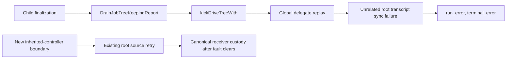

# Notification replay round 2: CI fixtures and exposed runtime defects

Starting commit: `d8a1d9604bca5faf083ccccd0d5cb9a02bbfe437`.
Branch: `replay-round2-ci-fixtures`.

The original failures were not both fixture-only. Initializing the attention fixture exposed a shared-controller replay ownership defect. Preserving the watch oracle's actual safety guarantees exposed a second production defect: replacement orphaned an already-produced addressed frame.

## Delivered corrections

- `agent/delegate_delivery.go:1177`, `replayDelegateDeliveries`: an inherited executor leaves the shared global inventory to the existing root runtime. Root replay still walks the full inventory and returns its errors. If there is no root runtime, or the runtime is the caller itself, the existing replay/retry path remains active. No inventory filtering, new queue, swallowed root error, or retry implementation change.
- `agent/session_attention_test.go:2964`: replace the executing bare root fixture with a fully restored root. Retain exact source-error, source-head, other-owner custody and journal-acknowledgement assertions. Add actual automatic child request, exact presented message, successful-response receipt and completed/reported generation assertions. Keep the root filesystem fault held while these succeed. Clear only that filesystem fault, advance the existing fake-clock retry, and require the original source's exact canonical ID and receiver wake.
- `agent/session_attention_test.go:3126–3216`: missing-root-runtime replay retains its exact unavailable-receiver error and paced retry; root bootstrap rejects another owner's wrong-identity transcript without acknowledgement; inherited restore rejects both malformed and wrong-identity own transcripts before model execution or transcript mutation.
- `agent/job_watch.go:887`, `configureWatch` replacement: use `detachWatchConfigSnapshotLocked(targets[0])` after the existing replacement batch commits. This is the same lifecycle used by Clear: close production triggers, remove the live registration, retain still-owed source state in `terminalFlush`, permit transport retry, and remove the retained config when settled. Atomic append and failure rollback are unchanged.
- `agent/watch_seqfuzz_test.go:651`: check durable registration ends and independent journal pending debt, not disjoint map membership. Added causal oracle controls, real receiver retry, replacement/Clear controls for callback and addressed frames, Stop-request-versus-terminal controls, canonical custody, exact model presentation and response receipts.

`agent/session_init.go` is unchanged from the starting commit. The provisional fresh-constructor guard did not fix the reproduced cold restore and was reverted. The later provisional cold-only guard allowed a request but not successful generation finalization; it too was reverted in favor of the shared replay-entrypoint boundary.

## Attention failure and full replay caller map

The original fixture constructed `&Session{...}` and then exercised automatic cold reconstruction, which requires initialized `subagents`. Normal and race runs panicked in `subagentManager.beginReconstruction` at `subagent_manager.go:84`.

After initializing the root, durable delivery reached the healthy nested owner, but child construction failed on an unrelated root writer failure. After the provisional cold-restore-only guard, the child made its request and recorded its receipt, but finalization still classified the generation as `failed/run_error`, `terminal_error`. The final regression requires successful settlement, not just a request.

All production calls to `replayDelegateDeliveries`:

| Caller | Ownership and original behavior |
| --- | --- |
| `session_init.go:642`, `NewSession` | Root or inherited child, returned replay errors |
| `session_init.go:1480`, `RestoreSessionFromMetaWithConfig` | Root or inherited child, returned errors and refreshed replayed transcript entries |
| `session_model_call.go:176`, `prepareModelRequestWithError` | Root or inherited child, already warned on global replay errors and continued to authoritative local history/writer checks |
| `session_jobtree_drain.go:1498`, `kickDriveTreeWith` | Root or inherited child, recursive kick returned the global error |
| `delegate_delivery.go:1074`, paced retry callback | `scheduleDelegateDeliveryRetry` routes this timer to `controller.rootRuntime`, falling back to the calling session only when absent, retry failure emits a warning |

`bootstrapDelegateResources` already separates inherited controllers (`delegate_runtime.go:3233`) from root-owned bootstrap/global recovery (`:3246–3317`). The new boundary reuses that ownership split at the common replay entrypoint. It skips only with an actual distinct root runtime; the missing-root control proves that absence cannot silently suppress the only pump.



The error propagated from `kickDriveTreeWith:1498` through `drainJobTreeWith:1045–1046`, `subagents.go:1990–1992`, and `stableDelegateFinishFromRun:2250–2258`. The common inherited-controller boundary removes that cross-owner error dependency from child construction, request preparation and finalization. Direct mutation-plan execution still transfers custody and schedules the existing root retry when a receiver fails.

The earlier rationale that `restorePendingNotifications` validates an inherited child's transcript was incorrect. It is root-only. Actual malformed/identity refusal is the preconstruction `OpenWriterForSession` boundary near `session_init.go:990`; the new controls invoke `RestoreSessionFromMetaWithConfig` and prove refusal there. Bootstrap refresh, own transcript opening/identity checks, all later mutation-recovery refreshes, root global replay and root errors remain unchanged.

### Replay review corrections over `3139553`

The first replay review found that the recovery-wake assertion could consume the healthy child's earlier completion edge. The corrected test joins the child and root senders, drains that edge while the root filesystem fault remains active, then clears only the fault and advances the existing automatic retry. It keeps the original callback installed and requires a new wake alongside exact recovered canonical custody. Source debt, journal acknowledgements, actual request, response receipt and completed/reported generation checks remain intact.

A temporary control called the existing `root.SetNotifyFunc(nil)` only after draining the old edge. Custody still recovered, but the test failed specifically at `automatic root retry did not wake recovered receiver` (exit 1). The control was removed before final verification. Log: `review-replay-disabled-wake-red.log`.

Three new error-prose assertions were replaced. The test filesystem now returns one per-instance sync-failure sentinel, checked with `errors.Is`. Inherited own-header failures require `transcript.SessionIDMismatchError` with both exact session IDs or `json.SyntaxError` at the malformed input's exact byte offset; unchanged transcript, retained source debt and zero model requests remain required. Global bootstrap uses an untyped identity error, so its control now repairs only the wrong owner's header and repeats the same restore configuration: the invalid header must refuse before construction with no delivery acknowledgement, while the corrected header must reach the existing `builtin_agents` construction seam and return its exact sentinel once. No production error type or runtime behavior was added. A first attempted typed global assertion failed because bootstrap's evidence fold does not return `transcript.SessionIDMismatchError`; that assertion was replaced with this differential boundary control.

## Watch failure, old/new invariant, and causal controls

Old O2 required the live and `terminalFlush` watch-ID sets to be disjoint. This was false for an active callback whose produced durable frame had not reached receiver custody: `produceCallbackNotifications` deliberately retains that config in `terminalFlush`. The original standalone harness had no receiver capable of accepting that frame. Seed 37 reproduced this after the exact create-plus-tick sequence, and seed 1 rediscovered it after eight iterations.

New O2 preserves the old safety properties and adds independent no-loss accounting:

1. Every config has a nonempty ID and generation; neither set contains duplicate IDs.
2. A durable ended registration or explicitly cleared watch cannot be live.
3. Live/flush overlap must be the same config and generation with actual durable pending source debt. Pointer equality alone does not pass.
4. Every in-memory pending frame matches its durable key, delivery ID and update sequence.
5. Every pending journal frame must remain reachable in one of the source maps until custody. Deleting it from both maps fails even if those maps agree.

The six direct oracle controls distinguish valid active-plus-pending and detached-plus-pending states from lost pending debt, retired-plus-live, different-config overlap, and pointer-only overlap without owed work. The original operation generator, tick selection, seed bank, delivery-budget checks, pure event-delivery oracle, terminal cleanup and monotone counters remain in place. No seed, assertion or timeout was skipped or relaxed.

This independent pending-journal check exposed seed 121 (discovered during seed 1's bounded replay). Its minimized production sequence is: configure an addressed periodic watch, fail receiver transcript sync for its produced frame, then replace that watch with an output-match watch. The journal retains the old addressed frame, but the original replacement block removed its only live-map entry without retaining it in `terminalFlush`. Existing automatic retry found no config: one journal frame stayed owed and the receiver had zero canonical records.

The one-line lifecycle-helper replacement fixes that loss. Deterministic controls cover replacement and Clear with both callback and addressed pending frames. They require automatic transport retry, exact canonical ID, one request occurrence, one successful-response receipt, and removal of the settled historical config. The Stop controls assert the distinct lifecycle: requesting concrete-job Stop does not prematurely retire its watch; the simulated shell's actual cancellation terminal edge does. `TestWatchSeqFuzz_ActivePendingCallbackRetriesAutomatically` also proves that the valid active-plus-pending overlap settles automatically and leaves its registration active.

These tests advance the existing paced retry, not a manual replay, enqueue, or rescue. Their explicit notification processing occurs only after automatic custody and its real receiver wake, to check actual request presentation and observation separately from transport.

### Watch review corrections over `3139553`

All six direct oracle controls now specify their own journal pending map and expected error boolean, not error prose. The pointer-only overlap case has an empty durable map, so a missing overlap check cannot be masked by the independent lost-debt check. Temporarily removing only the overlap-validation block made the different-config and pointer-only cases fail with `custody error=<nil>, want error=true`; the other four controls passed (exit 1 overall). The block was restored before final verification. Log: `review-watch-removed-overlap-red.log`.

The three new instance-local top-level watch tests now call `t.Parallel()`. The sequence generator and production invariants are unchanged. Both production files remain frozen during these test-only review corrections.

No product-contract amendment is needed. `docs/job-control.md:141–145` separates custody, successful-response observation and generation settlement; `:799–820`, especially `:812`, requires already-produced frames to survive clear/replacement. `docs/product/subsystems.md`, S12, assigns paced FIFO retry to the source journal until receiver custody and requires healthy receivers to remain usable during another receiver's storage failure.

## RED evidence

All logs are under `/tmp/evener-scratch-034jtJhKy8d46cjj7htOQv/034lxFAXq5h2TBuAMLnG7v/`.

| Log | Observed result |
| --- | --- |
| `red-attention-normal.log`, `red-attention-race.log` | Original executing bare-root fixture panics at `subagent_manager.go:84` |
| `red-watch-seed37.log`, `red-watch-seed1.log` | Original live-and-terminalFlush oracle fails on the reported sequence |
| `green-attention-focused.log` | Exploratory name only: initialized fixture is RED, unrelated owner cannot launch because cold restore returns another receiver's closed-writer replay error |
| `red-child-finalization-global-replay.log` | With provisional cold-only guard, actual request/receipt succeeds but generation finishes failed/run_error and terminal_error |
| `green-watch-normal-seeds.log` | Exploratory name only: corrected safety oracle is RED, bounded seed 1 discovers seed 121 pending-source loss |
| `constructor-and-watch-check.log` | Minimized watch RED with real receiver and retry owner: one frame remains owed after automatic retry, zero canonical custody records. Also contains the exploratory overstrong total-root-entry assertion later corrected to count the exact source ID |

An early watch recovery fixture used a blocking wake recorder, which wedged teardown. `watch-focused.log` retains its SIGQUIT diagnostic. It was corrected to a nonblocking coalesced wake recorder before the final checks. Early one-shot root faults and writer replacement attempts did not hold the intended failure; the final attention fixture closes the original writer before installing its filesystem and holds the fault across internal health retries. These exploratory failures are not reported as successful verification.

## Verification environment and commands

Read `docs/developing-evener/testing.md`, relevant notification/watch product contracts, initialized session fixtures, `make/fuzzing.mk`, and `scripts/fuzz/rapid-replay.sh` before running the corresponding checks. The replay script's bank is `1 2 3 5 8`, with 100 rapid checks and 30 configured steps. Its actual command uses the `evenerfuzz` build tag. The additional `37` is the CI reproduction; `121` is the newly exposed replacement-loss reproduction. `FuzzWatchAttachTerminalProgram` registers exactly four native seed inputs: empty, `[0]`, `[1,2,3]`, and `[255,1,254,2]`; each runs all four attach/terminal routines.

Common environment:

```sh
GO=/home/jesse/go/pkg/mod/golang.org/toolchain@v0.0.1-go1.27.0.linux-amd64/bin/go
GOTOOLCHAIN=local GOPROXY=off GOSUMDB=off GOMAXPROCS=2 GOFLAGS=-p=2
TMPDIR=/tmp/evener-scratch-034jtJhKy8d46cjj7htOQv/034lxFAXq5h2TBuAMLnG7v
GOCACHE=/tmp/evener-scratch-034jtJhKy8d46cjj7htOQv/034jtJhKy8d46cjj7htOQv/replay-integration-go-cache
EVENER_E2E=0 EVENER_LIVE_TESTS=0
```

Commands (run both with and without `-race`):

```sh
"$GO" test ./agent [-race] -run '^Test(DelegateAttention|RootDelegateAttention|StableDelegateAttention)_' -count=1 -v
"$GO" test ./agent -tags evenerfuzz [-race] -run '^TestWatchSeqFuzz_|^FuzzWatchAttachTerminalProgram$' -count=1 -v
# Each seed in 1 2 3 5 8 37 121:
env -u RAPID_FAILFILE EVENER_FUZZ_TESTS=1 RAPID_SEED="$seed" RAPID_CHECKS=100 RAPID_STEPS=30 RAPID_NOFAILFILE=true RAPID_LOG=false RAPID_V=false RAPID_DEBUG=false RAPID_DEBUGVIS=false RAPID_SHRINKTIME=30s \
  "$GO" test ./agent -tags evenerfuzz [-race] -run '^TestWatchSeqFuzz$' -count=1 -v
PATH="${GO%/go}:$PATH" /home/jesse/go/bin/golangci-lint run --new-from-rev=d8a1d9604bca5faf083ccccd0d5cb9a02bbfe437 ./agent
git diff --check
```

Attention normal and race completed successfully: 88 top-level tests in each run, including the new same-owner/root/fallback controls and successful cross-owner generation plus automatic root-source recovery. Logs: `green-attention-normal.log`, `green-attention-race.log`.

Existing attention fixtures still emit unasserted missing-transcript/automatic-wake warnings in `TestDelegateAttention_PrelaunchRecoveryDoesNotWaitForUnlaunchedRunner`, `TestDelegateAttention_FailedTerminalDeliveryRetriesFromRootPump`, and `TestDelegateAttention_DeliveryDuringProcessingTakesCustodyAndArmsWake`, plus `target_busy` warnings. These were not suppressed or treated as assertions. The final modified cross-owner test proves the requested success structurally; the full logs remain evidence for the other fixtures' warnings.

### Final checked results

| Check | Result and retained log |
| --- | --- |
| Attention normal | PASS, 88 top-level tests, package `ok ... 9.348s`, `green-attention-normal.log` |
| Attention race | PASS, 88 top-level tests, package `ok ... 8.346s`, `green-attention-race.log` |
| Watch deterministic controls and native neighbor seeds, normal | PASS, three watch test groups and all four native seed cases, package `ok ... 3.179s`, `green-watch-controls-normal.log` |
| Same controls and native neighbor seeds, race | PASS, package `ok ... 5.693s`, `green-watch-controls-race.log` |
| Tagged rapid seeds `1,2,3,5,8,37,121`, normal | All seven runs PASS with 100 iterations each, `green-watch-normal-seed{seed}.log` |
| Same seven rapid seeds, race | All seven runs PASS with 100 iterations each, `green-watch-race-seed{seed}.log` |
| Configured changed-line lint | Exit 0, `0 issues.`, `changed-files-lint.log` |
| Gofmt and diff checks | No unformatted owned Go files, `git diff --check` and staged diff checks clean |

There were 1,400 bounded rapid iterations across the fourteen normal/race seed runs. The runner's check and step settings were not reduced. No continuous fuzz search ran.

Raw final attention normal/race/lint output: `job:job_034lxFAXq5h2TBuAMLnG7v_CKdfTz6c9CAI` (exit 0). Raw final watch normal/race controls and all fourteen seed runs: `job:job_034lxFAXq5h2TBuAMLnG7v_RUHFgf9JvZI6` (exit 0). The foreground stronger settled-generation RED invocation/result is in `local:034lxFAXq5h2TBuAMLnG7v`, transcript turns `386–387`, as well as `red-child-finalization-global-replay.log`.

### Review-correction verification

These checks reran after both temporary causal controls were removed. They supersede the earlier results for the changed test oracles, not the closed production review.

| Check | Result and retained log |
| --- | --- |
| Replay focused controls | PASS, `review-replay-focused-green.log` |
| Full attention normal | PASS, 88 top-level tests, `ok ... 9.197s`, `review-attention-normal.log` |
| Full attention race | PASS, 88 top-level tests, `ok ... 13.944s`, `review-attention-race.log` |
| Three parallel watch groups and four native seeds, normal | PASS, `ok ... 3.995s`, `review-watch-controls-normal.log` |
| Same watch groups and native seeds, race | PASS, `ok ... 7.368s`, `review-watch-controls-race.log` |
| Seven rapid seeds normal and race | All fourteen runs PASS, 100 iterations each, `review-watch-{normal,race}-seed{1,2,3,5,8,37,121}.log` |
| Configured changed-line lint | Exit 0, `0 issues.`, `review-changed-files-lint.log` |

Raw normal/race attention and watch controls: `job:job_034lxFAXq5h2TBuAMLnG7v_9FmVUBp05kXI` (exit 0). Raw fourteen bounded rapid runs: `job:job_034lxFAXq5h2TBuAMLnG7v_pLAKHxWflgWu` (exit 0). The test commands and environment are the same as above; the control/native command's exact pattern was `^(TestWatchSeqFuzz_(CustodyInvariant|ActivePendingCallbackRetriesAutomatically|RetirementRetainsPendingSource)|FuzzWatchAttachTerminalProgram)$`. There were another 1,400 bounded rapid iterations, with no new campaign, skipped seed, timeout increase or live provider traffic. Gofmt and diff checks were clean. Only `agent/session_attention_test.go`, `agent/watch_seqfuzz_test.go` and this report changed over `3139553`; `agent/delegate_delivery.go`, `agent/job_watch.go` and `agent/session_init.go` were verified unchanged. Existing broader-fixture warning limits above still apply.

### Commits and handoff

1. `641c45d86af01f02ab70b9cc064857459fd32e7a`, `fix(agent): keep shared delegate replay on its root pump`: only `agent/delegate_delivery.go` and `agent/session_attention_test.go`. Normal commit with configured hooks enabled. Those paths were explicitly relinquished to the parent immediately after this commit. The parent later reopened only the test file for the review corrections above; production remains frozen.
2. The subsequent `fix(agent): retain replaced watch sources until custody` commit contains only `agent/job_watch.go`, `agent/watch_seqfuzz_test.go`, and this report. Its exact resulting hash is supplied in the final parent handoff, since a committed file cannot name its own commit hash.
3. The test-only review correction is a new child commit over `3139553dcfd031480c990e2be870695eaa9176e4`, with configured hooks enabled. Its exact hash is supplied in the parent handoff. Both test paths and the report are relinquished after that commit; production remains frozen.

The missing-root-runtime control proves unavailable-receiver error identity, retained source debt, and the child's fallback retry owner. It does not claim eventual recovery without any receiver runtime. Actual automatic recovery after fault repair is proved with the initialized root. Watch controls use real journals, receiver transcripts, model-request construction and successful-response receipts with deterministic provider fixtures; their shell terminal edge is simulated, not a launched OS process.

No full suite, browser build, live provider/E2E, dependency/network operation, main merge, deploy, release, push, amend or rebase was performed. The shared Go cache was used and not deleted. Retained scratch logs are the evidence named above, including clearly identified exploratory failures. Generated test/build scratch is removed before the final handoff; the session lock is left alone.
