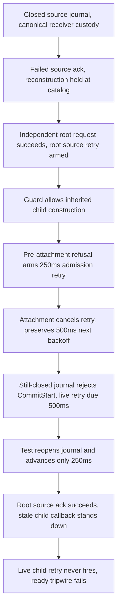

# Integrated source acknowledgment diagnosis

The timeout is a fixture ordering/backoff mismatch exposed by successful child reconstruction, not a missing source acknowledgment. The root acknowledges the exact source at +250ms, but the test freezes virtual time before the current resident receiver retry at +500ms. A fixture-only boundary reorder passes with the unchanged 250ms horizon and all original assertions. Production, including the inherited replay guard, is unchanged.

## Scope and baseline

Exact base: `6d0bf4fecc65aa6a24035d3d4088d535e14aa8d9`. Initial scope was temporary diagnostics in `agent/notification_producers_test.go` and this report, with production read-only and no commits. After causal proof, the parent granted the test-only correction and commit, conditional on positive race and negative-control results. It separately granted one temporary production predicate mutation, restored immediately after that control. No production change is deliverable.

Read `docs/developing-evener/testing.md` (deterministic boundary and timeout rules), `docs/product/README.md`, `docs/product/subsystems.md`, and `docs/subagent-runtime-contracts.md` (receiver custody, root/shared transport inventory, addressed admission). The contract requires paced source retry without another input, and receiver custody is not observation.

Unmodified focused reproduction exited 1:

```text
=== RUN   TestCommittedSourceAckRetryDoesNotHoldColdRestore
    notification_producers_test.go:1250: async boundary did not complete
--- FAIL: TestCommittedSourceAckRetryDoesNotHoldColdRestore (40.28s)
FAIL
FAIL primeradiant.com/evener/agent 40.326s
```

Evidence: `job:job_034lzSiaBW1XquuUCLWsb6_xcM2QjAU5R1r`; log `$EVENER_SCRATCH_DIR/source-ack-baseline.log`.

Invocation (all focused runs use these environment settings):

```bash
while IFS= read -r name; do unset "$name"; done < <(compgen -e | grep -E '^EVENER.*(LIVE|E2E)|^EVENER_(SHARD_RUN_FILE|TEST_RUN_FILE)$' || true)
export GOTOOLCHAIN=local GOPROXY=off GOSUMDB=off GOMAXPROCS=2 GOFLAGS=-p=2 TMPDIR="$EVENER_SCRATCH_DIR" GOCACHE=/tmp/evener-scratch-034jtJhKy8d46cjj7htOQv/034jtJhKy8d46cjj7htOQv/replay-integration-go-cache
/home/jesse/go/pkg/mod/golang.org/toolchain@v0.0.1-go1.27.0.linux-amd64/bin/go test ./agent -run '^TestCommittedSourceAckRetryDoesNotHoldColdRestore$' -count=1 -v
```

## Hypotheses recorded before test changes

1. **Fixture bypasses source retry ownership.** The test directly invokes `deliverColdDelegatePacket` at line 1199. The producer entry `Session.executeDelegateMutationPlans` invokes that helper and, after any delivery error, calls `scheduleDelegateDeliveryRetry` at `agent/delegate_delivery.go:1025–1027`. The helper itself does not schedule source retry. Prior child reconstruction called global replay at `agent/session_init.go:1480`, potentially accidentally arming the root retry while the source store was closed. The new guard at `delegate_delivery.go:1181–1191` correctly suppresses that inherited replay. Check source/receiver retry states before reopening and whether a child is now resident despite failed generation commit. Then replace only the direct fixture call with the real producer entry and retain every assertion.
2. **Real missing root rearm/wake despite production entry.** If the real producer entry still fails, trace source replay and addressed receiver state after the armed timer, without removing the guard or introducing manual rescue.
3. **Single Advance races registration or uses wrong backoff.** Inspect exact retry state and fake-clock callback count before Advance. `FakeClock.AfterFunc` registers synchronously, but `Advance` dispatches callbacks asynchronously. Joining the direct delivery goroutine joins its deferred synchronous cold restore/wake attempt. This can distinguish no timer from a late registration; do not add sleeps, polls or deadlines.

## Exact prior comparison

The complete failing test function is byte-for-byte identical in `b738e71087` and this base. Comparing `agent/delegate_delivery.go` between those refs shows only the inherited-executor guard at the start of `replayDelegateDeliveries`; no source timer/backoff code changed in that file. Earlier accepted behavior is not under review.

## Diagnostic 1: absent source timer is disproved

Temporary read-only state logging before reopening found:

```text
diagnostic source retry={active:true delay:250000000 generation:4} pumping=false receiver retry={active:false delay:0 generation:0} resident=true bound=false callbacks=4
notification_producers_test.go:1263: async boundary did not complete
--- FAIL: TestCommittedSourceAckRetryDoesNotHoldColdRestore (40.65s)
FAIL primeradiant.com/evener/agent 40.787s
```

Evidence: `job:job_034lzSiaBW1XquuUCLWsb6_EpO8IMUIVrNg`, `$EVENER_SCRATCH_DIR/source-ack-state.log`. The root source retry is already armed, so a claim that the helper bypass alone leaves no root timer is false. The integrated guard allows the receiver runtime to become resident before source storage recovers. Its controller-level cold-restore retry is not active; resident scheduling must be traced separately. Removed these diagnostic lines before the next causal variant.

Diagnostic 2 tests only replacing the helper call with `s.executeDelegateMutationPlans(delegateMutationPlans{deliveries: plans})`, retaining the original fake-clock advance and all assertions. This distinguishes producer entry behavior from the fixture helper without changing production.

## Diagnostic 2: production producer entry also fails

The one-line production-entry substitution exited 1 at the same original line 1250 after 40.21s (`FAIL primeradiant.com/evener/agent 40.232s`). Evidence: `job:job_034lzSiaBW1XquuUCLWsb6_fJim4BlkNt5q`, `$EVENER_SCRATCH_DIR/source-ack-producer-entry.log`. Thus changing only the helper call is not a sufficient correction. Restored the original helper call before further diagnosis.

Production has exactly one non-test caller of `deliverColdDelegatePacket`: `executeDelegateMutationPlans` at `delegate_delivery.go:1015`. Actual communicate publication calls this entry at `session_tools_communicate.go:325`, after `PostUpdate`. This confirms production source failure scheduling exists, but does not yet prove its later wake is sufficient.

Diagnostic 3 uses a transparent wrapper around the existing fake clock's `AfterFunc` to log registration time/delay/caller and callback start/end. It delegates unchanged to `FakeClock.AfterFunc`. It also logs child warning events and a post-await source/receiver state snapshot, with no extra timer, advancement, sleep, polling or rescue.

## Diagnostic 3: source acknowledgment completes, receiver backoff remains due

At unchanged virtual time `1970-01-01T00:16:40Z`, registrations are:

1. `delegate_delivery.go:1065`: 250ms source retry.
2. `session_notifications.go:166`: 250ms receiver retry.
3. `session_notifications.go:166`: 500ms receiver retry.

The test advances only 250ms. Both due 250ms callbacks start and finish. After the unchanged 10s async tripwire, before cleanup completes:

```text
source retry={active:false delay:250000000 generation:6} pumping=false
pending source=0 receiver retry={active:false delay:0 generation:0}
child schedule={version:3 hinted:false running:false paused:false pauseWarned:false retry:{active:true delay:1000000000 generation:3} admissionBlocked:false nameBlocked:false releaseTurnID:}
```

The source is acknowledged successfully. The child's generation-3 retry remains armed at +500ms, with next backoff 1s. The +250ms receiver callback was superseded before `Advance`; it did not own current recovery. This rules out an unregistered source timer or source acknowledgment failing to replay. At this diagnostic stage no correction had been chosen. The original failing test's approximately 40s duration includes cleanup after the 10s async tripwire at `notification_inline_delivery_test.go:93`.

Evidence: `job:job_034lzSiaBW1XquuUCLWsb6_qHBEB50M7jCU`, `$EVENER_SCRATCH_DIR/source-ack-timer-trace.log`; focused test still exited 1 (40.33s, package 40.368s). Cleanup emitted child close-budget warnings after the timeout, not before it. The next diagnostic identifies the cancellation path.

## Diagnostic 4: exact cancellation and changed ordering

Registration stacks (`job:job_034lzSiaBW1XquuUCLWsb6_iZD52HCTgAf9`, `$EVENER_SCRATCH_DIR/source-ack-registration-stacks.log`) show:

- The root source timer comes from the independent root's real `ProcessInputKind` → `prepareModelRequestWithError` → `replayDelegateDeliveries` → `executeDelegateMutationPlans` failure. Thus the original direct helper did not prevent the root timer from existing.
- The first child timer is `restoreIdle` → `installDelegateNotify` → `SetNotifyFunc` → `dispatchNotificationWake` → `driveStableDelegateAttention:843` → `deferNotificationAdmission` → `scheduleNotificationRetry` (250ms). At this point the child is not yet attached, so `ReserveAttention` refuses admission.
- After attachment, `requestSessionWake:562` calls `releaseNotificationAdmission`. At `session_notifications.go:70–74` this cancels the admission-blocked timer by increasing its generation and clearing active, without resetting its already-doubled backoff.
- The immediate re-drive now reaches `CommitStart`, which fails against the still-closed shared journal. `delegate_runtime.go:854` arms the next resident retry (500ms, generation 3).
- All registrations finish before the delivery goroutine returns. There is no timer-registration race with the single `Advance`.
- With the older blob, child restore instead reached global replay and failed while acknowledging that journal, retaining a controller-level cold-restore retry. The guard intentionally removes this unrelated/shared replay failure from construction. The identical fixture therefore reaches a different, valid resident retry path.

The stack-trace run exited 1 after 40.32s (package 40.353s), with the same successful source ack / live future resident retry state. No permanent correction or production edit had been made at that point.

## Proposed minimal change before correction

Do not remove or weaken the inherited replay guard. Do not increase a real deadline or the fake-clock horizon. In this fixture, prove canonical receiver custody plus exact pending source debt while child reconstruction is held at the provider boundary, then reopen the shared journal **before** releasing that boundary. The first source ack has already failed before deferred reconstruction enters the boundary, so its exact source-only debt remains real. This avoids deliberately forcing an additional, unrelated generation-commit storage failure after successful reconstruction. Retain the single initial-delay clock advance and every final source-ID/canonical-count/request/receipt/generation/source-ack assertion. Producer-entry substitution is nonessential and not part of the correction: the original independent root request already exercises real source retry scheduling, and the earlier substitution diagnostic did not fix the failure.

This proposal was reported before correction. The next temporary causal variant moved only the existing custody/source-debt check and journal reopening ahead of `unblockListing`, after removing transparent tracing. Positive checks and the granted negative control below qualified that variant for permanent correction.

## Diagnostic 5: timing-neutral boundary reorder is GREEN normally

The only test diff moves this unchanged block from original lines 1227–1232 to after journal reopening (original line 1248):

```go
unblockListing()
deliveryErr := <-delivered
joinedDelivery = true
if deliveryErr == nil {
    t.Fatal("closed source acknowledged the canonical receiver write")
}
```

Before repair, while reconstruction is held, it still asserts exactly one canonical attention entry, the exact pending source `deliveryID`, and permission from `idleDelegateRestoreCommit`. The real failed acknowledgment error is retained until the delivery goroutine returns, not fabricated. The independent root request has already finished but cannot silently satisfy source debt: its shared store is still closed, and the pending exact source is checked after that request and before repair.

After repair/release it retains the original initial-delay `Advance`, real child request containing `seed`, generation and bound generation exactly 1, initialized runtime managers, zero observation receipts while the request is blocked, one successful-response receipt after release, no pending notifications, one canonical attention body, no pending source delivery, and exactly one durable source acknowledgment.

```text
=== RUN   TestCommittedSourceAckRetryDoesNotHoldColdRestore
--- PASS: TestCommittedSourceAckRetryDoesNotHoldColdRestore (0.26s)
PASS
ok primeradiant.com/evener/agent 0.283s
```

Evidence: `job:job_034lzSiaBW1XquuUCLWsb6_f7I8bHvvimKK`, `$EVENER_SCRATCH_DIR/source-ack-recovery-boundary.log`. Race ×3 then passed with the same selector and environment plus `-race -count=3`: test durations 1.08s, 0.45s, 0.44s; package `ok primeradiant.com/evener/agent 3.056s`. Evidence: `job:job_034lzSiaBW1XquuUCLWsb6_RjLYZSYJriZ2`, `$EVENER_SCRATCH_DIR/source-ack-recovery-boundary-race.log`.



The proposed test reopens the shared journal between C and D, after proving the source-only obligation and before releasing the held reconstruction. That isolates the test's source-custody guarantee from an additional generation-commit fault. It does not change the retry implementation or increase its deadline.

## Compiled negative control is RED, exact production restored

After positive race completion, the parent granted exactly one temporary production mutation: remove `!receipt.receiverCommitted &&` from `hasDeliveryWorkForOwnerLocked` at `agent/delegate_delivery.go:808`. That reinstates a real committed-source admission fence from before accepted commit `0d5ce6e153d`. The logged diff shows exactly that predicate change, and `go test` compiled the modified on-disk runtime, not an unused overlay. With the corrected fixture:

```text
=== RUN   TestCommittedSourceAckRetryDoesNotHoldColdRestore
    notification_producers_test.go:1207: async boundary did not complete
--- FAIL: TestCommittedSourceAckRetryDoesNotHoldColdRestore (10.17s)
FAIL
FAIL primeradiant.com/evener/agent 10.196s
```

Line 1207 waits for the held provider catalog boundary. Source-only debt now prevents cold reconstruction from entering that boundary, so the reordered fixture still rejects the original guarantee's regression. Evidence: `job:job_034lzSiaBW1XquuUCLWsb6_sxelj2uyjVxB`, `$EVENER_SCRATCH_DIR/source-ack-fence-negative.log`; same focused normal invocation as baseline.

Immediately after the RED control, before any other check, `git restore -- agent/delegate_delivery.go` restored exact production bytes. `git diff --exit-code 6d0bf4fecc65aa6a24035d3d4088d535e14aa8d9 -- agent/delegate_delivery.go` exited 0. Both `git hash-object agent/delegate_delivery.go` and `git rev-parse 6d0bf4fecc65aa6a24035d3d4088d535e14aa8d9:agent/delegate_delivery.go` printed `5b65463904817a799226157b619f4c038ba5d76b`. No mutation remains.

The permanent test-only correction keeps that proven block relocation and adds a concise comment explaining why journal repair precedes reconstruction release. It retains the direct helper, all original assertions and the one 250ms advance.

## Final verification after exact production restoration

Using the environment above, the final commands were:

```bash
GO=/home/jesse/go/pkg/mod/golang.org/toolchain@v0.0.1-go1.27.0.linux-amd64/bin/go
PATTERN='^(TestCommittedSourceAckRetryDoesNotHoldColdRestore|TestNotificationSourceAckFailureRetainsReceiverWake|TestNotificationColdSourceAckFailureRetainsReceiverRecovery|TestCanonicalDeliverySourceAckFailureRetriesWithoutDuplicate|TestNotificationColdRetryHandoff)$'
"$GO" test ./agent -run "$PATTERN" -count=3 -v 2>&1 | tee "$EVENER_SCRATCH_DIR/source-ack-final-normal.log"
"$GO" test -race ./agent -run "$PATTERN" -count=3 -v 2>&1 | tee "$EVENER_SCRATCH_DIR/source-ack-final-race.log"
PATH="$(dirname "$GO"):$PATH" /home/jesse/go/bin/golangci-lint run --new-from-rev=6d0bf4fecc65aa6a24035d3d4088d535e14aa8d9 --whole-files ./agent
```

- Normal: 15 top-level executions passed (five selected tests ×3), including the six `TestNotificationColdRetryHandoff` subcases each repetition. Package `ok primeradiant.com/evener/agent 5.707s`. The corrected test passed in 0.55s, 0.36s and 0.32s.
- Race: the same 15 top-level executions and handoff subcases passed, with no race report. Package `ok primeradiant.com/evener/agent 6.178s`. The corrected test passed in 0.93s, 0.26s and 0.28s.
- The combined job exited 0. All 38,421 output bytes were read, not only its tail. The two complete logs independently contain 15 top-level RUN and PASS lines each, with no FAIL or race-warning line. Evidence: `job:job_034lzSiaBW1XquuUCLWsb6_pQP36Ioa74Rx`.
- Configured changed-whole-file lint exited 0 and printed `0 issues.` Evidence: `job:job_034lzSiaBW1XquuUCLWsb6_aSROQcpWemHn`, `$EVENER_SCRATCH_DIR/source-ack-final-whole-file-lint.log`.
- `gofmt -l agent/notification_producers_test.go` printed nothing. `git diff --check` exited 0.

The neighboring controls emitted missing-transcript wake warnings for their synthetic child fixtures, including after PASS during cleanup. No selected test failed. Those fixtures were outside this correction's write scope and were not changed.

All `$EVENER_SCRATCH_DIR` log references in this report resolve to `/tmp/evener-scratch-034jtJhKy8d46cjj7htOQv/034lzSiaBW1XquuUCLWsb6`. The scratch directory was listed before handoff. It contains only the referenced diagnostic/verification logs and the preexisting `.evener-session.lock`; no unreferenced scratch was retained, and the shared Go cache was not removed.

Deliverables are this report and `agent/notification_producers_test.go` only. Production bytes, source retry ownership, deadlines and assertions are unchanged. No full suite, live/network test, dependency install, push, merge, deployment or release was performed. Earlier reviews and original 4841/4951 were not reopened or changed. Parent owns integration and its remaining gate, not this isolated correction.
