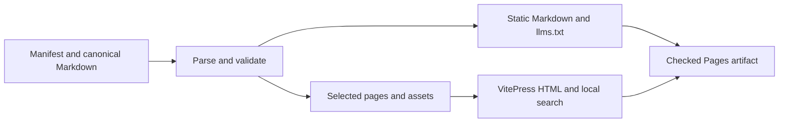

# Documentation site

Build the public guide from canonical repository Markdown. This package owns the
publisher, not the chapters. Edit sources in `docs/`, never `.generated/`.

## Build and preview

Use Node 22 or newer. Run from the repository root:

```sh
npm --prefix docs-site ci
(cd docs-site && npx playwright install chromium)
npm --prefix docs-site run check
npm --prefix docs-site run build
npm --prefix docs-site run preview -- --host 127.0.0.1 --port 4173
```

Open `http://127.0.0.1:4173/evener/`. The Pages artifact is
**`docs-site/.vitepress/dist/`**. It contains HTML, local-search data,
`markdown/` exports and `llms.txt`. No hosted search service is used.

For browser checks after building:

```sh
cd docs-site
npx playwright test
```

The check and build commands also run tests that launch Chromium, so install it
before either command. `DOCS_BROWSER_CHANNEL=chrome npx playwright test` selects
an installed Chrome for the browser suite only; it does not replace that prerequisite.

The browser suite starts and stops its own preview server. It checks mobile
width, navigation, keyboard focus, local search and the AppWire table.
It also builds an isolated two-page fixture with the production theme and checks
actual Mermaid SVG output on initial load, client navigation and browser back.
Fixture pages never enter the publication manifest or the Pages artifact.

## Publication manifest

`publication.json` is the sole page and asset inventory:

```json
{
  "pages": [
    {
      "source": "docs/index.md",
      "path": "index.md",
      "title": "Documentation",
      "group": "Get started"
    }
  ],
  "assets": ["docs/images/example.png"]
}
```

- `source`: canonical Markdown path relative to the repository root.
- `path`: unique staged Markdown path, with one `index.md` homepage.
- `title`: navigation and `llms.txt` label.
- `group`: sidebar section. Manifest order controls groups and pages.
- `assets`: explicit repository-relative files to publish under `assets/`.

Only listed pages enter the renderer and search. Linked source files and
unpublished documents stay in the repository, not the artifact. Do not add
plans, research, screenshots or mockups merely because a chapter links to them.

The manifest publishes the user guides and generated AppWire reference, with
`docs/index.md` as the homepage and the first-run guide on its own route. Update
the manifest when adding or removing a public chapter. The builder validates
structure and links; authors must keep product claims current.

## Link and export rules



The check parses Markdown and validates local targets before staging. Published
page links become `/evener/` HTML URLs. Markdown exports instead link to absolute
Markdown URLs on the same site. Links to existing unpublished documents and
source files resolve to GitHub on `main`; directories use GitHub tree URLs.

Relative links resolve from the canonical source, not its new site route.
Leading `/` means repository root in source Markdown. Spaces are URL-encoded.
Markdown fragments must match headings or explicit HTML IDs, including duplicate
headings. Code fences remain code. External HTTP, HTTPS, mail and telephone links
are preserved without network checks. Source-code fragments use GitHub `#L1` or `#L1-L3` syntax and must name existing lines.

Use ordinary Markdown and GFM tables. Each page needs one H1. Use Markdown links
and images instead of raw HTML attributes. Unsupported HTML/components fail the
check rather than leaking renderer code into exports. Plain HTML anchors and
small semantic tags are allowed. Exported content is complete, not a summary.

Mermaid fences render as SVG in the browser through Mermaid's strict-security
renderer. The renderer loads only when a page contains a Mermaid fence and runs
again after client-side navigation. Without JavaScript, the code fence remains
readable. Markdown exports retain the original fenced Mermaid source; they do
not contain Vue components or generated SVG.

`check` runs fixture tests, validates sources and regenerates staging and exports.
`build` also runs VitePress and checks actual HTML targets and fragments, asset
URLs, the `/evener/` base and exact page/export membership. The fixture tests cover
exclusions, nested paths, spaces, duplicate headings, code fences, images,
reference links and broken targets. No copy-length or wording rules masquerade
as comprehension tests.

## Publishing

`.github/workflows/docs.yml` builds and uploads this same checked artifact on PRs,
main pushes and manual dispatch. It explicitly installs Chromium and runs the
diagram, search and navigation browser checks before uploading. Only a main-branch push or main-branch manual
run can deploy. The deploy job alone receives Pages and OIDC write permissions.
Enable GitHub Pages with GitHub Actions separately; adding this workflow does not
enable Pages. The site is served at `https://primeradiant.com/evener/`: GitHub
Pages publishes under the organization's inherited domain, and
`https://prime-radiant-inc.github.io/evener/` redirects there. This repository
configures no separate CNAME or release-version switcher.

Generated absolute links (Markdown exports, `llms.txt`, absolute asset URLs)
name `https://primeradiant.com`, matching the host a reader lands on. Changing
the organization domain means changing `origin` in `scripts/prepare.mjs` with
it; the link checks only compare generated URLs against that constant, so a
stale value fails nothing by itself.

The site tracks `main`. Released binaries can lag the guide. Installation chapter
owners must explain snapshot versus release installation beside those commands.

Vite is overridden to the patched 6.4 series because VitePress 1.6.4's default Vite
5 dependency has known development-server advisories. Keep the lockfile and
browser/build checks current when updating either package. Bind local preview
servers to loopback, not a public interface.
