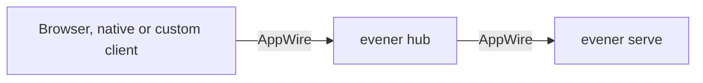

<!-- Code generated by "go generate ./appwire" (cmd: internal/appwiredoc); DO NOT EDIT. -->
<!-- Edit the prose in internal/appwiredoc/protocol.md.tmpl and the catalog in appwire/protocol.go, then run `go run ./internal/appwiredoc -out docs/appwire-protocol.md`. -->

# AppWire protocol reference

AppWire connects browser, native and custom clients to `evener hub`, which
routes session requests to `evener serve` daemons. Start with
[Integrations](integrations.md) for an authenticated client example. This page
owns the exact wire reference for main, not an independent compatibility promise.

This document is **generated** from the declarative catalog in
[`appwire/protocol.go`](../appwire/protocol.go) (`appwire.Methods` and
`appwire.Notifications`); a test cross-checks that catalog against the live
hub and daemon routers. To
change it, edit the catalog and/or the prose template
(`internal/appwiredoc/protocol.md.tmpl`) and run
`go run ./internal/appwiredoc -out docs/appwire-protocol.md` from the repository root.

## Transport

- **Endpoint.** A single WebSocket at `/rpc`. The browser uses `wss:`/`ws:` to
  match the page; hub→daemon dials the daemon's rendezvous endpoint.
- **Authentication.** The hub authenticates the HTTP upgrade with its cookie
  or bearer token before AppWire initialization. Initialization is not login.
  Keep remote traffic on TLS or a trusted private transport.
- **Framing.** Each WebSocket text message is one JSON object. Three shapes:
  - **Request** — `{"id": <number>, "method": <string>, "params": <object>}`.
  - **Response** — `{"id": <same id>, "result": <object>}` or
    `{"id": <same id>, "error": {"code", "message", "data"}}`.
  - **Notification** — `{"method": <string>, "params": <object>}` with no `id`
    (server-pushed; see the catalog below).
  These are schematic shapes, not literal JSON examples. There is no
  `jsonrpc` field. Do not assume JSON-RPC batch or cancellation conventions.
- **Read limit.** 128 MiB per message (large image inputs and transcript
  replays ride the same socket).
- **Write timeout.** Each server→client write is bounded (30 s); a stuck write
  tears the connection down rather than blocking the send loop.
- **Keepalive.** WebSocket has no application-level liveness on its own and
  `coder/websocket` does not auto-ping, so a silently-dropped TCP connection
  (sleep/wake, NAT rebind, proxy idle timeout) would otherwise leave both ends
  believing the socket is open. Every hop therefore pings:
  - **Server side** (`internal/appserver`) pings the peer every 15 s and tears
    the connection down if no pong arrives within 10 s. This covers both server
    roles — hub-for-browser and daemon-for-hub. While request intake prevents
    the receive loop from reading, the server skips new pings and disregards
    a missing pong for an attempt that overlapped that pause. It lets an active
    ping finish within its existing deadline: canceling a control-frame write
    can close a healthy socket and cancel its pending requests. Heartbeats
    resume automatically when the reader is available; real disconnects still
    cancel connection-owned work.
  - **Go client side** (`appwire.Client`, used hub→daemon) runs the same ping
    loop via the optional `Pinger` transport capability.
  - **Browsers** can't send WebSocket ping frames from JS, so the web client
    sends an application-level `ping` request every 20 s with a 10 s timeout
    and force-closes the socket if it goes unanswered, which drives the normal
    reconnect path.
  These checks detect silent peers; they are not a universal 30-second
  completion deadline, particularly while request intake pauses the reader.

## Connection lifecycle

1. **initialize.** The client's first request must be `initialize` (any other
   request before it is rejected). The response carries the server's feature
   set. The protocol version must match exactly. After success, the client sends
   the `initialized` notification. Align client and server versions on mismatch.
2. **Requests.** The client issues request/response calls from the catalog.
3. **Subscriptions.** `thread/read` with `subscribe: true` registers the
   connection for that thread's notifications; `replaceSubscription: true`
   swaps any prior subscription. The response also hydrates current state.
4. **Notifications.** While subscribed, the server pushes the notifications in
   the catalog below (turn/item lifecycle, deltas, queue and status changes,
   jobs, warnings).
5. **Reconnect + resynchronize.** On a dropped socket, authenticate and
   initialize again, restore subscriptions, then hydrate from authoritative
   snapshots. A replacing subscription is appropriate only when the caller owns
   the connection's subscription set. Recorded history repairs the view, but
   transient events are not guaranteed to replay without loss. Fence results
   from the old connection generation instead of merging them into new state.

A successful `turn/start` response acknowledges a turn and mutation receipt,
not completion. Follow turn notifications and reads for `completed`, `failed`
or `interrupted`. Partial text is not a final result. A client request timeout
does not cancel server work or prove that a mutation was never accepted.
Use the catalog's explicit control methods, then inspect the resulting state.

Keep public routing refs opaque. Retry-safe mutations carry `clientMutationId`
and `expectedInstanceId`; preserve the original intent and reconcile receipts
after uncertainty. A request ID alone provides no mutation deduplication.

## History content selection

`thread/read` and `thread/turns/list` accept `includeConversation`,
`includeThinking`, `includeToolCalls`, `includeToolCallIntents`,
`includeSystemMessages`, and `includeDiagnostics`. Each defaults to true.
Tool calls include arguments and results together; intents can be requested
without that payload. Selection applies before the public page count and byte
limits, and to the read's downstream subscription. Shared upstream feeds stay
complete. Cursors and opaque snapshot incarnations distinguish normalized
selections; changing selection requires a fresh latest read. Status, capability,
mutation and recovery metadata are always retained.
Metadata-only reads and mutation relay setup preserve an existing subscription's
history selection; an `includeTurns: true` read establishes or changes that view.

See [the history content contract](product/history-content.md) for item mapping,
intent representation, selected paging and reconnect behavior.

## Error model

Errors use JSON-RPC codes in `error.code` with a human `error.message`.
`error.data.evenerErrorInfo` carries a structured Evener-specific detail string
when present. Common cases: method-not-found, invalid-params (params failed to
unmarshal), invalid-request (e.g. a request before `initialize`). History reads
distinguish three conditions:

- **`transcriptIndexRebuilding`:** the server owns a background index repair.
  `data.retryDisposition` is `automatic`. Retry the read after a delay so the
  repair can commit.
- **`transcriptIndexLocked`:** a writer or foreign rebuild holds the index lock,
  with no server-owned repair in flight. `data.retryDisposition` is `automatic`.
  Retry the read after a delay rather than starting another repair.
- **`transcriptHistoryFailed`:** the history has failed, and the error identifies
  its last recorded entry. This is terminal, not an automatic-retry signal.
  Stop retrying and inspect the error and saved history with
  [Doctor](cli.md#doctor-session-selectors) before choosing a recovery action.

A retry-safe mutation arriving on a connection whose inbound request queue is
at high-water depth is refused in band as `connectionBackpressure` with
`data.cause "queueSaturated"`, `mutationOutcome "notAccepted"` and
`retryDisposition "automatic"`: the mutation was never queued and never
started, so an identical retry is safe. The message states what happened on
the hub and promises nothing about what a client will do.

## Explicit skill and command input

Input-bearing requests accept canonical selections alongside text and images:
`{"type":"skill","name":"pkg:review"}` and
`{"type":"command","name":"pkg:review"}` request different behavior even when
their names match. These items admit only `type` and `name`; bodies, paths,
arguments and other raw keys are rejected. The target's advertised `skillInput`
or `commandInput` capability authorizes that kind, never a client assumption.

Command selections resolve exact catalog identity at consumption and expand
once per canonical name with empty arguments under their source's existing
expansion rules. Original user text is retained separately from expanded bodies.
Generated output cannot select or recursively invoke commands. Existing leading
typed `/command args` retains its arguments; unselected inline slash prose is
not an explicit selection. Queue, return and recovery input keeps both kinds.

Text items may carry `mentions: [{kind, name, offset}]` as editing metadata.
Offsets count UTF-16 code units in that text item and locate ordered,
non-overlapping visible labels for separately selected canonical identities.
They never authorize activation or carry command bodies, paths or arguments.
Accepted input persists these locations; queue reads and `thread/queueChanged`
project FIFO-aligned `mentions` beside full text and canonical name lists, so a
fresh client's edit restores the chosen kind without selecting duplicate prose.
Attachment marker translation shifts locations at the submission boundary.
Automatic transcript-refusal recovery uses `returnClaimedQueuedMutation` to
clone the original `pending.Input`, retaining text items and their locations.
The separate `pushQueueHead` helper has no production callers; explicit use of
it retains locations in the flattened returned text. Public `turn/drainAsSteer`
preserves each retained entry's raw text and shifts its locations by the
preceding UTF-16 text length plus the two-unit `\n\n` separator, including any
extra drain input. Image-only entries add no text separator. Direct promotion
retains the original text items and their item-relative locations. These
locations survive durable recovery and mutation replay without changing
canonical activation identities.

Live completion reads `thread.evener.diagnostics.commands` from the owning
session's `thread/read` response. It contains path-free descriptors for that
session's loaded plugin, project and user commands, resolved for its cwd, host
and harness. An absent field means unreported inventory; `[]` means an
authoritative empty inventory. Neither permits controller catalog fallback.
`evener/command/list` remains controller-wide discovery for the separate palette;
`evener/spawn/slashCatalog` supplies target-scoped pre-session discovery.

## Request methods

`Scope` is which binaries expose the method: **both** (hub and daemon), **hub**
(evener hub only — auth, launch config, provider instances, model listing), or
**daemon** (the `evener serve` engine only). **connection** methods (`initialize`,
`ping`) are handled by the connection itself on every server, outside the
router. **unimplemented** methods are defined with a client stub but served by
no router (reserved).

| Method | Scope | Params | Result | Summary |
|--------|-------|--------|--------|---------|
| `initialize` | connection | [InitializeParams](#initializeparams) | [InitializeResponse](#initializeresponse) | Handshake; must be the first request. Returns server info, protocol version, source ID, and feature set. |
| `ping` | connection | [EmptyParams](#emptyparams) | [EmptyResponse](#emptyresponse) | Connection keepalive, answered directly before the initialize gate (the browser's app-level heartbeat). |
| `thread/list` | both | [ThreadListParams](#threadlistparams) | [ThreadListResponse](#threadlistresponse) | Lists threads; the daemon returns its single session. |
| `thread/read` | both | [ThreadReadParams](#threadreadparams) | [ThreadReadResponse](#threadreadresponse) | Reads one thread and optionally subscribes to its live updates; includeTurns returns the newest bounded atomic projected items, and itemLimit caps items. |
| `thread/unsubscribe` | both | [ThreadUnsubscribeParams](#threadunsubscribeparams) | [EmptyResponse](#emptyresponse) | Drops this connection's live-update subscription to a thread without reading it. |
| `thread/turns/list` | both | [ThreadTurnsListParams](#threadturnslistparams) | [ThreadTurnsListResponse](#threadturnslistresponse) | Pages atomic projected items backward (older) for lazy transcript loading; requests carry an opaque item cursor, a before position (which rebases the cursor, or with no cursor pages before it in the current transcript, for threads advertising pageBefore), or both. |
| `thread/turns/items/list` | unimplemented | [ThreadTurnItemsListParams](#threadturnitemslistparams) | [ThreadTurnItemsListResponse](#threadturnitemslistresponse) | Codex-parity: paginated items for one turn. Experimental even in Codex (returns method-not-supported) and served by no evener router. |
| `thread/start` | hub | [ThreadStartParams](#threadstartparams) | [ThreadStartResponse](#threadstartresponse) | Starts a new thread and attaches a live-update relay. |
| `thread/resume` | hub | [ThreadResumeParams](#threadresumeparams) | [ThreadResumeResponse](#threadresumeresponse) | Resumes an existing session and attaches its relay. |
| `thread/fork` | hub | [ThreadForkParams](#threadforkparams) | [ThreadForkResponse](#threadforkresponse) | Forks a thread from a source item (sourceItemKey), either replacing the turn with edited input or deferring the original input back to the client for editing (deferInput, mutually exclusive with editedInput). With `aside: true` (local evener threads only; mutually exclusive with sourceItemKey/editedInput/deferInput/label), forks the session at its tip into a side thread that inherits the parent's permissions and config. |
| `thread/clear` | both | [ThreadClearParams](#threadclearparams) | [ThreadClearResponse](#threadclearresponse) | Clears the thread's conversation when no turn, queued, or approval work is unresolved. |
| `thread/model/set` | both | [ThreadModelSetParams](#threadmodelsetparams) | [EmptyResponse](#emptyresponse) | Changes the session's model/provider. |
| `evener/thread/name/set` | both | [ThreadNameSetParams](#threadnamesetparams) | [EmptyResponse](#emptyresponse) | Sets a user-chosen session title (rename). |
| `thread/reasoning-effort/set` | both | [ThreadReasoningEffortSetParams](#threadreasoningeffortsetparams) | [EmptyResponse](#emptyresponse) | Sets reasoning effort, normalizing and validating the value. |
| `thread/vision-model/set` | both | [ThreadVisionModelSetParams](#threadvisionmodelsetparams) | [EmptyResponse](#emptyresponse) | Sets the vision side-channel routing ("", "off", or a model ref). |
| `thread/compact/start` | both | [ThreadCompactStartParams](#threadcompactstartparams) | [EmptyResponse](#emptyresponse) | Starts a context-compaction pass on the session. |
| `evener/thread/forceStop` | hub | [ThreadForceStopParams](#threadforcestopparams) | [EmptyResponse](#emptyresponse) | Explicitly terminates a verified local daemon and confirms exit; saved session data is retained. |
| `thread/shutdown` | both | [ThreadShutdownParams](#threadshutdownparams) | [EmptyResponse](#emptyresponse) | Shuts the session down (the daemon runs it asynchronously). |
| `turn/start` | both | [TurnStartParams](#turnstartparams) | [TurnStartResponse](#turnstartresponse) | Starts a new user turn and reserves a turn ID. |
| `turn/steer` | both | [TurnSteerParams](#turnsteerparams) | [TurnSteerResponse](#turnsteerresponse) | Injects a steering message into the active turn. |
| `turn/interrupt` | both | [TurnInterruptParams](#turninterruptparams) | [TurnInterruptResponse](#turninterruptresponse) | Cancels whatever turn the session is running; the receipt names the turn actually cancelled. |
| `turn/queue` | both | [TurnQueueParams](#turnqueueparams) | [TurnQueueResponse](#turnqueueresponse) | Queues a user message for after the active turn completes. |
| `turn/drainAsSteer` | both | [TurnDrainAsSteerParams](#turndrainassteerparams) | [TurnDrainAsSteerResponse](#turndrainassteerresponse) | Drains the input queue and injects it as a single steering message. |
| `turn/promoteQueuedAsSteer` | both | [TurnPromoteQueuedAsSteerParams](#turnpromotequeuedassteerparams) | [TurnPromoteQueuedAsSteerResponse](#turnpromotequeuedassteerresponse) | Removes one queued message by index and injects it as user-sourced steering into the in-flight turn (or the next turn when none is running). |
| `turn/cancelQueued` | both | [TurnCancelQueuedParams](#turncancelqueuedparams) | [TurnCancelQueuedResponse](#turncancelqueuedresponse) | Removes one queued message by index so it is never consumed (cancel; also the removal half of edit-and-recompose). |
| `goal/set` | both | [GoalSetParams](#goalsetparams) | [GoalSetResponse](#goalsetresponse) | Sets or clears the session's /goal objective. |
| `notes/human/set` | both | [NotesHumanSetParams](#noteshumansetparams) | [NotesHumanSetResponse](#noteshumansetresponse) | Atomically accepts the human whiteboard and a notification; returns the canonical note and mutation receipt. |
| `urls/remove` | both | [UrlsRemoveParams](#urlsremoveparams) | [UrlsRemoveResponse](#urlsremoveresponse) | Removes one session URL list entry by id. |
| `evener/tasks/list` | both | [TaskListParams](#tasklistparams) | [TaskListResponse](#tasklistresponse) | Lists the session's tasks. |
| `evener/jobs/list` | both | [JobsListParams](#jobslistparams) | [JobsListResponse](#jobslistresponse) | Returns the current-session activity tree. Hub-served for exited sessions via the persisted jobs.jsonl fallback; older daemons may still return a flat array in JobsListResponse.Data. |
| `evener/jobs/output` | both | [JobsOutputParams](#jobsoutputparams) | [JobsOutputResponse](#jobsoutputresponse) | Reads a byte tail of one job's output. Hub-served for exited sessions via the persisted jobs.jsonl fallback. |
| `evener/jobs/get` | both | [JobsGetParams](#jobsgetparams) | [JobsGetResponse](#jobsgetresponse) | Reads one job's metadata (the activity-tree job shape, including the untruncated command). Hub-served for exited sessions via the persisted jobs.jsonl fallback. |
| `evener/daemon/list` | hub | [DaemonListParams](#daemonlistparams) | [DaemonListResponse](#daemonlistresponse) | Lists resident daemons with lifecycle and exact ownership identity, including archived, incompatible, and unresolved discovered processes. |
| `evener/daemon/retire` | both | [DaemonRetireParams](#daemonretireparams) | [DaemonRetireResponse](#daemonretireresponse) | Requests safe daemon retirement against exact ownership identity; reports whether the claim was accepted with the current lifecycle. |
| `evener/daemon/status` | daemon | [DaemonStatusParams](#daemonstatusparams) | [DaemonStatusResponse](#daemonstatusresponse) | Reports the daemon retirement lifecycle snapshot, including why the last automatic retirement attempt did not retire the process; a detached control read that never resets eligibility. |
| `evener/daemon/idle-timeout/set` | daemon | [DaemonIdleTimeoutSetParams](#daemonidletimeoutsetparams) | [DaemonIdleTimeoutSetResponse](#daemonidletimeoutsetresponse) | Retargets the automatic idle-retirement deadline (0 disables it) against exact ownership identity and answers with the current lifecycle; the Hub sets this from session archive decisions. |
| `evener/thread/transcripts/list` | hub | [ThreadTranscriptListParams](#threadtranscriptlistparams) | [ThreadTranscriptListResponse](#threadtranscriptlistresponse) | Lists transcript targets (subagents/related threads) for a ref. |
| `evener/thread/activity/read` | both | [SessionActivityReadParams](#sessionactivityreadparams) | [SessionActivitySummary](#sessionactivitysummary) | Reads cheap activity counts and context for an explicit session ref and ownership scope; unknown counts are explicit. |
| `evener/thread/delegates/list` | both | [SessionActivityListParams](#sessionactivitylistparams) | [SessionDelegatesResponse](#sessiondelegatesresponse) | Pages compact stable delegates logically owned by a session or its subtree; bounded by 200 rows and 256 KiB. |
| `evener/thread/jobs/list` | both | [SessionActivityListParams](#sessionactivitylistparams) | [SessionJobsResponse](#sessionjobsresponse) | Pages shell jobs logically owned by a session or its subtree; job output is read separately. |
| `evener/thread/watches/list` | both | [SessionActivityListParams](#sessionactivitylistparams) | [SessionWatchesResponse](#sessionwatchesresponse) | Pages receiver-owned watches and bounded retained history for a session or its subtree. |
| `evener/subagentPreview` | hub | [EvenerSubagentPreviewParams](#evenersubagentpreviewparams) | [EvenerSubagentPreviewResponse](#evenersubagentpreviewresponse) | Reads a bounded lazy preview of a subagent transcript's latest direct items. |
| `evener/paths/complete` | hub | [PathsCompleteParams](#pathscompleteparams) | [PathsCompleteResponse](#pathscompleteresponse) | Path autocompletion for a prefix. |
| `evener/dirs/create` | hub | [DirsCreateParams](#dirscreateparams) | [DirsCreateResponse](#dirscreateresponse) | Creates a missing working directory and its parents for Spawn preflight. |
| `evener/projects/recent` | hub | [ProjectsRecentParams](#projectsrecentparams) | [ProjectsRecentResponse](#projectsrecentresponse) | Lists the most recently used project working directories (session creation path-dropdown options; default cap 15). |
| `evener/path/validate` | hub | [PathValidateParams](#pathvalidateparams) | [PathValidateResponse](#pathvalidateresponse) | Validates a launch path. |
| `evener/git/head` | hub | [GitHeadParams](#githeadparams) | [GitHeadResponse](#githeadresponse) | Reads a working directory's git HEAD, and its sanitized origin remote URL when requested. |
| `evener/mobile/pairing` | hub | [MobilePairingParams](#mobilepairingparams) | [MobilePairingResponse](#mobilepairingresponse) | Creates a validated mobile pairing URL for the authenticated web application. |
| `evener/devicePairing/create` | hub | [DevicePairingCreateParams](#devicepairingcreateparams) | [DevicePairingInvitation](#devicepairinginvitation) | Creates a short-lived device pairing invitation. |
| `evener/devicePairing/read` | hub | [DevicePairingParams](#devicepairingparams) | [DevicePairingStatus](#devicepairingstatus) | Lists pending device claims for explicit comparison. |
| `evener/devicePairing/approve` | hub | [DevicePairingApproveParams](#devicepairingapproveparams) | [DevicePairingStatus](#devicepairingstatus) | Approves one device key for encrypted credential delivery. |
| `evener/devicePairing/cancel` | hub | [DevicePairingParams](#devicepairingparams) | [DevicePairingStatus](#devicepairingstatus) | Revokes a device pairing invitation. |
| `evener/navigation/read` | hub | [NavigationReadParams](#navigationreadparams) | [NavigationReadResponse](#navigationreadresponse) | Reads one bounded, revisioned hub navigation resource as a normalized v3 snapshot or delta, optionally conditional on its exact base. |
| `evener/favorite/set` | hub | [FavoriteSetParams](#favoritesetparams) | [FavoriteSetResponse](#favoritesetresponse) | Sets or clears a project favorite and returns the committed navigation invalidation targets. |
| `evener/archive/set` | hub | [ArchiveParams](#archiveparams) | [ArchiveResponse](#archiveresponse) | Sets or clears an explicit project or session archive decision and returns its committed navigation receipt. |
| `evener/project/delete` | hub | [ProjectDeleteParams](#projectdeleteparams) | [ProjectDeleteResponse](#projectdeleteresponse) | Deletes every removable session in one path-validated local project and returns detailed outcomes plus its committed navigation receipt. |
| `evener/session/delete` | hub | [SessionDeleteParams](#sessiondeleteparams) | [SessionDeleteResponse](#sessiondeleteresponse) | Deletes one ended or confirmed-crashed local session; live or concurrently reserved targets are returned in skipped, and successful cleanup includes its committed navigation receipt. |
| `evener/pin-section/rename` | hub | [PinSectionRenameParams](#pinsectionrenameparams) | [PinSectionRenameResponse](#pinsectionrenameresponse) | Renames a named pin section and returns its canonical summary and committed navigation receipt. |
| `evener/pin-section/delete` | hub | [PinSectionDeleteParams](#pinsectiondeleteparams) | [PinSectionDeleteResponse](#pinsectiondeleteresponse) | Deletes a named pin section and returns its removed membership and committed navigation receipt. |
| `evener/session-pin/assign` | hub | [SessionPinAssignParams](#sessionpinassignparams) | [SessionPinAssignResponse](#sessionpinassignresponse) | Assigns a top-level session to a named pin section and returns the canonical assignment and committed navigation receipt. |
| `evener/session-pin/unpin` | hub | [SessionPinUnpinParams](#sessionpinunpinparams) | [SessionPinUnpinResponse](#sessionpinunpinresponse) | Removes a top-level session's named pin assignment and returns its committed navigation receipt. |
| `evener/session/seen/set` | hub | [SessionSeenSetParams](#sessionseensetparams) | [SessionSeenSetResponse](#sessionseensetresponse) | Marks sessions seen through a hub or daemon timestamp the client showed (a row's turn end, or a session's last-moved time), or unread, on the hub (S4), and returns the committed navigation receipt. Live rows then carry unseen and seen_through from the hub's marker. |
| `evener/search` | hub | [SearchParams](#searchparams) | [SearchResponse](#searchresponse) | Searches the hub's sessions: live and ended ones whose ID, title or prompt match, each once, and (S14) the sessions whose messages match, with each one's newest hits and snippets. A scope narrows every group; every result says whether it is archived. Each matching subagent names the top-level session it renders under, so clients group it there. |
| `evener/archived/list` | hub | [ArchivedListParams](#archivedlistparams) | [ArchivedListResponse](#archivedlistresponse) | Lists one project's archived sessions, newest first, a page at a time: the key names the project and the catalog is a hint (a project that moved between projects and archived projects is read from the one holding it now, and the response says which catalog it read), and the cursor continues from the previous page. The rows are navigation session summaries. Each response carries the whole list's revision; a first-page read naming the revision it holds is answered unchanged, with no rows, while the list has not changed. The list has no invalidation of its own. |
| `evener/activity/read` | hub | [ActivityReadParams](#activityreadparams) | [ActivityReadResponse](#activityreadresponse) | Reads the pulse meter (seven one-minute activity counts over the whole tree), running subagents, quiet time, the newest tool intent and when the tree last moved, of the hub's live top-level sessions and its attached hosts' (S5). A client polls it while a Board or session is on screen; it is never part of navigation. |
| `evener/notices/list` | hub | [EmptyParams](#emptyparams) | [NoticesListResponse](#noticeslistresponse) | Lists the hub's notices (S11): provider instances on this hub that need signing in again, hosts that are offline, and installed plugins that are broken, each with the live sessions it blocks when the hub can count them. evener/notices/changed announces every change. |
| `evener/harnesses/list` | hub | [HarnessListParams](#harnesslistparams) | [HarnessListResponse](#harnesslistresponse) | Lists available harness descriptors. |
| `evener/upgrade` | hub | [UpgradeParams](#upgradeparams) | [UpgradeResponse](#upgraderesponse) | Performs or reports an Evener binary upgrade. |
| `evener/update/check` | hub | [UpdateCheckParams](#updatecheckparams) | [UpdateCheckResponse](#updatecheckresponse) | Compares the running hub build against a release channel's current commit; dev builds report applicable=false without a network request. |
| `evener/update/apply` | hub | [UpdateApplyParams](#updateapplyparams) | [UpdateApplyResponse](#updateapplyresponse) | Downloads and installs a channel's build, then execs it in place of the running hub; refused on dev builds. |
| `evener/auth/status` | hub | [AuthStatusParams](#authstatusparams) | [AuthStatusResponse](#authstatusresponse) | Reports auth/credential status for a provider. |
| `evener/auth/test` | hub | [AuthTestParams](#authtestparams) | [AuthTestResponse](#authtestresponse) | Tests the effective credentials for one configured provider instance without starting a session. |
| `evener/auth/login/start` | hub | [AuthLoginStartParams](#authloginstartparams) | [AuthLoginStartResponse](#authloginstartresponse) | Begins an OAuth login flow; returns a flow ID and URL. |
| `evener/auth/login/complete` | hub | [AuthLoginCompleteParams](#authlogincompleteparams) | [AuthLoginCompleteResponse](#authlogincompleteresponse) | Completes OAuth login; broadcasts evener/auth/updated. |
| `evener/auth/logout` | hub | [AuthLogoutParams](#authlogoutparams) | [AuthLogoutResponse](#authlogoutresponse) | Logs out a provider; broadcasts evener/auth/updated. |
| `evener/auth/list` | hub | [EmptyParams](#emptyparams) | [AuthListResponse](#authlistresponse) | Lists auth status for all providers. |
| `evener/auth/apiKey/set` | hub | [AuthApiKeySetParams](#authapikeysetparams) | [AuthStatusResponse](#authstatusresponse) | Stores a provider API key; broadcasts evener/auth/updated. |
| `evener/auth/apiKey/clear` | hub | [AuthApiKeyClearParams](#authapikeyclearparams) | [AuthStatusResponse](#authstatusresponse) | Clears a provider's stored file-layer key only, leaving any OAuth/ADC/env credential untouched; broadcasts evener/auth/updated. |
| `evener/auth/apiKey/conditionalSet` | hub | [ApiKeyConditionalSetParams](#apikeyconditionalsetparams) | [ApiKeyConditionalSetResponse](#apikeyconditionalsetresponse) | Conditionally stores a provider API key: re-resolves the instance's credential source and configuration revision under the credential write lock and refuses a stale revision or a non-writable scheme; broadcasts evener/auth/updated when it writes. |
| `evener/auth/credentialJson/set` | hub | [AuthCredentialJsonSetParams](#authcredentialjsonsetparams) | [AuthStatusResponse](#authstatusresponse) | Stores a Google credential JSON (service-account or application-default) for a gcp-adc instance after validating it; broadcasts evener/auth/updated. |
| `evener/auth/device/start` | hub | [AuthDeviceStartParams](#authdevicestartparams) | [AuthDeviceStartResponse](#authdevicestartresponse) | Begins a device-code auth flow (or signals fallback). |
| `evener/auth/device/poll` | hub | [AuthDevicePollParams](#authdevicepollparams) | [AuthDevicePollResponse](#authdevicepollresponse) | Polls a device-code flow; broadcasts evener/auth/updated when authorized. |
| `evener/launch/resolve` | hub | [LaunchConfigResolveParams](#launchconfigresolveparams) | [LaunchConfigResolved](#launchconfigresolved) | Resolves the effective launch config for a cwd. |
| `evener/launch/schema` | hub | [EmptyParams](#emptyparams) | [LaunchOptionSchemaResponse](#launchoptionschemaresponse) | Returns the launch-option schema. |
| `evener/launch/getLayer` | hub | [LaunchConfigGetLayerParams](#launchconfiggetlayerparams) | [LaunchConfigLayer](#launchconfiglayer) | Reads one launch-config layer (global/project). |
| `evener/launch/setLayer` | hub | [LaunchConfigSetLayerParams](#launchconfigsetlayerparams) | [LaunchConfigResolved](#launchconfigresolved) | Writes a launch-config layer; broadcasts evener/launch/updated. |
| `evener/launch/trustRepo` | hub | [LaunchConfigTrustRepoParams](#launchconfigtrustrepoparams) | [LaunchConfigResolved](#launchconfigresolved) | Trusts a repo's launch config by hash; broadcasts evener/launch/updated. |
| `model/list` | both | [ModelListParams](#modellistparams) | [ModelListResponse](#modellistresponse) | Lists available models with launch diagnostics. |
| `evener/instance/list` | hub | [EmptyParams](#emptyparams) | [InstanceListResponse](#instancelistresponse) | Lists configured provider instances. |
| `evener/instance/create` | hub | [InstanceCreateParams](#instancecreateparams) | [InstanceListResponse](#instancelistresponse) | Creates a provider instance; returns the updated list. |
| `evener/instance/edit` | hub | [InstanceEditParams](#instanceeditparams) | [InstanceListResponse](#instancelistresponse) | Edits a provider instance; returns the updated list. |
| `evener/instance/remove` | hub | [InstanceRemoveParams](#instanceremoveparams) | [InstanceListResponse](#instancelistresponse) | Removes a provider instance; returns the updated list. |
| `evener/instance/setDefault` | hub | [InstanceSetDefaultParams](#instancesetdefaultparams) | [InstanceListResponse](#instancelistresponse) | Sets the default provider instance; returns the updated list. |
| `evener/instance/setModelDisabled` | hub | [InstanceSetModelDisabledParams](#instancesetmodeldisabledparams) | [InstanceListResponse](#instancelistresponse) | Enables or disables one model row on an instance; returns the updated list. |
| `evener/instance/refreshModels` | hub | [InstanceRefreshModelsParams](#instancerefreshmodelsparams) | [InstanceListResponse](#instancelistresponse) | Fetches the instance's live model listing, then returns the updated list. |
| `evener/plugin/checkNow` | hub | [EmptyParams](#emptyparams) | [PluginCheckNowResponse](#pluginchecknowresponse) | Runs one auto-upgrade daemon pass on demand; broadcasts evener/plugin/updated per plugin actually upgraded. |
| `evener/plugin/preview` | hub | [PluginPreviewParams](#pluginpreviewparams) | [PluginPreviewResponse](#pluginpreviewresponse) | Previews the plugins selected for a launch without starting a session or executing plugin commands. |
| `evener/marketplace/list` | hub | [EmptyParams](#emptyparams) | [MarketplaceListResponse](#marketplacelistresponse) | Lists registered plugin marketplaces. |
| `evener/marketplace/add` | hub | [MarketplaceAddParams](#marketplaceaddparams) | [MarketplaceListResponse](#marketplacelistresponse) | Registers a plugin marketplace; returns the updated list. |
| `evener/marketplace/remove` | hub | [MarketplaceNameParams](#marketplacenameparams) | [MarketplaceListResponse](#marketplacelistresponse) | Unregisters a plugin marketplace; returns the updated list. |
| `evener/marketplace/refresh` | hub | [MarketplaceNameParams](#marketplacenameparams) | [MarketplaceListResponse](#marketplacelistresponse) | Pulls a marketplace's latest catalog (one pinned to a tag or a commit is already current) and stamps its lastUpdated; returns the updated list. Broadcasts evener/marketplace/updated only when the refresh moved the clone to another commit or repaired it. |
| `evener/marketplace/edit` | hub | [MarketplaceEditParams](#marketplaceeditparams) | [MarketplaceListResponse](#marketplacelistresponse) | Renames a registered marketplace and/or replaces its source, re-fetching it; returns the updated list and broadcasts evener/marketplace/updated and evener/plugin/updated. |
| `evener/marketplace/browse` | hub | [MarketplaceBrowseParams](#marketplacebrowseparams) | [MarketplaceBrowseResponse](#marketplacebrowseresponse) | Lists a marketplace's plugin catalog for browsing/install. |
| `evener/plugin/list` | hub | [EmptyParams](#emptyparams) | [PluginListResponse](#pluginlistresponse) | Lists installed plugins. |
| `evener/plugin/install` | hub | [PluginRefParams](#pluginrefparams) | [PluginListResponse](#pluginlistresponse) | Installs a plugin from a marketplace; returns the updated list. |
| `evener/plugin/upgrade` | hub | [PluginRefParams](#pluginrefparams) | [PluginListResponse](#pluginlistresponse) | Upgrades an installed plugin to its marketplace's latest; returns the updated list. |
| `evener/plugin/remove` | hub | [PluginRefParams](#pluginrefparams) | [PluginListResponse](#pluginlistresponse) | Removes an installed plugin; returns the updated list. |
| `evener/plugin/enable` | hub | [PluginRefParams](#pluginrefparams) | [PluginListResponse](#pluginlistresponse) | Enables an installed plugin; returns the updated list. |
| `evener/plugin/disable` | hub | [PluginRefParams](#pluginrefparams) | [PluginListResponse](#pluginlistresponse) | Disables an installed plugin; returns the updated list. |
| `evener/plugin/setAutoUpgrade` | hub | [PluginSetAutoUpgradeParams](#pluginsetautoupgradeparams) | [PluginListResponse](#pluginlistresponse) | Sets an installed plugin's auto-upgrade flag; returns the updated list. |
| `evener/plugin/checkUpdates` | hub | [EmptyParams](#emptyparams) | [PluginListResponse](#pluginlistresponse) | Refreshes each fetched git marketplace, within a time budget (a refresh it cannot make is a warning), then asks each git-backed installed plugin's remote whether it has moved past the installed commit and checks each plugin stored in its marketplace's own repo against the refreshed clone, without installing anything; returns the list with updateAvailable set. Clients call it when their plugins view opens; the hub never runs it on a timer. It waits on every plugin's remote, each with its own timeout (internal/plugins updateCheckTimeout) and the whole check within updateCheckDeadline, so a client's timeout for it must exceed that deadline. |
| `evener/command/list` | hub | [EmptyParams](#emptyparams) | [CommandListResponse](#commandlistresponse) | Lists loaded slash commands (name, plugin, description, source: plugin, project, or user) for catalog/autocomplete display. |
| `evener/spawn/slashCatalog` | hub | [SpawnSlashCatalogParams](#spawnslashcatalogparams) | [SpawnSlashCatalogResponse](#spawnslashcatalogresponse) | Pre-session slash catalog for the spawn form: the commands and skills a session started with this cwd, harness, and launch overrides would offer. |
| `evener/settings/overview` | hub | [EmptyParams](#emptyparams) | [SettingsOverviewResponse](#settingsoverviewresponse) | Returns the settings overview field bag: hub/runtime, storage, agent roster, and probed MCP servers — the five template-only settings sections' data. |
| `evener/settings/transcriptDisplay/get` | hub | [EmptyParams](#emptyparams) | [TranscriptDisplayDefaults](#transcriptdisplaydefaults) | Reads the canonical Desktop and Mobile transcript-display defaults. |
| `evener/settings/transcriptDisplay/patch` | hub | [TranscriptDisplayDefaultsPatchParams](#transcriptdisplaydefaultspatchparams) | [TranscriptDisplayPatchResponse](#transcriptdisplaypatchresponse) | Updates one transcript-display default using an expected revision and returns the canonical value. |
| `evener/settings/keybindings/get` | hub | [EmptyParams](#emptyparams) | [KeybindingsOverrides](#keybindingsoverrides) | Reads the canonical user keybinding overrides (version, revision, rules). |
| `evener/settings/keybindings/patch` | hub | [KeybindingsPatchParams](#keybindingspatchparams) | [KeybindingsOverrides](#keybindingsoverrides) | Replaces the user keybinding overrides using an expected revision and returns the canonical value. |
| `evener/settings/agentsDoc/get` | hub | [EmptyParams](#emptyparams) | [AgentsDocResponse](#agentsdocresponse) | Reads the personal AGENTS.md under the user config root: its path, whether it exists, and its content. |
| `evener/settings/agentsDoc/set` | hub | [AgentsDocSetParams](#agentsdocsetparams) | [AgentsDocResponse](#agentsdocresponse) | Replaces the personal AGENTS.md whole (no precondition); broadcasts evener/settings/agentsDoc/changed. |
| `evener/sandbox/escalation/resolve` | both | [SandboxEscalationResolveParams](#sandboxescalationresolveparams) | [EmptyResponse](#emptyresponse) | Delivers a human's approve/deny decision for a pending sandbox-exemption escalation (M7); the daemon unblocks the waiting tool-exec goroutine, the hub relays. |
| `evener/delegate/stop` | both | [DelegateStopParams](#delegatestopparams) | [DelegateStopResponse](#delegatestopresponse) | Ends one subagent's current run at the user's request (S6): that subagent alone, while the subagents it started keep running; the root's daemon serves it, the hub relays. Answers stopping or notRunning. |
| `evener/host/request` | hub | [HostRequestParams](#hostrequestparams) | [HostForwardedResult](#hostforwardedresult) | Forwards one hub-scoped admin RPC to a named remote host's hub through the allow-listed proxy (component 07a); the result is the forwarded method's own result, verbatim — an opaque JSON object, not a wrapper, so a typed client must treat the result as unknown and cast it to the forwarded method's own result type (see HostForwardedResult). |
| `evener/host/attach` | hub | [HostAttachParams](#hostattachparams) | [HostAttachResponse](#hostattachresponse) | Explicitly attaches one configured remote host by name through the Ensure-backed dialing seam (component 06's Connect action); a mutation and the only browser-reachable attach trigger, idempotent while attached, returning the host's post-attach state. |
| `evener/host/add` | hub | [HostAddParams](#hostaddparams) | [HostMutationCommitted](#hostmutationcommitted) \| [HostMutationTeardownFailure](#hostmutationteardownfailure) \| [HostMutationCollisionDropped](#hostmutationcollisiondropped) \| [HostMutationAmbiguous](#hostmutationambiguous) | Registers one host entry (its full entry: name, ssh address, user, key path, and the host's paths and roots) into the machine-managed hub.toml; validates like hub.toml loading and refuses a name the live set already holds. Result is the mutation-result union: committed, committed-with-teardown-failure, collision-dropped, or the keyless-add ambiguous arm. |
| `evener/host/list` | hub | [EmptyParams](#emptyparams) | [HostListResponse](#hostlistresponse) | Lists every known host with truthful online state; never dials — attached rows read the live channel, offline rows render last-known state. |
| `evener/host/status` | hub | [HostStatusParams](#hoststatusparams) | [HostStatusResponse](#hoststatusresponse) | Returns one host's list row for a single named host; never dials. |
| `evener/host/remove` | hub | [HostRemoveParams](#hostremoveparams) | [HostMutationCommittedRemoved](#hostmutationcommittedremoved) \| [HostMutationTeardownFailureRemoved](#hostmutationteardownfailureremoved) \| [HostMutationCollisionDropped](#hostmutationcollisiondropped) | Deregisters one live host entry, stopping its supervisor and dropping its channel; every live host is removable here. Result is the mutation-result union, whose committed and teardown-failure arms carry the dedicated removed row. |
| `evener/host/update` | hub | [HostUpdateParams](#hostupdateparams) | [HostMutationCommitted](#hostmutationcommitted) \| [HostMutationTeardownFailure](#hostmutationteardownfailure) \| [HostMutationCollisionDropped](#hostmutationcollisiondropped) | Edits one live host entry in place (every field but the name; the name is the target) and retires the host's channel with the identity it replaced; the edit is written into the machine-managed hub.toml. Result is the mutation-result union. |
| `evener/host/teardown-retry` | hub | [HostTeardownRetryParams](#hostteardownretryparams) | [HostTeardownRetryCompleteLive](#hostteardownretrycompletelive) \| [HostTeardownRetryCompleteRemoved](#hostteardownretrycompleteremoved) \| [HostTeardownRetryClearedLive](#hostteardownretryclearedlive) \| [HostTeardownRetryClearedRemoved](#hostteardownretryclearedremoved) \| [HostTeardownRetryFailedLive](#hostteardownretryfailedlive) \| [HostTeardownRetryFailedRemoved](#hostteardownretryfailedremoved) | Resumes one named teardown remnant by its opaque id: gate first, claim under the mutation lock, the pinned teardown run to completion with a bounded deadline, then finalization from the observed result. Result is the six-arm outcome x hostKind union; an unknown or purged id is the typed teardown-unknown-key refusal. |
| `evener/host/teardown-recover` | hub | [HostTeardownRecoverParams](#hostteardownrecoverparams) | [HostTeardownRecoverResult](#hostteardownrecoverresult) | Clears an open remnant whose pinned target is unresolvable, on an authenticated operator's audited teardown-verified-absent attestation: gate first, the safety checks immediately before the clearing write, the attestation recorded on the original receipt beside remnantResolvedAt, and a typed resolved-remnant record persisted in the same atomic write. |
| `evener/host/plan` | hub | [HostPlanParams](#hostplanparams) | [HostPlanPlanned](#hostplanplanned) \| [HostPlanNoToken](#hostplannotoken) | Plans one deploy against a named host and mints the single-use confirmation token evener/host/deploy consumes: refreshes the host's preflight facts without a gate, probes its running state, and answers with either the plan plus token (HostPlanPlanned) or the no-token arm (HostPlanNoToken) naming why nothing was minted and whether the refusal is terminal. |
| `evener/host/deploy` | hub | [HostDeployParams](#hostdeployparams) | [HostDeployResponse](#hostdeployresponse) | Consumes a plan's confirmation token and starts the deploy operation it names: dedup-first on the client operation ID, then the token's single-use consume under the host gate after the running probe and under-gate re-resolution, and a durable pending operation record whose worker runs the 04b deploy path outside the RPC. |
| `evener/host/restart` | hub | [HostRestartParams](#hostrestartparams) | [HostRestartResponse](#hostrestartresponse) | Starts a restart operation for one named host: dedup on the client operation ID and the intended (generation, incarnation id) pair, the gated under-gate re-resolution and terminal-operation scan, then a durable pending operation record whose worker runs the 04b restart path outside the RPC. |
| `evener/host/operations` | hub | [HostOperationsParams](#hostoperationsparams) | [HostOperationsResponse](#hostoperationsresponse) | Reads the operation store's deploy/restart records, one bounded page at a time, ascending by the controller-assigned id and resumed by an opaque cursor: host-pinned pages echo the effective (generation, incarnationId) pair, unfiltered cross-host pages carry the authoritative hostBoundaries map (the triple or the literal "absent" per host in the query), and limit defaults to 50 and caps at 200. Never dials; a remote origin is refused. |
| `evener/host/running` | hub | [HostRunningParams](#hostrunningparams) | [HostRunningResponse](#hostrunningresponse) | Serves one hub's own running build revision and authoritative health to the controller probing it over an attached session, presenting the caller's required fencing epoch: process start time is present exactly when the hub knows it, and healthy reflects the local restart-required predicate, the owner-set minimum-free-space knob, and the state-root write probe. |
| `evener/host/pushCredentials` | hub | [HostPushCredentialsParams](#hostpushcredentialsparams) | [HostPushCredentialsResponse](#hostpushcredentialsresponse) | Copies the controller's local provider-instance keys to one named remote host (component 07c): each local store key is joined to the host's own instance by name (the lookup folds case), and the HOST's own spelling of the matched entry is what travels as Provider to evener/auth/status and evener/auth/apiKey/conditionalSet, the host classifies and writes its own store, and each entry reports added/updated/skipped/failed. |
| `evener/session/image` | hub | [SessionImageParams](#sessionimageparams) | [SessionImageResponse](#sessionimageresponse) | Fetches one image out of the recipient hub's own local session state for the controller's host-qualified image routes (component 05): SHA addresses a replayed transcript image and Path a relative or current-root absolute file inside the session's current working directory; the sha branch enforces the 8 MiB bound while scanning, and the media type is re-derived from the bytes. Never an HTTP route. |
| `evener/session/document` | hub | [SessionDocumentParams](#sessiondocumentparams) | [SessionDocumentResponse](#sessiondocumentresponse) | Reads one document out of the recipient hub's own local session state for the controller's host-qualified /doc/file proxy (S7): the path is resolved inside the session's working directory by the local route's rule and refused as pathOutsideSession when it leads out; the answer is the file's first 512 KiB, its true size, the sha256 of the whole file (up to 16 MiB) and its modification time. Never an HTTP route. |

## Notifications (server → client)

Pushed to subscribed connections; no `id`. The web client maps these in
the shared [TypeScript client](../appwire-client/typescript/README.md).

| Notification | Payload | Summary |
|--------------|---------|---------|
| `thread/started` | [ThreadStartedParams](#threadstartedparams) | Session started; carries the initial Thread snapshot. |
| `thread/closed` | [ThreadClosedParams](#threadclosedparams) | Session ended. |
| `thread/status/changed` | [ThreadStatusChangedParams](#threadstatuschangedparams) | Thread status (type + active flags) changed. |
| `thread/queueChanged` | [ThreadQueueChangedParams](#threadqueuechangedparams) | The per-session input queue depth/preview changed. |
| `evener/thread/name/changed` | [ThreadNameChangedParams](#threadnamechangedparams) | The session title changed (generated or user-renamed). |
| `thread/model/changed` | [ThreadModelChangedParams](#threadmodelchangedparams) | The session's model/provider changed mid-session (thread/model/set or an equivalent switch). |
| `thread/reasoning-effort/changed` | [ThreadReasoningEffortChangedParams](#threadreasoningeffortchangedparams) | The session's reasoning effort changed mid-session (thread/reasoning-effort/set). |
| `thread/vision-model/changed` | [ThreadVisionModelChangedParams](#threadvisionmodelchangedparams) | The session's vision side-channel routing changed mid-session (thread/vision-model/set). |
| `warning` | [WarningParams](#warningparams) | Non-fatal diagnostic. Also used for cancelled turns and relay-attach failures. |
| `evener/thread/modelRetry` | [ThreadModelRetryParams](#threadmodelretryparams) | A model call failed with a retryable error and will be retried after a wait. Ephemeral liveness state, not a thread item. |
| `evener/job/started` | [EvenerJobParams](#evenerjobparams) | A background job started. |
| `evener/job/finished` | [EvenerJobParams](#evenerjobparams) | A background job finished; the job carries status/reason/exitCode/output. |
| `evener/delegate/updated` | [EvenerDelegateParams](#evenerdelegateparams) | A stable delegate projection changed. |
| `evener/jobs/treeUpdated` | [JobsTreeUpdatedParams](#jobstreeupdatedparams) | The current-session activity tree changed; clients refresh the jobs tree. |
| `evener/auth/updated` | [EvenerAuthUpdatedParams](#evenerauthupdatedparams) | Broadcast after a successful auth mutation or provider-instance CRUD/live-model change, including a launch model list refresh that changed what a picker showed. Clients refresh auth state, the instance list and their model list. |
| `evener/launch/updated` | [EvenerLaunchUpdatedParams](#evenerlaunchupdatedparams) | Broadcast after a launch layer/trust mutation. Clients refresh launch config. |
| `evener/attention/changed` | [AttentionChangedPayload](#attentionchangedpayload) | Hub-derived attention transitions for live sessions plus authoritative badge summary. Hub-originated; never sent by daemons. |
| `evener/navigation/invalidated` | [NavigationInvalidatedPayload](#navigationinvalidatedpayload) | Hub-derived scoped navigation-resource invalidation. Clients conditionally revalidate only the named loaded resources. |
| `evener/marketplace/updated` | [EmptyParams](#emptyparams) | Broadcast after a marketplace mutation (add/edit/remove, or a refresh that moved a clone to another commit or repaired it); no payload. Clients refresh the marketplace list. A refresh that changed nothing moves only lastUpdated and does not broadcast. |
| `evener/plugin/updated` | [EmptyParams](#emptyparams) | Broadcast after a plugin mutation (install/upgrade/remove/enable/disable/setAutoUpgrade, or a marketplace edit that can re-key installs); no payload. Clients refresh the plugin list. |
| `evener/notices/changed` | [NoticesListResponse](#noticeslistresponse) | Hub-derived: the hub's notices changed (a notice appeared, cleared, or its session count moved); carries the whole new list, as evener/notices/list returns it. Hub-originated; never sent by daemons. |
| `evener/thread/resync` | [ThreadResyncParams](#threadresyncparams) | Hub-originated hint asking clients to re-read one thread after relay recovery. |
| `evener/thread/activity/changed` | [SessionActivityChangedParams](#sessionactivitychangedparams) | Scoped activity invalidation; clients revalidate the named observed resources for the addressed session. |
| `evener/task/updated` | [TaskUpdatedParams](#taskupdatedparams) | The session's task-list outcome counts (total/done/cancelled/remaining) changed. |
| `evener/goal/updated` | [GoalUpdatedParams](#goalupdatedparams) | The session's complete structured goal state changed; null clears it. |
| `evener/notes/updated` | [NotesUpdatedParams](#notesupdatedparams) | The session's shared-notes whiteboards changed. |
| `evener/urls/updated` | [UrlsUpdatedParams](#urlsupdatedparams) | The session's shared-notes URL list changed. |
| `evener/sandbox/escalation/requested` | [SandboxEscalationRequested](#sandboxescalationrequested) | A harness-raised, human-gated sandbox-exemption approval card (M7); the tool-exec goroutine blocks until answered via `evener/sandbox/escalation/resolve`. |
| `evener/sandbox/escalation/resolved` | [SandboxEscalationResolved](#sandboxescalationresolved) | A previously-raised sandbox escalation left the pending set — resolved, turn-interrupted, or cleared by session close (M7); every OTHER subscribed client clears its now-stale copy of the card. |
| `evener/settings/transcriptDisplay/changed` | [TranscriptDisplayChangedParams](#transcriptdisplaychangedparams) | Broadcast after a transcript-display default changes; carries the layout, revision, and canonical configuration. |
| `evener/settings/keybindings/changed` | [KeybindingsOverrides](#keybindingsoverrides) | Broadcast after the user keybinding overrides change; carries the revision and canonical rules. |
| `evener/settings/agentsDoc/changed` | [AgentsDocResponse](#agentsdocresponse) | Broadcast after the personal AGENTS.md is written; carries the new path, existence, and content. |
| `evener/host/notification` | [HostNotificationParams](#hostnotificationparams) | Re-emits one host-owned config notification to the controller's browser clients tagged with the source host (component 07a); local notifications keep their unwrapped methods. This is the Go-side fan-out contract: the client-side unwrapping into host-scoped stores is component 07b, and no Go-side consumer exists here. |
| `history/updated` | [HistoryUpdatedParams](#historyupdatedparams) | The full current form of every item and turn whose recorded entries changed. |
| `overlay/upserted` | [OverlayUpsertedParams](#overlayupsertedparams) | One overlay item (a stream, preview, running tool, or notice) was created or replaced. |
| `overlay/delta` | [OverlayDeltaParams](#overlaydeltaparams) | An incremental chunk appended to one overlay item's text or output. |
| `overlay/reset` | [OverlayResetParams](#overlayresetparams) | Discard a stream's in-progress overlay item; a retry replaces it. |
| `overlay/end` | [OverlayEndParams](#overlayendparams) | A round's overlay state is final and about to be replaced by recorded history. |

## Type reference

JSON fields of each params/result/payload type, reflected from the Go structs.
An embedded type contributes its own fields inline.

Follow type links for nested AppWire schemas. Go notation describes the stored
type, not a JSON literal: `*T` is a pointer (which can be nil), `[]T` is an array
of values, and `map[string]T` is an object with string keys. The byte-slice
exception, `[]uint8` (Go `[]byte`), encodes as a base64 string. `interface {}` is an
arbitrary JSON value. Named scalar types below give their underlying Go kind;
the [AppWire source](../appwire/) defines their constants and validation.
External leaves are not implementation schemas: `time.Time` encodes an RFC 3339
timestamp string, and `jsontext.Value` holds raw JSON whose shape depends on its
containing field. Do not infer fields from their Go internals.

`Omitempty` records the Go JSON tag: the encoder may omit an empty value.
It does not say whether a request field is optional, nullable, or valid.
Method validation and capability checks still apply, including to fields
without that tag. These tables describe fields, not every validation constraint.

### `ActivityReadParams`

| Field | Go type | Omitempty | Embedded |
|-------|---------|-----------|----------|
| `refs` | []string | yes |  |

### `ActivityReadResponse`

| Field | Go type | Omitempty | Embedded |
|-------|---------|-----------|----------|
| `sessions` | [][appwire.SessionActivity](#sessionactivity) |  |  |

### `AgentsDocResponse`

| Field | Go type | Omitempty | Embedded |
|-------|---------|-----------|----------|
| `path` | string |  |  |
| `exists` | bool |  |  |
| `content` | string |  |  |

### `AgentsDocSetParams`

| Field | Go type | Omitempty | Embedded |
|-------|---------|-----------|----------|
| `content` | string |  |  |

### `ApiKeyConditionalSetParams`

| Field | Go type | Omitempty | Embedded |
|-------|---------|-----------|----------|
| `provider` | string |  |  |
| `value` | string |  |  |
| `expectedSource` | string | yes |  |
| `expectedRevision` | string | yes |  |
| `originClientId` | string | yes |  |

### `ApiKeyConditionalSetResponse`

| Field | Go type | Omitempty | Embedded |
|-------|---------|-----------|----------|
| `action` | string |  |  |
| `reason` | string | yes |  |
| `status` | [appwire.AuthStatusResponse](#authstatusresponse) |  |  |

### `ArchiveParams`

| Field | Go type | Omitempty | Embedded |
|-------|---------|-----------|----------|
| `kind` | [appwire.ArchiveTargetKind](#archivetargetkind) |  |  |
| `id` | string |  |  |
| `workingDir` | string | yes |  |
| `archived` | bool |  |  |
| `source` | string | yes |  |

### `ArchiveResponse`

| Field | Go type | Omitempty | Embedded |
|-------|---------|-----------|----------|
| `ok` | bool |  |  |
| `navigation` | [appwire.NavigationMutation](#navigationmutation) |  |  |

### `ArchiveTargetKind`

Underlying Go kind: `string` (no struct fields).

### `ArchivedListParams`

| Field | Go type | Omitempty | Embedded |
|-------|---------|-----------|----------|
| `catalog` | string | yes |  |
| `projectKey` | string |  |  |
| `cursor` | string | yes |  |
| `limit` | int | yes |  |
| `revision` | string | yes |  |

### `ArchivedListResponse`

| Field | Go type | Omitempty | Embedded |
|-------|---------|-----------|----------|
| `sessions` | jsontext.Value |  |  |
| `nextCursor` | string | yes |  |
| `total` | int |  |  |
| `catalog` | string | yes |  |
| `revision` | string | yes |  |
| `unchanged` | bool | yes |  |

### `AttentionChanged`

| Field | Go type | Omitempty | Embedded |
|-------|---------|-----------|----------|
| `AttentionEntry` | [appwire.AttentionEntry](#attentionentry) |  | yes |
| `prevLevel` | string |  |  |

### `AttentionChangedPayload`

| Field | Go type | Omitempty | Embedded |
|-------|---------|-----------|----------|
| `changed` | [][appwire.AttentionChanged](#attentionchanged) |  |  |
| `summary` | [appwire.AttentionSummary](#attentionsummary) |  |  |

### `AttentionEntry`

| Field | Go type | Omitempty | Embedded |
|-------|---------|-----------|----------|
| `threadId` | string |  |  |
| `title` | string |  |  |
| `project` | string |  |  |
| `level` | string |  |  |
| `askPending` | bool | yes |  |
| `approvalPending` | bool | yes |  |
| `needsResponse` | bool | yes |  |

### `AttentionSummary`

| Field | Go type | Omitempty | Embedded |
|-------|---------|-----------|----------|
| `needsYou` | int |  |  |
| `error` | int |  |  |
| `working` | int |  |  |

### `AuthApiKeyClearParams`

| Field | Go type | Omitempty | Embedded |
|-------|---------|-----------|----------|
| `provider` | string |  |  |
| `expectedEndpointFingerprint` | string | yes |  |
| `originClientId` | string | yes |  |

### `AuthApiKeySetParams`

| Field | Go type | Omitempty | Embedded |
|-------|---------|-----------|----------|
| `provider` | string |  |  |
| `value` | string |  |  |
| `expectedEndpointFingerprint` | string | yes |  |
| `originClientId` | string | yes |  |

### `AuthCredentialJsonSetParams`

| Field | Go type | Omitempty | Embedded |
|-------|---------|-----------|----------|
| `provider` | string |  |  |
| `value` | string |  |  |
| `expectedEndpointFingerprint` | string | yes |  |
| `originClientId` | string | yes |  |

### `AuthDevicePollParams`

| Field | Go type | Omitempty | Embedded |
|-------|---------|-----------|----------|
| `provider` | string |  |  |
| `flowId` | string |  |  |
| `originClientId` | string | yes |  |

### `AuthDevicePollResponse`

| Field | Go type | Omitempty | Embedded |
|-------|---------|-----------|----------|
| `state` | string |  |  |
| `status` | \*[appwire.AuthStatusResponse](#authstatusresponse) | yes |  |

### `AuthDeviceStartParams`

| Field | Go type | Omitempty | Embedded |
|-------|---------|-----------|----------|
| `provider` | string |  |  |

### `AuthDeviceStartResponse`

| Field | Go type | Omitempty | Embedded |
|-------|---------|-----------|----------|
| `provider` | string |  |  |
| `flowId` | string |  |  |
| `userCode` | string |  |  |
| `verificationUrl` | string |  |  |
| `intervalSeconds` | int |  |  |
| `expiresInSeconds` | int | yes |  |
| `fallback` | bool | yes |  |

### `AuthListResponse`

| Field | Go type | Omitempty | Embedded |
|-------|---------|-----------|----------|
| `providers` | [][appwire.AuthStatusResponse](#authstatusresponse) |  |  |

### `AuthLoginCompleteParams`

| Field | Go type | Omitempty | Embedded |
|-------|---------|-----------|----------|
| `provider` | string |  |  |
| `flowId` | string |  |  |
| `redirectUrl` | string |  |  |
| `originClientId` | string | yes |  |

### `AuthLoginCompleteResponse`

| Field | Go type | Omitempty | Embedded |
|-------|---------|-----------|----------|
| `status` | [appwire.AuthStatusResponse](#authstatusresponse) |  |  |

### `AuthLoginStartParams`

| Field | Go type | Omitempty | Embedded |
|-------|---------|-----------|----------|
| `provider` | string |  |  |

### `AuthLoginStartResponse`

| Field | Go type | Omitempty | Embedded |
|-------|---------|-----------|----------|
| `provider` | string |  |  |
| `flowId` | string |  |  |
| `url` | string |  |  |

### `AuthLogoutParams`

| Field | Go type | Omitempty | Embedded |
|-------|---------|-----------|----------|
| `provider` | string |  |  |
| `expectedEndpointFingerprint` | string | yes |  |
| `originClientId` | string | yes |  |

### `AuthLogoutResponse`

| Field | Go type | Omitempty | Embedded |
|-------|---------|-----------|----------|
| `removed` | bool |  |  |
| `status` | [appwire.AuthStatusResponse](#authstatusresponse) |  |  |

### `AuthStatusParams`

| Field | Go type | Omitempty | Embedded |
|-------|---------|-----------|----------|
| `provider` | string |  |  |

### `AuthStatusResponse`

| Field | Go type | Omitempty | Embedded |
|-------|---------|-----------|----------|
| `provider` | string |  |  |
| `supported` | bool |  |  |
| `signedIn` | bool |  |  |
| `activeSource` | string |  |  |
| `authModes` | []string | yes |  |
| `hasStoredOAuth` | bool |  |  |
| `hasStoredFile` | bool | yes |  |
| `envVar` | string | yes |  |
| `shadowedEnvVar` | string | yes |  |
| `email` | string | yes |  |
| `storedEmail` | string | yes |  |
| `accountId` | string | yes |  |
| `workspaceId` | string | yes |  |
| `needsRefresh` | bool | yes |  |
| `needsLogin` | bool | yes |  |
| `refreshRejected` | bool | yes |  |
| `error` | string | yes |  |
| `configRevision` | string | yes |  |

### `AuthTestParams`

| Field | Go type | Omitempty | Embedded |
|-------|---------|-----------|----------|
| `provider` | string |  |  |
| `expectedEndpointFingerprint` | string | yes |  |

### `AuthTestResponse`

| Field | Go type | Omitempty | Embedded |
|-------|---------|-----------|----------|
| `provider` | string |  |  |
| `status` | string |  |  |
| `message` | string |  |  |

### `Capabilities`

| Field | Go type | Omitempty | Embedded |
|-------|---------|-----------|----------|
| `experimentalApi` | bool |  |  |
| `optOutNotificationMethods` | []string | yes |  |

### `ClientInfo`

| Field | Go type | Omitempty | Embedded |
|-------|---------|-----------|----------|
| `name` | string |  |  |
| `version` | string |  |  |

### `CommandDescriptor`

| Field | Go type | Omitempty | Embedded |
|-------|---------|-----------|----------|
| `name` | string |  |  |
| `pluginName` | string | yes |  |
| `description` | string | yes |  |
| `argumentHint` | string | yes |  |
| `source` | string | yes |  |

### `CommandListResponse`

| Field | Go type | Omitempty | Embedded |
|-------|---------|-----------|----------|
| `commands` | [][appwire.CommandDescriptor](#commanddescriptor) |  |  |

### `DaemonBlocker`

| Field | Go type | Omitempty | Embedded |
|-------|---------|-----------|----------|
| `category` | string |  |  |
| `sessionId` | string | yes |  |
| `delegateId` | string | yes |  |

### `DaemonIdentity`

| Field | Go type | Omitempty | Embedded |
|-------|---------|-----------|----------|
| `ref` | string |  |  |
| `pid` | int |  |  |
| `startedAt` | string |  |  |
| `generation` | string |  |  |

### `DaemonIdleTimeoutSetParams`

| Field | Go type | Omitempty | Embedded |
|-------|---------|-----------|----------|
| `identity` | [appwire.DaemonIdentity](#daemonidentity) |  |  |
| `timeoutMillis` | int64 |  |  |

### `DaemonIdleTimeoutSetResponse`

| Field | Go type | Omitempty | Embedded |
|-------|---------|-----------|----------|
| `lifecycle` | [appwire.DaemonLifecycle](#daemonlifecycle) |  |  |

### `DaemonLifecycle`

| Field | Go type | Omitempty | Embedded |
|-------|---------|-----------|----------|
| `phase` | string |  |  |
| `timeoutMillis` | int64 |  |  |
| `eligibleSince` | string | yes |  |
| `deadline` | string | yes |  |
| `blockers` | [][appwire.DaemonBlocker](#daemonblocker) |  |  |
| `failure` | string | yes |  |
| `lastAttempt` | \*[appwire.DaemonRetirementAttempt](#daemonretirementattempt) | yes |  |

### `DaemonListParams`

Underlying Go kind: `struct` (no struct fields).

### `DaemonListResponse`

| Field | Go type | Omitempty | Embedded |
|-------|---------|-----------|----------|
| `defaultTimeoutMillis` | int64 |  |  |
| `daemons` | [][appwire.DaemonResident](#daemonresident) |  |  |

### `DaemonResident`

| Field | Go type | Omitempty | Embedded |
|-------|---------|-----------|----------|
| `identity` | [appwire.DaemonIdentity](#daemonidentity) |  |  |
| `name` | string |  |  |
| `protocol` | string |  |  |
| `compatibility` | string |  |  |
| `archived` | bool |  |  |
| `probeState` | string |  |  |
| `lifecycle` | \*[appwire.DaemonLifecycle](#daemonlifecycle) | yes |  |
| `canRetire` | bool |  |  |
| `canForceStop` | bool |  |  |

### `DaemonRetireParams`

| Field | Go type | Omitempty | Embedded |
|-------|---------|-----------|----------|
| `identity` | [appwire.DaemonIdentity](#daemonidentity) |  |  |

### `DaemonRetireResponse`

| Field | Go type | Omitempty | Embedded |
|-------|---------|-----------|----------|
| `accepted` | bool |  |  |
| `lifecycle` | [appwire.DaemonLifecycle](#daemonlifecycle) |  |  |

### `DaemonRetirementAttempt`

| Field | Go type | Omitempty | Embedded |
|-------|---------|-----------|----------|
| `at` | string |  |  |
| `blockers` | [][appwire.DaemonBlocker](#daemonblocker) |  |  |
| `error` | string | yes |  |

### `DaemonStatusParams`

Underlying Go kind: `struct` (no struct fields).

### `DaemonStatusResponse`

| Field | Go type | Omitempty | Embedded |
|-------|---------|-----------|----------|
| `lifecycle` | [appwire.DaemonLifecycle](#daemonlifecycle) |  |  |

### `DelegateStopOutcome`

Underlying Go kind: `string` (no struct fields).

### `DelegateStopParams`

| Field | Go type | Omitempty | Embedded |
|-------|---------|-----------|----------|
| `threadId` | string | yes |  |
| `ref` | string | yes |  |
| `delegateId` | string |  |  |

### `DelegateStopResponse`

| Field | Go type | Omitempty | Embedded |
|-------|---------|-----------|----------|
| `outcome` | [appwire.DelegateStopOutcome](#delegatestopoutcome) |  |  |

### `DeletionSkip`

| Field | Go type | Omitempty | Embedded |
|-------|---------|-----------|----------|
| `id` | string |  |  |
| `reason` | string |  |  |
| `kind` | string | yes |  |

### `DevicePairingApproveParams`

| Field | Go type | Omitempty | Embedded |
|-------|---------|-----------|----------|
| `invitation` | string |  |  |
| `publicKey` | string |  |  |

### `DevicePairingClaim`

| Field | Go type | Omitempty | Embedded |
|-------|---------|-----------|----------|
| `publicKey` | string |  |  |
| `client` | string |  |  |
| `comparison` | string |  |  |

### `DevicePairingCreateParams`

| Field | Go type | Omitempty | Embedded |
|-------|---------|-----------|----------|
| `origin` | string |  |  |
| `tailnet` | bool |  |  |

### `DevicePairingInvitation`

| Field | Go type | Omitempty | Embedded |
|-------|---------|-----------|----------|
| `invitation` | string |  |  |
| `origin` | string |  |  |
| `tailnet` | bool |  |  |
| `expiresAt` | int64 |  |  |

### `DevicePairingParams`

| Field | Go type | Omitempty | Embedded |
|-------|---------|-----------|----------|
| `invitation` | string |  |  |

### `DevicePairingStatus`

| Field | Go type | Omitempty | Embedded |
|-------|---------|-----------|----------|
| `state` | string |  |  |
| `claims` | [][appwire.DevicePairingClaim](#devicepairingclaim) |  |  |
| `approvedKey` | string | yes |  |

### `DiagnosticCause`

| Field | Go type | Omitempty | Embedded |
|-------|---------|-----------|----------|
| `kind` | string |  |  |
| `provider` | string | yes |  |
| `model` | string | yes |  |
| `status` | int | yes |  |

### `DirsCreateParams`

| Field | Go type | Omitempty | Embedded |
|-------|---------|-----------|----------|
| `path` | string |  |  |

### `DirsCreateResponse`

| Field | Go type | Omitempty | Embedded |
|-------|---------|-----------|----------|
| `path` | string |  |  |
| `created` | bool |  |  |

### `EmptyParams`

Underlying Go kind: `struct` (no struct fields).

### `EmptyResponse`

Underlying Go kind: `struct` (no struct fields).

### `ErrorInfo`

Underlying Go kind: `string` (no struct fields).

### `EvenerAuthUpdatedParams`

| Field | Go type | Omitempty | Embedded |
|-------|---------|-----------|----------|
| `provider` | string | yes |  |
| `activeSource` | string | yes |  |
| `originClientId` | string | yes |  |

### `EvenerDelegateInfo`

| Field | Go type | Omitempty | Embedded |
|-------|---------|-----------|----------|
| `runGeneration` | uint64 |  |  |
| `delegateId` | string |  |  |
| `ownerSessionId` | string |  |  |
| `logicalOwnerSessionId` | string | yes |  |
| `rootSessionId` | string |  |  |
| `childSessionId` | string |  |  |
| `transcriptRef` | string |  |  |
| `parentDelegateId` | string | yes |  |
| `type` | string |  |  |
| `lifecycle` | string |  |  |
| `phase` | string |  |  |
| `status` | string |  |  |
| `outcome` | string | yes |  |
| `reason` | string | yes |  |
| `error` | string | yes |  |
| `terminal` | bool | yes |  |
| `resumable` | bool |  |  |
| `needsAttention` | bool |  |  |
| `notResumableReason` | string | yes |  |
| `projectionRevision` | uint64 |  |  |
| `reportPreview` | string | yes |  |
| `reportPreviewTruncated` | bool | yes |  |
| `task` | string | yes |  |
| `description` | string | yes |  |
| `agentType` | string | yes |  |
| `requestedModel` | string | yes |  |
| `resolvedProfileId` | string | yes |  |
| `resolvedModel` | string | yes |  |
| `model` | string | yes |  |
| `reasoningEffort` | string | yes |  |
| `originTurnId` | string | yes |  |
| `originToolCallId` | string | yes |  |
| `originItemId` | string | yes |  |
| `runStartedAt` | string | yes |  |
| `runEndedAt` | string | yes |  |
| `latestActivityAt` | string | yes |  |
| `latestIntent` | string | yes |  |
| `runningForMs` | \*int64 | yes |  |
| `quietForMs` | \*int64 | yes |  |
| `durationMs` | \*int64 | yes |  |
| `packetKind` | string | yes |  |
| `message` | jsontext.Value | yes |  |
| `structuredResult` | jsontext.Value | yes |  |
| `structuredResultValid` | \*bool | yes |  |
| `structuredResultReason` | string | yes |  |
| `warnings` | []string | yes |  |
| `diagnostics` | []string | yes |  |
| `exhaustionBudget` | string | yes |  |
| `exhaustionLimit` | int | yes |  |
| `exhaustionResumable` | \*bool | yes |  |
| `delegationAllowance` | int | yes |  |
| `parentWatchGranted` | bool | yes |  |
| `usage` | \*[appwire.EvenerUsage](#evenerusage) | yes |  |
| `worktree` | \*[appwire.JobActivityWorktree](#jobactivityworktree) | yes |  |

### `EvenerDelegateParams`

| Field | Go type | Omitempty | Embedded |
|-------|---------|-----------|----------|
| `threadId` | string |  |  |
| `ref` | string |  |  |
| `delegate` | [appwire.EvenerDelegateInfo](#evenerdelegateinfo) |  |  |

### `EvenerDiagnostics`

| Field | Go type | Omitempty | Embedded |
|-------|---------|-----------|----------|
| `commands` | [][appwire.CommandDescriptor](#commanddescriptor) |  |  |
| `tools` | [][appwire.EvenerToolInfo](#evenertoolinfo) | yes |  |
| `mcp` | [][appwire.EvenerMCPServerInfo](#evenermcpserverinfo) | yes |  |
| `skills` | [][appwire.EvenerSkillInfo](#evenerskillinfo) | yes |  |
| `plugins` | [][appwire.EvenerPluginInfo](#evenerplugininfo) |  |  |
| `hookEvents` | [][appwire.EvenerHookEventStatus](#evenerhookeventstatus) | yes |  |
| `jobs` | [][appwire.EvenerJobInfo](#evenerjobinfo) | yes |  |
| `delegates` | [][appwire.EvenerDelegateInfo](#evenerdelegateinfo) | yes |  |
| `watches` | [][appwire.EvenerWatchInfo](#evenerwatchinfo) | yes |  |
| `turnSlots` | \*[appwire.EvenerTurnSlots](#evenerturnslots) | yes |  |
| `agents` | []string | yes |  |
| `delegateDiagnostics` | []string | yes |  |
| `skillDiagnostics` | [][appwire.EvenerSkillDiagnostic](#evenerskilldiagnostic) | yes |  |

### `EvenerHookEventStatus`

| Field | Go type | Omitempty | Embedded |
|-------|---------|-----------|----------|
| `event` | string |  |  |
| `count` | int |  |  |
| `tier` | string | yes |  |
| `supported` | bool |  |  |

### `EvenerJobInfo`

| Field | Go type | Omitempty | Embedded |
|-------|---------|-----------|----------|
| `jobId` | string |  |  |
| `jobType` | string |  |  |
| `status` | string |  |  |
| `reason` | string | yes |  |
| `exhaustionBudget` | string | yes |  |
| `exhaustionLimit` | int | yes |  |
| `resumable` | \*bool | yes |  |
| `exitCode` | \*int | yes |  |
| `outputBytes` | int64 |  |  |
| `transcriptRef` | string | yes |  |
| `fromWatch` | bool | yes |  |
| `background` | bool | yes |  |
| `command` | string | yes |  |
| `intent` | string | yes |  |
| `parentDelegateId` | string | yes |  |
| `delegateId` | string | yes |  |
| `task` | string | yes |  |
| `originTurnId` | string | yes |  |
| `originToolCallId` | string | yes |  |
| `originItemId` | string | yes |  |

### `EvenerJobParams`

| Field | Go type | Omitempty | Embedded |
|-------|---------|-----------|----------|
| `threadId` | string |  |  |
| `ref` | string |  |  |
| `job` | [appwire.EvenerJobInfo](#evenerjobinfo) |  |  |

### `EvenerLaunchUpdatedParams`

| Field | Go type | Omitempty | Embedded |
|-------|---------|-----------|----------|
| `cwd` | string |  |  |
| `layer` | string |  |  |

### `EvenerMCPServerInfo`

| Field | Go type | Omitempty | Embedded |
|-------|---------|-----------|----------|
| `name` | string |  |  |
| `tools` | []string |  |  |
| `status` | string | yes |  |
| `error` | string | yes |  |

### `EvenerPluginInfo`

| Field | Go type | Omitempty | Embedded |
|-------|---------|-----------|----------|
| `name` | string |  |  |
| `version` | string | yes |  |
| `skillCount` | int |  |  |
| `agentCount` | int |  |  |
| `hookCount` | int |  |  |
| `mcpCount` | int |  |  |

### `EvenerSkillDiagnostic`

| Field | Go type | Omitempty | Embedded |
|-------|---------|-----------|----------|
| `category` | string |  |  |
| `name` | string | yes |  |
| `source` | string |  |  |
| `otherSource` | string | yes |  |
| `field` | string | yes |  |
| `message` | string |  |  |

### `EvenerSkillInfo`

| Field | Go type | Omitempty | Embedded |
|-------|---------|-----------|----------|
| `name` | string |  |  |
| `description` | string | yes |  |
| `disableModelInvocation` | bool |  |  |
| `userInvocable` | bool |  |  |
| `available` | bool |  |  |
| `allowedTools` | []string | yes |  |

### `EvenerSubagentPreviewParams`

| Field | Go type | Omitempty | Embedded |
|-------|---------|-----------|----------|
| `ref` | string |  |  |
| `limit` | int | yes |  |

### `EvenerSubagentPreviewResponse`

| Field | Go type | Omitempty | Embedded |
|-------|---------|-----------|----------|
| `ref` | string |  |  |
| `items` | [][appwire.ThreadItem](#threaditem) |  |  |
| `truncated` | bool |  |  |

### `EvenerThread`

| Field | Go type | Omitempty | Embedded |
|-------|---------|-----------|----------|
| `resumeRequired` | bool | yes |  |
| `resumeOnlyFoldable` | bool | yes |  |
| `ref` | string |  |  |
| `instanceId` | string | yes |  |
| `parentRef` | string | yes |  |
| `kind` | string | yes |  |
| `profile` | string | yes |  |
| `turnCount` | int | yes |  |
| `activeTurnId` | string | yes |  |
| `contextPressure` | float64 | yes |  |
| `contextUsed` | int | yes |  |
| `contextWindow` | int | yes |  |
| `contextRemaining` | int | yes |  |
| `contextAssumed` | bool | yes |  |
| `capabilities` | [appwire.ThreadCapabilities](#threadcapabilities) |  |  |
| `diagnostics` | \*[appwire.EvenerDiagnostics](#evenerdiagnostics) | yes |  |
| `queue` | [appwire.QueueState](#queuestate) |  |  |
| `pendingMutations` | [][appwire.PendingMutation](#pendingmutation) | yes |  |
| `mutationStateAuthoritative` | bool | yes |  |
| `tasks` | \*[appwire.TaskAggregate](#taskaggregate) | yes |  |
| `goal` | \*[appwire.GoalState](#goalstate) | yes |  |
| `humanNote` | string | yes |  |
| `agentNote` | string | yes |  |
| `sessionUrls` | [][appwire.SessionURL](#sessionurl) | yes |  |
| `usage` | \*[appwire.EvenerUsage](#evenerusage) | yes |  |
| `workMillis` | int64 | yes |  |
| `activeTurnStartedAt` | int64 | yes |  |
| `cost` | string | yes |  |
| `failedToolCalls` | \*int | yes |  |
| `askPending` | bool | yes |  |
| `pendingQuestion` | \*[appwire.PendingQuestion](#pendingquestion) | yes |  |
| `failure` | \*[appwire.ThreadFailure](#threadfailure) | yes |  |
| `pendingEscalations` | [][appwire.SandboxEscalationRequested](#sandboxescalationrequested) | yes |  |
| `reasoningEffort` | string | yes |  |
| `reasoningEffortLevels` | []string | yes |  |
| `supportsReasoning` | bool | yes |  |
| `visionModel` | string | yes |  |
| `activity` | \*[appwire.ThreadActivity](#threadactivity) | yes |  |
| `lastTurnEndedAt` | int64 | yes |  |
| `lastMessage` | string | yes |  |
| `subagents` | \*[appwire.SubagentTally](#subagenttally) | yes |  |
| `access` | \*[appwire.ThreadAccess](#threadaccess) | yes |  |

### `EvenerToolInfo`

| Field | Go type | Omitempty | Embedded |
|-------|---------|-----------|----------|
| `name` | string |  |  |
| `source` | string |  |  |

### `EvenerTurnSlots`

| Field | Go type | Omitempty | Embedded |
|-------|---------|-----------|----------|
| `inUse` | int64 |  |  |
| `cap` | int64 |  |  |
| `jobs` | int64 |  |  |
| `driveTurns` | int64 |  |  |

### `EvenerUsage`

| Field | Go type | Omitempty | Embedded |
|-------|---------|-----------|----------|
| `inputTokens` | int64 | yes |  |
| `outputTokens` | int64 | yes |  |
| `cacheReadTokens` | int64 | yes |  |
| `totalTokens` | int64 | yes |  |

### `EvenerWatchCadence`

| Field | Go type | Omitempty | Embedded |
|-------|---------|-----------|----------|
| `kind` | string |  |  |
| `seconds` | float64 | yes |  |
| `derivedNextFireAt` | string | yes |  |
| `every` | int | yes |  |
| `filter` | string | yes |  |

### `EvenerWatchInfo`

| Field | Go type | Omitempty | Embedded |
|-------|---------|-----------|----------|
| `id` | string |  |  |
| `source` | string |  |  |
| `target` | string | yes |  |
| `sendTo` | string | yes |  |
| `note` | string | yes |  |
| `cadence` | [][appwire.EvenerWatchCadence](#evenerwatchcadence) | yes |  |
| `outputMatch` | string | yes |  |
| `events` | []string | yes |  |
| `wildcardEvents` | bool | yes |  |
| `deliveries` | int |  |  |
| `deliveryTimes` | []string | yes |  |
| `createdAt` | string |  |  |
| `active` | bool |  |  |
| `endReason` | string | yes |  |

### `FavoriteSetParams`

| Field | Go type | Omitempty | Embedded |
|-------|---------|-----------|----------|
| `kind` | string |  |  |
| `id` | string |  |  |
| `favorited` | bool |  |  |
| `source` | string | yes |  |

### `FavoriteSetResponse`

| Field | Go type | Omitempty | Embedded |
|-------|---------|-----------|----------|
| `ok` | bool |  |  |
| `navigation` | [appwire.NavigationMutation](#navigationmutation) |  |  |

### `FeatureSet`

| Field | Go type | Omitempty | Embedded |
|-------|---------|-----------|----------|
| `threadList` | bool |  |  |
| `threadTurnsList` | bool |  |  |
| `turnStart` | bool |  |  |
| `turnSteer` | bool |  |  |
| `threadClear` | bool |  |  |
| `threadShutdown` | bool |  |  |
| `forkFromTurn` | bool |  |  |
| `tasks` | bool |  |  |
| `transcriptList` | bool |  |  |
| `modelList` | bool |  |  |
| `directoryComplete` | bool |  |  |
| `auth` | bool |  |  |
| `transcriptDisplaySettings` | bool | yes |  |
| `keybindingsSettings` | bool | yes |  |

### `FencingEpoch`

| Field | Go type | Omitempty | Embedded |
|-------|---------|-----------|----------|
| `bootId` | string |  |  |
| `opSeq` | uint64 |  |  |

### `GitHeadParams`

| Field | Go type | Omitempty | Embedded |
|-------|---------|-----------|----------|
| `cwd` | string |  |  |
| `includeOrigin` | bool | yes |  |

### `GitHeadResponse`

| Field | Go type | Omitempty | Embedded |
|-------|---------|-----------|----------|
| `head` | string |  |  |
| `originUrl` | string | yes |  |

### `GitInfo`

| Field | Go type | Omitempty | Embedded |
|-------|---------|-----------|----------|
| `sha` | string | yes |  |
| `branch` | string | yes |  |
| `originUrl` | string | yes |  |

### `GoalSetParams`

| Field | Go type | Omitempty | Embedded |
|-------|---------|-----------|----------|
| `ref` | string |  |  |
| `objective` | string | yes |  |

### `GoalSetResponse`

| Field | Go type | Omitempty | Embedded |
|-------|---------|-----------|----------|
| `started` | bool |  |  |

### `GoalState`

| Field | Go type | Omitempty | Embedded |
|-------|---------|-----------|----------|
| `objective` | string | yes |  |
| `status` | string |  |  |
| `iterations` | int |  |  |

### `GoalUpdatedParams`

| Field | Go type | Omitempty | Embedded |
|-------|---------|-----------|----------|
| `threadId` | string |  |  |
| `ref` | string |  |  |
| `goal` | \*[appwire.GoalState](#goalstate) |  |  |

### `HarnessDescriptor`

| Field | Go type | Omitempty | Embedded |
|-------|---------|-----------|----------|
| `id` | string |  |  |
| `label` | string |  |  |
| `kind` | string | yes |  |
| `emptyTaskUnsupportedReason` | string | yes |  |
| `emptyTaskUnsupportedNextAction` | string | yes |  |

### `HarnessListParams`

Underlying Go kind: `struct` (no struct fields).

### `HarnessListResponse`

| Field | Go type | Omitempty | Embedded |
|-------|---------|-----------|----------|
| `data` | [][appwire.HarnessDescriptor](#harnessdescriptor) |  |  |

### `HistoryChanges`

| Field | Go type | Omitempty | Embedded |
|-------|---------|-----------|----------|
| `turns` | [][appwire.Turn](#turn) | yes |  |
| `items` | [][appwire.ThreadItem](#threaditem) | yes |  |

### `HistoryUpdatedParams`

| Field | Go type | Omitempty | Embedded |
|-------|---------|-----------|----------|
| `threadId` | string |  |  |
| `ref` | string |  |  |
| `bootGeneration` | string |  |  |
| `epoch` | uint64 |  |  |
| `snapshot` | [appwire.SnapshotIdentity](#snapshotidentity) |  |  |
| `turns` | [][appwire.Turn](#turn) | yes |  |
| `items` | [][appwire.ThreadItem](#threaditem) | yes |  |

### `HostAddParams`

| Field | Go type | Omitempty | Embedded |
|-------|---------|-----------|----------|
| `entry` | [appwire.HostEntry](#hostentry) |  |  |
| `mutationId` | string | yes |  |

### `HostAttachParams`

| Field | Go type | Omitempty | Embedded |
|-------|---------|-----------|----------|
| `host` | string |  |  |

### `HostAttachResponse`

| Field | Go type | Omitempty | Embedded |
|-------|---------|-----------|----------|
| `attached` | bool |  |  |
| `host` | string | yes |  |
| `serverName` | string | yes |  |
| `serverVersion` | string | yes |  |
| `protocolVersion` | string | yes |  |
| `hubVersion` | string | yes |  |
| `os` | string | yes |  |
| `arch` | string | yes |  |
| `features` | \*[appwire.FeatureSet](#featureset) | yes |  |

### `HostCredentialPushResult`

| Field | Go type | Omitempty | Embedded |
|-------|---------|-----------|----------|
| `instance` | string |  |  |
| `action` | string |  |  |
| `reason` | string | yes |  |

### `HostDeployParams`

| Field | Go type | Omitempty | Embedded |
|-------|---------|-----------|----------|
| `name` | string |  |  |
| `token` | string |  |  |
| `operationId` | string |  |  |

### `HostDeployResponse`

| Field | Go type | Omitempty | Embedded |
|-------|---------|-----------|----------|
| `id` | string |  |  |
| `clientOperationId` | string |  |  |
| `state` | [appwire.OperationState](#operationstate) |  |  |

### `HostEntry`

| Field | Go type | Omitempty | Embedded |
|-------|---------|-----------|----------|
| `name` | string | yes |  |
| `address` | string |  |  |
| `user` | string | yes |  |
| `keyPath` | string | yes |  |
| `evenerPath` | string | yes |  |
| `configPath` | string | yes |  |
| `addr` | string | yes |  |
| `roots` | []string | yes |  |

### `HostForwardedResult`

Underlying Go kind: `struct` (no struct fields).

### `HostListResponse`

| Field | Go type | Omitempty | Embedded |
|-------|---------|-----------|----------|
| `hosts` | [][appwire.HostRow](#hostrow) |  |  |

### `HostMutationAmbiguous`

| Field | Go type | Omitempty | Embedded |
|-------|---------|-----------|----------|
| `outcome` | [appwire.HostMutationOutcome](#hostmutationoutcome) |  |  |
| `observedRow` | [appwire.HostRow](#hostrow) |  |  |

### `HostMutationCollisionDropped`

| Field | Go type | Omitempty | Embedded |
|-------|---------|-----------|----------|
| `outcome` | [appwire.HostMutationOutcome](#hostmutationoutcome) |  |  |
| `droppedEntry` | [appwire.HostRow](#hostrow) |  |  |
| `winningFingerprint` | string |  |  |
| `host` | \*[appwire.HostRow](#hostrow) | yes |  |
| `removed` | bool | yes |  |

### `HostMutationCommitted`

| Field | Go type | Omitempty | Embedded |
|-------|---------|-----------|----------|
| `outcome` | [appwire.HostMutationOutcome](#hostmutationoutcome) |  |  |
| `host` | [appwire.HostRow](#hostrow) |  |  |

### `HostMutationCommittedRemoved`

| Field | Go type | Omitempty | Embedded |
|-------|---------|-----------|----------|
| `outcome` | [appwire.HostMutationOutcome](#hostmutationoutcome) |  |  |
| `host` | [appwire.RemovedRow](#removedrow) |  |  |

### `HostMutationOutcome`

Underlying Go kind: `string` (no struct fields).

### `HostMutationTeardownFailure`

| Field | Go type | Omitempty | Embedded |
|-------|---------|-----------|----------|
| `outcome` | [appwire.HostMutationOutcome](#hostmutationoutcome) |  |  |
| `seam` | string |  |  |
| `remnantId` | string |  |  |
| `host` | [appwire.HostRow](#hostrow) |  |  |

### `HostMutationTeardownFailureRemoved`

| Field | Go type | Omitempty | Embedded |
|-------|---------|-----------|----------|
| `outcome` | [appwire.HostMutationOutcome](#hostmutationoutcome) |  |  |
| `seam` | string |  |  |
| `remnantId` | string |  |  |
| `host` | [appwire.RemovedRow](#removedrow) |  |  |

### `HostNotificationParams`

| Field | Go type | Omitempty | Embedded |
|-------|---------|-----------|----------|
| `host` | string |  |  |
| `method` | string |  |  |
| `params` | jsontext.Value | yes |  |

### `HostOperationsParams`

| Field | Go type | Omitempty | Embedded |
|-------|---------|-----------|----------|
| `name` | string | yes |  |
| `operationId` | string | yes |  |
| `state` | [appwire.OperationState](#operationstate) | yes |  |
| `generation` | uint64 | yes |  |
| `incarnationId` | string | yes |  |
| `id` | string | yes |  |
| `limit` | int | yes |  |
| `cursor` | string | yes |  |

### `HostOperationsResponse`

| Field | Go type | Omitempty | Embedded |
|-------|---------|-----------|----------|
| `operations` | [][appwire.OperationRecord](#operationrecord) |  |  |
| `generation` | uint64 | yes |  |
| `incarnationId` | string | yes |  |
| `hostBoundaries` | map[string]interface {} | yes |  |
| `nextCursor` | string | yes |  |

### `HostPlan`

| Field | Go type | Omitempty | Embedded |
|-------|---------|-----------|----------|
| `host` | string |  |  |
| `generation` | uint64 |  |  |
| `targetPath` | string |  |  |
| `controllerRevision` | string |  |  |
| `restartFollows` | bool |  |  |
| `factsRevision` | string |  |  |
| `hubTomlFingerprint` | string |  |  |
| `factsCapturedAt` | string |  |  |
| `factsAgeSec` | int64 |  |  |
| `runningVersion` | string |  |  |
| `runningHealthy` | bool |  |  |
| `runningProcessStartTime` | string | yes |  |

### `HostPlanNoToken`

| Field | Go type | Omitempty | Embedded |
|-------|---------|-----------|----------|
| `outcome` | string |  |  |
| `staleFacts` | [appwire.HostPlanStaleFacts](#hostplanstalefacts) |  |  |
| `terminal` | bool |  |  |
| `remnantId` | string | yes |  |

### `HostPlanParams`

| Field | Go type | Omitempty | Embedded |
|-------|---------|-----------|----------|
| `name` | string |  |  |

### `HostPlanPlanned`

| Field | Go type | Omitempty | Embedded |
|-------|---------|-----------|----------|
| `outcome` | string |  |  |
| `plan` | [appwire.HostPlan](#hostplan) |  |  |
| `token` | string |  |  |

### `HostPlanStaleFacts`

| Field | Go type | Omitempty | Embedded |
|-------|---------|-----------|----------|
| `message` | string |  |  |
| `attached` | bool |  |  |
| `reason` | string |  |  |

### `HostPushCredentialsParams`

| Field | Go type | Omitempty | Embedded |
|-------|---------|-----------|----------|
| `host` | string |  |  |

### `HostPushCredentialsResponse`

| Field | Go type | Omitempty | Embedded |
|-------|---------|-----------|----------|
| `host` | string |  |  |
| `results` | [][appwire.HostCredentialPushResult](#hostcredentialpushresult) |  |  |

### `HostRemoveParams`

| Field | Go type | Omitempty | Embedded |
|-------|---------|-----------|----------|
| `name` | string |  |  |
| `mutationId` | string |  |  |
| `expectedGeneration` | uint64 |  |  |
| `expectedIncarnationId` | string |  |  |

### `HostRequestParams`

| Field | Go type | Omitempty | Embedded |
|-------|---------|-----------|----------|
| `host` | string |  |  |
| `method` | string |  |  |
| `params` | jsontext.Value | yes |  |

### `HostRestartParams`

| Field | Go type | Omitempty | Embedded |
|-------|---------|-----------|----------|
| `name` | string |  |  |
| `operationId` | string |  |  |
| `generation` | uint64 |  |  |
| `incarnationId` | string |  |  |

### `HostRestartResponse`

| Field | Go type | Omitempty | Embedded |
|-------|---------|-----------|----------|
| `id` | string |  |  |
| `clientOperationId` | string |  |  |
| `state` | [appwire.OperationState](#operationstate) |  |  |

### `HostRow`

| Field | Go type | Omitempty | Embedded |
|-------|---------|-----------|----------|
| `name` | string |  |  |
| `address` | string | yes |  |
| `user` | string | yes |  |
| `keyPath` | string | yes |  |
| `evenerPath` | string | yes |  |
| `configPath` | string | yes |  |
| `addr` | string | yes |  |
| `roots` | []string | yes |  |
| `origin` | string |  |  |
| `generation` | uint64 |  |  |
| `incarnationId` | string |  |  |
| `attached` | bool |  |  |
| `serverName` | string | yes |  |
| `serverVersion` | string | yes |  |
| `hubVersion` | string | yes |  |
| `os` | string | yes |  |
| `arch` | string | yes |  |
| `lastAttachError` | string | yes |  |
| `midAttach` | bool |  |  |
| `removed` | bool |  |  |
| `retainedRows` | \*int | yes |  |
| `rowsTruncated` | bool | yes |  |
| `openRemnantId` | string | yes |  |
| `escalationAgeSec` | \*int64 | yes |  |

### `HostRunningParams`

| Field | Go type | Omitempty | Embedded |
|-------|---------|-----------|----------|
| `fencingEpoch` | [appwire.FencingEpoch](#fencingepoch) |  |  |

### `HostRunningResponse`

| Field | Go type | Omitempty | Embedded |
|-------|---------|-----------|----------|
| `buildRevision` | string |  |  |
| `healthy` | bool |  |  |
| `processStartTime` | string | yes |  |

### `HostStatusParams`

| Field | Go type | Omitempty | Embedded |
|-------|---------|-----------|----------|
| `name` | string |  |  |

### `HostStatusResponse`

| Field | Go type | Omitempty | Embedded |
|-------|---------|-----------|----------|
| `host` | [appwire.HostRow](#hostrow) |  |  |

### `HostTeardownAttestation`

| Field | Go type | Omitempty | Embedded |
|-------|---------|-----------|----------|
| `operator` | string |  |  |
| `statement` | string |  |  |
| `observedAt` | string |  |  |

### `HostTeardownRecoverParams`

| Field | Go type | Omitempty | Embedded |
|-------|---------|-----------|----------|
| `remnantId` | string |  |  |
| `attestation` | [appwire.HostTeardownAttestation](#hostteardownattestation) |  |  |

### `HostTeardownRecoverResult`

| Field | Go type | Omitempty | Embedded |
|-------|---------|-----------|----------|
| `outcome` | string |  |  |
| `remnantId` | string |  |  |
| `clearedName` | string |  |  |
| `clearedAt` | string |  |  |
| `hostKind` | string |  |  |

### `HostTeardownRetryClearedLive`

| Field | Go type | Omitempty | Embedded |
|-------|---------|-----------|----------|
| `outcome` | string |  |  |
| `hostKind` | string |  |  |
| `host` | [appwire.HostRow](#hostrow) |  |  |
| `remnantId` | string |  |  |
| `escalationAgeSec` | \*int64 | yes |  |

### `HostTeardownRetryClearedRemoved`

| Field | Go type | Omitempty | Embedded |
|-------|---------|-----------|----------|
| `outcome` | string |  |  |
| `hostKind` | string |  |  |
| `host` | [appwire.RemovedRow](#removedrow) |  |  |
| `remnantId` | string |  |  |
| `escalationAgeSec` | \*int64 | yes |  |

### `HostTeardownRetryCompleteLive`

| Field | Go type | Omitempty | Embedded |
|-------|---------|-----------|----------|
| `outcome` | string |  |  |
| `hostKind` | string |  |  |
| `host` | [appwire.HostRow](#hostrow) |  |  |
| `remnantId` | string |  |  |
| `escalationAgeSec` | \*int64 | yes |  |

### `HostTeardownRetryCompleteRemoved`

| Field | Go type | Omitempty | Embedded |
|-------|---------|-----------|----------|
| `outcome` | string |  |  |
| `hostKind` | string |  |  |
| `host` | [appwire.RemovedRow](#removedrow) |  |  |
| `remnantId` | string |  |  |
| `escalationAgeSec` | \*int64 | yes |  |

### `HostTeardownRetryFailedLive`

| Field | Go type | Omitempty | Embedded |
|-------|---------|-----------|----------|
| `outcome` | string |  |  |
| `hostKind` | string |  |  |
| `host` | [appwire.HostRow](#hostrow) |  |  |
| `remnantId` | string |  |  |
| `seam` | string |  |  |
| `escalationAgeSec` | \*int64 | yes |  |

### `HostTeardownRetryFailedRemoved`

| Field | Go type | Omitempty | Embedded |
|-------|---------|-----------|----------|
| `outcome` | string |  |  |
| `hostKind` | string |  |  |
| `host` | [appwire.RemovedRow](#removedrow) |  |  |
| `remnantId` | string |  |  |
| `seam` | string |  |  |
| `escalationAgeSec` | \*int64 | yes |  |

### `HostTeardownRetryParams`

| Field | Go type | Omitempty | Embedded |
|-------|---------|-----------|----------|
| `remnantId` | string |  |  |

### `HostUpdateParams`

| Field | Go type | Omitempty | Embedded |
|-------|---------|-----------|----------|
| `name` | string |  |  |
| `entry` | [appwire.HostEntry](#hostentry) |  |  |
| `mutationId` | string |  |  |
| `expectedGeneration` | uint64 |  |  |
| `expectedIncarnationId` | string |  |  |

### `HubNotice`

| Field | Go type | Omitempty | Embedded |
|-------|---------|-----------|----------|
| `id` | string |  |  |
| `kind` | string |  |  |
| `subject` | string |  |  |
| `marketplace` | string | yes |  |
| `affectedSessions` | int | yes |  |

### `InitializeParams`

| Field | Go type | Omitempty | Embedded |
|-------|---------|-----------|----------|
| `protocolVersion` | string |  |  |
| `clientInfo` | [appwire.ClientInfo](#clientinfo) |  |  |
| `capabilities` | [appwire.Capabilities](#capabilities) |  |  |

### `InitializeResponse`

| Field | Go type | Omitempty | Embedded |
|-------|---------|-----------|----------|
| `serverInfo` | [appwire.ServerInfo](#serverinfo) |  |  |
| `protocolVersion` | string |  |  |
| `sourceId` | string |  |  |
| `features` | [appwire.FeatureSet](#featureset) |  |  |
| `navigation` | \*[appwire.NavigationCapability](#navigationcapability) | yes |  |

### `InputItem`

| Field | Go type | Omitempty | Embedded |
|-------|---------|-----------|----------|
| `type` | string |  |  |
| `text` | string | yes |  |
| `mentions` | [][appwire.InputMention](#inputmention) | yes |  |
| `url` | string | yes |  |
| `mediaType` | string | yes |  |
| `data` | []uint8 | yes |  |
| `name` | string | yes |  |
| `path` | string | yes |  |
| `metadata` | map[string]string | yes |  |

### `InputMention`

| Field | Go type | Omitempty | Embedded |
|-------|---------|-----------|----------|
| `kind` | string |  |  |
| `name` | string |  |  |
| `offset` | int |  |  |

### `InstanceCreateParams`

| Field | Go type | Omitempty | Embedded |
|-------|---------|-----------|----------|
| `name` | string |  |  |
| `base` | string |  |  |
| `baseUrl` | string | yes |  |
| `protocol` | string | yes |  |
| `surface` | string | yes |  |
| `vars` | map[string]string | yes |  |
| `apiKeyEnv` | string | yes |  |
| `credentialHeader` | string | yes |  |
| `originClientId` | string | yes |  |

### `InstanceEditParams`

| Field | Go type | Omitempty | Embedded |
|-------|---------|-----------|----------|
| `name` | string |  |  |
| `newName` | string | yes |  |
| `baseUrl` | string | yes |  |
| `clearBaseUrl` | bool | yes |  |
| `protocol` | string | yes |  |
| `clearProtocol` | bool | yes |  |
| `surface` | string | yes |  |
| `clearSurface` | bool | yes |  |
| `vars` | map[string]string | yes |  |
| `apiKeyEnv` | string | yes |  |
| `clearApiKeyEnv` | bool | yes |  |
| `credentialHeader` | string | yes |  |
| `clearCredentialHeader` | bool | yes |  |
| `expectedEndpointFingerprint` | string | yes |  |
| `originClientId` | string | yes |  |

### `InstanceEntry`

| Field | Go type | Omitempty | Embedded |
|-------|---------|-----------|----------|
| `name` | string |  |  |
| `base` | string | yes |  |
| `providerId` | string |  |  |
| `protocol` | string |  |  |
| `surface` | string | yes |  |
| `auth` | string |  |  |
| `baseUrl` | string | yes |  |
| `endpointFingerprint` | string | yes |  |
| `vars` | map[string]string | yes |  |
| `apiKeyEnv` | string | yes |  |
| `credentialHeader` | string | yes |  |
| `implicit` | bool |  |  |
| `hidden` | bool | yes |  |
| `isDefault` | bool |  |  |
| `authModes` | []string | yes |  |
| `activeSource` | string |  |  |
| `hasStoredFile` | bool | yes |  |
| `hasStoredOAuth` | bool |  |  |
| `envVar` | string | yes |  |
| `shadowedEnvVar` | string | yes |  |
| `renameLeavesRow` | bool | yes |  |
| `storedEmail` | string | yes |  |
| `configRevision` | string | yes |  |
| `credentialRequired` | bool |  |  |
| `warnings` | []string | yes |  |
| `models` | [][appwire.InstanceModelEntry](#instancemodelentry) | yes |  |

### `InstanceListResponse`

| Field | Go type | Omitempty | Embedded |
|-------|---------|-----------|----------|
| `instances` | [][appwire.InstanceEntry](#instanceentry) |  |  |
| `availableProviders` | [][appwire.ProviderDescriptor](#providerdescriptor) |  |  |
| `diagnostics` | []string | yes |  |
| `userLayer` | string | yes |  |
| `writesRefused` | bool | yes |  |

### `InstanceModelEntry`

| Field | Go type | Omitempty | Embedded |
|-------|---------|-----------|----------|
| `id` | string |  |  |
| `disabled` | bool | yes |  |

### `InstanceRefreshModelsParams`

| Field | Go type | Omitempty | Embedded |
|-------|---------|-----------|----------|
| `name` | string |  |  |
| `originClientId` | string | yes |  |

### `InstanceRemoveParams`

| Field | Go type | Omitempty | Embedded |
|-------|---------|-----------|----------|
| `name` | string |  |  |
| `expectedEndpointFingerprint` | string | yes |  |
| `originClientId` | string | yes |  |

### `InstanceSetDefaultParams`

| Field | Go type | Omitempty | Embedded |
|-------|---------|-----------|----------|
| `name` | string |  |  |
| `originClientId` | string | yes |  |

### `InstanceSetModelDisabledParams`

| Field | Go type | Omitempty | Embedded |
|-------|---------|-----------|----------|
| `name` | string |  |  |
| `model` | string |  |  |
| `disabled` | bool |  |  |
| `originClientId` | string | yes |  |

### `JobActivityBranchState`

| Field | Go type | Omitempty | Embedded |
|-------|---------|-----------|----------|
| `error` | string | yes |  |
| `truncated` | bool | yes |  |
| `continuation` | string | yes |  |

### `JobActivityCounts`

| Field | Go type | Omitempty | Embedded |
|-------|---------|-----------|----------|
| `active` | int |  |  |
| `failed` | int |  |  |
| `completed` | int |  |  |
| `complete` | bool |  |  |

### `JobActivityDelegate`

| Field | Go type | Omitempty | Embedded |
|-------|---------|-----------|----------|
| `delegateId` | string |  |  |
| `ownerSessionId` | string | yes |  |
| `rootSessionId` | string | yes |  |
| `childSessionId` | string |  |  |
| `childRef` | string |  |  |
| `parentDelegateId` | string | yes |  |
| `type` | string | yes |  |
| `lifecycle` | string | yes |  |
| `phase` | string | yes |  |
| `status` | string | yes |  |
| `projectionRevision` | uint64 | yes |  |
| `outcome` | string | yes |  |
| `reason` | string | yes |  |
| `error` | string | yes |  |
| `terminal` | bool | yes |  |
| `resumable` | bool | yes |  |
| `notResumableReason` | string | yes |  |
| `mandate` | string | yes |  |
| `task` | string | yes |  |
| `description` | string | yes |  |
| `agentType` | string | yes |  |
| `requestedModel` | string | yes |  |
| `resolvedProfileId` | string | yes |  |
| `resolvedModel` | string | yes |  |
| `model` | string | yes |  |
| `reasoningEffort` | string | yes |  |
| `originTurnId` | string | yes |  |
| `originToolCallId` | string | yes |  |
| `originItemId` | string | yes |  |
| `runStartedAt` | string | yes |  |
| `runEndedAt` | string | yes |  |
| `latestActivityAt` | string | yes |  |
| `runningForMs` | \*int64 | yes |  |
| `quietForMs` | \*int64 | yes |  |
| `durationMs` | \*int64 | yes |  |
| `packetKind` | string | yes |  |
| `message` | jsontext.Value | yes |  |
| `structuredResult` | jsontext.Value | yes |  |
| `structuredResultValid` | \*bool | yes |  |
| `structuredResultReason` | string | yes |  |
| `warnings` | []string | yes |  |
| `diagnostics` | []string | yes |  |
| `exhaustionBudget` | string | yes |  |
| `exhaustionLimit` | int | yes |  |
| `exhaustionResumable` | \*bool | yes |  |
| `delegationAllowance` | int | yes |  |
| `parentWatchGranted` | bool | yes |  |
| `worktree` | \*[appwire.JobActivityWorktree](#jobactivityworktree) | yes |  |
| `turns` | [][appwire.JobActivityJob](#jobactivityjob) |  |  |
| `child` | \*[appwire.JobActivitySession](#jobactivitysession) | yes |  |
| `branch` | [appwire.JobActivityBranchState](#jobactivitybranchstate) |  |  |
| `usage` | \*[appwire.EvenerUsage](#evenerusage) | yes |  |

### `JobActivityEntry`

| Field | Go type | Omitempty | Embedded |
|-------|---------|-----------|----------|
| `kind` | string |  |  |
| `job` | \*[appwire.JobActivityJob](#jobactivityjob) | yes |  |
| `delegate` | \*[appwire.JobActivityDelegate](#jobactivitydelegate) | yes |  |

### `JobActivityJob`

| Field | Go type | Omitempty | Embedded |
|-------|---------|-----------|----------|
| `jobId` | string |  |  |
| `ownerSessionId` | string |  |  |
| `ownerRef` | string |  |  |
| `transcriptRef` | string | yes |  |
| `type` | string |  |  |
| `status` | string |  |  |
| `outcome` | string | yes |  |
| `terminal` | bool |  |  |
| `background` | bool |  |  |
| `hasOutput` | bool |  |  |
| `description` | string |  |  |
| `command` | string | yes |  |
| `task` | string | yes |  |
| `reason` | string | yes |  |
| `startedAt` | string |  |  |
| `endedAt` | string | yes |  |
| `exitCode` | \*int | yes |  |
| `outputBytes` | int64 |  |  |
| `lastOutputAt` | string | yes |  |

### `JobActivitySession`

| Field | Go type | Omitempty | Embedded |
|-------|---------|-----------|----------|
| `sessionId` | string |  |  |
| `ref` | string |  |  |
| `label` | string |  |  |
| `aggregate` | string |  |  |
| `counts` | [appwire.JobActivityCounts](#jobactivitycounts) |  |  |
| `entries` | [][appwire.JobActivityEntry](#jobactivityentry) |  |  |
| `diagnostics` | []string | yes |  |
| `branch` | [appwire.JobActivityBranchState](#jobactivitybranchstate) |  |  |

### `JobActivityTree`

| Field | Go type | Omitempty | Embedded |
|-------|---------|-----------|----------|
| `revision` | uint64 |  |  |
| `root` | [appwire.JobActivitySession](#jobactivitysession) |  |  |

### `JobActivityWorktree`

| Field | Go type | Omitempty | Embedded |
|-------|---------|-----------|----------|
| `path` | string |  |  |
| `branch` | string |  |  |
| `headSha` | string |  |  |
| `ahead` | int |  |  |
| `dirty` | bool |  |  |

### `JobOutputPage`

| Field | Go type | Omitempty | Embedded |
|-------|---------|-----------|----------|
| `offsetBytes` | int64 |  |  |
| `bytesReturned` | int64 |  |  |
| `totalBytes` | int64 |  |  |
| `retainedStartBytes` | int64 |  |  |
| `encoding` | string |  |  |
| `data` | string |  |  |

### `JobOutputPrunedErrorData`

| Field | Go type | Omitempty | Embedded |
|-------|---------|-----------|----------|
| `evenerErrorInfo` | [appwire.ErrorInfo](#errorinfo) |  |  |
| `retainedStartBytes` | int64 |  |  |
| `totalBytes` | int64 |  |  |

### `JobsGetParams`

| Field | Go type | Omitempty | Embedded |
|-------|---------|-----------|----------|
| `ref` | string | yes |  |
| `jobId` | string |  |  |

### `JobsGetResponse`

| Field | Go type | Omitempty | Embedded |
|-------|---------|-----------|----------|
| `data` | [appwire.JobActivityJob](#jobactivityjob) |  |  |

### `JobsListParams`

| Field | Go type | Omitempty | Embedded |
|-------|---------|-----------|----------|
| `ref` | string | yes |  |
| `continuation` | string | yes |  |

### `JobsListResponse`

| Field | Go type | Omitempty | Embedded |
|-------|---------|-----------|----------|
| `data` | interface {} |  |  |

### `JobsOutputParams`

| Field | Go type | Omitempty | Embedded |
|-------|---------|-----------|----------|
| `ref` | string | yes |  |
| `jobId` | string |  |  |
| `maxBytes` | int64 | yes |  |
| `beforeBytes` | \*int64 | yes |  |

### `JobsOutputResponse`

| Field | Go type | Omitempty | Embedded |
|-------|---------|-----------|----------|
| `data` | [appwire.JobOutputPage](#joboutputpage) |  |  |

### `JobsTreeUpdatedParams`

| Field | Go type | Omitempty | Embedded |
|-------|---------|-----------|----------|
| `threadId` | string |  |  |
| `ref` | string |  |  |
| `revision` | uint64 |  |  |

### `KeybindingsConfig`

| Field | Go type | Omitempty | Embedded |
|-------|---------|-----------|----------|
| `version` | int |  |  |
| `rules` | [][appwire.KeybindingsRule](#keybindingsrule) |  |  |

### `KeybindingsOverrides`

| Field | Go type | Omitempty | Embedded |
|-------|---------|-----------|----------|
| `version` | int |  |  |
| `revision` | uint64 |  |  |
| `rules` | [][appwire.KeybindingsRule](#keybindingsrule) |  |  |
| `loadError` | string | yes |  |

### `KeybindingsPatchParams`

| Field | Go type | Omitempty | Embedded |
|-------|---------|-----------|----------|
| `expectedRevision` | uint64 |  |  |
| `config` | [appwire.KeybindingsConfig](#keybindingsconfig) |  |  |

### `KeybindingsRule`

| Field | Go type | Omitempty | Embedded |
|-------|---------|-----------|----------|
| `action` | string |  |  |
| `chord` | \*string |  |  |

### `LaunchConfigDiagnostic`

| Field | Go type | Omitempty | Embedded |
|-------|---------|-----------|----------|
| `layer` | string |  |  |
| `field` | string |  |  |
| `message` | string |  |  |

### `LaunchConfigGetLayerParams`

| Field | Go type | Omitempty | Embedded |
|-------|---------|-----------|----------|
| `cwd` | string |  |  |
| `layer` | string |  |  |

### `LaunchConfigLayer`

| Field | Go type | Omitempty | Embedded |
|-------|---------|-----------|----------|
| `schema` | \*int | yes |  |
| `model` | string | yes |  |
| `fastCheapModel` | string | yes |  |
| `agent` | string | yes |  |
| `reasoningEffort` | string | yes |  |
| `contextStrategy` | string | yes |  |
| `openAIResponsesContinuation` | string | yes |  |
| `providerIdleTimeout` | string | yes |  |
| `sandbox` | string | yes |  |
| `sandboxNet` | \*bool | yes |  |
| `maxRounds` | \*int | yes |  |
| `maxSubagentDepth` | \*int | yes |  |
| `maxConcurrentDelegateTurns` | \*int | yes |  |
| `maxRetainedTerminal` | \*int | yes |  |
| `nonInteractive` | \*bool | yes |  |
| `appReplaySize` | \*int | yes |  |
| `skillsDirs` | []string | yes |  |
| `pluginDirs` | []string | yes |  |
| `mcpConfigs` | []string | yes |  |
| `systemPromptMode` | string | yes |  |
| `systemPromptFile` | string | yes |  |
| `systemPromptText` | string | yes |  |
| `systemPromptAppendMode` | string | yes |  |
| `systemPromptAppendFile` | string | yes |  |
| `systemPromptAppendText` | string | yes |  |
| `systemPromptAppend` | []string | yes |  |
| `modelFallbacks` | []string | yes |  |
| `enabledPlugins` | \*[]string | yes |  |
| `mcps` | [][appwire.MCPServerSpec](#mcpserverspec) | yes |  |
| `env` | map[string]string | yes |  |
| `verbose` | \*bool | yes |  |
| `apiLog` | \*bool | yes |  |
| `traceFile` | string | yes |  |
| `cpuProfile` | string | yes |  |
| `exportATIFPath` | string | yes |  |
| `exportATIFProviderHandles` | string | yes |  |

### `LaunchConfigResolveParams`

| Field | Go type | Omitempty | Embedded |
|-------|---------|-----------|----------|
| `cwd` | string |  |  |
| `launchOverrides` | \*[appwire.LaunchConfigLayer](#launchconfiglayer) | yes |  |

### `LaunchConfigResolved`

| Field | Go type | Omitempty | Embedded |
|-------|---------|-----------|----------|
| `effective` | [appwire.LaunchConfigLayer](#launchconfiglayer) |  |  |
| `layers` | map[string][appwire.LaunchConfigLayer](#launchconfiglayer) |  |  |
| `provenance` | map[string]string |  |  |
| `repo` | \*[appwire.RepoLaunchConfigStatus](#repolaunchconfigstatus) | yes |  |
| `diagnostics` | [][appwire.LaunchConfigDiagnostic](#launchconfigdiagnostic) | yes |  |

### `LaunchConfigSetLayerParams`

| Field | Go type | Omitempty | Embedded |
|-------|---------|-----------|----------|
| `cwd` | string |  |  |
| `layer` | string |  |  |
| `config` | [appwire.LaunchConfigLayer](#launchconfiglayer) |  |  |

### `LaunchConfigTrustRepoParams`

| Field | Go type | Omitempty | Embedded |
|-------|---------|-----------|----------|
| `cwd` | string |  |  |
| `hash` | string |  |  |

### `LaunchOption`

| Field | Go type | Omitempty | Embedded |
|-------|---------|-----------|----------|
| `field` | string |  |  |
| `wireField` | string |  |  |
| `label` | string |  |  |
| `description` | string | yes |  |
| `group` | string |  |  |
| `kind` | string |  |  |
| `pathKind` | string | yes |  |
| `repeatable` | bool | yes |  |
| `defaultableLayers` | []string | yes |  |
| `perLaunch` | bool |  |  |
| `debugOnly` | bool | yes |  |
| `envFallback` | \*[appwire.LaunchOptionEnvFallback](#launchoptionenvfallback) | yes |  |
| `choices` | [][appwire.LaunchOptionChoice](#launchoptionchoice) | yes |  |
| `driverSupport` | map[string]bool | yes |  |
| `builtinDefault` | string | yes |  |
| `builtinDefaultInt` | \*int | yes |  |
| `builtinDefaultBool` | \*bool | yes |  |
| `builtinDefaultLabel` | string | yes |  |

### `LaunchOptionChoice`

| Field | Go type | Omitempty | Embedded |
|-------|---------|-----------|----------|
| `value` | string |  |  |
| `label` | string |  |  |
| `disabled` | bool | yes |  |
| `hint` | string | yes |  |

### `LaunchOptionEnvFallback`

| Field | Go type | Omitempty | Embedded |
|-------|---------|-----------|----------|
| `name` | string |  |  |

### `LaunchOptionSchemaResponse`

| Field | Go type | Omitempty | Embedded |
|-------|---------|-----------|----------|
| `options` | [][appwire.LaunchOption](#launchoption) |  |  |
| `excluded` | map[string]string | yes |  |

### `MCPServerSpec`

| Field | Go type | Omitempty | Embedded |
|-------|---------|-----------|----------|
| `name` | string |  |  |
| `command` | string |  |  |
| `args` | []string | yes |  |

### `MarketplaceAddParams`

| Field | Go type | Omitempty | Embedded |
|-------|---------|-----------|----------|
| `name` | string | yes |  |
| `source` | [appwire.MarketplaceSourceInput](#marketplacesourceinput) |  |  |

### `MarketplaceBrowseParams`

| Field | Go type | Omitempty | Embedded |
|-------|---------|-----------|----------|
| `name` | string |  |  |

### `MarketplaceBrowseResponse`

| Field | Go type | Omitempty | Embedded |
|-------|---------|-----------|----------|
| `name` | string |  |  |
| `description` | string | yes |  |
| `plugins` | [][appwire.MarketplaceCatalogPlugin](#marketplacecatalogplugin) |  |  |

### `MarketplaceCatalogPlugin`

| Field | Go type | Omitempty | Embedded |
|-------|---------|-----------|----------|
| `name` | string |  |  |
| `description` | string | yes |  |
| `category` | string | yes |  |
| `homepage` | string | yes |  |
| `author` | string | yes |  |

### `MarketplaceEditParams`

| Field | Go type | Omitempty | Embedded |
|-------|---------|-----------|----------|
| `name` | string |  |  |
| `newName` | string | yes |  |
| `source` | \*[appwire.MarketplaceSourceInput](#marketplacesourceinput) | yes |  |

### `MarketplaceEntry`

| Field | Go type | Omitempty | Embedded |
|-------|---------|-----------|----------|
| `name` | string |  |  |
| `source` | [appwire.MarketplaceSourceInput](#marketplacesourceinput) |  |  |
| `installLocation` | string | yes |  |
| `lastUpdated` | int64 |  |  |

### `MarketplaceListResponse`

| Field | Go type | Omitempty | Embedded |
|-------|---------|-----------|----------|
| `marketplaces` | [][appwire.MarketplaceEntry](#marketplaceentry) |  |  |

### `MarketplaceNameParams`

| Field | Go type | Omitempty | Embedded |
|-------|---------|-----------|----------|
| `name` | string |  |  |

### `MarketplaceSourceInput`

| Field | Go type | Omitempty | Embedded |
|-------|---------|-----------|----------|
| `kind` | string |  |  |
| `repo` | string | yes |  |
| `url` | string | yes |  |
| `path` | string | yes |  |
| `ref` | string | yes |  |
| `sha` | string | yes |  |

### `MobilePairingParams`

| Field | Go type | Omitempty | Embedded |
|-------|---------|-----------|----------|
| `origin` | string |  |  |

### `MobilePairingResponse`

| Field | Go type | Omitempty | Embedded |
|-------|---------|-----------|----------|
| `authUrl` | string |  |  |

### `ModelDescriptor`

| Field | Go type | Omitempty | Embedded |
|-------|---------|-----------|----------|
| `provider` | string |  |  |
| `model` | string |  |  |
| `displayName` | string | yes |  |
| `contextWindow` | \*int | yes |  |
| `maxInputTokens` | \*int | yes |  |
| `supportsTools` | \*bool | yes |  |
| `supportsVision` | \*bool | yes |  |
| `maxOutputTokens` | \*int | yes |  |
| `supportsWebSearch` | \*bool | yes |  |
| `supportsReasoning` | \*bool | yes |  |
| `inputCostPerMillion` | \*float64 | yes |  |
| `outputCostPerMillion` | \*float64 | yes |  |
| `reasoningEffortLevels` | []string | yes |  |
| `warnings` | []string | yes |  |

### `ModelListDiagnostic`

| Field | Go type | Omitempty | Embedded |
|-------|---------|-----------|----------|
| `provider` | string | yes |  |
| `source` | string | yes |  |
| `title` | string | yes |  |
| `message` | string |  |  |
| `hint` | string | yes |  |

### `ModelListParams`

| Field | Go type | Omitempty | Embedded |
|-------|---------|-----------|----------|
| `harness` | string | yes |  |
| `cwd` | string | yes |  |
| `refresh` | bool | yes |  |

### `ModelListResponse`

| Field | Go type | Omitempty | Embedded |
|-------|---------|-----------|----------|
| `data` | [][appwire.ModelDescriptor](#modeldescriptor) |  |  |
| `diagnostics` | [][appwire.ModelListDiagnostic](#modellistdiagnostic) | yes |  |
| `recent` | [][appwire.ModelDescriptor](#modeldescriptor) | yes |  |

### `MutationDisposition`

Underlying Go kind: `string` (no struct fields).

### `MutationProjectionState`

Underlying Go kind: `string` (no struct fields).

### `MutationReceipt`

| Field | Go type | Omitempty | Embedded |
|-------|---------|-----------|----------|
| `clientMutationId` | string |  |  |
| `disposition` | [appwire.MutationDisposition](#mutationdisposition) |  |  |
| `threadId` | string |  |  |
| `instanceId` | string | yes |  |
| `turnId` | string | yes |  |
| `queueEntryIds` | []string | yes |  |
| `projectionState` | [appwire.MutationProjectionState](#mutationprojectionstate) |  |  |
| `consumedClientMutationIds` | []string | yes |  |

### `NavigationCapability`

| Field | Go type | Omitempty | Embedded |
|-------|---------|-----------|----------|
| `version` | int |  |  |
| `generationId` | string |  |  |
| `sequence` | uint64 |  |  |
| `readVersions` | []int | yes |  |

### `NavigationInvalidatedPayload`

| Field | Go type | Omitempty | Embedded |
|-------|---------|-----------|----------|
| `generationId` | string |  |  |
| `sequence` | uint64 |  |  |
| `targets` | [][appwire.NavigationInvalidationTarget](#navigationinvalidationtarget) |  |  |

### `NavigationInvalidationTarget`

| Field | Go type | Omitempty | Embedded |
|-------|---------|-----------|----------|
| `kind` | [appwire.NavigationTargetKind](#navigationtargetkind) |  |  |
| `section` | string | yes |  |
| `sectionId` | string | yes |  |
| `catalog` | string | yes |  |
| `projectKey` | string | yes |  |
| `revision` | uint64 | yes |  |

### `NavigationMutation`

| Field | Go type | Omitempty | Embedded |
|-------|---------|-----------|----------|
| `generation_id` | string |  |  |
| `targets` | [][appwire.NavigationInvalidationTarget](#navigationinvalidationtarget) |  |  |

### `NavigationReadBase`

| Field | Go type | Omitempty | Embedded |
|-------|---------|-----------|----------|
| `generationId` | string |  |  |
| `revision` | uint64 |  |  |
| `etag` | string |  |  |

### `NavigationReadParams`

| Field | Go type | Omitempty | Embedded |
|-------|---------|-----------|----------|
| `representationVersion` | uint8 |  |  |
| `resource` | string |  |  |
| `section` | string | yes |  |
| `sectionId` | string | yes |  |
| `catalog` | string | yes |  |
| `projectKey` | string | yes |  |
| `tier` | string | yes |  |
| `ref` | string | yes |  |
| `offset` | \*uint32 | yes |  |
| `limit` | \*uint32 | yes |  |
| `base` | \*[appwire.NavigationReadBase](#navigationreadbase) | yes |  |

### `NavigationReadResponse`

| Field | Go type | Omitempty | Embedded |
|-------|---------|-----------|----------|
| `status` | string |  |  |
| `representation` | [appwire.NavigationRepresentation](#navigationrepresentation) | yes |  |
| `generationId` | string |  |  |
| `revision` | uint64 |  |  |
| `etag` | string |  |  |
| `base` | \*[appwire.NavigationReadBase](#navigationreadbase) | yes |  |
| `data` | jsontext.Value | yes |  |

### `NavigationRepresentation`

Underlying Go kind: `string` (no struct fields).

### `NavigationTargetKind`

Underlying Go kind: `string` (no struct fields).

### `NotesHumanSetParams`

| Field | Go type | Omitempty | Embedded |
|-------|---------|-----------|----------|
| `ref` | string |  |  |
| `clientMutationId` | string |  |  |
| `expectedInstanceId` | string |  |  |
| `note` | string | yes |  |

### `NotesHumanSetResponse`

| Field | Go type | Omitempty | Embedded |
|-------|---------|-----------|----------|
| `note` | string |  |  |
| `receipt` | [appwire.MutationReceipt](#mutationreceipt) |  |  |

### `NotesUpdatedParams`

| Field | Go type | Omitempty | Embedded |
|-------|---------|-----------|----------|
| `threadId` | string |  |  |
| `ref` | string |  |  |
| `humanNote` | string | yes |  |
| `agentNote` | string | yes |  |

### `NoticesListResponse`

| Field | Go type | Omitempty | Embedded |
|-------|---------|-----------|----------|
| `notices` | [][appwire.HubNotice](#hubnotice) |  |  |

### `OperationProgressEntry`

| Field | Go type | Omitempty | Embedded |
|-------|---------|-----------|----------|
| `ts` | string |  |  |
| `message` | string |  |  |

### `OperationRecord`

| Field | Go type | Omitempty | Embedded |
|-------|---------|-----------|----------|
| `id` | string |  |  |
| `clientOperationId` | string |  |  |
| `host` | string |  |  |
| `generation` | uint64 |  |  |
| `incarnationId` | string |  |  |
| `kind` | string |  |  |
| `state` | [appwire.OperationState](#operationstate) |  |  |
| `progress` | [][appwire.OperationProgressEntry](#operationprogressentry) | yes |  |
| `result` | \*[appwire.OperationResult](#operationresult) | yes |  |
| `createdAt` | string |  |  |
| `updatedAt` | string |  |  |
| `hostRemoved` | bool |  |  |
| `compacted` | bool | yes |  |

### `OperationResult`

| Field | Go type | Omitempty | Embedded |
|-------|---------|-----------|----------|
| `ok` | bool |  |  |
| `message` | string |  |  |

### `OperationState`

Underlying Go kind: `string` (no struct fields).

### `OutputImage`

| Field | Go type | Omitempty | Embedded |
|-------|---------|-----------|----------|
| `source` | string |  |  |
| `name` | string | yes |  |
| `mediaType` | string | yes |  |
| `size` | int64 | yes |  |
| `url` | string | yes |  |
| `sha` | string | yes |  |
| `path` | string | yes |  |

### `OverlayDeltaField`

Underlying Go kind: `string` (no struct fields).

### `OverlayDeltaParams`

| Field | Go type | Omitempty | Embedded |
|-------|---------|-----------|----------|
| `threadId` | string |  |  |
| `ref` | string |  |  |
| `key` | string |  |  |
| `field` | [appwire.OverlayDeltaField](#overlaydeltafield) |  |  |
| `delta` | string |  |  |

### `OverlayEndParams`

| Field | Go type | Omitempty | Embedded |
|-------|---------|-----------|----------|
| `threadId` | string |  |  |
| `ref` | string |  |  |
| `roundId` | string |  |  |

### `OverlayItem`

| Field | Go type | Omitempty | Embedded |
|-------|---------|-----------|----------|
| `key` | string |  |  |
| `kind` | [appwire.OverlayKind](#overlaykind) |  |  |
| `turnId` | string | yes |  |
| `roundId` | string | yes |  |
| `streamId` | string | yes |  |
| `callId` | string | yes |  |
| `historyKey` | string | yes |  |
| `anchor` | \*[appwire.ThreadItemPosition](#threaditemposition) | yes |  |
| `item` | [appwire.ThreadItem](#threaditem) |  |  |

### `OverlayKind`

Underlying Go kind: `string` (no struct fields).

### `OverlayResetParams`

| Field | Go type | Omitempty | Embedded |
|-------|---------|-----------|----------|
| `threadId` | string |  |  |
| `ref` | string |  |  |
| `streamId` | string |  |  |

### `OverlayUpsertedParams`

| Field | Go type | Omitempty | Embedded |
|-------|---------|-----------|----------|
| `threadId` | string |  |  |
| `ref` | string |  |  |
| `item` | [appwire.OverlayItem](#overlayitem) |  |  |

### `PathValidateParams`

| Field | Go type | Omitempty | Embedded |
|-------|---------|-----------|----------|
| `path` | string |  |  |
| `kind` | string | yes |  |

### `PathValidateResponse`

| Field | Go type | Omitempty | Embedded |
|-------|---------|-----------|----------|
| `path` | string |  |  |
| `valid` | bool |  |  |
| `error` | string | yes |  |

### `PathsCompleteParams`

| Field | Go type | Omitempty | Embedded |
|-------|---------|-----------|----------|
| `prefix` | string |  |  |
| `limit` | int | yes |  |
| `includeFiles` | bool | yes |  |

### `PathsCompleteResponse`

| Field | Go type | Omitempty | Embedded |
|-------|---------|-----------|----------|
| `data` | []string |  |  |

### `PendingMutation`

| Field | Go type | Omitempty | Embedded |
|-------|---------|-----------|----------|
| `clientMutationId` | string |  |  |
| `method` | string |  |  |
| `input` | [][appwire.InputItem](#inputitem) | yes |  |
| `executionState` | string |  |  |
| `turnId` | string | yes |  |
| `queueEntryIds` | []string | yes |  |
| `projectionState` | [appwire.MutationProjectionState](#mutationprojectionstate) |  |  |

### `PendingQuestion`

| Field | Go type | Omitempty | Embedded |
|-------|---------|-----------|----------|
| `question` | string |  |  |
| `options` | []string | yes |  |
| `count` | int |  |  |

### `PinSection`

| Field | Go type | Omitempty | Embedded |
|-------|---------|-----------|----------|
| `id` | string |  |  |
| `name` | string |  |  |
| `memberCount` | int |  |  |

### `PinSectionDeleteParams`

| Field | Go type | Omitempty | Embedded |
|-------|---------|-----------|----------|
| `sectionId` | string |  |  |

### `PinSectionDeleteResponse`

| Field | Go type | Omitempty | Embedded |
|-------|---------|-----------|----------|
| `ok` | bool |  |  |
| `changed` | bool |  |  |
| `memberCount` | int |  |  |
| `navigation` | [appwire.NavigationMutation](#navigationmutation) |  |  |

### `PinSectionRenameParams`

| Field | Go type | Omitempty | Embedded |
|-------|---------|-----------|----------|
| `sectionId` | string |  |  |
| `name` | string |  |  |

### `PinSectionRenameResponse`

| Field | Go type | Omitempty | Embedded |
|-------|---------|-----------|----------|
| `ok` | bool |  |  |
| `changed` | bool |  |  |
| `section` | [appwire.PinSection](#pinsection) |  |  |
| `navigation` | [appwire.NavigationMutation](#navigationmutation) |  |  |

### `PluginCheckNowResponse`

| Field | Go type | Omitempty | Embedded |
|-------|---------|-----------|----------|
| `updated` | []string | yes |  |
| `errors` | []string | yes |  |

### `PluginDiagnostic`

| Field | Go type | Omitempty | Embedded |
|-------|---------|-----------|----------|
| `name` | string | yes |  |
| `path` | string | yes |  |
| `source` | string | yes |  |
| `message` | string |  |  |

### `PluginEntry`

| Field | Go type | Omitempty | Embedded |
|-------|---------|-----------|----------|
| `plugin` | string |  |  |
| `marketplace` | string |  |  |
| `version` | string |  |  |
| `enabled` | bool |  |  |
| `autoUpgrade` | bool |  |  |
| `broken` | bool |  |  |
| `installPath` | string |  |  |
| `gitCommitSha` | string | yes |  |
| `installedAt` | int64 |  |  |
| `lastUpdated` | int64 |  |  |
| `updateAvailable` | bool | yes |  |

### `PluginLaunchCandidate`

| Field | Go type | Omitempty | Embedded |
|-------|---------|-----------|----------|
| `name` | string |  |  |
| `version` | string | yes |  |
| `description` | string | yes |  |
| `source` | string |  |  |
| `marketplace` | string | yes |  |
| `path` | string | yes |  |
| `selected` | bool |  |  |
| `skillCount` | int |  |  |
| `agentCount` | int |  |  |
| `commandCount` | int |  |  |
| `hookCount` | int |  |  |
| `mcpCount` | int |  |  |

### `PluginListResponse`

| Field | Go type | Omitempty | Embedded |
|-------|---------|-----------|----------|
| `plugins` | [][appwire.PluginEntry](#pluginentry) |  |  |

### `PluginPreviewParams`

| Field | Go type | Omitempty | Embedded |
|-------|---------|-----------|----------|
| `cwd` | string |  |  |
| `launchOverrides` | \*[appwire.LaunchConfigLayer](#launchconfiglayer) | yes |  |

### `PluginPreviewResponse`

| Field | Go type | Omitempty | Embedded |
|-------|---------|-----------|----------|
| `plugins` | [][appwire.PluginLaunchCandidate](#pluginlaunchcandidate) |  |  |
| `diagnostics` | [][appwire.PluginDiagnostic](#plugindiagnostic) | yes |  |
| `selectionErrors` | [][appwire.PluginSelectionError](#pluginselectionerror) | yes |  |

### `PluginRefParams`

| Field | Go type | Omitempty | Embedded |
|-------|---------|-----------|----------|
| `plugin` | string |  |  |
| `marketplace` | string |  |  |

### `PluginSelectionError`

| Field | Go type | Omitempty | Embedded |
|-------|---------|-----------|----------|
| `name` | string |  |  |
| `reason` | string |  |  |

### `PluginSetAutoUpgradeParams`

| Field | Go type | Omitempty | Embedded |
|-------|---------|-----------|----------|
| `plugin` | string |  |  |
| `marketplace` | string |  |  |
| `autoUpgrade` | bool |  |  |

### `ProjectDeleteParams`

| Field | Go type | Omitempty | Embedded |
|-------|---------|-----------|----------|
| `key` | string |  |  |
| `workingDir` | string |  |  |
| `source` | string | yes |  |

### `ProjectDeleteResponse`

| Field | Go type | Omitempty | Embedded |
|-------|---------|-----------|----------|
| `deleted` | []string |  |  |
| `skipped` | [][appwire.ProjectDeleteSkip](#projectdeleteskip) |  |  |
| `navigation` | [appwire.NavigationMutation](#navigationmutation) |  |  |

### `ProjectDeleteSkip`

| Field | Go type | Omitempty | Embedded |
|-------|---------|-----------|----------|
| `id` | string |  |  |
| `reason` | string |  |  |
| `kind` | string | yes |  |

### `ProjectsRecentParams`

| Field | Go type | Omitempty | Embedded |
|-------|---------|-----------|----------|
| `limit` | int | yes |  |

### `ProjectsRecentResponse`

| Field | Go type | Omitempty | Embedded |
|-------|---------|-----------|----------|
| `data` | []string |  |  |

### `ProviderDescriptor`

| Field | Go type | Omitempty | Embedded |
|-------|---------|-----------|----------|
| `id` | string |  |  |
| `name` | string | yes |  |
| `protocol` | string |  |  |
| `auth` | string |  |  |
| `varsEnv` | []string | yes |  |
| `vars` | map[string]string | yes |  |
| `apiKeyEnv` | []string | yes |  |
| `implicit` | bool |  |  |
| `authModes` | []string | yes |  |
| `setup` | \*[appwire.InstanceEntry](#instanceentry) | yes |  |

### `QueueState`

| Field | Go type | Omitempty | Embedded |
|-------|---------|-----------|----------|
| `depth` | int | yes |  |
| `revision` | uint64 |  |  |
| `preview` | []string | yes |  |
| `ids` | []string | yes |  |
| `clientMutationIds` | []string | yes |  |
| `texts` | []string | yes |  |
| `skillNames` | [][]string | yes |  |
| `commandNames` | [][]string | yes |  |
| `mentions` | [][][appwire.InputMention](#inputmention) | yes |  |

### `RemovedRow`

| Field | Go type | Omitempty | Embedded |
|-------|---------|-----------|----------|
| `name` | string |  |  |
| `address` | string | yes |  |
| `user` | string | yes |  |
| `keyPath` | string | yes |  |
| `evenerPath` | string | yes |  |
| `configPath` | string | yes |  |
| `addr` | string | yes |  |
| `roots` | []string | yes |  |
| `origin` | string |  |  |
| `generation` | uint64 |  |  |
| `incarnationId` | string |  |  |
| `removed` | bool |  |  |
| `attached` | bool |  |  |
| `midEnsure` | bool |  |  |
| `retainedRows` | \*int | yes |  |
| `rowsTruncated` | bool | yes |  |
| `escalationAgeSec` | \*int64 | yes |  |
| `openRemnantId` | string | yes |  |

### `RepoLaunchConfigStatus`

| Field | Go type | Omitempty | Embedded |
|-------|---------|-----------|----------|
| `path` | string |  |  |
| `hash` | string | yes |  |
| `trust` | string |  |  |
| `preview` | string | yes |  |

### `SandboxEscalationRequested`

| Field | Go type | Omitempty | Embedded |
|-------|---------|-----------|----------|
| `threadId` | string |  |  |
| `ref` | string |  |  |
| `escalationId` | string |  |  |
| `mode` | string |  |  |
| `tool` | string |  |  |
| `kind` | string |  |  |
| `deniedPath` | string |  |  |
| `command` | string | yes |  |
| `outputSoFar` | string | yes |  |
| `partiallyRan` | bool | yes |  |

### `SandboxEscalationResolveParams`

| Field | Go type | Omitempty | Embedded |
|-------|---------|-----------|----------|
| `threadId` | string | yes |  |
| `ref` | string | yes |  |
| `escalationId` | string |  |  |
| `approve` | bool |  |  |

### `SandboxEscalationResolved`

| Field | Go type | Omitempty | Embedded |
|-------|---------|-----------|----------|
| `threadId` | string |  |  |
| `ref` | string |  |  |
| `escalationId` | string |  |  |

### `SearchHit`

| Field | Go type | Omitempty | Embedded |
|-------|---------|-----------|----------|
| `transcriptKey` | string |  |  |
| `position` | [appwire.ThreadItemPosition](#threaditemposition) |  |  |
| `snippet` | [][appwire.SearchSnippetPart](#searchsnippetpart) |  |  |

### `SearchParams`

| Field | Go type | Omitempty | Embedded |
|-------|---------|-----------|----------|
| `query` | string | yes |  |
| `scope` | string | yes |  |

### `SearchResponse`

| Field | Go type | Omitempty | Embedded |
|-------|---------|-----------|----------|
| `live` | [][appwire.SearchResult](#searchresult) |  |  |
| `past` | [][appwire.SearchResult](#searchresult) |  |  |
| `inSessions` | [][appwire.SearchResult](#searchresult) | yes |  |
| `scope` | string | yes |  |

### `SearchResult`

| Field | Go type | Omitempty | Embedded |
|-------|---------|-----------|----------|
| `id` | string |  |  |
| `title` | string |  |  |
| `project` | string |  |  |
| `state` | string |  |  |
| `age` | string |  |  |
| `ref` | string |  |  |
| `askPending` | bool | yes |  |
| `approvalPending` | bool | yes |  |
| `archived` | bool | yes |  |
| `hits` | [][appwire.SearchHit](#searchhit) | yes |  |
| `hitCount` | int | yes |  |
| `topLevel` | \*[appwire.SearchTopLevel](#searchtoplevel) | yes |  |

### `SearchSnippetPart`

| Field | Go type | Omitempty | Embedded |
|-------|---------|-----------|----------|
| `text` | string |  |  |
| `match` | bool | yes |  |

### `SearchTopLevel`

| Field | Go type | Omitempty | Embedded |
|-------|---------|-----------|----------|
| `id` | string |  |  |
| `ref` | string |  |  |
| `title` | string |  |  |
| `project` | string | yes |  |
| `state` | string |  |  |
| `age` | string | yes |  |
| `askPending` | bool | yes |  |
| `approvalPending` | bool | yes |  |

### `ServerInfo`

| Field | Go type | Omitempty | Embedded |
|-------|---------|-----------|----------|
| `name` | string |  |  |
| `version` | string |  |  |
| `os` | string | yes |  |
| `arch` | string | yes |  |
| `roots` | []string | yes |  |

### `SessionActivity`

| Field | Go type | Omitempty | Embedded |
|-------|---------|-----------|----------|
| `ref` | string |  |  |
| `minutes` | []int |  |  |
| `runningSubagents` | int |  |  |
| `quietForMs` | \*int64 | yes |  |
| `latestIntent` | string | yes |  |
| `lastMovedAt` | int64 | yes |  |

### `SessionActivityAncestor`

| Field | Go type | Omitempty | Embedded |
|-------|---------|-----------|----------|
| `ref` | string |  |  |
| `sessionId` | string |  |  |
| `delegateId` | string | yes |  |
| `title` | string |  |  |

### `SessionActivityChangedParams`

| Field | Go type | Omitempty | Embedded |
|-------|---------|-----------|----------|
| `threadId` | string |  |  |
| `ref` | string |  |  |
| `sessionId` | string |  |  |
| `resources` | [][appwire.SessionActivityResource](#sessionactivityresource) |  |  |

### `SessionActivityContext`

| Field | Go type | Omitempty | Embedded |
|-------|---------|-----------|----------|
| `ref` | string |  |  |
| `sessionId` | string |  |  |
| `rootRef` | string |  |  |
| `parentRef` | string | yes |  |
| `delegateId` | string | yes |  |
| `ancestors` | [][appwire.SessionActivityAncestor](#sessionactivityancestor) |  |  |
| `ancestryKnown` | bool |  |  |
| `epoch` | string |  |  |
| `availability` | string |  |  |
| `reportPreview` | bool | yes |  |

### `SessionActivityCounts`

| Field | Go type | Omitempty | Embedded |
|-------|---------|-----------|----------|
| `known` | bool |  |  |
| `total` | int |  |  |
| `active` | int |  |  |
| `failed` | int |  |  |
| `completed` | int |  |  |

### `SessionActivityIssue`

| Field | Go type | Omitempty | Embedded |
|-------|---------|-----------|----------|
| `ref` | string |  |  |
| `code` | string |  |  |

### `SessionActivityListParams`

| Field | Go type | Omitempty | Embedded |
|-------|---------|-----------|----------|
| `ref` | string |  |  |
| `scope` | [appwire.SessionActivityScope](#sessionactivityscope) | yes |  |
| `cursor` | string | yes |  |
| `limit` | int | yes |  |

### `SessionActivityPage`

| Field | Go type | Omitempty | Embedded |
|-------|---------|-----------|----------|
| `nextCursor` | string | yes |  |
| `complete` | bool |  |  |
| `issues` | [][appwire.SessionActivityIssue](#sessionactivityissue) |  |  |

### `SessionActivityReadParams`

| Field | Go type | Omitempty | Embedded |
|-------|---------|-----------|----------|
| `ref` | string |  |  |
| `scope` | [appwire.SessionActivityScope](#sessionactivityscope) | yes |  |

### `SessionActivityResource`

Underlying Go kind: `string` (no struct fields).

### `SessionActivityScope`

Underlying Go kind: `string` (no struct fields).

### `SessionActivitySummary`

| Field | Go type | Omitempty | Embedded |
|-------|---------|-----------|----------|
| `issues` | [][appwire.SessionActivityIssue](#sessionactivityissue) | yes |  |
| `refreshPending` | bool | yes |  |
| `context` | [appwire.SessionActivityContext](#sessionactivitycontext) |  |  |
| `scope` | [appwire.SessionActivityScope](#sessionactivityscope) |  |  |
| `delegates` | [appwire.SessionActivityCounts](#sessionactivitycounts) |  |  |
| `jobs` | [appwire.SessionActivityCounts](#sessionactivitycounts) |  |  |
| `watches` | [appwire.SessionActivityCounts](#sessionactivitycounts) |  |  |

### `SessionDelegate`

| Field | Go type | Omitempty | Embedded |
|-------|---------|-----------|----------|
| `name` | string | yes |  |
| `runGeneration` | uint64 |  |  |
| `projectionRevision` | uint64 |  |  |
| `reportPreview` | string | yes |  |
| `reportPreviewTruncated` | bool | yes |  |
| `delegateId` | string |  |  |
| `ownerRef` | string |  |  |
| `rootRef` | string |  |  |
| `childRef` | string |  |  |
| `parentDelegateId` | string | yes |  |
| `description` | string |  |  |
| `task` | string |  |  |
| `type` | string |  |  |
| `lifecycle` | string |  |  |
| `phase` | string |  |  |
| `status` | string |  |  |
| `outcome` | string | yes |  |
| `reason` | string | yes |  |
| `error` | string | yes |  |
| `terminal` | bool |  |  |
| `resumable` | bool |  |  |
| `notResumableReason` | string | yes |  |
| `model` | string | yes |  |
| `reasoningEffort` | string | yes |  |
| `runStartedAt` | string | yes |  |
| `runEndedAt` | string | yes |  |
| `latestActivityAt` | string | yes |  |
| `latestIntent` | string | yes |  |
| `usage` | \*[appwire.EvenerUsage](#evenerusage) | yes |  |
| `worktree` | \*[appwire.JobActivityWorktree](#jobactivityworktree) | yes |  |

### `SessionDelegatesResponse`

| Field | Go type | Omitempty | Embedded |
|-------|---------|-----------|----------|
| `context` | [appwire.SessionActivityContext](#sessionactivitycontext) |  |  |
| `scope` | [appwire.SessionActivityScope](#sessionactivityscope) |  |  |
| `page` | [appwire.SessionActivityPage](#sessionactivitypage) |  |  |
| `delegates` | [][appwire.SessionDelegate](#sessiondelegate) |  |  |

### `SessionDeleteParams`

| Field | Go type | Omitempty | Embedded |
|-------|---------|-----------|----------|
| `ref` | string |  |  |

### `SessionDeleteResponse`

| Field | Go type | Omitempty | Embedded |
|-------|---------|-----------|----------|
| `deleted` | []string |  |  |
| `skipped` | [][appwire.DeletionSkip](#deletionskip) |  |  |
| `navigation` | [appwire.NavigationMutation](#navigationmutation) |  |  |

### `SessionDocumentParams`

| Field | Go type | Omitempty | Embedded |
|-------|---------|-----------|----------|
| `sessionId` | string |  |  |
| `path` | string |  |  |

### `SessionDocumentResponse`

| Field | Go type | Omitempty | Embedded |
|-------|---------|-----------|----------|
| `data` | []uint8 |  |  |
| `totalSize` | int64 |  |  |
| `revision` | string | yes |  |
| `modifiedAt` | int64 | yes |  |

### `SessionImageParams`

| Field | Go type | Omitempty | Embedded |
|-------|---------|-----------|----------|
| `sessionId` | string |  |  |
| `sha` | string | yes |  |
| `path` | string | yes |  |

### `SessionImageResponse`

| Field | Go type | Omitempty | Embedded |
|-------|---------|-----------|----------|
| `mediaType` | string |  |  |
| `size` | int64 |  |  |
| `sha` | string | yes |  |
| `data` | []uint8 |  |  |

### `SessionJobsResponse`

| Field | Go type | Omitempty | Embedded |
|-------|---------|-----------|----------|
| `context` | [appwire.SessionActivityContext](#sessionactivitycontext) |  |  |
| `scope` | [appwire.SessionActivityScope](#sessionactivityscope) |  |  |
| `page` | [appwire.SessionActivityPage](#sessionactivitypage) |  |  |
| `jobs` | [][appwire.JobActivityJob](#jobactivityjob) |  |  |

### `SessionPinAssignParams`

| Field | Go type | Omitempty | Embedded |
|-------|---------|-----------|----------|
| `sessionRef` | string |  |  |
| `sectionId` | \*string | yes |  |
| `sectionName` | \*string | yes |  |

### `SessionPinAssignResponse`

| Field | Go type | Omitempty | Embedded |
|-------|---------|-----------|----------|
| `ok` | bool |  |  |
| `changed` | bool |  |  |
| `assignment` | [appwire.SessionPinAssignment](#sessionpinassignment) |  |  |
| `navigation` | [appwire.NavigationMutation](#navigationmutation) |  |  |

### `SessionPinAssignment`

| Field | Go type | Omitempty | Embedded |
|-------|---------|-----------|----------|
| `sessionRef` | string |  |  |
| `section` | [appwire.PinSection](#pinsection) |  |  |

### `SessionPinUnpinAssignment`

| Field | Go type | Omitempty | Embedded |
|-------|---------|-----------|----------|
| `sessionRef` | string |  |  |

### `SessionPinUnpinParams`

| Field | Go type | Omitempty | Embedded |
|-------|---------|-----------|----------|
| `sessionRef` | string |  |  |

### `SessionPinUnpinResponse`

| Field | Go type | Omitempty | Embedded |
|-------|---------|-----------|----------|
| `ok` | bool |  |  |
| `changed` | bool |  |  |
| `assignment` | [appwire.SessionPinUnpinAssignment](#sessionpinunpinassignment) |  |  |
| `navigation` | [appwire.NavigationMutation](#navigationmutation) |  |  |

### `SessionSeenMark`

| Field | Go type | Omitempty | Embedded |
|-------|---------|-----------|----------|
| `ref` | string |  |  |
| `seenThrough` | int64 | yes |  |
| `unread` | bool | yes |  |

### `SessionSeenSetParams`

| Field | Go type | Omitempty | Embedded |
|-------|---------|-----------|----------|
| `sessions` | [][appwire.SessionSeenMark](#sessionseenmark) |  |  |

### `SessionSeenSetResponse`

| Field | Go type | Omitempty | Embedded |
|-------|---------|-----------|----------|
| `ok` | bool |  |  |
| `changed` | bool |  |  |
| `navigation` | [appwire.NavigationMutation](#navigationmutation) |  |  |

### `SessionURL`

| Field | Go type | Omitempty | Embedded |
|-------|---------|-----------|----------|
| `id` | string |  |  |
| `url` | string |  |  |
| `label` | string | yes |  |
| `addedBy` | string | yes |  |
| `addedAt` | int64 | yes |  |

### `SessionWatch`

| Field | Go type | Omitempty | Embedded |
|-------|---------|-----------|----------|
| `ownerRef` | string |  |  |
| `sourceRef` | string |  |  |
| `receiverRef` | string |  |  |
| `state` | [appwire.SessionWatchState](#sessionwatchstate) |  |  |
| `watch` | [appwire.EvenerWatchInfo](#evenerwatchinfo) |  |  |

### `SessionWatchState`

Underlying Go kind: `string` (no struct fields).

### `SessionWatchesResponse`

| Field | Go type | Omitempty | Embedded |
|-------|---------|-----------|----------|
| `context` | [appwire.SessionActivityContext](#sessionactivitycontext) |  |  |
| `scope` | [appwire.SessionActivityScope](#sessionactivityscope) |  |  |
| `page` | [appwire.SessionActivityPage](#sessionactivitypage) |  |  |
| `watches` | [][appwire.SessionWatch](#sessionwatch) |  |  |

### `SettingsAgentEntry`

| Field | Go type | Omitempty | Embedded |
|-------|---------|-----------|----------|
| `name` | string |  |  |
| `editPath` | string | yes |  |

### `SettingsHubOverview`

| Field | Go type | Omitempty | Embedded |
|-------|---------|-----------|----------|
| `version` | string | yes |  |
| `commit` | string | yes |  |
| `buildChannel` | string | yes |  |
| `listenAddr` | string | yes |  |
| `runDir` | string | yes |  |
| `spawnTimeout` | string | yes |  |
| `bearerTokenAge` | string | yes |  |
| `pastIndex` | \*[appwire.SettingsPastIndexOverview](#settingspastindexoverview) | yes |  |
| `daemonIdleTimeoutMillis` | int64 |  |  |

### `SettingsMCPOverview`

| Field | Go type | Omitempty | Embedded |
|-------|---------|-----------|----------|
| `servers` | [][appwire.SettingsMCPServerEntry](#settingsmcpserverentry) | yes |  |
| `error` | string | yes |  |

### `SettingsMCPServerEntry`

| Field | Go type | Omitempty | Embedded |
|-------|---------|-----------|----------|
| `name` | string |  |  |
| `transport` | string | yes |  |
| `status` | string | yes |  |
| `error` | string | yes |  |

### `SettingsOverviewResponse`

| Field | Go type | Omitempty | Embedded |
|-------|---------|-----------|----------|
| `hub` | \*[appwire.SettingsHubOverview](#settingshuboverview) | yes |  |
| `storage` | \*[appwire.SettingsStorageOverview](#settingsstorageoverview) | yes |  |
| `agents` | [][appwire.SettingsAgentEntry](#settingsagententry) | yes |  |
| `mcpDiscovered` | \*[appwire.SettingsMCPOverview](#settingsmcpoverview) | yes |  |

### `SettingsPastIndexOverview`

| Field | Go type | Omitempty | Embedded |
|-------|---------|-----------|----------|
| `path` | string | yes |  |
| `size` | string | yes |  |
| `perPage` | int | yes |  |
| `count` | int | yes |  |

### `SettingsStorageOverview`

| Field | Go type | Omitempty | Embedded |
|-------|---------|-----------|----------|
| `stateDir` | string | yes |  |

### `SnapshotIdentity`

| Field | Go type | Omitempty | Embedded |
|-------|---------|-----------|----------|
| `incarnation` | string |  |  |
| `length` | int64 |  |  |

### `SpawnSlashCatalogParams`

| Field | Go type | Omitempty | Embedded |
|-------|---------|-----------|----------|
| `cwd` | string |  |  |
| `harness` | string | yes |  |
| `launchOverrides` | \*[appwire.LaunchConfigLayer](#launchconfiglayer) | yes |  |

### `SpawnSlashCatalogResponse`

| Field | Go type | Omitempty | Embedded |
|-------|---------|-----------|----------|
| `commands` | [][appwire.CommandDescriptor](#commanddescriptor) |  |  |
| `skills` | [][appwire.EvenerSkillInfo](#evenerskillinfo) | yes |  |

### `SubagentTally`

| Field | Go type | Omitempty | Embedded |
|-------|---------|-----------|----------|
| `running` | int |  |  |
| `failed` | int |  |  |
| `done` | int |  |  |

### `Task`

| Field | Go type | Omitempty | Embedded |
|-------|---------|-----------|----------|
| `id` | int |  |  |
| `type` | [appwire.TaskType](#tasktype) |  |  |
| `description` | string |  |  |
| `prompt` | string |  |  |
| `status` | [appwire.TaskStatus](#taskstatus) |  |  |
| `depends_on` | []int | yes |  |
| `notes` | []string | yes |  |
| `reasoning_effort` | string | yes |  |
| `insert` | string | yes |  |
| `created_at` | \*time.Time | yes |  |
| `updated_at` | \*time.Time | yes |  |
| `completed_at` | \*time.Time | yes |  |

### `TaskAggregate`

| Field | Go type | Omitempty | Embedded |
|-------|---------|-----------|----------|
| `total` | int |  |  |
| `done` | int |  |  |
| `cancelled` | int | yes |  |
| `remaining` | int | yes |  |
| `current` | \*[appwire.TaskSummary](#tasksummary) | yes |  |

### `TaskListParams`

| Field | Go type | Omitempty | Embedded |
|-------|---------|-----------|----------|
| `ref` | string | yes |  |

### `TaskListResponse`

| Field | Go type | Omitempty | Embedded |
|-------|---------|-----------|----------|
| `data` | [][appwire.Task](#task) |  |  |

### `TaskStatus`

Underlying Go kind: `string` (no struct fields).

### `TaskSummary`

| Field | Go type | Omitempty | Embedded |
|-------|---------|-----------|----------|
| `id` | int |  |  |
| `description` | string |  |  |

### `TaskType`

Underlying Go kind: `string` (no struct fields).

### `TaskUpdatedParams`

| Field | Go type | Omitempty | Embedded |
|-------|---------|-----------|----------|
| `threadId` | string |  |  |
| `ref` | string |  |  |
| `total` | int |  |  |
| `done` | int |  |  |
| `cancelled` | int | yes |  |
| `remaining` | int | yes |  |
| `current` | \*[appwire.TaskSummary](#tasksummary) | yes |  |

### `Thread`

| Field | Go type | Omitempty | Embedded |
|-------|---------|-----------|----------|
| `id` | string |  |  |
| `sessionId` | string |  |  |
| `projectId` | string | yes |  |
| `projectPath` | string | yes |  |
| `forkedFromId` | string | yes |  |
| `preview` | string |  |  |
| `ephemeral` | bool |  |  |
| `modelProvider` | string |  |  |
| `createdAt` | int64 |  |  |
| `updatedAt` | int64 |  |  |
| `status` | [appwire.ThreadStatus](#threadstatus) |  |  |
| `path` | string | yes |  |
| `cwd` | string |  |  |
| `cliVersion` | string |  |  |
| `source` | string |  |  |
| `threadSource` | string | yes |  |
| `agentNickname` | string | yes |  |
| `agentRole` | string | yes |  |
| `gitInfo` | \*[appwire.GitInfo](#gitinfo) | yes |  |
| `name` | string | yes |  |
| `turns` | [][appwire.Turn](#turn) | yes |  |
| `evener` | [appwire.EvenerThread](#evenerthread) |  |  |

### `ThreadAccess`

| Field | Go type | Omitempty | Embedded |
|-------|---------|-----------|----------|
| `sandbox` | string |  |  |
| `network` | bool |  |  |

### `ThreadActivity`

| Field | Go type | Omitempty | Embedded |
|-------|---------|-----------|----------|
| `minutes` | []int |  |  |
| `lastActivityAt` | int64 |  |  |
| `latestIntent` | string | yes |  |
| `lastMovedAt` | int64 | yes |  |

### `ThreadCapabilities`

| Field | Go type | Omitempty | Embedded |
|-------|---------|-----------|----------|
| `send` | bool |  |  |
| `steer` | bool |  |  |
| `interrupt` | bool |  |  |
| `compact` | bool |  |  |
| `clear` | bool |  |  |
| `forkFromTurn` | bool |  |  |
| `shutdown` | bool |  |  |
| `changeModel` | bool |  |  |
| `changeVisionModel` | bool |  |  |
| `queue` | bool |  |  |
| `goal` | bool |  |  |
| `sharedNotes` | bool |  |  |
| `rename` | bool |  |  |
| `skillInput` | bool | yes |  |
| `commandInput` | bool | yes |  |
| `stopSubagent` | bool | yes |  |
| `pageBefore` | bool | yes |  |

### `ThreadClearParams`

| Field | Go type | Omitempty | Embedded |
|-------|---------|-----------|----------|
| `ref` | string |  |  |
| `clientMutationId` | string |  |  |
| `expectedInstanceId` | string |  |  |

### `ThreadClearResponse`

| Field | Go type | Omitempty | Embedded |
|-------|---------|-----------|----------|
| `thread` | [appwire.Thread](#thread) |  |  |
| `ref` | string |  |  |
| `receipt` | [appwire.MutationReceipt](#mutationreceipt) |  |  |

### `ThreadClosedParams`

| Field | Go type | Omitempty | Embedded |
|-------|---------|-----------|----------|
| `threadId` | string |  |  |
| `ref` | string |  |  |
| `reason` | string | yes |  |

### `ThreadCompactStartParams`

| Field | Go type | Omitempty | Embedded |
|-------|---------|-----------|----------|
| `ref` | string |  |  |

### `ThreadContentParams`

| Field | Go type | Omitempty | Embedded |
|-------|---------|-----------|----------|
| `includeConversation` | \*bool | yes |  |
| `includeThinking` | \*bool | yes |  |
| `includeToolCalls` | \*bool | yes |  |
| `includeToolCallIntents` | \*bool | yes |  |
| `includeSystemMessages` | \*bool | yes |  |
| `includeDiagnostics` | \*bool | yes |  |

### `ThreadFailure`

| Field | Go type | Omitempty | Embedded |
|-------|---------|-----------|----------|
| `title` | string | yes |  |
| `cause` | \*[appwire.DiagnosticCause](#diagnosticcause) | yes |  |

### `ThreadForceStopParams`

| Field | Go type | Omitempty | Embedded |
|-------|---------|-----------|----------|
| `ref` | string |  |  |
| `expectedDaemon` | \*[appwire.DaemonIdentity](#daemonidentity) | yes |  |

### `ThreadForkParams`

| Field | Go type | Omitempty | Embedded |
|-------|---------|-----------|----------|
| `ref` | string |  |  |
| `editedInput` | string | yes |  |
| `label` | string | yes |  |
| `modelProvider` | string | yes |  |
| `model` | string | yes |  |
| `deferInput` | bool | yes |  |
| `aside` | bool | yes |  |
| `sourceItemKey` | string | yes |  |

### `ThreadForkResponse`

| Field | Go type | Omitempty | Embedded |
|-------|---------|-----------|----------|
| `thread` | [appwire.Thread](#thread) |  |  |
| `originalInput` | string | yes |  |

### `ThreadItem`

| Field | Go type | Omitempty | Embedded |
|-------|---------|-----------|----------|
| `type` | string |  |  |
| `id` | string |  |  |
| `transcriptKey` | string | yes |  |
| `position` | \*[appwire.ThreadItemPosition](#threaditemposition) | yes |  |
| `turnId` | string | yes |  |
| `transcriptEntryIndex` | int | yes |  |
| `text` | string | yes |  |
| `delta` | string | yes |  |
| `images` | [][appwire.InputItem](#inputitem) | yes |  |
| `toolName` | string | yes |  |
| `callId` | string | yes |  |
| `argumentsJson` | string | yes |  |
| `description` | string | yes |  |
| `output` | string | yes |  |
| `error` | string | yes |  |
| `outputImages` | [][appwire.OutputImage](#outputimage) |  |  |
| `status` | string | yes |  |
| `prevalOnly` | bool | yes |  |
| `startedAt` | \*int64 | yes |  |
| `completedAt` | \*int64 | yes |  |
| `durationMs` | \*int64 | yes |  |
| `exitCode` | \*int64 | yes |  |
| `raw` | jsontext.Value | yes |  |
| `eventKind` | [appwire.ThreadItemEventKind](#threaditemeventkind) | yes |  |
| `source` | string | yes |  |
| `steeringKind` | string | yes |  |
| `clientMutationId` | string | yes |  |
| `version` | uint64 | yes |  |
| `roundId` | string | yes |  |
| `completedAtEntry` | uint64 | yes |  |

### `ThreadItemEventKind`

Underlying Go kind: `string` (no struct fields).

### `ThreadItemPosition`

| Field | Go type | Omitempty | Embedded |
|-------|---------|-----------|----------|
| `entry` | uint64 |  |  |
| `item` | uint32 |  |  |
| `sub` | uint32 | yes |  |

### `ThreadListParams`

| Field | Go type | Omitempty | Embedded |
|-------|---------|-----------|----------|
| `cursor` | string | yes |  |
| `limit` | int | yes |  |
| `sortKey` | string | yes |  |
| `sortDirection` | string | yes |  |
| `searchTerm` | string | yes |  |
| `statuses` | []string | yes |  |
| `sourceIds` | []string | yes |  |
| `includeSubagents` | bool | yes |  |
| `statusOnly` | bool | yes |  |

### `ThreadListResponse`

| Field | Go type | Omitempty | Embedded |
|-------|---------|-----------|----------|
| `data` | [][appwire.Thread](#thread) |  |  |
| `nextCursor` | string | yes |  |
| `backwardsCursor` | string | yes |  |

### `ThreadModelChangedParams`

| Field | Go type | Omitempty | Embedded |
|-------|---------|-----------|----------|
| `threadId` | string |  |  |
| `ref` | string |  |  |
| `modelProvider` | string |  |  |
| `model` | string |  |  |
| `reasoningEffortLevels` | []string | yes |  |
| `supportsReasoning` | bool | yes |  |

### `ThreadModelRetryParams`

| Field | Go type | Omitempty | Embedded |
|-------|---------|-----------|----------|
| `threadId` | string |  |  |
| `ref` | string |  |  |
| `turnId` | string | yes |  |
| `attempt` | int |  |  |
| `maxAttempts` | int |  |  |
| `delayMs` | int64 |  |  |
| `errorClass` | string | yes |  |
| `statusCode` | int | yes |  |
| `message` | string | yes |  |
| `model` | string | yes |  |
| `groupElapsedMs` | int64 |  |  |
| `attemptCap` | int |  |  |

### `ThreadModelSetParams`

| Field | Go type | Omitempty | Embedded |
|-------|---------|-----------|----------|
| `ref` | string |  |  |
| `modelProvider` | string |  |  |
| `model` | string |  |  |

### `ThreadNameChangedParams`

| Field | Go type | Omitempty | Embedded |
|-------|---------|-----------|----------|
| `threadId` | string |  |  |
| `ref` | string |  |  |
| `name` | string |  |  |
| `source` | string | yes |  |

### `ThreadNameSetParams`

| Field | Go type | Omitempty | Embedded |
|-------|---------|-----------|----------|
| `ref` | string |  |  |
| `name` | string |  |  |

### `ThreadQueueChangedParams`

| Field | Go type | Omitempty | Embedded |
|-------|---------|-----------|----------|
| `threadId` | string |  |  |
| `ref` | string |  |  |
| `queue` | [appwire.QueueState](#queuestate) |  |  |
| `consumedClientMutationIds` | []string | yes |  |

### `ThreadReadParams`

| Field | Go type | Omitempty | Embedded |
|-------|---------|-----------|----------|
| `ThreadContentParams` | [appwire.ThreadContentParams](#threadcontentparams) |  | yes |
| `threadId` | string | yes |  |
| `ref` | string | yes |  |
| `includeTurns` | bool |  |  |
| `itemsView` | string | yes |  |
| `subscribe` | bool | yes |  |
| `replaceSubscription` | bool | yes |  |
| `itemLimit` | int | yes |  |
| `requestGeneration` | uint64 | yes |  |
| `heldSnapshot` | \*[appwire.SnapshotIdentity](#snapshotidentity) | yes |  |

### `ThreadReadResponse`

| Field | Go type | Omitempty | Embedded |
|-------|---------|-----------|----------|
| `thread` | [appwire.Thread](#thread) |  |  |
| `olderCursor` | string | yes |  |
| `requestGeneration` | uint64 | yes |  |
| `bootGeneration` | string | yes |  |
| `epoch` | uint64 | yes |  |
| `snapshot` | \*[appwire.SnapshotIdentity](#snapshotidentity) | yes |  |
| `overlay` | [][appwire.OverlayItem](#overlayitem) | yes |  |
| `authoritative` | bool | yes |  |
| `changes` | \*[appwire.HistoryChanges](#historychanges) | yes |  |

### `ThreadReasoningEffortChangedParams`

| Field | Go type | Omitempty | Embedded |
|-------|---------|-----------|----------|
| `threadId` | string |  |  |
| `ref` | string |  |  |
| `reasoningEffort` | string | yes |  |

### `ThreadReasoningEffortSetParams`

| Field | Go type | Omitempty | Embedded |
|-------|---------|-----------|----------|
| `ref` | string |  |  |
| `reasoningEffort` | string |  |  |

### `ThreadResumeParams`

| Field | Go type | Omitempty | Embedded |
|-------|---------|-----------|----------|
| `ref` | string | yes |  |
| `sessionId` | string | yes |  |

### `ThreadResumeResponse`

| Field | Go type | Omitempty | Embedded |
|-------|---------|-----------|----------|
| `thread` | [appwire.Thread](#thread) |  |  |

### `ThreadResyncParams`

| Field | Go type | Omitempty | Embedded |
|-------|---------|-----------|----------|
| `threadId` | string |  |  |
| `ref` | string |  |  |
| `bootGeneration` | string | yes |  |
| `epoch` | uint64 | yes |  |

### `ThreadShutdownParams`

| Field | Go type | Omitempty | Embedded |
|-------|---------|-----------|----------|
| `ref` | string |  |  |

### `ThreadStartParams`

| Field | Go type | Omitempty | Embedded |
|-------|---------|-----------|----------|
| `harness` | string | yes |  |
| `source` | string | yes |  |
| `cwd` | string |  |  |
| `input` | [][appwire.InputItem](#inputitem) | yes |  |
| `modelProvider` | string | yes |  |
| `model` | string | yes |  |
| `profile` | string | yes |  |
| `reasoningEffort` | string | yes |  |
| `nonInteractive` | \*bool | yes |  |
| `launchOverrides` | \*[appwire.LaunchConfigLayer](#launchconfiglayer) | yes |  |

### `ThreadStartResponse`

| Field | Go type | Omitempty | Embedded |
|-------|---------|-----------|----------|
| `thread` | [appwire.Thread](#thread) |  |  |
| `turn` | [appwire.Turn](#turn) |  |  |

### `ThreadStartedParams`

| Field | Go type | Omitempty | Embedded |
|-------|---------|-----------|----------|
| `threadId` | string |  |  |
| `ref` | string |  |  |
| `thread` | [appwire.Thread](#thread) |  |  |

### `ThreadStatus`

| Field | Go type | Omitempty | Embedded |
|-------|---------|-----------|----------|
| `type` | string |  |  |
| `activeFlags` | []string | yes |  |

### `ThreadStatusChangedParams`

| Field | Go type | Omitempty | Embedded |
|-------|---------|-----------|----------|
| `threadId` | string |  |  |
| `ref` | string |  |  |
| `status` | [appwire.ThreadStatus](#threadstatus) |  |  |
| `failedToolCalls` | \*int | yes |  |
| `askPending` | \*bool | yes |  |
| `capabilities` | \*[appwire.ThreadCapabilities](#threadcapabilities) | yes |  |
| `activeTurnId` | string | yes |  |

### `ThreadTranscriptListParams`

| Field | Go type | Omitempty | Embedded |
|-------|---------|-----------|----------|
| `ref` | string |  |  |

### `ThreadTranscriptListResponse`

| Field | Go type | Omitempty | Embedded |
|-------|---------|-----------|----------|
| `data` | [][appwire.ThreadTranscriptTarget](#threadtranscripttarget) |  |  |

### `ThreadTranscriptTarget`

| Field | Go type | Omitempty | Embedded |
|-------|---------|-----------|----------|
| `ref` | string |  |  |
| `threadId` | string | yes |  |
| `title` | string |  |  |
| `kind` | string |  |  |
| `status` | string | yes |  |
| `source` | string | yes |  |
| `turnsUsed` | int | yes |  |

### `ThreadTurnItemsListParams`

| Field | Go type | Omitempty | Embedded |
|-------|---------|-----------|----------|
| `threadId` | string | yes |  |
| `ref` | string | yes |  |
| `turnId` | string |  |  |
| `cursor` | string | yes |  |
| `limit` | int | yes |  |

### `ThreadTurnItemsListResponse`

| Field | Go type | Omitempty | Embedded |
|-------|---------|-----------|----------|
| `data` | [][appwire.ThreadItem](#threaditem) |  |  |
| `nextCursor` | string | yes |  |

### `ThreadTurnsListParams`

| Field | Go type | Omitempty | Embedded |
|-------|---------|-----------|----------|
| `ThreadContentParams` | [appwire.ThreadContentParams](#threadcontentparams) |  | yes |
| `threadId` | string | yes |  |
| `ref` | string | yes |  |
| `cursor` | string | yes |  |
| `itemsView` | string | yes |  |
| `itemLimit` | int | yes |  |
| `before` | \*[appwire.ThreadItemPosition](#threaditemposition) | yes |  |

### `ThreadTurnsListResponse`

| Field | Go type | Omitempty | Embedded |
|-------|---------|-----------|----------|
| `data` | [][appwire.Turn](#turn) |  |  |
| `nextCursor` | string | yes |  |
| `bootGeneration` | string | yes |  |
| `epoch` | uint64 | yes |  |
| `snapshot` | \*[appwire.SnapshotIdentity](#snapshotidentity) | yes |  |
| `authoritative` | bool | yes |  |

### `ThreadUnsubscribeParams`

| Field | Go type | Omitempty | Embedded |
|-------|---------|-----------|----------|
| `threadId` | string | yes |  |
| `ref` | string | yes |  |

### `ThreadVisionModelChangedParams`

| Field | Go type | Omitempty | Embedded |
|-------|---------|-----------|----------|
| `threadId` | string |  |  |
| `ref` | string |  |  |
| `visionModel` | string |  |  |

### `ThreadVisionModelSetParams`

| Field | Go type | Omitempty | Embedded |
|-------|---------|-----------|----------|
| `ref` | string |  |  |
| `visionModel` | string |  |  |

### `TranscriptContentKind`

Underlying Go kind: `string` (no struct fields).

### `TranscriptDisplayAdvanced`

| Field | Go type | Omitempty | Embedded |
|-------|---------|-----------|----------|
| `roundTimings` | bool |  |  |
| `tokenCounts` | bool |  |  |
| `estimatedCost` | bool |  |  |
| `systemEvents` | bool |  |  |
| `promptEvents` | bool |  |  |
| `hookExits` | [appwire.TranscriptHookExitDetail](#transcripthookexitdetail) |  |  |

### `TranscriptDisplayChangedParams`

| Field | Go type | Omitempty | Embedded |
|-------|---------|-----------|----------|
| `layout` | [appwire.TranscriptViewportClass](#transcriptviewportclass) |  |  |
| `revision` | uint64 |  |  |
| `config` | [appwire.TranscriptDisplayConfig](#transcriptdisplayconfig) |  |  |

### `TranscriptDisplayConfig`

| Field | Go type | Omitempty | Embedded |
|-------|---------|-----------|----------|
| `version` | int |  |  |
| `content` | [appwire.TranscriptDisplayContent](#transcriptdisplaycontent) |  |  |
| `advanced` | [appwire.TranscriptDisplayAdvanced](#transcriptdisplayadvanced) |  |  |

### `TranscriptDisplayContent`

| Field | Go type | Omitempty | Embedded |
|-------|---------|-----------|----------|
| `kind` | [appwire.TranscriptContentKind](#transcriptcontentkind) |  |  |
| `level` | [appwire.TranscriptLevel](#transcriptlevel) | yes |  |
| `custom` | \*[appwire.TranscriptDisplayCustomContent](#transcriptdisplaycustomcontent) | yes |  |

### `TranscriptDisplayCustomContent`

| Field | Go type | Omitempty | Embedded |
|-------|---------|-----------|----------|
| `toolIntent` | bool |  |  |
| `toolCalls` | bool |  |  |
| `reasoning` | bool |  |  |
| `expandByDefault` | bool |  |  |

### `TranscriptDisplayDefault`

| Field | Go type | Omitempty | Embedded |
|-------|---------|-----------|----------|
| `revision` | uint64 |  |  |
| `config` | [appwire.TranscriptDisplayConfig](#transcriptdisplayconfig) |  |  |

### `TranscriptDisplayDefaults`

| Field | Go type | Omitempty | Embedded |
|-------|---------|-----------|----------|
| `desktop` | [appwire.TranscriptDisplayDefault](#transcriptdisplaydefault) |  |  |
| `mobile` | [appwire.TranscriptDisplayDefault](#transcriptdisplaydefault) |  |  |

### `TranscriptDisplayDefaultsPatchParams`

| Field | Go type | Omitempty | Embedded |
|-------|---------|-----------|----------|
| `layout` | [appwire.TranscriptViewportClass](#transcriptviewportclass) |  |  |
| `expectedRevision` | uint64 |  |  |
| `config` | [appwire.TranscriptDisplayConfig](#transcriptdisplayconfig) |  |  |

### `TranscriptDisplayPatchResponse`

| Field | Go type | Omitempty | Embedded |
|-------|---------|-----------|----------|
| `layout` | [appwire.TranscriptViewportClass](#transcriptviewportclass) |  |  |
| `revision` | uint64 |  |  |
| `config` | [appwire.TranscriptDisplayConfig](#transcriptdisplayconfig) |  |  |

### `TranscriptHookExitDetail`

Underlying Go kind: `string` (no struct fields).

### `TranscriptLevel`

Underlying Go kind: `string` (no struct fields).

### `TranscriptViewportClass`

Underlying Go kind: `string` (no struct fields).

### `Turn`

| Field | Go type | Omitempty | Embedded |
|-------|---------|-----------|----------|
| `id` | string |  |  |
| `items` | [][appwire.ThreadItem](#threaditem) | yes |  |
| `itemsView` | [appwire.TurnItemsView](#turnitemsview) |  |  |
| `status` | string |  |  |
| `error` | \*[appwire.TurnError](#turnerror) | yes |  |
| `version` | uint64 | yes |  |
| `hasEarlierItems` | bool | yes |  |
| `hasLaterItems` | bool | yes |  |
| `startedAt` | \*int64 | yes |  |
| `completedAt` | \*int64 | yes |  |
| `durationMs` | \*int64 | yes |  |
| `usage` | \*[appwire.EvenerUsage](#evenerusage) | yes |  |
| `cost` | string | yes |  |

### `TurnCancelQueuedParams`

| Field | Go type | Omitempty | Embedded |
|-------|---------|-----------|----------|
| `ref` | string |  |  |
| `index` | int |  |  |
| `clientMutationId` | string |  |  |
| `expectedInstanceId` | string |  |  |
| `expectedEntryId` | string |  |  |

### `TurnCancelQueuedResponse`

| Field | Go type | Omitempty | Embedded |
|-------|---------|-----------|----------|
| `removedText` | string |  |  |
| `removedImages` | int | yes |  |
| `receipt` | [appwire.MutationReceipt](#mutationreceipt) |  |  |

### `TurnDrainAsSteerParams`

| Field | Go type | Omitempty | Embedded |
|-------|---------|-----------|----------|
| `ref` | string |  |  |
| `clientMutationId` | string |  |  |
| `expectedInstanceId` | string |  |  |
| `expectedQueueRevision` | uint64 |  |  |
| `input` | [][appwire.InputItem](#inputitem) | yes |  |

### `TurnDrainAsSteerResponse`

| Field | Go type | Omitempty | Embedded |
|-------|---------|-----------|----------|
| `receipt` | [appwire.MutationReceipt](#mutationreceipt) |  |  |

### `TurnError`

| Field | Go type | Omitempty | Embedded |
|-------|---------|-----------|----------|
| `message` | string |  |  |
| `additionalDetails` | string | yes |  |
| `codexErrorInfo` | interface {} | yes |  |
| `source` | string | yes |  |
| `title` | string | yes |  |
| `hint` | string | yes |  |
| `cause` | \*[appwire.DiagnosticCause](#diagnosticcause) | yes |  |

### `TurnInterruptParams`

| Field | Go type | Omitempty | Embedded |
|-------|---------|-----------|----------|
| `ref` | string | yes |  |
| `threadId` | string | yes |  |
| `clientMutationId` | string |  |  |
| `expectedInstanceId` | string |  |  |

### `TurnInterruptResponse`

| Field | Go type | Omitempty | Embedded |
|-------|---------|-----------|----------|
| `receipt` | [appwire.MutationReceipt](#mutationreceipt) |  |  |

### `TurnItemsView`

Underlying Go kind: `string` (no struct fields).

### `TurnPromoteQueuedAsSteerParams`

| Field | Go type | Omitempty | Embedded |
|-------|---------|-----------|----------|
| `ref` | string |  |  |
| `index` | int |  |  |
| `clientMutationId` | string |  |  |
| `expectedInstanceId` | string |  |  |
| `expectedEntryId` | string |  |  |

### `TurnPromoteQueuedAsSteerResponse`

| Field | Go type | Omitempty | Embedded |
|-------|---------|-----------|----------|
| `receipt` | [appwire.MutationReceipt](#mutationreceipt) |  |  |

### `TurnQueueParams`

| Field | Go type | Omitempty | Embedded |
|-------|---------|-----------|----------|
| `ref` | string |  |  |
| `clientMutationId` | string |  |  |
| `expectedInstanceId` | string |  |  |
| `input` | [][appwire.InputItem](#inputitem) | yes |  |

### `TurnQueueResponse`

| Field | Go type | Omitempty | Embedded |
|-------|---------|-----------|----------|
| `receipt` | [appwire.MutationReceipt](#mutationreceipt) |  |  |

### `TurnStartParams`

| Field | Go type | Omitempty | Embedded |
|-------|---------|-----------|----------|
| `ref` | string | yes |  |
| `threadId` | string | yes |  |
| `clientMutationId` | string |  |  |
| `expectedInstanceId` | string |  |  |
| `input` | [][appwire.InputItem](#inputitem) | yes |  |

### `TurnStartResponse`

| Field | Go type | Omitempty | Embedded |
|-------|---------|-----------|----------|
| `turn` | [appwire.Turn](#turn) |  |  |
| `receipt` | [appwire.MutationReceipt](#mutationreceipt) |  |  |

### `TurnSteerParams`

| Field | Go type | Omitempty | Embedded |
|-------|---------|-----------|----------|
| `ref` | string | yes |  |
| `threadId` | string | yes |  |
| `clientMutationId` | string |  |  |
| `expectedInstanceId` | string |  |  |
| `input` | [][appwire.InputItem](#inputitem) | yes |  |

### `TurnSteerResponse`

| Field | Go type | Omitempty | Embedded |
|-------|---------|-----------|----------|
| `receipt` | [appwire.MutationReceipt](#mutationreceipt) |  |  |

### `UpdateApplyParams`

| Field | Go type | Omitempty | Embedded |
|-------|---------|-----------|----------|
| `channel` | string | yes |  |

### `UpdateApplyResponse`

| Field | Go type | Omitempty | Embedded |
|-------|---------|-----------|----------|
| `release` | string |  |  |
| `channel` | string |  |  |
| `installed` | []string |  |  |
| `restarting` | bool |  |  |

### `UpdateCheckParams`

| Field | Go type | Omitempty | Embedded |
|-------|---------|-----------|----------|
| `channel` | string | yes |  |

### `UpdateCheckResponse`

| Field | Go type | Omitempty | Embedded |
|-------|---------|-----------|----------|
| `channel` | string |  |  |
| `buildChannel` | string |  |  |
| `currentVersion` | string |  |  |
| `currentCommit` | string |  |  |
| `latestTag` | string | yes |  |
| `latestCommit` | string | yes |  |
| `updateAvailable` | bool |  |  |
| `applicable` | bool |  |  |

### `UpgradeParams`

| Field | Go type | Omitempty | Embedded |
|-------|---------|-----------|----------|
| `requested` | string | yes |  |

### `UpgradeResponse`

| Field | Go type | Omitempty | Embedded |
|-------|---------|-----------|----------|
| `release` | string |  |  |
| `channel` | string |  |  |
| `url` | string |  |  |
| `archive` | string |  |  |
| `prefix` | string |  |  |
| `binDir` | string |  |  |
| `shareBinDir` | string |  |  |
| `installed` | []string |  |  |
| `restartMessage` | string |  |  |

### `UrlsRemoveParams`

| Field | Go type | Omitempty | Embedded |
|-------|---------|-----------|----------|
| `ref` | string |  |  |
| `clientMutationId` | string |  |  |
| `expectedInstanceId` | string |  |  |
| `id` | string |  |  |

### `UrlsRemoveResponse`

Underlying Go kind: `struct` (no struct fields).

### `UrlsUpdatedParams`

| Field | Go type | Omitempty | Embedded |
|-------|---------|-----------|----------|
| `threadId` | string |  |  |
| `ref` | string |  |  |
| `urls` | [][appwire.SessionURL](#sessionurl) | yes |  |

### `WarningParams`

| Field | Go type | Omitempty | Embedded |
|-------|---------|-----------|----------|
| `threadId` | string |  |  |
| `ref` | string |  |  |
| `message` | string | yes |  |
| `source` | string | yes |  |
| `code` | string | yes |  |
| `title` | string | yes |  |
| `hint` | string | yes |  |
| `warning` | interface {} | yes |  |
| `cause` | \*[appwire.DiagnosticCause](#diagnosticcause) | yes |  |

