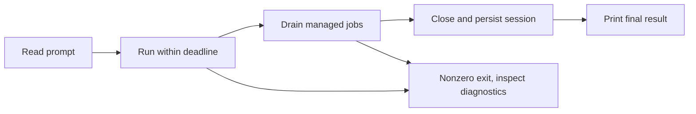

# Automate a task

Run a bounded, read-only task, capture its result, then check the result independently. A successful agent exit proves that the invocation completed, not that its conclusions are correct.

## Before you run unattended

Install Evener and configure a provider using [Get started](getting-started.md). These instructions track main. Run the commands below in a disposable checkout of the repository you want to inspect. You need a POSIX shell and a working sandbox on the host.

Review repository instructions, hooks, plugins and MCP configuration first. Those extensions can execute code. The default sandbox is **off**; a prompt saying “read only” does not enforce that restriction. Do not give a CI job production credentials, deploy permissions or a writable production checkout merely because the task is a review.

## Capture one result

This shell recipe writes private output into a fresh directory. It does not overwrite an earlier run or automatically retry a failed task. In each example, replace `provider/model` with an available model from your configured provider.

```sh
umask 077
report_dir=$(mktemp -d "${TMPDIR:-/tmp}/evener-review.XXXXXX") || exit 1
if evener --model provider/model --timeout 2m --max-rounds 8 \
  --sandbox read-only --sandbox-net off \
  'Inspect this repository without changing files. Name three public entry points with their file paths. Do not start services.' \
  >"$report_dir/result.txt" 2>"$report_dir/diagnostics.txt"
then
  if grep -q '[^[:space:]]' "$report_dir/result.txt"; then
    printf 'Result to review: %s/result.txt\n' "$report_dir"
  else
    printf 'Invocation succeeded but produced no substantive result: %s\n' "$report_dir" >&2
    exit 1
  fi
else
  status=$?
  printf 'Evener exited %s. Inspect %s/diagnostics.txt before retrying.\n' "$status" "$report_dir" >&2
  exit "$status"
fi
```

Open the result and verify each named path and entry point in source. Nonblank output is only a transport check. For a change-producing task, run the project's acceptance tests and inspect the diff; do not use the agent's own summary as the acceptance oracle. Keep reports private because prompts, paths, tool output and provider diagnostics can contain sensitive information. Remove each report when you no longer need it.

`--sandbox-net off` restricts sandboxed tool egress, not the host-side provider connection. A hosted model still needs its configured credentials and network route.

## Supply a prompt file

Redirect a trusted UTF-8 text file into the same bounded invocation:

```sh
evener --model provider/model --timeout 2m --max-rounds 8 --sandbox read-only --sandbox-net off < prompt.txt
```

Run from the intended working directory, or set `--dir`. The prompt is read to EOF before the run begins. Command-line prompt arguments override stdin; do not accidentally supply both and expect concatenation.

## Request structured output

Pass a schema document as one quoted argument. This example requests a result object; it does not turn diagnostics into JSON.

```sh
evener --model provider/model --timeout 2m --max-rounds 8 --sandbox read-only --sandbox-net off \
  --output-schema '{"type":"object","properties":{"summary":{"type":"string"}},"required":["summary"],"additionalProperties":false}' \
  'Summarize this repository in the summary field of your final structured output.'
```

In a script, capture stdout and stderr separately as above. Parse stdout with your application's JSON parser, validate against the same schema, then check the content. Reject missing output, malformed JSON or a schema mismatch even after exit 0. Model compliance is not a deterministic guarantee.

## Handle completion, cancellation and retries



The CLI can continue after the first assistant answer while it drains background jobs and delegates. Wait for process exit before accepting stdout as the final result. Managed shell jobs belong to the session; detached processes do not and can survive it. Never ask an unattended review to launch detached services unless your supervisor separately owns their cleanup.

Use `--timeout` and a CI supervisor deadline together. The first SIGINT or SIGTERM requests graceful cancellation; a repeated signal forces exit and can prevent cleanup or export. Do not confuse a provider idle deadline with a total run deadline. See [CLI output and exits](cli.md#output-and-exits).

After an ambiguous interruption, inspect the saved session and filesystem before starting again. Re-running the same prompt creates another attempt and can repeat shell commands or external writes. `--resume SESSION_ID` continues known work; `--resume-with SESSION_ID` creates a separate session with previous context. Neither is an exactly-once transaction.

The hub's AppWire `thread/start` can spawn a session and fail before answering.
When the spawned identity is known, its error data includes `createdRef` and
`createdInstanceId` alongside the original `evenerErrorInfo` and error code.
Use that ref to inspect the session rather than starting the same request again;
for a remote host, `createdRef` is qualified in the calling hub's namespace.
Otherwise missing evidence is an unknown launch, not proof that nothing spawned.
Creation after a spawn is never automatically retryable. A start refused before
spawn reports `mutationOutcome: "notAccepted"` and carries no created identity.

## Diagnose without starting a model task

```sh
evener --version
evener --list-sessions
evener doctor --help
evener models list --help
evener providers list --help
```

Use doctor to inspect retained state, then correct the specific setup or runtime failure. Do not “fix” a sandbox failure by removing the sandbox in an unattended retry. Provider probes and model-driven runs are separate, opt-in checks; a deterministic documentation or protocol test should not call a hosted model.

For a persistent application rather than a one-shot process, use [AppWire integration](integrations.md). For agent tool lifetimes, see [Job control](job-control.md).

## Manager sessions

Start a Manager by setting `manager: true` in the AppWire `thread/start`
parameters. Anyone authorized to start a session may supply it. Manager is an
immutable session property: an existing session cannot gain or lose it.

The session saves the bit in its metadata. Resume, process restart and Clear
preserve it. Fresh roots and forks do not inherit it; a new Manager requires an
explicit `manager: true` start. A missing bit means false, so existing sessions
remain ordinary without migration.

The daemon reports `thread.evener.manager`, and the hub reads that projection
rather than storing a separate preference. Web **Session Details** and native
**Session Info** show a read-only Manager indication. Normal refresh preserves
loaded history pages when their source identity still matches, and preserves
unsent input. Reconnect may replace stale pages with the latest authoritative
window.

A Manager reaches sessions through its own hub, including connected hosts and
other Managers. A Manager hosted on another machine uses that machine's hub,
not the controller through which someone viewed or started it. See
[remote Manager and input support](evener-hub-remote-operations.md#remote-manager-and-input-support)
for routing and capability limits.

## Manager discovery, status and bounded reads

An authenticated live Manager runtime can use `job_list` with
`{"hub":{"mode":"discovery"}}` to discover reachable sessions and sources,
then `job_status` with `{"hub":{"ref":"local:WORKSPACE_ID"}}` to read a
source-qualified session's status through the existing hub read owner. Use a
returned reference rather than constructing one. Ordinary calls keep their
existing behavior. Explicit tool-policy denials still apply.

Discovery is shallow: it lists source-qualified sessions and every configured
host, including an empty or offline host. It does not mark a session seen,
acknowledge a report, or reveal SSH paths, keys or host administration rows.
Use `job_list` with `hub:{mode:"activity",ref,resource:"summary"}` for
counts/context, or `resource:"delegates"`, `"jobs"`, or `"watches"` with
`cursor` and `limit` for the corresponding bounded collection. The owner
and scope come from the existing activity methods, not navigation rows.
Activity follow-ups retain the selected resource, subtree or session scope,
and page limit, so a later page never silently narrows the read.

Use `job_list` with `hub:{mode:"tasks",ref,offset,limit,snapshot}` for the
complete task descriptions and prompts. Omit offset/snapshot on the first page;
its default limit is 50 and maximum is 200. Follow `nextOffset` with the
returned snapshot and original page limit. The token is the SHA-256 identity
of the complete ordered authoritative list, canonical ref and session instance,
not a clock or page counter. Changes anywhere in that list return
`snapshot_changed` instead of a mixed continuation; restart at offset zero.
`data:null` means task data is unavailable; `data:[]` means the authoritative
list is empty. An unknown or changing instance cannot mint a task token.

`read_transcript` with `hub:{ref,itemLimit}` reads the latest bounded history;
its returned `nextCursor` pages older items with `hub:{ref,cursor,itemLimit}`.
`job_status` with `hub:{ref,jobId}` reads the job's full metadata, and
`read_transcript` with `hub:{ref,jobId,maxBytes,beforeBytes}` pages its output
backward in lifetime bytes. Each job handle names both its owner ref and job ID;
do not route by job ID alone. `model_list` with `hub:{host:"SOURCE_ID",refresh:true}`
reads the selected host's catalog and diagnostics, rather than the Manager's
frozen local catalog. Ordinary local transcript JSONL, expansion, range and
artifact arguments are rejected on hub reads, not silently interpreted there.
Read responses stay below the tool result cap; use returned structured
`followUps` to fetch the next page instead of treating a preview as complete.

Session configuration supplies the Manager schemas and guidance independently
of transport availability. A disconnect leaves that tool surface intact;
individual calls may report unavailable while healthy ordinary work continues.
The authenticated connection supplies caller identity, and the hub checks the
daemon's Manager projection before admitting an operation. Tool arguments cannot
grant Manager status or choose a different caller.

## Start an independent worker from a Manager

A Manager can call `delegate` with `prompt` and
`hub:{cwd,model,watch:{events,completion}}`. This creates an empty, independent
ordinary top-level session on the Manager's local hub. It attaches the requested
`job_watch` and reads its initial state **before** submitting the prompt with
`turn/start`. Use `events:["question","communicate"]` and `completion:true` to
receive question and terminal-result notices even when no browser is open.
Read a pending question with `job_status` and
`hub:{ref:"local:WORKSPACE_ID"}`, then send an answer with `delegate_send` using
the returned ref, `input_mode:"start"`, `message`, a fresh
`client_mutation_id`, and the returned `expected_instance_id`. A notification
alone never answers a question. Resolve a pending approval with
`session_control` and the approval's `escalationId` instead.

A completion watch follows the recorded question-to-answer relationship across
successive answers, including a watch attached while a question is pending.
Unrelated work cannot complete it. A transient continuation read retries the
original candidate under the same watch ID, preserving pending deliveries. The
existing subscription consumer uses two seconds per call, two seconds between
retries and at most five consecutive failed calls, with an interruption notice.
Clear, replacement or subscription cancellation stops recovery. Permanent
request/evidence failures and exhausted retries end the watch explicitly rather
than guessing. Cancellation checks between reads do not impose a hard wall-clock
bound on catch-up or underlying OS I/O; see
[completion evidence](job-control.md#manager-observation-evidence).

Creation is local. `hub` accepts only `cwd`, `model` and `watch`, and an
unknown field such as a source or host name is rejected rather than ignored.
A Manager can discover an empty remote host and read its model catalog, but it
cannot create the first worker there: start that worker from the remote host's
own client, then address it by its `HOST:WORKSPACE_ID` reference. Remote
creation is a planned follow-up, not a supported mode.

The `delegate` result reports `created`, `watch` and `input` separately. A
successful creation followed by a failed watch returns the worker ref, leaves
the worker empty, and does not submit its prompt. A successful watch followed
by failed or uncertain input keeps the watch attached and reports that input
outcome separately. Once input has a mutation identity, `input.clientMutationId`
retains it on submitted, refused and uncertain outcomes. Retry uncertain input
with `delegate_send` using that same ID, prompt, worker ref and instance, not a
new creation or a fresh mutation ID. If the launch is unknown, it stays unknown:
never retry creation automatically. Inspect any returned worker ref before deciding what
to do next. Workers are not owned delegates; they continue independently when
their Manager's turn ends, and their watch notices are not delegate reports.

Manager `job_watch` supports local and remote targets through the same shared
hub subscriptions as human clients. For an existing remote worker, attach
`job_watch(operation="create", hub={ref:"HOST:WORKSPACE_ID",events:["question"],completion:true})`
before sending input. Remote question/answer/completion and saved Manager
attribution are checked through real two-hub SSH acceptance, without a browser.
Clearing a Manager watch leaves human subscribers attached. Local no-browser
sandbox approval is qualified; approval caused by a live remote prompt remains
unexercised end to end.

An in-process owned child can also be watched by its canonical child ref. Its
list and read identify the child session, but `instanceId` names the current
serving root session and its boot generation is root-qualified. Root replacement
invalidates that observation identity. A completion-enabled watch observes child
`communicate` events, but those events have no `end_reason` and do not certify a
`done` completion. Watching a child does not make it eligible for sandbox approval:
approval remains root-only, and ordinary delegated controls are unchanged.

## Apply human controls from a Manager

`session_control` accepts `{"action":"rename","arguments":{"ref":"local:WORKSPACE_ID","name":"Research"}}`. The action is a closed set: `approval`, `resume`, `fork`, `clear`, `model`, `vision_model`, `reasoning_effort`, `compact`, `drain_queue`, `promote_queued`, `cancel_queued`, `rename`, `goal`, `human_notes`, `remove_url`, `archive`, `delete`, `pin`, `unpin`, and `seen`. Each uses the matching existing AppWire parameters. Supply only one typed payload; archive requires `kind:"session"` and its `archived` boolean also unarchives. `seen` requires one to 500 session marks, each with exactly one of `seenThrough` and `unread`. Queue editing cancels the selected entry and lets you recompose with `delegate_send`; it does not add queued input. Pinning by section name can create a section. Only ended or confirmed-crashed local sessions can be deleted.

To stop human-style work, call `job_stop` with `{"hub":{"mode":"interrupt","arguments":{"ref":"local:WORKSPACE_ID","clientMutationId":"UNIQUE_ID","expectedInstanceId":"INSTANCE_ID"}}}`. Modes `delegate`, `shutdown`, and `force_stop` take their corresponding `DelegateStopParams`, `ThreadShutdownParams`, and `ThreadForceStopParams` fields in `arguments`. Three target scopes stay separate: `delegate` uses a `dlg_` ID and stops **one run**, leaving its child delegates alive; `owned_delegate` takes `{ref,delegateId,maxWaitMs?}` with a `dlg_` ID and stops the **owned subtree**, returning `already_stopped` when it has settled; `job` takes `{ref,jobId,includeChildren?,maxWaitMs?}` with a `job_` ID and stops **that shell job**, plus only its **immediate** shell children when `includeChildren` is true. These flags match human `job_stop`; they do not make `delegate` recursive or clear watches. A descendant ref is checked against its actual job or delegate owner before the stop reaches the root daemon; later reads or input still address the descendant's original ref. Force-stop still uses the human verified-daemon owner and must not become an unchecked remote kill. The authenticated binding identifies the Manager; no tool argument can select a caller or an RPC method.
