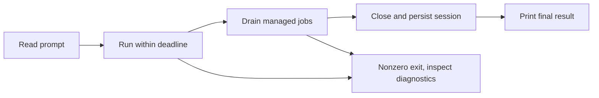

# Automate a task

Run a bounded, read-only task, capture its result, then check the result independently. A successful agent exit proves that the invocation completed, not that its conclusions are correct.

## Before you run unattended

Install Evener and configure a provider using [Get started](getting-started.md). These instructions track main. Run the commands below in a disposable checkout of the repository you want to inspect. You need a POSIX shell and a working sandbox on the host.

Review repository instructions, hooks, plugins and MCP configuration first. Those extensions can execute code. The default sandbox is **off**; a prompt saying “read only” does not enforce that restriction. Do not give a CI job production credentials, deploy permissions or a writable production checkout merely because the task is a review.

## Capture one result

This shell recipe writes private output into a fresh directory. It does not overwrite an earlier run or automatically retry a failed task. In each example, replace `provider/model` with an available model from your configured provider.

```sh
umask 077
report_dir=$(mktemp -d "${TMPDIR:-/tmp}/evener-review.XXXXXX") || exit 1
if evener --model provider/model --timeout 2m --max-rounds 8 \
  --sandbox read-only --sandbox-net off \
  'Inspect this repository without changing files. Name three public entry points with their file paths. Do not start services.' \
  >"$report_dir/result.txt" 2>"$report_dir/diagnostics.txt"
then
  if grep -q '[^[:space:]]' "$report_dir/result.txt"; then
    printf 'Result to review: %s/result.txt\n' "$report_dir"
  else
    printf 'Invocation succeeded but produced no substantive result: %s\n' "$report_dir" >&2
    exit 1
  fi
else
  status=$?
  printf 'Evener exited %s. Inspect %s/diagnostics.txt before retrying.\n' "$status" "$report_dir" >&2
  exit "$status"
fi
```

Open the result and verify each named path and entry point in source. Nonblank output is only a transport check. For a change-producing task, run the project's acceptance tests and inspect the diff; do not use the agent's own summary as the acceptance oracle. Keep reports private because prompts, paths, tool output and provider diagnostics can contain sensitive information. Remove each report when you no longer need it.

`--sandbox-net off` restricts sandboxed tool egress, not the host-side provider connection. A hosted model still needs its configured credentials and network route.

## Supply a prompt file

Redirect a trusted UTF-8 text file into the same bounded invocation:

```sh
evener --model provider/model --timeout 2m --max-rounds 8 --sandbox read-only --sandbox-net off < prompt.txt
```

Run from the intended working directory, or set `--dir`. The prompt is read to EOF before the run begins. Command-line prompt arguments override stdin; do not accidentally supply both and expect concatenation.

## Request structured output

Pass a schema document as one quoted argument. This example requests a result object; it does not turn diagnostics into JSON.

```sh
evener --model provider/model --timeout 2m --max-rounds 8 --sandbox read-only --sandbox-net off \
  --output-schema '{"type":"object","properties":{"summary":{"type":"string"}},"required":["summary"],"additionalProperties":false}' \
  'Summarize this repository in the summary field of your final structured output.'
```

In a script, capture stdout and stderr separately as above. Parse stdout with your application's JSON parser, validate against the same schema, then check the content. Reject missing output, malformed JSON or a schema mismatch even after exit 0. Model compliance is not a deterministic guarantee.

## Handle completion, cancellation and retries



The CLI can continue after the first assistant answer while it drains background jobs and delegates. Wait for process exit before accepting stdout as the final result. Managed shell jobs belong to the session; detached processes do not and can survive it. Never ask an unattended review to launch detached services unless your supervisor separately owns their cleanup.

Use `--timeout` and a CI supervisor deadline together. The first SIGINT or SIGTERM requests graceful cancellation; a repeated signal forces exit and can prevent cleanup or export. Do not confuse a provider idle deadline with a total run deadline. See [CLI output and exits](cli.md#output-and-exits).

After an ambiguous interruption, inspect the saved session and filesystem before starting again. Re-running the same prompt creates another attempt and can repeat shell commands or external writes. `--resume SESSION_ID` continues known work; `--resume-with SESSION_ID` creates a separate session with previous context. Neither is an exactly-once transaction.

## Diagnose without starting a model task

```sh
evener --version
evener --list-sessions
evener doctor --help
evener models list --help
evener providers list --help
```

Use doctor to inspect retained state, then correct the specific setup or runtime failure. Do not “fix” a sandbox failure by removing the sandbox in an unattended retry. Provider probes and model-driven runs are separate, opt-in checks; a deterministic documentation or protocol test should not call a hosted model.

For a persistent application rather than a one-shot process, use [AppWire integration](integrations.md). For agent tool lifetimes, see [Job control](job-control.md).
