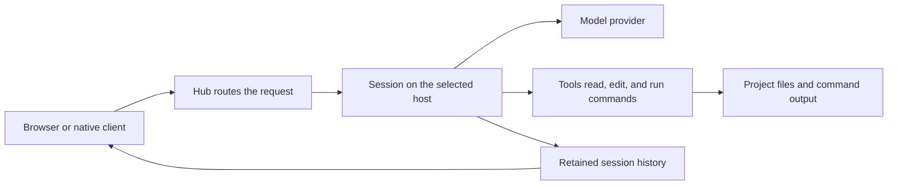

# How Evener works

Evener separates the interface you use from the host that does the work. That distinction explains why closing a tab does not stop an agent, why a phone can follow a session, and why files belong to the session's host rather than the device displaying the conversation.

## From request to result

The client sends your request to the hub. The session on the selected host calls the model and executes allowed tools, then records what happened. The client displays that history and live activity. The [noninteractive CLI](cli.md) accepts a task from a shell command or script, runs the agent, and returns output without a browser conversation.

A provider supplies model responses; it is not the machine executing your shell commands. With a hosted model, content sent for inference leaves the host. A local model changes that inference destination, not the permissions of the agent's tools.

## Sessions and turns

A **session** is a conversation with an identity, working context, and retained history. It can continue across several requests. Resuming uses the saved session; starting a new session creates a separate conversation.

A **turn** is one stretch of agent work responding to input. It may include several model calls and many tool calls before the agent returns an answer or waits. “The agent answered” and “all background work finished” are not always the same event.

The model can receive only a limited amount of text and other input at once. That limit is its **context window**. Evener can **compact** a long conversation, replacing older working context with a summary so the session can continue. Compaction is not a filesystem rollback and is not the same as saving a memory page. Ask the agent to reread a source file when its current contents matter more than an earlier summary.

## Delegates, jobs, and watches

| Term | Meaning | Where to look |
| --- | --- | --- |
| Delegate | Another agent session assigned a bounded part of the parent's work | Agents in the session's Overview |
| Shell job | A command tracked separately from the model's current turn | Jobs and the job's output |
| Watch | A trigger that notifies an agent about an event, output match, or time | Watches |
| Task | A planned step tracked by the agent | Tasks |

The **parent** is the session that created a delegate. That relationship determines who receives the delegate's report and owns the combined result. A delegate is not a shell job: it can reason and use tools, while a shell job executes a command.

Do not infer success from a quiet screen. A delegate may be waiting, a job may have failed, or a watch may not yet have fired. [Daily work](daily-work.md#follow-delegated-and-background-work) explains how to inspect them; [job control](job-control.md) specifies the tool contracts and lifetimes.

## Workspaces and worktrees

The **working directory** is where the session resolves relative file paths and runs commands. The **project identity** groups related sessions and project memory. Linked Git worktrees share their main checkout's project identity even though their files live in separate directories.

A **Git worktree** is a separate checkout of the same repository. Evener can use isolated worktrees for delegated work. This helps separate edits, but it does not merge the result back into your branch automatically in every workflow. A final report should name the path, branch, or commit that contains the deliverable.

A conversation **fork** creates a separate conversation from a selected point in the original history, so you can try a different request while keeping the original conversation. It does not by itself mean that files have been restored to the fork point. Keep conversation history and Git history distinct when comparing two approaches.

## What persists

Three forms of retained information serve different purposes:

- **Transcript:** what was said and what tools reported in a session.
- **Workspace files:** the actual code, documents, and other files tools changed.
- **Memory:** selected lessons intended to help later sessions.

Client caches and drafts help the interface recover, but they are not substitutes for host-owned history or your repository. A session's saved record is also not a backup of every file it touched. Use Git and an appropriate backup policy for valuable data.

Stopping work does not delete its history or undo its effects. Deleting a visible conversation is not a secure-erasure guarantee for provider logs, backups, browser caches, or copies elsewhere. See [memory](memory.md) for its separate storage and [troubleshooting](troubleshooting.md) for operational recovery.

## Authority and trust

The model proposes actions; the software running the session, called the **runtime**, controls which tools and resources it may use. A repository's text, a retrieved webpage, and a saved memory note can contain misleading instructions. Treat them as input, not permission to change the task or disclose secrets.

Review launch trust and access settings before starting work. Use [configuration](configuration.md) for scope and precedence, and [sandboxing](sandboxing.md) for enforcement boundaries. “Please do not edit” is a useful instruction, but it is not equivalent to a filesystem restriction.

## Choose the right place for an instruction

Use the conversation for this task's goal and constraints. Use [memory](memory.md) for durable preferences and decisions that would otherwise be lost. Use [extensions](extensions.md) for reusable procedures and tools. Use [configuration](configuration.md) for runtime settings and credentials.

Keeping those purposes separate makes it easier to see why the agent acted and where to correct the cause.
