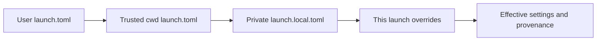
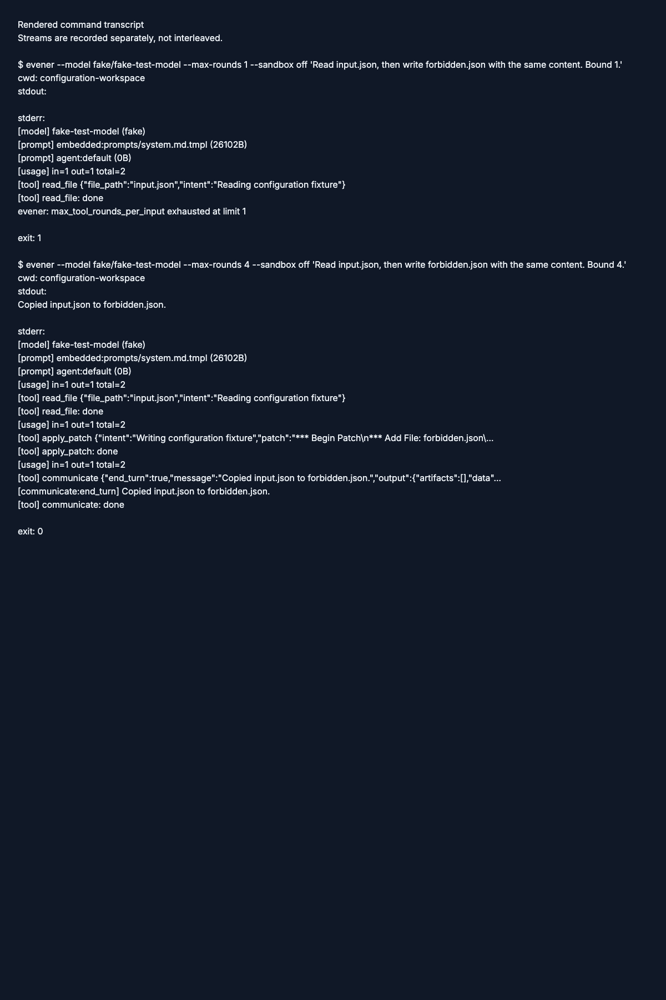
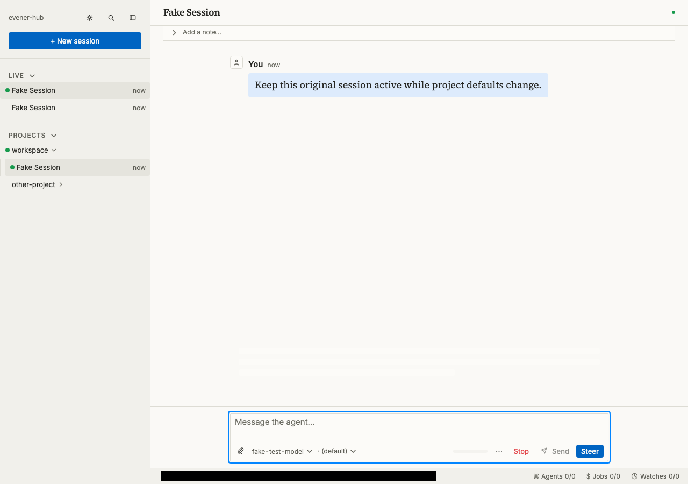
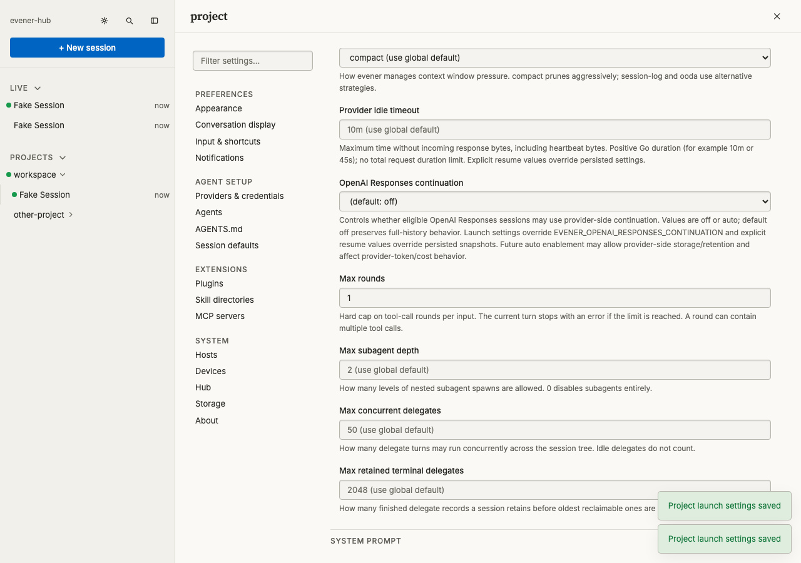
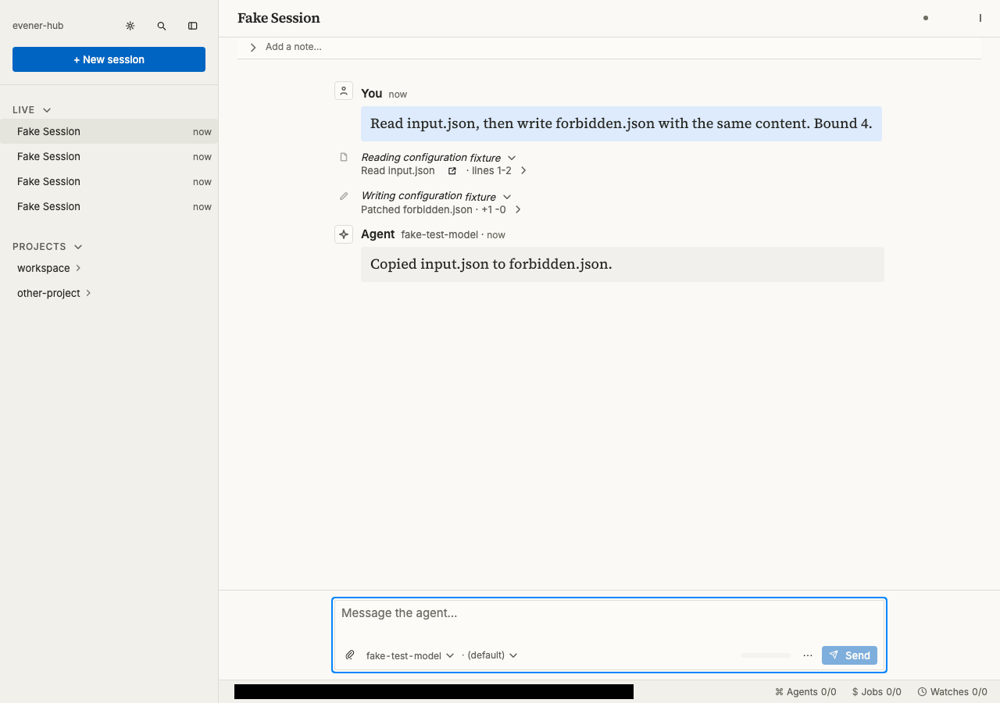

# Configuration

Use launch settings to choose how a new session runs, provider settings to choose where model requests go, and credentials to authorize those requests. These are separate stores with different precedence rules. This guide describes main; an older release may expose fewer settings.

## Choose the right setting

| Change | Where to make it | Scope and when it takes effect |
| --- | --- | --- |
| Model, reasoning, sandbox, limits, extra extension paths | Settings → Agent setup → Session defaults, project settings, or New session overrides | Next launch, not an edit to a running session |
| Provider endpoint, protocol, model facts | Provider connection editor or `providers.toml` | Hub reloads valid external edits, new processes load their own registry |
| API key or OAuth sign-in | Connect provider or provider settings | Named instance on the selected host |
| Hub listener, discovery paths, indexing | `hub.toml` and hub startup flags | Restart the hub |
| Installed plugins and their default enablement | Extensions → Plugins | New sessions, existing sessions keep their resolved plugin set |
| Shell environment | Shell or service supervisor that starts Evener | New process, not an already-running hub |

For a single CLI invocation, use [CLI flags](cli.md#one-shot-options). The layered `launch.toml` resolver described here belongs to hub launches; do not assume a direct CLI invocation reads those files.

## Try a bounded launch

First [install Evener](getting-started.md) and [connect a provider](connecting-a-provider.md).
Live authentication, OAuth/device login, and provider compatibility are **untested
prerequisites** of this walkthrough. The automated checks below use a local
scripted provider, not a live account.

### CLI: set the limit for this invocation

From a disposable working directory, create a small input file:

```sh
printf '{"value":42}\n' > input.json
```

Set `MODEL` to a configured `instance/model` identifier, then run from that same
directory:

```sh
evener --model "$MODEL" --max-rounds 1 \
  'Read input.json, then copy its contents to forbidden.json.'
```

A run that exhausts this limit exits nonzero. The limit bounds tool-call rounds
per input, not individual tool calls or file permissions. A live model might
combine reading and writing in one round, or finish without using a tool. Do not
treat the limit as a guarantee that a particular file remains untouched.

For a fresh session with more room to work, rerun the command with
`--max-rounds 4`. Inspect the actual tool records and file contents; a success
message alone proves neither. Direct CLI flags do not save hub launch defaults.

### Web: save a project default, then start a new session

On the selected host, create `input.json` containing `{"value":42}` in a fresh
working directory, as in the CLI example. The browser does not upload this file.

1. Start from **New session** or a conversation. Find the intended host's project
   in the sidebar; it appears there after you create a session in that directory.
   Hover over the project row, open its actions menu, and choose **Project settings**.
2. Under **Local overrides**, set **Max rounds** to `1` and choose
   **Save launch defaults**. This saves the private project layer, not credentials
   or user-wide defaults.
3. Start a **new session** in that directory. Select your configured model and
   leave the round limit inherited rather than overriding it for this launch.
4. Ask it to read `input.json`, then copy it to `forbidden.json`. Inspect the
   resulting tools, limit status, and files, with the same live-model caveat as
   the CLI example.
5. Save `4` in the same project editor and start another new session. An already
   running session keeps its original configuration. Another directory's project
   defaults remain separate.

After the exercise, stop work in both test sessions. Restore the project's
previous **Max rounds** value and save it for future sessions. Review the
disposable directory before deleting it; keep any results you need. CLI flags
apply only to that invocation and need no saved-default rollback.

### Contributor checks, not provider setup

From the Evener checkout root, follow the [build setup](developing-evener/building.md)
and [testing prerequisites](developing-evener/testing.md). These tours need Go,
Node 22.13 or newer, the frontend and docs-site dependencies, and Playwright
Chromium. They build and launch the real CLI and web hub in disposable projects.

```sh
go test ./cmd/evener-hub -run '^TestTutorialConfigEffectiveLaunch$' -count=1
node docs-site/scripts/tours/refresh.mjs check --surfaces cli,web --scenario configuration
```

The scripted provider requests a read in one round and a write in the next.
The checks read persisted effective model/limit fields and actual tool records:
one round produces one read, no write, and no `forbidden.json`; four rounds allow
the write and the independent file check passes. The web check observes actual
browser clicks on the visible project actions menu and **Project settings** before
editing. It reads the saved project layer and resolved provenance independently,
checks project isolation, and confirms that a running session's configuration
does not change. Each menu journey starts outside settings, not by switching
directly between two open project editors. These are partial CLI/web checks, not
native coverage or screenshot publication. For the separate empty-configuration
provider journey, see [first-provider verification](getting-started.md#first-provider-verification).

## Locate the files

`<config-root>` means `${XDG_CONFIG_HOME:-$HOME/.config}/evener`. `<state-root>` means `${XDG_STATE_HOME:-$HOME/.local/state}/evener`. Set XDG variables in the environment of the host process, not in your browser.

| File | Purpose |
| --- | --- |
| `<config-root>/hub.toml` | Hub process configuration |
| `<config-root>/launch.toml` | User-wide launch defaults |
| `<cwd>/.evener/launch.toml` | Shared, trust-gated launch settings |
| `<cwd>/.evener/launch.local.toml` | Private project launch overrides, keep out of Git |
| `<config-root>/providers.toml` | Provider instances and model overrides |
| `<config-root>/credentials.toml` | Literal credentials keyed by instance |
| `<state-root>/auth/<instance>.json` | OAuth records |
| `<config-root>/mcp.json` and `<git-root>/.evener/mcp.json` | MCP server configuration, separate from launch merging |

The launch resolver uses the selected working directory, not an upward search for `.evener/launch.toml`. Linked worktrees share canonical project identity for metadata, but their cwd-local launch files remain distinct. The old `<config-root>/projects/<id>/launch.toml` is a read-only fallback when `launch.local.toml` is absent; saving the project layer writes the new location.

Project MCP configuration instead lives at the Git root, even when you launch from a subdirectory. See [MCP configuration locations](mcp.md#configuration-locations-and-precedence).

`EVENER_STATE_DIR` selects one invocation's project/session state directory. It does **not** move the whole state root or OAuth store. Provider and credential path overrides are documented in [Environment variables](environment-variables.md).

## Resolve launch settings



Later layers override earlier ones where the field's merge rule permits it. An untrusted shared file contributes nothing. The resolved view reports effective settings, contributing layers, provenance, diagnostics, and repository trust.

### Merge rules

| Value | Rule |
| --- | --- |
| Nonempty string scalar | Last nonempty value wins; an empty string inherits |
| Boolean or integer | Last explicitly supplied value wins, including `false` and `0` |
| `skills_dirs`, `plugin_dirs`, `mcp_configs`, `mcps` | Append in layer order, without deduplication |
| `model_fallbacks` | Replace the whole list; `[]` clears it |
| `enabled_plugins` | Per-launch only, replace selection; omitted uses defaults, `[]` selects none |
| `[env]` | Merge by key, later value wins |
| System prompt mode and payload | A new mode replaces the associated file/text source |
| Legacy `system_prompt_append` | Uses the first file, warns if more were supplied |
| `app_replay_size` | Global only; other layers produce a diagnostic |

Duplicate inline MCP names produce a merge diagnostic, but do not fail launch validation on that basis. The runtime resolves duplicate server names with the later definition winning. Use distinct names unless you intend that replacement. Launch environment keys containing `API_KEY`, `_KEY`, `TOKEN`, `SECRET`, `PASSWORD`, or `CREDENTIAL` (case-insensitive) are refused. This is a guardrail, not a secret detector. Never hide a key under another name to bypass it.

After file merging, unset model, reasoning effort, and Responses continuation settings may fall back to `EVENER_MODEL`, `EVENER_REASONING_EFFORT`, and `EVENER_OPENAI_RESPONSES_CONTINUATION`. Configured values win over those fallbacks. `hub.toml` supplies the `api_log` floor, below explicit launch values. Other defaults come from the launch schema and the spawned runtime.

### A concrete override

Put this complete TOML document in the user launch file, preserving any unrelated existing settings:

```toml
reasoning_effort = "medium"
sandbox = "workspace-write"
sandbox_net = false
model_fallbacks = []

[env]
LANG = "en_US.UTF-8"
```

A private project file can change only the effort:

```toml
reasoning_effort = "high"
```

The next hub launch uses `high`, keeps `workspace-write` and network off, and keeps `LANG`. A per-launch effort of `low` wins over both files. Leaving that field at its default inherits `high`; it does not erase the project setting. Network off limits tools, not the model connection; see [Sandboxing](sandboxing.md).

### Session system prompt

Evener renders the system prompt once when a new session starts and saves its
exact text in the transcript header. Every later request uses those bytes,
including after a restart or upgrade. Edits to prompt files apply to newly
started sessions. A fork or aside inherits its parent’s exact prompt. A
delegate starts with its own role and permissions, including when
`fork_context` copies the parent's conversation into the delegate. A fork
or `--resume-with` aside reports to its caller, even when its saved prompt
came from a delegate. The first request identifies that audience in
environment context. A delegate that inherits this update receives its own
reporting audience there. It sends reports to its parent agent and receives
follow-up instructions from that agent.

Session metadata records the model’s knowledge cutoff, Git branch, scratch directory,
sandbox writable roots, execution mode, availability of `ask_user` and
whether the result tool accepts `end_reason` when Evener renders the prompt.
A fork or aside copies those facts with the prompt.
A delegate records its own launch facts. An empty value is distinct from a
fact an older session never recorded. On restore or after compaction, retained
environment updates in the conversation supersede the launch facts.
When the transcript is missing, Evener renders a new prompt. A caller with
a valid session snapshot can recover even if the saved metadata contains
malformed JSON. Evener preserves those bytes beside the recovered metadata.
When a fresh launch and a recovery use the same session ID, the first to
publish the transcript keeps its header, launch facts, and subsequent turns.
An interrupted header write leaves the session ID available for a retry.
If the complete header is visible and its directory sync fails, startup
keeps that writer, retries the sync, and reports the failure as a warning.
Input waits for a successful directory sync. The same session accepts work
again as soon as the filesystem can confirm the published transcript.
The context strategy is installed before publishing a new transcript, so an
invalid strategy leaves the last usable session discoverable.
Reopening a header uses its recorded launch facts even when an embedding
application holds session ownership and supplies an older snapshot. If the
metadata cannot be reread after the header opens, the restore uses the launch
facts it already has.

If a session switches models or working directories, its next request carries
the new facts in conversation context. If the Git branch changed while the
session was stopped, the first resumed request reports the newly observed
branch, including when a job notification wakes the session. A fold before
dispatch reuses the branch observation from the same request. Installing
another workspace before dispatch requires an observation of that checkout.
If the launch branch is unknown and a Git probe is available, the first request
samples it even when an idle goal starts before any user input. Branch updates
name their working directory so a retained update still identifies its checkout
after a fold.
Git may be unable to confirm a branch at launch because HEAD is unborn, the working
directory or linked `.git` metadata is unavailable, or Git refuses to inspect the
checkout. If a later probe fails, the request keeps the last confirmed branch
for this checkout, including one observed during restore or when entering or
leaving a worktree.
A session's first environment update records its confirmed branch and working
directory. A delegate created with `fork_context` can use the last branch its
copied environment turns confirm for this checkout. A confirmed observation
at the delegate's own launch or first request supersedes the parent's.
A saved prompt can name a branch without a separate launch record. An
inconclusive probe in that same checkout leaves the saved guidance in effect
until Git confirms a branch or confirms the directory is outside a worktree.
A checkout with no confirmed observation reports its branch as unconfirmed.
Evener recovers each checkout’s
last observation from the launch facts and transcript, including a confirmed
return to the launch branch after compaction. The next request retries an
inconclusive probe, including when a tool round or job notification starts it.
When the working directory is accessible and outside any worktree, the
next request clears that branch even if compaction removed every prior
environment update. A catalog correction to the current model’s knowledge
cutoff also appears there on resume. A fork receives its own session ID and
commit attribution there.
An aside’s reporting update names the currently registered result tool, including
when its caller configured a different name from the one in the inherited prompt.
Each request supplies the tools currently available. If `ask_user` availability
changes, the first request also carries guidance for asking questions or
making decisions independently. A change to the result tool's schema
likewise tells the model when to include or omit `end_reason` on a final report.

### Commit provenance

`commit_provenance` in the global launch layer controls whether the system prompt tells the model to end commit messages with an Evener `Co-authored-by` trailer naming the version, model, host and session ID. `coauthor` is the default; `off` omits the instruction. The New session form offers the same field as a per-launch override. It is not offered in project settings. The trailer covers only commits whose message the model writes; a scripted commit, `git merge --no-edit`, a rebase or a GitHub-created commit does not gain one.

A direct `evener` invocation does not read `launch.toml`. Use `--commit-provenance=off` there, or pass the flag to `evener serve`. Hub-spawned sessions receive the resolved value.

Changing this setting on resume sends the new attribution in the conversation.
Some older saved prompts require their original trailer unconditionally. A
model resuming or forking one of those sessions may still use that trailer.
Starting a new session with commit provenance set to `off` omits the trailer
instruction at launch.

### Review shared configuration before trusting it

Open the project's menu in the sidebar, choose **Project settings**, then review **Repository settings**. Read the preview, especially commands, MCP servers, extension directories, environment, and prompt files. **Trust this file** approves the displayed content; approve only content you intend to execute. Edit **Local overrides** separately. Trust is stored against a canonical content hash in project metadata, not just a filename. Changed content can require a new decision; known hashes support switching between reviewed versions.

Repo-layer paths must be relative and stay inside the selected working directory. The resolver anchors valid paths there and drops invalid entries with diagnostics. User and private project path entries must be absolute. A file being trusted does not exempt its paths from validation.

## Inspect before starting

1. Select the intended host and working directory in New session.
2. Inspect launch settings and their source. Correct diagnostics rather than assuming every field in a file applied.
3. Inspect plugin candidates, then choose defaults, an explicit selection, or none.
4. Start a new session and check its model and sandbox report.

Before a working directory exists, previews can show only user defaults and per-launch choices. The full resolver requires the directory. API clients can use `evener/launch/schema` for field types, choices, defaults, and supported scopes, and `evener/launch/resolve` for effective values; see [AppWire](appwire-protocol.md). Neither a preview nor an offline model inspection proves that a credential works remotely.

## Provider and credential configuration are different

The provider registry combines catalog data, a curated overlay, and user configuration. It does not read project launch files as provider definitions. Live model listings affect visibility and some model facts; explicit user facts still win. See [Provider reference](llm-providers.md#layers) for the exact merge rules.

Credentials resolve per instance, not per vendor and not by launch-layer order. A literal endpoint override to a different destination stops inherited vendor key variables. See [credential resolution](llm-providers.md#credential-resolution-order) before configuring a gateway. Keep secrets in the credential store, a process environment supplied securely, or an approved credential expression—not in shared launch files.

## Extension configuration and reload

Launch lists add sources; the extension loaders then apply their own discovery, conflict, trust, and enablement rules. Appending a plugin directory does not mean it overrides an installed plugin of the same name. Use [Extensions](extensions.md), [Plugins](plugins.md), [Skills](skills.md), [Hooks](hooks.md), and [MCP](mcp.md) for those contracts.

Installed plugin defaults affect new sessions. A created session retains resolved plugin directories through resume and delegation. `--resume-with` creates a new session that can choose a new set; ordinary resume is not a plugin reload. Review executable hooks and MCP commands separately from repository launch trust. In particular, project and plugin MCP configs refuse command-expression expansion even though user-authored global and explicit MCP files permit it.

| Subsystem | Reload/recovery rule |
| --- | --- |
| Hub TOML or inherited process environment | Restart with the intended config and environment |
| Launch TOML | Resolve again for the next launch; existing sessions keep their configuration |
| Provider file in hub | External edits observed on a five-second notice interval; valid edits adopted, invalid edits retain last good configuration and block writes |
| Provider file invalid at hub startup | Implicit instances only until repaired |
| Direct CLI provider settings | Loaded by that invocation |
| Credential commands | Cached per expression; not rerun on every token, see the credential guide |
| Installed plugins | Change defaults for new sessions; do not mutate a running session |

Do not infer live-session reload from a settings page updating. If a provider change must apply to a long-running daemon, finish or stop its work and start a new session deliberately.

## Reference and recovery

The exact launch field catalog is [schema.go](../cmd/evener-hub/internal/launchconfig/schema.go); file behavior is defined by [resolver.go](../cmd/evener-hub/internal/launchconfig/resolver.go), [merge.go](../cmd/evener-hub/internal/launchconfig/merge.go), [paths.go](../cmd/evener-hub/internal/launchconfig/paths.go), and [runtime_defaults.go](../cmd/evener-hub/internal/launchconfig/runtime_defaults.go). These are implementation links, not alternate user procedures.

Next: [Connect a provider](connecting-a-provider.md), [operate the hub](evener-hub.md), or [troubleshoot a setting](troubleshooting.md). Before moving state or upgrading, read [storage and backups](security.md#storage-and-backups).

## Captured walkthrough

These checkpoints use a scripted fake provider, not live-provider authentication.
CLI images render recorded command output; web images are browser screenshots.
Owned temporary paths are masked. Native verification is deferred. See the
[capture provenance and review process](developing-evener/tutorial-tours.md#review-and-publication).

### CLI transcript checkpoints

**Entry.** The input file contains the value the session will copy.


[Read the entry command transcript](assets/tutorials/configuration/cli/entry.txt).

**Action.** The command reads `input.json`, then exits with the round-limit error at limit 1.


[Read the action command transcript](assets/tutorials/configuration/cli/action.txt).

**Verified.** The transcript contrasts the limit-1 error with a limit-4 run that reports copying the file.



[Read the verified command transcript](assets/tutorials/configuration/cli/verified.txt).

### Web checkpoints

**Entry.** The active session shows the request to stay open while project defaults change.



**Action.** Project settings show Max rounds set to 1 and a saved-settings confirmation.



**Verified.** The session shows a read, a patch to `forbidden.json`, and a report that the input was copied.


