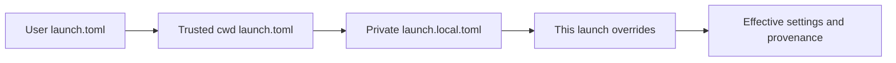

# Configuration

Use launch settings to choose how a new session runs, provider settings to choose where model requests go, and credentials to authorize those requests. These are separate stores with different precedence rules. This guide describes main; an older release may expose fewer settings.

## Choose the right setting

| Change | Where to make it | Scope and when it takes effect |
| --- | --- | --- |
| Model, reasoning, sandbox, limits, extra extension paths | Settings → Agent setup → Session defaults, project settings, or New session overrides | Next launch, not an edit to a running session |
| Provider endpoint, protocol, model facts | Provider connection editor or `providers.toml` | Hub reloads valid external edits, new processes load their own registry |
| API key or OAuth sign-in | Connect provider or provider settings | Named instance on the selected host |
| Hub listener, discovery paths, indexing | `hub.toml` and hub startup flags | Restart the hub |
| Installed plugins and their default enablement | Extensions → Plugins | New sessions, existing sessions keep their resolved plugin set |
| Shell environment | Shell or service supervisor that starts Evener | New process, not an already-running hub |

For a single CLI invocation, use [CLI flags](cli.md#one-shot-options). The layered `launch.toml` resolver described here belongs to hub launches; do not assume a direct CLI invocation reads those files.

## Locate the files

`<config-root>` means `${XDG_CONFIG_HOME:-$HOME/.config}/evener`. `<state-root>` means `${XDG_STATE_HOME:-$HOME/.local/state}/evener`. Set XDG variables in the environment of the host process, not in your browser.

| File | Purpose |
| --- | --- |
| `<config-root>/hub.toml` | Hub process configuration |
| `<config-root>/launch.toml` | User-wide launch defaults |
| `<cwd>/.evener/launch.toml` | Shared, trust-gated launch settings |
| `<cwd>/.evener/launch.local.toml` | Private project launch overrides, keep out of Git |
| `<config-root>/providers.toml` | Provider instances and model overrides |
| `<config-root>/credentials.toml` | Literal credentials keyed by instance |
| `<state-root>/auth/<instance>.json` | OAuth records |
| `<config-root>/mcp.json` and `<git-root>/.evener/mcp.json` | MCP server configuration, separate from launch merging |

The launch resolver uses the selected working directory, not an upward search for `.evener/launch.toml`. Linked worktrees share canonical project identity for metadata, but their cwd-local launch files remain distinct. The old `<config-root>/projects/<id>/launch.toml` is a read-only fallback when `launch.local.toml` is absent; saving the project layer writes the new location.

Project MCP configuration instead lives at the Git root, even when you launch from a subdirectory. See [MCP configuration locations](mcp.md#configuration-locations-and-precedence).

`EVENER_STATE_DIR` selects one invocation's project/session state directory. It does **not** move the whole state root or OAuth store. Provider and credential path overrides are documented in [Environment variables](environment-variables.md).

## Resolve launch settings



Later layers override earlier ones where the field's merge rule permits it. An untrusted shared file contributes nothing. The resolved view reports effective settings, contributing layers, provenance, diagnostics, and repository trust.

### Merge rules

| Value | Rule |
| --- | --- |
| Nonempty string scalar | Last nonempty value wins; an empty string inherits |
| Boolean or integer | Last explicitly supplied value wins, including `false` and `0` |
| `skills_dirs`, `plugin_dirs`, `mcp_configs`, `mcps` | Append in layer order, without deduplication |
| `model_fallbacks` | Replace the whole list; `[]` clears it |
| `enabled_plugins` | Per-launch only, replace selection; omitted uses defaults, `[]` selects none |
| `[env]` | Merge by key, later value wins |
| System prompt mode and payload | A new mode replaces the associated file/text source |
| Legacy `system_prompt_append` | Uses the first file, warns if more were supplied |
| `app_replay_size` | Global only; other layers produce a diagnostic |

Duplicate inline MCP names produce a diagnostic and fail launch validation; they are not a way to override a server. Launch environment keys containing `API_KEY`, `_KEY`, `TOKEN`, `SECRET`, `PASSWORD`, or `CREDENTIAL` (case-insensitive) are refused. This is a guardrail, not a secret detector. Never hide a key under another name to bypass it.

After file merging, unset model, reasoning effort, and Responses continuation settings may fall back to `EVENER_MODEL`, `EVENER_REASONING_EFFORT`, and `EVENER_OPENAI_RESPONSES_CONTINUATION`. Configured values win over those fallbacks. `hub.toml` supplies the `api_log` floor, below explicit launch values. Other defaults come from the launch schema and the spawned runtime.

### A concrete override

Put this complete TOML document in the user launch file, preserving any unrelated existing settings:

```toml
reasoning_effort = "medium"
sandbox = "workspace-write"
sandbox_net = false
model_fallbacks = []

[env]
LANG = "en_US.UTF-8"
```

A private project file can change only the effort:

```toml
reasoning_effort = "high"
```

The next hub launch uses `high`, keeps `workspace-write` and network off, and keeps `LANG`. A per-launch effort of `low` wins over both files. Leaving that field at its default inherits `high`; it does not erase the project setting. Network off limits tools, not the model connection; see [Sandboxing](sandboxing.md).

### Review shared configuration before trusting it

Open the project's menu in the sidebar, choose **Project settings**, then review **Repository settings**. Read the preview, especially commands, MCP servers, extension directories, environment, and prompt files. **Trust this file** approves the displayed content; approve only content you intend to execute. Edit **Local overrides** separately. Trust is stored against a canonical content hash in project metadata, not just a filename. Changed content can require a new decision; known hashes support switching between reviewed versions.

Repo-layer paths must be relative and stay inside the selected working directory. The resolver anchors valid paths there and drops invalid entries with diagnostics. User and private project path entries must be absolute. A file being trusted does not exempt its paths from validation.

## Inspect before starting

1. Select the intended host and working directory in New session.
2. Inspect launch settings and their source. Correct diagnostics rather than assuming every field in a file applied.
3. Inspect plugin candidates, then choose defaults, an explicit selection, or none.
4. Start a new session and check its model and sandbox report.

Before a working directory exists, previews can show only user defaults and per-launch choices. The full resolver requires the directory. API clients can use `evener/launch/schema` for field types, choices, defaults, and supported scopes, and `evener/launch/resolve` for effective values; see [AppWire](appwire-protocol.md). Neither a preview nor an offline model inspection proves that a credential works remotely.

## Provider and credential configuration are different

The provider registry combines catalog data, a curated overlay, and user configuration. It does not read project launch files as provider definitions. Live model listings affect visibility and some model facts; explicit user facts still win. See [Provider reference](llm-providers.md#layers) for the exact merge rules.

Credentials resolve per instance, not per vendor and not by launch-layer order. A literal endpoint override to a different destination stops inherited vendor key variables. See [credential resolution](llm-providers.md#credential-resolution-order) before configuring a gateway. Keep secrets in the credential store, a process environment supplied securely, or an approved credential expression—not in shared launch files.

## Extension configuration and reload

Launch lists add sources; the extension loaders then apply their own discovery, conflict, trust, and enablement rules. Appending a plugin directory does not mean it overrides an installed plugin of the same name. Use [Extensions](extensions.md), [Plugins](plugins.md), [Skills](skills.md), [Hooks](hooks.md), and [MCP](mcp.md) for those contracts.

Installed plugin defaults affect new sessions. A created session retains resolved plugin directories through resume and delegation. `--resume-with` creates a new session that can choose a new set; ordinary resume is not a plugin reload. Review executable hooks and MCP commands separately from repository launch trust. In particular, project and plugin MCP configs refuse command-expression expansion even though user-authored global and explicit MCP files permit it.

| Subsystem | Reload/recovery rule |
| --- | --- |
| Hub TOML or inherited process environment | Restart with the intended config and environment |
| Launch TOML | Resolve again for the next launch; existing sessions keep their configuration |
| Provider file in hub | External edits observed on a five-second notice interval; valid edits adopted, invalid edits retain last good configuration and block writes |
| Provider file invalid at hub startup | Implicit instances only until repaired |
| Direct CLI provider settings | Loaded by that invocation |
| Credential commands | Cached per expression; not rerun on every token, see the credential guide |
| Installed plugins | Change defaults for new sessions; do not mutate a running session |

Do not infer live-session reload from a settings page updating. If a provider change must apply to a long-running daemon, finish or stop its work and start a new session deliberately.

## Reference and recovery

The exact launch field catalog is [schema.go](../cmd/evener-hub/internal/launchconfig/schema.go); file behavior is defined by [resolver.go](../cmd/evener-hub/internal/launchconfig/resolver.go), [merge.go](../cmd/evener-hub/internal/launchconfig/merge.go), [paths.go](../cmd/evener-hub/internal/launchconfig/paths.go), and [runtime_defaults.go](../cmd/evener-hub/internal/launchconfig/runtime_defaults.go). These are implementation links, not alternate user procedures.

Next: [Connect a provider](connecting-a-provider.md), [operate the hub](evener-hub.md), or [troubleshoot a setting](troubleshooting.md). Before moving state or upgrading, read [storage and backups](security.md#storage-and-backups).
