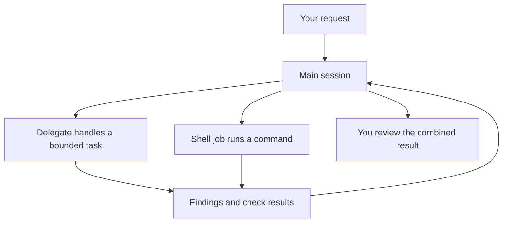

# Daily work

A useful Evener session ends with a result you can inspect, not just a convincing answer. Give the agent a bounded task, intervene when the direction changes, and review the files and checks before accepting its work.

This guide assumes you have completed [provider setup](getting-started.md#connect-a-provider-before-starting-work) and can open your hub in a browser. All interface paths below are relative to that hub, normally `http://127.0.0.1:9180`.

## Start with a task you can check

Before starting, run `git status --short` in the project. Commit or otherwise preserve work you cannot afford to lose. Evener may work alongside existing edits, but a mixed diff makes review harder.

Open **New session** at `/new`. Choose the working directory and model, then review the launch settings. The working directory is on the selected host, not necessarily the computer running your browser. Do not assume a new conversation creates an isolated checkout.

A good request names four things:

- **Outcome:** what should change for the user.
- **Scope:** files or components the agent may touch.
- **Constraints:** behavior to preserve and actions to avoid.
- **Check:** the command or observation that proves success.

For example, send this as an agent prompt, with paths and commands adapted to your project:

```text
Find why the invoice preview omits zero-value items. Reproduce the problem
with the existing preview tests, then repair the cause. Limit changes to
the preview component and its tests. Preserve item order. Do not commit or
deploy. Report the test command, its result, and anything not checked.
```

For an unfamiliar codebase, start with a question or request a plan before authorizing edits. A prompt constraint guides the agent; it is not a substitute for [sandbox controls](sandboxing.md).

## Follow the work without reading every line

Use the conversation to see the current result and expand tool calls when you need evidence. A tool call can contain a command, a file edit, or a read; the label alone does not tell you whether a test passed. Read the exit status and output of important checks.

Open the session's **Overview** from its **Session actions** menu to inspect **Agents**, **Jobs**, **Watches**, and **Tasks**. The session remains the place to send instructions. A task list is the agent's plan, not proof that the listed work succeeded.

For several sessions, use the sidebar to return to the one that needs attention. Give parallel sessions distinct goals and avoid asking two agents to edit the same files in a shared checkout.

## Send, steer, or stop

Choose the action that matches your intent:

| Action | Use it when… | What to remember |
| --- | --- | --- |
| **Send** | You have another request for the session | While it is busy, ordinary input queues for later rather than serving as an immediate correction |
| **Steer** | New information should change the work already underway | The running agent receives your correction, but actions already completed remain |
| **Stop** | You want the current work interrupted | Completed edits and external side effects remain |

Busy sessions expose Stop and, when supported, Steer. Narrow layouts may put actions in the session menu rather than beside the composer. Read the pending-message or queue state before resending text, especially after a connection loss.

The submit button still says **Send** while the agent is busy; it does not become a separate Queue button. Messages waiting for a later turn appear in **Queued messages** beside the composer. A **Sending** or **Retrying** indicator means delivery is still in progress, not that the agent has already acted on the message.

For a queued message, use **Remove from queue** to withdraw it before it runs, **Edit message** to bring it back for revision, or **Steer now** to send it into the current work. These controls appear only when the session supports them and may be disabled during recovery. Confirm that removal succeeded; an error means you must not assume the request was withdrawn. Removing a queued message cannot undo work the agent has already started. If a row says **Delivery uncertain**, let the session recover before submitting a duplicate.

A useful steering message is specific:

```text
Keep the existing public API. The compatibility requirement applies to
all callers, not only the failing test. Stop the API rename and repair
the parser internally instead.
```

Steering cannot retract a command that already ran. If the agent is about to take an unsafe action, use Stop, then inspect what actually happened. Do not send a second copy of a destructive request because the first copy has not appeared in the transcript yet.

## Return after a break

Reopen the session from the sidebar or session search. If it has stopped, sending a new message resumes it. Read the last result first, then tell the agent what has changed outside the conversation.

```text
Continue from the last result. I changed the fixture in the meantime.
Reread it and run the focused test before making another edit.
```

A closed browser tab and a stopped session are different things. Work runs on the host; navigating away is not a request to stop it. Conversely, a saved conversation does not guarantee that every process it started is still running. Check jobs and the host connection when returning.

After a disconnection, wait for the interface to reconcile pending input before submitting it again. If the session shows a recovery or version-compatibility notice, follow that notice. Force shutdown interrupts work; it is not a routine refresh button. See [troubleshooting](troubleshooting.md) if you cannot resume the session.

## Fork to try another direction

Use **Fork from here** on a user message to branch the conversation at that point and revise the request. The original line of work remains available. Open the command palette with Cmd+K on macOS or Ctrl+K on Linux. Its **Aside: fork to side thread** command offers a separate thread for a tangent.

A conversation fork is not a Git rollback. Earlier edits may still be present on disk, and the new conversation must work with the filesystem it actually has. Ask it to inspect the current state rather than assuming the files match an older message. Use an explicit Git branch or worktree when you need separate code versions; see [concepts](concepts.md#workspaces-and-worktrees).

## Follow delegated and background work

An agent can split a task into **delegates**, run commands as **shell jobs**, and use **watches** to react to later events. You do not need to operate those tools manually to supervise the result.



The main session should combine the findings and explain what was checked. A delegate's completion does not prove its changes were integrated. A shell's exit zero does not prove that the command tested what you intended.

In Overview, open the relevant agent conversation or job output when the summary leaves a gap. Ask the main session for exact paths, commands, and remaining work. If you want to stop a whole effort, say whether that includes child work and detached services; do not assume every kind of background process shares the same lifetime.

A **turn** is one stretch of agent work responding to input. A background shell job can keep running after the agent answers. Closing the browser does not shut down the session, and **Stop** interrupts the current turn rather than acting as a general shutdown command for all its jobs.

When Evener shuts down the owning session, its cleanup stops the session-owned shell processes. That shutdown is different from the agent answering or waiting for your next message. Check **Jobs** to see which commands are still running and ask the agent to stop a particular job when that is your intent.

A **detached process** is deliberately started outside that cleanup so it can survive the session. For a detached server, agree on how to find and stop it before asking the agent to leave it running. Watches notify an agent about selected events or timers; they do not make an offline host keep working. See [job-control vocabulary](job-control.md#vocabulary) and [shutdown and restart behavior](job-control.md#restart-behavior) for the exact rules.

## Review before accepting

In the actual working directory, inspect the result with Git:

```sh
git status --short
git diff --stat
git diff
```

If work happened in an isolated worktree, review that worktree or the resulting commit, not just your original checkout. Ask where the deliverable lives if the final report does not say.

Then run the project's relevant checks yourself. Confirm that the tests still assert the intended behavior and that the agent did not replace a failing check with a weaker one. Check for unrelated edits, generated files, credentials, and changes outside the requested scope.

Ask for missing evidence directly:

```text
Which test failed before the repair and passed after it? Give the exact
command and output summary. Separate checks you ran from checks you only
recommend. List any changes outside the requested files.
```

Commit only after review. Deploying, publishing, and merging are separate decisions; make them explicit in your request rather than leaving the agent to infer permission.

## Keep useful context, not a running diary

Tell Evener durable preferences and project decisions that should affect later work. Ask it to correct obsolete notes when those decisions change. [Memory](memory.md) explains what persists and where; a transcript is the record of this session, while memory is selected knowledge for future sessions.

For reusable procedures, use [extensions](extensions.md). For repeatable unattended runs, use [automation](automation.md) and the [CLI reference](cli.md). Those guides own the exact configuration and command contracts.
