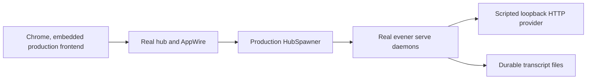

# Onboarding verification

This index separates fast fixture evidence from the real-hub acceptance path for
the first-run browser journey. It records results reported by the implementation
tasks and the gates rerun for this documentation change. It is not a claim that a
model provider, subscription, billing state, every browser, or every access mode
was tested live.

## Current status

The implemented desktop path covers terminal handoff, in-context provider setup,
model-list recovery, explicit model selection and Start, retained task/directory
drafts, resolver-backed effective access, a producer reply, and the matching
durable transcript. The external provider in acceptance is scripted. The hub,
AppWire path, spawner, daemon, embedded production frontend and transcript writes
are real.

A fixed-head screencast and desktop/narrow light/dark access screenshots are now
retained below. Jesse's screencast approval remains pending. This evidence does
not supersede the failed full web gate or the outstanding review/CI conditions.

## Recorded actual flow

The recording is a retained local artifact, not a public hosting URL. It lives
outside the repository under the run's artifact directory, named
`onboarding-first-run-2026-10-18/onboarding.mp4`; reproduce or re-record it with
the commands below rather than expecting a committed file. Recorded production
head: `271bc85260470d6d4af6d1740a0ca3edf6725494`, after `make web-preflight` and
`make build-web`. Format: H.264 MP4, 1440×1072, 20fps, 44.45 seconds, 834,544 bytes,
silent. The top 72px labels the scripted local provider and fixture-generated reply.

The page-only CDP capture shows fresh provider setup, masked fixture-key entry,
failed listing and Retry check, explicit model choice, retained task/directory,
effective access, Start, the real daemon's fixture reply and a second blank
session. The hub, frontend, AppWire, spawner, daemon and transcript writes are real;
only external HTTP provider responses are scripted. No UI or RPC was mocked.
The terminal command roster and terminal-to-hub handoff are **not** in this video:
capture begins in the authenticated production page, excluding auth links.

Sibling artifacts in the same retained directory:

- `video-contact.png`: sampled flow overview (last empty tile is unused).
- `video-model-choice.png`: full-resolution model-picker frame at 24 seconds.
- `access-{1440,390}-{light,dark}-{summary,change}.png`: eight actual-app
  screenshots, at 1440×1000 and 390×844. Both themes were inspected. Access text
  wraps within the viewport; Change opens Advanced options and focuses Access mode.
- `access-views.json`: sanitized dimensions, resolved sandbox and focus evidence.
  Every case has page width equal to viewport width; every Change case focuses
  `spawn-access`. This samples inherited Full access, not all access overrides.

The recording run passed `TestOnboardingBrowser`, both `TestOnboardingEvidence*`
tests and all seven evidence subcases in 58.066s. It verified ten listing requests,
no generation/session before Start, one streamed task generation, matching durable
input/reply and a distinct empty session. The ordinary unrecorded selection also
passed in 6.456s. Pinned Biome and Node syntax checks passed for recording tooling.
`ffprobe` opened the file; `ffmpeg -v error -i onboarding.mp4 -f null -` decoded
the complete video with no errors. Representative video frames and all eight
screenshots were visually inspected: no auth URL, unmasked key, token or personal
state was visible. Only fixture paths and a loopback provider endpoint appear.
No interactive media-player playback or human acceptance is claimed.

Video SHA-256: `bd2982f0ee15d3a677ec9719c11573dc65fefbe3fb3f69a56921746214b2c004`.
The finite guard cleaned its private Chrome profile, daemons, listeners, fixture
state and raw frames. Superseded recordings were deleted. Full provenance and
commands are in the local task report
`.superpowers/sdd/2026-10-18-onboarding-first-run/task-5-recording-report.md`.

## Evidence layers

| Layer | Boundary | What it can establish | What it cannot establish |
| --- | --- | --- | --- |
| Vitest/jsdom unit and integration | Frontend state, RPC fakes and DOM behavior | Provider capability routing, saved-access state, catalogue transitions, draft retention, explicit Start, focus, and effective-access precedence | Real CSS/browser behavior, process launch, hub routing, provider HTTP, or durable transcript |
| `spawnguard` browser fixture | Real Chrome against the fixture component entry | Responsive layout, structural ordering, accessibility exposure, onboarding controls, explicit Start, and blank-launch behavior | Real hub/AppWire routing, a real daemon, or transcript persistence |
| Onboarding real-stack browser guard | Real Chrome and embedded production app through a real hub, production spawner and real `evener serve` daemons; only provider HTTP is scripted | No session or generation before Start, failed model list and retry, explicit instance/model routing, retained task/directory, producer reply, and session-joined durable transcript | Live-provider credentials, quota/billing, OAuth, remote-host setup, every access mode/theme/browser, or model quality |
| Repository web gates | The registered deterministic frontend and browser suites | The onboarding changes coexist with the existing web gate surface | Full repository, native, live-provider, or release qualification |



The acceptance driver receives only harness addresses and fixture data. It saves
a fixture credential through the production dialog, and the provider asserts that
credential without using personal state. Test-only checkpoints carry evidence
from Node to Go; they do not replace a production frontend RPC.

## Reported red and green evidence

These rows are transcribed from the retained Task 1–5 implementation reports.
They were not rerun merely to write this index. Later sections identify commands
run again for gate registration and this documentation change.

| Area and commits | Red evidence | Final reported green |
| --- | --- | --- |
| Terminal handoff, `8b06feea5f` | `go test ./cmd/evener -run 'Test(Main|DispatchCLICommand)' -count=1` failed because bare interactive startup still printed full run flags. `go test ./cmd/evener-hub -run 'TestRunMainAddrZeroReportsAndBindsTheRealPort' -count=1` failed because startup printed only the private URL. | `go test ./cmd/evener ./cmd/evener-hub -count=1` exited 0: `cmd/evener` passed in 64.995s and `cmd/evener-hub` in 189.207s. |
| Provider connection, `3708025ce6`, `1abae142ba` | `npm test -- src/panes/settings/sections/credentials/ProviderConnection.test.tsx` first exited 1: 69 passed and 2 new behavior tests failed. Review additions later produced 71 passes and 3 intended failures. | The focused file passed 74/74, its package script ran 230 passing script checks, and `npm run typecheck` exited 0. |
| Model recovery, `839ebcd3e1`, `01bc90483b`, `cd299ddc56` | The first focused picker run exited 1 with 3 intended missing-recovery failures. Later reversible mutations separately made cache bypass, mobile focus handoff and draft retention tests fail. | `npm test -- --run src/panes/session/chrome/ModelSwitchTrigger.test.tsx src/panes/spawn/Spawn.test.tsx src/panes/settings/sections/credentials/ProviderConnection.test.tsx` exited 0 with 428 Vitest tests and 230 script checks passing; typecheck and pinned Biome also exited 0. |
| First-session hierarchy/access, `80389fb300`, `6fb5f460d8`, `85e383957a`, `2ec24f50bb` | See the retrospective below. The later production-focus repair was test-first: 2 new select-focus cases failed because focus remained on a button. | The four focused frontend files passed 458 tests. Typecheck exited 0. Pinned Biome checked 3 production/test files with no fixes. `spawnguard` reported PASS at 320, 390, 899, 900 and 1440px. This is fixture-browser evidence, not real-hub evidence. |
| Real-stack acceptance, `eaabedf3a2`, `f2d637881f` | Moving the complete provider prerequisite below the composer made `TestOnboardingBrowser` fail on structural ordering. Assertion-layer tests initially rejected neither wrong session/directory nor pre-Start observations: 5 intended subcases failed. | `go test -tags browserguard ./cmd/evener-hub -run '^TestOnboardingEvidence' -count=1 -v` passed both top-level tests and 7 subcases in 0.480s. `go test -tags browserguard ./cmd/evener-hub -run '^TestOnboardingBrowser$' -count=5` passed in 29.781s. Final one-count runs passed in 6.427s and 0.486s respectively. |

### Task 4 retrospective TDD admission

Task 4's production implementation preceded its new behavior tests. Its initial
parse error and unsupported matcher failures were not meaningful test-first
proof. The implementer later ran the three new hierarchy/access behaviors against
the exact Task 3 `Spawn.tsx` from `cd299ddc569240db17a2c8bc4cf4bb7c0f0accb4`;
all three failed for the missing prerequisite ordering and effective-access
behavior (`3 failed, 321 skipped`). A restoration trap used a wrong relative path,
so the file was immediately restored from Task 4 commit `80389fb300` and a clean
path diff was proved before work continued. This is retrospective regression
evidence, not prospective TDD. Subsequent review fixes, including the production
sandbox-select focus repair, did begin with focused failing behavior tests.

## Real-stack acceptance claims

`TestOnboardingBrowser` and `TestOnboardingEvidence*` establish this sequence:

1. Fresh isolated state opens New session with the missing provider prerequisite
   structurally before the task composer.
2. The driver enters an opaque task and chooses a real fixture project directory.
3. The production Connect provider dialog saves a fixture OpenAI key. No session
   launch or provider generation is observed before Start.
4. The first model-list request fails with HTTP 503. Retry succeeds. The model
   chooser is scoped to the actual `openai` instance, and the driver explicitly
   chooses `openai/gpt-4o-mini`.
5. Task and directory remain unchanged. Focus returns to the task editor or chosen
   model control.
6. An actual Start activation precedes the observed daemon launch and every
   generation arrival. The real daemon sends the task to the scripted provider.
7. The production agent handles the scripted `communicate` call. Its reply is
   visible in the active browser session and persists in that exact session's
   transcript beside the exact user input and completed execution.
8. A second `/new` visit bypasses provider setup. An explicit blank Start creates
   a distinct daemon/session whose joined transcript contains no user input,
   fixture reply or completed execution; startup/bookkeeping records are allowed.

The evidence joins the active pane's session reference to the observed launch
PID, rendezvous entry, persisted SessionID, working directory and exact transcript
path. Same-host browser and Go timestamps order Start and launch observations;
this is test evidence, not a production authorization protocol.

## Gate registration and sequential results

The canonical browser gate must select all three onboarding test names:
`TestOnboardingBrowser`, `TestOnboardingEvidenceRejectsMisrouting`, and
`TestOnboardingEvidenceRejectsPreStartObservation`, while retaining every
previous skill-guard selection.

The selector contract was added first. Before `webbrowser.go` changed:

```sh
go test ./cmd/evener-dev -run '^TestSkillGuardIncludesOnboardingSelection$' -count=1
```

It exited 1. The actual `-run` value contained only
`^TestSkillComposerBrowser$|^TestSkillGuard`; the test required those preserved
alternatives plus `^TestOnboardingBrowser$|^TestOnboardingEvidence`. After the
registration change, the same command exited 0. A focused follow-up covering
selector membership, concise verdicts, failed-build fencing and interrupt cleanup
also exited 0:

```sh
go test ./cmd/evener-dev -run '^(TestSkillGuardIncludesOnboardingSelection|TestBrowserGateSuccessIsConcise|TestBrowserGateBuildFailureFailsOnlyTheProductionGuards|TestBrowserGateInterruptTermsTheNodeGuardsAndWaitsForTheGoTestGuards)$' -count=1
```

The required heavy gates ran in order, never concurrently. The first
`make test-web` exposed one stale `Continue` locator in
`ConnectProviderDialog.test.tsx`; production and the rest of the onboarding tests
already used `Choose model`. Its focused test failed before the locator repair
and passed afterward while retaining the `onConnected("anthropic")` assertion.
Pinned Biome checked the file with no fixes. The complete rerun then passed:

```text
make test-web
PASS  web-typecheck (13.2s)
PASS  web-test (84.9s)
PASS  web-lint (1.3s)
```

Only then did `make test-web-browser` run. The registered `web-skillguard`
passed in 67.1s, along with layout, overflow, shell, spawn, transcript-scroll,
retirement, Mermaid, memory and background-jobs guards. The overall target
exited 2 because two existing guards failed:

- `web-cascadeguard`: timed out after 15s waiting for the selected-leaf sidebar
  entrance to settle before recovery reconnect.
- `web-backgroundtranscriptguard`: timed out after 15s waiting for native-wheel
  movement of the older reader; later milestones consequently were absent.

Each failure reproduced when its exact Go browser test ran alone, so neither is
credited as a pass or dismissed as concurrency. Cause and regression provenance
remain undetermined: no fixed-base comparison established that these failures
predate this branch or are unrelated. Their files are outside this onboarding
docs/gate unit and were not changed. These checks remain unwaived.

The final-review repair wave subsequently ran `make test-web` sequentially after
409 focused Spawn/access/Advanced/mobile tests and TypeScript passed. The full
gate exited 2: typecheck and lint passed, but `Session.test.tsx`'s
“a merely-resumable local session shows no standalone Resume notice” failed on
unexpected unwrapped `ConversationBody` act updates (`testSetup.ts:50`). Vitest
reported 18,522 passed, one failed and 14 expected failures; the later Node script
tests did not run. This failure is outside the repair's owned files, has
undetermined cause/provenance, and is not waived or classified as preexisting.
The exact Session case passed once alone (one passed, 121 skipped); that does not
change the failed full-suite result.

The exact selector registered in the passing `web-skillguard` was also run with
verbose names:

```sh
go test -tags browserguard ./cmd/evener-hub \
  -run '^TestSkillComposerBrowser$|^TestSkillGuard|^TestOnboardingBrowser$|^TestOnboardingEvidence' \
  -count=1 -v
```

It exited 0 in 50.931s. `TestOnboardingBrowser` passed in 5.90s; both onboarding
evidence tests and their seven subcases passed; all existing `TestSkillGuard*`
tests passed; and `TestSkillComposerBrowser` passed in 44.31s.

## Known limits and deferred evidence

- Model-list success proves only that listing request. It does not prove a later
  generation, quota, billing, tool use, or the chosen model's capabilities.
- The scripted provider proves Evener plumbing deterministically. It does not
  validate a vendor's live wire behavior or a personal account.
- This is one desktop Chrome journey. OAuth, remote-host connection, a separate
  unsupported-listing journey, themes, narrow layout, all access modes, Safari,
  and a complete keyboard matrix are outside this acceptance guard.
- Focus evidence covers the task editor or selected-model control after handoff,
  not every keyboard traversal.
- Forced daemon-kill and forced Node-termination cleanup paths were not exercised.
  Normal passing runs reaped their disposable processes.
- Access resolution remains display-only. A resolution error does not become a
  new Start gate. No global model default, recommendation engine, credential-store
  redesign, or widget API was added.
- The optional disposable exercise remains a documentation convenience. The
  primary getting-started path now uses a developer's own reviewed project.
- Simplification completed at `ace66564a0`. The final independent whole-branch
  review completed with changes requested, not acceptance. Its inherited-access
  disclosure and browser-failure provenance repairs await scoped rereview.
- Video decoding/privacy inspection and the desktop/narrow both-theme access
  sample are recorded above. Jesse's screencast review, broader visual acceptance
  and final-head CI remain pending; recording evidence is not merge approval.

## Gate repair follow-up, 2026-10-18

The later sequential `make test-web` passed typecheck, tests and lint. Its Session
regression now deterministically crosses the liveness clock inside the awaited
`act` scope. The cascade browser guard passed both alone and in the full browser
gate after removing an unnecessary centering scroll before native recovery input;
a trusted-press assertion checks the actual target.

The later `make test-web-browser` still failed. Background transcripts still
failed the 15s native-wheel movement assertion; three unsuccessful repair
experiments were removed and investigation stopped. The same full run also
failed `TestOnboardingBrowser` when its driver clicked disabled `OpenAI` while
provider access was still being checked. Approved onboarding code was not changed
for that newly observed failure. Ten other guard groups passed, including cascade.
The earlier failure history above remains valid; there is no full browser-gate
pass or new human approval. Detailed red/green evidence and retained log paths are
in `.superpowers/sdd/2026-10-18-onboarding-first-run/gate-repair-report.md`.
