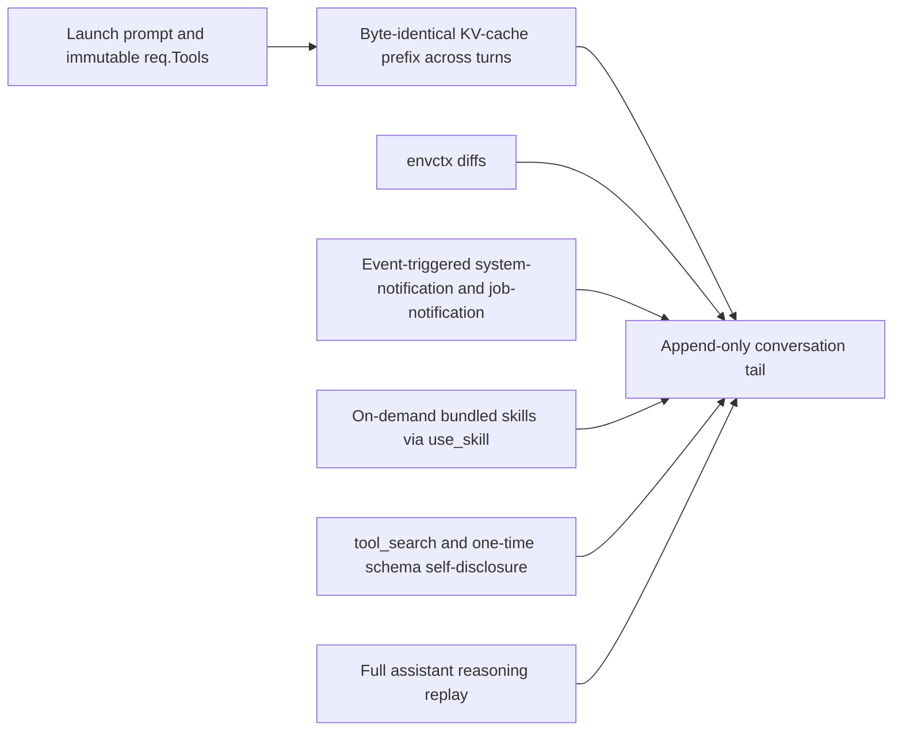

# System prompting and tool surface design

This guide defines how Evener designs, structures, gates, discloses, and tests its model-facing surfaces: the system prompt ([`agent/prompts/system.md.tmpl`](../../agent/prompts/system.md.tmpl)), tool schemas ([`agent/internal/tool/definitions.go`](../../agent/internal/tool/definitions.go) and [`agent/internal/tool/registry.go`](../../agent/internal/tool/registry.go)), bundled skills (`internal/bundled/skills/`), and runtime notifications. For product guarantees, see [the product guide](../product/README.md); for the deterministic test policy, see [testing.md](testing.md).

## Architecture at a glance

Evener separates **launch-time static context** from **runtime incremental updates** so provider prompt prefix caches stay hot across turns while rare workflows load only when triggered.



At session startup, [`agent/session_prompts.go`](../../agent/session_prompts.go) renders [`agent/prompts/system.md.tmpl`](../../agent/prompts/system.md.tmpl) once from live capabilities and freezes it (`systemPromptFrozen`). [`agent/session_tool_definitions.go`](../../agent/session_tool_definitions.go) caches the wire tool list (`cachedToolDefs`) so `req.Tools` stays stable across rounds. Runtime changes, lifecycle disclosures, job completions, and loaded skills append to the conversation tail, preserving the prefix cache.

## Identity and original prose

Evener is a peer collaborator working with human partners to achieve outcomes. Frame prompts, tool descriptions, and bundled skills directly in that voice (for example, `"You are evener. You collaborate with your human partner to achieve outcomes..."`). Avoid framing Evener as an "assistant" that "helps users".

Every word in [`agent/prompts/system.md.tmpl`](../../agent/prompts/system.md.tmpl), tool definitions, and bundled skills must be original Evener prose written in Evener's own voice. External harnesses can serve as diagnostic controls during evaluation, yet zero wording, phrasing, or structure from external harnesses may enter Evener source files.

Write model-facing prose in the exact clear, grammatical English that Evener expects the model to produce: active voice, concrete verbs, complete sentences, and intact behavioral qualifiers. Compressing prompts into telegraphic shorthand, semicolon pileups, or symbol soup degrades model clarity and risks inverting safety or lifecycle qualifiers. Trim redundant examples and throat-clearing while keeping every surviving sentence readable on its own.

## Voice, structure, and framing

Empirical prompt testing across reasoning models shows six durable rules for how wording shapes reasoning effort, tool accuracy, and turn discipline.

| Dimension | Avoid | Evener standard |
| --- | --- | --- |
| Voice | Imperative command checklists (`"Be concise."`, `"Automate work."`) | Descriptive persona and ethos statements (`"You are concise and grounded in what you ran."`, `"You believe automation is always better than doing work by hand."`) |
| Structure | Multi-clause prose walls and nested essays prescribing serialized loops | Short, single-clause atomic bullets that encourage fast inspect-and-verify cycles |
| Opening | Abstract meta-directives (`"Think first."`) | Concrete engineering actions (inspecting files, writing and editing code, running commands directly) |
| Framing | Negative checklists and forbidden-behavior lists | Positive statements of what Evener does, avoiding the pink-elephant effect |
| Scope | Task-specific hints or narrow benchmark workarounds | Timeless engineering principles that hold across all sessions |
| Markup | Decorative `<rules>` wrappers or a duplicated `<tools>` catalog | Plain Markdown headings and bullets, leaving tool schemas solely in the API `tools` array |

### Descriptive ethos outperforms imperative checklists

Descriptive identity statements (*"You are concise and grounded in what you ran"*, *"You believe automation is always better than doing work by hand"*) consistently outperform imperative command checklists (*"Be concise"*, *"Automate work"*) on reasoning models. Imperative checklists push models into defensive self-checking and long upfront deliberation; descriptive statements guide behavior with less wasted reasoning while preserving task accuracy.

### Atomic bullets outperform dense prose walls

Short, single-clause bullets outperform dense multi-clause paragraphs and nested multi-heading essays. Packing three or four prescriptions into a single sentence, or scripting rigid multi-hypothesis serialized loops, causes reasoning models to compose upfront essays ahead of inspecting the workspace. Atomic statements keep models moving through short inspect-edit-verify cycles.

### Lead with concrete actions

Open the system prompt with concrete engineering actions: inspecting files, writing and editing code, and running commands directly. Abstract meta-directives such as *"Think first"* invite extended pre-action deliberation without improving accuracy.

### Positive framing and the pink-elephant effect

State what Evener does directly, leaving out negative shopping lists of forbidden behaviors. Naming an unwanted behavior activates the exact behavior it tries to suppress. Telling a model *"instead of trying to work it out in your head"* primes mental simulation; stating *"Write a quick script to compute or verify results"* directs the model straight to execution. Keep guidance compact and omit rules that tool schemas already enforce.

### General engineering principles only

Every behavioral rule in [`agent/prompts/system.md.tmpl`](../../agent/prompts/system.md.tmpl) must read naturally as timeless engineering guidance to someone who has never seen a particular evaluation task. Principles such as *"Automation is always better than doing work by hand"* and *"Writing shell one-liners can save you a bunch of back and forth"* belong in every session. Narrow benchmark workarounds, task-tailored library hints, and eval-specific shortcuts stay out of the prompt.

### Clean markup without duplicated tool schemas

Omit decorative XML wrappers around prose rules (such as `<rules>`). Never mirror the API `tools` schema array with a redundant `<tools>` block in the system prompt; the API tool definitions are the sole authoritative catalog of callable tools and arguments. Reserve pseudo-XML tags (`<environment>`, `<environment_context>`, `<skill-catalog>`, `<available_agents>`, `<system-notification>`, `<job-notification>`) strictly for structured runtime payloads whose boundaries Evener parses or updates incrementally.

## Prompt content versus prompt length

Prompt content and framing drive per-turn reasoning and output-token inflation far more strongly than raw byte length alone. Padding a lean, descriptive prompt with neutral reference text adds minimal extra reasoning, whereas imperative, prescriptive, or multi-clause wording inflates reasoning even at identical byte length. Reducing overthinking therefore starts with rewriting framing and structure alongside trimming dead copy.

Static Turn-1 size still matters because it multiplies linearly across every turn in a session. Every byte in the launch system prompt and wire `req.Tools` rides along on every round, adding prefill latency, cache-write cost, context-window pressure, and total input tokens across long runs. Every kilobyte of Turn-1 prompt text and tool schema must earn its keep across ordinary sessions; specialized workflows belong in on-demand disclosures.

## Capability gating and honest environment reporting

Every prompt line, section, and environment block must reflect the session's actual capabilities at render time.

- **Gate on registered and advertised tools:** [`agent/prompt_data.go`](../../agent/prompt_data.go) and [`agent/session_prompts.go`](../../agent/session_prompts.go) compute `promptData.CallableTools` from the intersection of registered tools and wire-advertised definitions, exposed to [`agent/prompts/system.md.tmpl`](../../agent/prompts/system.md.tmpl) via `HasTool`. Gate every tool reference and section on `HasTool` and explicit runtime flags:
  - interactive versus non-interactive mode (`NonInteractive`, `HasAskUser`);
  - persistent versus one-shot run lifetime (`TurnEndsProcess`, which omits ceremony tools such as `notes_agent_set`, `notes_read`, `urls_add`, and `urls_remove` via `omitOneShotCeremonyTools` in [`agent/session_tool_registry.go`](../../agent/session_tool_registry.go));
  - repository and process environment (`IsGitRepo`, `GitSnapshotFailed`, `DetachSupported`);
  - delegation allowance (`CanDelegate`, `DelegationAllowance`), memory (`MemoryRead`, `MemorySearch`, `MemorySaves`, `ProjectMemory`), shared notes, and session links (`urls_add`, `urls_remove`).
- **Omit unavailable tools cleanly at render time:** Leave unavailable tools and their sections completely out of the rendered prompt. Never name omitted tools in instructional prose and never emit retraction or override text (*"this supersedes earlier instructions; tool X is unavailable here"*). Mentioning removed tools invites confusion and defeats omitting them. When runtime capabilities genuinely change mid-session or across a resume, [`agent/envctx/envctx.go`](../../agent/envctx/envctx.go) appends a compact `<environment_context>` diff carrying only changed facts and bare lifecycle labels.
- **Avoid empty noise blocks and throwaway side calls:** Omit environment blocks that convey zero actionable information for the session (such as `<git>Not a git repository.</git>` outside Git repositories, empty `<workspace>` blocks, or unset `<resource_caps>`). Skip auxiliary LLM calls such as session-title generation ([`agent/session_namer.go`](../../agent/session_namer.go)) in throwaway one-shot runs where no persistent UI consumes the generated title.

## Tool surface design, progressive disclosure, and KV-cache invariance

### Immutable prefix and full reasoning replay

Provider prompt prefix KV-caches across Anthropic, OpenAI Responses, Chat Completions, and Gemini require byte-identical prefixes: the system prompt, the `req.Tools` array (order, names, and schemas), and all prior messages.

- **Freeze the launch prefix and `req.Tools`:** Evener freezes the rendered system prompt at launch (`systemPromptFrozen` in [`agent/session_prompts.go`](../../agent/session_prompts.go)) and serves a cached wire tool list (`cachedToolDefs` in [`agent/session_tool_definitions.go`](../../agent/session_tool_definitions.go)). Avoid mutating `req.Tools` mid-session to swap deferred schemas in or out. Mid-session tool-array mutations bust the entire prompt prefix cache and convert cheap cached reads into expensive uncached prefills.
- **Never elide or prune earlier reasoning replay:** Preserve full assistant reasoning history across all wire adapters (`llm/providers/anthropic/`, `llm/providers/responses/`, `llm/providers/chatcompletions/`, and `llm/providers/google/`). Dropping or window-pruning earlier reasoning blocks invalidates the prompt prefix KV-cache and breaks continuity on reasoning models. Achieve input-token reductions by cutting static Turn-1 prompt weight, schema size, tool-result boilerplate, and unnecessary rounds while leaving history intact.

### Two-tier tool surface (when deferral is enabled)

When a session enables tool deferral to shrink Turn-1 schema overhead, keep the wire tool list immutable by splitting tools into two tiers at launch:

| Tier | Membership | Wire representation in `req.Tools` | Discovery mechanism |
| --- | --- | --- | --- |
| **Tier 1 (upfront)** | Frequent core tools (file read, edit, write, search, shell, result reporting), tiny high-frequency tools such as `web_fetch`, and configured `Tier1Tools` promotions | Full JSON schema and concise description | Directly visible at Turn 1 |
| **Tier 2 (deferred)** | Rare or schema-heavy tools permitted by session policy | Empty-description open-object stub callable directly by name | Compact read-only `tool_search` lookup plus one-time live-schema self-disclosure on invalid arguments |

Three design invariants govern this layout:

1. **Additive promotion respects policy ceilings:** Configurable `Tier1Tools` promotion promotes permitted tools from Tier 2 to Tier 1 for workflows that invoke them heavily. Promotion stays strictly inside the session's policy and denied tool ceilings; it never makes a denied or excluded tool callable.
2. **Direct open-object stubs beat wrapper indirection:** Keeping every Tier 2 tool in `req.Tools` under its own name lets the model call the tool directly without `call_tool` wrapper keys. Direct calls avoid double-encoded JSON errors, keep transcripts and UI rows legible, and keep `req.Tools` byte-identical across turns.
3. **Empty stub descriptions prevent blind bypass calls:** Deferred stubs carry empty descriptions on purpose. Putting a short summary on a deferred stub tempts models to guess parameters and skip `tool_search`. Leaving the stub bare guides the model to inspect the full schema with `tool_search` first, while one-time live-schema self-disclosure on invalid arguments recovers cleanly if the model calls a deferred tool with bad parameters.

### Preserve delegation discoverability

Hiding delegation completely suppresses delegation on multi-part work, even when parallel subagents would finish faster and cleaner. Whenever `delegate` is registered (including when its full schema is deferred to Tier 2), retain a compact Turn-1 delegation cue:

- a single-sentence cue stating when to delegate;
- a compact `<available_agents>` roster (role names, brief descriptions, and default task summaries, with authoritative per-role tool lists computed dynamically in [`agent/session_tool_definitions.go`](../../agent/session_tool_definitions.go) so the frozen launch prompt and live `delegate` schema never disagree);
- a one-line `delegate` usage hint.

When delegation is unavailable (`CanDelegate == false` or `delegate` unregistered), omit all delegation prose and `<available_agents>` completely.

### Just-in-time disclosures and bundled skills

Move specialized, multi-step lifecycle playbooks out of [`agent/prompts/system.md.tmpl`](../../agent/prompts/system.md.tmpl) into bundled skills loaded on demand via `use_skill`:

- [`running-jobs`](../../internal/bundled/skills/running-jobs/SKILL.md): delegating work, running background or detached jobs, and setting job watches.
- [`using-worktrees`](../../internal/bundled/skills/using-worktrees/SKILL.md): creating or retiring git worktrees, isolating parallel writers, and merging branches locally (see also [worktrees.md](worktrees.md)).
- [`reading-transcripts`](../../internal/bundled/skills/reading-transcripts/SKILL.md): auditing prior sessions, recovering compacted context, reading missing delegate reports, and paging retained job or artifact output.

Follow two strict rules for bundled skills and runtime disclosures:

- **Skill frontmatter states strictly when to read the skill:** Every `SKILL.md` `description` field states only the triggering situations (`"Use when ..."`), and nothing else. Summarizing rules or procedures in `<skill-catalog>` wastes Turn-1 tokens on every session and tempts models to act on the catalog blurb without loading the skill. Keep skill bodies free of parameter rules already documented in tool schemas.
- **Reinforce with event-triggered tail disclosures:** When a rare lifecycle event actually fires, append a concise `<system-notification>` or `<system-reminder>` ([`agent/system_notification.go`](../../agent/system_notification.go)) at the tail of the message stream. Tail disclosures cost zero Turn-1 tokens, preserve the prefix KV-cache, and surface instructions at the exact moment they are needed.

### Required `intent` parameters

[`agent/internal/tool/registry.go`](../../agent/internal/tool/registry.go) injects a required `intent` parameter (`toolIntentDescription`) onto tool schemas, asking for a brief verb-first gerund stating the hypothesis and desired outcome. Kept to a single concise sentence, `intent` acts as a lightweight per-call reasoning anchor that improves tool discipline and reduces tool errors. Removing `intent` degrades call quality, while expanding its description bloats every tool schema on Turn 1.

## Actionable tool results and auto-backgrounding

Runtime tool results teach the model how Evener's machinery works at the exact moment it matters. Balance routine brevity with explicit transition clarity:

- **Keep normal footers terse:** Ordinary foreground shell completions and file reads carry minimal footers (such as `[exit 0]` or a short pagination cue) so repetitive boilerplate stays out of the growing conversation history.
- **Make rare state transitions explicit:** Spend extra prose on infrequent transitions where misunderstanding causes polling loops, duplicate launches, or killed work.

Auto-backgrounding a long foreground shell command is the canonical example. Evener keeps a 120-second default foreground wait (`DefaultCommandTimeoutMS` in [`agent/session_config.go`](../../agent/session_config.go)). Raising foreground timeouts blindly traps wedged or interactive commands for minutes without feedback, while unexplained promotions cause models to mistake a healthy build or computation for a hang.

When a foreground shell command promotes to a background job, the tool result rendered by `formatShellResult` in [`agent/session_tools_shell.go`](../../agent/session_tools_shell.go) must make three facts unmistakable:

1. **The command is still running:** State the `job_...` ID, explain that the foreground wait ended while the process continues, and note that empty or quiet output commonly reflects normal stdout or pipe buffering from an active process.
2. **How completion surfaces:** Explain that completion wakes the session automatically through `<job-notification>` ([`agent/job_notify.go`](../../agent/job_notify.go)), carrying exit status, a bounded head+tail or retained output excerpt, and the `job:<job_id>` `transcript_ref` for paging full output via `read_transcript`.
3. **The exact wait sequence:** Spell out how to wait cleanly once no independent work remains:
   - In **persistent sessions**, yield quietly with `communicate` (`next="log_quietly_and_end_turn"`, brief wait note).
   - In **one-shot (`TurnEndsProcess`) runs**, attach `job_watch` first (for example `progress_interval_ms` of a few minutes or `output_match`) so the background job survives turn end, then yield quietly with `communicate` (`next="log_quietly_and_end_turn"`). Avoid calling `sleep`, polling `job_status`, or stopping a healthy buffered job.

## Testing and evaluating prompt changes

Prompt and tool-surface changes pass through three tiers of verification, from millisecond deterministic unit tests to full end-to-end container benchmarks.

### 1. Structural unit tests, never copy oracles

Follow [Prompt Prose Is Not a Test Oracle](testing.md#prompt-prose-is-not-a-test-oracle) and [Copy Is Not a Test Oracle](testing.md#copy-is-not-a-test-oracle) in [testing.md](testing.md). Never pin prompt text with golden snapshots or assert on wording, substrings, regexes, clause order, or token counts. Review natural-language phrasing directly in the diff.

Pin structural invariants in deterministic Go tests:

- **Template inputs and branch coverage** ([`agent/system_prompt_test.go`](../../agent/system_prompt_test.go)): verify typed `promptData` inputs, operator-input propagation using opaque sentinels (`TestSystemPromptCarriesEachOperatorInputOnce`), and rendered session facts (`TestSystemPromptRendersTheSessionData`) across interactive, headless, one-shot, and delegate session shapes.
- **Shipped-prompt tool sweep** ([`agent/bundled_prompt_tool_mentions_test.go`](../../agent/bundled_prompt_tool_mentions_test.go)): `TestShippedPromptsOnlyNameToolsTheSessionHas` sweeps every shipped agent's assembled system prompt against its actual registered tools so ungated tool mentions fail CI immediately.
- **Cross-view capability agreement** ([`agent/oneshot_ceremony_test.go`](../../agent/oneshot_ceremony_test.go)): verify that the tool registry, wire `ToolDefinitions()`, `promptData.HasTool`, and rendered prompt sections agree on every omitted or gated capability.

```sh
go test ./agent -run 'TestShippedPromptsOnlyNameToolsTheSessionHas|TestSystemPrompt|TestOneShotOmitsCeremonyTools' -count=1
```

### 2. Zero-container prefix replay first

Before spending container or cloud evaluation cycles on a wording, framing, or reasoning-inflation hypothesis, replay recorded `.api.jsonl` Turn 1 through Turn 3 prefixes directly against the target model with controlled prompt or tool-schema mutations (for example, using `evener-overthink-probe`).

Run multiple repetitions per prefix to separate genuine signal from sampling variance. Zero-container prefix replay skips image setup and long tool execution, testing causal hypotheses on reasoning tokens, tool selection, and argument fidelity in minutes.

### 3. Paired AB/BA container evaluation and multi-model smoke checks

Validate surviving candidates end-to-end before merging:

- **Wave-interleaved paired AB/BA runs:** Pair every candidate against a control built from the same base commit, run on the same fleet and day, interleaving A/B and B/A waves to control for gateway load and time-of-day variance. Isolate individual hypotheses before stacking them so regressions stay attributable.
- **Gateway weather hygiene:** Record raw API logs (`--api-log on`) for every trial and compute normalized metrics directly from raw logs. Exclude pairs contaminated by rate-limit stalls or provider outages from efficiency deltas, while reporting raw pass rates, behavior timeouts, gateway timeouts, and outages side-by-side. Never hide behavior timeouts inside passed-only averages.
- **Complete normalized accounting:** Track all four efficiency and reliability dimensions together so token savings never trade away pass rate:
  - **Reliability:** raw pass rate, deterministic guard pass rate, behavior timeouts, tool-error rate, and 100% reasoning-replay continuity.
  - **Input tokens:** Turn-1 input tokens, total input tokens (uncached input plus cache read plus all cache-creation tiers), and uncached input tokens.
  - **Output tokens:** total output tokens including reasoning tokens, plus peak single-round output tokens (the primary detector of runaway reasoning spirals).
  - **Execution efficiency:** tool-call counts and timing splits (generation wait, gateway stall wait, and tool execution time).
- **Multi-model smoke checks:** Exercise changed prompts and tool schemas across Evener's supported model families and audit session health with `evener doctor` before shipping.

## Pre-PR review checklist

Before opening a pull request that edits [`agent/prompts/system.md.tmpl`](../../agent/prompts/system.md.tmpl), [`agent/internal/tool/definitions.go`](../../agent/internal/tool/definitions.go), `internal/bundled/skills/`, or runtime tool result text:

1. Read every changed line for original Evener collaborator prose in clear, grammatical English.
2. Confirm positive, descriptive, atomic phrasing carrying general engineering principles.
3. Verify every tool mention and section is gated on live capabilities (`HasTool` and runtime flags) and run the structural prompt tests.
4. Confirm launch-prefix and `req.Tools` immutability and full reasoning-replay preservation.
5. Verify any touched skill `description` states strictly when to read the skill.
6. Attach prefix-replay and paired AB/BA evaluation evidence for behavioral or tool-surface changes.
