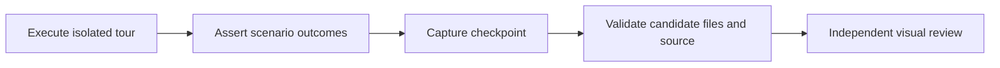

# Tutorial screenshot candidates

Tutorial tours execute the real CLI and web hub against a scripted provider.
They capture checkpoints only after independent scenario assertions pass.
They do not publish assets or approve screenshots.

## Active coverage

The active matrix is four scenarios (`receipt`, `daily`, `configuration`, and
`extensions`) × two surfaces (`cli`, `web`) × three checkpoints (`entry`,
`action`, `verified`): **24 rows**. Native is deferred. Every manifest records
`deferredSurfaces: ["native"]`; requesting native fails rather than skipping it.
The CLI daily-work tour verifies sequential resume, not interactive web controls.

`complete: true` means the selected full CLI/web matrix passed artifact
validation. It does not mean native was verified or publication was approved.
Known contradictory sidebar captures remain a publication blocker. Reviewers
must check screenshots against the tutorial, even when validation succeeds.

## Run serially

Use Node 22, Go, installed docs-site and frontend dependencies, Python 3, and
the Playwright Chromium browser. Set `PLAYWRIGHT_BROWSERS_PATH` when the browser
cache is outside the default location. The web tour builds the frontend before
embedding it in the test binary. Do not run frontend builds or tours concurrently.

```sh
node --test docs-site/scripts/tours/artifacts.test.mjs
node docs-site/scripts/tours/refresh.mjs check --surfaces cli,web --scenario receipt
node docs-site/scripts/tours/refresh.mjs refresh --surfaces cli,web --out /ABS/OWNED-SCRATCH/new-candidate
node docs-site/scripts/tours/refresh.mjs validate --surfaces cli,web --out /ABS/OWNED-SCRATCH/new-candidate
```

The scratch parent must exist. `refresh` requires an explicit absolute path to a
new directory outside the repository. Existing destinations and symlinked paths
are refused, including approved assets and site staging. `check` permits subset
coverage and uses temporary output unless given `--out`; subset manifests have
`complete: false`. Native cannot be added to either command.

## Evidence and safety



The Go coordinator records the assertions that authorized each checkpoint.
The wrapper copies only images and selectable CLI text into the candidate.
Raw records and private control/config state stay in separate temporary roots;
normal completion, failure, and handled interruption clean those roots. A handled
interrupt waits for the current bounded Go tour to finish so its cleanup runs.
A forced process kill may leave temporary state for manual inspection. Never
publish it.

`manifest.json` version 1 records the revision, dirty-source digest, tool
versions, explicit coverage, deferral, completeness, and each checkpoint's
representation, hashes, dimensions, assertions, and result. CLI rows also name
and hash selectable text. Paths follow `scenario/surface/checkpoint.png` and
`.txt`. Validation checks exact coverage, passing assertions, file inventory,
PNG CRCs and decompressed pixel layout, dimensions, hashes, safe paths, and
source correspondence. It scans metadata and text for credentials, canaries,
and private paths. This is not an image-secret detector: inspect every image.

The source digest uses working bytes from tracked and non-ignored untracked
files in runtime packages, CLI/hub/frontend code, AppWire clients, test fixtures,
build scripts, Go module/workspace files, docs examples, and tour scripts and
package metadata. It includes dirty changes, not just HEAD. It excludes native
and XCTest tour files while native is deferred, along with unrelated docs and
publication output. See `sourceTreeDigest` for the exact scope. Revision and
digest must still match at review time; changed relevant source requires fresh
evidence. A commit changes the revision even when working bytes stay the same.

Candidates remain outside Git for independent review. A failed run leaves no
valid complete manifest; use a new output directory for the next attempt.
This tool has no acceptance command and never writes approved images or
`docs-site/publication.json`. Selecting and publishing reviewed assets is a
separate task.
