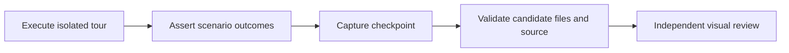

# Tutorial screenshot candidates

Tutorial tours execute the real CLI and web hub against a scripted provider.
They capture checkpoints only after independent scenario assertions pass.
They do not publish assets or approve screenshots.

## Active coverage

The active matrix is four scenarios (`receipt`, `daily`, `configuration`, and
`extensions`) × two surfaces (`cli`, `web`) × three checkpoints (`entry`,
`action`, `verified`): **24 rows**. Native is deferred. Every manifest records
`deferredSurfaces: ["native"]`; requesting native fails rather than skipping it.
The CLI daily-work tour verifies sequential resume, not interactive web controls.

`complete: true` means the selected full CLI/web matrix passed artifact
validation. It does not mean native was verified or publication was approved.
Reviewers must check screenshots against the tutorial, even when validation
succeeds. Earlier contradictory sidebar captures must not be selected; use a
fresh run with the sidebar readiness check.

## Run serially

Run these contributor commands from the Evener repository root. Use Node 22,
Go, installed docs-site and frontend dependencies, Python 3, and
the Playwright Chromium browser. Set `PLAYWRIGHT_BROWSERS_PATH` when the browser
cache is outside the default location. The web tour builds the frontend before
embedding it in the test binary. Do not run frontend builds or tours concurrently.

```sh
node --test docs-site/scripts/tours/*.test.mjs docs-site/scripts/tutorial-artifacts.test.mjs
node docs-site/scripts/tours/refresh.mjs check --surfaces cli,web --scenario receipt
node docs-site/scripts/tours/refresh.mjs refresh --surfaces cli,web --out /ABS/OWNED-SCRATCH/new-candidate
node docs-site/scripts/tours/refresh.mjs validate --surfaces cli,web --out /ABS/OWNED-SCRATCH/new-candidate
node docs-site/scripts/tours/review.mjs --candidate /ABS/OWNED-SCRATCH/new-candidate --out /ABS/OWNED-SCRATCH/new-review
```

The scratch parent must exist. `refresh` requires an explicit absolute path to a
new directory outside the repository. Existing destinations and symlinked paths
are refused, including approved assets and site staging. `check` permits subset
coverage and uses temporary output unless given `--out`; subset manifests have
`complete: false`. Native cannot be added to either command.

## Evidence and safety



The Go coordinator records the assertions that authorized each checkpoint.
The wrapper copies only images and selectable CLI text into the candidate.
Raw records and private control/config state stay in separate temporary roots;
normal completion, failure, and handled interruption clean those roots. A handled
interrupt waits for the current bounded Go tour to finish so its cleanup runs.
A forced process kill may leave temporary state for manual inspection. Never
publish it.

When a child command fails, the wrapper retains its stdout/stderr in a separate
owned temporary directory (0700), in `process.json` (0600). The error reports
only that path. Treat this file as private, inspect it locally, and remove the
directory after diagnosis. It is not candidate evidence and must not be copied
into the site. Successful commands leave no diagnostic file.

Web setup failures also retain the full Playwright error in a protected
`failure.json` outside the Go-owned temporary root. Public errors identify the
action phase and private file path, not the locator details. Apply the same
local-inspection and deletion rule to this file.

`manifest.json` version 1 records the revision, dirty-source digest, tool
versions, explicit coverage, deferral, completeness, and each checkpoint's
representation, hashes, dimensions, assertions, and result. CLI rows also name
and hash selectable text. Paths follow `scenario/surface/checkpoint.png` and
`.txt`. Validation checks exact coverage, passing assertions, file inventory,
PNG CRCs and decompressed pixel layout, dimensions, hashes, safe paths, and
source correspondence. It scans metadata and text for credentials, canaries,
and private paths. This is not an image-secret detector: inspect every image.

The source digest uses working bytes from tracked and non-ignored untracked
files in runtime packages, CLI/hub/frontend code, AppWire clients, test fixtures,
build scripts, Go module/workspace files, docs examples, and tour scripts and
package metadata. It includes dirty changes, not just HEAD. It excludes native
and XCTest tour files while native is deferred, along with unrelated docs and
publication output. See `sourceTreeDigest` for the exact scope. Revision and
digest must still match at review time; changed relevant source requires fresh
evidence. A commit changes the revision even when working bytes stay the same.

Candidates remain outside Git for independent review. A failed run leaves no
valid complete manifest; use a new output directory for the next attempt.
This tool has no acceptance command and never writes approved images or
`docs-site/publication.json`. Selecting and publishing reviewed assets is a
separate task.

## Review and publication

Review the full 24-row candidate against the relevant working source before
selecting files. `refresh` and `validate` require both the recorded revision and
source digest to match the checkout. Freeze relevant source during review; a
change requires fresh evidence. Inspect every image for legibility, clipping,
private data, and agreement with the instructions. CLI PNGs render recorded
commands and output, not an interactive terminal; the paired `.txt` files are
selectable output. Web PNGs capture the real browser UI, with exact owned
workspace labels masked rather than rewritten.

`review.mjs` validates the current candidate and the historical published set,
then writes `summary.json`, `review.md`, and `refresh.patch` to a new directory
outside the repository and both inputs. It refuses existing outputs and symlinks.
The command never changes its inputs, applies the patch, or publishes assets.
The summary reports `sourceChanged`, `changedFiles`, and a status of `unchanged`
or `review-required`. Matching relevant source and artifact content need no
replacement merely because the capture revision changed. A changed source
digest or evidence requires review even if the pixels match.

Failures exit 1 and write JSON to stderr with `status: "failed"` and a fixed
`code`. Diagnostics never include input values, paths, or caught error messages.

| Code | What to check |
| --- | --- |
| `invalid-arguments` | Required, unknown, missing-value, or duplicate CLI options. |
| `unsafe-path` | Output must be absolute, outside every input, and free of symlinks. Check input paths for symlinks too. |
| `output-unavailable` | Choose a new output directory with an existing writable parent. |
| `stale-source` | Candidate revision or source digest no longer matches. Capture fresh evidence. |
| `private-data` | Candidate or published metadata/text contains private data. Inspect locally, never paste it into a report. |
| `invalid-candidate` | Candidate files, manifest, or source repository failed validation. |
| `invalid-published` | Published files or manifest failed historical validation. |
| `review-failed` | Review preparation or output writing failed after validation. Check local Git and storage. |

Check `summary.json` first. If its status is `unchanged`, stop without applying:
the patch is empty and no replacement is needed. For `review-required`, inspect
all 24 images and 12 selectable transcripts, not just changed files.
After independent evidence review and approval, apply the proposed patch
locally with `git apply --check /ABS/OWNED-SCRATCH/new-review/refresh.patch`, then
`git apply /ABS/OWNED-SCRATCH/new-review/refresh.patch`. The patch touches only
canonical tutorial assets and their manifest. Keep their explicit entries in
`docs-site/publication.json.assets`; the review command does not edit that file.
Commit the manifest and selected files together; never copy raw logs or an entire run directory.
Use ordinary relative Markdown image and text links. Instructions and meaningful
alt text must explain the result without requiring the image.

`npm --prefix docs-site run build` validates the checked-in set before staging
it. Missing rows, files, explicit asset entries, native deferral, or passing
evidence fail the build, as do changed hashes and wrong representations.
The recorded `sourceRevision` and `sourceTreeDigest` are historical capture
provenance, not a claim that every later main revision reran those captures.
Publication validates their format and preserves their values; it does not
require equality with a future HEAD or working tree. This exception applies
only to checked-in publication, never current-candidate validation. Do not edit
provenance to make an old capture look current.

The build warns when relevant source bytes differ from the capture. An unrelated
documentation commit or the later asset commit alone does not trigger that warning.
New candidates still require both the current revision and source digest.

CI provisions Go, Python, Node, frontend/docs dependencies, and Chromium. It
executes all four CLI/web scenarios before building and browser-checking the
docs site. Successful validation retains the sanitized 24-row candidate as the
`tutorial-candidate-cli-web` workflow artifact for review, never private raw logs.
Workflow candidates are not publication approval. Missing requested-lane prerequisites fail. Pages deploys checked-in
reviewed assets from main, not runtime candidates. Native remains deferred and
unverified; there is no native publication lane. Host installation, live provider
authentication, model quality, physical devices, and camera pairing are not
proved by these scripted-provider tours.

Before publication, request independent full-corpus audits from different OpenAI
and Lunaroute models. Supply the revision, executed matrix, and coverage limits;
require source or executed evidence, deduplicate findings, and fix confirmed
issues. Missing audits leave the publication gate incomplete. These reviews are
opt-in, not live-provider dependencies in deterministic CI.
