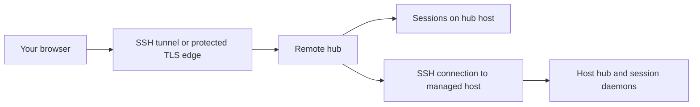
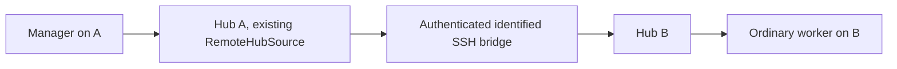

# Remote hub operations

Run the hub near the repositories and tools it manages, then connect your browser through a protected connection. This guide covers both a browser reaching one remote hub and a hub managing additional execution hosts. Credentials, paths, and processes belong to the execution host—not the browser's machine.

## Choose the topology



For one remote machine, start with an SSH tunnel to its loopback hub. For several machines, configure managed hosts in the hub. A tunnel forwards a port; it does not copy your repository, provider credentials, or laptop environment.

## Connect to one remote hub

Prerequisites: SSH access, an installed Evener build on the remote host, a repository there, and a provider connection available to the remote user. Use the [installation guide](getting-started.md) rather than assuming a source checkout is an installed runtime.

On the remote host, start the hub on loopback:

```sh
evener hub --addr 127.0.0.1:9180
```

The startup authorization URL contains a bearer credential. Keep the terminal and supervisor logs private. Do not copy that URL into a ticket or chat.

On your laptop, open the tunnel:

```sh
ssh -N -L 9180:127.0.0.1:9180 hubbox.example
```

Replace `hubbox.example` with your SSH host. If local port 9180 is occupied, use a different **local** port, such as `19180:127.0.0.1:9180`. Visit the remote hub's authorization URL through `http://127.0.0.1:9180` (or your chosen local port), preserving its private token path.

Check transport without displaying credentials:

```sh
curl -fsS http://127.0.0.1:9180/api/health
```

Then open New session, select the remote working directory, and [connect a provider](connecting-a-provider.md) on that host. Confirm the host, directory, and model before starting. A healthy HTTP endpoint is not proof of provider access.

## Trust boundary

The hub uses a long-lived capability token stored at `<hub_state_root>/auth-token`. New token files are mode `0600`; an existing file's mode is not automatically repaired. `/auth/<token>`, `/api/health`, `/api/device-pairing`, and PWA icons are public exceptions; other routes require authorization. [Device pairing](device-pairing.md) uses an invitation and requires approval before releasing credentials, rather than requiring the hub token or cookie. The cookie is HTTP-only and SameSite=Lax. This is full hub access, not per-user roles.

Hub serves plain HTTP. Do not expose it directly to an untrusted network. A private VPN also needs access controls and a firewall. If you deliberately bind to `0.0.0.0:9180` or `[::]:9180`, every permitted interface can accept connections; set those controls **before** changing the bind address.

For a TLS reverse proxy, use its `https://` origin in the authorization URL. Hub's cookie uses `Secure=false` to permit direct loopback HTTP; configure the proxy to add `Secure` before offering access over an untrusted network. Protect WebSocket connections as well as ordinary HTTP. Never put the capability in a public proxy access log.

## Configure the service host

Use the same service user for the hub, repositories, provider configuration, and diagnostics. Set XDG paths in its supervisor environment before starting the hub. A GUI login shell and a system service need not have the same environment.

This complete `/etc/evener/hub.toml` example assumes the service user owns private directories beneath `/var/lib/evener`:

```toml
addr = "127.0.0.1:9180"
hub_state_root = "/var/lib/evener/state/evener"
run_dir = "/var/lib/evener/state/evener/run"
state_glob = "/var/lib/evener/state/evener/projects/*"
past_index_db = "/var/lib/evener/state/evener/index.db"
spawn_timeout = "30s"
past_index_rebuild_interval = "60s"
past_results_per_page = 50
api_log = false
```

Start it through your supervisor with `XDG_STATE_HOME=/var/lib/evener/state` and an appropriate private `XDG_CONFIG_HOME`. The paths in TOML are literal; TOML does not expand `$HOME`.

```sh
evener hub --config /etc/evener/hub.toml --evener /usr/local/bin/evener
```

Adjust the executable path to the installed build. `--addr` overrides the configured listener; `--evener` selects the runtime used for local daemons. Use [Configuration](configuration.md) for launch defaults; do not create a second credential hierarchy in `hub.toml`.

`run_dir` contains rendezvous records and logs, including daemon access tokens. Keep it private. `state_glob` must match the actual durable session directories. An invocation-level `EVENER_STATE_DIR` override can put sessions outside the usual project layout; changing only the index glob does not move those sessions.

## Managed execution hosts and deployment

A managed host needs SSH connectivity, the required tools, and repository/configuration paths on that host. Use host-scoped settings for provider connections and launch defaults. Check the selected host before saving a credential or trusting a repository launch file.

### Remote Manager and input support

A Manager manages sessions reachable through its own hub. Start it with
`manager: true` in the AppWire `thread/start` parameters; anyone authorized to
start a session may set that immutable bit. The daemon persists and reports it,
and the hub reads the projection. A Manager on hub B uses B for `job_status`
and other management calls, even when someone views or starts it through hub A.
Hub A does not install a runtime binding on B's Manager.



A local Manager on hub A sends to an ordinary worker on SSH-hosted hub B through
A's existing `RemoteHubSource`. Manager input uses a private envelope on that
authenticated, identified bridge. B qualifies the caller with A's durable hub ID
before saving its attribution, so the actor cannot be mistaken for a session on B.
The real-stack [TestE2E_ManagerAcceptance](../cmd/evener-hub/e2e_manager_acceptance_test.go)
exercises `delegate_send`, the remote worker's `ask_user`, the Manager's answer,
and the saved actors. It also checks a Manager on B using B's own hub for `job_status`.

The existing authenticated connection exchanges the hubs' persisted IDs. This
identifies cooperating hubs; it is **not cryptographic isolation between hostile
token holders**. A hub bearer token is not a hub identity. Tool arguments cannot
supply caller authority or actor metadata.

Session configuration supplies Manager schemas even while transport is down.
Calls may report unavailable, but healthy ordinary session work continues.
Resume, process restart and Clear preserve the Manager bit; fresh roots and forks
do not inherit it. See [Manager sessions](automation.md#manager-sessions).

The shared remote source carries text Send, Queue and Steer, plus skill and command input **only when the target advertises those capabilities**. Human and Manager input use the same remote mutation receipts and target validation. Unsupported input modes stay unavailable; unrelated remote mutations are not advertised. Reads, status and sandbox approval use their existing routes.

Manager worker creation remains local to the Manager's own hub. Remote creation
through the Manager's `delegate` branch is deferred; start a worker through the
remote host's own client, then use its source-qualified ref. Discovery of an empty
remote host and its model catalog does not create a worker there.

The real two-hub localhost SSH
[remote approval test](../cmd/evener-hub/manager_readiness_approval_test.go)
checks a restricted worker's denied write, a Manager's shared watch and approval
without a browser subscriber, the changed file and the saved Manager-attributed
decision and successful tool result. Only the external model responses are
scripted. Live-model behavior and non-localhost deployment remain unqualified.

**Remote Manager `job_watch` uses the same shared hub subscription path as human clients.** It supports targeted status, question, approval and communicate notifications plus accepted terminal completion. Question/answer/completion and saved Manager actor attribution are qualified through real two-hub SSH acceptance without a browser. A Manager attach or clear preserves existing human subscribers. Daemon socket reconnect is separately checked for local and remote routing with the original human subscriber retained; this is not a claim about SSH bridge reconnect. Resync re-reads authoritative state regardless of event selectors, retains the watched execution on the same generation, and ends the old watch on replacement.

Run the actual SSH acceptance explicitly with
`EVENER_SSH_E2E=1 EVENER_SSH_E2E_DEPLOY=1 go test ./cmd/evener-hub -run '^TestE2E_ManagerAcceptance$' -count=1`.
It uses a new test-owned localhost SSH directory and reaps fixture daemons before removal.
`TestE2E_ManagerRemoteSharedInput` exercises real remote-wire routing locally, not SSH.

**Connect preserves a compatible running hub.** The controller verifies its live AppWire handshake and uses that same channel without replacing the binary or restarting the process. A different build label or unavailable cross-platform artifact does not prevent connection. Host details report the remote process's build, or unknown when the handshake omits build metadata.

Connect still provisions a missing installation or upgrades a proven incompatible one. An explicit Connect can start a stopped compatible installation after proving no hub is listening; background reconnect cannot. Authentication, transport and malformed-handshake failures remain connection errors and do not authorize deployment. Explicit Deploy keeps its plan, confirmation and requested-build verification.

Add a host through the hub's host settings, or merge a `[[hosts]]` entry into the controller's `hub.toml`. This complete TOML example names one SSH target and an advisory project root:

```toml
[[hosts]]
name = "buildbox"
ssh = "buildbox.example"
user = "developer"
roots = ["/srv/projects"]
```

Replace these example values with paths and an account on the remote machine. Optional `evener_path`, `config_path`, and `addr` identify a nondefault remote executable, hub config, and listener. `key_path` selects an SSH private-key file; it is a path, never the key contents. Preserve machine-managed host records when editing the file. The exact fields are defined in [HostConfig](../cmd/evener-hub/config.go).

| Hub startup option | Effect |
| --- | --- |
| `--deploy-binary /absolute/path/to/evener` | Use a prebuilt artifact; target and Evener identity are checked |
| `--build-source /absolute/path/to/checkout` | Cross-compile from an Evener source tree on the controller |
| `--no-deploy` | Disable push and installer deployment paths |

`--no-deploy` wins over the other options; `--deploy-binary` wins over `--build-source`. When installation is required, a cross-platform host cannot run the controller's own executable, so the hub may use a published release/snapshot installer instead. Development, dirty, or unstamped builds cannot always be pinned to a published artifact. These source constraints do not apply to using an already-compatible installation. A host that needs provisioning still needs a suitable artifact and deployment permission.

The [hub deployment reference](evener-hub.md#deploying-to-remote-hosts) retains the exact artifact, dirty-build, atomic replacement, identity, and retry rules. After an interrupted deployment, the connection manager reconciles the pending replacement against its captured requested build and predecessor process. A compatible handshake alone cannot settle that operation, and later disk changes cannot redefine its target. Inspect the operation's status when recovery remains unresolved; response loss does not prove the remote write failed.

Automatic recovery retains the host-entry check that authorized the unfinished
work. If that entry changes, it refuses further writes or restarts while keeping
the pending work. Restore the entry and retry, or issue a fresh Restart to accept
the changed entry after validation. Fresh Restart keeps the originally requested
build and installation target; it does not silently retarget the work. Replaying
the same operation ID or reconnecting cannot authorize the changed entry. A new
confirmed Deploy can replace the unfinished request at its first authorized write.

## Restart and upgrade safely

Record the actual supervisor job, executable, flags, and config paths when provisioning. Keep environment sources private. Restart that exact service rather than killing every process named `evener`; session daemons can share the same executable name.

Stopping the hub does not stop every session daemon. Existing daemons keep their running build after the executable on disk is replaced. Finish or stop them deliberately if an upgrade requires all sessions to use the new build. The hub lock prevents two hubs sharing one state root; a lock error is not a reason to delete the lock file.

After restart:

1. Check `/api/health` through the same route the browser uses.
2. Compare its version and startup time with the intended deployment.
3. Reconnect to an existing session and confirm its transcript is visible.
4. Start a small, explicitly authorized new task only when provider access needs a live check.

The first three checks do not validate model generation. See [upgrades and migration](evener-hub.md#upgrading-and-migrating-safely) and [storage and backups](security.md#storage-and-backups). A backup of the controller does not automatically back up managed hosts.

## Recover a failed connection

| Failure | Next check |
| --- | --- |
| Tunnel refuses connection | Remote hub listener, SSH forwarding, local port collision |
| Browser unauthorized | Correct hub's private capability and origin |
| Host unavailable | SSH authentication and connectivity before provider debugging |
| Build mismatch | Deployment source, target platform, stamped build, `--no-deploy` policy |
| Model absent only remotely | Credentials and endpoint variables on the selected host |
| Settings saved on wrong machine | Host selector and file paths, not browser storage |
| Session disappeared after restart | Effective `run_dir`, `state_glob`, XDG paths, and daemon health |

Keep logs private: startup output contains authorization URLs. For a report, include sanitized host labels, build identities, timestamps, and the exact failure—not tokens, full environments, or whole rendezvous records. [Troubleshooting](troubleshooting.md) gives read-only diagnostic commands.
