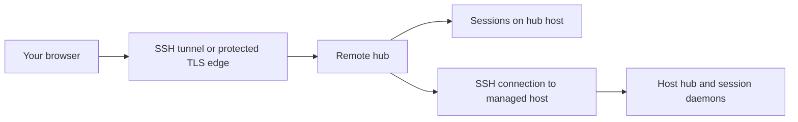

# Remote hub operations

Run the hub near the repositories and tools it manages, then connect your browser through a protected connection. This guide covers both a browser reaching one remote hub and a hub managing additional execution hosts. Credentials, paths, and processes belong to the execution host—not the browser's machine.

## Choose the topology



For one remote machine, start with an SSH tunnel to its loopback hub. For several machines, configure managed hosts in the hub. A tunnel forwards a port; it does not copy your repository, provider credentials, or laptop environment.

## Connect to one remote hub

Prerequisites: SSH access, an installed Evener build on the remote host, a repository there, and a provider connection available to the remote user. Use the [installation guide](getting-started.md) rather than assuming a source checkout is an installed runtime.

On the remote host, start the hub on loopback:

```sh
evener hub --addr 127.0.0.1:9180
```

The startup authorization URL contains a bearer credential. Keep the terminal and supervisor logs private. Do not copy that URL into a ticket or chat.

On your laptop, open the tunnel:

```sh
ssh -N -L 9180:127.0.0.1:9180 hubbox.example
```

Replace `hubbox.example` with your SSH host. If local port 9180 is occupied, use a different **local** port, such as `19180:127.0.0.1:9180`. Visit the remote hub's authorization URL through `http://127.0.0.1:9180` (or your chosen local port), preserving its private token path.

Check transport without displaying credentials:

```sh
curl -fsS http://127.0.0.1:9180/api/health
```

Then open New session, select the remote working directory, and [connect a provider](connecting-a-provider.md) on that host. Confirm the host, directory, and model before starting. A healthy HTTP endpoint is not proof of provider access.

## Trust boundary

The hub uses a long-lived capability token stored at `<hub_state_root>/auth-token`. New token files are mode `0600`; an existing file's mode is not automatically repaired. `/auth/<token>`, `/api/health`, `/api/device-pairing`, and PWA icons are public exceptions; other routes require authorization. [Device pairing](device-pairing.md) uses an invitation and requires approval before releasing credentials, rather than requiring the hub token or cookie. The cookie is HTTP-only and SameSite=Lax. This is full hub access, not per-user roles.

Hub serves plain HTTP. Do not expose it directly to an untrusted network. A private VPN also needs access controls and a firewall. If you deliberately bind to `0.0.0.0:9180` or `[::]:9180`, every permitted interface can accept connections; set those controls **before** changing the bind address.

For a TLS reverse proxy, use its `https://` origin in the authorization URL. Hub's cookie uses `Secure=false` to permit direct loopback HTTP; configure the proxy to add `Secure` before offering access over an untrusted network. Protect WebSocket connections as well as ordinary HTTP. Never put the capability in a public proxy access log.

## Configure the service host

Use the same service user for the hub, repositories, provider configuration, and diagnostics. Set XDG paths in its supervisor environment before starting the hub. A GUI login shell and a system service need not have the same environment.

This complete `/etc/evener/hub.toml` example assumes the service user owns private directories beneath `/var/lib/evener`:

```toml
addr = "127.0.0.1:9180"
hub_state_root = "/var/lib/evener/state/evener"
run_dir = "/var/lib/evener/state/evener/run"
state_glob = "/var/lib/evener/state/evener/projects/*"
past_index_db = "/var/lib/evener/state/evener/index.db"
spawn_timeout = "30s"
past_index_rebuild_interval = "60s"
past_results_per_page = 50
api_log = false
```

Start it through your supervisor with `XDG_STATE_HOME=/var/lib/evener/state` and an appropriate private `XDG_CONFIG_HOME`. The paths in TOML are literal; TOML does not expand `$HOME`.

```sh
evener hub --config /etc/evener/hub.toml --evener /usr/local/bin/evener
```

Adjust the executable path to the installed build. `--addr` overrides the configured listener; `--evener` selects the runtime used for local daemons. Use [Configuration](configuration.md) for launch defaults; do not create a second credential hierarchy in `hub.toml`.

`run_dir` contains rendezvous records and logs, including daemon access tokens. Keep it private. `state_glob` must match the actual durable session directories. An invocation-level `EVENER_STATE_DIR` override can put sessions outside the usual project layout; changing only the index glob does not move those sessions.

## Managed execution hosts and deployment

A managed host needs SSH connectivity, the required tools, and repository/configuration paths on that host. Use host-scoped settings for provider connections and launch defaults. Check the selected host before saving a credential or trusting a repository launch file.

**Connect preserves a compatible running hub.** The controller verifies its live AppWire handshake and uses that same channel without replacing the binary or restarting the process. A different build label or unavailable cross-platform artifact does not prevent connection. Host details report the remote process's build, or unknown when the handshake omits build metadata.

Connect still provisions a missing installation or upgrades a proven incompatible one. An explicit Connect can start a stopped compatible installation after proving no hub is listening; background reconnect cannot. Authentication, transport and malformed-handshake failures remain connection errors and do not authorize deployment. Explicit Deploy keeps its plan, confirmation and requested-build verification.

Add a host through the hub's host settings, or merge a `[[hosts]]` entry into the controller's `hub.toml`. This complete TOML example names one SSH target and an advisory project root:

```toml
[[hosts]]
name = "buildbox"
ssh = "buildbox.example"
user = "developer"
roots = ["/srv/projects"]
```

Replace these example values with paths and an account on the remote machine. Optional `evener_path`, `config_path`, and `addr` identify a nondefault remote executable, hub config, and listener. `key_path` selects an SSH private-key file; it is a path, never the key contents. Preserve machine-managed host records when editing the file. The exact fields are defined in [HostConfig](../cmd/evener-hub/config.go).

| Hub startup option | Effect |
| --- | --- |
| `--deploy-binary /absolute/path/to/evener` | Use a prebuilt artifact; target and Evener identity are checked |
| `--build-source /absolute/path/to/checkout` | Cross-compile from an Evener source tree on the controller |
| `--no-deploy` | Disable push and installer deployment paths |

`--no-deploy` wins over the other options; `--deploy-binary` wins over `--build-source`. When installation is required, a cross-platform host cannot run the controller's own executable, so the hub may use a published release/snapshot installer instead. Development, dirty, or unstamped builds cannot always be pinned to a published artifact. These source constraints do not apply to using an already-compatible installation. A host that needs provisioning still needs a suitable artifact and deployment permission.

The [hub deployment reference](evener-hub.md#deploying-to-remote-hosts) retains the exact artifact, dirty-build, atomic replacement, identity, and retry rules. After an interrupted deployment, the connection manager reconciles the pending replacement against its captured requested build and predecessor process. A compatible handshake alone cannot settle that operation, and later disk changes cannot redefine its target. Inspect the operation's status when recovery remains unresolved; response loss does not prove the remote write failed.

Automatic recovery retains the host-entry check that authorized the unfinished
work. If that entry changes, it refuses further writes or restarts while keeping
the pending work. Restore the entry and retry, or issue a fresh Restart to accept
the changed entry after validation. Fresh Restart keeps the originally requested
build and installation target; it does not silently retarget the work. Replaying
the same operation ID or reconnecting cannot authorize the changed entry. A new
confirmed Deploy can replace the unfinished request at its first authorized write.

## Restart and upgrade safely

Record the actual supervisor job, executable, flags, and config paths when provisioning. Keep environment sources private. Restart that exact service rather than killing every process named `evener`; session daemons can share the same executable name.

Stopping the hub does not stop every session daemon. Existing daemons keep their running build after the executable on disk is replaced. Finish or stop them deliberately if an upgrade requires all sessions to use the new build. The hub lock prevents two hubs sharing one state root; a lock error is not a reason to delete the lock file.

After restart:

1. Check `/api/health` through the same route the browser uses.
2. Compare its version and startup time with the intended deployment.
3. Reconnect to an existing session and confirm its transcript is visible.
4. Start a small, explicitly authorized new task only when provider access needs a live check.

The first three checks do not validate model generation. See [upgrades and migration](evener-hub.md#upgrading-and-migrating-safely) and [storage and backups](security.md#storage-and-backups). A backup of the controller does not automatically back up managed hosts.

## Recover a failed connection

| Failure | Next check |
| --- | --- |
| Tunnel refuses connection | Remote hub listener, SSH forwarding, local port collision |
| Browser unauthorized | Correct hub's private capability and origin |
| Host unavailable | SSH authentication and connectivity before provider debugging |
| Build mismatch | Deployment source, target platform, stamped build, `--no-deploy` policy |
| Model absent only remotely | Credentials and endpoint variables on the selected host |
| Settings saved on wrong machine | Host selector and file paths, not browser storage |
| Session disappeared after restart | Effective `run_dir`, `state_glob`, XDG paths, and daemon health |

Keep logs private. Redirected and supervisor startup logs contain a safe browser address, not a private authorization URL. Interactive terminal startup can print the private link; retrieve it explicitly with `evener hub login-url [--config PATH]` using the same selected host configuration. Treat that link as a password, not diagnostic output. For a report, include sanitized host labels, build identities, timestamps, and the exact failure—not tokens, full environments, or whole rendezvous records. [Troubleshooting](troubleshooting.md) gives read-only diagnostic commands.

## Managed SSH attachment

The controller invokes `evener hub attach --stdio [--config PATH]` on the selected host executable. Attachment resolves the selected config and live endpoint on that host before reading its token. It never uses `[[hosts]].addr` as a connect URL or takes `public_url` as a local target. `addr` remains a server-listener override for authorized fresh bootstrap, and the server retains `--addr`. The attachment command rejects its former `--addr` option.

For an explicit direct attachment, `evener hub attach --stdio --hub-url http://127.0.0.1:PORT [--config PATH]` must agree with the verified selected instance. The bridge requires literal-loopback HTTP, bypasses proxies, refuses redirects and verifies each authenticated socket before sending the token. A listener reachable only on a non-loopback interface remains usable by direct clients, but not by this SSH bridge.

Before automatic deployment or restart, the manager reads `evener launch-check --json` without a protocol filter. `hub_endpoint_schema: 1` is required independently of the reported AppWire protocol. An endpoint-capable binary with an older AppWire protocol can use the existing authorized upgrade path. An installed binary lacking supported endpoint capability requires an operator's manual upgrade/migration, without killing the running hub or rewriting config. A genuinely absent executable can still be installed through the authorized fresh-host path. A failed SSH connection or cancellation is neither absence nor migration.

Managed lifecycle decisions resolve the selected executable, configuration and state root. A `config_path` host entry needs no paired `addr`. Neither `[[hosts]].addr` nor the manager's bootstrap listener option is a probe target. Before automatic or explicit deployment writes the executable, the manager proves predecessor capability and process/service ownership and retains selected launch intent. Retained repair writes only its pinned install target, without remote lock authorization. The newly installed pathname cannot retroactively authorize an unsupported old running image. Stopping a live owner requires a matching live report (boot ID, PID, config and root) and an unchanged launch definition. Missing or mismatched evidence refuses before the stop and preserves pending intent. If the selected process is gone, a validated start does not stop anything or require remote lock evidence; the new hub takes its own lock or exits.

Restarts revalidate selected intent and wait for a verified successor PID/birth, boot and build with the expected service association. Every readiness poll resolves the endpoint again, so wildcard and port-zero listeners can move without freezing an old bound port into configuration. Attachment then discovers and verifies that new endpoint before sending a credential. A non-loopback-only listener is an attachment limitation, not permission to change the server configuration.

An explicit attach may start a stopped selected owner. Existing service definitions are preserved. Only a fresh ad-hoc start applies `[[hosts]].addr` (ahead of the internal `HubListenAddr` default) as listener intent. With neither override, current remote config/defaults apply. Failed first starts and stopped replacements retain selected intent for root, registration and service revalidation, rather than replaying stored shell text or guessing from another port. This retry state lives only in the manager process, separate from durable operation receipts. Recorder hooks, operation identities and the per-host gate still cover the lifecycle.

### Disposable SSH lifecycle check

The opt-in `TestHostDeployPipelineContainerE2E` runs real SSH add/attach, fresh
installation, confirmed deployment and restart against a fresh Alpine container
per row. It covers a bootstrap listener override, default-path config with a
custom port, explicit config/custom state root, wildcard binding and port zero.
It checks process/socket identity, authenticated AppWire marker readback,
single-use confirmation, operation identities, unchanged config and installation,
and survival of an unrelated default-port hub. An owned holder keeps the retired
ephemeral port occupied, forcing the port-zero successor to use a new port.

```sh
env -u EVENER_SSH_E2E_HOST EVENER_SSH_E2E=1 EVENER_SSH_E2E_DEPLOY=1 EVENER_SSH_E2E_CONTAINER=1 \
  go test ./cmd/evener-hub -run '^TestHostDeployPipelineContainerE2E$' -count=1 -timeout=160m -v
```

This writes only to disposable resources and needs a local Docker daemon and
the test image/toolchain. Ordinary tests skip it. A Docker/tool/platform skip is
missing live evidence, not a successful SSH journey. The container runs ad-hoc
Linux hubs, not systemd or launchd. The separate script harness below uses command
fixtures. Neither check establishes real supervisor behavior or guaranteed retry
availability under concurrent lock churn.

## Worktree launchd deployment

If Hub was submitted to launchd as its own job, `scripts/ops/deploy-hub.sh`
automates the rebuild-and-restart sequence for the current worktree:

```bash
scripts/ops/deploy-hub.sh --label com.example.evener-hub --config /absolute/path/to/hub.toml --timeout 30
```

The script requires the Node/npm toolchain already used by `make build-hub`.
It manages only an existing `gui/UID` launchd job whose executable is this
worktree's `evener`. Without `--label`, exactly one evener-like label must
exist. `--config` is optional and must agree with the service's selection; it
does not change the service. The script rejects its old `--addr` option.

Before building, it associates the job's PID, effective user, argv, working
directory, relevant environment and endpoint config/state root. It invokes
`hub endpoint --json` with that context, not the calling shell's listener or
config overrides. Two labels sharing a binary do not share service identity.
The selected definition and process are revalidated after `make build-hub`
and immediately before `kickstart -k` of that label alone. Build retains the
existing atomic executable replacement, with no rollback claim on failure.

Health availability and restart authority are separate. A healthy associated
report proves that running generation's endpoint capability. With damaged or
unreachable metadata, recovery instead needs the selected process's open
state-root lock file and an executable text mapping matching the inspected
binary's device/inode, plus schema-1 `launch-check --json`. The mapping is
corroboration under the same-user accidental-wrong-instance boundary, not
kernel lock or hostile-user attestation. A newer file at the same pathname
does not prove old-image capability. Unknown association/provenance refuses
before build/restart; a positively unsupported image requires manual migration.
A stopped selected job with a stopped endpoint and capable installed image
can be started, including on a retry after a failed replacement. No retry
receipt or capability cache is persisted by this script.

Success requires fresh selected endpoint reports with the new service PID,
changed process generation, changed boot when previously known, expected git
version (including `-dirty`) and backend SHA, and the same config/root. Reports
are re-queried during readiness, including when port zero gets a new port.
An interrupted kickstart's status is advisory only when this independent
successor proof succeeds. Neither a default listener nor `public_url` is
probed. The service definition and environment are never rewritten, and actual
ephemeral ports never become listener configuration.

Inspection commands have five-second and combined 64-KiB stdout/stderr bounds.
The build has a 15-minute and 8-MiB combined-output bound; `--timeout` (1–3600
seconds) bounds successor verification. Console errors omit raw command output.
Only build stdout/stderr is captured in `build.log` inside a new private
`evener-deploy-build-*` directory under the operating system temporary directory
(`TMPDIR` when set). The directory is mode `0700`, the file `0600`, and its path
is printed before make starts. It may contain secrets: inspect it privately,
never paste it wholesale into shared logs. Service/environment inspection
output is not included. Both build streams share the 8-MiB capture limit, in
arrival order; overflow retains only that prefix and stops the build's process
group. A deadline also stops that group and retains the available partial log.

On a nonzero build exit, output-limit failure or deadline, the script never
kickstarts the service and reports build completion as false. The predecessor
PID shown is the last inspected state, not a promise that the process or disk
binary is unchanged. There is no rollback. Failed or interrupted builds leave
the private log for diagnosis until you remove its named directory, or the
operating system's temporary-file cleanup removes it. No automatic retention
period is promised. A successful make removes its log and directory immediately,
even if a later revalidation/restart fails. Diagnostic creation failure refuses
before make; a diagnostic write failure stops the build and may leave a partial
file. Failure reports
the phase, last observed selected PID and whether build/restart completed or
was attempted; it does not delete endpoint records or user work. Missing
inspection evidence or an unresolvable launchd/ps representation refuses
rather than guessing. The disposable test is
`bash scripts/ops/deploy-hub-endpoint-test.sh` (Python 3 test prerequisite).
It exercises the actual script under strict command fixtures, not real macOS
launchd or SSH.
