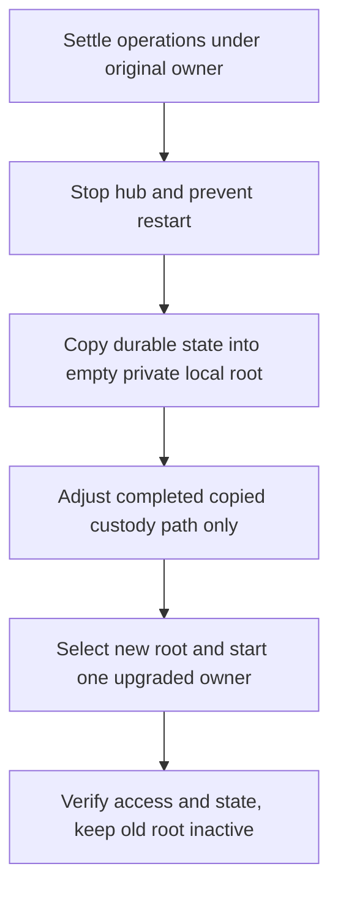

# Local hub state and manual relocation

`hub_state_root` must use local storage. If startup or `endpoint`, `login-url`
or `attach` refuses its storage, preserve the old state and relocate it manually
before selecting a new root. Refusal is an error, not evidence of a stopped hub
or permission to bootstrap another owner. Evener does not move files or rotate
credentials for you. A subsequent invocation with an admitted root needs no
reset marker.

Relative `hub_state_root` values, such as `"hub-state"`, resolve against the
hub process's working directory, not the config file's directory. Startup and
endpoint inspection use and publish that same absolute root, following existing
symlinks without creating missing directories during inspection. Absolute values
keep their existing meaning. Inspect a relative configuration from the service's
working directory to select the same owner.

## Detection and lock limits

Linux rejects recognized NFS, CIFS, SMB, SMB2, AFS, AFS_FS, CODA, CEPH and NCP
filesystem types. This is not an exhaustive network-filesystem detector.
Unlisted types, including FUSE, overlay and tmpfs, are admitted, **not certified
local**. Network-backed FUSE can evade this check. Darwin requires the OS
`MNT_LOCAL` mount flag, not proof of physical backing; a local FUSE mount without
that flag can be refused. Persistence is separate from locality: choose private,
persistent local storage for durable hub state, not a temporary filesystem.

Inspection follows actual existing symlinks and checks the selected directory
or its nearest existing directory ancestor without creating a missing root.
It preserves permission, non-directory and broken-symlink errors. Startup checks
before directory creation or credentials, then rechecks the actual root and
lock descriptor. Discovery checks before credentials and checks its opened lock
descriptor. These checks are not a recursive backing-store audit, a guarantee
about every child mount or an adversarial remount defense.

The hub retains exclusive nonblocking whole-file `flock`. Linux also holds a
whole-file OFD write marker on that same descriptor. Discovery uses a non-owning
`F_GETLK` query, not a temporary exclusive lock. Darwin queries its existing
flock with `F_GETLK` and adds no OFD marker. Closing the owned descriptor releases
ownership, including on process death, without deleting the lock inode.

**Coordinate the upgrade of the hub and every inspector/tool that reads its
ownership.** Stop the old owner and prevent restart, upgrade all participants,
then start one owner. A flock-only Linux owner is not supported by the new
marker query. A query is a snapshot, not a promise that another owner cannot
start afterward. Do not run old/new versions or old/new roots concurrently.

## Inventory before copying

Record the effective service user, HOME, XDG environment, selected config path,
`hub_state_root`, `run_dir`, `state_glob` and `past_index_db`. Do not print tokens
or paste private files into diagnostics.

| Entry under the selected hub root | Treatment |
| --- | --- |
| `auth-token` | Preserve exact bytes and private access modes, do not rotate it. |
| `deletions/state.json` | Preserve durable deletion fences. |
| `recovery/state.json` | Preserve session/exit/alias recovery authority, including paths. |
| Entire `hostops/` directory | Preserve journal, allocator/history, epochs, custody, quarantined payloads and companions, subject to the bounded adjustment below. |
| `transcript-display/state.json`, `keybindings/state.json` | Preserve durable preferences and revisions. |
| `search.db` and SQLite companions | Derived full-text search data, either copy the complete offline set or omit the set and rebuild. |
| `hub.lock`, `hub-endpoint.json` | Do not copy to the destination, leave the source alone. The new owner creates coordination state and publishes its fresh endpoint after acquiring ownership and binding. |
| Logs | Sensitive, optionally retain a private archive. They are not reconstructed authority. |
| Temporary leftovers | Not a reason to prune the source or discard durable companions. Investigate uncertain entries rather than deleting them. |

`past_index_db` (by default `index.db`) is **not** the disposable `search.db`:
it contains user archive/favorite/pin/seen state. Leave its selected pathname
and data intact, even if it happens to be inside the old root. `run_dir`,
project/session state selected by `state_glob`, config, providers, credentials
and OAuth stores resolve independently of `hub_state_root`. Changing the hub
root does not move them. Keep HOME, XDG and config selection unchanged, and
preserve the whole TOML plus private sibling `hub.toml.stash*` recovery files.
Do not apply a blanket old-path-to-new-path replacement.

## Offline same-host procedure

This procedure assumes the same service user and an empty destination outside
the source. Cross-user ownership/ACL transfer and whole-default-root relocation
need a separate plan. A hub restart does not stop its session daemons.

First settle recovery while the original owner still has its original paths.
Then copy offline, edit only the intended root and completed custody field, and
verify the new owner before retiring the old selection. Never serve both copies.

1. Finish or reconcile host mutations, pending cross-file compensation and
   quarantine under the original owner. In particular, a pending
   `hostops/operations.json.quarantine-intent.json` must settle before copying.
   Do not migrate its intent or bypass validation. Unsettled config recovery
   can otherwise undo the root edit.
2. Stop the hub through its actual supervisor and prevent automatic restart.
   Verify that its owner process has exited, not just that a port is quiet or
   an unsupported inspector says stopped. Coordinate upgraded hub/inspectors.
   Keep the source, config backup and all recovery evidence private and intact.
3. Create an empty private directory on persistent local storage as the same
   service user. Review symlinks, nested mounts, ownership and ACLs before
   copying, do not blindly follow them. Selectively copy the durable entries
   above, preserving exact bytes, directory/file modes and ownership. Use
   exclusive destination creation so existing state cannot be overwritten.
   Omit `hub.lock` and `hub-endpoint.json`. Leave independent stores at their
   original selected paths, including an `index.db` inside the old directory.
4. Ordinary settled hostops state requires no edit. For completed quarantine,
   copy **all** `operations.json.custody-*.json`, their matching
   `operations.json.quarantined-*` payloads and
   `operations.json.quarantine-epoch.json`, along with `operations.json` and
   every other hostops companion. In **each copied completed custody file**,
   require the top-level `quarantinedFile` JSON string to equal the exact old
   `hostops/operations.json` StorePath. Replace only that JSON string token
   with the exact destination StorePath. Preserve every other byte: nested
   paths, opaque payloads, IDs, filenames, epochs, allocator values, ownership,
   history and fences. Do not reserialize the document or edit the source.
   If the exact old value is absent or destination opening still fails, stop,
   retain both copies and investigate, do not reset or weaken validation.
5. Compare copied bytes and access modes against the source, allowing only
   that completed-custody string-token adjustment. Preserve the existing TOML
   and change **only** `hub_state_root` to the destination. Keep `run_dir`,
   `state_glob`, `past_index_db`, listener, hosts and all other fields unchanged.
   If config was absent, deliberately create a minimal TOML with that one key
   at the same selected default config pathname, without changing selectors.
   Keep the same service environment and selected config. This is not a
   request to deploy or synchronize builds on compatible remote hosts.
6. Start one upgraded hub with that selection. Require successful journal
   opening and fresh endpoint publication. Use `evener hub endpoint --json
   --config PATH` to verify the selected root, running generation and actual
   listener, including a newly assigned port for `:0`. Discovery verifies
   token-free health. Use the retained credential privately to verify
   authenticated access, never log its value. `login-url` intentionally prints
   a credential-bearing link, so do not redirect it to shared logs.
7. Verify durable preferences, deletion fences, saved/archive visibility,
   favorites and pins. Check existing daemon/session routing and SSH attachment
   where used. Check host journal authority and allocator continuity before
   accepting further mutations. Keep the old selection inactive and the source
   retained. Once the new root has writes, do not overwrite it or switch back
   as an improvised rollback, plan an offline reconciliation instead.

Independent daemons may continue writing project/session/run data left at their
original locations. The old directory as a whole is therefore not a frozen
backup. Moving those stores too requires a wider shutdown and migration plan,
not an extension of this selective hub-root procedure.

## What has been verified

Disposable real-file tests prove ordinary settled hostops relocation and one
completed-custody adjustment, including authority, history, restrictive modes,
epochs and next-ID continuity. They do not qualify all legacy custody shapes,
multiple historical epochs or every compensation/token family.

A separate disposable hub journey models storage refusal at the OS
classification boundary. It proves the source credential/settings/fences stay
unchanged, a selective explicit copy retains the token and preferences, a real
listener publishes a fresh endpoint, the original token authenticates, and an
independent favorite/config/project/run selection remains intact. It reuses
the custody proof rather than duplicating its journal fixture. No live service
or real network share was migrated. Live daemon/SSH and full operator cutover
acceptance remain the operator's checks above.

The new production lock/query runtime proof was executed on Linux amd64 with
ext4. The existing Darwin APFS arm64 primitive proof is separate evidence, not
execution of this changed production implementation. Darwin arm64/amd64
cross-compiles are not runtime proof, and updated macOS CI must run the package.
These checks do not certify Intel/older Darwin, network, FUSE or overlay storage.
