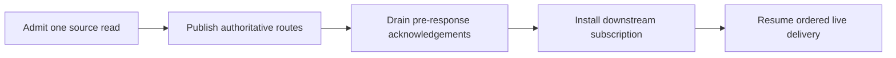

# Evener Hub Web Routing

Evener Hub serves the SPA shell for page navigation. The browser reads session
data and performs mutations over the authenticated AppWire connection at `/rpc`.
The [HTTP mux](../cmd/evener-hub/web.go) retains document, image, asset, auth,
health, and subscription-debug surfaces.

- Deep-linkable page routes include `/`, `/new`, `/s/:ref`, `/thread/:ref`,
  `/settings`, `/settings/:section`, and `/credentials`.
- `/s/:ref/images/:sha` serves session images through the
  [session route handler](../cmd/evener-hub/web_workspace.go).
- `/doc/file` serves one session document in two representations: `format=raw`
  is the capped head a doc pane renders, `format=download` is the whole file a
  client saves or hands to another app. `/doc/image` serves document images.
- `/api/health` and `/api/debug/subscriptions` expose health and subscription
  diagnostics.

The `/_partials/*` fragment endpoints and session form-action endpoints are
unregistered. The session route handler returns 404 for unsupported
`/s/:ref/:subroute` paths, including `state`, `details`, and `tasks`. Other
unmatched paths may serve the SPA shell through the root catch-all route.

Sidebar navigation:

The sidebar is client-rendered: it reads typed navigation resources over the
authenticated AppWire connection and keeps its own keyed DOM, instead of
swapping in a server-rendered HTML partial.

- `evener/navigation/read` — the typed sidebar read surface. Its `manifest`
  resource provides the bounded descriptor/count index and attention summary;
  `section`, `pin_catalog`, `pin_section`, `catalog`, `project`,
  `project_page`, and `location` resources provide bounded rows and ownership
  details. The canonical request shapes, pagination rules, and response
  envelope are maintained in the [AppWire navigation resource matrix](developing-evener/agentic-testing.md).
  Representation version 3 carries flat session summaries with compact activity
  counts. Session delegate, shell-job and watch collections use the session
  activity methods in the [AppWire catalog](appwire-protocol.md); a navigation
  `location` remains a placement lookup. The separate `evener/archived/list`
  path retains bounded inline fork-original conversations and their disclosure;
  the normalized navigation graph stays flat. See the
  [session activity boundary](product/session-activity.md#navigation-boundary).
- `evener/favorite/set` — set or clear a project's favorite (Pinned) decision;
  the typed method retains the explicit rejection for obsolete session-shaped
  favorite requests.
- `evener/project/delete` — delete every removable session under a
  path-validated local project and return detailed outcomes plus its committed
  navigation receipt.
- `evener/thread/name/set` — rename a live or ended session.

## Navigation identity and mutations

Project identity includes the full working directory; equally named directories
at different paths remain distinct projects. Source identity keeps projects on
different machines distinct. The
[navigation projection](../cmd/evener-hub/navigation_projection.go) owns the
bounded resources and project tiers used by the client.

Project favorites use `evener/favorite/set`. Session pins use
`evener/session-pin/assign` and `evener/session-pin/unpin` with the navigation pin
catalog. A project deletion uses `evener/project/delete`, which validates its
working directory, reports per-session outcomes, and returns a navigation
receipt. Clients reconcile the returned invalidation targets through AppWire.
- Rename uses `evener/thread/name/set` for both live and ended sessions.

## Session snapshot and live delivery

For a live local `thread/read`,
[`mergePastThreadForRead`](../cmd/evener-hub/app_threadread.go) fills missing
metadata from the saved session. Non-nil live tasks and diagnostics are
authoritative, including empty values: the merge does not load their saved
counterparts. In particular, live diagnostics bypass saved delegate-journal and
child attention-transcript reconstruction. Absent live fields retain their
saved fallbacks, and saved turns are projected only when requested and the live
read supplied none. Remote reads never merge this hub's local saved state.

The [hub relay](../cmd/evener-hub/app_relay.go) shares one canonical upstream
connection across a session and its descendant routes. The
[source relay](../cmd/evener-hub/internal/appsource/relay_session.go) serializes
reads and keeps the snapshot-to-live acknowledgement barrier.

Only the admitted read owns unresolved route discovery. A queued read cannot
hold acknowledgements needed by the read ahead of it. Publishing authoritative
routes resolves that discovery and wakes parked deliveries before waiting for
their acknowledgements. Known targets retain their ordering barrier; updates
for a route that remains unbound do not enter a different session's stream.

The command owner has a longer lifetime, through downstream subscription
handoff. It retains daemon-departure announcements until in-flight handoffs
finish, allowing a newly subscribed route to receive recovery after routing is
known. Replay tracks served routes, so a second subscriber joining an already
served route can still miss that announcement; see
[the same-route recovery gap](https://github.com/prime-radiant-inc/evener/issues/4684).
Cancellation releases read ownership; connection loss
fences the old epoch, and rejoining establishes a fresh snapshot and ordered
live stream. These guarantees apply to every AppWire client, including browser
tabs and background subscriptions and native clients. Reads alone
never launch or stop a daemon.

## Session document reads

The [document server](../cmd/evener-hub/doc_serve.go) resolves a file against its
owning session's current directory for each read. Live reads obtain the current
daemon descriptor. Archived reads reload session metadata from disk rather than
using the navigation index's cached directory. Remote text reads route through
the owning host with the captured absolute file target.

A missing archived metadata file returns `ResourceNotFound` (HTTP 404). Other
metadata read or decode failures return `SessionUnavailable` (HTTP 503), so the
shared document read owner keeps its paced retry demand instead of treating a
temporary metadata fault as a missing file. Raw HTTP, image HTTP and AppWire
document reads share this classification. Once metadata is readable again, the
next read uses its fresh directory without rebuilding the navigation index.

The browser DocPane and native Reader retain the document's captured target and
owning session during recovery. The shared
[document read demand](../appwire-client/typescript/documentReadDemand.ts)
paces retries while the reader is visible and connected. Hidden or disconnected
readers preserve demand for re-entry. A text HTTP 404 ends the current paced
retry series. Reload, reopen, visibility or connection re-entry, and reader
refresh triggers start a new series. Image load callbacks do not expose HTTP
status, so failed image loads keep paced retries.

`/doc/file?format=download` is the one representation that does not stop at the
pane cap: the body is the file itself, with its type from its extension and its
own name in `Content-Disposition`. It shares the raw read's containment rules
(the path must resolve inside the session's folder, and the open goes through
that folder's root) and refuses a non-regular file. The body is served as
content, so `HEAD` and `Range` work and an interrupted transfer resumes. Its
type table is the whole answer: an extension it does not list is
`application/octet-stream`, never a type borrowed from the host's mime tables.
It serves local sessions only; a host-qualified id answers 501 rather than
reading locally. Proxying a whole file to the owning host is not implemented:
`evener/session/document` answers only the first 512 KiB, so a session on
another host cannot be shared yet. Native saves the body to its cache and opens
the system share sheet for it (the Reader, and a touch-and-hold on a transcript
document chip).
