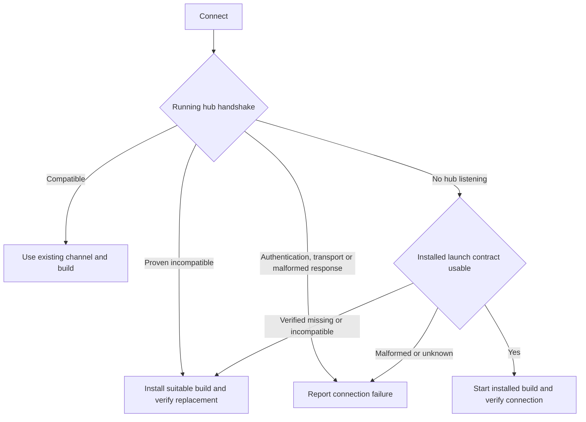

# Evener Hub

`evener hub` is Evener's orchestrator. It serves the web UI — Evener's
default interactive surface — where you start sessions, watch the agent work,
and steer it across many concurrent sessions. The hub launches and supervises
local `evener serve` daemons and indexes saved sessions for search.

**First time here?** [Getting started](getting-started.md)
walks from install to your first session. This document is the
production-style local runbook: config files, credentials, supervised
operation, and smoke checks. For non-local hosts, see
[`evener-hub-remote-operations.md`](evener-hub-remote-operations.md).

## Trust boundary

The hub requires a capability token on every route except the `/auth/<token>`
bootstrap, `/api/health`, `/api/device-pairing`, and the PWA icons. Device pairing
uses an invitation and requires approval before releasing credentials; it does
not require the hub token or cookie. See [device pairing](device-pairing.md).
At startup it loads
`<hub_state_root>/auth-token`; the default `hub_state_root` is
`${XDG_STATE_HOME:-$HOME/.local/state}/evener`, and `hub.toml` may override it.
It creates a fresh 256-bit token when the file is absent. A newly created token
file is written mode 0600; a non-empty existing file is accepted after
surrounding whitespace is trimmed, without format or mode enforcement. The hub
logs an authorization URL:

```
[hub] auth URL (visit once per browser): http://127.0.0.1:9180/auth/<token>
```

A browser authorizes by visiting that URL once; the hub sets a long-lived
`SameSite=Lax` cookie and slides its expiry forward on each visit. Scripted
clients pass the token as `Authorization: Bearer`. Treat the token as a
credential: anyone holding it has full hub access.

Daemons spawned by the hub authenticate to it with a separate per-hub bearer
token recorded in their rendezvous file, and are forced to loopback. Direct
`evener serve` also defaults to loopback, but `--addr` can override it. The hub
serves a strict content security policy. When you expose it further, put it
behind an SSH tunnel, VPN or private-network firewall, or an authenticated
reverse proxy — the token is a bearer capability, not a per-user login system.

## Prepare the host

Install Evener using [Getting started](getting-started.md), then run the hub as the user who owns the repositories and configuration. This guide assumes that installation is complete. For routine browser work, use [Daily work](daily-work.md); for headless invocations, use the [CLI](cli.md).

Before starting a service, choose its config and state roots and arrange a provider connection on that host. Do not put secrets in a service command line. A service supervisor does not automatically inherit later changes to your interactive shell.

## Runtime directories

Evener creates runtime and config directories on first use, not at
install time. Paths below use the XDG defaults; when those variables are
unset, the corresponding defaults are under `$HOME/.local/state` and
`$HOME/.config`.

- `${XDG_STATE_HOME:-$HOME/.local/state}/evener/run` holds each live daemon's
  rendezvous file — a small JSON document, named by PID, that tells the hub
  how to reach and authenticate to that daemon — plus per-daemon logs.
- `${XDG_STATE_HOME:-$HOME/.local/state}/evener/projects/*` is durable per-project
  Evener state and saved transcripts.
- `${XDG_STATE_HOME:-$HOME/.local/state}/evener/index.db` is the hub's SQLite
  search index.
- `${XDG_STATE_HOME:-$HOME/.local/state}/evener/auth-token` is the hub's
  capability token (see Trust Boundary).
- `${XDG_CONFIG_HOME:-$HOME/.config}/evener/skills` and
  `${XDG_CONFIG_HOME:-$HOME/.config}/evener/plugins` are user extension roots
  created by Evener startup.
- `${XDG_CONFIG_HOME:-$HOME/.config}/evener/AGENTS.md` is your personal
  standing instructions file. Every session loads it ahead of the repo's own
  instruction docs — AGENTS.md plus whichever sibling the model's surface reads
  (CLAUDE.md, GEMINI.md) — and Settings → AGENTS.md in the web UI edits it in
  place. Hub-spawned sessions receive the hub's own path (`--agents-doc`) the
  way they receive the plugin root, so a per-launch `XDG_CONFIG_HOME` override
  cannot make Settings and sessions disagree about the file.

Extension discovery and enablement have separate rules. Use [Extensions](extensions.md) to choose a source; `skills_dirs` and `plugin_dirs` add explicit launch sources, while installed plugins have their own enabled-by-default state.

## Hub config

`${XDG_CONFIG_HOME:-$HOME/.config}/evener/hub.toml` is optional. If it is absent,
the hub uses defaults: `hub_state_root =
${XDG_STATE_HOME:-$HOME/.local/state}/evener`, `run_dir` = the rendezvous
directory described above, `state_glob` =
`${XDG_STATE_HOME:-$HOME/.local/state}/evener/projects/*`, and `past_index_db` =
`${XDG_STATE_HOME:-$HOME/.local/state}/evener/index.db`. Missing config does not
create a default launch stanza; launch defaults still come from the layered
launch files described below.

Create `hub.toml` when you need to override those paths or the listen
address. If it already exists, preserve a private copy and edit only the intended fields rather than running this file-creation recipe over it. The shell expands `hub_config` and `hub_state_root` in the heredoc
before writing the file; TOML itself does not expand shell variables.

```bash
hub_config="${XDG_CONFIG_HOME:-$HOME/.config}/evener/hub.toml"
hub_state_root="${XDG_STATE_HOME:-$HOME/.local/state}/evener"
mkdir -p "$(dirname "$hub_config")"
cat > "$hub_config" <<EOF
addr = "127.0.0.1:9180"
hub_state_root = "$hub_state_root"
run_dir = "$hub_state_root/run"
state_glob = "$hub_state_root/projects/*"
past_index_db = "$hub_state_root/index.db"
spawn_timeout = "30s"
past_index_rebuild_interval = "60s"
past_results_per_page = 50
api_log = false
EOF

chmod 600 "$hub_config"
```

This recipe explicitly sets `run_dir` to `$hub_state_root/run`.
Omit `run_dir` to use the hub's runtime-directory default.

`api_log` controls the hub's default for durable API-request logging on the
`evener serve` daemons it spawns: `true` passes `--api-log on`, recording every
provider request and response body to the session's
`<state-dir>/sessions/<SID>.api.jsonl` for post-mortem inspection. It defaults to
`false` because those records grow with every model call. The hub's value is
always passed explicitly (`--api-log on` or `--api-log off`) rather than left to
the spawned binary's own default, so the opt-out cannot be defeated by an older
`evener` on `PATH` that still records by default. The hub also refuses to launch
a binary whose `launch-check` does not advertise the `api-log` flag (see
`launch_flags` in the launch contract), reporting an upgrade error up front
instead of letting the launch die on the unknown flag. It is a floor, not a
force: launch config layers that set `api_log` explicitly (either direction)
win over the hub-wide value. The `evener/launch/resolve` preview reports the
same floor (provenance `hub`), so what the Launch settings show matches what a
spawned session actually runs with.

### Daemon idle retirement

The hub retires an idle session daemon after one hour by default, so a session
you stopped using does not keep a process, a listener, and its runtime tree
alive. Retirement is not a delete: the saved session stays resumable, and the
next message to it starts a replacement that restores the same identity. Your
transcript, jobs, and memory are unaffected.

```toml
# hub.toml
# One hour is the default; omit the field to keep it.
daemon_idle_timeout = "1h"
# To disable automatic retirement instead, set this one field to "0s".
```

Only *proven* inactivity counts: an active turn, accepted input, a running shell
job, an outstanding delegate, a pending question, or an active goal resets the
full interval. A directly launched `evener serve` is resident by default and
takes the same value through `--daemon-idle-timeout`. A `hub.toml` change applies
to daemons spawned or resumed afterward, never to one already running. An
omitted field and an explicit `0s` are different: only `0s` disables retirement.

If a session appears to stop on its own after an idle period, this is the
expected behavior rather than a failure; sending a message resumes it. See
[daemon idle retirement](daemon-idle-retirement.md) for the inactivity rules and
for how a retired, unavailable, and incompatible daemon differ.

### Other operator knobs

These `hub.toml` fields are set less often. Defaults are the values used when the
field is absent.

| Field | Default | Effect |
| --- | --- | --- |
| `daemon_idle_timeout` | `"1h"` | Idle retirement interval; `"0s"` disables it. See above. |
| `plugin_auto_upgrade` | `true` | Master switch for the background plugin upgrade daemon. A plugin still opts in individually. |
| `plugin_auto_upgrade_interval` | `"12h"` | How often marketplaces refresh and opted-in plugins are re-checked. |
| `host_probe_timeout` | `"10s"` | Deadline for one remote-host health probe; also bounds how long a hung remote holds a deploy gate. |
| `host_min_free_space_bytes` | 512 MiB | Free space each state root needs before the hub reports itself healthy. |
| `host_tombstone_retention` | `"168h"` | How long a removed host's tombstone is retained before pruning. |
| `status_poll_interval` | `"2s"` | How often the hub polls session state. |
| `mobile_base_url` | unset | Default hub address offered to paired phones; otherwise the browser's own origin is used. |

Write every duration as a TOML string, such as `"30s"` or `"1h"`. A bare integer
is read by TOML as a nanosecond count, so `spawn_timeout = 30` arms 30ns rather
than 30 seconds. Some duration fields refuse that form outright
(`daemon_idle_timeout`, `host_probe_timeout`, and the host receipt and operation
TTLs). Negative handling then differs by field: a negative
`daemon_idle_timeout` is rejected, some fields fall back to their default, and
others keep the negative value. The loader does not validate every duration
field the same way, so assume a typo can take effect and check the resolved
value rather than trusting a silent load.

Host receipt and operation retention rows are documented beside the host
registry in the [subsystem map](product/subsystems.md) rather than here.

## Launch configuration

[Configuration](configuration.md) owns launch-file locations, trust, precedence, merging, and reload. Use Settings → Agent setup → Session defaults for user defaults, project settings for local overrides and repository review, and New session for one launch. Select the host before editing host-scoped settings.

The launch resolver reads user defaults, trusted cwd-local shared settings, private project settings, and per-launch overrides. It reports diagnostics and provenance. API logging inherits the hub default only when no launch layer supplies a value. Neither a browser reload nor a saved setting changes an already-running daemon's configuration.

### Session plugin selection

Plugin selection is a new-session control. The default state leaves the
selection omitted, so the session uses every otherwise-loadable plugin from the
resolved explicit directories and installed plugins marked enabled by default.
Every installed plugin appears in the list, including ones whose default is off.
Choosing an individual plugin, **All**, or **None** changes the launch to an
explicit allow-list of manifest names, and an off-by-default plugin named there
loads for that session; **None** sends an explicit empty list and loads no
plugins. This control does not change persistent plugin state — the plugin
detail's **Enabled by default** switch does.

In the desktop new-session pane, the summary appears between the working
directory/model/effort controls and Advanced options:

```text
Plugins for this session
5 of 6 will load · session only                                      v
```

Expanding it shows a filter, **All** and **None** actions, one accessible switch
per candidate, source metadata (marketplace or directory), component counts,
and any preview diagnostics. Diagnostics identify invalid or duplicate
candidates without hiding the remaining valid rows. A stale or unavailable
explicit selection is a blocking error that must be corrected before Start.

On mobile, the **Plugins — N of M** row below the existing launch settings opens
a sheet with the same filter, actions, metadata, and diagnostics. The sheet
stays open while switches are changed; **Done** applies the selection and
**Cancel** restores the selection from before the sheet opened.

The launcher previews the effective candidates for the current working directory
and launch overrides. While inspection is pending it shows `Inspecting
plugins…`; a failed inspection shows `Couldn't inspect plugins` with retry and
never invents a zero count. Preview diagnostics are nonblocking candidate
warnings, while missing names in an explicit allow-list remain blocking and
are revalidated at Start.

The selection applies only to the session being created. After a successful
Start, the new-session form resets to the current defaults; a failed Start keeps
the explicit selection for correction. The created session stores its resolved
plugin directories, so resumes, forks, asides, direct children/subagents, and
durable delegates inherit the same plugin set. `--resume` and `--resume-last`
restore that frozen set rather than accepting a replacement; `--resume-with`
creates a new session and may choose a new set. Global enable/disable changes do
not mutate an existing session.

## Provider credentials

Follow [Connecting a provider](connecting-a-provider.md) for first access. The hub stores literal keys by instance in `credentials.toml`; OAuth records belong to the state root. `openai` and `openai-codex` are distinct connections, not two interchangeable keys for one endpoint.

[Credentials and provider launch behavior](llm-provider-config-and-launch.md) owns storage and subprocess details. [Provider reference](llm-providers.md#credential-resolution-order) owns the exact credential order. Keep both configuration and credential files private, including custom headers and command expressions.

## Start the hub

Foreground run with logs:

```bash
set -o pipefail
umask 077
hub_config="${XDG_CONFIG_HOME:-$HOME/.config}/evener/hub.toml"
hub_state_root="${XDG_STATE_HOME:-$HOME/.local/state}/evener"
# If hub.toml sets hub_state_root, set hub_state_root above to that same value.
log_file="$hub_state_root/log/hub.log"
mkdir -p "$(dirname "$log_file")"
chmod 700 "$(dirname "$log_file")"
touch "$log_file"
chmod 600 "$log_file"
evener hub --config "$hub_config" 2>&1 | tee -a "$log_file"
```

The hub listens on `127.0.0.1:9180` unless `addr` in `hub.toml` says
otherwise, and logs the authorization URL described under Trust Boundary on
every start. That URL contains the bearer credential: protect supervisor
stdout/stderr and this log as secrets, and do not paste them into tickets or
chat.

If you manage credentials via environment variables rather than
`${XDG_CONFIG_HOME:-$HOME/.config}/evener/credentials.toml`, source your env file
before starting:

```bash
set -a; source "${XDG_CONFIG_HOME:-$HOME/.config}/evener/hub.env"; set +a
```

This Bash recipe uses `pipefail` so a hub failure is not hidden by `tee`.
Production deployments should preferably execute `evener hub --config
"$hub_config"` directly under a supervisor and let it capture stdout/stderr.
The hub logs config errors, past-index rebuild errors, roster watch errors,
child-process launch diagnostics, and the auth URL there.

On macOS, [`scripts/ops/deploy-hub.sh`](../scripts/ops/deploy-hub.sh) builds
while the old hub remains running, kickstarts its launchd job to replace it,
then verifies health; see
`scripts/ops/deploy-hub.sh --help`.

The hub acquires a `flock` on `hub.lock` in its state root, so one hub process runs
per `hub_state_root` — one per user under the default layout.

### Updating the hub from Settings

Settings → Hub → Updates shows the running build (version, commit, channel),
a channel selector (release or snapshot), and whether that channel is ahead
of the running build. "Update and restart" downloads and installs the
channel's archive with the same code as `evener upgrade`, then, once the
apply response has been written to the websocket, the hub `exec`s the
installed binary in place: same PID, same arguments, same
environment. That is why it works the same under launchd, systemd, or a
plain shell, and why nothing needs `KeepAlive`. The `hub.lock` flock and the
listener are released by the exec and re-acquired by the new process; the
page polls `/api/health` until the new version answers, then reloads.

The install targets the prefix the running hub was launched from (derived
from its own binary path, e.g. `/usr/local` for a system install), not
always `~/.local`. The whole operation runs under a 4-minute overall
deadline (both downloads, verification, install) so a stalled server fails
the apply instead of blocking later updates. Before
extraction, the archive's SHA-256 is checked against the release's
`checksums.txt` entry (same fail-closed guarantee as `install.sh`); a
mismatch or missing entry refuses the install. Note the limit: the
checksums travel over the same GitHub TLS transport as the archive,
unsigned, so this stops corruption and asset-swaps but not a compromise
that rewrites both files the way a signature would.

The channel selector has no stored setting. It defaults to the channel the
running binary was built for, and after an update the installed binary's
channel becomes the new default.

Dev builds (a worktree `make build-hub`, channel `dev`) are excluded:
Settings shows a rebuild note instead of the controls, and
`evener/update/apply` is refused. Use `make build-hub` or
`scripts/ops/deploy-hub.sh` for those.

Running session daemons keep the binary they were spawned from (see the
[upgrade procedure](#upgrading-and-migrating-safely) below). Shut down the
daemon and resume the saved session to move it to the new build.

### Deploying to remote hosts

Connect first verifies the running remote hub's AppWire handshake. A compatible
hub stays on its existing build and process, even when the controller has a
different version, is a development or dirty build, or cannot supply an artifact
for the host's platform. Optional capabilities control the features available on
that connection; their absence does not trigger deployment.



Connect can still install software on a fresh or incompatible host. A stopped
compatible installation is started without replacement on an explicit Connect;
background reconnect does not start a stopped hub. An unclassified handshake
failure is a connection error, not permission to overwrite the installation.
The same rule applies to malformed or incomplete cold-start launch metadata.
Use `--no-deploy` to prohibit both pushes and installer fallback. Explicit Deploy
retains its plan, confirmation and requested-build checks.

The source rules below apply **when installation is required**, not on every
Connect:

| Hub invocation or condition | Binary source | Overwrite or refusal behavior |
|---|---|---|
| `evener hub` with no deploy flags, same platform | File at the controller's own executable path | Pushes that file when deployment is needed. A dirty controller may use this source. |
| `evener hub` with no deploy flags, different OS or architecture | Published artifact through `install.sh` | A clean release needs a stamped release tag; a clean snapshot uses the snapshot artifact. Dev, dirty, or tag-less release builds refuse this cross-platform deployment. |
| `evener hub --deploy-binary <path>` | Named pre-built Evener executable | Needs no Go toolchain or source. Refuses a non-Evener binary or wrong OS/architecture before pushing. A dirty controller refuses this source. After installation, a build mismatch refuses attachment. |
| `evener hub --build-source <path>` | Cross-compiled checkout on the controller | Needs Go, the Evener module root, and a built web UI. A stamped controller requires the same commit, a clean checkout, and no ignored untracked Go files. A dirty controller refuses this source. An unstamped dev controller skips revision checks. |
| `evener hub --no-deploy` | None | Writes no build, including through the installer. Keeps an existing compatible host build; refuses a host that needs installation or a protocol/launch-contract upgrade. |
| No flags, but the controller cannot adopt its executable as an Evener binary | Published artifact if available | Uses the release/snapshot installer when installation is required; refuses if no suitable artifact is available. |

`--no-deploy` wins over both source flags; `--deploy-binary` wins over
`--build-source`. Named paths are still validated at startup even when another
flag takes precedence. The startup log records the effective source and any
ignored flags. Read attach failures and the connected host's build in host
details in the web or native client. The live handshake's optional
`serverInfo.buildVersion` reports that remote process's build; absent metadata
stays unknown. `serverInfo.version` is the protocol package version and is not a
substitute for the remote build. Launch-check describes the installed executable,
which can differ from the process still running.
An executable launch-check failure that can be distinguished from a transport
failure does not block a usable live connection or already-authorized deployment
repair. Startup and post-install verification still require a valid launch
contract; SSH and environment failures remain connection errors.

**Installation target.** Deployment uses the host entry's `evener_path`, then
the running host hub's executable, then `command -v evener`, then
`~/.local/bin/evener` if no installation exists. The push path resolves symlinks,
stages a temporary file, verifies its length, and renames it atomically over the
target. A failed transfer does not leave a partial executable. The installer
preserves the existing installation location and layout. A configured target
must name the `evener` runtime, not another program.
While an effect is pending, default-path discovery cannot replace its selected
target, even when a concurrent plan refresh began discovery before the deployment
recorded that target. If that executable disappears or loses its execute bit, an
authorized deployment repairs the selected installation rather than switching to
another one.

**Build verification.** A source build carries the controller's build identity;
a named artifact carries its own. After deployment, the controller re-reads the
host's launch contract and refuses attachment if the build differs. A successful
installation is not proof of successful attachment. In particular, installer
verification happens **after the binary is written**: a moved snapshot channel
can replace the host binary and then fail the version check. Prefer a push source
when the published snapshot has moved beyond the controller's commit.

**Interrupted deployment.** A compatible connection cannot settle an unfinished
build replacement or restart. Recovery retains the requested build identity and
the predecessor process identity before the first remote write, including writes
whose acknowledgement is lost. Reconnect verifies the installed build and finishes
the recorded replacement even if the original attempt failed before choosing a
restart command. A confirmed deploy-only operation remains deploy-only on retry.
Explicit Restart authorizes starting or replacing that installation even when
its acknowledged write already matches the requested build and needs no rewrite.
An unacknowledged write is retried before recovery can settle, since equal build
labels such as `dev` do not prove the requested executable was installed.
Even an acknowledged deploy-only write remains pending until its build and startup
contract are verified, preserving its repair authority for a later Restart.
Before stopping the live hub, Restart re-reads the selected executable's startup
contract and uses those fresh facts to reconcile any pending deployment. An
already-authorized deployment can repair an invalid contract or a changed build;
its requested build must be verified before restart. If the SSH channel has
dropped, Restart performs this recovery under its persisted operation gate before
requiring attachment. It then reattaches and independently verifies the requested
build and replacement process without issuing a second restart. Recovery rechecks
the operation-bound host entry before each remote mutation. Pending effects retain
that check across installation, command recording, worker completion and channel
loss; a reconnect attempt cannot replace it with a new settings snapshot. An entry
edit during installation refuses replacement while retaining the verified
installation. Restoring the entry permits a later retry. A fresh explicit Restart
can instead accept the changed entry after admission and validation, retaining the
original requested build, target and process proof. Replaying the same operation
ID does not renew this authorization. A new confirmed Deploy supersedes old intent
only when its first authorized write begins; source refusal leaves it untouched.
An already-completed effect can settle through independent read-only verification
despite later entry drift. None of these paths transfers pending work to a different
host registration or silently reloads its target. These reads do not atomically
exclude external edits after the check. Ordinary Restart
without pending deployment authority still attaches first. Without that repair, an
incompatible protocol, missing required flag or unreadable contract refuses the
restart and preserves the live connection. Fix the executable, then retry Restart.
Connect and reconnect also validate the executable before retrying
a pending restart, whether the predecessor is still running or has stopped.
Refusal retains the pending intent so recovery can finish after the repair.
A pending standalone start or Restart retains its original build and predecessor;
enabling automatic deployment does not authorize replacing that intent with a
controller-build installation. A known different executable build refuses another
start or restart until the requested executable is restored. An already-completed
expected process can still settle without another command despite later disk drift,
including an incompatible protocol or missing launch flag. Recovery verifies the
recorded build and process before requiring the executable to support another
launch. An unverified effect remains pending, and another launch still requires a
valid startup contract.
A verified restart retires the predecessor's bridge before reattaching and
checking the replacement, even if the old SSH connection has not reported EOF.
If the first health probe missed the predecessor, a later probe can identify it
before the first restart command runs; an issued command retains its original
predecessor identity across retries.
If a supervisorless predecessor exits before a restart command is recorded,
recovery proves the port is free and starts the saved target with the deployment's
build expectations. An occupied or unprobeable port leaves the recovery pending.
The same startup proof applies when a dormant systemd, systemd user, or launchd
unit starts on a proven-free port; a live supervisor remains a replacement.
When the predecessor is unknown, the public operation independently verifies the
actual startup process after reattachment. A known predecessor still requires a
different process start time. Retrying a recorded startup completes that effect
without requesting another replacement.
Source refusals before a write leave no recovery intent. Recovery does not
reinterpret the operation from a newly observed executable or hide its failure.

**Stable installation paths.** Keep executable symlinks and their parent
directories unchanged until pending deployment recovery finishes. Host-entry
validation does not freeze remote filesystem path resolution: redirecting a
configured `evener_path` symlink between attempts can send a retried write to its
new destination. Destination-drift handling is deferred in
[#4802](https://github.com/prime-radiant-inc/evener/issues/4802).

**Own-executable limit.** The default reads the executable file at deploy time,
not a copy of the running process. Replacing that file while the controller runs
changes what it pushes. A cross-commit replacement fails the post-install build
check, but another dirty build at the same commit can report the same label and
escape that check. Restart the controller after replacing its executable.

### Trace browser AppWire traffic

Use `--appwire-trace` to diagnose excessive browser WebSocket traffic. The flag
records every AppWire data frame on each browser `/rpc` connection:

```bash
umask 077
hub_config="${XDG_CONFIG_HOME:-$HOME/.config}/evener/hub.toml"
trace_dir="$(mktemp -d)"
trace_file="$trace_dir/hub-appwire.jsonl"
evener hub --config "$hub_config" --appwire-trace "$trace_file"
```

The hub creates `trace_file` with mode `0600` and refuses to overwrite an
existing path. Omit the flag during normal operation; tracing is off by default.

Each JSONL record contains a UTC `timestamp`, a process-local `connection`
(`conn-N`), and an `event` (`open`, `frame`, or `close`). Frame records also
contain a hub-relative `direction` (`browser_to_hub` or `hub_to_browser`), the
exact `bytes` count, and the complete raw JSON `frame`. The trace covers AppWire
data frames, not WebSocket ping, pong, or close control frames. It excludes the
hub's separate connections to Evener daemons.

The raw frames can contain prompts, transcripts, paths, tool arguments, and
credentials entered through Settings. Keep the file private, inspect it before
sharing it, and never commit it. Stop the traced hub after reproducing the issue,
then analyze it locally. Share only a reviewed, sanitized excerpt, never an unreviewed raw trace.

For a compact first pass, list each frame's connection, direction, size, request
ID, and method:

```bash
jq -r '
  select(.event == "frame") as $record
  | ($record.frame | fromjson) as $frame
  | [$record.connection, $record.direction, $record.bytes,
     ($frame.id // "-"), ($frame.method // "response")]
  | @tsv
' "$trace_file"
```

To find the connections and message types producing the most traffic, aggregate
frame counts and bytes before inspecting individual payloads:

```bash
jq -s -r '
  [ .[]
    | select(.event == "frame")
    | . + {message: (.frame | fromjson)}
  ]
  | group_by([.connection, .direction, (.message.method // "response")])
  | map({
      connection: .[0].connection,
      direction: .[0].direction,
      method: (.[0].message.method // "response"),
      frames: length,
      bytes: (map(.bytes) | add)
    })
  | sort_by(-.bytes)
  | .[]
  | [.connection, .direction, .method, .frames, .bytes]
  | @tsv
' "$trace_file"
```

The columns are connection, direction, method (or `response`), frame count, and
total bytes, ordered by total bytes. Use the process-local connection ID to
correlate an `open` record, its frames, and the final `close` record.

## Check the running hub

Visit the private authorization URL once in your browser. It sets the cookie; afterward, open the plain hub origin without the token path.

This unauthenticated health check requires only `curl`:

```sh
curl -fsS http://127.0.0.1:9180/api/health
```

Check the version and startup time against the process you intended to run. Health does not validate provider credentials. For client integration, use the [AppWire protocol](appwire-protocol.md) and [integration guide](integrations.md), not an unauthenticated model-list URL.

A live functional check can incur provider charges: authorize the browser, choose a known directory and model, start a small task, confirm transcript updates, then refresh and confirm the same session remains readable. Review the task's actual output separately from hub health.

## Upgrading and migrating safely

The documentation site tracks main. Release builds can lag it; snapshot builds follow ongoing development. Record the current version and installation prefix before changing channels. The installation guide owns download procedures; Settings → Hub → Updates owns an installed hub's update flow above.

1. Finish work that must not straddle a version change. In each session's actions menu, choose **Shut down** and confirm. This stops the agent process; the composer's **Stop** only interrupts a turn. Verify that the old daemon process has exited before copying state. A hub restart alone does not stop its session daemons.
2. Inventory effective paths and make a private [backup](security.md#storage-and-backups). Copying live state is not guaranteed consistent.
3. Preview any legacy-layout migration on the owning host:

   ```sh
   evener migrate --dry-run --verbose
   ```

4. Review the paths before running `evener migrate`. It moves supported legacy layouts and converts old provider schema, preserving `providers.toml.pre-registry`. It is not a universal session-format repair or a promise that old project identities become current ones.
5. Restart the intended hub, check health/build, and verify saved-session visibility. Resume a saved session or start a new one only after the intended runtime is installed.
6. Verify the session daemon separately from the hub. On the owning host, check its new rendezvous record's PID against the process's start time and executable path. For a direct authenticated AppWire connection to that daemon, `initialize` returns its running build in `serverInfo.version`; compare it with the intended build. A hub health response or `evener --version` alone does not prove that an existing daemon was replaced. Keep rendezvous credentials private.

Keep the pre-upgrade backup until you have checked workspaces and saved sessions. Do not restore over new work or assume an older executable can read newly written state. See [provider migration](llm-provider-config-and-launch.md#upgrading-from-the-old-schema) for renamed instances and changed credential variables.

## Operations notes

- Evener daemons spawned by the hub keep running if the hub exits. Use the
  session actions menu's **Shut down**, not the composer's **Stop**, to end a daemon.
- Existing daemons keep the `evener` binary they were spawned from. Install the
  intended build, shut down the old daemon, then resume the saved session. Verify
  the new daemon as described in the [upgrade procedure](#upgrading-and-migrating-safely).
- Do not blanket-prune `run_dir`, and never delete a live rendezvous file or
  log. The hub owns cleanup. For a specific suspected stale rendezvous file,
  inspect its recorded PID, verify it is the expected Evener daemon, and
  confirm that process is no longer alive (for example, `kill -0` fails; a PID
  can be reused). Re-check before removing only that file. Leave logs in place
  for diagnosis.
  Saved transcripts live under the state directories matched by `state_glob`.
- Keep `hub.toml`, env files, the auth token, run directories, and state
  directories private to the service user.
