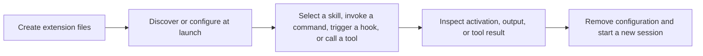

# Choose an extension

Start with a skill unless you need argument substitution, automatic execution,
or a new tool. These guides describe Evener on main, not another agent's extension
contract. A familiar filename does not imply identical behavior.

| You want to… | Choose | Start here |
| --- | --- | --- |
| Reuse instructions or a checklist | Skill | [Create and use a skill](skills.md#create-and-use-a-skill) |
| Invoke a prompt template with arguments | Command | [Create a command](skills.md#create-a-command-with-arguments) |
| Distribute skills, commands, roles, hooks, or server configuration together | Plugin | [Load a local plugin](plugins.md#load-a-local-plugin) |
| Run code at a session or tool boundary | Hook | [Add a startup hook](hooks.md#add-and-verify-a-startup-hook) |
| Connect an external service as tools | MCP server | [Connect a local server](mcp.md#connect-a-local-server) |
| Give a delegate a reusable specialist prompt and tool selection | Plugin agent role | [Add a delegate role](plugins.md#add-a-delegate-role) |

A plugin is packaging, not a seventh execution mechanism. A skill does not create
a delegate. A hook runs because an event fires, not because the model chooses it.
An MCP server supplies tools the model can call; connecting it does not prove
that a tool was called.

## Know what you are trusting

Skills and discovered commands insert untrusted instructions into model context.
Their wording cannot enforce permissions. Plugin commands can run shell commands
and read files while expanding. Command hooks run processes. MCP stdio servers
run on the session host; HTTP and SSE servers run wherever their endpoints are
hosted. Remote services enforce their own permissions and receive tool arguments.

Review code, requested credentials, and configuration before enabling an
extension. The session's sandbox and effective tool policy still apply to local
execution. Installation is not permission to bypass them. See
[sandboxing](sandboxing.md) before giving a server or plugin access to private data.

## Check the whole path

Loading is not invocation. Verify the observable result named in each guide,
then remove the configuration and check a new session. Removing files cannot
retract instructions already delivered or undo external effects.

The [example fixtures](examples/extensions/README.md) include deterministic checks
that use Evener's loaders and an MCP client without a hosted model.
