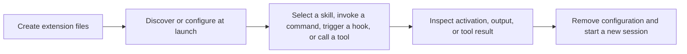
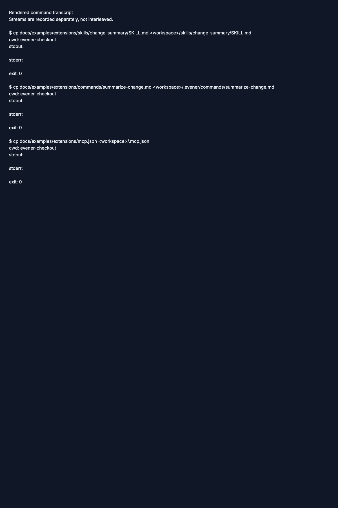
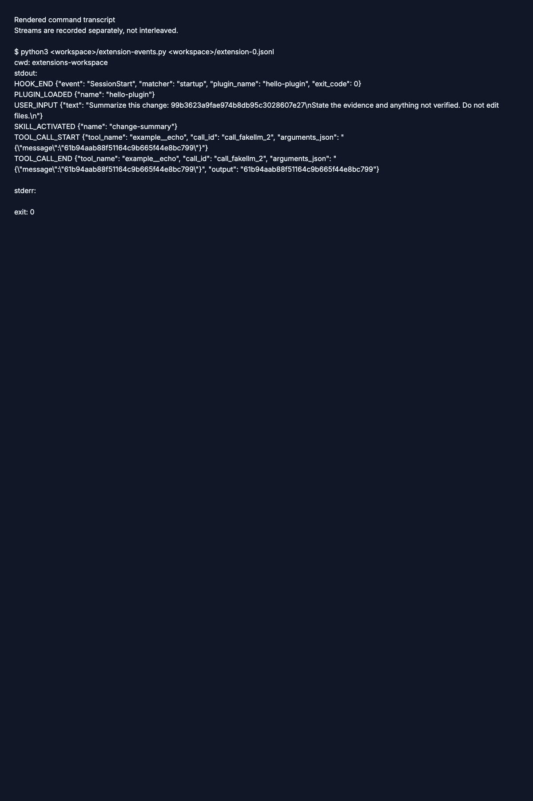
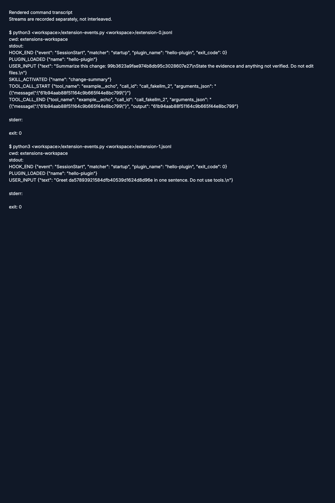
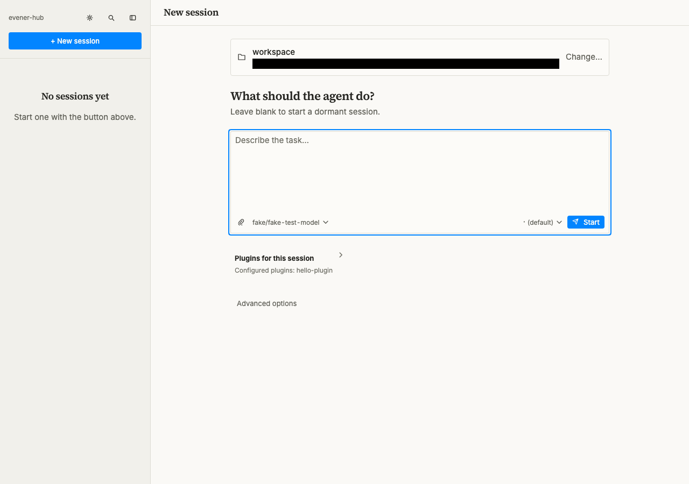
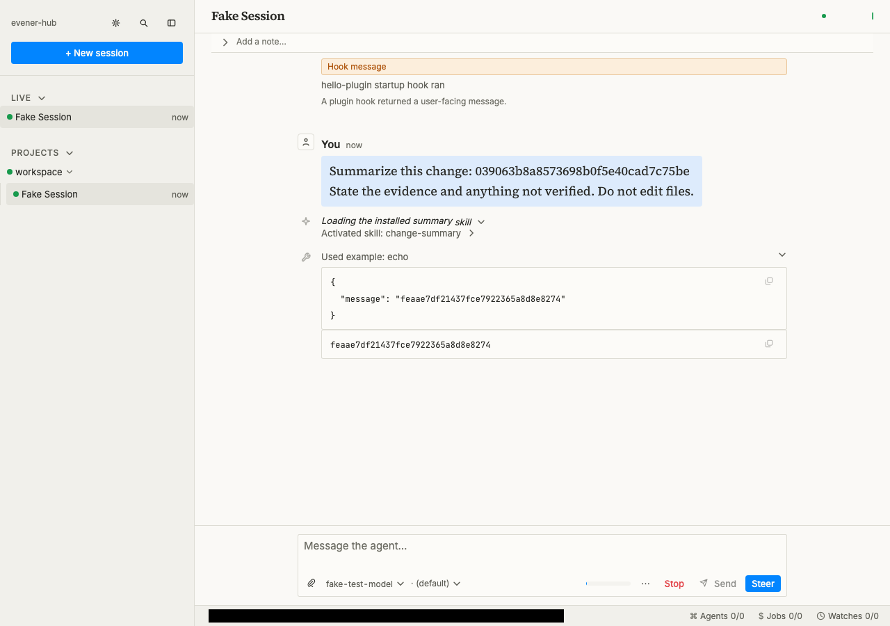
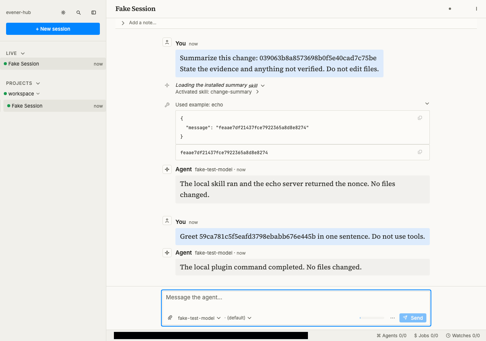

# Choose an extension

Start with a skill unless you need argument substitution, automatic execution,
or a new tool. These guides describe Evener on main, not another agent's extension
contract. A familiar filename does not imply identical behavior.

| You want to… | Choose | Start here |
| --- | --- | --- |
| Reuse instructions or a checklist | Skill | [Create and use a skill](skills.md#create-and-use-a-skill) |
| Invoke a prompt template with arguments | Command | [Create a command](skills.md#create-a-command-with-arguments) |
| Distribute skills, commands, roles, hooks, or server configuration together | Plugin | [Load a local plugin](plugins.md#load-a-local-plugin) |
| Run code at a session or tool boundary | Hook | [Add a startup hook](hooks.md#add-and-verify-a-startup-hook) |
| Connect an external service as tools | MCP server | [Connect a local server](mcp.md#connect-a-local-server) |
| Give a delegate a reusable specialist prompt and tool selection | Plugin agent role | [Add a delegate role](plugins.md#add-a-delegate-role) |

A plugin packages extensions; it adds no new execution mechanism. A skill does not create
a delegate. A hook runs because an event fires, not because the model chooses it.
An MCP server supplies tools the model can call; connecting it does not prove
that a tool was called.

## Know what you are trusting

Skills and discovered commands insert untrusted instructions into model context.
Their wording cannot enforce permissions. Plugin commands can run shell commands
and read files while expanding. Command hooks run processes. MCP stdio servers
run on the session host; HTTP and SSE servers run wherever their endpoints are
hosted. Remote services enforce their own permissions and receive tool arguments.

Review code, requested credentials, and configuration before enabling an
extension. The session's sandbox and effective tool policy still apply to local
execution. Installation is not permission to bypass them. See
[sandboxing](sandboxing.md) before giving a server or plugin access to private data.

## Check the whole path



Loading is not invocation. Verify the observable result named in each guide,
then remove the configuration and check a new session. Removing files cannot
retract instructions already delivered or undo external effects.

## Try local extensions

First follow the linked setup guides for the extensions you need. Put the skill
in your project's `skills/change-summary/SKILL.md` and the command in
`.evener/commands/summarize-change.md`. Inspect existing files before copying.
Keep the plugin directory and compiled MCP server on the machine running Evener.
The [example files](examples/extensions/README.md) are optional source examples,
not files bundled with an installed `evener` command.

From your project directory, invoke an installed command. Replace `provider/model` with an available model from your configured provider:

```bash
evener --model provider/model "/summarize-change review-42"
```

Check that `review-42` reaches the expanded session input. For the plugin example,
pass its actual directory to `--plugin-dir` and invoke
`/hello-plugin:hello review-42`. Look for the plugin load and startup-hook records,
not just a greeting. See [local plugin setup](plugins.md#load-a-local-plugin).

For the echo server, follow [MCP setup](mcp.md#connect-a-local-server), then ask
Evener to call `example__echo` with a fresh identifier. Inspect the tool result:
it should return that identifier unchanged. An assistant's claim that it called
the server is not evidence of a tool call. To check the skill, ask Evener to use
`change-summary` and inspect its activation and `use_skill` result.

### Use the configured workspace in the web hub

Install files and configure extensions on the host first. The browser does not
install these examples. Set `EVENER_EXAMPLE_MCP_SERVER` to the compiled server's
absolute path in the environment that starts the hub. Configure `plugin_dirs`
and `mcp_configs` in the host's launch defaults, using absolute paths; see
[configuration](configuration.md). Start a new session in the prepared workspace.

Enter `/summarize-change review-42` as the prompt. In the session composer, send
`/hello-plugin:hello review-42`. Ask for the skill and echo tool separately, then
inspect their runtime records and compare the workspace with its initial state.
These examples request no file edits. A missing server or invalid configuration
is a setup failure, even if the assistant still answers.

For cleanup, stop the test session, restore the launch and MCP configuration you
changed, and remove only example files you installed. Start a new session to
check that the removed extensions are no longer loaded. Unsetting a variable in
your shell does not change an already-running hub's environment.

## What the automated walkthrough proves

The [tour manifest and review process](developing-evener/tutorial-tours.md#review-and-publication)
record the capture revision and source digest. CLI images render recorded command
output; web images capture the browser. Neither proves live-provider
authentication, model quality, or native behavior.

The CLI and web tours execute the real examples with scripted model responses.
They check command-argument routing, skill delivery, plugin execution, the
startup hook's identity and exit code, a call-ID-correlated MCP nonce, and
unchanged workspace contents, paths, and modes. The MCP server runs as a compiled
process over OS stdio. No marketplace installation or hosted provider is needed.

CLI evidence includes the plugin-loaded event. Web verification combines the
recorded startup hook, effective plugin directory, and plugin-command routing;
the transient plugin-loaded announcement is not retained by `thread/read`.
Scripted tool choice proves integration, not that a model follows the skill or
chooses the requested tool. Native verification is deferred. Contributor setup
and check commands belong in the [example README](examples/extensions/README.md#deterministic-checks).

## Captured walkthrough

These checkpoints use a scripted fake provider, not live-provider authentication.
CLI images render recorded command output; web images are browser screenshots.
Owned temporary paths are masked. Native verification is deferred. See the
[capture provenance and review process](developing-evener/tutorial-tours.md#review-and-publication).

### CLI transcript checkpoints

**Entry.** Three copy commands install the example skill file, command file, and MCP configuration.



[Read the entry command transcript](assets/tutorials/extensions/cli/entry.txt).

**Action.** The event output lists the startup hook, loaded plugin, activated skill, and matching MCP call and result.



[Read the action command transcript](assets/tutorials/extensions/cli/action.txt).

**Verified.** The event output includes a second startup hook and the expanded greeting request.



[Read the verified command transcript](assets/tutorials/extensions/cli/verified.txt).

### Web checkpoints

**Entry.** The New session form lists `hello-plugin` under configured plugins.



**Action.** The conversation shows the startup-hook message, activated skill, and matching echo input and output.



**Verified.** The conversation shows the expanded greeting request and the agent's report that the plugin command completed.


