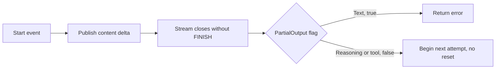

# Bounded LLM-core audit: two fixes, Raw replay unresolved

TLC found two families; both are now **confirmed Go bugs and fixed**:

- **SC-1:** `StreamGenerate` retried after publishing reasoning or tool-argument
  payloads without resetting the consumer. A public-boundary regression failed
  before the change and passed afterward.
- **SS-1:** a later terminal error left completed tool results and usage out
  of `StreamResult.Steps()` and `TotalUsage()`. A public-boundary regression
  failed before completed-round publication and passed afterward.

**Unresolved:** provider-specific `PROVIDER_EVENT`/`Raw` passthrough can
repeat after a transient stream failure, including a nonempty content payload.
The two fixes and passing bounded models cover the enumerated normalized
events and completed-round accounting, **not** a universal no-replay guarantee
for provider events. See [Raw provider passthrough replay](#raw-provider-passthrough-replay-unresolved)
and [issue #4941](https://github.com/prime-radiant-inc/evener/issues/4941).

Of the 17 documented configurations, 12 finish without violations. Four retain
historical counterexamples for SC-1/SS-1; a fifth concerns a deliberately
stronger cancellation hypothesis, not the approved observed-cancellation
contract. Both bugs were separately reproduced in Go before their fixes. No
live provider request or broad local test suite was used for either fix.

Source baseline: `0e8e648c19de07b6a72830032d991631a3d4e8b0`.
Contract: [approved design](../../superpowers/specs/2026-10-24-llm-tlc-audit-design.md).
These models describe the public `llm` library. A repository-wide Go reference
search for `StreamGenerate(` found only `llm` implementation/tests, not a
production agent-session caller. Do not infer session-path impact from SC-1/SS-1.

## Reproduce

Use Java 21 and the official **v1.7.4** release asset:

- Release: <https://github.com/tlaplus/tlaplus/releases/tag/v1.7.4>
- Asset: <https://github.com/tlaplus/tlaplus/releases/download/v1.7.4/tla2tools.jar>
- GitHub release API: `draft=false`, `prerelease=false`, published
  `2024-08-05T20:16:41Z`, asset size `2274532` bytes.
- SHA256: `936a262061c914694dfd669a543be24573c45d5aa0ff20a8b96b23d01e050e88`.
- Runtime banner: `TLC2 Version 2.19 of 08 August 2024 (rev: 5a47802)`.
- Host used: OpenJDK `21.0.12.1`, Linux amd64.

The checksum pins the downloaded bytes; the upstream API supplied no digest for
this older release. This is HTTPS provenance, not a separately signed checksum.
The initial v1.8.0 download was rejected after the API identified it as a
prerelease. It was not used for model checks. Both releases' `-help` entry points
printed help and returned **1**, not a model-check failure.

From the repository root, choose an empty session-scratch directory:

```bash
export RUN_DIR="$EVENER_SCRATCH_DIR"
curl --fail --silent --show-error --location --proto '=https' --tlsv1.2 \
  https://github.com/tlaplus/tlaplus/releases/download/v1.7.4/tla2tools.jar \
  -o "$RUN_DIR/tla2tools-1.7.4.jar"
export TLA_JAR="$RUN_DIR/tla2tools-1.7.4.jar"
printf '%s  %s\n' \
  936a262061c914694dfd669a543be24573c45d5aa0ff20a8b96b23d01e050e88 \
  "$TLA_JAR" | sha256sum --check
java -Xmx512m -cp "$TLA_JAR" tlc2.TLC -help # expected exit 1
cd docs/formal/llm
```

Run each configuration below. This is the exact checker command used, with the
scratch path factored into `RUN_DIR` and `TLA_JAR`:

```bash
java -Xmx512m -XX:+UseParallelGC -cp "$TLA_JAR" tlc2.TLC \
  -workers 1 -fp 0 -metadir "$RUN_DIR/states-$cfg" \
  -config "$cfg.cfg" "$module.tla" > "$RUN_DIR/$cfg.log" 2>&1
status=$?
printf '%s exit=%s\n' "$cfg" "$status"
cat "$RUN_DIR/$cfg.log"
```

Set `module=StreamCommit` for every `StreamCommit*` configuration,
`module=StreamSteps` for `StreamSteps*`, and `module=RetryBudget` for `RetryBudget*`.
Use separate metadata directories as above. No jar, TLC state directory, or
runtime dependency belongs in the repository. Do not use `-continue`: the
candidate runs intentionally stop at the first violating state. The passing
safety configurations explore beyond those states without pretending the
candidate invariants pass.

## Checked configurations, 2026-10-24

All runs used breadth-first search, one worker, fingerprint polynomial 0, and a
512 MiB heap ceiling. TLC reported about 491 MiB usable heap plus 64 MiB off-heap.
There are no state constraints, symmetry reductions, or search-depth cutoffs.
StreamSteps has two initial states, with and without configured active tools;
the other models have one. Exit **12** is an invariant violation;
exit **0** means TLC finished the configured checks with no error. Generated /
distinct counts for violating runs cover only the explored prefix, not the
complete graph. Depth is TLC's reported depth, including the initial state.

| Configuration | Bounds / variant | Exit | Generated / distinct | Depth | Verdict |
|---|---|---:|---:|---:|---|
| `StreamCommit` | 2 attempts, 2 events per attempt, all 3 content families | 12 | 91 / 71 | 5 | SC-1, reasoning |
| `StreamCommitTool` | same bounds, tool only | 12 | 33 / 27 | 5 | SC-1, tool arguments |
| `StreamCommitText` | same bounds, text only plus controls | 0 | 70 / 42 | 6 | No unreset-content retry |
| `StreamCommitSafety` | all families, type/bounds only | 0 | 420 / 252 | 8 | Full bounded state space well-formed |
| `StreamCommitFixed` | fixed gate, 2 attempts, 2 events, text/reasoning/tool/object | 0 | 313 / 186 | 6 | No unreset-content retry in the bounded fixed model |
| `StreamSteps` | 2 tool rounds, usage 0..2 per response | 12 | 270 / 199 | 5 | SS-1, results/step count |
| `StreamStepsUsage` | same bounds | 12 | 348 / 239 | 5 | SS-1, usage |
| `StreamStepsSafety` | same bounds | 0 | 1810 / 822 | 9 | Round limit, settled execution, success accounting, termination |
| `StreamStepsZero` | 0 tool rounds, usage 0..2 | 0 | 226 / 150 | 3 | Both retention properties, execution safety, termination |
| `StreamStepsFixed` | fixed publication, 2 tool rounds, usage 0..2 | 0 | 1810 / 822 | 9 | Both retention properties, execution safety, success accounting, termination |
| `RetryBudget` | Stream, retries 1, policy wall 3 | 0 | 356 / 223 | 20 | Owning budget, observed cancellation, termination |
| `RetryBudgetStreamOwned` | Stream, retries 1, policy wall 3, owned 5 minus reserve 1 | 0 | 650 / 407 | 26 | Same, owned budget overrides policy |
| `RetryBudgetStreamCounted` | Stream, retries 1, wall disabled | 0 | 202 / 127 | 11 | Same, rate limits attempt-counted |
| `RetryBudgetGenericPolicy` | Generic, retries 1, policy wall 3 | 0 | 433 / 279 | 20 | Owning budget, observed cancellation, termination |
| `RetryBudgetGenericOwned` | Generic, retries 1, policy wall 3, owned 5 minus reserve 1 | 0 | 793 / 511 | 26 | Same, owned budget overrides policy |
| `RetryBudgetGenericCounted` | Generic, retries 1, wall disabled | 0 | 257 / 167 | 11 | Same, rate limits attempt-counted |
| `RetryBudgetCancelledEntry` | Generic, retries 1, policy wall 3 | 12 | 9 / 9 | 3 | RB-D1, stronger diagnostic only |

Each passing row also checks `TypeOK`. Temporal checks completed for all three
`StreamSteps` passing rows and all six retry-contract rows. Deadlock checking
remains enabled; terminal states have explicit self-loops. The first development
run of `StreamCommit` used `-XX:+UseSerialGC`, found the same 91/71 counterexample,
and printed TLC's recommendation for ParallelGC. The table records the subsequent
ParallelGC runs. The first 15 configurations were initially run sequentially
and finished in under a second each according to TLC's rounded duration output.
The full 17-configuration matrix was rerun after both fixed configurations
were added.

Self-review corrected one initial overapproximation: active-tool availability
must stay fixed across rounds (`llm/generate.go:205-227`), not be selected anew by
each response. All configurations were rerun after that correction. The same
candidate traces remain; the historical rows retain those corrected counts.
`StreamCommitFixed` and `StreamStepsFixed` are the later source-fix checks.

## StreamCommit: publication versus retry commitment



The model records published normalized content independently of the
implementation's `PartialOutput` flag. `NoRetryAfterUnresetContent` asks
whether the next attempt starts while old content remains visible. It does not
require an identical second payload to detect the dangerous retry. The
historical model's counterexample was a replay *risk*; the later Go test
established the observable second attempt.

| Action / field | Source correspondence (baseline unless marked fixed) |
|---|---|
| `Start`, `Delta`, `Control` | baseline `llm/stream_generate.go:223-262`; fixed `:234-280`, accumulator processes before forwarding. `Delta` abstracts only nonempty content, including tool arguments on start/end |
| historical `partial` | baseline `llm/stream_generate.go:259-261`: **every** `TEXT_DELTA`, even empty, set `hasPartialOutput`; the pre-fix model omits empty text events rather than treating them as `Control` |
| fixed `partial` | fixed `llm/stream_generate.go:268-279`: nonempty typed text, reasoning, tool arguments at start/delta/end, or nonnil object payload set `hasPartialOutput`; empty text is `Control` only in this mode |
| `Finish` | baseline `llm/stream_generate.go:241-244,305-308`; fixed `:252-255,323-333`, FINISH buffered, then settled |
| `Truncate` | baseline `llm/stream_generate.go:266-271`; fixed `:282-289`, no FINISH becomes retryable `StreamError` |
| `Retry`, `Stop` | baseline `llm/stream_generate.go:284-292`; fixed `:302-320`; `llm/stream_retry.go:129-170` |
| `published`, `replayRisk` | observer history of delivered nonempty deltas and subsequent attempt entry, not implementation state |

### SC-1 shortest traces

Both are **4 transitions / 5 states**, shortest in their bounded models:

| State | Reasoning trace (`StreamCommit.cfg`) | Tool trace (`StreamCommitTool.cfg`) |
|---:|---|---|
| 1 | Attempt 1, empty output, `partial=FALSE` | Same |
| 2 | `Start("reasoning")` | `Start("tool")` |
| 3 | `Delta("reasoning")`, published reasoning, `partial=FALSE` | `Delta("tool")`, published arguments, `partial=FALSE` |
| 4 | `Truncate`, phase failed | Same |
| 5 | `Retry`, attempt 2, old content still published, `replayRisk=TRUE` | Same |

**Input validation:** `llm/stream.go:51-79` defines separate `Delta`,
`ReasoningDelta`, and `ToolCall` fields. A concrete reasoning input has
`ReasoningDelta: "r"`; a concrete tool input has nonnil
`ToolCallData{ID:"c1", Name:"t1", Type:"function", Arguments: []byte("{")}`
on TOOL_CALL_DELTA. Tool chunks need not be complete JSON. Neither input puts
tool arguments or reasoning into the text `Delta` field.

These are real emitted shapes: `llm/providers/chatcompletions/stream.go:239-252`
emits reasoning start/delta, and `:272-305` emits tool start/argument delta.
`llm/stream_accumulator.go:64-100` consumes both. `Client.Stream` accepts adapter
streams (`llm/client.go:384-402`); its pump forwards these fields unchanged
(`:856-883`). The public boundary permits the two-event stream before closure.
A protocol stream may additionally emit STREAM_START; the trace abstracts that
prefix away. The two-event bound counts the modeled start and delta, not the
closing channel or retry decision. A provider's terminal ERROR instead of raw
closure follows baseline `stream_generate.go:245-254` (fixed `:256-265`) to the
same retry gate.

**Contract strength:** the approved design treats published normalized content
as committed; `stream_retry.go:56-64` documents that default retry cannot
re-stream already shown content. The baseline `stream_generate.go:275-281`
repeats that intent.
Its baseline comment at `:212-213` described the text-only implementation, not
a proof that reasoning/tool content is safe to replay. Start/control duplication
is not classified as a bug. The public-boundary regression below establishes the effect.
No reset action is invented: this caller sets neither `RetryAfterPartial` nor
`OnReset`.

### SC-1 Go reproduction and fixed-mode check, 2026-10-24

`go test ./llm -run '^TestStreamGenerate_RetryAfterPublishedContent$' -count=1 -v`
failed before the source edit: the text case passed, but reasoning, tool
arguments in a delta, complete arguments in a start or end event, and object
deltas each produced **2** provider requests and a successful response after a
truncation instead of one request and a terminal `StreamError`. An empty text
delta also wrongly prevented the control-only stream from retrying. The same
command passed all seven subcases after the source edit. The test uses the real
`Client`, `StreamGenerate`, and `ChanStream`, with only the provider scripted.
Its oracle checks request count, structured event fields, error type/identity,
and successful recovery when no content was published.

`StreamCommit.tla` now has a `CommitRule` setting: the original four configurations
explicitly select `"pre-fix"` and retain their historical state counts and
counterexamples, while `StreamCommitFixed.cfg` selects `"fixed"`. The fixed
model also includes object payloads. One worker and 512 MiB yield exit **12**
for `StreamCommit` (91/71 states) and `StreamCommitTool` (33/27 states), and exit
**0** for `StreamCommitText` (70/42), `StreamCommitSafety` (420/252), and
`StreamCommitFixed` (313/186). The fixed setting represents only the content
classification passed to `RetryStream`, not an independent proof of Go behavior.
`Start` represents no-payload starts. In **fixed mode**, `Control` includes
empty text deltas and no-payload controls; `Delta` represents nonempty payload
on the content-bearing event, including tool arguments in START or END. The
**historical mode omits empty text deltas**: historical Go marked every text
delta as partial, including an empty one, so classifying it as `Control` would
misrepresent its retry decision. Historical counterexamples concern nonempty
reasoning and tool arguments and are unaffected. Neither mode models exact
field bytes or the accumulator. The Go regression, not the bounded model,
confirms the fixed empty-text retry and the tool-start/end and object cases.
No production agent-session `StreamGenerate` caller was found; the demonstrated
impact is limited to public `llm` library consumers.

### Raw provider passthrough replay, unresolved

A separate public-library diagnostic against the fixed source used a scripted
adapter with the real `Client` and `StreamGenerate`. On attempt 1 it emitted a
`PROVIDER_EVENT` with `Raw: {"type":"response.refusal.delta",
"delta":"I cannot help with that."}` and then closed without `FINISH`. On
attempt 2 it emitted the same event followed by `FINISH` with response text
`settled`. With `MaxRetries: 1`, the observed result was **2 requests, 2
Raw content events, a successful `"settled"` response, and no error**. The
complete diagnostic source and reproduction command are in
[issue #4941](https://github.com/prime-radiant-inc/evener/issues/4941).

`llm/stream_generate.go:268-280` forwards provider passthrough but sets
`hasPartialOutput` only for nonempty normalized text/reasoning, nonempty tool
arguments on start/delta/end, or a nonnil object delta. `RetryStream` uses the
caller's `PartialOutput` report to gate another attempt
(`llm/stream_retry.go:129-130`). Source inspection shows that the Responses
adapter's default branch can forward unrecognized frames as `PROVIDER_EVENT`
with `Raw` (`llm/providers/responses/stream.go:537-555`); the diagnostic
scripted the adapter and **did not** exercise that decoder or a live provider.

Whether each adapter's opaque payload is content or control remains
undecided. Marking **every** `Raw` event as partial output would also prevent
recovery after control-only failures; special-casing refusal deltas would not
settle other adapters' content semantics. This is a deferred contract and
adapter decision, **not** a new fixed regression or a claim of live-provider
or agent-session impact. Neither the fixed StreamCommit model nor its Go
regression checks opaque `Raw` replay; the bounded normalized-event result
does not prove a universal no-replay property.

## RetryBudget: admission and bounded liveness

| Action / expression | Source correspondence at baseline |
|---|---|
| Stream `Enter` | `llm/stream_retry.go:96-100`, check context before callback |
| Generic `Enter` | `llm/retry_util.go:77-78`, callback without entry context check |
| `Return`, `Check` | `stream_retry.go:100-108,129-141`; `retry_util.go:78-94` |
| `Wall`, `Budget` | `llm/retry.go:90-100`; `retry_util.go:144-167` |
| `Delay`, `Sleep`, `PostSleep` | `stream_retry.go:142-165`; `retry_util.go:96-120` |
| `Cancel`, `observed`, admissions log | external caller cancellation and observer records of source checks/attempt starts |

`OwningBudgetRespected` checks the error that *authorized* the next attempt.
Initial attempts are exempt. Ordinary retries use the global attempt index,
including prior rate-limited attempts. A newly returned ordinary failure after a
rate-limit storm can therefore exceed the count already, but cannot authorize
another ordinary retry. This matches
`retry_ratelimit_budget_test.go:148-167,335-354`; using a separate ordinary-error
counter would mistranslate the code.

The clock starts at zero and advances by the actual clipped sleep. Positive
Retry-After delays are nondeterministically 1 or 2 ticks, MaxDelay is 2, and jitter
is disabled. Owned budget snapshots 5 ticks and reserves 1, deliberately allowing
4 ticks even when the policy fallback is 3. WallBudget=0 disables the exception.
The upper bounds in `TypeOK` are assertions, not transition guards or pruning.
No run is forced to terminate by an artificial attempt cutoff.

**Liveness assumptions:** `WF_vars(Progress)` requires the continuously enabled
local step eventually to run. Attempt callbacks and sleeps return; the clock
progresses by at least one tick on successful sleep; no infinite provider/tool
hang is modeled. Cancellation is optional, may arrive at any nonterminal stage,
and is not assumed fair. These assumptions plus finite budgets are enough for
`Terminates`; cancellation is not required to make the check pass. Clock time
does not advance between the post-sleep check and admission. Thus these results
do **not** rule out real-time check/admission races, zero-delay fake-clock loops,
or handlers that ignore context forever. Success remains ahead of cancellation
checks, matching both implementations.

### RB-D1 diagnostic, not an approved-contract failure

`RetryBudgetCancelledEntry.cfg` violates `NoCancelledEntry` in **2 transitions /
3 states**: Init, `Cancel`, generic `Enter`. The final admissions record is
`[owner |-> "initial", prior |-> 0, time |-> 0, observed |-> FALSE,
cancelled |-> TRUE]`. A pre-cancelled context is admitted by the generic helper's
signature, and it calls `fn()` at `retry_util.go:78`. But the loop has **not yet
observed** cancellation. The approved `NoAttemptAfterObservedCancellation`
property passes for both modes. This stronger diagnostic is retained to expose
the source difference, not to authorize a production fix. Go cancellation can
also race the streaming precheck; the model combines that precheck and entry in
one action and makes no atomic-cancellation promise.

## StreamSteps: completed work versus published bookkeeping


The diagram shows the fixed behavior. The historical model instead keeps public
accounting unchanged at the error edge. Completed tool results are modeled as
ordered round IDs and usage as one additive nonnegative scalar. `publicResults`
projects the `ToolResults` inside published
`Steps`, not a separate API. Retention is checked only at terminal settlement,
not while the goroutine is still running. No partial failed-step usage is owed
by the invariant; it concerns already completed steps.

| Action / predicate | Source correspondence at baseline unless marked fixed |
|---|---|
| `Settle` | `llm/stream_generate.go:294-318`, successful retry settlement and complete response |
| `CanExecute` | `:320-334`, calls, tool_calls/pause_turn finish, active/passive handlers, round budget |
| `Execute` | `:366-403`, execute tools, increment rounds, append step/usage, emit STEP_FINISH |
| `Final` | `:336-363`, append final completion, copy usage and steps |
| `StopWhen`, `Continue` | `:405-419`, custom stop copy or next iteration |
| `Fail("error")`, `Fail("cancelled")` | `:296-302`, terminal step error; `:165-172`, top-of-loop cancellation |
| fixed terminal publication | `llm/stream_generate.go:164-174`, unsuccessful goroutine exit copies completed steps and usage under `res.mu` before closing `done`; successful paths already publish them, and failures leave `res.final` unset |
| `public*` observation | `:85-99,116-129`, Response waits for done, then read TotalUsage and Steps |

`StreamStepsSafety.cfg` checks `RoundLimit`, `OnlySettledExecution`,
`SuccessAccounting`, and `Terminates`. The zero-round and fixed configurations
also check both retention hypotheses. Active-tool availability is chosen at initialization
and remains fixed. Each response can have no calls, passive calls, or a
non-executable finish reason. One executed tool result per round suffices to
expose loss; parallel tool ordering and repair are excluded.
`executeToolCalls` returns results (`llm/generate.go:455-498`), including tool
errors (`:402-445`), rather than a separate error that skips local accounting.
Weak fairness of `Next`, finite responses/tools, and finite MaxRounds underlie
the liveness check. It assumes the caller drains `Events()` or closes the stream,
and that `StopWhen` returns; otherwise event delivery or the callback can block
progress. A callback panic or a hung tool is not represented.

### SS-1 shortest historical traces

Both retention invariants fail in **4 transitions / 5 states**:

| State / action | Local accounting | Public accounting |
|---|---|---|
| 1 Init | No results, 0 steps, 0 usage | Empty, 0, 0 |
| 2 Settle | Successful tool_calls response, calls/active true, passive false | Unchanged |
| 3 Execute | Results `<<1>>`, 1 step, usage `u` | Empty, 0, 0 |
| 4 Continue | Same completed locals, next call | Empty, 0, 0 |
| 5 Fail("error") | Same completed locals, terminal | Empty, 0, 0 |

TLC chose `u=0` for the result-retention trace and `u=1` for the independent usage
trace. The regression uses one settled tool response with usage 10/20/30 and an
executable `lookup` returning `resolved-17`. After a second permanent open error,
a truncated stream, or cancellation coordinated on the second open, `Events()`
is drained and `Response()` returns a terminal error without a successful final
response. The first request's completed tool result remains in `Steps()` and its
usage in `TotalUsage()`; the second request carries that result in its history.

**Input validation:** successful multi-step execution and additive usage are
already exercised by `stream_generate_test.go:256-394,1341-1476`. StopWhen is
exercised at `:1478-1591`, passive calls at `:396-472`, and non-tool finish reasons
at `:1167-1276`. A second open returning a typed permanent provider error is an
allowed `ProviderAdapter.Stream` outcome and avoids inventing an internal seam.
The retention contract comes from the approved hypothesis and the unconditional
Steps/TotalUsage descriptions. Existing tests cover successful accounting; the
new default-suite regression covers completed accounting after terminal failure.

### SS-1 Go reproduction and fixed-mode check, 2026-10-24

`go test ./llm -run '^TestStreamGenerate_PreservesCompletedStepsOnFailure$' -count=1 -v`
exited **1** at reviewed HEAD `8192d297805fede3ed454eaec9b9d36a6a6533ae`:
all three failure cases executed the handler exactly once and reached the
second provider request, but `Steps()` was empty and `TotalUsage()` was zero.
After the source edit the same command exited **0** with all three cases passing.
Only the provider is scripted; `Client`, `StreamGenerate`, retry, event forwarding,
and the tool handler are real. The second open's cancellation case waits for its
entry after `STEP_FINISH` and cancels without sleeping.

The historical `StreamSteps` and `StreamStepsUsage` configurations explicitly
select `PublicationRule = "pre-fix"`, retaining their exit **12** counterexamples
at 270/199 and 348/239 states. `StreamStepsSafety` and `StreamStepsZero` also
select pre-fix and retain exit **0** at 1810/822 and 226/150 states. The new
`StreamStepsFixed.cfg` selects `"fixed"`: the terminal error/cancellation edge
copies completed locals to public accounting, but never synthesizes a final
response. With two rounds, usage 0..2 per response, one worker and 512 MiB,
it exited **0** after 1810 generated / 822 distinct states, depth 9, checking
both retention invariants, execution safety, success accounting and termination.
The model reduces each tool result to a round ID and usage to one scalar; passing
this finite abstraction cannot prove the Go implementation or live provider paths.

## Rejected shortcuts and exclusions

- A FINISH with `Response=nil` is **not** enough to reach the missing-response
  error branch: `StreamAccumulator.Process` constructs a nonnil response
  (`llm/stream_accumulator.go:124-141,172-223`). Replacing the package variable
  `streamGenerateAccumulatedResponse` would be internal mocking, not a legitimate
  public-input reproduction. This branch is excluded rather than fabricated.
- Reasoning in `StreamEvent.Delta`, tool arguments only in `Delta`, or a nil
  ToolCall are not substituted for actual emitted payloads. The candidate traces
  use the documented fields and a nonempty tool call ID.
- No-payload control/start events alone do not establish committed content.
  The fixed StreamCommit model checks nonnil object payloads and abstracts
  nonempty tool arguments on START/DELTA/END as `Delta`; the Go regression
  checks object deltas, arguments specifically on START and END, and empty
  text/control-only recovery. The historical model excludes empty text, which
  old Go incorrectly marked partial. Model checks do not inspect exact payload
  bytes, empty-text behavior, or the event position of tool arguments. Opaque
  provider `PROVIDER_EVENT`/`Raw` passthrough is outside both StreamCommit modes
  and can replay as documented above.
- More than two modeled events per attempt, explicit reset-enabled RetryStream
  callers, fail-fast streak/cap rules, backoff numeric overflow, time moving
  backwards, real clock/deadline epoch interactions, and concurrent
  result-reader aliasing are not checked.
- The SS-1 regression checks a completed first round with nonzero usage, but
  does not give a truncated second stream its own nonzero partial usage; the
  model tracks only settled response usage. No unfinished-step usage is owed.
- Tool-call IDs/arguments, token vectors/maps, provider wire parsers, transcript
  persistence, fallback, crash recovery, and the agent session are abstractions
  or outside scope. No inference about live providers follows from these checks.
- The models encode source transitions, while named invariants encode audit
  hypotheses. A passing bounded model is not an unbounded proof. A failing
  model alone is not a confirmed production bug: SC-1 and SS-1 were separately
  reproduced through real Client/StreamGenerate/RetryStream before their fixes.
  RB-D1 remains a diagnostic of a stronger, unconfirmed contract.
