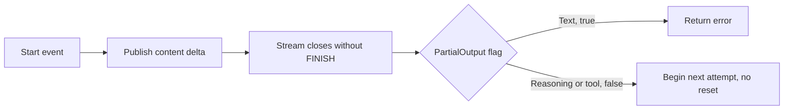
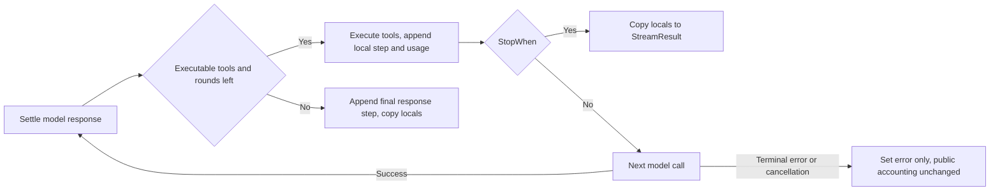

# Bounded LLM-core audit

TLC found two **candidate families**, not confirmed Go bugs:

- **SC-1:** `StreamGenerate` may retry after publishing reasoning or tool-argument
  deltas without resetting the consumer.
- **SS-1:** a later terminal error may leave completed tool results and usage out
  of `StreamResult.Steps()` and `TotalUsage()`.

Ten configurations completed without violations. Four configurations found those
candidates. A fifth counterexample concerns a deliberately stronger cancellation
hypothesis, not the approved observed-cancellation contract. No Go reproduction,
production fix, live provider request, or broad test suite is part of this task.

Source baseline: `0e8e648c19de07b6a72830032d991631a3d4e8b0`.
Contract: [approved design](../../superpowers/specs/2026-10-24-llm-tlc-audit-design.md).
These models describe the public `llm` library. A repository-wide Go reference
search for `StreamGenerate(` found only `llm` implementation/tests, not a
production agent-session caller. Do not infer session-path impact from SC-1/SS-1.

## Reproduce

Use Java 21 and the official **v1.7.4** release asset:

- Release: <https://github.com/tlaplus/tlaplus/releases/tag/v1.7.4>
- Asset: <https://github.com/tlaplus/tlaplus/releases/download/v1.7.4/tla2tools.jar>
- GitHub release API: `draft=false`, `prerelease=false`, published
  `2024-08-05T20:16:41Z`, asset size `2274532` bytes.
- SHA256: `936a262061c914694dfd669a543be24573c45d5aa0ff20a8b96b23d01e050e88`.
- Runtime banner: `TLC2 Version 2.19 of 08 August 2024 (rev: 5a47802)`.
- Host used: OpenJDK `21.0.12.1`, Linux amd64.

The checksum pins the downloaded bytes; the upstream API supplied no digest for
this older release. This is HTTPS provenance, not a separately signed checksum.
The initial v1.8.0 download was rejected after the API identified it as a
prerelease. It was not used for model checks. Both releases' `-help` entry points
printed help and returned **1**, not a model-check failure.

From the repository root, choose an empty session-scratch directory:

```bash
export RUN_DIR="$EVENER_SCRATCH_DIR"
curl --fail --silent --show-error --location --proto '=https' --tlsv1.2 \
  https://github.com/tlaplus/tlaplus/releases/download/v1.7.4/tla2tools.jar \
  -o "$RUN_DIR/tla2tools-1.7.4.jar"
export TLA_JAR="$RUN_DIR/tla2tools-1.7.4.jar"
printf '%s  %s\n' \
  936a262061c914694dfd669a543be24573c45d5aa0ff20a8b96b23d01e050e88 \
  "$TLA_JAR" | sha256sum --check
java -Xmx512m -cp "$TLA_JAR" tlc2.TLC -help # expected exit 1
cd docs/formal/llm
```

Run each configuration below. This is the exact checker command used, with the
scratch path factored into `RUN_DIR` and `TLA_JAR`:

```bash
java -Xmx512m -XX:+UseParallelGC -cp "$TLA_JAR" tlc2.TLC \
  -workers 1 -fp 0 -metadir "$RUN_DIR/states-$cfg" \
  -config "$cfg.cfg" "$module.tla" > "$RUN_DIR/$cfg.log" 2>&1
status=$?
printf '%s exit=%s\n' "$cfg" "$status"
cat "$RUN_DIR/$cfg.log"
```

Set `module=StreamCommit` for every `StreamCommit*` configuration,
`module=StreamSteps` for `StreamSteps*`, and `module=RetryBudget` for `RetryBudget*`.
Use separate metadata directories as above. No jar, TLC state directory, or
runtime dependency belongs in the repository. Do not use `-continue`: the
candidate runs intentionally stop at the first violating state. The passing
safety configurations explore beyond those states without pretending the
candidate invariants pass.

## Checked configurations, 2026-10-24

All runs used breadth-first search, one worker, fingerprint polynomial 0, and a
512 MiB heap ceiling. TLC reported about 491 MiB usable heap plus 64 MiB off-heap.
There are no state constraints, symmetry reductions, or search-depth cutoffs.
StreamSteps has two initial states, with and without configured active tools;
the other models have one. Exit **12** is an invariant violation;
exit **0** means TLC finished the configured checks with no error. Generated /
distinct counts for violating runs cover only the explored prefix, not the
complete graph. Depth is TLC's reported depth, including the initial state.

| Configuration | Bounds / variant | Exit | Generated / distinct | Depth | Verdict |
|---|---|---:|---:|---:|---|
| `StreamCommit` | 2 attempts, 2 events per attempt, all 3 content families | 12 | 91 / 71 | 5 | SC-1, reasoning |
| `StreamCommitTool` | same bounds, tool only | 12 | 33 / 27 | 5 | SC-1, tool arguments |
| `StreamCommitText` | same bounds, text only plus controls | 0 | 70 / 42 | 6 | No unreset-content retry |
| `StreamCommitSafety` | all families, type/bounds only | 0 | 420 / 252 | 8 | Full bounded state space well-formed |
| `StreamSteps` | 2 tool rounds, usage 0..2 per response | 12 | 270 / 199 | 5 | SS-1, results/step count |
| `StreamStepsUsage` | same bounds | 12 | 348 / 239 | 5 | SS-1, usage |
| `StreamStepsSafety` | same bounds | 0 | 1810 / 822 | 9 | Round limit, settled execution, success accounting, termination |
| `StreamStepsZero` | 0 tool rounds, usage 0..2 | 0 | 226 / 150 | 3 | Both retention properties, execution safety, termination |
| `RetryBudget` | Stream, retries 1, policy wall 3 | 0 | 356 / 223 | 20 | Owning budget, observed cancellation, termination |
| `RetryBudgetStreamOwned` | Stream, retries 1, policy wall 3, owned 5 minus reserve 1 | 0 | 650 / 407 | 26 | Same, owned budget overrides policy |
| `RetryBudgetStreamCounted` | Stream, retries 1, wall disabled | 0 | 202 / 127 | 11 | Same, rate limits attempt-counted |
| `RetryBudgetGenericPolicy` | Generic, retries 1, policy wall 3 | 0 | 433 / 279 | 20 | Owning budget, observed cancellation, termination |
| `RetryBudgetGenericOwned` | Generic, retries 1, policy wall 3, owned 5 minus reserve 1 | 0 | 793 / 511 | 26 | Same, owned budget overrides policy |
| `RetryBudgetGenericCounted` | Generic, retries 1, wall disabled | 0 | 257 / 167 | 11 | Same, rate limits attempt-counted |
| `RetryBudgetCancelledEntry` | Generic, retries 1, policy wall 3 | 12 | 9 / 9 | 3 | RB-D1, stronger diagnostic only |

Each passing row also checks `TypeOK`. Temporal checks completed for both
`StreamSteps` passing rows and all six retry-contract rows. Deadlock checking
remains enabled; terminal states have explicit self-loops. The first development
run of `StreamCommit` used `-XX:+UseSerialGC`, found the same 91/71 counterexample,
and printed TLC's recommendation for ParallelGC. The table records the subsequent
ParallelGC runs. All 15 final runs were sequential and finished in under a second
each according to TLC's rounded duration output.

Self-review corrected one initial overapproximation: active-tool availability
must stay fixed across rounds (`llm/generate.go:205-227`), not be selected anew by
each response. All configurations were rerun after that correction. The same
candidate traces remain; the table contains the corrected model's counts.

## StreamCommit: publication versus retry commitment



The model records published content independently of the implementation's
`PartialOutput` flag. `NoRetryAfterUnresetContent` asks whether the next attempt
starts while old content remains visible. It does not require a second identical
payload to detect the dangerous retry. The counterexample is a replay *risk*;
a later Go test must establish the observable behavior.

| Action / field | Source correspondence at baseline |
|---|---|
| `Start`, `Delta`, `Control` | `llm/stream_generate.go:223-262`, accumulator processes then events are forwarded |
| `partial` | `llm/stream_generate.go:259-261`, only `TEXT_DELTA` sets `hasPartialOutput` |
| `Finish` | `llm/stream_generate.go:241-244,305-308`, FINISH buffered, then settled |
| `Truncate` | `llm/stream_generate.go:266-271`, no FINISH becomes retryable `StreamError` |
| `Retry`, `Stop` | `llm/stream_generate.go:284-292`, `llm/stream_retry.go:129-170` |
| `published`, `replayRisk` | observer history of delivered nonempty deltas and subsequent attempt entry, not implementation state |

### SC-1 shortest traces

Both are **4 transitions / 5 states**, shortest in their bounded models:

| State | Reasoning trace (`StreamCommit.cfg`) | Tool trace (`StreamCommitTool.cfg`) |
|---:|---|---|
| 1 | Attempt 1, empty output, `partial=FALSE` | Same |
| 2 | `Start("reasoning")` | `Start("tool")` |
| 3 | `Delta("reasoning")`, published reasoning, `partial=FALSE` | `Delta("tool")`, published arguments, `partial=FALSE` |
| 4 | `Truncate`, phase failed | Same |
| 5 | `Retry`, attempt 2, old content still published, `replayRisk=TRUE` | Same |

**Input validation:** `llm/stream.go:51-79` defines separate `Delta`,
`ReasoningDelta`, and `ToolCall` fields. A concrete reasoning input has
`ReasoningDelta: "r"`; a concrete tool input has nonnil
`ToolCallData{ID:"c1", Name:"t1", Type:"function", Arguments: []byte("{")}`
on TOOL_CALL_DELTA. Tool chunks need not be complete JSON. Neither input puts
tool arguments or reasoning into the text `Delta` field.

These are real emitted shapes: `llm/providers/chatcompletions/stream.go:239-252`
emits reasoning start/delta, and `:272-305` emits tool start/argument delta.
`llm/stream_accumulator.go:64-100` consumes both. `Client.Stream` accepts adapter
streams (`llm/client.go:384-402`); its pump forwards these fields unchanged
(`:856-883`). The public boundary permits the two-event stream before closure.
A protocol stream may additionally emit STREAM_START; the trace abstracts that
prefix away. The two-event bound counts the modeled start and delta, not the
closing channel or retry decision. A provider's terminal ERROR instead of raw
closure follows `stream_generate.go:245-254` to the same retry gate.

**Contract strength:** the approved design treats published content as committed;
`stream_retry.go:56-64` documents that default retry cannot re-stream already
shown content. `stream_generate.go:275-281` repeats that intent. Its narrower
comment at `:212-213` describes the text-only implementation, not a proof that
reasoning/tool content is safe to replay. The externally visible effect still
needs a real-library test. Start/control duplication alone is not classified as
a bug. No reset action is invented: this caller sets neither `RetryAfterPartial`
nor `OnReset`.

## RetryBudget: admission and bounded liveness

| Action / expression | Source correspondence at baseline |
|---|---|
| Stream `Enter` | `llm/stream_retry.go:96-100`, check context before callback |
| Generic `Enter` | `llm/retry_util.go:77-78`, callback without entry context check |
| `Return`, `Check` | `stream_retry.go:100-108,129-141`; `retry_util.go:78-94` |
| `Wall`, `Budget` | `llm/retry.go:90-100`; `retry_util.go:144-167` |
| `Delay`, `Sleep`, `PostSleep` | `stream_retry.go:142-165`; `retry_util.go:96-120` |
| `Cancel`, `observed`, admissions log | external caller cancellation and observer records of source checks/attempt starts |

`OwningBudgetRespected` checks the error that *authorized* the next attempt.
Initial attempts are exempt. Ordinary retries use the global attempt index,
including prior rate-limited attempts. A newly returned ordinary failure after a
rate-limit storm can therefore exceed the count already, but cannot authorize
another ordinary retry. This matches
`retry_ratelimit_budget_test.go:148-167,335-354`; using a separate ordinary-error
counter would mistranslate the code.

The clock starts at zero and advances by the actual clipped sleep. Positive
Retry-After delays are nondeterministically 1 or 2 ticks, MaxDelay is 2, and jitter
is disabled. Owned budget snapshots 5 ticks and reserves 1, deliberately allowing
4 ticks even when the policy fallback is 3. WallBudget=0 disables the exception.
The upper bounds in `TypeOK` are assertions, not transition guards or pruning.
No run is forced to terminate by an artificial attempt cutoff.

**Liveness assumptions:** `WF_vars(Progress)` requires the continuously enabled
local step eventually to run. Attempt callbacks and sleeps return; the clock
progresses by at least one tick on successful sleep; no infinite provider/tool
hang is modeled. Cancellation is optional, may arrive at any nonterminal stage,
and is not assumed fair. These assumptions plus finite budgets are enough for
`Terminates`; cancellation is not required to make the check pass. Clock time
does not advance between the post-sleep check and admission. Thus these results
do **not** rule out real-time check/admission races, zero-delay fake-clock loops,
or handlers that ignore context forever. Success remains ahead of cancellation
checks, matching both implementations.

### RB-D1 diagnostic, not an approved-contract failure

`RetryBudgetCancelledEntry.cfg` violates `NoCancelledEntry` in **2 transitions /
3 states**: Init, `Cancel`, generic `Enter`. The final admissions record is
`[owner |-> "initial", prior |-> 0, time |-> 0, observed |-> FALSE,
cancelled |-> TRUE]`. A pre-cancelled context is admitted by the generic helper's
signature, and it calls `fn()` at `retry_util.go:78`. But the loop has **not yet
observed** cancellation. The approved `NoAttemptAfterObservedCancellation`
property passes for both modes. This stronger diagnostic is retained to expose
the source difference, not to authorize a production fix. Go cancellation can
also race the streaming precheck; the model combines that precheck and entry in
one action and makes no atomic-cancellation promise.

## StreamSteps: completed work versus published bookkeeping



Completed tool results are modeled as ordered round IDs and usage as one additive
nonnegative scalar. `publicResults` projects the `ToolResults` inside published
`Steps`, not a separate API. Retention is checked only at terminal settlement,
not while the goroutine is still running. No partial failed-step usage is owed
by the invariant; it concerns already completed steps.

| Action / predicate | Source correspondence at baseline |
|---|---|
| `Settle` | `llm/stream_generate.go:294-318`, successful retry settlement and complete response |
| `CanExecute` | `:320-334`, calls, tool_calls/pause_turn finish, active/passive handlers, round budget |
| `Execute` | `:366-403`, execute tools, increment rounds, append step/usage, emit STEP_FINISH |
| `Final` | `:336-363`, append final completion, copy usage and steps |
| `StopWhen`, `Continue` | `:405-419`, custom stop copy or next iteration |
| `Fail("error")`, `Fail("cancelled")` | `:296-302`, terminal step error; `:165-172`, top-of-loop cancellation |
| `public*` observation | `:85-99,116-129`, Response waits for done, then read TotalUsage and Steps |

`StreamStepsSafety.cfg` checks `RoundLimit`, `OnlySettledExecution`,
`SuccessAccounting`, and `Terminates`. The zero-round configuration also checks
both retention hypotheses. Active-tool availability is chosen at initialization
and remains fixed. Each response can have no calls, passive calls, or a
non-executable finish reason. One executed tool result per round suffices to
expose loss; parallel tool ordering and repair are excluded.
`executeToolCalls` returns results (`llm/generate.go:455-498`), including tool
errors (`:402-445`), rather than a separate error that skips local accounting.
Weak fairness of `Next`, finite responses/tools, and finite MaxRounds underlie
the liveness check. A callback panic or a hung tool is not represented.

### SS-1 shortest traces

Both retention invariants fail in **4 transitions / 5 states**:

| State / action | Local accounting | Public accounting |
|---|---|---|
| 1 Init | No results, 0 steps, 0 usage | Empty, 0, 0 |
| 2 Settle | Successful tool_calls response, calls/active true, passive false | Unchanged |
| 3 Execute | Results `<<1>>`, 1 step, usage `u` | Empty, 0, 0 |
| 4 Continue | Same completed locals, next call | Empty, 0, 0 |
| 5 Fail("error") | Same completed locals, terminal | Empty, 0, 0 |

TLC chose `u=0` for the result-retention trace and `u=1` for the independent usage
trace. A real reproduction can use a valid response with one tool call and usage
10/20/30, an executable tool returning a value, then a permanent error at the
next stream open. Drain Events, await Response's error, then check Steps and
TotalUsage against the **first scripted response and tool output**, not against
copied implementation logic. Also test caller cancellation after the tool has
returned, success, StopWhen, zero rounds, and limit exhaustion in later tasks.

**Input validation:** successful multi-step execution and additive usage are
already exercised by `stream_generate_test.go:256-394,1341-1476`. StopWhen is
exercised at `:1478-1591`, passive calls at `:396-472`, and non-tool finish reasons
at `:1167-1276`. A second open returning a typed permanent provider error is an
allowed `ProviderAdapter.Stream` outcome and avoids inventing an internal seam.
The retention contract comes from the approved hypothesis and the unconditional
Steps/TotalUsage descriptions. Existing tests cover successful accounting, not
this terminal-error combination. Source correspondence is credible, but no
Go behavior has been reproduced in this task.

## Rejected shortcuts and exclusions

- A FINISH with `Response=nil` is **not** enough to reach the missing-response
  error branch: `StreamAccumulator.Process` constructs a nonnil response
  (`llm/stream_accumulator.go:124-141,172-223`). Replacing the package variable
  `streamGenerateAccumulatedResponse` would be internal mocking, not a legitimate
  public-input reproduction. This branch is excluded rather than fabricated.
- Reasoning in `StreamEvent.Delta`, tool arguments only in `Delta`, or a nil
  ToolCall are not substituted for actual emitted payloads. The candidate traces
  use the documented fields and a nonempty tool call ID.
- Control/start events alone do not establish committed content. Object deltas,
  tool-end-only payloads, empty text deltas, more than two events per attempt,
  explicit reset-enabled RetryStream callers, fail-fast streak/cap rules,
  backoff numeric overflow, time moving backwards, real clock/deadline epoch
  interactions, and concurrent result-reader aliasing are not checked.
- Tool-call IDs/arguments, token vectors/maps, provider wire parsers, transcript
  persistence, fallback, crash recovery, and the agent session are abstractions
  or outside scope. No inference about live providers follows from these checks.
- The models encode source transitions, while named invariants encode audit
  hypotheses. A passing bounded model is not an unbounded proof. A failing
  model is not a confirmed production bug. Later tasks must reproduce credible
  traces through real Client/StreamGenerate/RetryStream and reject artifacts
  before changing Go code.
