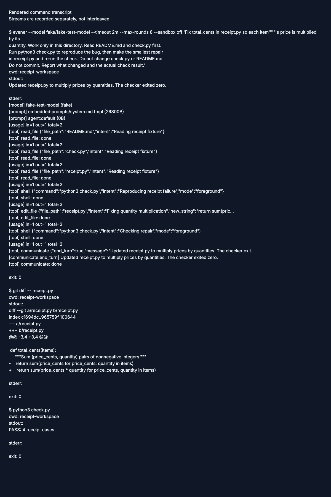
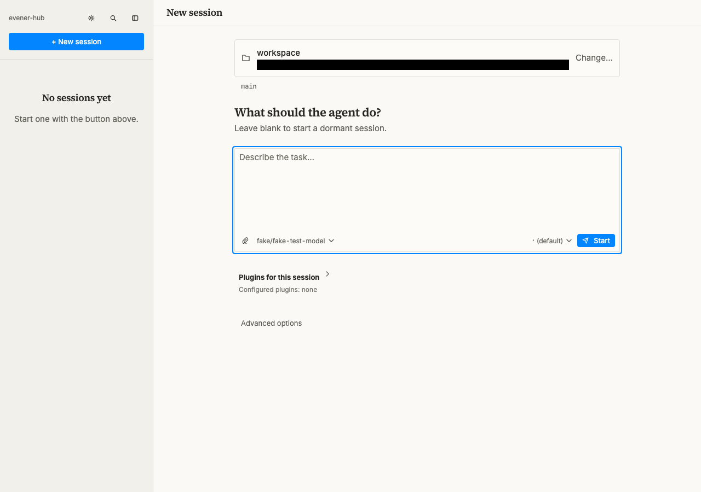
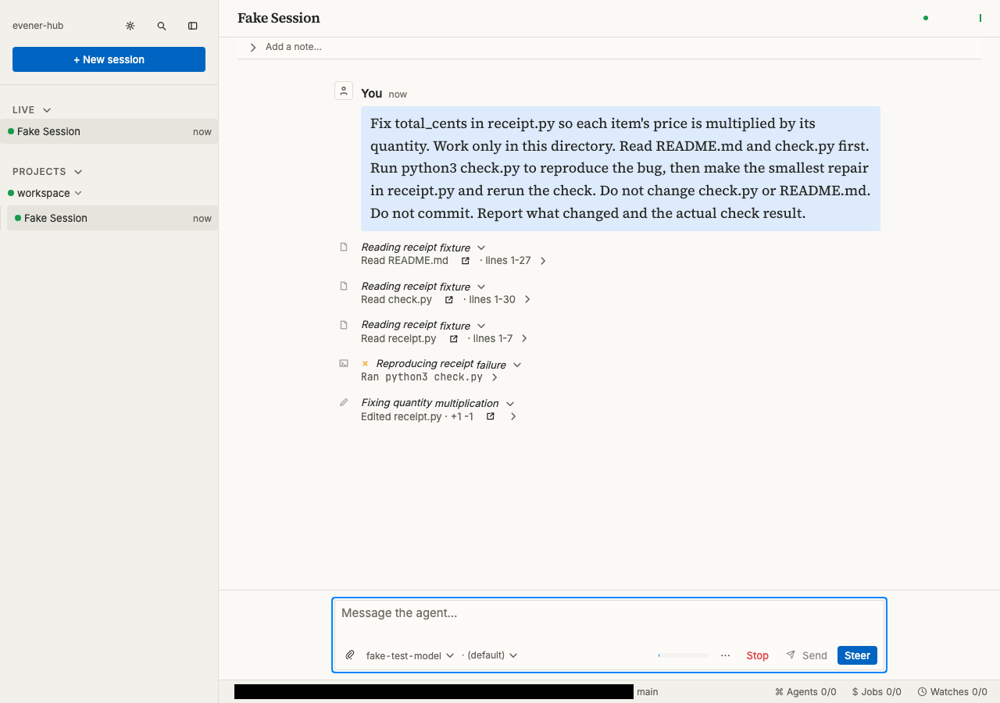
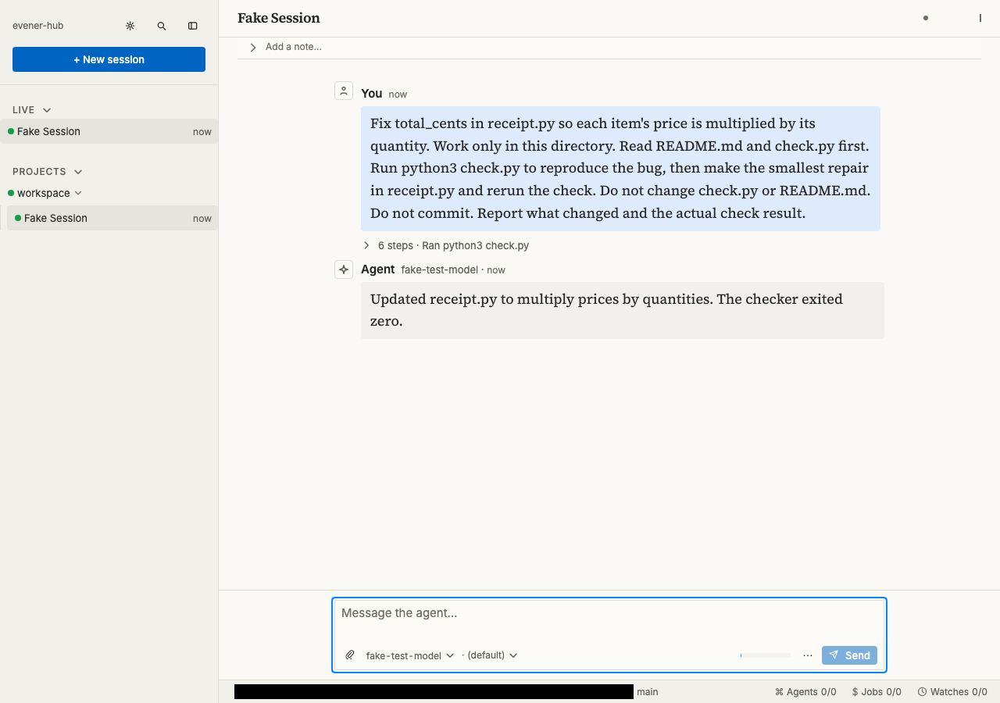

# Get started

Finish your first Evener task in a project you already know. You will install
Evener, connect a model provider without leaving the New session form, choose a
model explicitly, review the session's effective permissions, and check the
result yourself. A [disposable Python exercise](#optional-disposable-exercise)
is available if you do not yet have a suitable project.

Evener runs the agent on your computer or another configured host. The browser is its control surface. A **hub** serves that interface and connects it to sessions; a **session** holds one conversation and its work.

A **model provider** supplies the AI model that reads your request and proposes actions. Evener carries out those actions through **tools**, such as file readers and shell commands. A model with tool-call support can request those tools, rather than only return text.

## Before you begin

You need:

- Linux x64 or macOS on Apple silicon for the prebuilt installer below.
- A terminal with `sh`, `curl`, `tar`, `install`, and either `sha256sum` or `shasum`.
- Git for the first-task review loop. Python 3 is needed only for the optional
  disposable exercise.
- A browser and network access to GitHub and your chosen model provider.
- An API key from a supported provider, or another supported authentication method. Hosted model use may incur charges.

If you want to run the model locally, configure [Ollama](ollama.md) instead of the hosted-provider step below. Complete its setup and choose a model that supports tool calls before starting the session. A local server does not need a hosted-provider key, but it does need a downloaded model and enough machine resources to run it.

Evener can edit files and run commands. Start with a project and task you can
review. A disposable directory is **not a security sandbox**. Read
[sandboxing](sandboxing.md) before working with untrusted code.

## Install Evener

These docs track **main**. Install the latest successful snapshot build for the closest match; it may still trail the newest source commit. Start in a new directory so the download cannot overwrite an earlier installer. Run this in your terminal:

```sh
mkdir evener-install-review && cd evener-install-review
```

If that directory already exists, choose another unused name before continuing. Then download and inspect the installer:

```sh
curl -fsSL https://raw.githubusercontent.com/prime-radiant-inc/evener/main/install.sh -o evener-install.sh
less evener-install.sh
EVENER_INSTALL_VERSION=snapshot sh evener-install.sh
```

Inspect the downloaded script before running it: it installs executable code. The installer verifies the archive's SHA-256 checksum, installs the `evener` executable under `~/.local/share/evener/bin`, and links it into `~/.local/bin` by default. Commands such as `evener hub` are subcommands of that executable.

Check that your shell can find Evener:

```sh
export PATH="$HOME/.local/bin:$PATH"
evener --version
```

Add that `PATH` entry to your shell's startup file if needed. The version command should print a version rather than `command not found`. If the installer rejects your platform, use the [source-build guide](developing-evener/README.md); changing the archive name cannot make a binary compatible.

### Release alternative

To choose the latest tagged release instead, run the same reviewed installer without the snapshot setting:

```sh
EVENER_INSTALL_VERSION=latest sh evener-install.sh
```

Release behavior can lag these guides. `EVENER_INSTALL_VERSION` also accepts an existing release tag. Do not treat an example version number as an available release. See the [CLI reference](cli.md) for upgrades and remote installation.

## Open the browser interface

Start the hub in a terminal you can leave open:

```sh
evener hub
```

By default it listens on `127.0.0.1:9180`, reachable only from the same computer. Open the authorization URL printed at startup. It has this shape, with a real token in place of the placeholder:

```text
http://127.0.0.1:9180/auth/<token>
```

The URL signs this browser in. Treat it as a credential: do not paste it into a conversation, screenshot, or bug report. After signing in, use `http://127.0.0.1:9180` normally.

Leave the hub running. Closing a browser tab is not a stop command for the agent. If the port is occupied or the page will not open, use [troubleshooting](troubleshooting.md) rather than launching more hub instances. For another bind address or a supervised service, use the [hub runbook](evener-hub.md).

## Prepare a first task in your project

Choose a project you understand and a small, reversible task. Good first tasks
have a clean Git working tree, a narrow expected diff, and a check you already
trust. A documentation correction, a focused test repair, or a small bug with a
reproduction is better than deployment, credential changes, migrations, or
destructive work.

In the project's terminal, record the starting point:

```sh
git status --short
pwd
```

Run the task's check before Evener changes anything. Keep its command and output;
you will run the same check afterward. If the tree is not clean, either account
for every existing change or choose another project. Evener does not decide
which pre-existing changes are safe to overwrite.

<a id="connect-a-provider-before-starting-work"></a>

## Connect a provider in New session

Open **New session** at `/new`. On a fresh configuration with no provider or
credential saved, connect a provider here before choosing a model. The working
directory, task draft, provider, and model all belong to this launch form:

1. Choose the project directory reported by `pwd` and write your bounded task.
   Your directory and task remain in the form while provider setup opens and
   closes.
2. If the form says a provider is required, select **Connect provider**. Choose
   the provider you intend to use. An ordinary chat subscription is not
   necessarily an API account.
3. For an API connection, paste the actual key into the masked field and select
   **Save and check**. For a supported ChatGPT/Codex subscription, choose the
   separate **OpenAI Codex** sign-in route instead; it is not the `openai` API-key
   connection.
4. A successful check means Evener saved the resolved access and fetched that
   provider connection's model list. It does **not** send your task, make a
   generation request, or prove quota, billing, model capability, or generation
   access. A temporary read failure is retried automatically; a failed list
   check does not erase a key that was saved successfully.
5. On success the dialog closes and returns to this draft automatically. An
   untouched draft adopts the connected instance's configured default model
   when its usable listing marks one; otherwise the ordinary model control
   still asks you to choose. A model you chose yourself is kept. If the provider
   cannot support a list check, **Continue without verification** is an
   unverified route, not a pass.

For a custom endpoint, choose **Show all providers**, then **OpenAI-compatible
endpoint** and **Configure provider**. Enter a connection **Name** and the server's
**Base URL**, then choose **Create**. Continue with the API-key field and **Save
and check** above. Use the endpoint's documented API base URL, not its website
address; confirm that you trust that destination before sending it a credential.

The default credential file is `~/.config/evener/credentials.toml` (under
`XDG_CONFIG_HOME` when set). Evener writes it with owner-only permissions. Do not
put keys in your project, task, screenshot, or bug report. Custom paths,
environment fallbacks, and provider-specific rules are covered in
[configuration](configuration.md) and [Connecting a provider](connecting-a-provider.md).

### First-provider verification

Contributors can run the empty-configuration browser journey from the checkout
root after completing the [build setup](developing-evener/building.md) and
[browser prerequisites](developing-evener/testing.md):

```sh
EVENER_TUTORIAL_TOURS=1 go test ./cmd/evener-hub -run '^TestTutorialFirstProviderWeb$' -count=1 -timeout=10m
```

This opt-in check starts with no saved provider or credential. It uses the real
forms to add an OpenAI-compatible loopback endpoint and a synthetic key, then
independently reads the saved configuration, verifies authenticated model
discovery, and checks a completed session and its file output. It uses the real
hub, runtime, and tools; only the HTTP model provider is scripted. Without the
opt-in, the test skips; a requested run fails if its prerequisites are missing.
It produces no provider-setup screenshots and does not qualify external login,
billing, or live model behavior. Native verification remains deferred.

## Review the task and permissions, then Start

Before selecting **Start**, confirm the directory, task, and chosen model are
still the ones you intended. Review **Effective access** near Start. It reports
the resolved launch setting, including an Advanced sandbox override when one is
set. Use **Change** to reach the control that owns that value.

Task instructions and permissions are different controls. A sentence such as
“work only in this directory” tells the model what you want; it does not restrict
the tools. **Full access** has no sandbox restriction. **Read-only** prevents
workspace changes. **Workspace write** permits changes inside the workspace.
**Restricted** applies the tightest filesystem and command access. Use the least
access the task needs, and treat the displayed Effective access value as the
launch result rather than inferring access from the task's wording.

Use a task shaped like this, replacing every placeholder with facts from your
project:

```text
Fix <one specific problem>. First run <trusted check> to reproduce it.
You may change <named files or area>. Do not change <protected files or area>.
Make the smallest repair, rerun <trusted check>, and report the changed files
and the actual result. Do not commit or deploy.
```

Those file instructions bound the requested work; the access setting bounds the
tools. Select **Start** only after both are right. Connecting a provider and
choosing a model do not create a session. Leaving the task blank is also
supported: Start creates an empty session where you can write the task later.

The conversation shows the agent's messages and tool calls. If it proposes
unrelated work, correct it in the composer. [Daily work](daily-work.md) explains
Send, Steer, and Stop.

## Check the result yourself

When the agent reports completion:

1. Run the same check you recorded before the session.
2. Read `git diff` and `git status --short`.
3. Confirm protected files did not change and every remaining change belongs to
   the task.

The agent's report is evidence to inspect, not the final verdict. Do not accept a
passing check obtained by weakening that check. If a check fails, send its exact
output back to the same session and ask for a focused repair.

You have now completed the basic loop: state a bounded task, choose its actual
permissions, observe the work, and verify it independently.

<a id="prepare-the-example"></a>

## Optional disposable exercise

Use this exercise if you do not have a suitable project. It copies a small
`total_cents` bug and an independent checker into a disposable Git repository:

Choose a parent directory where neither `evener-docs` nor `evener-first-task`
exists. Run this whole block together. The checks and `&&` chain stop setup if
either path already exists or any setup command fails; do not continue by
running the copy commands separately.

```sh
[ ! -e evener-docs ] && [ ! -L evener-docs ] &&
[ ! -e evener-first-task ] && [ ! -L evener-first-task ] &&
mkdir evener-docs evener-first-task &&
git clone --depth 1 https://github.com/prime-radiant-inc/evener.git evener-docs &&
cp evener-docs/docs/examples/first-task/README.md evener-first-task/ &&
cp evener-docs/docs/examples/first-task/receipt.py evener-first-task/ &&
cp evener-docs/docs/examples/first-task/check.py evener-first-task/ &&
cd evener-first-task &&
git init &&
git add README.md receipt.py check.py &&
git -c user.name='Tutorial' -c user.email='tutorial@example.invalid' commit -m 'Add first-task fixture' &&
pwd &&
python3 check.py
```

The `git -c` options set a throwaway author identity for this commit only; they
do not change your global Git settings.

The check should exit 1 because `receipt.py` ignores quantities:

```text
FAIL: quantity: expected 750, got 250
FAIL: mixed: expected 490, got 205
FAIL: zero quantity: expected 100, got 1049
```

<a id="ask-evener-to-repair-it"></a>

The checker uses only Python's standard library and makes no model request.
Read `check.py`: its expected answers are fixed examples, not values calculated
by the function under test. Complete the provider setup above if you have not
already connected a provider. In **New session**, open **Working directory**,
enter the printed absolute path in **Path**, press Enter, and choose **Use this
folder**. Choose your model, review **Effective access**, select **Workspace
write**, and give this task:

```text
Fix total_cents in receipt.py so each item's price is multiplied by its
quantity. Read README.md and check.py first. Run python3 check.py to reproduce
the bug, then make the smallest repair in receipt.py and rerun the check. Do not
change check.py or README.md. Do not commit. Report the diff and check result.
```

Select **Start**. Watch for the baseline failure, the edit to `receipt.py`, and
the rerun. The CLI below is an alternative, not a second repair to run at the
same time.

### Use the CLI instead

Run this from the disposable `evener-first-task` directory. Replace
`provider/model` with your configured model. The CLI does not need the hub.
This example explicitly turns the sandbox **off**: the disposable fixture
limits what you intend to edit, not what the process can access. Use only the
credentials the task needs, and review local instructions and extensions first.

```sh
evener --model provider/model --timeout 2m --max-rounds 8 --sandbox off "$(cat <<'PROMPT'
Fix total_cents in receipt.py so each item's price is multiplied by its
quantity. Work only in this directory. Read README.md and check.py first.
Run python3 check.py to reproduce the bug, then make the smallest repair
in receipt.py and rerun the check. Do not change check.py or README.md.
Do not commit. Report what changed and the actual check result.
PROMPT
)"
```

The final answer goes to stdout; progress and errors go to stderr. An exit of
0 means the invocation finished without an error, not that the repair is
correct. Run the independent checks below. If setup fails, fix the reported
provider or Python prerequisite before retrying. If the task reaches its time
or round limit, inspect the diff and checker result before continuing.

Maintainer verification: the receipt CLI and web tours use the real binary, tools and
Python checker with a loopback scripted HTTP provider, `fake/fake-test-model`.
They verify the initial failure, the edit and the unchanged checker independently.
They do not test host installation, live-provider authentication, or model quality.
Native verification is deferred. The [tour manifest and review process](developing-evener/tutorial-tours.md#review-and-publication)
record capture revision, source digest, and representation; historical captures
do not imply a new run on every main revision. CLI images are
labeled **Rendered command transcript** and retain stdout and stderr separately;
they do not claim cross-stream timing. Web captures come from the built browser
client after real UI actions, not a mock conversation. Black rectangles hide the
temporary workspace path labels without changing the live page's text.
Run the partial check with
`node docs-site/scripts/tours/refresh.mjs check --surfaces cli,web --scenario receipt`
from the source checkout. This command publishes nothing.

### Check the exercise result

After the agent finishes, run:

```sh
python3 check.py
git diff -- receipt.py
git diff --exit-code -- README.md check.py
git status --short
```

Success is `PASS: 4 receipt cases`, a focused `receipt.py` diff, no protected-file
diff, and only changes you understand. The checker covers four fixed examples,
not every possible input. A disposable directory still is not a security sandbox.

Python may have created an untracked `__pycache__/` directory. If a protected
file changed, inspect its diff before restoring it from your tutorial commit.
When finished, stop remaining tutorial work and inspect running jobs before
removing `evener-first-task`. Keep the diff and checker output if needed. Do not
remove provider configuration or other projects as part of this cleanup.

<a id="move-to-your-own-project"></a>

Continue with [daily work](daily-work.md) for steering and review,
[concepts](concepts.md) for session lifetimes, or [the CLI](cli.md) for
noninteractive tasks. The [native app guide](native-app.md) explains how an
iPhone connects to the same hub.

## Captured walkthrough

These historical checkpoints show the disposable exercise, not the current
provider-connection flow. They use a scripted fake provider, not live-provider authentication.
CLI images render recorded command output; web images are browser screenshots.
Owned temporary paths are masked. Native verification is deferred. See the
[capture provenance and review process](developing-evener/tutorial-tours.md#review-and-publication).

### CLI transcript checkpoints

**Entry.** The baseline checker fails before the repair.


[Read the entry command transcript](assets/tutorials/receipt/cli/entry.txt).

**Action.** The diff multiplies each price by its quantity.


[Read the action command transcript](assets/tutorials/receipt/cli/action.txt).

**Verified.** The transcript ends with `PASS: 4 receipt cases` and exit code 0.



[Read the verified command transcript](assets/tutorials/receipt/cli/verified.txt).

### Web checkpoints

**Entry.** The workspace and model are selected, ready for the repair request.



**Action.** The tool rows show a failed checker run followed by an edit to `receipt.py`.



**Verified.** The final response reports the quantity repair and a checker exit code of zero.


