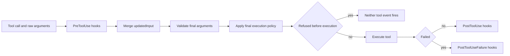

# Hooks

Run a hook when an event must trigger code: for example, inspect a tool call
before execution or add context at startup. Hooks belong to [plugins](plugins.md).
They run in the session execution environment with its sandbox policy; they do
not grant additional permissions. Prompt handlers make model calls and may incur
provider charges. Start with a command handler that makes no model call.

## Add and verify a startup hook

You need Evener with a configured provider and `bash` on the session host. Get
an Evener checkout with the [example clone command](getting-started.md#optional-disposable-exercise),
then run from the resulting `evener-docs` directory. No Evener build is needed.
The complete [`hello-plugin` fixture](examples/extensions/hello-plugin/hooks/hooks.json)
runs a startup hook. The session makes a real provider call and may incur charges;
`--sandbox read-only` prevents writes to the checkout but permits reads outside
it and writes to session scratch. In each example, replace `provider/model` with
an available model from your configured provider.

```bash
evener --model provider/model --sandbox read-only --plugin-dir ./docs/examples/extensions/hello-plugin "Reply briefly."
```

This plugin has a manifest and a `SessionStart` hook. The hook uses exec-form
`printf` to return `{"systemMessage":"hello-plugin startup hook ran"}`. Before
the first model turn, look for the warning **hello-plugin startup hook ran**.
The warning proves the hook ran; the model's reply does not. The fixture makes
no file changes and invokes no provider itself, but the Evener session does.

To build your own, create `.claude-plugin/plugin.json` containing
`{"name":"hello-plugin"}` and `hooks/hooks.json` with:

```json
{
  "hooks": {
    "SessionStart": [{
      "matcher": "startup",
      "hooks": [{
        "type": "command",
        "command": "printf",
        "args": ["%s\n", "{\"systemMessage\":\"hello-plugin startup hook ran\"}"]
      }]
    }]
  }
}
```

Pass that directory to `--plugin-dir`. After editing the declaration, start a
new session to load it. To remove the hook, omit the directory on the next launch
(or disable its installed plugin). End an existing session before removing files
its hooks may still need. A running hook is synchronous, bounded by its timeout
and session cancellation; deleting its declaration is not a stop command.

If the warning is absent, inspect startup diagnostics, confirm the manifest
loaded, and check the matcher. For tool hooks, [use `Bash`, not
`shell`](#the-1-mistake-shell--bash).
The reference below distinguishes supported behavior from fields that only parse.

## Hook reference

Use the sections below to check hook discovery, event support, matchers, handlers,
and input/output contracts. Parsed fields marked reserved have no runtime effect.

## How Evener discovers your hooks

Point Evener at one or more plugin directories with `--plugin-dir`:

```bash
evener --model provider/model --plugin-dir ./my-plugin "do the thing"
```

For each plugin directory, Evener reads hooks from the **first** of these it finds:

1. **A manifest-referenced path.** If the plugin manifest
   (`.claude-plugin/plugin.json`, or `.codex-plugin/plugin.json` as a fallback) has a `hooks`
   field that is a **string**, it is a path (relative to the plugin dir,
   `${CLAUDE_PLUGIN_ROOT}` expanded) to a hooks file.
2. **Inline manifest hooks.** If the manifest `hooks` field is a JSON **object**,
   it is parsed inline as the hooks config.
3. **The default file** `<plugin-dir>/hooks/hooks.json`.

Most plugins just use option 3 — drop a `hooks/hooks.json` in the plugin
directory and you are done.

### File shape

Evener accepts the Claude **wrapper** shape (an optional `description` plus a
`hooks` object keyed by event name):

```json
{
  "description": "What this plugin's hooks do",
  "hooks": {
    "PreToolUse": [
      {
        "matcher": "Bash|Edit",
        "hooks": [
          { "type": "command", "command": "${CLAUDE_PLUGIN_ROOT}/hooks/check.sh" }
        ]
      }
    ]
  }
}
```

It also accepts the **direct** shape (events at the top level, no `hooks`
wrapper):

```json
{
  "PreToolUse": [
    { "matcher": "*", "hooks": [ { "type": "command", "command": "echo ok" } ] }
  ]
}
```

The structure is the same either way: each event maps to an array of **matcher
groups**; each group has a `matcher` and an array of **handlers**.

## Behavior changes in this version

Four changes differ from earlier Evener versions. Each one changes what an
existing plugin sees.

- **`PostToolUse` fires only for a tool that succeeded.** A tool that ran and
  failed fires `PostToolUseFailure` instead. A call refused before execution
  (unknown tool, invalid arguments, tool policy, a `PreToolUse` deny) fires
  neither. A plugin that relied on `PostToolUse` also seeing failures must add
  `PostToolUseFailure` (`agent/session_tools.go:1036`; the switch is
  `case !res.IsError`).
- **`continue: false` is honored.** At every fired event except five, it stops
  the action it guards, and the hook's `stopReason` is delivered as a user-visible
  warning: `PreToolUse` stops the call, the two tool post-hooks end the turn,
  `Stop` and `SubagentStop` end the turn or run, `UserPromptSubmit` and
  `SessionStart` keep the prompt from the model, `SubagentStart` stops the
  launch, and `PostToolBatch` stops the round loop. It is discarded on
  `StopFailure`, `Notification`, `PreCompact`, `PostCompact`, and `SessionEnd`,
  exactly as Claude discards it (`agent/internal/hooks/hookinput.go`,
  `continueDiscardedEvents`; `agent/internal/hooks/hooks.go`, `applyStopped`;
  [per-event consumers](#claude-compatibility-caveats)).
- **`effort` is an object** — `{"level": "high"}` — and the field is absent when
  no effort is configured. A plugin that expected the old bare string now gets an
  object, or no field at all
  (`agent/internal/hooks/hookinput.go`, the `Effort` struct and the `*Effort`
  field; `agent/session_events.go:645-647`). `CLAUDE_EFFORT` stays the bare
  level (`agent/internal/hooks/command_runtime.go:242-243`).
- **Matcher exact mode accepts `,` and spaces.** `Edit, Write` now matches
  `Edit` or `Write`; before, the comma made it fall through to regex mode and
  match nothing (`agent/internal/hooks/matcher.go`, `isExactMatcher` and
  `splitExactMatcher`, lines 62-81).

## Which events Evener fires

Evener fires **fourteen** events. A hook on any other event name is parsed but
never runs (and warns loudly at load — see [Misconfiguration
warnings](#misconfiguration-warnings-loud-not-silent)).

| Event | When it fires | Matcher target |
|---|---|---|
| `SessionStart` | before the first model turn | `startup`, `resume`, `clear`, `compact` |
| `UserPromptSubmit` | after a user prompt is submitted | (none — the target is empty; use `*` or omit) |
| `PreToolUse` | before a tool runs (before schema validation) | Claude tool name |
| `PostToolUse` | after a tool runs and succeeds | Claude tool name |
| `PostToolUseFailure` | after a tool runs and fails | Claude tool name |
| `PostToolBatch` | after a round that executed tools, before the next model request | (none — any configured matcher is ignored) |
| `Stop` | before the assistant/session stops | (none — any configured matcher is ignored) |
| `SubagentStart` | before a delegate child run's first model request | child agent type |
| `SubagentStop` | after a delegate run finishes and before it settles | child agent type |
| `StopFailure` | when a turn ends on a provider/model failure | Claude error name (`rate_limit`, `server_error`, `unknown`, …) |
| `PreCompact` | before context compaction | `manual`/`auto` |
| `PostCompact` | after a fold that actually compacted | `manual`/`auto` |
| `SessionEnd` | at session teardown | session end reason (`clear`, `prompt_input_exit`, `other`) |
| `Notification` | on a user-visible notification | `notification_type` (`warning`) |

All fourteen are tier `claude-compatible-subset`: Evener fires them with a
Claude-compatible **subset** of the behavior. None is a complete end-to-end
reimplementation of the Claude event — for example `PreToolUse` honors `allow`
and `deny` decisions but not `ask`/`defer` (no interactive permission prompt),
and `PreCompact` cannot block compaction (below).

**`Stop` is not consulted at an ask-ending boundary.** When a round posts one or more
`ask_user` questions, the turn ends straight into the `awaiting` session state without
running `Stop` hooks — a pending, unanswered question is a stronger stop than a hook's
veto (a `Blocked` result would just force the model past its own unanswered questions).
`ask_user` is otherwise an ordinary tool: `PreToolUse` and `PostToolUse` still fire
around the call like any other.

**Other Claude events are reserved, not fired.** Names like `PermissionRequest`,
`Setup`, `FileChanged`, `TaskCreated`, `DirectoryAdded`, and the rest of the
Claude vocabulary are *recognized* (Evener knows they are real Claude events) but
**reserved** — declaring a hook for one parses cleanly and warns that the event
is not fired yet. The full event vocabulary and the roadmap live in
[07](subagent-management/07-lifecycle-hooks-claude-compat.md#event-contract).

**Unknown names are rejected loudly.** A typo like `PreToolUze` is neither an Evener
event nor a Claude event, so Evener warns that it is likely a typo and the hook
will never fire.

### Claude-compatibility caveats

These are the places the fired subset differs from Claude. Each is deliberate
and each is traced to the code that implements it.

- **`PreCompact` cannot block compaction.** In Claude, exit 2 (or
  `decision: "block"`) blocks the compaction. In Evener the hook runs mid-fold,
  where aborting would mean unwinding an in-flight strategy, so `RunPreCompactFor`
  only parses and aggregates output. Its exit 2 is non-blocking
  (`agent/internal/hooks/exitcode.go:47-57`; `RunPreCompactFor` in
  `agent/internal/hooks/hooks.go`). This is the one event whose decision control
  the design deliberately leaves out. `UserPromptSubmit`'s exit-2 block is also
  not enforced yet, because its runner has no block path either.
- **A nonzero shell exit is success in Evener, so `PostToolUseFailure` does not
  fire for a failing `bash`.** Evener treats a nonzero shell exit as a success
  (Jesse's 2026-10-16 ruling, `agent/transcript/failures.go:50-51`), so the shell tool
  returns `IsError == false` and the call fires `PostToolUse`. Claude fires
  `PostToolUseFailure` there (`agent/session_tools.go:1028-1032`).
- **`Notification`'s only type is the Evener-native `warning`.** Evener emits one
  kind of notification, a model-facing diagnostic warning, so `notification_type`
  and the matcher target are `warning`. Claude's `permission_prompt`,
  `idle_prompt`, and other types never occur, and a matcher naming one never
  matches (`agent/session_events.go:601-605,614`).
- **`SessionEnd` sends `clear`, `prompt_input_exit`, and `other`.** `clear` is a
  thread clear that replaced this identity; `prompt_input_exit` is a daemon
  shutdown that found the session provably idle (otherwise it downgrades to
  `other`); every other close sends `other`. `resume` and `logout` are in the
  vocabulary but never sent, because Evener has no boundary that proves them. A
  **retirement close runs no `SessionEnd` hook at all** (`agent/session_lifecycle.go`
  `claudeSessionEndReasons`, `sessionEndPromptInputExit`, `idleForPromptExit`,
  and the `if !retirement` guard around `RunSessionEndFor`).
- **`PostToolUseFailure.error` is the model-facing text, not the full output.** It
  is `ExecResult.Output`, the truncated text the model receives; `FullOutput`
  stays on the event stream. `PostToolBatch.tool_calls[].tool_response` is the
  same truncated text (`agent/session_tools.go:1043`;
  `agent/internal/tool/registry.go:301`; `agent/session_tool_round.go:145-153`).
- **`terminalSequence` is parsed but has no delivery site.** A hook may return
  it; Evener carries it and never emits it (`agent/internal/hooks/hooks.go`,
  the `TerminalSequences` fields, each commented "parsed but currently has no
  delivery-site consumer").
- **`Stop` and `SubagentStop` omit `background_tasks`, `session_crons`, and
  `agent_transcript_path`.** Evener has jobs but no cron concept and no
  per-subagent transcript path an agent-facing hook can read. It omits the
  fields rather than send a half-truthful list (`agent/internal/hooks/hookinput.go`
  has no such fields).
- **`SubagentStop`'s `stop_hook_active` is always `false`.** The field is present
  so a hook sees Claude's type rather than an absence
  (`agent/subagents.go:2664-2667`).
- **Go RE2, not JavaScript, and the widened exact set applies to every event.**
  Matchers use Go RE2 (see [below](#go-re2-not-javascript-regex)). The `,`/space/
  hyphen exact set has no per-event discriminator, so a `FileChanged` matcher
  (reserved) or a `StopFailure` matcher is exact in Evener where Claude uses its
  narrower set (`agent/internal/hooks/matcher.go:27-34,62-81`).
- **`PostCompact` fires only for a winning fold that actually compacted.** A
  request-time fold publishes on every model request whether or not a layer
  folded anything; the hook is gated on `commit.actualCompaction`, which is
  `stagedCompactionCount() > 0`, and skipped for a fold a newer one superseded
  (`agent/session_compaction.go:309,812-824`).
- **`Stop`'s `stop_hook_active` is per turn.** A Stop hook that blocks sets the
  flag; the next tool call in the turn clears it; a new turn clears it. It never
  leaks across turns (`agent/session.go:644-649`;
  `agent/session_tool_round.go:606,623,638`; `agent/session_tools.go:862`;
  `agent/session_lifecycle.go:2153`).
- **`continue: false` stops what each event guards.** The event-to-action map:
  `PreToolUse` stops the call (`agent/session_tools.go`, the `preResult.Stopped`
  arm); `PostToolUse` and `PostToolUseFailure` end the turn after the results are
  persisted (`agent/session_tools.go` records the stop, `agent/session_lifecycle.go`
  applies it after `deliverIfCommunicated`); `Stop` ends the turn and its
  `stopReason` replaces the vetoed reply (`agent/session_tool_round.go`);
  `SubagentStop` ends the child run with no continuation (`agent/subagents.go`);
  `SubagentStart` keeps the child from launching (`agent/subagents.go`);
  `UserPromptSubmit` and `SessionStart` end the turn before its first model
  request (`agent/session_lifecycle.go`, `takePromptHookStop` and
  `takeSessionStartHookStop`); `PostToolBatch` stops the round loop
  (`agent/session_lifecycle.go`). `StopFailure`, `Notification`, `PreCompact`,
  `PostCompact`, and `SessionEnd` discard it (`agent/internal/hooks/hookinput.go`,
  `continueDiscardedEvents`).
- **`effort` is an object and is absent when unset.** `{"level": "high"}`, not
  `"high"`; the field is omitted entirely when no effort is configured
  (`agent/internal/hooks/hookinput.go`, `Effort`; `agent/session_events.go:645-647`).

### When `PreToolUse` runs (input rewriting)

`PreToolUse` runs **before** registry schema validation, so a hook can inspect or
rewrite raw tool input. The order for each tool call is:



Evener decodes the call and best-effort parses its arguments for the pre-hook.
After applying any `updatedInput`, it validates the final arguments and checks
execution policy. Only an admitted call reaches the tool and a post-hook: a
success fires `PostToolUse`, a failure fires `PostToolUseFailure`, and a refusal
before execution (unknown tool, invalid arguments, policy, breaker park, a
`PreToolUse` deny) fires neither.

A `PreToolUse` hook can therefore rewrite arguments or deny the call, but it
**cannot** push an invalid or disallowed shape past validation and final policy —
those run on the post-hook input. `PostToolUse` runs after execution and cannot
undo a tool that already ran. A nonzero shell exit counts as success here, so a
`Bash` command that exits nonzero fires `PostToolUse` — see the
[caveats](#claude-compatibility-caveats).

## The #1 mistake: `shell` → `Bash`

> **Matchers run against the _Claude_ tool name, not Evener's name.** Evener's shell
> tool is presented to hooks as **`Bash`**. A matcher of `"shell"` silently never
> fires. Use `"Bash"`.

When Evener loads Claude-style plugins, tool names meet two vocabularies: Evener's
engine uses canonical names (`shell`, `read_file`, `edit_file`), while Claude
(and your hook matcher) names them `Bash`, `Read`, `Edit`. Before matching, Evener
translates the tool to its Claude name (`agent/internal/toolname`), so your
matcher must name the **Claude** tool:

| You want to match… | Evener canonical name | matcher you must write |
|---|---|---|
| the shell tool | `shell` | `Bash` |
| file reads | `read_file` | `Read` |
| file writes | `write_file` | `Write` |
| file edits | `edit_file` | `Edit` |
| grep / glob | `grep` / `glob` | `Grep` / `Glob` |
| starting a delegate | `delegate` | `Task` |
| web fetch / search | `web_fetch` / `web_search` | `WebFetch` / `WebSearch` |
| notebook edits | `notebook_edit` | `NotebookEdit` |
| asking the user a question | `ask_user` | `AskUserQuestion` |

MCP tools keep their `<server>__<tool>` name in both vocabularies.

A matcher that names an Evener-canonical tool (`"shell"`, `"read_file"`) is not an
error — it is a valid exact matcher that simply never matches the Claude name the
hook is tested against. It will fail silently. Write `"Bash"`.

## Matchers

A matcher decides which targets a group's hooks fire for. The rules, in order:

1. **Empty, omitted, or `"*"` → matches everything.**
2. **Only letters, digits, `_`, `-`, `|`, `,`, and spaces → exact name or a
   separator list.** `,` and `|` both separate alternatives, and surrounding
   whitespace is trimmed from each. `"Bash"` matches only `Bash` (not
   `BashOutput`). `"Edit|Write|MultiEdit"` and `"Edit, Write, MultiEdit"` both
   match exactly `Edit`, `Write`, or `MultiEdit`. `"code-reviewer"` matches the
   hyphenated name exactly rather than as a regex.
3. **Anything else → a Go RE2 regular expression.** `"memory__.*"` matches
   `memory__search` by regex.

Worked examples:

| Matcher | Target | Result |
|---|---|---|
| `""` / `"*"` | anything | match |
| `"Bash"` | `Bash` | match |
| `"Bash"` | `BashOutput` | **no** match (exact mode, not substring) |
| `"Edit|Write"` | `Write` | match (pipe-list) |
| `"Edit|Write"` | `Read` | no match |
| `"Edit, Write"` | `Write` | match (comma-list) |
| `" Edit , Write "` | `Edit` | match (alternatives are trimmed) |
| `"code-reviewer"` | `code-reviewer` | match (exact, hyphen allowed) |
| `"memory__.*"` | `memory__search` | match (regex) |
| `"memory"` | `memory__search` | **no** match (exact mode, no substring) |

Two traps worth calling out:

- **Exact mode does not substring-match.** `"Bash"` will not catch `BashOutput`,
  and `"memory"` will not catch `memory__search`. If you want a prefix,
  write a regex: `"memory__.*"`.
- **The matcher is the Claude tool name** — see [the gotcha
  above](#the-1-mistake-shell--bash).

Evener trims surrounding whitespace before classifying the matcher, so
`" Bash "` is the exact matcher `"Bash"`.

The widened exact set applies to **every** event. Claude's exact set is narrower
for `FileChanged` and `StopFailure` (no comma, space, or hyphen); Evener has no
per-event discriminator, so a hyphenated matcher there is exact rather than a
regex.

### Matcher targets by event

For the events Evener fires, the matcher is tested against:

- **Tool events** (`PreToolUse`, `PostToolUse`, `PostToolUseFailure`): the
  **Claude tool name**, including `<server>__<tool>` (see the
  [gotcha](#the-1-mistake-shell--bash)).
- **`SessionStart`**: the start kind — `startup`, `resume`, `clear`, or
  `compact`.
- **`SubagentStart`**, **`SubagentStop`**: the child's **agent type**, the same
  value the input's `agent_type` carries. A plugin agent is its catalog key
  (`toolsmith:toolsmith`); an unnamed delegate reports `subagent`. There is no
  `general-purpose` alias.
- **`StopFailure`**: the **Claude error name** — `rate_limit`, `overloaded`,
  `authentication_failed`, `oauth_org_not_allowed`, `billing_error`,
  `model_not_found`, `invalid_request`, `server_error`, or `unknown`.
- **`PreCompact`**, **`PostCompact`**: the fold's `trigger` — `manual` for
  `/compact`, `auto` for every other publisher.
- **`SessionEnd`**: the session end reason — `clear`, `prompt_input_exit`, or
  `other`.
- **`Notification`**: the `notification_type` — always `warning` today.
- **`UserPromptSubmit`**, **`Stop`**: no matcher target. `UserPromptSubmit`
  matches against an empty target, so `""`, `*`, or a regex that matches the
  empty string fires; a name matcher such as `"startup"` does not. `Stop` ignores
  a configured matcher entirely.
- **`PostToolBatch`**: no matcher target. Claude documents none, so Evener
  ignores a configured matcher rather than skip the hook.

`SubagentStop` runs once for a completed stable delegate generation before
terminal settlement. A blocking result starts one continuation; subtree stop
suppresses hook replay. Restart reconciliation never replays this hook, the
built-in communicate nudge, or final-round salvage.

### Go RE2, not JavaScript regex

Claude documents JavaScript regular expressions; Evener matches with **Go RE2**.
RE2 is a strict subset: **lookbehind** (`(?<=...)`, `(?<!...)`) and
**backreferences** (`\1`) are not supported. A matcher using either is treated as
an **invalid regex**: Evener skips the hook and emits a warning naming the plugin,
event, and matcher — it never silently mis-matches. Rewrite such matchers with
RE2-compatible alternatives. (Almost all real-world Claude matchers are already
RE2-compatible.)

## Handlers

Each matcher group holds an array of **handlers**. Evener runs two handler types
today: `command` (a process) and `prompt` (an LLM call, Evener-native sugar). The
`http`, `mcp_tool`, and `agent` types are **reserved** — they parse but are
skipped with a diagnostic; see
[07](subagent-management/07-lifecycle-hooks-claude-compat.md#handler-types).

### Common handler fields

Every handler shares these:

| Field | Status | Meaning |
|---|---|---|
| `type` | **required** | `command` or `prompt` today. |
| `timeout` | **active** | Seconds. Defaults: `command` 60s, `prompt` 30s. |
| `if` | parsed, reserved | A permission-rule filter for tool events. Captured but not yet enforced. |
| `statusMessage` | parsed, reserved | User-visible status text while the hook runs. Captured; surfacing reserved. |
| `once` | parsed, reserved | Run-once semantics (skill-frontmatter scope in Claude). Reserved. |

Reserved fields are preserved for diagnostics and forward-compatibility — they do
not cause a load error — but they have no runtime effect yet.

### The `command` handler

The implemented (and recommended) handler type is `command`. Evener runs it, pipes
the hook [input JSON](#the-input-your-hook-receives) to its **stdin**, and reads
its [output](#what-your-hook-returns) from stdout/stderr.

```json
{ "type": "command", "command": "${CLAUDE_PLUGIN_ROOT}/hooks/check.sh", "timeout": 30 }
```

#### Shell form vs. exec form

- **Shell form** (`command`, omitted or empty `args`): Evener runs `bash -c "<command>"`. The
  shell expands variables, globs, and pipes. This is the default.
- **Exec form** (`command` + nonempty `args`): Evener spawns the program **directly, with no
  shell**. `command` is the executable; `args` are passed verbatim. Use this for
  paths with spaces and to avoid shell expansion.

The difference matters:

```json
{ "type": "command", "command": "printf", "args": ["%s", "$HOME"] }
```

Exec form passes `$HOME` literally; no shell expands it. Arguments containing
spaces need no shell quoting:

```json
{ "type": "command", "command": "/opt/my plugin/check", "args": ["--mode", "strict"] }
```

When `args` is nonempty, `shell` is ignored. An empty array uses shell form.

> **`async` / `asyncRewake`** are command-only fields that Evener parses but does
> not execute yet (reserved). A hook that sets them runs **synchronously** today.

#### Selecting the shell

`shell` selects the shell for **shell-form** commands:

- `"bash"` (or omitted) → `bash -c`. This is the only supported shell today.
- `"powershell"` → an explicit error (reserved; not supported on this platform).
- any other value → an explicit error.

Evener never silently falls back to bash for an unrecognized shell — a bad `shell`
value fails loudly rather than running something you did not ask for.

#### Command environment variables

Evener sets these in the command's environment:

| Variable | Value |
|---|---|
| `CLAUDE_PLUGIN_ROOT` | your plugin's directory (absolute) |
| `PLUGIN_ROOT` | Evener-native alias of `CLAUDE_PLUGIN_ROOT` |
| `CLAUDE_PROJECT_DIR` | the session's working directory |
| `CLAUDE_EFFORT` | the session's reasoning-effort level — **only when configured** |

`${CLAUDE_PLUGIN_ROOT}` and `${PLUGIN_ROOT}` are also expanded inside the
`command` (and `args`) **strings** at parse time, so you can reference your
plugin's files in the path itself, as in the examples above.

Evener does not set `CLAUDE_PLUGIN_DATA`, `CLAUDE_CODE_REMOTE`, or
`CLAUDE_ENV_FILE` today. Do not depend on them in a hook.

### The `prompt` handler (Evener-native sugar)

`type: "prompt"` runs an LLM call instead of a process, substituting
`$TOOL_INPUT`, `$TOOL_RESULT`, `$USER_PROMPT`, `$MESSAGE`, and `$TOOL_NAME` into
the prompt and parsing the model's reply through the same output parser. An
optional `model` selects the provider/model; otherwise the session's client is
used.

```json
{ "type": "prompt", "prompt": "Is `$TOOL_INPUT` safe to run? Reply with JSON.", "model": "openai/gpt-5.4-mini" }
```

It works today but is Evener-specific sugar; the Claude-compatible `$ARGUMENTS` /
`{ok, reason}` form is reserved. The `http`, `mcp_tool`, and `agent` handler
types are **reserved and skipped** (with a diagnostic) — they do not run yet.

## The input your hook receives

A command hook reads a single JSON object on stdin. The fields Evener populates:

```json
{
  "session_id": "01ABC...",
  "cwd": "/path/to/project",
  "hook_event_name": "PreToolUse",
  "tool_name": "Bash",
  "tool_input": { "command": "ls" },
  "tool_use_id": "call-123",
  "tool_response": "…",
  "transcript_path": "/path/to/session.transcript.jsonl",
  "effort": { "level": "high" },
  "prompt": "…",
  "message": "…",
  "reason": "…",
  "agent_id": "01ABC…",
  "agent_type": "toolsmith:toolsmith",

  "tool_result": "…",
  "user_prompt": "…"
}
```

Notes:

- Fields are **omitted when empty** — `tool_name`/`tool_input` only appear for
  tool events, `transcript_path` only when persistence is on, `effort` only when
  configured, and so on.
- `tool_result` and `user_prompt` are **legacy Evener aliases** kept during
  migration. Prefer the official `tool_response` and `prompt`; the aliases will
  not necessarily survive forever.
- `permission_mode` is part of the Claude contract but Evener omits it — it has
  no permission-mode field to report and does not fabricate one
  (`agent/session_events.go:652-653`).
- `agent_id` and `agent_type` appear only inside a subagent. A root session's
  hook sees neither. `agent_type` is `subagent` for an unnamed delegate, or the
  plugin-scoped catalog key for a plugin agent (`agent/session_events.go:640-651`;
  `agent/subagents.go:731-741`).

Event-specific fields, all omitted when absent:

| Event | Fields |
|---|---|
| `PostToolUseFailure` | `tool_name`, `tool_input`, `tool_use_id`, `error` (the model-facing text), `is_interrupt` (`false`), `duration_ms` |
| `PostToolBatch` | `tool_calls`: `[{tool_name, tool_input, tool_use_id, tool_response}]` |
| `StopFailure` | `error` (a Claude error name), `error_details` (status/code when known), `last_assistant_message` (the failure text the conversation shows) |
| `Stop` | `stop_hook_active`, `last_assistant_message` (the reply the turn is about to deliver) |
| `SubagentStop` | `stop_hook_active` (always `false`), `last_assistant_message` (the child's last assistant turn, not the delivered report) |
| `PreCompact` | `trigger`, `custom_instructions` (omitted when the fold carried none) |
| `PostCompact` | `trigger`, `compact_summary` |
| `SessionEnd` | `reason` |
| `Notification` | `message`, `title`, `notification_type` (`warning`) |
| `SubagentStart` | `agent_id`, `agent_type` |
| all | `effort` (`{"level": …}`) when configured |

(A `prompt` handler does not receive this JSON on stdin; it gets the legacy
`$TOOL_INPUT`/`$USER_PROMPT`/etc. substitutions described above.)

## What your hook returns

Evener reads the command's **stdout**, **stderr**, and **exit code**.

- **Exit 0, empty stdout** → success, no decision.
- **Exit 0, plain-text stdout** → reaches the **model** only for `SessionStart` and
  `UserPromptSubmit` (context events). Most other fired events show it to the
  **user** as a diagnostic warning. `StopFailure`, `PostCompact`, and `SessionEnd`
  discard their stdout entirely — they have no turn to steer or report to.
- **Exit 0, JSON stdout** → parsed as a structured decision (below).
- **Exit 2** → an event-specific block/error (see the [exit-code
  table](#exit-codes-per-event)). JSON is not parsed on exit 2. Failure text comes
  from stderr when nonblank, otherwise stdout.
- **Other non-zero** → a non-blocking error for the events Evener fires.
- **Any non-zero from `SessionStart`, `SubagentStart`, or `PostCompact`** →
  summarized into a single user-facing warning; the hook's output never reaches
  the model (see [Failed `SessionStart` hooks](#failed-sessionstart-hooks); the
  same summary applies to all three).

> **JSON is parsed only on exit 0.** If your hook exits non-zero, any JSON it
> printed is not interpreted as a decision, but its bytes can become failure text
> when stderr is blank. SessionStart failures remain user-only; SessionEnd outputs
> are discarded. Print decision JSON only when you exit 0.

The output JSON Evener reads (exit 0):

```json
{
  "continue": true,
  "suppressOutput": false,
  "systemMessage": "shown to the user as a warning message",
  "terminalSequence": "",
  "decision": "block",
  "reason": "why (with decision:block)",
  "hookSpecificOutput": {
    "permissionDecision": "allow|deny|ask|defer",
    "permissionDecisionReason": "why",
    "updatedInput": { "command": "ls -la" },
    "additionalContext": "extra context for the model"
  }
}
```

- `continue` is **honored** on every fired event except five: `continue: false`
  stops the action the event guards and `stopReason` becomes a user-visible
  warning. It is discarded on `StopFailure`, `Notification`, `PreCompact`,
  `PostCompact`, and `SessionEnd`, as Claude discards it. `suppressOutput` is
  still parsed but has no runtime effect.
- `hookSpecificOutput.additionalContext` is delivered to the **model**, wrapped in
  a `<SYSTEM-REMINDER>`.
- The top-level `systemMessage` field is shown to the **user** (a `[warning]`-style
  message via Evener's diagnostic-warning channel) — it is **not** sent to the model.
- `terminalSequence` is parsed but has no delivery site; it triggers no terminal
  notification.
- `decision: "block"` blocks where the event supports it (e.g. `Stop`,
  `SubagentStop`, and `PostToolBatch`).
- For `PreToolUse`, `hookSpecificOutput.permissionDecision` honors `allow` and
  `deny`; the reason is read from `permissionDecisionReason`. Deprecated top-level
  form is accepted as a fallback: `decision: "approve"` → allow, `decision: "block"`
  → deny, top-level `reason` → the reason; the preferred `permissionDecision` wins
  when both are present. `updatedInput` rewrites the tool arguments before
  validation. `ask` and `defer` are recognized but **not honored** — Evener has no
  interactive permission prompt, so the tool proceeds and a user-visible diagnostic
  names the unsupported decision. The rewritten input still passes registry schema validation and final execution policy.

### Failed `SessionStart` hooks

A `SessionStart` hook that exits **non-zero** — exit 2 included — does not send
its failure output to the model. Its stderr (or its stdout
when stderr is empty) is summarized into **one operator-facing warning line**
naming the event, the registering plugin and matcher, and the exit code, followed
by the first non-empty line of that output (160 characters plus an ellipsis when truncated):

```
SessionStart hook my-plugin failed (exit 2): /path/to/hook.sh: permission denied
```

A hook that never produced an exit code at all (a spawn failure, or a timeout
kill) reads `SessionStart hook my-plugin failed to run: <error>` instead.

Failed `SessionStart` output goes to the user only. `SessionEnd` outputs are
discarded because there is no following model turn. Other fired hook events can
return failure context to the model according to the event's blocking and
output-routing rules; see [Exit codes per event](#exit-codes-per-event).

Write `SessionStart` diagnostics you want the MODEL to read on the **exit-0**
path — plain stdout, or `hookSpecificOutput.additionalContext`.

### Exit codes per event

Exit 2 blocks for some events and is informational for others. Failure text is
nonblank stderr, falling back to stdout. The Evener-fired subset:

| Event | Exit 2 effect |
|---|---|
| `PreToolUse` | block the tool call — failure text becomes the deny reason, surfaced to the model as the tool's error result |
| `PostToolBatch` | stop the round loop before the next model call — failure text (or the JSON `reason`) becomes a user warning and a steering turn, then the turn ends |
| `Stop` | prevent stopping |
| `SubagentStop` | prevent the subagent stopping |
| `UserPromptSubmit` | **no block yet** — Claude erases the prompt here, but Evener does not yet enforce the block; failure text is delivered to the model |
| `PreCompact` | **no block** — Claude blocks compaction here; Evener's runner parses and aggregates only, and cannot block mid-fold. Failure text is delivered to the model |
| `PostToolUse` | **no block** (cannot undo the tool) — failure text is delivered to the model as context |
| `PostToolUseFailure` | **no block** (cannot undo the tool) — failure text is delivered to the model as context |
| `SubagentStart` | **no block** — the failure is summarized to the **user**; the spawn still proceeds |
| `StopFailure` | **ignored** — the turn already failed; exit code and all output are discarded |
| `SessionStart` | **no block** — the failure is summarized to the **user**; neither stderr nor stdout reaches the model (see [Failed `SessionStart` hooks](#failed-sessionstart-hooks)) |
| `PostCompact` | **no block** — the failure is summarized to the **user**; exit-0 stdout is discarded |
| `SessionEnd` | **no block** — the session is ending, so the stderr is captured but not delivered (no following turn) |
| `Notification` | **no block** — failure text is delivered to the model |

(The full Claude table, including the reserved events, is in
[07 §Exit-code semantics](subagent-management/07-lifecycle-hooks-claude-compat.md#exit-code-semantics).)

## Misconfiguration warnings (loud, not silent)

Evener warns **loudly at plugin load** when a hook declaration is broken, so a typo
does not turn into silent non-execution. You will see a `[warning] …` line in the
CLI (and a warning in the browser) for each of:

- **An unknown event name** (e.g. `PreToolUze`) — "not a recognized Claude or evener
  event (likely a typo); this hook will never fire."
- **A recognized-but-unsupported event** (a real Claude event Evener does not fire
  yet, e.g. `PermissionRequest`) — "declared for a reserved event evener does not
  yet fire; this hook will not run."
- **An invalid-regex matcher** (e.g. one using lookbehind) — names the plugin,
  event, and matcher; the hook is skipped.
- **An unsupported handler type** (`http`, `mcp_tool`, `agent`) — names the
  plugin, event, and type; the handler is skipped until implemented.

A handler missing its required `type`, or a malformed `hooks` array, is a **load
error** that names the source path, event, matcher, and handler index. Unknown
handler **fields** are not errors — they are preserved for diagnostics and
forward-compatibility.

Hook lifecycle event payloads carry metadata, not hook commands, environment
values, or stdout/stderr. Completed runs also record a sanitized error category
when relevant: `parse_error`,
`unsupported_event`, `unsupported_handler`, `invalid_matcher`, `timeout`,
`cancelled`, `command_error`, `prompt_error`, or `hook_blocked`.

**Warnings are not restricted to metadata.** A failed `SessionStart` warning can
include the first non-empty line of stderr, or stdout when stderr is empty.
Hooks can also supply free-form `systemMessage` warnings. These messages are not
secret-redacted. Keep secrets out of hook output, and inspect warnings and
transcripts before sharing them.

Check startup warnings for load errors. To verify execution, use the explicit
warning in [the startup-hook example](#add-and-verify-a-startup-hook). In the
browser, `/status` opens Overview's About tab with Session, Usage, and Location
details; it does not show hook tiers or counts.

## Extend the example to tool calls

Change the event to `PreToolUse` and the matcher to `Bash|Edit` to inspect shell
and edit calls. Your process receives the input JSON on stdin. Return
`{"hookSpecificOutput":{"permissionDecision":"deny","permissionDecisionReason":"Explain why"}}`
with exit 0 to deny the call, or write the reason to stderr and exit 2.
Use `PostToolUse` only for observation: it cannot undo an executed action.

Do not interpolate tool input into shell code. Parse stdin as JSON and pass
values as data. Use exec form when paths contain spaces. See the input, output,
and exit-code tables above before implementing a guard.

## Hooks cannot bypass policy

However a plugin hook rewrites input or returns a decision, it cannot escape
Evener's execution guarantees. A hook cannot:

- bypass effective tool policy;
- expand a child/subagent's capability set beyond effective policy;
- bypass provider/model feature policy;
- bypass session cancellation or closed state;
- push input past final execution policy — validation and policy run on the
  post-hook (`updatedInput`) arguments, not the originals.

## How this is tested

The shipped behavior is covered by `agent/internal/hooks/*_test.go` (matcher,
exec form, output parsing, exit codes), `agent/plugin/*_test.go` (config parsing
and diagnostics), the session-level hook/warning tests in `agent/`, and the live
scenario card `test/scenarios/hooks-claude-compat-matcher.md`, which loads a
plugin via `--plugin-dir` and exercises the matcher and exec-form behavior.

## See also

- [`subagent-management/07-lifecycle-hooks-claude-compat.md`](subagent-management/07-lifecycle-hooks-claude-compat.md)
  — the compatibility & roadmap spec: the full Claude event vocabulary, the
  reserved output schemas, the `http`/`mcp_tool`/`agent` handler types, async
  semantics, the typed SDK hook shape, the compatibility tiers, and the deferred
  phases (B–E).
