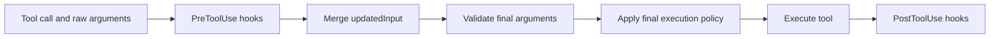

# Hooks

Run a hook when an event must trigger code: for example, inspect a tool call
before execution or add context at startup. Hooks belong to [plugins](plugins.md).
They run in the session execution environment with its sandbox policy; they do
not grant additional permissions. Prompt handlers make model calls and may incur
provider charges. Start with a command handler that makes no model call.

## Add and verify a startup hook

You need Evener with a configured provider and `bash` on the session host. Get
an Evener checkout with the [example clone command](getting-started.md#optional-disposable-exercise),
then run from the resulting `evener-docs` directory. No Evener build is needed.
The complete [`hello-plugin` fixture](examples/extensions/hello-plugin/hooks/hooks.json)
runs a startup hook. The session makes a real provider call and may incur charges;
`--sandbox read-only` prevents writes to the checkout but permits reads outside
it and writes to session scratch.

```bash
evener --sandbox read-only --plugin-dir ./docs/examples/extensions/hello-plugin "Reply briefly."
```

This plugin has a manifest and a `SessionStart` hook. The hook uses exec-form
`printf` to return `{"systemMessage":"hello-plugin startup hook ran"}`. Before
the first model turn, look for the warning **hello-plugin startup hook ran**.
The warning proves the hook ran; the model's reply does not. The fixture makes
no file changes and invokes no provider itself, but the Evener session does.

To build your own, create `.claude-plugin/plugin.json` containing
`{"name":"hello-plugin"}` and `hooks/hooks.json` with:

```json
{
  "hooks": {
    "SessionStart": [{
      "matcher": "startup",
      "hooks": [{
        "type": "command",
        "command": "printf",
        "args": ["%s\n", "{\"systemMessage\":\"hello-plugin startup hook ran\"}"]
      }]
    }]
  }
}
```

Pass that directory to `--plugin-dir`. After editing the declaration, start a
new session to load it. To remove the hook, omit the directory on the next launch
(or disable its installed plugin). End an existing session before removing files
its hooks may still need. A running hook is synchronous, bounded by its timeout
and session cancellation; deleting its declaration is not a stop command.

If the warning is absent, inspect startup diagnostics, confirm the manifest
loaded, and check the matcher. For tool hooks, [use `Bash`, not
`shell`](#the-1-mistake-shell--bash).
The reference below distinguishes supported behavior from fields that only parse.

## Hook reference

Use the sections below to check hook discovery, event support, matchers, handlers,
and input/output contracts. Parsed fields marked reserved have no runtime effect.

## How Evener discovers your hooks

Point Evener at one or more plugin directories with `--plugin-dir`:

```bash
evener --plugin-dir ./my-plugin "do the thing"
```

For each plugin directory, Evener reads hooks from the **first** of these it finds:

1. **A manifest-referenced path.** If the plugin manifest
   (`.claude-plugin/plugin.json`, or `.codex-plugin/plugin.json` as a fallback) has a `hooks`
   field that is a **string**, it is a path (relative to the plugin dir,
   `${CLAUDE_PLUGIN_ROOT}` expanded) to a hooks file.
2. **Inline manifest hooks.** If the manifest `hooks` field is a JSON **object**,
   it is parsed inline as the hooks config.
3. **The default file** `<plugin-dir>/hooks/hooks.json`.

Most plugins just use option 3 — drop a `hooks/hooks.json` in the plugin
directory and you are done.

### File shape

Evener accepts the Claude **wrapper** shape (an optional `description` plus a
`hooks` object keyed by event name):

```json
{
  "description": "What this plugin's hooks do",
  "hooks": {
    "PreToolUse": [
      {
        "matcher": "Bash|Edit",
        "hooks": [
          { "type": "command", "command": "${CLAUDE_PLUGIN_ROOT}/hooks/check.sh" }
        ]
      }
    ]
  }
}
```

It also accepts the **direct** shape (events at the top level, no `hooks`
wrapper):

```json
{
  "PreToolUse": [
    { "matcher": "*", "hooks": [ { "type": "command", "command": "echo ok" } ] }
  ]
}
```

The structure is the same either way: each event maps to an array of **matcher
groups**; each group has a `matcher` and an array of **handlers**.

## Which events Evener fires

Evener fires **nine** events. A hook on any other event name is parsed but never
runs (and warns loudly at load — see [Misconfiguration
warnings](#misconfiguration-warnings-loud-not-silent)).

| Event | When it fires | Matcher target |
|---|---|---|
| `SessionStart` | before the first model turn | `startup`, `resume`, `clear`, `compact` |
| `UserPromptSubmit` | after a user prompt is submitted | (none) |
| `PreToolUse` | before a tool runs (before schema validation) | tool name |
| `PostToolUse` | after a tool runs | tool name |
| `Stop` | before the assistant/session stops | (none) |
| `SubagentStop` | after a delegate run finishes and before it settles | (not yet wired) |
| `PreCompact` | before context compaction | `manual`/`auto` (not yet wired) |
| `SessionEnd` | at session teardown | session end reason (not yet wired) |
| `Notification` | on a user-visible notification | notification type (not yet wired) |

All nine are tier `claude-compatible-subset`: Evener fires them with a
Claude-compatible **subset** of the behavior. None is a complete end-to-end
reimplementation of the Claude event — for example `PreToolUse` honors `allow` and
`deny` decisions but not `ask`/`defer` (no interactive permission prompt), and
several events ignore their matcher target today (noted above).

**`Stop` is not consulted at an ask-ending boundary.** When a round posts one or more
`ask_user` questions, the turn ends straight into the `awaiting` session state without
running `Stop` hooks — a pending, unanswered question is a stronger stop than a hook's
veto (a `Blocked` result would just force the model past its own unanswered questions).
`ask_user` is otherwise an ordinary tool: `PreToolUse` and `PostToolUse` still fire
around the call like any other.

**Other Claude events are reserved, not fired.** Names like `PostToolUseFailure`,
`PermissionRequest`, `SubagentStart`, `PostCompact`, `Setup`, `FileChanged`, and
the rest of the Claude vocabulary are *recognized* (Evener knows they are real
Claude events) but **reserved** — declaring a hook for one parses cleanly and
warns that the event is not fired yet. The full event vocabulary and the roadmap
live in
[07](subagent-management/07-lifecycle-hooks-claude-compat.md#event-contract).

**Unknown names are rejected loudly.** A typo like `PreToolUze` is neither an Evener
event nor a Claude event, so Evener warns that it is likely a typo and the hook
will never fire.

### When `PreToolUse` runs (input rewriting)

`PreToolUse` runs **before** registry schema validation, so a hook can inspect or
rewrite raw tool input. The order for each tool call is:



Evener decodes the call and best-effort parses its arguments for the pre-hook.
After applying any `updatedInput`, it validates the final arguments and checks
execution policy. Only an admitted call reaches the tool and post-hook.

A `PreToolUse` hook can therefore rewrite arguments or deny the call, but it
**cannot** push an invalid or disallowed shape past validation and final policy —
those run on the post-hook input. `PostToolUse` runs after execution and cannot
undo a tool that already ran.

## The #1 mistake: `shell` → `Bash`

> **Matchers run against the _Claude_ tool name, not Evener's name.** Evener's shell
> tool is presented to hooks as **`Bash`**. A matcher of `"shell"` silently never
> fires. Use `"Bash"`.

When Evener loads Claude-style plugins, tool names meet two vocabularies: Evener's
engine uses canonical names (`shell`, `read_file`, `edit_file`), while Claude
(and your hook matcher) names them `Bash`, `Read`, `Edit`. Before matching, Evener
translates the tool to its Claude name (`agent/internal/toolname`), so your
matcher must name the **Claude** tool:

| You want to match… | Evener canonical name | matcher you must write |
|---|---|---|
| the shell tool | `shell` | `Bash` |
| file reads | `read_file` | `Read` |
| file writes | `write_file` | `Write` |
| file edits | `edit_file` | `Edit` |
| grep / glob | `grep` / `glob` | `Grep` / `Glob` |
| starting a delegate | `delegate` | `Task` |
| web fetch / search | `web_fetch` / `web_search` | `WebFetch` / `WebSearch` |
| notebook edits | `notebook_edit` | `NotebookEdit` |
| asking the user a question | `ask_user` | `AskUserQuestion` |

MCP tools keep their `<server>__<tool>` name in both vocabularies.

A matcher that names an Evener-canonical tool (`"shell"`, `"read_file"`) is not an
error — it is a valid exact matcher that simply never matches the Claude name the
hook is tested against. It will fail silently. Write `"Bash"`.

## Matchers

A matcher decides which targets a group's hooks fire for. The rules, in order:

1. **Empty, omitted, or `"*"` → matches everything.**
2. **Only `[A-Za-z0-9_|]` characters → exact name / pipe-list.** `"Bash"` matches
   only `Bash` (not `BashOutput`). `"Edit|Write|MultiEdit"` matches exactly
   `Edit`, `Write`, or `MultiEdit`.
3. **Anything else → a Go RE2 regular expression.** `"memory__.*"` matches
   `memory__search` by regex.

Worked examples:

| Matcher | Target | Result |
|---|---|---|
| `""` / `"*"` | anything | match |
| `"Bash"` | `Bash` | match |
| `"Bash"` | `BashOutput` | **no** match (exact mode, not substring) |
| `"Edit|Write"` | `Write` | match (pipe-list) |
| `"Edit|Write"` | `Read` | no match |
| `"memory__.*"` | `memory__search` | match (regex) |
| `"memory"` | `memory__search` | **no** match (exact mode, no substring) |

Two traps worth calling out:

- **Exact mode does not substring-match.** `"Bash"` will not catch `BashOutput`,
  and `"memory"` will not catch `memory__search`. If you want a prefix,
  write a regex: `"memory__.*"`.
- **The matcher is the Claude tool name** — see [the gotcha
  above](#the-1-mistake-shell--bash).

> **Evener-native nicety:** Evener trims surrounding whitespace from the matcher
> before classifying it, so `" Bash "` is treated as the exact matcher `"Bash"`.
> Claude treats the matcher as a literal regex and would not trim. This is a
> minor, intentional divergence.

### Matcher targets by event

For the events Evener fires, the matcher is tested against:

- **Tool events** (`PreToolUse`, `PostToolUse`): the **Claude tool name**,
  including `<server>__<tool>` (see the [gotcha](#the-1-mistake-shell--bash)).
- **`SessionStart`**: the start kind — `startup`, `resume`, `clear`, or
  `compact`.
- **`UserPromptSubmit`**, **`Stop`**: no matcher target; use `"*"` or omit.
- **`SubagentStop`**, **`SessionEnd`**, **`Notification`**, **`PreCompact`**:
  these fire, but their matcher target is **not yet wired** — the runner matches
  with an empty target today, so use `"*"` or omit the matcher. (The intended
  targets — delegate agent type, end reason, notification type, `manual`/`auto`
  — are a reserved compatibility item.)

`SubagentStop` runs once for a completed stable delegate generation before
terminal settlement. A blocking result starts one continuation; subtree stop
suppresses hook replay. Restart reconciliation never replays this hook, the
built-in communicate nudge, or final-round salvage.

### Go RE2, not JavaScript regex

Claude documents JavaScript regular expressions; Evener matches with **Go RE2**.
RE2 is a strict subset: **lookbehind** (`(?<=...)`, `(?<!...)`) and
**backreferences** (`\1`) are not supported. A matcher using either is treated as
an **invalid regex**: Evener skips the hook and emits a warning naming the plugin,
event, and matcher — it never silently mis-matches. Rewrite such matchers with
RE2-compatible alternatives. (Almost all real-world Claude matchers are already
RE2-compatible.)

## Handlers

Each matcher group holds an array of **handlers**. Evener runs two handler types
today: `command` (a process) and `prompt` (an LLM call, Evener-native sugar). The
`http`, `mcp_tool`, and `agent` types are **reserved** — they parse but are
skipped with a diagnostic; see
[07](subagent-management/07-lifecycle-hooks-claude-compat.md#handler-types).

### Common handler fields

Every handler shares these:

| Field | Status | Meaning |
|---|---|---|
| `type` | **required** | `command` or `prompt` today. |
| `timeout` | **active** | Seconds. Defaults: `command` 60s, `prompt` 30s. |
| `if` | parsed, reserved | A permission-rule filter for tool events. Captured but not yet enforced. |
| `statusMessage` | parsed, reserved | User-visible status text while the hook runs. Captured; surfacing reserved. |
| `once` | parsed, reserved | Run-once semantics (skill-frontmatter scope in Claude). Reserved. |

Reserved fields are preserved for diagnostics and forward-compatibility — they do
not cause a load error — but they have no runtime effect yet.

### The `command` handler

The implemented (and recommended) handler type is `command`. Evener runs it, pipes
the hook [input JSON](#the-input-your-hook-receives) to its **stdin**, and reads
its [output](#what-your-hook-returns) from stdout/stderr.

```json
{ "type": "command", "command": "${CLAUDE_PLUGIN_ROOT}/hooks/check.sh", "timeout": 30 }
```

#### Shell form vs. exec form

- **Shell form** (`command`, omitted or empty `args`): Evener runs `bash -c "<command>"`. The
  shell expands variables, globs, and pipes. This is the default.
- **Exec form** (`command` + nonempty `args`): Evener spawns the program **directly, with no
  shell**. `command` is the executable; `args` are passed verbatim. Use this for
  paths with spaces and to avoid shell expansion.

The difference matters:

```json
{ "type": "command", "command": "printf", "args": ["%s", "$HOME"] }
```

In exec form, `$HOME` is passed **literally** — there is no shell to expand it, so
the program receives the four characters `$HOME`. A path with spaces works
without quoting gymnastics:

```json
{ "type": "command", "command": "/opt/my plugin/check", "args": ["--mode", "strict"] }
```

When `args` is nonempty, `shell` is ignored. An empty array uses shell form.

> **`async` / `asyncRewake`** are command-only fields that Evener parses but does
> not execute yet (reserved). A hook that sets them runs **synchronously** today.

#### Selecting the shell

`shell` selects the shell for **shell-form** commands:

- `"bash"` (or omitted) → `bash -c`. This is the only supported shell today.
- `"powershell"` → an explicit error (reserved; not supported on this platform).
- any other value → an explicit error.

Evener never silently falls back to bash for an unrecognized shell — a bad `shell`
value fails loudly rather than running something you did not ask for.

#### Command environment variables

Evener sets these in the command's environment:

| Variable | Value |
|---|---|
| `CLAUDE_PLUGIN_ROOT` | your plugin's directory (absolute) |
| `PLUGIN_ROOT` | Evener-native alias of `CLAUDE_PLUGIN_ROOT` |
| `CLAUDE_PROJECT_DIR` | the session's working directory |
| `CLAUDE_EFFORT` | the session's reasoning-effort level — **only when configured** |

`${CLAUDE_PLUGIN_ROOT}` and `${PLUGIN_ROOT}` are also expanded inside the
`command` (and `args`) **strings** at parse time, so you can reference your
plugin's files in the path itself, as in the examples above.

Evener does not set `CLAUDE_PLUGIN_DATA`, `CLAUDE_CODE_REMOTE`, or
`CLAUDE_ENV_FILE` today. Do not depend on them in a hook.

### The `prompt` handler (Evener-native sugar)

`type: "prompt"` runs an LLM call instead of a process, substituting
`$TOOL_INPUT`, `$TOOL_RESULT`, `$USER_PROMPT`, `$MESSAGE`, and `$TOOL_NAME` into
the prompt and parsing the model's reply through the same output parser. An
optional `model` selects the provider/model; otherwise the session's client is
used.

```json
{ "type": "prompt", "prompt": "Is `$TOOL_INPUT` safe to run? Reply with JSON.", "model": "openai/gpt-5.4-mini" }
```

It works today but is Evener-specific sugar; the Claude-compatible `$ARGUMENTS` /
`{ok, reason}` form is reserved. The `http`, `mcp_tool`, and `agent` handler
types are **reserved and skipped** (with a diagnostic) — they do not run yet.

## The input your hook receives

A command hook reads a single JSON object on stdin. The fields Evener populates:

```json
{
  "session_id": "01ABC...",
  "cwd": "/path/to/project",
  "hook_event_name": "PreToolUse",
  "tool_name": "Bash",
  "tool_input": { "command": "ls" },
  "tool_use_id": "call-123",
  "tool_response": "…",
  "transcript_path": "/path/to/session.transcript.jsonl",
  "effort": "high",
  "prompt": "…",
  "message": "…",
  "reason": "…",

  "tool_result": "…",
  "user_prompt": "…"
}
```

Notes:

- Fields are **omitted when empty** — `tool_name`/`tool_input` only appear for
  tool events, `transcript_path` only when persistence is on, `effort` only when
  configured, and so on.
- `tool_result` and `user_prompt` are **legacy Evener aliases** kept during
  migration. Prefer the official `tool_response` and `prompt`; the aliases will
  not necessarily survive forever.
- `permission_mode`, `agent_id`, `agent_type`, and `CLAUDE_CODE_REMOTE` are part
  of the Claude contract but Evener omits them today. Do not write a hook that
  depends on them.

(A `prompt` handler does not receive this JSON on stdin; it gets the legacy
`$TOOL_INPUT`/`$USER_PROMPT`/etc. substitutions described above.)

## What your hook returns

Evener reads the command's **stdout**, **stderr**, and **exit code**.

- **Exit 0, empty stdout** → success, no decision.
- **Exit 0, plain-text stdout** → reaches the **model** only for `SessionStart` and
  `UserPromptSubmit` (context events); for all other events it is shown to the
  **user** as a diagnostic warning. This is a deliberate divergence from Claude,
  which debug-logs non-context plain stdout to neither model nor user; Evener surfaces
  it to the user so hook output never silently vanishes.
- **Exit 0, JSON stdout** → parsed as a structured decision (below).
- **Exit 2** → an event-specific block/error (see the [exit-code
  table](#exit-codes-per-event)). **JSON is ignored on exit 2** — only stderr is
  used.
- **Other non-zero** → a non-blocking error for the events Evener fires.
- **Any non-zero from `SessionStart`** → summarized into a single user-facing
  warning; the hook's output never reaches the model (see [Failed `SessionStart`
  hooks](#failed-sessionstart-hooks)).

> **JSON is parsed only on exit 0.** If your hook exits non-zero, any JSON it
> printed is discarded; Evener uses the exit code and stderr. Print your decision
> JSON only when you exit 0.

The output JSON Evener reads (exit 0):

```json
{
  "continue": true,
  "suppressOutput": false,
  "systemMessage": "shown to the user as a warning message",
  "terminalSequence": "",
  "decision": "block",
  "reason": "why (with decision:block)",
  "hookSpecificOutput": {
    "permissionDecision": "allow|deny|ask|defer",
    "permissionDecisionReason": "why",
    "updatedInput": { "command": "ls -la" },
    "additionalContext": "extra context for the model"
  }
}
```

- `continue` and `suppressOutput` are **parsed but not acted on today** — Evener
  reads them for Claude compatibility, but they have no runtime effect yet (a
  deferred item); a hook that sets `continue: false` still runs to completion.
  `stopReason` and the rest of the structured output schema are reserved (see
  [07](subagent-management/07-lifecycle-hooks-claude-compat.md#hook-output-contract)).
- `hookSpecificOutput.additionalContext` is delivered to the **model**, wrapped in
  a `<SYSTEM-REMINDER>`.
- The top-level `systemMessage` field is shown to the **user** (a `[warning]`-style
  message via Evener's diagnostic-warning channel) — it is **not** sent to the model.
- `terminalSequence` must be a safe terminal notification sequence.
- `decision: "block"` blocks where the event supports it (e.g. `Stop`,
  `SubagentStop`).
- For `PreToolUse`, `hookSpecificOutput.permissionDecision` honors `allow` and
  `deny`; the reason is read from `permissionDecisionReason`. Deprecated top-level
  form is accepted as a fallback: `decision: "approve"` → allow, `decision: "block"`
  → deny, top-level `reason` → the reason; the preferred `permissionDecision` wins
  when both are present. `updatedInput` rewrites the tool arguments before
  validation. `ask` and `defer` are recognized but **not honored** — Evener has no
  interactive permission prompt, so the tool proceeds and a user-visible diagnostic
  names the unsupported decision. The rewritten input still passes registry schema validation and final execution policy.

### Failed `SessionStart` hooks

A `SessionStart` hook that exits **non-zero** — exit 2 included — is the one case
where the failing hook's output never reaches the model. Its stderr (or its stdout
when stderr is empty) is summarized into **one operator-facing warning line**
naming the event, the registering plugin and matcher, and the exit code, followed
by the first non-empty line of that output (160 characters plus an ellipsis when truncated):

```
SessionStart hook my-plugin failed (exit 2): /path/to/hook.sh: permission denied
```

A hook that never produced an exit code at all (a spawn failure, or a timeout
kill) reads `SessionStart hook my-plugin failed to run: <error>` instead.

The reasoning: a `SessionStart` hook's output is the session's FIRST steering
input, and the model can do nothing with a permission denial or a broken script —
a wall of shell stderr as opening context is worse than no context. Every other
event keeps the Claude-compatible contract that a non-zero hook's stderr reaches
the model, which is how a tool-event hook corrects it. This moves Evener toward
Claude's own `SessionStart` rule, which
[07](subagent-management/07-lifecycle-hooks-claude-compat.md#exit-code-semantics)
records as "show stderr to user only".

Write `SessionStart` diagnostics you want the MODEL to read on the **exit-0**
path — plain stdout, or `hookSpecificOutput.additionalContext`.

### Exit codes per event

Exit 2 blocks for some events and is informational for others. The Evener-fired
subset:

| Event | Exit 2 effect |
|---|---|
| `PreToolUse` | block the tool call — the stderr becomes the deny reason, surfaced to the model as the tool's error result |
| `Stop` | prevent stopping |
| `SubagentStop` | prevent the subagent stopping |
| `UserPromptSubmit` | **no block yet** — Claude erases the prompt here, but Evener does not yet enforce the block; stderr is delivered to the model |
| `PreCompact` | **no block yet** — Claude blocks compaction here, but Evener does not yet enforce the block; stderr is delivered to the model |
| `PostToolUse` | **no block** (cannot undo the tool) — stderr is delivered to the model as context |
| `SessionStart` | **no block** — the failure is summarized to the **user**; neither stderr nor stdout reaches the model (see [Failed `SessionStart` hooks](#failed-sessionstart-hooks)) |
| `SessionEnd` | **no block** — the session is ending, so the stderr is captured but not delivered (no following turn) |
| `Notification` | **no block** — stderr is delivered to the model |

(The full Claude table, including the reserved events, is in
[07 §Exit-code semantics](subagent-management/07-lifecycle-hooks-claude-compat.md#exit-code-semantics).)

## Misconfiguration warnings (loud, not silent)

Evener warns **loudly at plugin load** when a hook declaration is broken, so a typo
does not turn into silent non-execution. You will see a `[warning] …` line in the
CLI (and a warning in the browser) for each of:

- **An unknown event name** (e.g. `PreToolUze`) — "not a recognized Claude or evener
  event (likely a typo); this hook will never fire."
- **A recognized-but-unsupported event** (a real Claude event Evener does not fire
  yet, e.g. `PostToolUseFailure`) — "declared for a reserved event evener does not
  yet fire; this hook will not run."
- **An invalid-regex matcher** (e.g. one using lookbehind) — names the plugin,
  event, and matcher; the hook is skipped.
- **An unsupported handler type** (`http`, `mcp_tool`, `agent`) — names the
  plugin, event, and type; the handler is skipped until implemented.

A handler missing its required `type`, or a malformed `hooks` array, is a **load
error** that names the source path, event, matcher, and handler index. Unknown
handler **fields** are not errors — they are preserved for diagnostics and
forward-compatibility.

Hook lifecycle event payloads carry metadata, not hook commands, environment
values, or stdout/stderr. Completed runs also record a sanitized error category
when relevant: `parse_error`,
`unsupported_event`, `unsupported_handler`, `invalid_matcher`, `timeout`,
`cancelled`, `command_error`, `prompt_error`, or `hook_blocked`.

**Warnings are not restricted to metadata.** A failed `SessionStart` warning can
include the first non-empty line of stderr, or stdout when stderr is empty.
Hooks can also supply free-form `systemMessage` warnings. These messages are not
secret-redacted. Keep secrets out of hook output, and inspect warnings and
transcripts before sharing them.

Check startup warnings for load errors. To verify execution, use the explicit
warning in [the startup-hook example](#add-and-verify-a-startup-hook). In the
browser, `/status` opens Overview's About tab with Session, Usage, and Location
details; it does not show hook tiers or counts.

## Extend the example to tool calls

Change the event to `PreToolUse` and the matcher to `Bash|Edit` to inspect shell
and edit calls. Your process receives the input JSON on stdin. Return
`{"hookSpecificOutput":{"permissionDecision":"deny","permissionDecisionReason":"Explain why"}}`
with exit 0 to deny the call, or write the reason to stderr and exit 2.
Use `PostToolUse` only for observation: it cannot undo an executed action.

Do not interpolate tool input into shell code. Parse stdin as JSON and pass
values as data. Use exec form when paths contain spaces. See the input, output,
and exit-code tables above before implementing a guard.

## Hooks cannot bypass policy

However a plugin hook rewrites input or returns a decision, it cannot escape
Evener's execution guarantees. A hook cannot:

- bypass effective tool policy;
- expand a child/subagent's capability set beyond effective policy;
- bypass provider/model feature policy;
- bypass session cancellation or closed state;
- push input past final execution policy — validation and policy run on the
  post-hook (`updatedInput`) arguments, not the originals.

## How this is tested

The shipped behavior is covered by `agent/internal/hooks/*_test.go` (matcher,
exec form, output parsing, exit codes), `agent/plugin/*_test.go` (config parsing
and diagnostics), the session-level hook/warning tests in `agent/`, and the live
scenario card `test/scenarios/hooks-claude-compat-matcher.md`, which loads a
plugin via `--plugin-dir` and exercises the matcher and exec-form behavior.

## See also

- [`subagent-management/07-lifecycle-hooks-claude-compat.md`](subagent-management/07-lifecycle-hooks-claude-compat.md)
  — the compatibility & roadmap spec: the full Claude event vocabulary, the
  reserved output schemas, the `http`/`mcp_tool`/`agent` handler types, async
  semantics, the typed SDK hook shape, the compatibility tiers, and the deferred
  phases (B–E).
