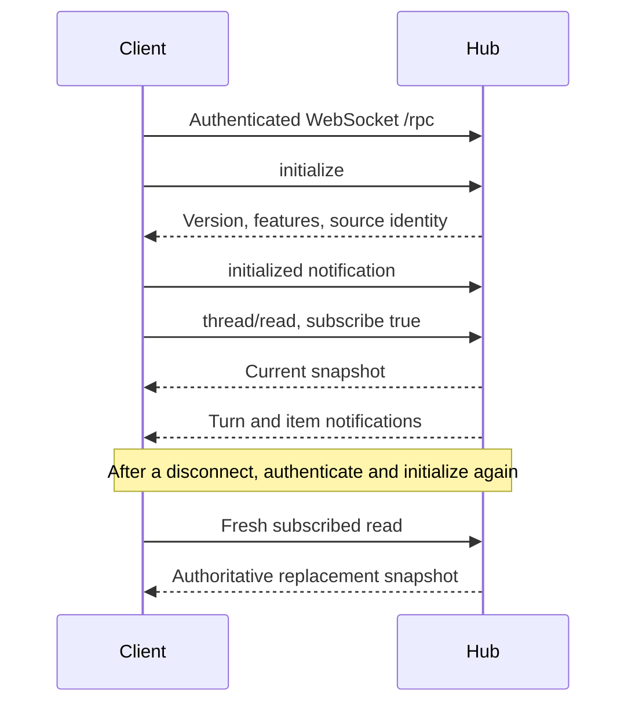

# Integrate with Evener

Use the CLI for one-shot scripts. Use AppWire for an application that lists sessions, follows output or controls running work. AppWire connects clients to `evener hub`, which routes session requests to `evener serve` daemons.

These instructions track main. The protocol version is checked exactly; use a client and server from the same checkout rather than assuming a newer SDK can talk to an older release. The [generated protocol reference](appwire-protocol.md) owns the method catalog and field names.

## Connect from a source checkout

Public registry installation has not been verified for this guide. The package name in `package.json` is not proof of publication. The supported path below builds the checked-out SDK and uses its local dependencies; it does not require publishing a package.

Prerequisites: an Evener checkout, Node.js and npm compatible with that checkout, and an installed Evener binary matching it. Run from the checkout root:

```sh
npm --prefix appwire-client/typescript ci
npm --prefix appwire-client/typescript run build
evener hub --help
```

Start the hub with `evener hub` in another terminal. Keep its default local binding unless you have configured secure remote access. Obtain the RPC address and auth token from the hub operator. The hub logs an authentication URL at startup; treat that URL and its token as credentials. Do not paste either into issues or commit them.

The [inspection example](examples/integrations/inspect.mjs) makes only `thread/list`; it does not start a model task. In a POSIX shell, enter the hub token without putting its value into shell history:

```sh
export EVENER_RPC_URL='ws://127.0.0.1:9180/rpc' # replace with your hub address
printf 'Hub token: ' >&2
old_stty=$(stty -g) || exit 1
stty -echo
IFS= read -r EVENER_HUB_TOKEN
stty "$old_stty"
printf '\n' >&2
export EVENER_HUB_TOKEN
node docs/examples/integrations/inspect.mjs
unset EVENER_HUB_TOKEN
```

Use your actual hub address, not a daemon endpoint. Success prints the negotiated protocol version, the number of sessions on the first page and whether another page exists. An empty list is a successful read. A 401 means the transport was not authenticated; a protocol rejection means the versions need alignment. Neither is fixed by retrying a model prompt. If interrupted while entering a token, run `stty echo` to restore terminal echo. Avoid this interactive token entry in CI; inject the secret through your runner's secret mechanism.

### Authentication is before initialization

The hub's HTTP guard accepts its auth cookie or `Authorization: Bearer …`. The Node example supplies a header through a `ws` socket factory. Browser WebSocket APIs cannot set that header; authorize the browser through the hub's `/auth/<token>` URL and use its cookie. Do not use a token query parameter as a WebSocket authentication API: the HTTP guard can redirect such requests after setting a cookie.

Use TLS (`wss:`) or a trusted private transport for remote connections. A bearer token grants hub access; it is not a model-provider API key. The SDK's optional device-pairing support has a separate encrypted transport and does not replace ordinary hub authentication. Read the [SDK README](../appwire-client/typescript/README.md) before building a paired client.

## Understand the connection lifecycle



`AppwireClient.connect()` performs the handshake. Register notification handlers before submitting work. A request response and completion of the work it starts are different events. `turn/start` returns a turn and mutation receipt; follow notifications and subsequent reads to determine its outcome. Turn statuses include `inProgress`, `completed`, `failed` and `interrupted`. Text deltas are partial output, not a final answer or a durable event archive.

Raw clients send one JSON object per WebSocket message. The SDK uses numeric request IDs. AppWire uses JSON-RPC-style errors, but rejects a `jsonrpc: "2.0"` envelope. Do not assume batch requests, arbitrary JSON-RPC cancellation or any method absent from the catalog.

The complete request frames in [handshake.jsonl](examples/integrations/handshake.jsonl) show initialization, its notification and a first-page read. Send them in order, waiting for initialization success before sending the rest. The JSONL file is a fixture, not one multi-line WebSocket message. Its request IDs correlate responses on one connection; they do not identify durable work.

## Keep identities separate

| Value | What it identifies |
| --- | --- |
| Request `id` | One request/response exchange. A new request ID does not make a mutation safe to repeat. |
| Public session `ref` | An opaque routing reference. Retain it exactly; do not parse a session ID out of it. |
| Session instance ID | The current session incarnation. A stable workspace reference can survive a clear while this identity changes. |
| Turn ID | A turn within a session, not the lifetime of a delegate. |
| `clientMutationId` | The identity of a retry-safe mutation. Preserve it and the exact intent across retries. |
| `expectedInstanceId` | The session incarnation the mutation was intended for. Do not silently substitute a replacement session. |
| `dlg_…` | A stable delegate conversation that can run several generations. |
| `job_…` | A managed shell job, not a delegate activation. |

Use the generated request types. `turn/start`, for example, requires `clientMutationId` and `expectedInstanceId` along with its target and input. Read the target first and retain the accepted receipt. The SDK's mutation layer provides outbox and reconciliation primitives, but your application still owns persistence and recovery policy.

## Follow output without losing state

`thread/read` with `subscribe: true` both hydrates state and subscribes the connection. `replaceSubscription: true` can remove another consumer's subscription; use it only when you own the connection's whole subscription set. A multi-pane application should share `acquireThreadSubscription(client, ref)` leases, use each lease's `read`, and release its own lease when the view closes.

The last release drops local ownership immediately. Once pending subscription operations settle, the helper attempts an asynchronous unsubscribe if the connection is ready. It ignores unsubscribe failures, so remote membership can persist until the connection closes.

Reconnect restores a transport, **not every notification**. Reinitialize, restore subscriptions and read authoritative snapshots. Discard stale in-flight results from the previous connection generation. Recorded history can repair the view; transient deltas and retained rings are not an unlimited lossless replay log. The basic SDK reconnects after an established connection drops, with exponential backoff and jitter. It does not replay your application mutations or rebuild your view for you. A failed initial connection still needs caller error handling.

History reads have selection flags and bounded pages. Use returned cursors unchanged, keep the same selection, and take a fresh latest read when the selection or snapshot authority changes. `thread/list` returns `data` and `nextCursor`; an absent next cursor ends that listing. Other collections have their own cursor and completeness fields: an empty page alone does not prove completion. See the generated result type for each method.

Job output has lifetime byte offsets, not character offsets. `evener/jobs/output` returns a `JobsOutputResponse` whose `data` field contains the `JobOutputPage`. Read `offsetBytes`, `bytesReturned`, `totalBytes`, `retainedStartBytes`, `encoding` and the encoded `data` payload from `response.data`, not from the response itself. Decode with `parseJobOutputPage(response.data)`; join contiguous byte pages before decoding UTF-8.

Omitting `beforeBytes` reads the latest page; explicit zero is not omission. The default page is 4 KiB, with positive limits capped at 64 KiB. `jobOutputPruned` means requested bytes are no longer retained, not that the job produced no output.

## Cancel and recover safely

A request timeout stops waiting for its response; it does not prove the server rejected the operation or cancel the underlying turn. The TypeScript client defaults ordinary requests to 30 seconds and gives `thread/resume` a longer completion-owned budget. Closing a client is not a substitute for a session stop command.

Use `turn/interrupt` for running turn control and the catalog's job/delegate controls for those resources. Inspect the response and subsequent state; a stop request is not proof that all children are already terminal. Model-facing `job_stop` semantics are described in [Job control](job-control.md), not inferred from a socket close.

Retry only when the outcome permits it:

- A typed `connectionBackpressure` refusal with `mutationOutcome: "notAccepted"` and `retryDisposition: "automatic"` means the mutation was not queued or started. Retry the same intent with pacing.
- History errors such as `transcriptIndexRebuilding` and `transcriptIndexLocked` can explicitly authorize automatic retries. Use backoff rather than a tight loop.
- A transport failure after sending a mutation leaves acceptance uncertain. Reconcile its receipt and authoritative state. Do not invent a new mutation ID and blindly repeat the operation.
- A changed instance, deleted target, invalid parameters, unsupported method or protocol mismatch needs a decision or corrected input, not an endless retry loop.

Backpressure is part of the protocol. Servers bound request intake and writes; slow consumers can be disconnected. Keep socket handling responsive, bound your rendering queues, use paging for history and resynchronize after a gap. There is no universal exactly-once delivery or indefinite retention guarantee.

## Check a client without a live model

The included JSON fixtures are checked against Go's AppWire types by:

```sh
go test ./docs/examples/integrations
go test ./appwire ./internal/appserver ./internal/appwiredoc
node --test docs/examples/integrations/inspect.test.mjs
```

The SDK package qualification builds and packs the real package, checks consumer imports/types and exercises a local fake WebSocket peer:

```sh
npm --prefix appwire-client/typescript run qualification
```

These checks validate protocol plumbing, not provider availability or model behavior. Keep any live turn walkthrough separate and opt-in.
