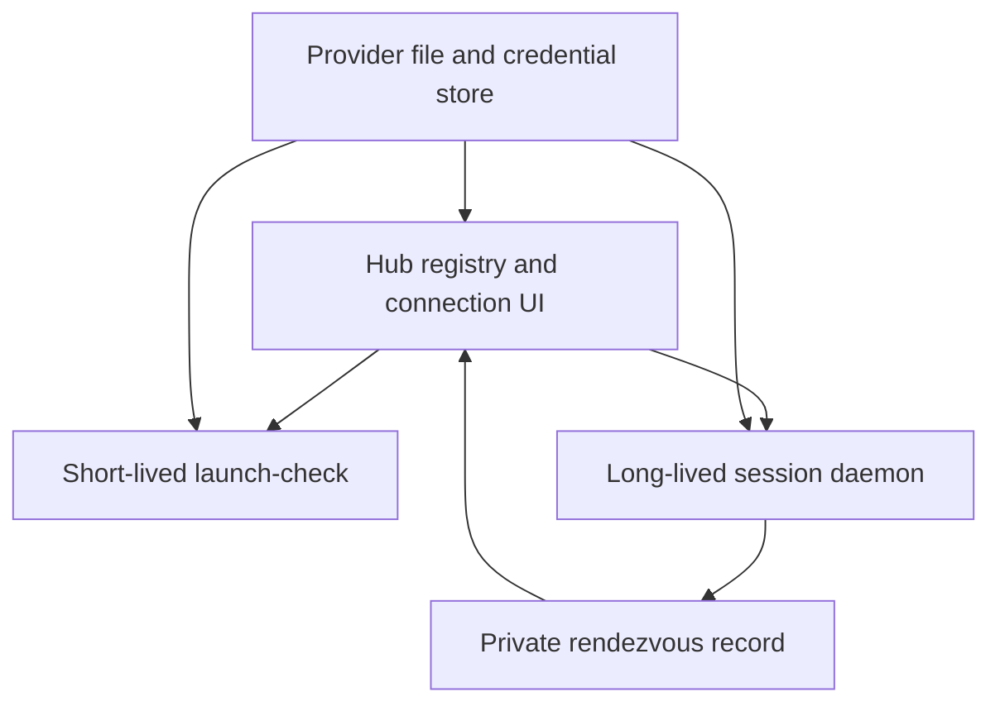

# Credentials and provider launch behavior

**Connecting your first provider?** Follow [Connecting a provider](connecting-a-provider.md)
for the New session → connection → model → Start walkthrough.

How Evener stores provider credentials, signs you in to OpenAI, and how the
**hub** turns a launch request into a running model session.

Companion docs:

- [`llm-providers.md`](llm-providers.md) — the registry architecture: layers,
  instances, resolution, wire protocols.
- [`ollama.md`](ollama.md) — the `ollama` provider and its env-var discovery.

## Overview

| Store | File | Format | Used for |
|---|---|---|---|
| Credentials store | `<config-root>/credentials.toml` (chmod 600) | TOML | API keys, keyed by **instance name** |
| OpenAI OAuth record | `<state-root>/auth/<instance>.json` (chmod 600) | JSON | OpenAI ChatGPT/Codex OAuth tokens, per instance — the default instance is now `openai-codex`, not `openai` |
| Providers config | `<config-root>/providers.toml` | TOML | instance descriptors: `base`, transport, protocol, surface, caps, and optional `headers`/`credential_headers`/model overrides (see [`llm-providers.md`](llm-providers.md#providerstoml)) |
| Process environment | n/a | env vars | fallback / base URLs / tuning |

The **hub process never runs a model**. To validate or list models it spawns
`evener launch-check` as a short-lived subprocess; to run a session it spawns
the `evener serve` daemon.

## Provider idle timeout

Model HTTP responses have a **10-minute idle timeout**, not a total-duration
limit. Incoming body bytes reset it, including partial SSE lines and heartbeat
comments. This applies to streaming and nonstreaming responses, including vision side
channels and gzip-compressed wire bytes: a response can
continue indefinitely while bytes keep arriving within the idle interval.

Set a positive Go duration (for example `45s`, `10m`, or `1h`):

```sh
evener --provider-idle-timeout 15m "your task"
evener serve --provider-idle-timeout 15m
```

The hub launch setting is **Provider idle timeout**. Launch TOML uses
`provider_idle_timeout = "15m"`; the launch API uses
`"providerIdleTimeout": "15m"`. Session configuration and snapshots use
`"provider_idle_timeout": "15m"`. Empty selects the default for new sessions
and retains the saved setting on resume. Zero, negative, malformed, and
overflowing durations are rejected. The setting is persisted
across resume and inherited by delegates; an explicit resume value overrides
the persisted setting, while a frozen delegate retains its own setting.

Connection establishment and standard TLS handshakes remain bounded to 10
seconds (shorter caller TLS limits are preserved). On standard HTTP
transports, response-header waiting is bounded by the idle interval (or a
shorter caller transport limit). Explicit caller cancellation, context
deadlines, and HTTP client timeouts still apply. SDK callers can opt into a
whole-attempt deadline with `llm.AdapterTimeout.Request`; its default is zero
(disabled). `StreamRead` now controls response-byte idle time for both streaming
and nonstreaming bodies. No default total request cap is imposed.

## Credentials store

`credentials.toml` holds one section per instance:

```toml
schema = 1

[providers.anthropic]
api_key = "sk-ant-..."

[providers.openai]
api_key = "sk-..."

[providers.openrouter]
api_key = "..."
```

A section name matches either a curated implicit provider's id (`anthropic`,
`openai`, `openrouter`, …) or a custom instance name defined in
`providers.toml` — the store no longer keys off a provider *type*.

The store's file entry under the instance name is step 3 of the [credential
resolution order](llm-providers.md#credential-resolution-order); see that
doc for the authoritative full order. `ollama`, `none`/`optional-bearer`
instances, and `oauth-openai-codex` instances need no credentials-store entry
at all. A `gcp-adc` instance needs none either when application-default
credentials are on the host, but its entry — when present — is read as a
Google credential JSON (a service-account key or `authorized_user` file)
rather than an API key, and outranks the ADC file; the hub writes it through
`evener/auth/credentialJson/set`.

The hub and `evener providers add`/`probe --write` write `providers.toml`
through the registry's config writer, which writes exactly the entries it's
given — a resolved credential is never persisted, only what the user
authored (`api_key = "$VAR"` literals and `credential_headers` references).

There's no separate "credential tag" anymore. The store holds only its file
layer, keyed by instance name; every environment lookup — the provider's
`api_key_env` variables and the `<NAME>_API_KEY` rule for custom names — is
the registry's own job, in the order [`llm-providers.md`](llm-providers.md#credential-resolution-order)
documents. The store never sees a separate lookup table for it.

## Command expressions in credential values

Wherever a credential value accepts an environment-variable reference —
`api_key` and `credential_headers` — it also accepts a command
expression, `$(...)`: the command runs through your shell and its
whitespace-trimmed stdout becomes the value. This is how a gateway whose
credentials live outside Evener gets used: the key stays in your password
manager, or the command obtains a short-lived token. Evener caches the result
within each process rather than running the command for every request. Display `headers`
and transport `vars` do not run commands: a command's output is a
credential, and those fields' values reach URLs and logs as ordinary
text, so a `$(...)` there is refused when the file loads.

```toml
# An API key stored in Apple Passwords (Keychain), not in the file:
[providers.anthropic-keychain]
base = "anthropic"
api_key = '''$(security find-generic-password -s "Anthropic" -w)'''

# Any password-store CLI works the same way:
[providers.pass-store]
base = "openai"
api_key = '''$(pass show llm-gateway/token)'''
```

If your command prints more than the value, pipe it down to what you want
first — the trimmed stdout is the value, verbatim. MCP server config
accepts the same forms in the fields it expands (command, args, env, url,
headers) in the layers you author yourself — the global
`~/.config/evener/mcp.json` and `--mcp-config` files. The project's
`.evener/mcp.json` and plugin configs are content Evener does not author,
so they refuse `$(command)` at load and skip the layer with a warning.

The rules that matter in practice:

- A variable that is unset or empty counts as missing, and `${NAME:-default}`
  fills a missing one (POSIX `:-` semantics); `$$` writes a literal `$`.
  A `${...}` reference name must match `[A-Za-z_][A-Za-z0-9_]*` — anything
  else is a load error. MCP config used to look such brace texts up
  verbatim, so `${MY-VAR}` or `${MY.VAR}` used to expand; the shared
  grammar now refuses them.
- Commands run with the process environment, no TTY, a closed stdin, and a
  30-second timeout. Each process caches successful results by command text
  until one minute before a readable JWT `exp`, or for five minutes if there
  is no readable expiry. The next lookup after that deadline reruns the command.
- A `$(...)` ends at the first `)` that brings the paren depth back to
  zero; quotes are not parsed, so a literal `)` inside a quoted argument
  ends the expression early — restructure the command or wrap it in a
  helper script.
- A failed command behaves like an unset variable: the credential resolves
  to nothing, the warning carries the command's own stderr, and the next
  request retries it. In MCP config the failure is a load error instead:
  the layer or server entry does not load.
- The output is a credential: it is never logged. A failing command's
  error carries its exit status and stderr line, never its output.
- The hub's credential-header field authors command expressions (as in
  `Authorization=Bearer $(...)`); the stored-key form refuses one, because a
  stored key is a literal secret that is never expanded.

## Environment-variable reference

The complete list — API keys and base URLs together — lives in
[Environment variables](environment-variables.md).
The public reference follows `envvars/envvars.go`; provider resolution rules remain in the provider reference.

## OpenAI OAuth and the Codex transport

OpenAI has two separate **instances**, not one instance with two credential
sources: `openai` (an API key, via `credentials.toml` or `OPENAI_API_KEY`)
and `openai-codex` (OAuth only).

### The OAuth record

One JSON file per instance: `<state-root>/auth/<instance>.json`. The
`evener openai` CLI and the hub's OAuth flow operate on `openai-codex` by
default now, so a fresh sign-in writes `auth/openai-codex.json`. A record's
validity no longer special-cases "openai-ness" by content — only by which
transport the named instance is on (`Transport.Auth ==
oauth-openai-codex`).

### Precedence

`openai` and `openai-codex` do not share credentials. The latter ranks before the former in the default-instance order, so signing in can change the automatically selected instance. Set an explicit default or use an explicit `instance/model` when that choice matters.

### How a user signs in

The device-code flow is primary: the browser (or CLI) requests a device
code, shows a user code and verification URL, and polls until a second
device authorizes it. Where device-code isn't available, a paste-back
redirect flow is the fallback — an authorize URL is opened in a browser and
the user pastes the resulting redirect URL back in. The CLI equivalent is
`evener openai login`, which auto-selects browser vs. device flow from
`SSH_CONNECTION`/`SSH_TTY`/`DISPLAY`/`WAYLAND_DISPLAY` (overridable with
`EVENER_LOGIN_HEADLESS`); `--instance` on `login`/`status`/`logout` now
defaults to `openai-codex` instead of `openai`. The gate for every OAuth RPC
is now "is this instance's transport `oauth-openai-codex`," not a
name-equals-`openai` check, so a custom instance can carry Codex OAuth too
(`[providers.work] base = "openai-codex"`).

A stray record — `auth/<name>.json` where `<name>` isn't an instance on the
Codex transport (including one left over from `evener openai login
--instance work` under the old scheme) — produces a one-line startup notice
naming the file, remedied with `evener openai logout --instance <name>` after confirming that the record is no longer needed.

## Hub launch / spawn process model

The hub's private [preview preparation](../cmd/evener-hub/app_launch_preview.go)
owns directory and layer resolution for `plugin/preview` and the blank or
missing-directory branches of `spawn/slashCatalog`. Blank CWD resolves only
the user layer and launch overrides. A missing directory uses a disposable
probe under the nearest existing ancestor, preserving the eventual target's
project identity and excluding the ancestor's cwd-local launch layers. The
probe stays alive through preview and command/skill discovery, and is removed
on success or resolution failure without creating the target. Slash catalog's
existing-directory branch retains its canonicalization and resolver seams and
error classification. These previews apply no runtime defaults or model
admission; `thread/start` owns scalar precedence and launch admission, while
`launch/resolve` requires an existing directory and includes its display defaults.

This is the part most worth internalizing: **the hub orchestrates, separate
`evener` processes do the work.**



Each subprocess loads its own provider registry. The hub forwards configuration paths and process coordination, not a selected provider key injected into the child. The daemon records how the hub can reconnect to it.

**The hub no longer materializes `providers.toml` at startup.** It passes
`EVENER_PROVIDERS_CONFIG` to children only when a file already exists.
`EVENER_PROVIDERS_CONFIG` is a **tri-state**: unset means the default path;
set to a path means that file; set and **empty**
(`export EVENER_PROVIDERS_CONFIG=`) means "no user layer" — `os.LookupEnv`,
not `Getenv`, distinguishes unset from empty. A hub whose own file failed to
load sets it empty in every child's environment, overriding anything the
hub itself inherited, so sessions keep launching against the implicit
instance set while the broken file gets fixed by hand.

`EVENER_CREDENTIALS_CONFIG` names `credentials.toml` explicitly (new
variable); when unset, the store is the sibling of the providers path, as
before.

**Implicit instances are computed identically and independently by every
process** from the same inputs — the environment and the credentials store.
The hub no longer injects the launched instance's key into the child the
way it used to: the subprocess environment carries process-coordination
vars (`EVENER_HUB_SPAWNED=1`, `EVENER_RUN_DIR`, `EVENER_STATE_DIR`,
`EVENER_HUB_TOKEN`), the two config-path variables above, and any per-launch
env overrides (sorted, last-write-wins) — no provider credential. The child
resolves its own from the registry, the `credentials.toml` named by
`EVENER_CREDENTIALS_CONFIG`, and its own environment, exactly as the hub
would for the same instance.

A `providers.toml` load error is a hub **diagnostic**, not a fatal crash:
the hub starts with implicit instances only, shows the error in the
instances pane, launches sessions against that implicit set, and refuses
every instance write until the file is fixed by hand.

The spawn credential gate keys on the instance's `Transport.Auth`: `none`
and `optional-bearer` need nothing; `oauth-openai-codex` is satisfied by the
instance's OAuth record; `gcp-adc` by a stored credential JSON, the ADC
variable, or the well-known file; everything else needs a resolved key or
credential header, or the launch fails before a process is spawned.

### Spawning `evener launch-check`

Still short-lived, still config-aware — it now resolves via the registry's
`Resolve` rather than the old `ResolveProfileFromConfig`/`BehaviorTagOf`, so
it needs no credentials to validate a profile (§5.2 of the design spec: a
reference resolves with no key set) and enumerates instances straight from
`Registry.Instances()`.

### Spawning `evener serve`

Still `cmdutil.LoadClient`-driven, still config-aware. It loads the same
registry (embedded snapshot, curated overlay, `providers.toml` when
`EVENER_PROVIDERS_CONFIG` names one, live listings as needed), resolves the
requested `instance/model` via `Resolve`, and writes a rendezvous entry
carrying the resolved instance name.

## Resume & persistence

Session metadata still persists the instance name in `ProfileID` — the
field keeps its name; it now holds the registry instance name rather than a
provider type. On hub resume, the stored `ProfileID` is passed through as
the instance to resolve; a saved session, `launch.toml`, `EVENER_MODEL`, or
plugin `model:` declaration that names an instance that no longer exists
fails with the "unknown instance" error, which lists the instances that are
actually available — this is exactly what happens on resume for a session
saved before the upgrade that named `kimi`, `glm`, `kimi-anthropic`, or
`openrouter-anthropic` (see
["Upgrading from the old schema"](#upgrading-from-the-old-schema) below).

Cost display follows the same registry-driven rule everywhere it appears —
the model picker, a live session, and past-session history: it's priced
from the resolved row's `Cost` (models.dev), and a row with no cost shows no
dollar figure rather than a placeholder. A session recorded before this
cut-over, with no instance name in its `ProfileID`, shows no cost in the
hub's past-sessions list.

## Manage existing connections

Settings → Providers & credentials shows launch-ready instances. **Connect provider** uses the broader catalogue so you can configure a provider that does not yet have credentials. Editing an implicit instance writes a shadowing entry containing authored changes, not a copy of every displayed default. Removing an override is different from removing the environment variable or OAuth record that creates an implicit instance.

Use the inspector to check the actual endpoint and credential source before changing access. The hub observes provider-file edits every five seconds. Valid edits update settings and future launches; invalid edits retain the last good configuration and block writes. See [provider-file reload](llm-providers.md#providerstoml) for snapshot and startup behavior. This does not promise hot reload of a running session daemon.

## Upgrading from the old schema

First run `evener migrate --dry-run --verbose` and review the paths. Stop writers and make a private [backup](security.md#storage-and-backups) before applying `evener migrate`: it converts an old-schema
`providers.toml` in place, keeps the original beside it as
`providers.toml.pre-registry`, and records every dropped field as a
`# migrate:` comment. The rest of this section is the by-hand story, for
when you'd rather rewrite the file yourself — the release notes and the
load-error message both point here.

**Missing variables no longer prevent the whole file from loading.** An unset
variable in `api_key` resolves to an empty credential with a warning; the request
fails when a credential is required. An unset variable in `headers` drops that
header. Both cases were load-time errors in the old schema. Check each instance's
resolved credential and headers after migration; a successful config load does
not prove that a request is authenticated.

**`providers.toml` fails to load.** An old-schema file (`[instances.*]`,
`type`, `api_style`, `quirks`, `compat`) fails to load. The CLI exits with a
pointer to
[`docs/superpowers/specs/2026-08-28-provider-registry-design.md`](superpowers/specs/2026-08-28-provider-registry-design.md);
the hub starts with implicit instances only, shows the error as a
diagnostic, launches sessions against the implicit set, and refuses
instance writes until the file is fixed. Fix it with `evener migrate`, or by
hand after preserving an exact private copy of the file. Most users need no
file at all afterward: implicit providers become available when their required credentials and endpoint variables resolve (see the [provider table](llm-providers.md#the-implicit-provider-list)). `*_BASE_URL` variables cover proxies. Re-create a
gateway or custom-named instance with `evener providers add … --api-key-env
NAME` or `--credential-header K=V`; remember an instance with a different
`base_url` does not inherit vendor key variables the way the old
`[instances.anthropic] base_url = …` shape did.

**Default instance ranking changed.** With more than one instance and no
`default` set, the default now follows `default_order` (the table in
[`llm-providers.md`](llm-providers.md#the-implicit-provider-list)), then
custom-named entries by sorted name — not the old alphabetical registration
order. Concretely: `GEMINI_API_KEY` + `OPENAI_API_KEY` set together now
defaults to `openai`, not `google`. Set `default` explicitly to keep the old
pick.

**Instance names that are gone**, with their replacements:

| Old name | Replacement |
|---|---|
| `kimi` | `moonshotai` |
| `glm` | `zai` |
| `kimi-anthropic` | `kimi-for-coding` |
| `openrouter-anthropic` | the `orclaude` recipe below — there's no single renamed instance, it's a `providers.toml` entry now |
| `openai-compatible` as a vendor/type name | still exists, but only as the protocol-only pseudo-provider instance, not a `type = "openai" api_style = "chat-completions"` recipe |

This example names the instance `orclaude`, selects OpenRouter's Anthropic
protocol route, and pins the Anthropic agent surface for `minimax/*` models.
The instance name is arbitrary; the `protocol` and model-glob settings control
the behavior:

```toml
[providers.orclaude]
base     = "openrouter"
protocol = "anthropic"
[providers.orclaude.models."minimax/*"]
surface  = "anthropic"
```

A saved session, `launch.toml`, `EVENER_MODEL`, or plugin `model:`
declaration naming an old instance fails with the unknown-instance error,
naming the instances that are actually available.

**Environment variables that changed meaning or disappeared** (this table
intentionally overlaps
[Environment variables](environment-variables.md)
— the registry defines current names):

- `KIMI_API_KEY` now means the Kimi coding plan (`kimi-for-coding`), not
  Moonshot's platform key.
- Moonshot's platform key is now `MOONSHOT_API_KEY`.
- `GLM_API_KEY` is now `ZHIPU_API_KEY`.
- No longer read at all: `KIMI_CODING_API_KEY`, `KIMI_BASE_URL`,
  `KIMI_CODING_BASE_URL`, `GLM_BASE_URL`, `GEMINI_BASE_URL` (now
  `GOOGLE_BASE_URL`), `OPENAI_CHATGPT_BASE_URL` (now
  `OPENAI_CODEX_BASE_URL`), `OPENAI_COMPATIBLE_PROVIDER_QUIRKS`.
- Every `*_BASE_URL` value now includes the version segment (e.g.
  `https://api.anthropic.com/v1`, not `https://api.anthropic.com`) — except
  DeepSeek's, a documented exception.

**`auth/openai.json` vs `auth/openai-codex.json`.** OAuth records are per
instance: `auth/openai.json` belongs to an instance literally named
`openai`, which by default is the platform API and never reads it.
`evener openai login` now writes `auth/openai-codex.json`, for the
`openai-codex` instance. `openai/…` still means the platform API unless the
user writes `[providers.openai] base = "openai-codex"` — in which case the
*old* record is read as that instance's. A stray record — `auth/<name>.json`
for any instance not on the Codex transport, including `auth/work.json`
from a prior `evener openai login --instance work` — produces a startup
notice until it's removed with `evener openai logout --instance <name>` after confirming that the record is no longer needed.

**`credentials.toml` entries under old names** are ignored and reported by
`evener providers list`; re-enter them under the new names through the
hub's credentials pane.

**`[1m]` references.** Only the Sonnet 4.5 and Opus 4.5 rows keep the
`[1m]` suffix (`claude-sonnet-4-5[1m]`, `claude-sonnet-4-5-20250929[1m]`,
`claude-opus-4-5[1m]`, `claude-opus-4-5-20251101[1m]`); `claude-opus-4-6[1m]`
and later are unknown ids — the 4.6+ rows are 1M natively, no suffix needed
or accepted.

**Sessions with no `--reasoning-effort`** carry the model's own stated
default effort, else `medium`, clamped to the model's ladder. Adaptive
Claude (Opus 4.6/4.7/4.8, Sonnet 4.6, and the 5 family, Fable 5 included)
states `high`, which is what Anthropic runs when the effort is omitted; the
budget-shaped Claude 4.5 generation, Gemini 2.5, and the zai/qwen thinking
toggles move from their provider's dynamic default to `medium`. Pass
`--reasoning-effort none` to turn thinking off — on the wire for a model
whose ladder lists an off level (gpt-5.1 and later), and as "no reasoning
control at all" on every other model.

**Ollama and local-model context windows.** The bundled per-model catalog
(8192 for `llama3.1`, tag-stripping) is gone; every live-only model on
`ollama` or a pseudo-provider now budgets against the provider-level
`131072` default. Pin the real window with
`[providers.ollama.models."llama3.1*"] context_window = 8192` or compaction
fires late (see [`ollama.md`](ollama.md#context-length) for the full
explanation — this is the same fact, not restated differently there).

**`EVENER_PROVIDERS_CONFIG` tri-state.** `export EVENER_PROVIDERS_CONFIG=`
(present, empty) now means "no user layer"; older builds treated it as the default
path. `evener providers list` and the hub diagnostics print `user layer:
none (EVENER_PROVIDERS_CONFIG is empty)` so the state is visible.

**`gemini` is no longer accepted** as an alias of `google` in model
references.

None of this is detected or translated at runtime, and none of the old
files are renamed or deleted.

## See also

- [`llm-providers.md`](llm-providers.md) — the registry: layers, instances,
  resolution, wire protocols, and the implicit provider table.
- [`ollama.md`](ollama.md) — running Evener against a local Ollama server.
- [`superpowers/specs/2026-08-28-provider-registry-design.md`](superpowers/specs/2026-08-28-provider-registry-design.md)
  — the registry design: data model, layers, resolution, and the flag day.
