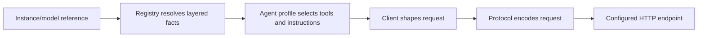

# Provider and model reference

Use this reference to choose an instance, explain a model's resolved settings, or configure an endpoint. For your first credential, follow [Connecting a provider](connecting-a-provider.md). For launch-file scopes, use [Configuration](configuration.md).

## Inspect before changing a provider

Run on the execution host:

```sh
EVENER_OFFLINE=1 evener providers list
EVENER_OFFLINE=1 evener models inspect openai/gpt-5.6
```

The first command reports instances and credential sources. The second explains the endpoint, protocol, model facts, and provenance with secrets masked; it does not prove live access. Review custom URLs and errors before sharing output. `--check`, `probe`, and `models refresh` contact remote services, and `probe --write` changes configuration.

Read [reference syntax](#reference-syntax-and-model-lookup) for model names, [providers.toml](#providerstoml) for authoring, and [credential resolution](#credential-resolution-order) before routing through a gateway. The exact registry implementation lives in [llm/registry](../llm/registry).

## Concepts

Five nouns. Only the first is code.

| Noun | What it is | Where it lives |
|---|---|---|
| **Protocol** | A wire format: how to encode a request body, decode a stream, list models, count tokens. Exactly one Go package each. | `llm/providers/{chatcompletions,responses,anthropic,google}` |
| **Transport** | How to reach an endpoint: auth scheme, URL templates, constant headers and body fields. | `registry.Transport` |
| **Provider** | A named endpoint definition: id, display name, transport, default protocol, surface, family default, caps, models. | `registry.Provider` |
| **Model** | A row under a provider: id, family, limits, cost, modalities, reasoning facts, caps, surface, optional protocol/transport override. | `registry.Model` |
| **Surface** | The agent-facing vendor family a model was trained for: which project doc files to read, which tool names to offer, which prompt sections apply. One of `openai`, `anthropic`, `google`, `generic`. Never changes the wire shape — that's the protocol's job. | `registry.Model.Surface`, `registry.Provider.Surface` |

**Resolution** merges the layered `Provider` records and produces one
`Resolved` record per `instance/model` reference (`(*registry.Registry).Resolve`).
Everything downstream — the agent's `provider.Profile`, the request builder,
the CLI — reads `Resolved` and nothing else.

**Caps** is one flat struct shared by every protocol (`registry.Caps`).
Fields a protocol doesn't use are ignored. `Fields map[string]bool` is a
denylist ("send this optional wire field or not") for the handful of
transforms that can't be expressed any other way.

### Why keyed by provider name, not endpoint

Choose the provider record for the service's behavior, and use `base_url` for
its address. A proxy URL does not identify the provider behind it. For example,
a gateway instance with `base = "openai"` inherits OpenAI behavior even at a custom
URL; `fields` can disable unsupported optional fields. For an unlisted endpoint,
use `openai-compatible`, `anthropic-compatible`, or `google-compatible` for the
matching protocol's baseline capabilities and `generic` surface.

### Why Surface is separate from Protocol and Provider

Claude served by OpenRouter over the Chat Completions protocol still wants
`CLAUDE.md` and the Anthropic tool set; a Llama served by Azure wants
neither. Kimi and MiniMax route over the anthropic protocol because their
native tool-call format is Anthropic's, and they want the Anthropic tool set
for the same reason — the curated overlay pins `surface = "anthropic"` on
their rows because their models.dev `family` doesn't otherwise imply it (the
`kimi-for-coding` and `minimax` rows in the table below). To route Anthropic-style
tool calls through OpenRouter, define a user entry with
`base = "openrouter", protocol = "anthropic"` and a model glob pinning
`surface = "anthropic"` (the `orclaude` recipe in
["Upgrading from the old schema"](llm-provider-config-and-launch.md#upgrading-from-the-old-schema)).
Surface is derived from the model row's family, with overlay pins where a
vendor wants a surface its family doesn't imply, so it survives any routing;
the provider's surface applies only where the row says nothing at all (no
family, or a model released this morning on an implicit provider).

## Request lifecycle



The registry supplies the instance, model facts, protocol, and surface. The profile uses those facts for agent behavior; the protocol owns the wire format. Changing a URL alone does not infer a different model family.

`resp.Provider` and error labels are stamped back to the instance name
centrally, in `llm.Client`, not by each protocol package.

## Request timeouts

Each request carries an `llm.AdapterTimeout`. `AdapterTimeout.Request` is the
wall-clock ceiling for **one HTTP attempt**, not for the surrounding logical
provider call. It starts before the request is sent and applies to the whole
non-streaming response or to the complete streaming lifetime, including
response headers and body consumption, when explicitly configured positive.
There is no default total attempt ceiling. `StreamRead` defaults to ten minutes
of byte inactivity for streaming and non-streaming response bodies; incoming
bytes reset the timer even without a complete SSE line or event. The standard
transport's response-header timer uses the shortest positive `Request`,
`StreamRead`, or existing caller header timeout.

The retry loops own the logical call separately: a retry gets a fresh request
context and therefore a fresh `Request` ceiling. This keeps per-attempt
liveness independent from any rate-limit wall budget (including the rate-limit
retry policy when that policy is enabled). A caller cancellation is never
reclassified as an adapter timeout; the earliest caller deadline still wins.
Caller HTTP client and transport limits remain authoritative. An existing
header timeout that is shorter than or equal to the adapter bound remains
caller-owned rather than being classified as an adapter response-header timeout.

## Layers

Every layer is a set of `Provider` records in the same schema, applied in
this order:

| # | Layer | Source | Refreshable |
|---|---|---|---|
| 1 | **Upstream snapshot** | `llm/registry/data/models.dev.json.gz`, the raw models.dev catalog, converted at load | `make refresh-model-catalog` |
| 2 | **Upstream cache** | `<state-root>/catalog/models.dev.json` plus a sibling `models.dev.meta.json` (etag, fetched-at), same converter | background, every 24h |
| 3 | **Curated overlay** | `llm/registry/data/providers_overlay.toml`, hand-maintained | ships with the release |
| 4 | **User config** | `<config-root>/providers.toml`; `credentials.toml` is its sibling; OAuth records live at `auth/<instance>.json` under the state root | by the user, the hub, or `evener providers add`/`probe --write` |
| live | **Live listing** | the instance's models endpoint | per process, cached |

Layer 2 replaces layer 1 wholesale when its fetched-at timestamp is newer
than the embedded snapshot's; the two are never merged. Layers 3 and 4
overlay field-wise, and later always wins regardless of level: a curated
provider glob beats an upstream row fact, and a user-layer instance-wide
`context_window` rewrites every row of that instance.

Model visibility and fact precedence are separate. A non-empty usable live
listing makes the visible ID set **live IDs + exact curated-overlay rows +
exact user-config rows**; snapshot/cache-only IDs disappear. If the endpoint
is unsupported, errors, times out, or returns no usable chat rows, the visible
set falls back to **snapshot/cache + curated overlay + user config**. The
original fetch error remains available to diagnostics while callers such as
the hub picker can still display the fallback. A successful response remains
a live endpoint and credential signal even when every row is unusable and the
visible IDs fall back. A caller-cancelled hub prefetch does not erase a
previously healthy live snapshot.

For facts on a visible ID, the live layer sits between the curated overlay and
the user config. It supplies `Tools`, `InputModalities`, `ContextWindow`,
`MaxOutputTokens`, `EffortValues`, `DefaultEffort`, `Cost`, `Reasoning`, plus
`ThinkingAlwaysOn` (only when OpenRouter's `reasoning.mandatory` is `true`).
`InputModalities` comes from OpenRouter's `architecture.input_modalities`, or,
when that list carries no entry, from a gateway's `capabilities.vision` (an
advertised vision capability is `["text", "image"]`); the Codex backend states
the list itself. `Reasoning` and `EffortValues` come from OpenRouter's
`supported_parameters` / `reasoning.supported_efforts`, the Codex backend's
`supported_reasoning_levels`, or a gateway's own per-model facts: a
`capabilities.reasoning` verdict, and the `client_compat.pi.thinkingLevelMap`
ladder (lunaroute's shape), where a level mapped to a string is supported, a
null is not, and levels sharing a wire value are advertised once. The ladder
is ordered as the picker shows it, with an off level first when `off` maps to
`none`. A published map with no usable level is the gateway stating that the
model takes no effort control, so it clears any inherited ladder; a
`capabilities.reasoning: false` verdict states no ladder at all. A usable
ladder is itself evidence the model tunes effort and raises a verdict inferred
from a provider-wide parameter list. A model whose listing carries no map at
all keeps whatever ladder its curated row supplies, and an uncatalogued one
resolves with none, so the request builder sends no effort name it cannot
vouch for. The gateway's `thinkingFormat`, `maxTokensField`, and
`supportsReasoningEffort` fields are not read yet; the dialect comes from the
row's `thinking_format`.

The live layer overrides catalog and curated facts but **never a field the
user layer (layer 4) set**, and it never touches any other wire-shaping cap.
Live rows matching the non-chat pattern list (`embedding`, `whisper`, `tts`,
`dall-e`, `moderation`, `audio`, `transcribe`, `image`, `realtime`, `davinci`,
`babbage`, `sora`) are unusable for model selection and are dropped.

## Instances

An **instance** is a named, usable provider. Instances come from two places:

- **Explicit** — every `[providers.X]` entry in `providers.toml`.
- **Implicit** — every curated `implicit = true` overlay row that is not
  shadowed by an explicit entry of the same name, is not `Hidden`, and whose
  credential resolves without network access.

The credential test depends on the transport's auth scheme, never on
inherited key variables from another scheme:

- `bearer` / `header` — a credentials-store entry for the id, or one of the
  provider's own `APIKeyEnv` variables set.
- `oauth-openai-codex` — the instance's OAuth record, and nothing else.
- `gcp-adc` — a credentials-store entry under the instance name (a credential
  JSON), `GOOGLE_APPLICATION_CREDENTIALS`, or the well-known ADC file (never
  a live metadata-server probe at load time).
- `none` / `optional-bearer` — only the base URL needs to resolve.

"Not `Hidden`" means the base URL template resolves, which means the cloud
providers need their location/region variables as well as their credential:
`google-vertex*` needs `GOOGLE_VERTEX_PROJECT` and `GOOGLE_VERTEX_LOCATION`;
`azure*` needs `AZURE_RESOURCE_NAME`; `amazon-bedrock` needs `AWS_REGION`.

Nothing else conjures an instance from the environment alone — `GITHUB_TOKEN`,
`HF_TOKEN`, or `DATABRICKS_TOKEN` in a shell must not produce a
`github-copilot`, `huggingface`, or `databricks` instance. A fresh install
writes no starter `providers.toml`: the hub and CLI compute the same implicit
set from the environment and the credentials store, and the file is created
only on the first write (the hub's instances pane, or `evener providers
add`); every write is dry-parsed first, so a config the registry couldn't
read back is refused rather than written.

### The default instance

`default` from `providers.toml` when set; else the first instance, explicit
or implicit, that has a `DefaultModel`, in this ranking: the curated
`default_order` below (an explicit entry sharing a curated implicit id keeps
that id's rank — a shadowing entry the hub or `probe --write` creates changes
fields, not rank), then every other explicit instance by sorted name.
`openai-codex` precedes `openai` in `default_order`, preserving "stored OAuth
beats API key."

A `default` naming neither an explicit instance nor a curated implicit id is
a load error. A `default` naming a curated implicit id whose credential
doesn't resolve here (or that's hidden for an unset variable) is a warning
that falls through to the ranking, so `evener models inspect` and a shell
without the key keep working. When no instance exists at all, resolving a
bare model id fails with:

```
no default instance: set `default` in providers.toml or export a provider key
```

When instances exist but none has a default model, the error names the
first ranked instance and lists every instance without one, for example:

```
azure has no default model; pass `azure/<model>` or set `default` (instances without one: azure, ollama)
```

### Resolving without a credential

Instance existence and resolvability are separate. `Resolve` succeeds for
any explicit instance, any implicit instance, or any curated implicit
provider id even with no credential configured — the record carries
`Warnings: no credential` (omitted for `none`/`optional-bearer` instances)
and an empty `Credential`. The "no credential for `<instance>`" error fires
only at the first request. This is what makes `evener models inspect
openai/gpt-5.6` work on a machine with no key set.

## The implicit provider list

`default_order` from the curated overlay, in order. This is also the ranking
`### The default instance` above uses.

| id | key var(s) | base-URL var (default) | notes |
|---|---|---|---|
| `anthropic` | `ANTHROPIC_API_KEY` | `ANTHROPIC_BASE_URL` (`https://api.anthropic.com/v1`) | surface `anthropic`, family `claude`; `default_model = claude-opus-5`, `cheap_model = claude-haiku-4-5` |
| `openai-codex` | none — OAuth only, `api_key_env = []` so a bare `OPENAI_API_KEY` never yields this instance | `OPENAI_CODEX_BASE_URL` (`https://chatgpt.com/backend-api/codex`) | see [The Codex transport](#the-codex-transport) below; `default_model = gpt-5.6`, `cheap_model = gpt-5.6-luna` |
| `openai` | `OPENAI_API_KEY` | `OPENAI_BASE_URL` (`https://api.openai.com/v1`) | surface `openai`; `default_model = gpt-5.6`, `cheap_model = gpt-4.1-nano`; `strict_tools = true` (strict JSON-schema tool calls on the native Responses path) |
| `google` | `GEMINI_API_KEY`, then `GOOGLE_API_KEY` | `GOOGLE_BASE_URL` (`https://generativelanguage.googleapis.com/v1beta`) | surface `google`; `default_model = gemini-3.8-flash`, `cheap_model = gemini-2.5-flash-lite` |
| `groq` | `GROQ_API_KEY` | `GROQ_BASE_URL` (`https://api.groq.com/openai/v1`) | `default_model = openai/gpt-oss-120b`, `cheap_model = llama-3.1-8b-instant` |
| `zai` | `ZHIPU_API_KEY` | `ZAI_BASE_URL` (`https://api.z.ai/api/paas/v4`) | `thinking_format = zai`; `default_model = glm-5.3`, `cheap_model = glm-4.7-flash` |
| `deepseek` | `DEEPSEEK_API_KEY` | `DEEPSEEK_BASE_URL` (`https://api.deepseek.com` — no version segment, a documented exception) | `thinking_format = deepseek`; `default_model = deepseek-v4-pro`, `cheap_model = deepseek-v4-flash` |
| `openrouter` | `OPENROUTER_API_KEY` | `OPENROUTER_BASE_URL` (`https://openrouter.ai/api/v1`) | `thinking_format = openrouter`; `default_model = anthropic/claude-opus-5`, `cheap_model = google/gemini-2.5-flash-lite` |
| `xai` | `XAI_API_KEY` | `XAI_BASE_URL` (`https://api.x.ai/v1`) | `default_model = grok-4.6`, `cheap_model = grok-4.3` |
| `mistral` | `MISTRAL_API_KEY` | `MISTRAL_BASE_URL` (`https://api.mistral.ai/v1`) | `default_model = mistral-medium-latest`, `cheap_model = ministral-3b-latest` |
| `cerebras` | `CEREBRAS_API_KEY` | `CEREBRAS_BASE_URL` (`https://api.cerebras.ai/v1`) | `default_model = gpt-oss-120b`, `cheap_model = gpt-oss-120b` |
| `togetherai` | `TOGETHER_API_KEY` — **not** `TOGETHERAI_API_KEY`; the instance id and the key variable don't match | `TOGETHERAI_BASE_URL` (`https://api.together.ai/v1`) | registry id is `togetherai` (no dash), not `together`; `default_model = moonshotai/Kimi-K3`, `cheap_model = openai/gpt-oss-20b` |
| `moonshotai` | `MOONSHOT_API_KEY` | `MOONSHOTAI_BASE_URL` (`https://api.moonshot.ai/v1`) | `default_model = kimi-k3`, `cheap_model = kimi-k2.6` |
| `kimi-for-coding` | `KIMI_API_KEY` (meaning changed at the flag day — see ["Upgrading from the old schema"](llm-provider-config-and-launch.md#upgrading-from-the-old-schema)) | `KIMI_FOR_CODING_BASE_URL` (`https://api.kimi.com/coding/v1`) | anthropic protocol, surface `anthropic`; sends `Headers["User-Agent"] = "claude-cli/2.1.177 (external, cli)"` (Kimi's coding-plan endpoint 403s any other User-Agent); `default_model = k3`, `cheap_model = kimi-for-coding` |
| `minimax` | `MINIMAX_API_KEY` | `MINIMAX_BASE_URL` (`https://api.minimax.io/anthropic/v1`) | anthropic protocol, surface `anthropic`; `default_model = MiniMax-M3`, `cheap_model = MiniMax-M2.7` |
| `zai-coding-plan` | `ZHIPU_API_KEY` (the same key as `zai`) | `ZAI_CODING_PLAN_BASE_URL` (`https://api.z.ai/api/coding/paas/v4`) | `thinking_format = zai`; `default_model = glm-5.3`, `cheap_model = glm-5.3-flash` |
| `google-vertex-anthropic` | none — `gcp-adc`, or a credential JSON stored under the instance name (see below) | n/a — host derived from `GOOGLE_VERTEX_LOCATION` | also needs `GOOGLE_VERTEX_PROJECT` to exist at all; surface `anthropic`, family `claude`; `default_model = claude-opus-5`, `cheap_model = claude-haiku-4-5@20251001` |
| `google-vertex` | none — `gcp-adc`, or a credential JSON stored under the instance name (see below) | n/a — same host derivation | also needs `GOOGLE_VERTEX_PROJECT`; surface `google`; `default_model = gemini-3.8-flash`, `cheap_model = gemini-2.5-flash-lite` |
| `google-vertex-express` | `GOOGLE_VERTEX_API_KEY` (a Google Cloud API key, `AQ.…`; sent as `x-goog-api-key`) | `GOOGLE_VERTEX_EXPRESS_BASE_URL` (`https://aiplatform.googleapis.com/v1`) | Vertex AI in express mode: `google`'s Gemini rows on the `vertex-gemini` endpoints, no project or location; surface `google`; `default_model = gemini-3.8-flash`, `cheap_model = gemini-2.5-flash-lite`. Listing is catalog-only — API keys cannot call the publisher-model listing |
| `amazon-bedrock` | `AWS_BEARER_TOKEN_BEDROCK` | n/a — host built from `AWS_REGION` | surface `anthropic`, family `claude`; `default_model = anthropic.claude-opus-5`, `cheap_model = anthropic.claude-haiku-4-5` (unprefixed — see [Cloud transports](#cloud-transports-azure-bedrock-vertex) below) |
| `azure` | `AZURE_API_KEY` | n/a — needs `AZURE_RESOURCE_NAME` | no curated `default_model` (deployment names are per-tenant) — a bare `azure` reference can't resolve without one, and a real deployment needs its own `providers.toml` row (`alias_of`; see [Cloud transports](#cloud-transports-azure-bedrock-vertex) below). With just the key and resource name set, `azure` still exists as an instance, addressable as `azure/<deployment>` |
| `ollama` | none required; `auth = optional-bearer`, `OLLAMA_API_KEY` optional | `OLLAMA_HOST` (default `localhost`, normalized by the `ollama-host` rule) or `OLLAMA_BASE_URL` (wins when set) | no curated `default_model` — see [`ollama.md`](ollama.md) for the "never the default" rule; provider-level `context_window = 131072` |

A handful of other overlay-defined providers exist but are **not** implicit —
they're usable only through an explicit `providers.toml` entry with
`base = "<id>"`: `azure-cognitive-services` (the Azure AI Services host
form), `moonshotai-cn`, `zhipuai`, `zhipuai-coding-plan`, `minimax-cn`,
`minimax-coding-plan`, `minimax-cn-coding-plan`. They carry the same
protocol/caps corrections as their implicit siblings, and several of them —
`zhipuai`, `moonshotai-cn`, `minimax-cn` — do
resolve a base URL and a credential straight from models.dev with no
curated pin at all. What none of the seven carries is a curated
`default_model`, so none of them is ever the automatic default.

## Reference syntax and model lookup

A reference is `instance/model`, split on the **first** slash — the model
half may itself contain slashes (`groq/openai/gpt-oss-120b`,
`openrouter/anthropic/claude-opus-5`). A bare model id with no slash
resolves against the default instance. There's no suffix parsing:
`claude-sonnet-4-5[1m]` is an ordinary alias row in the curated overlay, not
parsed suffix magic. Dated rows use their catalog spelling
(`vertex/claude-sonnet-4-5@20250929`). Id comparison is case-sensitive.

Within the merged provider record, in this order — the first hit wins:

1. exact id in the instance's own `models`
2. exact id in the provider's merged `models`
3. cloud region prefix stripped (`us.`, `eu.`, `apac.`, `au.`, `jp.`, `global.`)
4. dated family suffix removed (`-YYYYMMDD`, `-YYYYMMDD-v<N>`, `-YYYYMMDD-v<N>:<M>`, `@YYYYMMDD`)
5. live listing (provider-level caps only)
6. unknown — synthesized (below)

No substring or longest-prefix matching anywhere.

### Unknown models

A model id matching nothing is still resolvable: it's synthesized from
provider-level caps, matching glob rows, and the provider's surface and
family. `Warnings` carries `model not in catalog`; the wire id is the
reference verbatim. The synthesized row inherits any context window from
provider-level capabilities or matching glob rows. Only when the resolved row
has no window does the agent budget compaction against an assumed 128K window
and warn once to declare `context_window`. A live listing or user row can supply
a model-specific window. Catalog and declared windows remain authoritative. The anthropic
protocol's required `max_tokens` falls back to 32000.
This is how a model released this morning works before the cache refreshes.
**Exception:** the `oauth-openai-codex` transport enforces a model
allowlist — an unknown id there is a resolve error, not a synthesized row.

## Reasoning and thinking dialects

`Reasoning = false` empties `ReasoningControls`/`EffortValues`, sends no
reasoning field on any protocol, and drops replayed thinking from history.
Otherwise `ReasoningControls` says what the model accepts, `ThinkingShape`
says how the anthropic and google protocols spell it, and `ThinkingFormat`
says how the openai-chat protocol spells it.
A row is *effort-capable* when `effort` is
in its `ReasoningControls` — every row gets this unless it explicitly lists
controls without `effort` (a toggle-only or budget-only row).

**openai-chat.** Effort-capability controls which reasoning fields are sent:

| `thinking_format` | when an effort is set | with `ThinkingAlwaysOn` and no effort |
|---|---|---|
| `openai` (default) | `reasoning_effort: <wire>` when the ladder vouches for the level, else nothing | `reasoning_effort: medium` clamped to `EffortValues` when the ladder lists a level, else nothing |
| `openrouter` | `reasoning: {effort: <wire>}` unconditionally — the vouch-gate exception below | `reasoning: {enabled: true}` |
| `zai` | always `thinking: {type: enabled, clear_thinking: false}`; plus `reasoning_effort: <wire>` when the ladder vouches | `thinking: {type: enabled, clear_thinking: false}` |
| `deepseek` | always `thinking: {type: enabled}`; plus `reasoning_effort: <wire>` when the ladder vouches | `thinking: {type: enabled}` |
| `together` | always `reasoning: {enabled: true}`; plus `reasoning_effort: <wire>` when the ladder vouches | `reasoning: {enabled: true}` |
| `qwen` | `enable_thinking: true` | `enable_thinking: true` |
| `qwen-chat-template` | `chat_template_kwargs: {enable_thinking: true, preserve_thinking: true}` | same |
| `chat-template` | `chat_template_kwargs: <ChatTemplateKwargs>` (omitted when empty) | same |
| `string-thinking` | `thinking: <wire>` when the ladder vouches, else nothing | `thinking: "medium"` when the ladder lists a level, else nothing |

An explicit `none` is the user turning thinking off. The `openai` (and
default) dialect sends `reasoning_effort: none`, `openrouter` sends
`reasoning: {effort: none}`, and the Responses builder sends
`reasoning: {effort: none}` — each only where the model's `effort_values`
lists the off level (gpt-5.1 and later). Every other dialect and the
anthropic and google protocols have no value that says off, so they omit the
control. An off never falls through to the `ThinkingAlwaysOn` column: those
shapes switch thinking on, which would invert what the user asked for.

**The vouch gate.** A field that spells the level is written only when the
row's `effort_values` ladder lists a rankable level (`llm.VouchedEffort`); a
level the ladder cannot vouch for is omitted, not sent, so an uncatalogued
model cannot 400 a provider that rejects it. Two exemptions keep working:
`openrouter` passes the requested effort through unconditionally because
OpenRouter normalizes the level itself and its model listing often omits
supported efforts; and rows that map the effort to a numeric budget (Anthropic
`budget_tokens`/`budget+effort`, budget-shaped Google rows) still consume the
effort even with an empty ladder, because the row declares that control. On
the Responses protocol the encrypted-reasoning `include` and a configured
summary survive an unvouched effort: no level is sent, but replay stays intact.

**anthropic.** `ThinkingShape` picks one of three bodies: `adaptive` →
`thinking: {type: adaptive}` plus `display`, sent whenever `ThinkingAlwaysOn`
or an effort is set, plus `output_config.effort` only when the caller set one
and the ladder vouches for it; `budget` → `thinking: {type: enabled,
budget_tokens}`, only when an effort is set; `budget+effort` (Opus 4.5, Kimi
K3) → both. An unset shape sends no thinking object at all.

**google.** Gemini has two thinking wire shapes: `thinkingLevel` (Gemini 3.x
and later) and `thinkingBudget` (2.5 era); sending one shape to a model that
takes the other is a wire 400. The registry derives a row's `ThinkingShape`
from its catalog facts: a row recording `budget_tokens` is `budget`, a row
whose catalog itself records `effort` is `level`, and anything else — a
toggle-only row, a reasoning row whose catalog recorded no
`reasoning_options`, or an uncataloged live listing — has no vouched shape and
sends no thinking object at all, since the field it would guess at is exactly
the one such a model may reject. The builder then spells
`generationConfig.thinkingConfig.thinkingLevel` or `.thinkingBudget` from the
shape; a ladder on the row gates the spelled level through the vouch rule
above, and a level row with no ladder spells the requested effort as-is. A
model row may also set `thinking_shape` directly (a custom level-model needs
no catalog entry). Either shape carries `includeThoughts: true`. Clearing
`fields."generationConfig.thinkingConfig"` on a row prunes the object
entirely, for a model that takes no thinking fields at all.

**Replay.** Prior thinking on the openai-chat protocol writes back to
whichever field it arrived on — `reasoning_content`, `reasoning`, or
`reasoning_text` as a plain string field, or `reasoning_details` as
OpenRouter's array form. The value comes from models.dev's
`interleaved.field` when the catalog states one, else the field the text
actually arrived on, else `reasoning_content`.

What changed structurally: `thinking_format` is now a `Caps` field set in
`providers.toml`/the curated overlay (a provider- or model-level TOML key),
not a `[instances.X.compat]` table entry. There's no separate `thinking_levels`
per-model map anymore — a wire-spelled `effort_values` ladder on a model row
drives the clamp-and-vouch behavior: a below-range request raises to the
lowest supported value, the top tier resolves to the model's own spelling, and
a level the ladder does not list sends no effort name at all.

## `providers.toml`

The hub observes external edits on its five-second notice interval. A valid
repair is adopted automatically and updates open provider settings and launch
forms. While an edit cannot load, the hub retains its active configuration,
shows the specific load error, and refuses instance writes to preserve the
edited bytes. New launches, model lists and credential checks use a private
copy of the last successfully loaded user file until the source is repaired;
new children then return to the source file. Credential-store selection keeps
project overrides: a nonempty override selects that store, while an empty or
whitespace override selects the original provider file's sibling store.
Copies are kept beside the source
so they retain its directory visibility, and are removed after the owning child
or probe exits. Creating a copy needs a writable config directory; if the hub
exits before its detached child, the copy can remain. An invalid file at startup
uses implicit instances until repaired. A launch before the next notice tick
can still encounter the edited source before the hub observes its invalidity.


```toml
default = "groq"

[providers.groq]                        # name matches a registry id → inherits it
api_key  = "$GROQ_API_KEY"              # optional; registry says GROQ_API_KEY already
protocol = "openai-responses"           # override the registry default (openai-chat)

[providers.work]                        # name differs → say what it is based on
base     = "openai"
base_url = "https://gw.example.com/v1"
protocol = "openai-chat"
surface  = "generic"                     # the gateway serves non-OpenAI models
headers  = { "X-Portkey-Provider" = "openai" }
credential_headers = { "Authorization" = "Bearer $PORTKEY_KEY" }   # required: a gateway never inherits OpenAI's key
[providers.work.fields]
stream_options = false                   # this gateway rejects stream_options
[providers.work.models."glm-5.2-nvfp4"]
context_window    = 1048576
max_output_tokens = 131072
effort_values     = ["high", "max"]      # implies the effort control
default_effort    = "high"               # what it runs at with nothing configured
thinking_format   = "zai"

[providers.local]
base     = "openai-compatible"           # protocol-only pseudo-provider
base_url = "http://localhost:8080/v1"
auth     = "none"

[providers.bedrock]
base = "amazon-bedrock"
[providers.bedrock.vars]
AWS_REGION = "us-east-1"

[providers.vertex]
base = "google-vertex-anthropic"
[providers.vertex.vars]
GOOGLE_VERTEX_PROJECT  = "my-project"
GOOGLE_VERTEX_LOCATION = "global"
```

`[providers.work]` above is also the pattern for a gateway that needs
per-model overrides (a custom `context_window`/`effort_values`/`default_effort`/
`thinking_format` on one model ID).

Key mapping: `base`, `inherit_models`, `inherit_models_matching`, `api_key`,
`api_key_env`, `headers`, `credential_headers`, `surface`, `family`,
`default_model`, `cheap_model` →
`Provider`; `transport`, `base_url`, `host_rule`, `auth`, `auth_header`,
`endpoint`, `stream_endpoint`, `models_endpoint`, `count_tokens_endpoint`,
`vars`, `vars_env`, `body` → `Provider.Transport`; `protocol` →
`Provider.Protocol`; every `Caps` field by its snake_case name at the
instance level → `Provider.Caps`, or inside
`[providers.X.models."<id or glob>"]` → `Model.Caps` (plus `alias_of`,
`wire_id`, `family`, `protocol`, `surface`, `headers`, and the transport keys
there too). A top-level `[models."<glob>"]` table is accepted in both the
curated overlay and `providers.toml`.

`inherit_models_matching = ["<glob>", …]` keeps only the inherited rows
whose id matches a glob (`*` as in `[providers.X.models."<glob>"]`); the
provider's own rows are always kept. The curated `google-vertex-express` row
uses it to carry only google's `gemini-*` rows.

Auxiliary calls (session naming, summarization) resolve an explicitly
configured route first, then the instance's `cheap_model`, and otherwise run
on the active instance and model.

Load rules, enforced with errors that name the instance and key:

- names are lowercase, no slash, unique; `base` must name a registry id;
  `alias_of` must name an existing non-alias row.
- an unknown key anywhere is a load error naming it — a leftover
  `thinking_levels` or `compat` from the old schema is never silently
  ignored.
- `protocol` must be registered; `surface` one of the four values; `auth` ∈
  `bearer | optional-bearer | header | none | gcp-adc | oauth-openai-codex`.
- `fields` keys must be in the resolved protocol's prunable set (a typo
  guard); `thinking_format`, `thinking_shape`, `max_tokens_field`,
  `cache_control`, `reasoning_field`, `host_rule`, `image_detail` are
  validated against their vocabularies (`image_detail` is the wire detail an
  image part carries: both builders send the part's own detail, else the row's
  value — defaulting to `high` on the Responses side — and drop the field
  outright for `omit`; the Chat Completions builder additionally maps
  `original` to `high` and drops any value its wire does not accept, because
  that wire allows only `auto|low|high`); `reasoning_controls` entries must be
  `effort`/`budget_tokens`/`toggle`; `effort_values` entries must be
  non-empty, and `"off"` is rejected. `default_effort` must be one of the six
  tiers or `none` — the clamp passes an unrankable level straight through, so
  a typo that parsed would ride the request to the provider.
- `$ENV`/`${ENV}`/`$$` expansion in `api_key`, `credential_headers`, and
  `vars` happens at resolve time, so one instance's missing variable never
  blocks another. An unset variable in `api_key` yields an empty
  `Credential` with a `Warnings: no credential (<NAME> unset)` entry, and the
  error is deferred to the first request. In `headers` an unset variable
  **drops the header**, and an empty string removes an inherited header of that name.
- credential inheritance **stops at the endpoint**: an instance whose literal
  `base_url` differs from its base's does not inherit the base's
  `APIKeyEnv`, so a gateway never receives a vendor key by accident.
- hub rewrites go through the registry's config writer, which writes exactly
  the entries it's given — a resolved credential is never persisted, only
  what the user authored.
- when both `auth = bearer` and a credential header are set, the header
  wins. The credential follows the header the instance's merged transport
  names — `credential_headers.Authorization` for the bearer schemes, the
  `auth_header` entry for header auth, case-insensitive — so a row that
  overrides `auth_header` moves the credential slot with it.

The current schema rejects `type`, `api_style`, `quirks`, `[instances.*]`, and
`compat`. For replacements and changes to missing-variable handling, see
["Upgrading from the old schema"](llm-provider-config-and-launch.md#upgrading-from-the-old-schema).

### Credential resolution order

1. the credential header the launch's transport names —
   `credential_headers.Authorization` for the bearer schemes, the
   `auth_header` entry for header auth, case-insensitive (it also
   suppresses a derived key)
2. the instance's own `api_key` (literal, variable reference, or command expression)
3. the credentials-store file entry under the instance name
4. environment: the instance's resolved `APIKeyEnv`, then `<NAME>_API_KEY`
   under the uppercase rule **only for instance names that are not registry
   ids** (so `[providers.anthropic] base_url = gateway` cannot pick up
   `ANTHROPIC_API_KEY` through the name layer — and, symmetrically, an
   instance named `togetherai` does not gain a `TOGETHERAI_API_KEY` fallback
   just because its name matches the registry id; see the table above)
5. `oauth-openai-codex` ignores all of the above and uses its OAuth record.
   `gcp-adc` consults only step 3 — a credential JSON stored under the
   instance name — and otherwise application-default credentials (the
   `GOOGLE_APPLICATION_CREDENTIALS` variable or the well-known file); it
   never reads `api_key_env` or a `<NAME>_API_KEY` variable. A store entry
   under a `gcp-adc` instance that is not a credential JSON Evener can use —
   invalid JSON, a type other than `service_account` / `authorized_user`
   (for example a stale API key, or an `external_account` configuration), or
   a JSON missing the fields its type needs to mint a token (`client_email`
   and `private_key`, or `client_id`, `client_secret` and `refresh_token`),
   or a service-account key whose `private_key` is not a PEM or
   PKCS#8/PKCS#1 RSA key, a `token_uri` other than Google's own
   (`https://oauth2.googleapis.com/token` or the legacy
   `https://accounts.google.com/o/oauth2/token`, where the refresh token or
   the signed assertion is sent), a top-level `installed`/`web` block (an
   OAuth client configuration, not a credential), or a value of the wrong
   type in any field Google's parser decodes, external-account fields
   included (for example a numeric `quota_project_id`) — is ignored with a
   warning naming the remedy, and resolution falls through to
   application-default credentials. The gate reads these fields the way
   Google's library does, matching key names case-insensitively.

An authored auth-slot header or `api_key` is terminal: if its reference is missing or expands empty, resolution reports no credential rather than falling through to a stored or environment key. A header occupying the auth slot wins before an `api_key` command is evaluated. `auth = "none"` does not fill an auth slot, although explicitly configured credential headers can still be sent.

### Endpoint inheritance safeguard

A custom instance with a literal `base_url` different from its base stops inheriting the base's `api_key_env`. Its own `api_key_env` still applies. Copying the base's resolved URL or curated default URL is not considered a different endpoint, even when an environment override exists. This rule limits inherited key variables; it does not erase an explicitly authored key, credential header, or instance-store entry. Inspect the destination and credential source before a live request.

Source: [`effectiveAPIKeyEnv`](../llm/registry/instances.go).

## Cloud transports: Azure, Bedrock, Vertex

These presets use SSE streaming and do not require request signing.

**Azure.** `base_url = https://{AZURE_RESOURCE_NAME}.openai.azure.com/openai/v1`;
`auth = header`, `auth_header = api-key` (Entra bearer tokens work through
`auth = bearer` with the token in `api_key`); no `api-version` parameter on
v1. `model` in the request body is the **deployment name**. A deployment row
uses `alias_of` to pull catalog facts — and, when the row sets no protocol or
transport of its own, the target's protocol and endpoint too:

```toml
[providers.azure]
api_key = "$AZURE_API_KEY"
[providers.azure.vars]
AZURE_RESOURCE_NAME = "contoso-prod"
[providers.azure.models."gpt55-prod"]
alias_of = "gpt-5.5"          # facts from the catalog row; wire id stays gpt55-prod; Responses endpoint
[providers.azure.models."claude-prod"]
alias_of = "claude-opus-4-5"  # facts, the anthropic protocol, the Foundry /anthropic/v1 endpoint, and the Opus 4.5 glob pin follow the target
```

**Bedrock.** `amazon-bedrock` uses Anthropic's Messages API on
`bedrock-mantle` (`https://bedrock-mantle.{AWS_REGION}.api.aws/anthropic/v1`),
bearer token via `x-api-key`. Use unprefixed Claude IDs from Mantle's own
`/v1/models` catalog. The `global.`/`us.`/`eu.`/`jp.`/`au.` inference-profile IDs
resolve for metadata and remain accepted as explicit references, but are hidden
from `evener models list`. They address `bedrock-runtime`'s
`InvokeModel`/`Converse` path, not the Mantle endpoint. Catalog resolution alone
does not prove endpoint access. Mantle's OpenAI-shaped models use a separate
bearer-auth preset. Token counting is estimate-only — exact counting is
tracked as
[issue #565](https://github.com/prime-radiant-inc/evener/issues/565).

**Vertex.** Host is derived from location: `global` →
`aiplatform.googleapis.com`; `us`/`eu` → the `.rep.` regional host; anything
else → `{loc}-aiplatform.googleapis.com`. `auth = gcp-adc`: application-default
credentials on the host, or a **credential JSON stored under the instance
name** (a service-account key or an `application_default_credentials.json`,
pasted in the hub's instance sheet or written into `credentials.toml`; other credential types, such as `external_account`,
are refused), which outranks the ADC file. Requests authenticated with user credentials — an
`authorized_user` ADC file or a stored `authorized_user` JSON — carry
`x-goog-user-project` = `GOOGLE_VERTEX_PROJECT`, which such credentials need
for calls that have no project in their path (the model listing).
Service-account credentials are attributed to their own project and send no
such header. `google-vertex-anthropic` uses the `vertex-anthropic`
transport preset (`:rawPredict`/`:streamRawPredict`, `body.anthropic_version =
"vertex-2023-10-16"`); `google-vertex` uses `vertex-gemini`, whose
`models_endpoint` lists the project's Gemini publisher models live: `GET
{host}/v1beta1/publishers/google/models` (host-relative, not project-scoped),
kept to `gemini-*` ids at launch stage GA or PUBLIC_PREVIEW whose id contains
none of `tts`, `embedding`, `image`, `live`, `transcribe`, `translate`,
`omni`, `audio` — the listing carries no capability data, so this is a
heuristic; the catalog supplies metadata for known ids and unknown ids appear
as bare rows. A non-`global`/`us`/`eu` region paired with a model newer than
Sonnet 4.6 gets a `Warnings` entry.

**Vertex express mode** (`google-vertex-express`) is the same Gemini
publisher endpoints addressed without a project or location and
authenticated with a Google Cloud API key (`x-goog-api-key`). It is built on
`google` and narrowed to its `gemini-*` rows (`inherit_models_matching`):
google's catalog also carries Gemma, Lyria, and Deep Research rows, which the
express endpoint does not serve, and Claude is not reachable this way. API
keys are rejected by the publisher-model listing, so express instances never
list live.

## The Codex transport

`openai-codex` — `base = "openai"`, OAuth-only credential — is the one
transport with behavior beyond authentication:

- the OAuth record is per instance, at `auth/<instance>.json` under the state
  root, so `openai-codex` reads `auth/openai-codex.json`.
- `evener openai login`, `status`, and `logout` all default `--instance` to
  `openai-codex`.
- a stray record — `auth/<name>.json` where `<name>` isn't on the Codex
  transport (or doesn't exist as an instance) — produces a one-line startup
  notice naming the file, remedied with `evener openai logout --instance
  <name>` after confirming that the record is no longer needed.
- `openai/…` still means the platform API unless the user explicitly writes
  `[providers.openai] base = "openai-codex"`.
- the backend enforces a model allowlist: an unknown id is a resolve error,
  not a synthesized row (the exception in [Unknown models](#unknown-models)
  above).

`openai-codex/gpt-6-astra` is available in the curated catalog, including on
named instances with `base = "openai-codex"`; discovery is not required to
select it. Its subscription context defaults to 272,000 tokens. Live discovery
can override that value and the default reasoning effort; the public API's
larger context window is not the subscription default.

Astra uses Responses Lite: the routing header is set, tools and instructions
are sent as developer input items, and `reasoning.context = "all_turns"`
preserves reasoning across tool turns. Images use `detail = "original"`.
`parallel_tool_calls` is false on this route. These settings follow the
[Codex request builder](https://github.com/openai/codex/blob/459a79eb85400af759e9220c7bafb4429ae07516/codex-rs/core/src/client.rs#L907).

The selectable reasoning efforts are `low`, `medium`, `high`, `xhigh`, and
`max`; reasoning cannot be disabled. Codex discovery also advertises `ultra`,
but Evener omits it: it is a
[Codex delegation preset](https://github.com/openai/codex/blob/459a79eb85400af759e9220c7bafb4429ae07516/codex-rs/core/src/client.rs#L186),
not an API effort. Astra does not change the instance's default or cheap model.

## The fields denylist and `evener models inspect`

`Fields map[string]bool` in `Caps` answers "send this optional wire field or
not," keyed by JSON path, merged key-wise across layers. Every key must be
in the row's resolved-protocol prunable set — an unknown key is a load-time
typo-guard error, not a silent no-op.

`evener models inspect <ref>` prints the full `Resolved` record with
provenance per field, the pruned-field list the protocol would apply, and
the request skeleton (endpoint, auth scheme, headers with secrets masked).
It works with no credential configured.

## Commands: `evener models` and `evener providers`

- `evener models list [--provider X] [--all]` — resolved rows with protocol,
  surface, context, output cap, cost, effort ladder, and warnings. Hidden
  providers, hidden rows, and rows without `tool_call` need `--all`.
- `evener models inspect <ref>` — see above.
- `evener models refresh [--force]` — fetch models.dev into the runtime
  cache now, and print the diff.
- `evener providers list [--check]` — instances (explicit and implicit),
  base, protocol, endpoint, credential source, and live reachability with
  `--check`.
- `evener providers probe <instance> [--write]` — `GET` the models endpoint
  when supported, then a minimal request against `/responses` and
  `/chat/completions` (OpenAI protocols only), reporting which succeed.
  `--write` records the working protocol into `providers.toml`; discovered
  models are printed, never written. The runtime never probes on its own.
- `evener providers add <name> --base X [--base-url …] [--protocol …]
  [--var K=V] [--api-key-env NAME] [--credential-header K=V] [--surface S]`
  — writes the entry, then runs `probe --write` unless `--no-probe`; when no
  credential would resolve, it still writes the entry, skips the probe, and
  prints what to set. Secrets never go on the command line:
  `--credential-header` enforces a stricter grammar than the hub's own
  instance form does. Every whitespace-separated token must be an auth-scheme
  word (`Bearer`, …) or a run of `$VARIABLE` references, with at least one
  reference required, so a literal secret smuggled beside a reference
  (`Bearer sk-live-abc$X`) is rejected. The hub's form only checks that the
  value contains a `$` somewhere, which that same smuggled value would
  pass — the CLI is stricter because an argv is world-readable and lands in
  shell history.

## Errors

| Signal | Kind | What the user sees |
|---|---|---|
| 413 in any form; codes `context_length_exceeded`/`request_too_large`; a matching 400 message; Anthropic's "prompt is too long" | `KindContextLength` | non-retryable, provider message verbatim |
| `usage_limit_reached`, `insufficient_quota`, Kimi's quota 403, the 429 "usage limit" phrase | `KindQuotaExceeded` | non-retryable, carries the reset time |
| `rate_limit_exceeded` on 429, or any other 429 | `KindRateLimit` | retryable, honors `retry-after`/`x-ratelimit-reset-*` |
| an unrecognized/unsupported request parameter | `KindInvalidRequest` | the hint names the fix: if the bad parameter is the max-tokens field's spelling, `Hint: set max_tokens_field = "<the other spelling>"`; if it's a field the row prunes, `Hint: run evener models inspect <ref> and set fields.<name> = false`; otherwise a generic hint to run `inspect` and compare the pruned-field list against the provider's documentation |

The provider's own message is always included verbatim alongside the hint.

## Wire protocols

| Protocol | Endpoint | Stream endpoint | Models endpoint | Count-tokens endpoint |
|---|---|---|---|---|
| `openai-chat` | `/chat/completions` | same (stream flag in body) | `/models` | unsupported |
| `openai-responses` | `/responses` | same | `/models` | `/responses/input_tokens` on the `openai` instance |
| `anthropic` | `/messages` | same | `/models` | `/messages/count_tokens` |
| `google` | `/models/{model}:generateContent` | `/models/{model}:streamGenerateContent?alt=sse` | `/models` | `/models/{model}:countTokens` |

Every curated base URL carries its version segment (`…/v1`,
`…/anthropic/v1`, `…/paas/v4`); DeepSeek's `https://api.deepseek.com` is a
documented exception.

## Switching providers happens at the session, not the profile

`agent/provider.Profile` wraps one `Resolved` record and knows only its own
instance. The **session** owns cross-instance switching, via a resolver
injected at construction (cycle-free: `cmd/evener` builds the closure;
`agent` just holds the field):

- `SessionConfig.ResolveProfile func(ref string) (*provider.Profile, error)`,
  wired in `cmd/evener/serve.go` + `run.go`.
- `Session.resolveProfileForRef(base, ref)`: when `base.CrossProviderRef(ref)`
  reports the reference names another instance (the prefix differs from the
  current instance, and the current instance doesn't itself serve the whole
  ref as a namespaced model id — an OpenRouter id like
  `anthropic/claude-opus-5` stays on the `openrouter` instance) **and** a
  resolver is set, the resolver is called and `s.profile` is swapped
  (preserving communicate/allowed-decisions overrides, and re-running
  provider-specific tool registration via `reapplyProviderSpecificTools`).
  Otherwise, `profile.WithModel(ref)` handles it within the current instance.
- `SetModel`, explicit delegate model arguments, and `model_fallbacks` route
  through this. Plugin-agent `model` metadata is different: it's advisory,
  checked only against models the current instance already serves, and never
  switches instances — an unavailable plugin model falls through to the
  explicit delegate model and then the parent model.
- The cross-instance fallback guard compares `Surface()`, not a behavior tag:
  a `model_fallbacks` entry that would switch to a different surface fails
  fast (prompt and tool surfaces differ too much to fall back silently);
  same-surface is allowed.

## Tool choice: Evener never forces it

Agent requests use `tool_choice: auto` for gateway compatibility. Forcing a tool
call can prevent some models from stopping. Runtime nudges enforce required
reporting when a model returns bare text, including reminding delegates to call
`communicate` before ending their turn.

The regression test `TestProcessInput_ToolChoiceIsNeverForced` and its
[experiment notes](../agent/session_dod_definition_test.go) cover the request
setting; `TestBareText_RedirectsToCommunicate` covers the reporting nudge.
The general-purpose `llm/` library still supports `required` for other callers.

## Reasoning effort

One per-session knob ordered `minimal < low < medium < high < xhigh < max` —
distinct ascending tiers, not aliases, which the per-model clamp resolves to
the nearest level the model advertises. The vocabulary and its helpers
(`ClampReasoningEffort`, `NormalizeReasoningEffort`, `ReasoningEffortRank`)
live in `llm/types.go`; `none` and its aliases (`off`, `null`, `false`, `0`)
are the explicit off, which is distinct from leaving the knob unset.

**What a request carries.** One rule in `agent`
(`resolveRequestEffort`, `agent/session_model_call.go`) decides it for the
primary request and every fallback:

| configured | model | on the request |
|---|---|---|
| anything | `reasoning = false` | nothing |
| an explicit off | any reasoning model | `none`, never replaced by a default and never clamped into a tier; the builder sends it on a model whose ladder lists an off level and omits the control otherwise |
| a level | any reasoning model | that level, clamped to the model's ladder |
| nothing | a model that states a `default_effort` | that default, clamped |
| nothing | any other reasoning model | `medium`, clamped |

A reasoning model therefore reasons at `medium` unless something says
otherwise, which is why adaptive Claude's rows state `default_effort =
"high"`: that is Anthropic's own default when `output_config.effort` is
omitted, and taking `medium` instead would be a silent downgrade. Rows whose
provider default was dynamic (Gemini 2.5, the budget-shaped Claude 4.5
generation, the zai and qwen thinking toggles) do move to `medium`. Set
`--reasoning-effort none` to turn thinking off: on a model whose ladder lists
the off level that reaches the wire, and on any other model it means no
reasoning control at all, so the provider decides.

**Supported effort levels.** When a model lists supported levels, Evener clamps
requests to that list; for example, `xhigh` becomes `high` on a model capped at
`high`. Missing level metadata does not have one universal result. Most named-level
fields are omitted, but OpenRouter passes explicit effort through, and Google's
level-shaped models pass it through when no supported-level list is supplied.
Budget-shaped thinking can still use effort to size its token budget. See
[Reasoning and thinking dialects](#reasoning-and-thinking-dialects) for each mapping.

**Provider mapping.** The openai-chat dialects send the `reasoning_effort`
enum (see [Reasoning and thinking dialects](#reasoning-and-thinking-dialects)
above). On the anthropic protocol, a row whose `ThinkingShape` is `adaptive`
(e.g. Opus 4.6, Sonnet 4.6, and later) sends `output_config.effort`; a row
whose shape is `budget` or `budget+effort` (e.g. Opus 4.5, `kimi-for-coding`)
maps the effort to `thinking.budget_tokens`.
That derived budget is clamped to leave the one token of headroom the
protocol's `max_tokens > budget_tokens` contract requires, so an effort whose
table budget meets the row's output cap (max and xhigh map to 131072 —
`kimi-for-coding` k3's cap) still yields a sendable request instead of a
pre-dispatch `max_output_tokens` budget error.

**Setting it.** Launch: `--reasoning-effort`, `EVENER_REASONING_EFFORT`,
`reasoning_effort` in `launch.toml`, or the spawn-form effort chip
(per-model levels). Runtime: the web `⌘K`
"Set reasoning effort" command → the `thread/reasoning-effort/set` appwire
method → `Session.SetReasoningEffort`, validated and clamped against the
*current* model's ladder before it's applied. A successful change broadcasts
`thread/reasoning-effort/changed` (mirrored by `thread/model/set` →
`thread/model/changed` for a runtime model switch itself) so every
subscribed client's chip/header updates without re-reading the thread.
Unlike a model switch, a reasoning-effort change does not append a
transcript marker.

## Adding or changing a provider

- **A new implicit vendor with an existing wire protocol** — a new
  `[providers.<id>]` block in `llm/registry/data/providers_overlay.toml`
  with `implicit = true`, a `base_url` template plus `vars`/`vars_env`,
  `default_model`/`cheap_model`, and any `Caps` corrections; models.dev
  supplies the rest.
- **A new custom or gateway instance, for one user** — `evener providers
  add` (see [Commands](#commands-evener-models-and-evener-providers) above)
  or a hand-authored `providers.toml` entry (see
  [`providers.toml`](#providerstoml) above).
- **A new wire protocol** — a new Go package implementing the protocol
  interfaces; out of this doc's depth, see the design spec.
- **Touching identity or routing** — there's only one identity, the instance
  name; no tag split to preserve.

## See also

- [`llm-provider-config-and-launch.md`](llm-provider-config-and-launch.md) —
  credentials store, provider env-var reference, OpenAI OAuth, and the hub →
  `launch-check` → `evener serve` process model.
- [`ollama.md`](ollama.md) — running Evener against a local Ollama server.
- [`superpowers/specs/2026-08-28-provider-registry-design.md`](superpowers/specs/2026-08-28-provider-registry-design.md)
  — the registry design: data model, layers, resolution, and the flag day.
