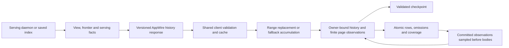
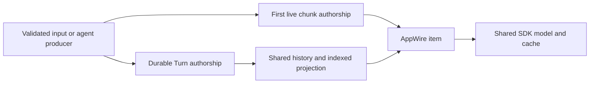

# History content selection

The existing AppWire `thread/read` and `thread/turns/list` methods let a client
choose which transcript content it receives. Every inclusion flag defaults to
true. An omitted flag and an explicit `true` select the same view.

| Flag | Content |
| --- | --- |
| `includeConversation` | User and assistant messages, including human steering |
| `includeThinking` | Reasoning items |
| `includeToolCalls` | Tool invocations, arguments and results together |
| `includeToolCallIntents` | Explicit tool descriptions |
| `includeSystemMessages` | System messages and non-human steering |
| `includeDiagnostics` | The detailed `thread.evener.diagnostics` object |

With tool calls excluded and intents included, a described tool stays in its
existing `commandExecution` slot with its identity, description and lifecycle
metadata. It has no arguments, output, error, images or raw tool state. Tools
without descriptions produce no intent row. Including calls and intents keeps
one item, with the description on the call. Excluding intents while including
calls omits the description field; arguments remain intact. Selection is a
bandwidth and presentation control, not a security redaction boundary.

For conversation-only reads, send `includeConversation: true` and set the other
five flags to `false`. Send the same options on older-page requests and on
refresh/reconnect reads. Metadata-only reads can use `includeTurns: false` with
`includeDiagnostics: false` to avoid fetching detailed diagnostics before a send.
Metadata-only reads and mutation relay setup preserve any existing subscription's
history selection and live overlay identities. Use an `includeTurns: true` read
to establish or change the history view.

The public `itemLimit` counts selected items. The server fills a selected page
across complete indexed source windows, skipping excluded content before applying
the public count and byte limit. It does not return empty intermediate pages
just because a source window contains only excluded items. An empty older cursor
means no older selected items remain. The usual single oversized-item exception
to the soft byte limit still applies.

Opaque cursors bind the selection, requested Ref/ThreadID target, source snapshot,
boot generation and epoch. Older-page requests retain the read's target fields.
Selected continuations use snapshot-fenced positional paging, so remote cursor
cache eviction does not invalidate an unchanged conversation. Changing any selection
flag requires a fresh latest read; reusing another view's cursor returns
`transcriptItemCursorStale`. Filtered snapshots have distinct opaque incarnation
identities, so clients' ordinary history replacement rules also separate views.
A held snapshot from another selection receives a replacement read, never an
incremental change set. Changed older items and turn status/version/usage remain
in `changes` when a smaller selected window drops them from the source's latest
window.

A window reports turn completeness from logical turn membership, not physical
adjacency: the index's item pages stamp each item's earlier/later flags from its
ordinal within its logical turn (`Index.span` in
[`internal/transcriptindex/window.go`](../../internal/transcriptindex/window.go)),
so a turn a later entry reopens reports completeness at its fragment boundaries
even when its fragments are not physically adjacent. A window holding only a
later fragment of a reopened turn therefore reports that earlier items of that
turn exist, and the omitted leading fragment gets a recovery cursor instead of
a false completeness claim.

Selection also applies to the subscription established by a read: history
updates, overlay items and their deltas use the same view. Lifecycle, status,
capabilities, queue state, delivery receipts, mutation authority and recovery
notifications remain available. History updates with no selected items still
advance the snapshot. A resync requests fresh history without retiring active
stream identities, so a failed refresh can continue receiving their deltas.
Overlay reset/end notifications still clear live state; successful subscription
replacement seeds identities from the new snapshot.

Each downstream subscription generation owns its selection and selected overlay
identities. Metadata reads and mutation relay preparation wait for overlapping
history responses to commit or abort, then preserve that resolved view. The wait
runs after preparation releases source ownership locks; mutations dispatch only
after preparation succeeds. A failed refresh preserves the previous view and live
overlay identities while still delivering daemon recovery notifications. Capture
rollback restores the previous owner and its filter; unsubscribe disposes of both.
Hub relay reads and feeds remain complete, so a compact client cannot hide data
from a full client sharing the same source.
The shared adapter in `internal/apphistory` and registration in
`internal/appserver.HandleThreadHistory` serve both Hub and daemon APIs.

Clients retain their own cached windows and drafts. The server owns selected-page
construction and history fencing; after a stale cursor, a client refreshes the
latest selected window without discarding unsent work. Source/index repair and
transport recovery remain owned by their existing subsystems.

## Manager bounded transcript reads

Manager `read_transcript` hub reads add a compact, non-subscribing view over the
same live and saved history owners. A request selects one turn window: latest,
one exact turn, a bounded forward window since a turn, or a bounded backward
window before a turn. Exact `itemTypes` filtering happens before the per-turn
item cap; `messages` selects user messages, agent messages and human steering
according to recorded source metadata. A window has one content filter: a
request that names the coarse `messages` selection is translated into that
exact `itemTypes` predicate, and any other coarse combination is refused typed.
The legacy global selection never re-pages a window. Message and tool-output body bounds apply
without removing item identity or lifecycle metadata.

The existing history packer owns both ordinary and Manager views. Its Manager
mode measures complete encoded fragments under the requested content budget,
with a 16 KiB floor and headroom below the outer 256 KiB tool-result cap. It
keeps at least one bounded fragment, trims only whole turns in the window's
direction, and limits cursor-bearing item lines to ten. Each affected turn has
one aggregate record separating items excluded by type, withheld by the item
cap, truncated beyond that cursor limit and elided by the content budget. The
record names whether to continue within the same view or re-read a wider view.

Window and item cursors are hub-owned and bind the requested ref, source
incarnation and projection. Window continuations retain the original selection
and bounds. A settled truncated item can carry a version-fenced fetch cursor.
Before measuring or truncating a Manager window, the hub applies its visible image
and file-route enrichment once and retains that exact canonical item JSON in a
bounded least-recently-used byte store. Fetch responses slice only those retained
bytes and return base64 ranges plus another cursor until complete, regardless of
whether the item came from a live daemon, saved index, compatibility read or
remote source. The source is still re-read on each fetch to enforce reachability
and version fences. Eviction or hub restart returns the typed stale result instead
of reconstructing bytes from mutable files or routes. A remote item beyond the
ordinary translated read's reach returns `fetch-unavailable-remote`.
Older daemons receive only a legacy latest-page read: the hub applies the same
packer, refuses other window forms with a typed upgrade path, and pages
compatibility fetch recovery backward only when that daemon advertises
`PageBefore`.

A cursor mismatch refreshes the view. A changed reachable item reports its new
version. A remote or compatibility item outside the bounded recovery path reports
the named degradation instead of returning partial bytes. These recovery reads
do not change the ordinary client subscription or its selected history view.

A window continuation keeps the resolved logical turn range it was minted for:
`resolveTranscriptWindowContinuation` in
[`cmd/evener-hub/transcript_window_continuation.go`](../../cmd/evener-hub/transcript_window_continuation.go)
carries a whole-turn continuation's range in its resume window and validates it
against the cursor's anchor, so turns an earlier page withheld upstream of the
page it served are re-covered by the resumed range rather than lost. Position
slicing applies only to a cursor that resumes inside one turn (an intra-turn
cut), because physical positions do not order interleaved reopened turns like
their logical turns. An empty-range digest is valid only when the whole
resumed range is known empty — a candidate in it fails the cursor stale — and
a range that still withholds turns upstream stays open so the packer can
continue from them.

## Serving facts and status comparison

`evener/thread/history/read` and `evener/thread/history/turns/list` take the
existing read and page parameters and add serving facts to their results.
The shared browser/native client upgrades history requests to these methods.
Manager history reads use them too. Content selection and subscription rules
above are unchanged.

The serving source captures the evidence with its view. Routing carries that
evidence to the client, which selects a merge policy without declaring freshness.

| Field | Meaning |
| --- | --- |
| `servedFrom` | The branch that supplied this view, `live-daemon` or `saved-index` |
| `fallbackReason` | Saved history followed an attempted live read, `live-read-empty` or `live-read-failed` |
| `asOf` | RFC3339 observation time, not a freshness verdict |
| `latestExecutionTurnId` | Newest recorded execution in the serving view, even on an older page |
| `instanceId` | Live session instance captured with the serving cut, absent on saved history |
| `servingFactsUnavailableReason` | Why an older source could not supply serving facts |

For saved history, `asOf` is the file-stat moment whose observed length bounds
index catch-up. Later bytes need not appear in that view. The timestamp is not
request completion time and does not prove the running session is caught up.
Catch-up and projection share the sidecar lock, and the observed file identity
must match the served view. A replaced-file cut uses the existing typed
rebuild/refusal path rather than labelling replacement content with the old
file's observation moment.
For live history it is the live read's observation time. Remote hubs forward
the source's facts; a local roster or clock cannot fill missing remote facts.
An unreachable source remains an error, not a newly labelled saved response.
`older-source` names a peer reached through method-not-found degradation;
`source-unsupported` names a source that does not supply serving facts.

The caller compares a status read's `instanceId` and `activeTurnId` with the
history view's instance and `latestExecutionTurnId`. The history frontier is
not the last visible item or the last execution on an older page. An execution
can be recorded without visible items. Delivery-only and gap records do not
advance it. Missing frontier evidence means unknown, not caught up or stale.
These fields do not introduce a server-computed freshness verdict.

The live frontier's source of truth is the Session's commit-time stamp:
`Recorded && OriginalOrdinal == nil && TurnKind == Execution`. This includes
recorded-but-unsynced retained entries. Completion does not clear the stamp;
compaction replay copies, delivery records and gaps do not move it. Attach
seeds only an empty frontier from the constructor's validated transcript view,
and cannot overwrite a committed or pending stamp. Reopening a writer does not
seed it again. The stamp is an atomic turn-ID/sequence pair under the frontier
leaf: seeding stamps the pair, and each later first-record commit advances its
sequence. Only descendant installation consumes that process-local sequence;
event JSON and wire responses never carry it. The internal recorded hook is
composed with the external hook; its owned emitter delivers the first-record
refresh outside the append lock.
Construction-time first-record events wait for SessionStart publication without delaying the commit-time stamp or later runtime signals, and constructor failure or pre-start close drops held events and stops the emitter.
Close joins that emitter through the ordinary session lifecycle.

Root envelope refreshes sample `Session.LatestExecutionTurnID()`. Descendants
use a `Server.mu`-owned sampler registry bound to runtime incarnation, not just
session ID. A retained runtime owns its binding until release, before idle
reclaim or ordinary teardown; failed construction releases its binding too.
Installing a child's durable boot generation publishes through that runtime's
retained binding before input runs, outside `Session.mu`.
The descendant first-record consumer samples outside the projection gate and
`Server.mu`, then installs only if the carried registration and published
generation still match. Each immutable registry entry records its last successful
install pair, including the `SessionStart` bootstrap. An older sequence cannot
displace a newer installed stamp within that registration; equal stamps write
idempotently. A fresh registration's first install is independent of the row its
predecessor left behind. An old callback cannot write its retired frontier into
a replacement row; one beginning after replacement samples the replacement,
subject to the same ordering guard.
The cached-row install deliberately emits no notification: addressed metadata
reads see the new frontier, while existing subscribers retain their last full
row until a full read or a later `ThreadStarted` row. That subscriber lag is a
known cost, not evidence that the execution was unrecorded.

On the versioned methods, live windows and normal saved browsing replace the
items in their returned range. Saved fallback windows accumulate without
erasing held history, including failed-live fallback whose daemonless identity
differs from a held live generation. Such a fallback retains the held live
identity rather than treating its daemonless token as a replacement. The phone
admits held history only for the same resolved thread and serving session,
even when a changed owner retains the same daemon instance.

The shared history reducer preserves higher item versions across overlapping
pages. `HistoryState.replacementScopes` records closed page intervals and their
observed snapshots under the containing history identity. Each scope also
records the entry ordinal its range end reached, because item versions and
range ends share that ordinal scale while an observed snapshot counts
transcript bytes. An older overlapping
page cannot revive an omitted key; disjoint older pages remain useful. These
observations survive validated checkpoints and cached records without advancing
`HistoryState.length`, the latest-window completeness watermark. An absent
scope field means no recorded page authority.

Every replacement bounds its own omissions by the highest entry ordinal the
response reported: a held item recorded after that ordinal survives, while an
item the response covered and did not return is omitted.

The browser repository persists normal-page omissions only inside the original
wire interval. The cache commits rows, omission fences, certificates and header
observations together, preserving newer item versions and rows outside that
interval. Returned identities retain their cached version and richer payload
until the ordinary version merge applies. Accepted page writes retain their
range authority across later disjoint reads. Their commits cannot clear an
uncommitted latest-read suffix or
repair a refused extent beyond the page's upper edge. Local openings
and older-body continuations sample committed observations before reading
bodies, so an accepted omission also holds while its write is queued or
capacity-refused. Cached items newer than the observation remain readable.
Known positive identities and valid committed cached bodies
remain readable. A fenced old page cannot manufacture fresh coverage. A newer
committed certificate covering its whole range on the current baseline keeps
recovery settled. Otherwise the repository requests reconciliation, and a fresh
covering page restores durable coverage. Other generation, cursor and recovery
fences retain their existing behavior.

The legacy `thread/read` and `thread/turns/list` methods keep their old wire
shapes and stamps, including the misleading saved-window `authoritative: true`
and the old failed-live replacement behavior. Their exact-key cache allowlists
remain unchanged. New clients cache one legacy-mode transition per connection
only after typed method-not-found. Initial reads remain concurrent; already
in-flight probes fall back individually. Later calls use legacy methods directly
without another probe, and reconnect resets that cache. Old-source degradation
has no invented provenance or freshness.
Keeping both paths carries two response contracts and two merge policies;
remove that compatibility path only when legacy methods and their clients are
retired together.

## Browser transcript cache

The browser keeps an entry-oriented cache of recorded history: one repository
per session accepts recorded updates, publishes them to open panes immediately,
and owns their asynchronous IndexedDB writes (the
[`TranscriptRepository`](../../cmd/evener-hub/frontend/src/stores/transcriptRepository.ts)
implementation). The server transcript stays authoritative; the cache is
derived storage that a fresh server read can always refill. There is no
competing blob writer — a legacy whole-session cache that predates entry
storage is discarded on the schema upgrade rather than migrated, and its
sessions refetch from the server. Entry-sized writes exist so a browser never
restores and rewrites a whole-session model to record one update.

Publication precedes persistence. `accept` folds a recorded update into the
published model synchronously, then queues the entry-sized write; a reader sees
new history before the database commit. Cached coverage claims advance only
after a commit, which records the committed certificate, coverage boundary and
read id together, so a crash between publication and commit leaves coverage
honest and the server refetch refills the local cache. Publication also
survives cache failures that persistence cannot: an accepted update whose
bodies no longer fit the cache is refused for caching while the published model
keeps its content, and an oversize recorded window takes the one exclusive
immediate batch rather than starting an unbounded write.

Residency budgets bound completed work, not the live session. The pending
resync buffer and the shared write admission queue
(`EntryWriteAdmission` in
[`entryWriteAdmission.ts`](../../cmd/evener-hub/frontend/src/stores/entryWriteAdmission.ts))
bound completed recorded input and pending completed writes
(`backgroundTranscriptOptions().pendingBytes`), but unfinished live output is
never spilled to disk or discarded to enforce a budget, so the budget is not a
total-memory bound. Retained bodies charge by identity: `EntryRetainedBody`
keys are the objects themselves, so one body shared by two accounting sites is
charged once, while two independently decoded copies of the same content are
two charges — equal serialized content does not deduplicate. Issued background
reads keep their capacity slot until the real response, rejection or the
lookup deadline settles them; retirement (`retireHydration`) cancels queued
work and resolves the owner's wait early, but never promises immediate release
of a server read already executing.

Older-page demand is a live-UI promise. A reader's older-page request uses
contiguous cached coverage first (the repository's local continuation, fenced
by source revision and certified coverage), then an existing server cursor or
supported position-based request for missing ranges. The paging scheduler
(`HistoryPaging` in
[`historyPaging.ts`](../../appwire-client/typescript/historyPaging.ts)) and the
pane's load-older control are part of the guarantee, not just the repository
and store beneath them: a null scheduling key or a hidden control makes
genuine cached bodies unreachable. The store's tagged scheduling key
(`olderTranscriptPageKey`) never goes onto the wire.

Reopen honors an explicit older-page demand. A caught-up pane with healthy
durable coverage needs no activation `thread/read` — zero activation reads is
the assertion for a healthy fixture (`openEntryTranscript` resolves from local
bodies) — but a reopen with missing older history may fetch it through the
retained server cursor or position-based paging, and incomplete local coverage
or dropped opening work requires reconciliation. A rendered retained-items
flag alone does not prove healthy durable coverage: the repository's recovery
verdict (`openLocal`'s status and the opening-cut certificate) decides whether
a recovery read is owed.

## Original transcript authors

Optional `ThreadItem.authorship` records an original author and an `inherited`
flag. It does not change message roles, item identities, positions or paging.
Authors are `human`, `agent`, `system` or `unknown`. An agent names its session
with `sessionRef`; a delegate also carries its logical parent's `ownerRef`,
stable `delegateId` and bounded canonical `delegateName`. The logical parent
can differ from the root session that physically stores the delegate.

Fresh client input is human. Parent delegate instructions retain their actual
sender, including active steering and input sent after the child completes.
Internal harness nudges are not human input. Assistant text, reasoning and
communicate previews use the same author snapshot as their durable records.
Deferred communicate messages take authorship from the original call, not the
later tool result or the page on which it appears. This includes inherited
format-1 ASSISTANT calls. Delegate context forks copy the call/result exchange
but exclude transcript-only COMMUNICATE records. The shared projector reconstructs
those messages at their results, or at the existing unpaired flush when no result
was recorded. Ordinary forks retain the complete prefix, including COMMUNICATE
records; each dedicated record clears pending reconstruction for its call, even
when echo suppression hides the record, so the same message appears only once.
Fresh format-1 calls still render only through their dedicated COMMUNICATE record.
Both paths preserve result/error behavior, call identity and echo suppression.

The index retains the copied call's position and any later assistant-text context
needed for echo suppression. A bounded page replays those entries with their
original format, preserving identity text runs and the call's recorded author,
without scanning earlier history. Pending context survives index close/reopen
and result append. Projection-version invalidation rebuilds older sidecars that
omitted or duplicated inherited messages; it does not rewrite the authoritative
transcript.

Ordinary forks and opt-in delegate context forks preserve original authors and
mark copied entries `inherited: true`, without mutating their sources. Fresh
edited human input is not inherited. Fork inclusion rules are unchanged.
An absent authorship field means both author and inheritance are unknown,
not fresh. Copying an old source-less entry proves inheritance but not its
author, so it becomes unknown/inherited. Placement in a child transcript,
the enclosing thread and prose that resembles a human message prove no author.

Remote sources qualify only structural author refs into their own namespaces;
opaque tool payloads and message text are unchanged. Live, reconnect, crash
recovery and cold history reads use the same recorded evidence without extra
subscriptions or context lookups. SDK normalization and cache codecs preserve
valid metadata. Sparse updates preserve omitted attribution, but authoritative
replacements can clear it or explicitly replace a known author with unknown.

Semantically invalid but structurally decodable author evidence projects as
unknown while preserving proven inheritance. Wrong-typed and unknown JSON
fields retain the transcript decoder's existing strict outcomes. The transcript
format marker is unchanged: older strict readers can reject records containing
the new field, so downgrading a writer is not a promise of readable new history.
This shared metadata does not change human-interaction permissions.

## Summary failure diagnostics

The same survive-and-reconcile rule governs every partial transcript write. A
write that fails halfway keeps the original readable: the writer
(`settleFailedWriteLocked` in
[`transcript.go`](../../agent/transcript/transcript.go)) removes a clean
rollback's bytes, keeps a whole line that landed as unsynced debt the next
fsync settles, and only a partial line poisons the writer — because a whole
line is a record every reader finds. There is no per-outcome rule set and no
poisoned-transcript dead end: the writer settles every rollback outcome
itself, and reopening the transcript rebuilds the writer from the complete
records the file still holds, truncating a torn tail a crash may have left. A
fold that fails to publish runs neither commit phase, so a restart anchors on
the last compaction marker that did land and brings back the pre-compaction
history; the fold's replay tail and merged-back turns are re-appended only
after their marker lands. A served session fails closed — one diagnostic,
every later input refused — only when the transcript can no longer record what
it announces (a COMMUNICATE message or a turn completion was not recorded);
ordinary append failures keep the session running with a warning. The retained
tail after compaction is preserved verbatim — a byte-identical suffix of the
pre-compaction history, not trimmed to a fit guarantee — so an occasional first
request after compaction can fail with a context-window error the user retries;
that trade keeps maximum detail in the retained tail.

A failed conversation summary leaves the existing history or the operation's
deterministic checkpoint available. The authoritative transcript is unchanged.
The next eligible compaction can install a valid summary and continue normal
model work. A locally rejected summarizer reply is one bad sample, not a route
verdict. The conversation summary resamples such a reply — an empty reply, a
reply with no summary section, an empty condensation batch — up to two more
times on the route that produced it before the next route takes over, and a
later sample that passes installs the summary without a warning. The
session-log fork summary resamples a reply that does not parse as a JSON entry
within the same budget before its error surfaces; the next completed tool
round attempts the fork again. Cut-off replies (the model's own output limit)
and deterministic failures get no resample, and a cancelled run resamples
nothing. Model selection and fallback eligibility are unchanged; an automatic
pass failing identically to the previously published failure warns once per
streak, while explicit `/compact` and `compact_context` always report their
outcome, and a completing summarize layer — including a no-op fold on a window
too small to summarize — re-arms the warning.

Context management emits `summary_failure` with the selected provider/model,
terminal failure category and available HTTP status in the existing warning
message, stating the terminal route's sample count once it exceeds one. Advice
distinguishes a failed fast/cheap route from the session model,
since changing the main model need not change an independently configured summary
model. CLI, AppWire, browser, native and Notification hooks carry these
existing message/title/hint fields without a new renderer or visibility policy.
Predictive-checkpoint recovery retains its informational `context_budget` code.

The runtime's typed `summary_failure` record separates the terminal attempt
from the last failed sample of each route that attempted the work (the
terminal route's own earlier samples included), at most two. It includes
controlled category, stage and validation reason
values, validated HTTP status and retryability when known, and each attempt's
route sample count. Provider/model names
come from routing, are bounded to 256 bytes each and have control characters
removed from display. A pre-selection failure has no invented model identity.
Provider messages, response bodies, raw error codes, prompts, summaries, headers
and credentials are excluded. The client projection keeps its existing
`raw.warning` fields: `code`, `source`, `title` and `hint`.

The [session warning publisher](../../agent/summary_diagnostics.go) logs the safe
record once with `code` and `session_id`, independently of the opt-in API logger.
The daemon launcher's private stderr file is `run/logs/daemon-<session-id>.log`
under its state root. A delegate sharing the root daemon's log still records its
own session identity. The launcher retains the latest 1 MiB at launch; there is
no continuous size cap during a run. This is best-effort process logging, without
a new fsync-backed audit guarantee. An unavailable log sink does not suppress
the warning or prevent later compaction. Plain CLI execution writes to stderr;
its caller owns persistence.

The [recorded summary failure fixture](../../agent/testdata/summaryfailurewire/README.md)
exercises the real producer, projection, shared decoder and existing client
warning surfaces, followed by successful summary installation.
