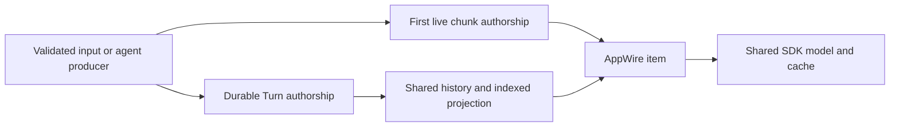

# History content selection

The existing AppWire `thread/read` and `thread/turns/list` methods let a client
choose which transcript content it receives. Every inclusion flag defaults to
true. An omitted flag and an explicit `true` select the same view.

| Flag | Content |
| --- | --- |
| `includeConversation` | User and assistant messages, including human steering |
| `includeThinking` | Reasoning items |
| `includeToolCalls` | Tool invocations, arguments and results together |
| `includeToolCallIntents` | Explicit tool descriptions |
| `includeSystemMessages` | System messages and non-human steering |
| `includeDiagnostics` | The detailed `thread.evener.diagnostics` object |

With tool calls excluded and intents included, a described tool stays in its
existing `commandExecution` slot with its identity, description and lifecycle
metadata. It has no arguments, output, error, images or raw tool state. Tools
without descriptions produce no intent row. Including calls and intents keeps
one item, with the description on the call. Excluding intents while including
calls omits the description field; arguments remain intact. Selection is a
bandwidth and presentation control, not a security redaction boundary.

For conversation-only reads, send `includeConversation: true` and set the other
five flags to `false`. Send the same options on older-page requests and on
refresh/reconnect reads. Metadata-only reads can use `includeTurns: false` with
`includeDiagnostics: false` to avoid fetching detailed diagnostics before a send.
Metadata-only reads and mutation relay setup preserve any existing subscription's
history selection and live overlay identities. Use an `includeTurns: true` read
to establish or change the history view.

The public `itemLimit` counts selected items. The server fills a selected page
across complete indexed source windows, skipping excluded content before applying
the public count and byte limit. It does not return empty intermediate pages
just because a source window contains only excluded items. An empty older cursor
means no older selected items remain. The usual single oversized-item exception
to the soft byte limit still applies.

Opaque cursors bind the selection, requested Ref/ThreadID target, source snapshot,
boot generation and epoch. Older-page requests retain the read's target fields.
Selected continuations use snapshot-fenced positional paging, so remote cursor
cache eviction does not invalidate an unchanged conversation. Changing any selection
flag requires a fresh latest read; reusing another view's cursor returns
`transcriptItemCursorStale`. Filtered snapshots have distinct opaque incarnation
identities, so clients' ordinary history replacement rules also separate views.
A held snapshot from another selection receives a replacement read, never an
incremental change set. Changed older items and turn status/version/usage remain
in `changes` when a smaller selected window drops them from the source's latest
window.

Selection also applies to the subscription established by a read: history
updates, overlay items and their deltas use the same view. Lifecycle, status,
capabilities, queue state, delivery receipts, mutation authority and recovery
notifications remain available. History updates with no selected items still
advance the snapshot. A resync requests fresh history without retiring active
stream identities, so a failed refresh can continue receiving their deltas.
Overlay reset/end notifications still clear live state; successful subscription
replacement seeds identities from the new snapshot.

Each downstream subscription generation owns its selection and selected overlay
identities. Metadata reads and mutation relay preparation wait for overlapping
history responses to commit or abort, then preserve that resolved view. The wait
runs after preparation releases source ownership locks; mutations dispatch only
after preparation succeeds. A failed refresh preserves the previous view and live
overlay identities while still delivering daemon recovery notifications. Capture
rollback restores the previous owner and its filter; unsubscribe disposes of both.
Hub relay reads and feeds remain complete, so a compact client cannot hide data
from a full client sharing the same source.
The shared adapter in `internal/apphistory` and registration in
`internal/appserver.HandleThreadHistory` serve both Hub and daemon APIs.

Clients retain their own cached windows and drafts. The server owns selected-page
construction and history fencing; after a stale cursor, a client refreshes the
latest selected window without discarding unsent work. Source/index repair and
transport recovery remain owned by their existing subsystems.

## Original transcript authors

Optional `ThreadItem.authorship` records an original author and an `inherited`
flag. It does not change message roles, item identities, positions or paging.
Authors are `human`, `agent`, `system` or `unknown`. An agent names its session
with `sessionRef`; a delegate also carries its logical parent's `ownerRef`,
stable `delegateId` and bounded canonical `delegateName`. The logical parent
can differ from the root session that physically stores the delegate.

Fresh client input is human. Parent delegate instructions retain their actual
sender, including active steering and input sent after the child completes.
Internal harness nudges are not human input. Assistant text, reasoning and
communicate previews use the same author snapshot as their durable records.
Deferred communicate messages take authorship from the original call, not the
later tool result or the page on which it appears. This includes inherited
format-1 ASSISTANT calls: forks copy the call/result exchange but exclude the
transcript-only COMMUNICATE record. The shared projector reconstructs the message
at its result, or at the existing unpaired flush when no result was recorded.
Fresh format-1 calls still render only through their dedicated COMMUNICATE record.
Both paths preserve result/error behavior, call identity and echo suppression.

The index retains the copied call's position and any later assistant-text context
needed for echo suppression. A bounded page replays those entries with their
original format, preserving identity text runs and the call's recorded author,
without scanning earlier history. Pending context survives index close/reopen
and result append. Projection-version invalidation rebuilds older sidecars that
omitted inherited messages; it does not rewrite the authoritative transcript.

Ordinary forks and opt-in delegate context forks preserve original authors and
mark copied entries `inherited: true`, without mutating their sources. Fresh
edited human input is not inherited. Fork inclusion rules are unchanged.
An absent authorship field means both author and inheritance are unknown,
not fresh. Copying an old source-less entry proves inheritance but not its
author, so it becomes unknown/inherited. Placement in a child transcript,
the enclosing thread and prose that resembles a human message prove no author.

Remote sources qualify only structural author refs into their own namespaces;
opaque tool payloads and message text are unchanged. Live, reconnect, crash
recovery and cold history reads use the same recorded evidence without extra
subscriptions or context lookups. SDK normalization and cache codecs preserve
valid metadata. Sparse updates preserve omitted attribution, but authoritative
replacements can clear it or explicitly replace a known author with unknown.

Semantically invalid but structurally decodable author evidence projects as
unknown while preserving proven inheritance. Wrong-typed and unknown JSON
fields retain the transcript decoder's existing strict outcomes. The transcript
format marker is unchanged: older strict readers can reject records containing
the new field, so downgrading a writer is not a promise of readable new history.
This shared metadata does not change human-interaction permissions or complete
the Comic client’s consumer and browser acceptance work.

## Summary failure diagnostics

A failed conversation summary leaves the existing history or the operation's
deterministic checkpoint available. The authoritative transcript is unchanged.
The next eligible compaction can install a valid summary and continue normal
model work. Model selection, fallback eligibility, retry counts and warning
visibility are unchanged; repeated failed compactions can still warn.

Context management emits `summary_failure` with the selected provider/model,
terminal failure category and available HTTP status in the existing warning
message. Advice distinguishes a failed fast/cheap route from the session model,
since changing the main model need not change an independently configured summary
model. CLI, AppWire, browser, native and Notification hooks carry these
existing message/title/hint fields without a new renderer or visibility policy.
Predictive-checkpoint recovery retains its informational `context_budget` code.

The runtime's typed `summary_failure` record separates the terminal route from
prior failed routes. It includes controlled category, stage and validation reason
values, validated HTTP status and retryability when known. Provider/model names
come from routing, are bounded to 256 bytes each and have control characters
removed from display. A pre-selection failure has no invented model identity.
Provider messages, response bodies, raw error codes, prompts, summaries, headers
and credentials are excluded. The client projection keeps its existing
`raw.warning` fields: `code`, `source`, `title` and `hint`.

The [session warning publisher](../../agent/summary_diagnostics.go) logs the safe
record once with `code` and `session_id`, independently of the opt-in API logger.
The daemon launcher's private stderr file is `run/logs/daemon-<session-id>.log`
under its state root. A delegate sharing the root daemon's log still records its
own session identity. The launcher retains the latest 1 MiB at launch; there is
no continuous size cap during a run. This is best-effort process logging, without
a new fsync-backed audit guarantee. An unavailable log sink does not suppress
the warning or prevent later compaction. Plain CLI execution writes to stderr;
its caller owns persistence.

The [recorded summary failure fixture](../../agent/testdata/summaryfailurewire/README.md)
exercises the real producer, projection, shared decoder and existing client
warning surfaces, followed by successful summary installation.
