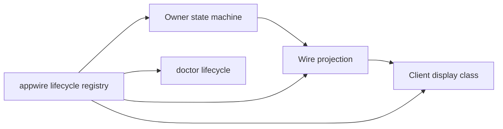

# Lifecycles

The product records several independent state machines. Each one has an owner,
a durable authority, a wire projection, and a display class. This page is the
current map. The core machines are declared once in
[`appwire/lifecycle.go`](../../appwire/lifecycle.go); clients read a generated
catalog of those declarations instead of keeping their own copies.

An agent can read the live registry with `evener doctor lifecycle --json`, or
with the `doctor_evener` tool and `command: "lifecycle"`. That command takes no
selector and reads no state root.

## How the layers fit

The owner holds the state and decides transitions. The wire projection carries
the owner's vocabulary plus the facts a client needs to classify it (for
example `terminal` and `resumable`). The client maps the state onto one display
class. The registry is the shared declaration: `appwire` constants and
predicates, the generated TypeScript unions and `LIFECYCLE_MACHINES`, and the
doctor output all come from it.

A state's **class** is one of `active` (work is in progress or owed),
`waiting` (waits on a person), `idle` (no work in progress and no completed run
in this state: resting, not started, or resumable), `settled` (a run finished,
or the entity is done and may be reopened), `failed` (something broke),
`neutral` (ended deliberately), or `ended` (no live entity to act on: closed,
removed, or not loaded). **Terminal** means no legal transition leaves the
state. Those two are independent: a failed turn rests (`threadStatus.systemError`)
and is not terminal, while a cancelled job is neutral and terminal.

## Registered machines

| Kind | Owner and durable authority | Projection and consumers |
| --- | --- | --- |
| `session` | [`agent.Session`](../../agent/session_state.go), `s.state` under the session mutex; restore re-derives it from history | Wire `ThreadStatus.type`; hub navigation, rail, web pane, phone session view |
| `threadStatus` | Observation, not an owner: the wire and navigation status vocabulary | `ThreadStatus`, `NormalizeState`, `attentionState`, `humanizeState` |
| `turn` | Transcript turns (`agent/schema`, `appwire.Turn`) written by the session | `TurnStatus`; web and phone transcript rows |
| `job` | [`agent/internal/jobstore`](../../agent/internal/jobstore) event log (`jobs.jsonl`) | `JobActivityJob`, `job_status`, `job_list`, activity counts and dots |
| `delegate` | [`agent/internal/delegatestore`](../../agent/internal/delegatestore) delegate journal, folded `Phase` | Wire `lifecycle`, `phase`, `status`, `resumable`; activity tree, sidebar, phone subagents |
| `delegateRun` | The in-memory subagent model ([`agent/subagents.go`](../../agent/subagents.go)) and the durable run outcome | `SubagentStatus`; legacy subagent results and diagnostics |
| `delegateOutcome` | `delegatestore.OutcomeStatus` in the delegate journal | Wire `outcome`; terminal delegate rows and reports |
| `watch` | [`jobstore`](../../agent/internal/jobstore) watch events plus the live `jobManager.watches` registry | `SessionWatchState`; activity watches, doctor watches |
| `task` | [`agent/task`](../../agent/task/task_store.go) task store | `TaskStatus`; task sheet and pane |
| `goal` | [`agent/internal/goal`](../../agent/internal/goal/goal.go) plus session meta | `GoalState.status`; status chip and `/goal status` |
| `hostOperation` | [`cmd/evener-hub/internal/hostops`](../../cmd/evener-hub/internal/hostops) operation store | `OperationState`; host operations page and `evener/host/operations` |
| `mutationProjection` | [`agent/session_client_mutation`](../../agent/session_client_mutation.go) journal | `MutationProjectionState`; transcript reconciliation |

### Session

States: `idle`, `active`, `awaiting`, `closed`. `closed` is terminal.
`idle -> active`, `idle -> awaiting`, and any open state may move to `closed`.
`active` returns to `idle` or `awaiting`; `awaiting` returns to `active` when
the human answers, or to `idle` when autonomous work takes over.

`awaiting` means the next move is owed to a person: a question is pending, or
the last turn ended on `needs_response` with no autonomous work in flight. A
plain reply rests `idle`. `WireState` may raise a resting state to `active` when
the session owns work that can start its next turn without user input.

### Thread status

Observed states, no owner transitions: `idle`, `active`, `awaiting`,
`warning`, `closed`, `notLoaded`, `systemError`, `restartRequired`. Clients
normalize `closed` to `ended` and `systemError` to `errored` on navigation
surfaces. `idle` and `systemError` are resting; `systemError` is a failed rest,
which is why resting is a declared fact rather than a class comparison.

### Turn

States: `inProgress`, `completed`, `failed`, `interrupted`. The three latter
states are terminal. A turn starts `inProgress` and ends in exactly one of them.

### Job

States: `running`, `completed`, `command_exited_nonzero`, `command_killed`,
`failed`, `exhausted`, `cancelled`, `stopped`. A job is created `running` and
moves once to a terminal status.

`completed` is the only success. `command_exited_nonzero`, `command_killed`,
`failed`, and `exhausted` roll up as failure. `cancelled` and `stopped` roll up
as neutral. The rollup is `JobOutcome`, shared by the activity tree and the
client.

A delegate activation job is the compatibility case: its record status has
historically carried the delegate's aggregate phase (`idle`, `settling`,
`stopping`, `closed`). The `job_list` status filter accepts both vocabularies
for that reason. New surfaces should read the delegate machine for those rows.

### Delegate

The durable aggregate phase has states `idle`, `running`, `settling`,
`stopping`, `closed`. `closed` is terminal. The fold permits
`idle -> running`, `running -> settling`, any open phase to `stopping`,
`stopping -> stopping` (a repeated stop request), and any phase except `closed`
to finish into `idle` or `closed`.

A delegate row on the wire carries several facts from this machine:

- `phase` is the durable aggregate phase above.
- `lifecycle` and `status` are the run-active projection: `running` while a
  run is open, otherwise `idle`.
- `outcome` is the last run's `delegateOutcome`.
- `terminal` means an outcome exists and no run is open.
- `resumable` means a new run may start.

A terminal row is read by its outcome, not by a stale phase. A delegate that
needs attention carries `needsAttention`, which the shared subagent dot reads
as attention; the legacy phase-valued attention vocabulary is still accepted
from older producers.

### Delegate run and outcome

The run status is `running`, `completed`, `failed`, `exhausted`, `cancelled`,
`stopped`; everything but `running` is terminal. The terminal outcome uses the
same vocabulary without `running`.

`completed` rolls up as success; `failed` and `exhausted` as failure;
`cancelled` and `stopped` as neutral.

### Watch

States: `armed`, `ended`, `unknown`. `armed -> ended`; `ended` is terminal.
`unknown` is retained evidence that cannot establish liveness and has no
transitions. A watch record's `active` boolean and its `armed`/`ended`
projection state the same fact; do not introduce a third.

### Task

States: `open`, `in_progress`, `done`, `cancelled`. The task store accepts every
non-self transition; `done` and `cancelled` are settled but not terminal
because reopening clears `completed_at`. Only one task may be `in_progress`.

### Goal

States: `active`, `complete`, `blocked`. `complete` and `blocked` are terminal.
`SetTerminal` only moves an `active` goal.

### Host operation

States: `pending`, `running`, `complete`, `failed`, `interrupted`,
`orphan-unverified`. `complete`, `failed`, and `interrupted` are terminal. The
store rejects every transition out of a terminal record, and
`orphan-unverified` resolves only to `interrupted`. A move the declared graph
does not contain is refused. The store also accepts a re-publish of
`pending`/`running` and entry into `orphan-unverified` from `pending`/`running`,
because those are durable historical facts.

### Mutation projection

States: `pending`, `reflected`, `removed`. `removed` is terminal. A mutation
may be reflected or removed without ever passing through the other.

## Adjacent machines outside the registry

These are real state machines with owners and transitions. They are listed here
so a change can find them; the ones that gain a shared consumer should move
into the registry.

| Machine | States | Owner |
| --- | --- | --- |
| Notification delivery (`jobstore.NotifyState`) | `not_armed`, `pending`, `delivered`, `consumed` | jobstore owner notification ledger |
| Persisted turn completion (`schema.TurnCompletionStatus`) | `completed`, `failed`, `interrupted` | execution turn record written by the session; the persisted subset of the turn machine |
| Task completion gate (`events.TaskCompletionState`) | `ready_for_final_output`, `waiting_for_blocking_delegates` | session goal/task completion decision |
| Transcript index turn window | `open`, `closed` (`Open` and `Started` markers) | [`internal/transcriptindex`](../../internal/transcriptindex), [`internal/apptranscript`](../../internal/apptranscript) |
| Client mutation operation | `inFlight`, `applied`, `rejected`, `terminal`; disposition `reserved`, `replayed`, `joined` | [`agent/session_client_mutation`](../../agent/session_client_mutation.go) |
| SSH connection | `disconnected`, `preflighting`, `deploying`, `restarting`, `attaching`, `attached`, `reconnecting` | [`cmd/evener-hub/internal/sshconn`](../../cmd/evener-hub/internal/sshconn) |
| Launch configuration trust | `absent`, `untrusted`, `trusted`, `changed`, `rejected` | [`launchconfig`](../../cmd/evener-hub/internal/launchconfig) |
| Session deletion | `deleting`, `deleted` | [`hubcore/deletion_store.go`](../../cmd/evener-hub/internal/hubcore/deletion_store.go) |
| Favorite authority | `complete`, `incomplete`, `ambiguous`; decision `valid`, `confirmed-invalid`, `dormant` | [`hubcore/favorite_authority.go`](../../cmd/evener-hub/internal/hubcore/favorite_authority.go) |
| Model availability | `success`, `empty-success`, `failure`, `timeout`, `limited` | [`agent/internal/modelavailability`](../../agent/internal/modelavailability) |
| API log settlement | `settled`, `unsettled`, `unknown_outside_range` | [`agent/apilog_read.go`](../../agent/apilog_read.go) |
| Thread clear journal | `reserved`, `applied` | [`server/thread_clear_journal.go`](../../server/thread_clear_journal.go) |
| Client connection | `idle`, `connecting`, `ready`, `reconnecting`, `closed` | [`appwire-client`](../../appwire-client/typescript/client.ts) |
| Provider sign-in (phone) | `idle`, `starting`, `device`, `browser`, `authorized`, `expired`, `error` | [`mobile-native/providerSignIn.ts`](../../mobile-native/src/providerSignIn.ts) |
| Provider credential editor (web) | `idle`, `saving`, `refreshing`, `checking`, `review`, `result`; push state `idle`, `pending`, outcome | [`ProviderConnection.tsx`](../../cmd/evener-hub/frontend/src/panes/settings/sections/credentials/ProviderConnection.tsx) |
| Plugin display status (web) | `failed` (broken), `ended` (disabled), `idle` (installed and enabled) | [`InstalledSection.tsx`](../../cmd/evener-hub/frontend/src/panes/settings/sections/marketplacesPlugins/InstalledSection.tsx) |
| Workspace, pane lifetime, user interface reading demand | Client runtime records | [`shell/workspace.ts`](../../cmd/evener-hub/frontend/src/shell/workspace.ts), [`shell/paneLifetime.ts`](../../cmd/evener-hub/frontend/src/shell/paneLifetime.ts) |
| Composer outbox and pending send | Outbox `submitting`, `blockedUnknown`, `canceled`; pending turn also `accepted`, `claimed`; recovery `rejected`, `orphaned`, `editing` | [`state/mutation`](../../appwire-client/typescript/state/mutation) and the [`threads` store](../../cmd/evener-hub/frontend/src/stores) |

## Known implicit relationships

These are the places where one entity carries more than one vocabulary. They
are current behavior, not proposals.

- **Delegate rows carry two outcome vocabularies.** `JobActivityJob.outcome` is
  the activity rollup (`success`, `failure`, `neutral`), while
  `JobActivityDelegate.outcome` is the delegate outcome (`completed`, `failed`,
  `exhausted`, `cancelled`, `stopped`). A client must use the matching
  predicate: `isFailedJobOutcome` or `isFailedDelegateOutcome`.
- **Delegate activation jobs report a delegate phase as a job status.** The job
  status filter accepts `idle`, `settling`, `stopping`, and `closed` alongside
  the declared job statuses.
- **Pagination and watch rows duplicate terminality and liveness as booleans.**
  `SessionActivityPage.complete`, `JobActivityCounts.complete`, and
  `WatchRecord.active` are projections of machine facts. They must agree with
  the state they accompany.
- **Task terminality is not completion.** `done` and `cancelled` are settled;
  `completed_at` is cleared when a task reopens.
- **Wire status is not navigation status.** `closed`/`ended` and
  `systemError`/`errored` are the same facts under two names, joined by
  `normalizeWireState` and `hubcore.NormalizeState`.

## Changing a machine

1. Declare or change the states and edges in `appwire/lifecycle.go`, and add the
   machine to `LifecycleMachines` if it is new.
2. Use the declared constant and predicate in the owner; do not introduce a
   parallel string.
3. Run `make generate`. The TypeScript unions and `LIFECYCLE_MACHINES` change
   with the Go declaration, and `make lint-generated` fails if they are stale.
4. Read the class in clients through `lifecycleStateClass` /
   `lifecycleStateIsFailed` (`appwire-client/typescript/lifecycle.ts`), not a
   local status list.
5. The fixture `testdata/lifecycle/state_classes.json` lists every declared
   state; add the new state's row. The Go test fails when a declared state is
   missing, and both languages read the same facts.
6. Update this page when an owner, a durable authority, or a user-visible
   boundary moves.
