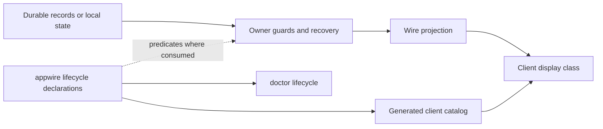

# Lifecycles

The product has independent lifecycles, local protocols and projections. This
page maps shared declarations and important recovery owners; it is not an
exhaustive inventory of stateful code. Shared lifecycle vocabulary is declared
in [`appwire/lifecycle.go`](../../appwire/lifecycle.go); clients consume its
generated catalog rather than duplicate those declarations.

An agent can read the live registry with `evener doctor lifecycle --json`, or
with the `doctor_evener` tool and `command: "lifecycle"`. That command takes no
selector and reads no state root.

## How the layers fit

The owner decides transitions, admission and recovery from its records and
current identity. A declaration describes vocabulary, edges and classification;
it does not install runtime guards. The [delegate fold](../../agent/internal/delegatestore/fold.go)
and [host-operation store](../../cmd/evener-hub/internal/hostops/store.go) consume
the declared edge predicate; other owners retain their own guards.

A projection describes evidence, not authority to change it. Wire facts such as
`terminal` and `resumable` must be read in their entity's scope. Clients consume
the generated TypeScript unions and `LIFECYCLE_MACHINES` for shared
classification; doctor reads the same declarations. Local protocols can remain
explicit in their owning code without entering the registry.

A state's **class** is one of `active` (work is in progress or owed),
`waiting` (waits on a person), `idle` (no work in progress and no completed run
in this state: resting, not started, or resumable), `settled` (a run finished,
or the entity is done and may be reopened), `failed` (something broke),
`neutral` (ended deliberately), or `ended` (no live entity to act on: closed,
removed, or not loaded). **Terminal** is a declared fact meaning no legal edge
leaves that state in the declared machine. Missing edges alone do not establish
terminality: observation-only and unknown states need not be terminal. Unknown
state names are not terminal. Class and terminality are independent: a failed
session observation rests (`threadStatus.systemError`) and is not terminal,
while a cancelled job is neutral and terminal.

## Registered machines

| Kind | Owner and durable authority | Projection and consumers |
| --- | --- | --- |
| `session` | [`agent.Session`](../../agent/session_state.go), `s.state` under the session mutex; restore re-derives it from history | Wire `ThreadStatus.type`; hub navigation, rail, web pane, phone session view |
| `threadStatus` | Observation, not an owner: the wire and navigation status vocabulary | `ThreadStatus`, `NormalizeState`, `attentionState`, `humanizeState` |
| `turn` | Transcript turns (`agent/schema`, `appwire.Turn`) written by the session | `TurnStatus`; web and phone transcript rows |
| `job` | [`agent/internal/jobstore`](../../agent/internal/jobstore) event log (`jobs.jsonl`) | `JobActivityJob`, `job_status`, `job_list`, activity counts and dots |
| `delegate` | [`agent/internal/delegatestore`](../../agent/internal/delegatestore) delegate journal, folded `Phase` | Wire `lifecycle`, `phase`, `status`, `resumable`; activity tree, sidebar, phone subagents |
| `delegateRun` | The in-memory subagent model ([`agent/subagents.go`](../../agent/subagents.go)) and the durable run outcome | `SubagentStatus`; legacy subagent results and diagnostics |
| `delegateOutcome` | `delegatestore.OutcomeStatus` in the delegate journal | Wire `outcome`; terminal delegate rows and reports |
| `watch` | [`jobstore`](../../agent/internal/jobstore) watch events plus the live `jobManager.watches` registry | `SessionWatchState`; activity watches, doctor watches |
| `task` | [`agent/task`](../../agent/task/task_store.go) task store | `TaskStatus`; task sheet and pane |
| `goal` | [`agent/internal/goal`](../../agent/internal/goal/goal.go) plus session meta | `GoalState.status`; status chip and `/goal status` |
| `hostOperation` | [`cmd/evener-hub/internal/hostops`](../../cmd/evener-hub/internal/hostops) operation store | `OperationState`; host operations page and `evener/host/operations` |
| `mutationProjection` | [`agent/session_client_mutation`](../../agent/session_client_mutation.go) journal | `MutationProjectionState`; transcript reconciliation |

### Session

States: `idle`, `active`, `awaiting`, `closed`. `closed` is terminal.
`idle -> active`, `idle -> awaiting`, and any open state may move to `closed`.
`active` returns to `idle` or `awaiting`; `awaiting` returns to `active` when
the human answers, or to `idle` when autonomous work takes over.

`awaiting` means the next move is owed to a person: a question is pending, or
the last turn ended on `needs_response` with no autonomous work in flight. A
plain reply rests `idle`. `WireState` may raise a resting state to `active` when
the session owns work that can start its next turn without user input.

### Thread status

Observed states, no owner transitions: `idle`, `active`, `awaiting`,
`warning`, `closed`, `notLoaded`, `systemError`, `restartRequired`. Clients
normalize `closed` to `ended` and `systemError` to `errored` on navigation
surfaces. `idle` and `systemError` are resting; `systemError` is a failed rest,
which is why resting is a declared fact rather than a class comparison.

### Turn

States: `inProgress`, `completed`, `failed`, `interrupted`. The three latter
states are terminal in the declared span. Execution recovery can reclaim a
client-mutation turn under the same ID with a recorded reopen marker; the
[execution owner](../../agent/session_execution.go) retains that protocol rather
than applying the declared graph as a blanket journal-write guard.

### Job

States: `running`, `completed`, `command_exited_nonzero`, `command_killed`,
`failed`, `exhausted`, `cancelled`, `stopped`. A job is created `running` and
moves once to a terminal status.

`completed` is the only success. `command_exited_nonzero`, `command_killed`,
`failed`, and `exhausted` roll up as failure. `cancelled` and `stopped` roll up
as neutral. The rollup is `JobOutcome`, shared by the activity tree and the
client.

A delegate activation job is the compatibility case: its record status has
historically carried the delegate's aggregate phase (`idle`, `settling`,
`stopping`, `closed`). The `job_list` status filter accepts both vocabularies
for that reason. New surfaces should read the delegate machine for those rows.

### Delegate

The durable aggregate phase has states `idle`, `running`, `settling`,
`stopping`, `closed`. `closed` is terminal. The fold permits
`idle -> running`, `running -> settling`, any open phase to `stopping`,
`stopping -> stopping` (a repeated stop request), and any phase except `closed`
to finish into `idle` or `closed`.

A delegate row on the wire carries several facts from this machine:

- `phase` is the durable aggregate phase above.
- `lifecycle` and `status` are the run-active projection: `running` while a
  run is open, otherwise `idle`.
- `outcome` is the last run's `delegateOutcome`.
- `terminal` means an outcome exists and no run is open.
- `resumable` means a new run may start.

A terminal row is read by its outcome, not by a stale phase. A delegate with
delivered input it has not consumed yet carries `needsAttention`; that means
the delegate owes itself a turn, not that a person is blocked. The shared
subagent dot still accepts the legacy phase-valued attention vocabulary from
older producers.

### Delegate run and outcome

The run status is `running`, `completed`, `failed`, `exhausted`, `cancelled`,
`stopped`; everything but `running` is terminal. The terminal outcome uses the
same vocabulary without `running`.

`completed` rolls up as success; `failed` and `exhausted` as failure;
`cancelled` and `stopped` as neutral.

### Watch

States: `armed`, `ended`, `unknown`. `armed -> ended`; `ended` is terminal.
`unknown` is retained evidence that cannot establish liveness and has no
transitions. A watch record's `active` boolean and its `armed`/`ended`
projection state the same fact; do not introduce a third.

### Task

States: `open`, `in_progress`, `done`, `cancelled`. The task store accepts every
non-self transition; `done` and `cancelled` are settled but not terminal
because reopening clears `completed_at`. Only one task may be `in_progress`.

### Goal

States: `active`, `complete`, `blocked`. `complete` and `blocked` are terminal.
`SetTerminal` only moves an `active` goal.

### Host operation

States: `pending`, `running`, `complete`, `failed`, `interrupted`,
`orphan-unverified`. `complete`, `failed`, and `interrupted` are terminal. The
store rejects every transition out of a terminal record.
`orphan-unverified -> interrupted` is legal; no other resolution is allowed.
A move absent from the declared graph is refused. The store also accepts a re-publish of
`pending`/`running` and entry into `orphan-unverified` from `pending`/`running`,
because those are durable historical facts.

The [web operation reader](../../cmd/evener-hub/frontend/src/stores/hostOps.ts)
uses `lifecycleStateIsTerminal("hostOperation", state)` for classification.
`operationNeedsRead` separately owns polling: an unread terminal seed still
owes its first read, `orphan-unverified` and unknown states keep polling, and a
`gone` record owes no read. See the [store transition tests](../../cmd/evener-hub/internal/hostops/sequence_test.go)
and [client polling tests](../../cmd/evener-hub/frontend/src/stores/hostOps.test.ts).

### Mutation projection

States: `pending`, `reflected`, `removed`. `removed` is terminal. A mutation
may be reflected or removed without ever passing through the other.

## Local protocols and projections outside the registry

These entries include locally explicit machines, composite protocols and pure
classifiers. A shared consumer can justify a shared declaration, but not every
protocol needs a registry entry. Keep transitions and recovery with the existing
owner; a presentation classifier is not another transaction owner.

| Protocol or projection | States or evidence | Owner or classifier |
| --- | --- | --- |
| Notification delivery (`jobstore.NotifyState`) | `not_armed`, `pending`, `delivered`, `consumed` | jobstore owner notification ledger |
| Persisted turn completion (`schema.TurnCompletionStatus`) | `completed`, `failed`, `interrupted` | execution turn record written by the session; the persisted subset of the turn machine |
| Task completion gate (`events.TaskCompletionState`) | `ready_for_final_output`, `waiting_for_blocking_delegates` | session goal/task completion decision |
| Transcript index turn window | `open`, `closed` (`Open` and `Started` markers) | [`internal/transcriptindex`](../../internal/transcriptindex), [`internal/apptranscript`](../../internal/apptranscript) |
| Client mutation operation | `inFlight`, `applied`, `rejected`, `terminal`; disposition `reserved`, `replayed`, `joined` | [`agent/session_client_mutation`](../../agent/session_client_mutation.go) |
| SSH connection | `disconnected`, `preflighting`, `deploying`, `restarting`, `attaching`, `attached`, `reconnecting` | [`cmd/evener-hub/internal/sshconn`](../../cmd/evener-hub/internal/sshconn) |
| Launch configuration trust classification | `absent`, `untrusted`, `trusted`, `changed`, `rejected` | [`launchconfig`](../../cmd/evener-hub/internal/launchconfig), classifies configuration and trust evidence |
| Session deletion | `deleting`, `deleted` | [`hubcore/deletion_store.go`](../../cmd/evener-hub/internal/hubcore/deletion_store.go) |
| Favorite authority classification | `complete`, `incomplete`, `ambiguous`; decision `valid`, `confirmed-invalid`, `dormant` | [`hubcore/favorite_authority.go`](../../cmd/evener-hub/internal/hubcore/favorite_authority.go), a pure read-time classifier that leaves stored decisions intact |
| Model availability | `success`, `empty-success`, `failure`, `timeout`, `limited` | [`agent/internal/modelavailability`](../../agent/internal/modelavailability) |
| API log settlement | `settled`, `unsettled`, `unknown_outside_range` | [`agent/apilog_read.go`](../../agent/apilog_read.go) |
| Thread clear journal | `reserved`, `applied` | [`server/thread_clear_journal.go`](../../server/thread_clear_journal.go) |
| Client connection | `idle`, `connecting`, `ready`, `reconnecting`, `closed` | [`appwire-client`](../../appwire-client/typescript/client.ts) |
| Provider sign-in (phone) | `idle`, `starting`, `device`, `browser`, `authorized`, `expired`, `error` | [`mobile-native/providerSignIn.ts`](../../mobile-native/src/providerSignIn.ts) |
| Provider credential editor (web) | `idle`, `saving`, `refreshing`, `checking`, `review`, `result`; push state `idle`, `pending`, outcome | [`ProviderConnection.tsx`](../../cmd/evener-hub/frontend/src/panes/settings/sections/credentials/ProviderConnection.tsx) |
| Plugin display classification (web) | `failed` (broken), `ended` (disabled), `idle` (installed and enabled) | [`InstalledSection.tsx`](../../cmd/evener-hub/frontend/src/panes/settings/sections/marketplacesPlugins/InstalledSection.tsx), not plugin installation or removal authority |
| Workspace, pane lifetime, user interface reading demand | Client runtime records | [`shell/workspace.ts`](../../cmd/evener-hub/frontend/src/shell/workspace.ts), [`shell/paneLifetime.ts`](../../cmd/evener-hub/frontend/src/shell/paneLifetime.ts) |
| Composer outbox and pending send | Outbox `submitting`, `blockedUnknown`, `canceled`, `superseded`; pending turn also `accepted`, `claimed`; recovery `rejected`, `orphaned`, `editing` | Shared [`state/mutation`](../../appwire-client/typescript/state/mutation); web [IndexedDB storage](../../cmd/evener-hub/frontend/src/stores/mutationOutboxIndexedDB.ts) and [thread store](../../cmd/evener-hub/frontend/src/stores/threads.ts); native [SQLite-backed runtime](../../mobile-native/src/nativeMutationRuntime.ts) |

`superseded` retires dispatch of a predecessor, not its evidence: its identity
and attempt evidence remain available to settle a late receipt or refusal.
The [record types](../../appwire-client/typescript/state/mutation/records.ts)
separate local outbox state, accepted copies and recovery kind from the daemon's
mutation admission and transcript projection.

## Recovery and preservation ownership

Follow the retained work and its exact owner, not a status label alone. These
links identify source-owned recovery rules and focused preservation tests; they
do not imply every combination is covered or that every test is an end-to-end
check.

| Family and authority | Recovery owner and preserved work | Preservation tests |
| --- | --- | --- |
| Execution spans — [`Session` execution bookkeeping and transcript](../../agent/session_execution.go) | Restore closes abandoned executions once, but leaves reclaimable pending work for its owner; a reclaimed execution records its reopen. | [Crash closure, pending work and same-ID reopen](../../agent/session_execution_resume_test.go) |
| Questions — [captured answer evidence](../../agent/session_client_mutation_ask.go) | Session admission compares the ask boot/revision pair. Fenced consumption and restore resolve only captured calls and the captured legacy count, preserving later asks. Unfenced input, legacy records, accepted interrupt and close retain whole-set behavior. See [session questions](session-questions.md). | [Refusal, consumption and replay preservation](../../agent/session_ask_fence_consumption_test.go) |
| Mutation delivery — [session journal](../../agent/session_client_mutation.go) and [client dispatcher](../../appwire-client/typescript/state/mutation/dispatcher.ts) | The daemon owns admission receipts; web/native storage retains local intent and attempt identity. Reconciliation and transactional Stop epochs decide redispatch, not transport reconnection alone. | [Response-loss recovery](../../server/appwire_mutation_recovery_test.go), [shared storage conformance](../../appwire-client/typescript/testing/mutationOutboxStorageConformance.ts) |
| Job and delegate attention — [job notification owner](../../agent/jobs.go), [delegate delivery](../../agent/delegate_delivery.go) and receiver transcript | Durable delivery acknowledgment is not attention consumption. Restore re-arms owned job notifications; persisted owner reads can consume them without consuming separate watch frames. Delegate attention survives compaction until presented and consumed. | [Job consumption](../../agent/job_notify_consume_test.go), [attention across compaction](../../agent/attention_survives_compaction_test.go) |
| Watches — [durable sends and settlement retries](../../agent/watch_send_settlement.go) | The job manager retains unsettled delivery obligations independently of `armed`/`ended`. Failed clear persistence leaves the watch live and retryable; partial teardown retains unapplied frames. | [Teardown persistence failures](../../agent/watch_teardown_persist_failure_test.go) |
| Residency — [`RetirementController`](../../agent/retirement.go) | Preparation may abort before commit. Committed retirement does not reopen admission on release failure and does not append terminal session evidence. | [Transcript preservation and release failure](../../agent/session_retirement_preservation_test.go) |
| Force Stop and resume — [hub `ResumeLocks`](../../cmd/evener-hub/internal/hubcore/resumelocks.go) | Persisted Stop intent survives hub recreation and signal failure. Replacement requires proof that the exact owner exited; automatic recovery cannot erase the explicit-resume obligation. | [Durable recovery requirement](../../cmd/evener-hub/app_recovery_persistence_test.go) |
| Connection callbacks — [connection store](../../appwire-client/typescript/state/connection/core.ts) | `onConnectionNotification` follows the current attachment. Unsubscribe plus generation/disposal checks retire captured callbacks, including A-to-B-to-A replacement, without blocking the new attachment. | [Captured notification fanout](../../appwire-client/typescript/state/connection/core.test.ts) |
| Subscription leases — [shared thread membership](../../appwire-client/typescript/threadSubscription.ts) | Last-holder release owns teardown. Reopened readers acquire without waiting for a departed request; late replies cannot publish stale metadata or tear down a successor's membership. | [Release, reacquisition and reconnect](../../appwire-client/typescript/threadSubscription.test.ts) |
| Older-history demand — [`HistoryPaging`](../../appwire-client/typescript/historyPaging.ts) | Active readers drive paced retries. Transient failures and inactive readers retain demand; one reader's cancellation does not cancel another's. History stores still own cursors and merging. | [Retained demand and return to reading](../../appwire-client/typescript/historyPaging.test.ts) |
| Composer work — [web source state](../../cmd/evener-hub/frontend/src/panes/session/composer/sourceState.ts) and [native draft document](../../mobile-native/src/draftDocument.ts) | Captured submissions do not clear newer edits. Automatic browser recovery restores only eligible work owned by that pane's seat; the transcript pending rows' explicit actions can reach other-owned rows. Native drafts checkpoint before transport and reconcile exact recovery sources. See [message recovery](message-recovery.md). | [Web submit preservation](../../cmd/evener-hub/frontend/src/panes/session/composer/Composer.submit.test.tsx), [own-seat restore](../../cmd/evener-hub/frontend/src/panes/session/composer/Composer.recovery.test.tsx), [native draft preservation](../../mobile-native/src/draftDocument.test.ts) |
| Host configuration publication — [host record store](../../cmd/evener-hub/app_host_record_store.go) | Staged records coordinate configuration publication and runtime replacement. Recovery keeps rollback evidence until the compensating file write is durable; operation completion is not connection readiness. | [Host mutation crash boundaries](../../cmd/evener-hub/app_host_crash_matrix_test.go) |
| Voice intake — [hub voice journal](../../cmd/evener-hub/internal/hubcore/voice_journal.go) | Intent is durable before an attempt; uncertain delivery requires original-instance reconciliation. Valid late receipts survive binding retirement. Generated or queued audio is not played evidence; [voice](voice.md) names the separate native playback owner. | [Lost acknowledgment, reopen and late receipt](../../cmd/evener-hub/internal/hubcore/voice_journal_intake_test.go) |
| OAuth refresh — [OpenAI credential service](../../auth/openai/service.go) | Refresh serializes by stored record and rereads under the lock. Transient failure retains the record for retry but returns no usable credentials and does not fall back to environment access. Permanent refusal requires sign-in rather than silently changing credential source. | [Refresh, concurrency and refusal behavior](../../auth/openai/service_test.go) |

## Known implicit relationships

These are the places where one entity carries more than one vocabulary. They
are current behavior, not proposals.

- **Delegate rows carry two outcome vocabularies.** `JobActivityJob.outcome` is
  the activity rollup (`success`, `failure`, `neutral`), while
  `JobActivityDelegate.outcome` is the delegate outcome (`completed`, `failed`,
  `exhausted`, `cancelled`, `stopped`). A client must use the matching
  predicate: `isFailedJobOutcome` or `isFailedDelegateOutcome`.
- **Delegate activation jobs report a delegate phase as a job status.** The job
  status filter accepts `idle`, `settling`, `stopping`, and `closed` alongside
  the declared job statuses.
- **Pagination and watch rows duplicate terminality and liveness as booleans.**
  `SessionActivityPage.complete`, `JobActivityCounts.complete`, and
  `WatchRecord.active` are projections of machine facts. They must agree with
  the state they accompany.
- **Task terminality is not completion.** `done` and `cancelled` are settled;
  `completed_at` is cleared when a task reopens.
- **Wire status is not navigation status.** `closed`/`ended` and
  `systemError`/`errored` are the same facts under two names, joined by
  `normalizeWireState` and `hubcore.NormalizeState`.

## Changing a machine

1. Find the existing owner, authority and recovery trigger. Decide whether this
   is an owner transition, a projection, or a local protocol; do not add a
   registry entry solely because code is stateful.
2. For shared lifecycle vocabulary, change `appwire/lifecycle.go` and add a new
   machine to `LifecycleMachines` when needed. Consume its constants and
   predicates rather than parallel lists. Review owner guards separately;
   declarations alone do not enforce runtime edges.
3. For declaration changes, run `make generate`. The TypeScript unions and
   `LIFECYCLE_MACHINES` change with the Go declaration, and `make lint-generated`
   fails if they are stale.
4. Read the class in clients through `lifecycleStateClass` /
   `lifecycleStateIsFailed`, and terminality through `lifecycleStateIsTerminal`
   ([`lifecycle.ts`](../../appwire-client/typescript/lifecycle.ts)), not a local
   status list. Keep independent obligations, such as an unread seed, separate.
5. The fixture `testdata/lifecycle/state_classes.json` lists every declared
   state; add the new state's row. The Go test fails when a declared state is
   missing, and both languages read the same facts.
6. Exercise the affected owner's failure, recovery and preservation paths,
   including stale completions and retained work where applicable. Update this
   page when authority, recovery ownership or a user-visible boundary moves.
