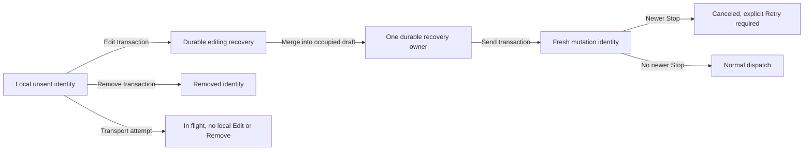
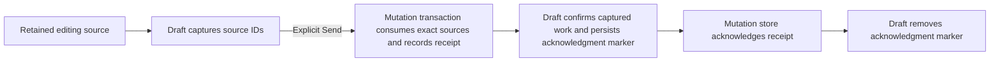

# Message recovery and queue ownership

Client storage owns unsent messages. The daemon owns accepted queue entries.
Controls follow that ownership, not the preview text or connection status.

## Browser controls

- A local, unattempted message offers **Edit message** and **Remove from queue**,
  including while offline. Stop-canceled messages keep **Retry** as well.
- Edit moves the exact durable identity into recovery before opening it in the
  composer. Remove deletes only that identity. Identical previews remain distinct.
- Attempted, accepted, delivery-uncertain and legacy records with unknown attempt
  history do not gain these local controls. Accepted daemon queue actions and
  delivery-uncertain Retry keep their existing rules.
- Promotion and input-empty drain commands offer Remove only. Editing a
  content-bearing drain restores its composer input, not the daemon queue preview.
- Unattempted rows appear once in QueueStrip, not also in optimistic send chips
  or steering ghosts. In-flight and remote ghosts remain. A move back to the
  local queue after an explicit refusal is not announced as delivery or failure.

Edit preserves the current draft and appends recovered content. A second edit
atomically folds both recoveries into one owner before deleting the secondary
record. A failed consolidation leaves both original records recoverable. Editing
recovery is discoverable after reload and is not labeled as a rejection.

Text, image bytes and selection metadata travel together. Image markers are
remapped without colliding with staged images or literal marker references.
Skill and command selections are restored with their text-owned mentions.
Encoding blocks the Edit claim before it can move a row. Typing during a storage
wait survives, and a completion cannot replace a disposed pane or a newer goal
draft. Send stays disabled while recovery ownership is being consolidated.

## Transactions and races

The press captures the durable row and Stop epoch together. Storage revalidates
both in the write transaction. Another tab's Remove, Retry, dispatch admission
or Stop can win, in which case the losing action refreshes without activating a
stale edit. Matching thread/session identity is required even offline.

Sending recovery consumes its durable source and creates one fresh outbox
identity atomically. It never falls back to an ordinary enqueue when the source
is missing. The Send press captures its Stop barrier before asynchronous draft
persistence, so a newer Stop leaves the fresh row canceled rather than dispatching
it. Storage failure retains recoverable content and reports the failure.

## Native controls and recovery

The transcript ghosts and Queue sheet share the same eligible local messages,
including offline waiting messages and messages held by Stop. Edit appends to
current work; Remove deletes only the selected durable identity. Local Edit
waits for a loaded, saved, non-submitting draft and completed image encoding.
Remove does not require an empty or ready composer. Queue-sheet Edit closes the
sheet before returning to the composer. The three-row transcript limit and More
count include local queue entries, not delivery-uncertain recovery.

The native screen passes the complete composition through online, offline and
command submission: text, image bytes and names, selections, mentions and exact
recovery source IDs. Image-only and selection-only work can be sent. Existing
slash-command attachment routing is unchanged. Accepted daemon queue editing
remains text-only; delivery-uncertain Discard and rejected recovery keep their
separate controls and restrictions.

Drafts and mutations live in separate SQLite databases. An Edit first claims the
source as durable editing recovery, then saves its ID beside the draft. Reopening
the screen reacquires any unowned editing sources, including a claim interrupted
before draft save. A source is hidden only when saved draft ownership represents
that exact ID. Failed saves retain the source; Retry saving and restored image
capacity allow recovery to finish. Recovery never sends automatically.

`queuedMessageControls.ts` reconciles these checkpoints after admission, reopen
and storage repair. Receipt proof must match the captured IDs; a missing outbox
row alone proves nothing. Unconsumed captured work returns beside newer typing
for an explicit Send. Failed acknowledgment exposes Retry without sending again.

For offline screen recreation, `screens.tsx` stores only the last observed
matching-ref, connected/open `{threadId, instanceId}` in existing device Storage
under `queued-message-identity:v1:` plus the composite hub/ref key. Reads, writes
and null-client registration belong to effects. A current matching conversation
supersedes this cache. The cache is local Edit/Remove authority only: it does not
restore a conversation, enable Send, acquire transport or grant capabilities.
Invalid or failed storage remains visible through Retry; a failed write is not
durable success. No selected outbox row supplies this identity.

Older native records may retain wire image bytes but lack their original composer
image-reference associations. Edit preserves their stored prose, including literal
and gapped `[image N]` references, and assigns attachments noncolliding markers.
The existing toast asks the user to check references before sending. It cannot
reconstruct an association that was never stored.

Broader [C05 convergence](friction.md) and C06 rejected-image recovery remain
deferred. These controls do not establish the cause of a reported screenshot
duplicate; only a reproduced identity/projection case can establish that cause.

## Owners and checks

- Shared policy and composition: `appwire-client/typescript/state/mutation` and
  the shared composer helpers. These do not authorize transport.
- Browser transactions: `cmd/evener-hub/frontend/src/stores/mutationOutboxIndexedDB.ts`.
- Browser identity checks and dispatch: `cmd/evener-hub/frontend/src/stores/threads.ts`.
- Projection and presentation membership: `composer/queue/pendingTurnsStore.ts`.
  Presentation filtering does not change submission routing.
- Pane lifetime and durable recovery owner: `composer/sourceState.ts`.
- Controls: `composer/queue/QueueStrip.tsx` and `composer/Composer.tsx`.
- End-to-end component checks: `composer/Composer.queuedMessages.test.tsx`, using
  the real composer, stores and IndexedDB adapter with external transport and
  browser-platform seams.
- Native integration and cached local identity: `mobile-native/src/screens.tsx`.
- Native mutation authority: `nativeMutationRuntime.ts` and
  `mutationOutboxStorage.ts`; draft ownership and bytes: `draftDocument.ts` and
  `draftRepository.ts`; separate-store coordination: `queuedMessageControls.ts`.
- Native acquisition and projections: `useNativeMutationRecovery.ts`,
  `MutationRecoveryPanel.tsx` and `session/ghosts.ts`; surfaces:
  `session/GhostRows.tsx` and `QueueSheet.tsx`.
- Native checks: `queuedMessageControls.render.test.tsx` renders the production
  screen and persisted component journeys; `useNativeMutationRecovery.render.test.tsx`
  checks effect-only acquisition/registration. Other native paths in this list
  are relative to `mobile-native/src/`.

Paths beginning with `composer/` are under
`cmd/evener-hub/frontend/src/panes/session/`. Browser recovery consolidates one
durable owner; native drafts retain exact source IDs across separate stores.

See [S03 and S11](subsystems.md), the [native guide](../../mobile-native/README.md),
the [web guide](../web-ui/README.md) and the historical
[Stop/outbox design](../design/stop-cancellation-outbox.md).
