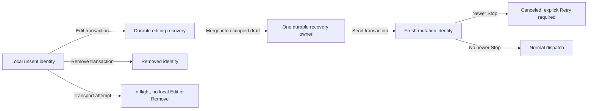

# Message recovery and queue ownership

Client storage owns unsent messages. The daemon owns accepted queue entries.
Controls follow that ownership, not the preview text or connection status.

## Browser controls

- A local, unattempted message offers **Edit message** and **Remove from queue**,
  including while offline. Stop-canceled messages keep **Retry** as well.
- Edit moves the exact durable identity into recovery before opening it in the
  composer. Remove deletes only that identity. Identical previews remain distinct.
- Attempted, accepted, delivery-uncertain and legacy records with unknown attempt
  history do not gain these local controls. Accepted daemon queue actions and
  delivery-uncertain Retry keep their existing rules.
- Promotion and input-empty drain commands offer Remove only. Editing a
  content-bearing drain restores its composer input, not the daemon queue preview.
- Unattempted rows appear once in QueueStrip, not also in optimistic send chips
  or steering ghosts. In-flight and remote ghosts remain. A move back to the
  local queue after an explicit refusal is not announced as delivery or failure.

Edit preserves the current draft and appends recovered content. A second edit
atomically folds both recoveries into one owner before deleting the secondary
record. A failed consolidation leaves both original records recoverable. Editing
recovery is discoverable after reload and is not labeled as a rejection.

Text, image bytes and selection metadata travel together. Image markers are
remapped without colliding with staged images or literal marker references.
Skill and command selections are restored with their text-owned mentions.
Encoding blocks the Edit claim before it can move a row. Typing during a storage
wait survives, and a completion cannot replace a disposed pane or a newer goal
draft. Send stays disabled while recovery ownership is being consolidated.

## Transactions and races

The press captures the durable row and Stop epoch together. Storage revalidates
both in the write transaction. Another tab's Remove, Retry, dispatch admission
or Stop can win, in which case the losing action refreshes without activating a
stale edit. Matching thread/session identity is required even offline.

Sending recovery consumes its durable source and creates one fresh outbox
identity atomically. It never falls back to an ordinary enqueue when the source
is missing. The Send press captures its Stop barrier before asynchronous draft
persistence, so a newer Stop leaves the fresh row canceled rather than dispatching
it. Storage failure retains recoverable content and reports the failure.

## Owners and checks

- Shared policy and composition: `appwire-client/typescript/state/mutation` and
  the shared composer helpers. These do not authorize transport.
- Browser transactions: `cmd/evener-hub/frontend/src/stores/mutationOutboxIndexedDB.ts`.
- Browser identity checks and dispatch: `cmd/evener-hub/frontend/src/stores/threads.ts`.
- Projection and presentation membership: `composer/queue/pendingTurnsStore.ts`.
  Presentation filtering does not change submission routing.
- Pane lifetime and durable recovery owner: `composer/sourceState.ts`.
- Controls: `composer/queue/QueueStrip.tsx` and `composer/Composer.tsx`.
- End-to-end component checks: `composer/Composer.queuedMessages.test.tsx`, using
  the real composer, stores and IndexedDB adapter with external transport and
  browser-platform seams.

Paths beginning with `composer/` are under
`cmd/evener-hub/frontend/src/panes/session/`. Native UI controls are a separate
implementation step; this guide's control behavior describes the browser.

See [S11](subsystems.md), the [web guide](../web-ui/README.md) and the historical
[Stop/outbox design](../design/stop-cancellation-outbox.md).
