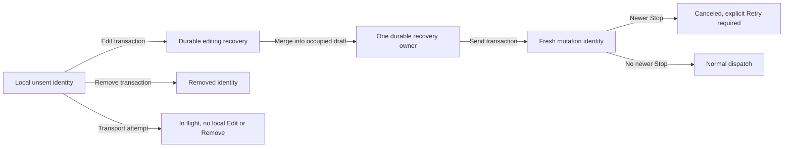
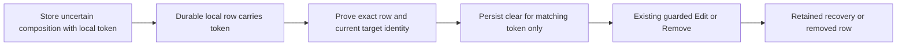
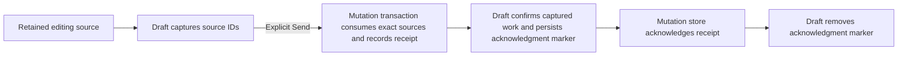

# Message recovery and queue ownership

Client storage owns unsent messages. The daemon owns accepted queue entries.
Controls follow that ownership, not the preview text or connection status.

## Browser controls

- A local, unattempted message offers **Edit message** and **Remove from queue**,
  including while offline. Stop-canceled messages keep **Retry** as well.
- Edit moves the exact durable identity into recovery before opening it in the
  composer. Remove deletes only that identity. Identical previews remain distinct.
- Attempted, accepted, delivery-uncertain and legacy records with unknown attempt
  history do not gain these local controls. Accepted daemon queue actions and
  delivery-uncertain Retry keep their existing rules.
- Promotion and input-empty drain commands offer Remove only. Editing a
  content-bearing drain restores its composer input, not the daemon queue preview.
- Unattempted rows appear once in QueueStrip, not also in optimistic send chips
  or steering ghosts. In-flight and remote ghosts remain. A move back to the
  local queue after an explicit refusal is not announced as delivery or failure.

Edit preserves the current draft and appends recovered content. A second edit
atomically folds both recoveries into one owner before deleting the secondary
record. A failed consolidation leaves both original records recoverable. Editing
recovery is discoverable after reload and is not labeled as a rejection.

New structured browser drafts carry a local revision ID. Recovery consolidation
records the exact incorporated ID in the same IndexedDB transaction as its
merged composition; reopening skips only that matching snapshot and clears it
only while the stored ID still matches. Newer edits in a replacement composer
remain separate. Older recovery rows without an ID keep the existing manual
merge behavior. This is local ownership metadata, not an RPC field or a
cross-process writer guarantee.

Text, image bytes and selection metadata travel together. Image markers are
remapped without colliding with staged images or literal marker references.
Skill and command selections are restored with their text-owned mentions.
Deleting or editing the last recorded `/skill` or `/command` label also removes
that canonical selection, including in older records whose selection may once
have been independent. A selection with no recorded label remains selected, and
another surviving label of the same kind and name keeps its selection. Literal
slash prose does not create or restore a selection.
Encoding blocks the Edit claim before it can move a row. Typing during a storage
wait survives, and a completion cannot replace a disposed pane or a newer goal
draft. Send stays disabled while recovery ownership is being consolidated.

## Transactions and races

The press captures the durable row and Stop epoch together. Storage revalidates
both in the write transaction. Another tab's Remove, Retry, dispatch admission
or Stop can win, in which case the losing action refreshes without activating a
stale edit. Matching thread/session identity is required even offline.

When another pane consumes or advances the recovery a browser pane owns, the
refused save preserves the complete local composition as a fresh recovery row
before retiring the stale lease. The new row carries the local text, skill and
command selections, payload input and attachment bytes, and the peer's row is
left untouched. If the stale row still holds the identical composition, no
duplicate row is created. The pane then owns the fresh row, so later edits
update it, Send consumes it, and a reload restores the local composition
including its images.

### Browser seat and selection ownership

A browser conversation seat owns its recovery selection. The seat is per tab
and per conversation, uses the tab's existing client identity, and is stored
beside the composer drafts under per-tab keys rather than in shared layout
geometry. Another tab can therefore never read or overwrite this tab's seat.
Independent panes on one conversation hold distinct seats and so keep
independent selections; a `sessionZoom` cascade pane uses the same tab-scoped
seat for its columns, with one selection entry per column ref. A mobile route
reconstruction resolves the conversation mapping first, so a restarted pane id
that once belonged to another conversation cannot lend its seat; a desktop
layout restore uses the pane mapping, which is stable for saved ids. Route
placement writes only the conversation mapping; pane-id mappings are written
when a layout is saved or restored, so startup cannot overwrite a saved pane's
seat before that layout returns. A retarget that keeps a pane's seat (resume,
then return to the resumed session) rewrites the destination ref's mapping so
a mobile reconstruction still finds that seat and its selection. Each pane-id
mapping records the conversation it belongs to; a shared layout that reuses
that id for another conversation falls back to this tab's mapping for the
restored ref instead of assigning the other conversation's seat. Validated
pane-specific seats are reserved across the whole restored layout before any
pane falls back to the ref mapping or a fresh seat.

Restoring a composer prefers the recovery row its seat last selected, falling
back to the oldest restorable rejected row. This keeps a pane's preserved local
work selected after reload even when an older rejected peer row exists.

A refused write's preservation records the fresh row as the seat's selection,
and retiring a lease clears that stored choice only when it still names the
retiring row. A resume or retarget carries the seat's selection to the resumed
ref, and a successful recovery write reconciles the seat with the row's
durable ref. A retained cascade column that owns a recovery selection maps its
ref to the pane's seat, so reopening a conversation the pane never showed as
its own still restores the column's selected row.

Sending recovery consumes its durable source and creates one fresh outbox
identity atomically. It never falls back to an ordinary enqueue when the source
is missing. The Send press captures its Stop barrier before asynchronous draft
persistence, so a newer Stop leaves the fresh row canceled rather than dispatching
it. Storage failure retains recoverable content and reports the failure.

## Native controls and recovery

The transcript ghosts and Queue sheet share the same eligible local messages,
including offline waiting messages and messages held by Stop. Edit appends to
current work; Remove deletes only the selected durable identity. Local Edit
waits for a loaded, saved, non-submitting draft and completed image encoding.
Remove does not require an empty or ready composer. Queue-sheet Edit closes the
sheet before returning to the composer. The three-row transcript limit and More
count include local queue entries, not delivery-uncertain recovery.

The native screen passes the complete composition through online, offline and
command submission: text, image bytes and names, selections, mentions and exact
recovery source IDs. Image-only and selection-only work can be sent. Existing
slash-command attachment routing is unchanged. When the leading built-in
invocation is itself a selected skill or command mention, the complete
composition routes as a message. A selection elsewhere in the composition does
not change a leading `/queue` or other built-in command route.
Accepted daemon queue editing
remains text-only; delivery-uncertain Discard and rejected recovery keep their
separate controls and restrictions.

Drafts and mutations live in separate SQLite databases. An Edit first claims the
source as durable editing recovery, then saves its ID beside the draft. Reopening
the screen reacquires any unowned editing sources, including a claim interrupted
before draft save. A source is hidden only when saved draft ownership represents
that exact ID. If the initial append save fails, the prior draft has no source ID,
so the retained source stays visible and recoverable. If a later typing save fails,
the last saved draft still owns its source IDs; those sources stay hidden from
Discard while Retry saving preserves the captured composition. Restored image
capacity can also complete a pending append. Recovery never sends automatically.

Replacing a recovered draft with a goal command parks the previous composition —
its text, images and recovery source IDs — in the native draft record instead of
re-appending it, so reconciliation leaves the goal composition alone and `/goal`
still routes as a built-in command. The park appears as a draft ghost: Edit
restores it whole once the composer is empty, and Discard clears it and releases
its source IDs. Inserting an image reconciles mentions against the resulting
text: a label the insertion splits loses its mention and canonical selection,
while a label before or after the insertion keeps its shifted offset.

An identity-changing resume carries the edited draft to the resumed ref before
the replacement screen opens: its text, image bytes, skill and command
selections, recovery source IDs, and any pending submission's capture token and
settlement markers move together, and recovery resend receipts move with their
sources. An already-open resumed draft adopts the transferred record
immediately. The retired ref keeps no draft or recovery ownership. A resumed
destination that already holds work is left untouched.

Browser and native outboxes share one receipt-settlement rule from the AppWire
package (`retainsAcceptedCopy`, `settlementRetiresRecovery`): a `pending` receipt
keeps an accepted copy of an input-bearing turn and of a note save until
authoritative state describes it, a receipt-only control keeps none, and a
recovery row a composer has edited outlives settlement.

An ordinary native submit stores its full `unconfirmed` composition with a local
capture token. If enqueue commits but draft confirmation fails, that token also
remains on the local mutation row, tying the row to that uncertainty copy. Before
Edit or Remove, the native coordinator proves the exact queued row and current
target identity. A retained editing row must also match the current thread and
instance identity before it is cleared or appended. The coordinator clears only
an `unconfirmed` record with the same token, then uses the existing guarded
Edit/Remove or appends the retained source to the latest draft. The token proves
local ownership, not daemon admission. Missing or different tokens, including
older records without token metadata, stay manual and do not block an unrelated
valid action. If persisting a matching clear fails, the action is blocked and the
row remains its owner. Remove does not require an otherwise ready composer. The
built-in completion marker remains evidence of a successful non-message command,
not message admission.

`queuedMessageControls.ts` reconciles these checkpoints after admission, reopen
and storage repair. Receipt proof must match the captured IDs; a missing outbox
row alone proves nothing. Unconsumed captured work returns beside newer typing
for an explicit Send. Failed acknowledgment exposes Retry without sending again.

Native built-in commands use a separate completion checkpoint. A successful
non-message command such as `/compact`, `/goal`, `/model`, `/clear`, `/aside`,
reasoning, shutdown, interrupt, a local command, or an argless queue drain clears
the edited command and records its exact recovered source IDs before cleanup.
Cleanup deletes only those IDs and never invokes the command again. Until cleanup
finishes, the completion marker keeps those rows out of Discard and prevents
automatic restoration. A cleanup failure stays visible with Retry; newer draft
text remains usable and is not cleared. A failed command keeps the command and
its recovered sources. `/steer` and `/queue` carry real message input through the
ordinary outbox and settle recovery only on the matching resend receipt. Clearing
the goal with `clear=true` sends `/goal` without consuming the unrelated current
draft or its recovery ownership.

The browser retries failed empty-source cleanup on its existing serialized
queue, starting after 250 ms and doubling to a 5-second cap. It cancels retries
when the source is disposed, replaced, edited, or cleanup succeeds. Native cleanup
uses the screen's explicit Retry after storage failure. Both clients keep command
execution separate from cleanup, but neither can promise exactly-once external
RPC effects if the process or storage is lost before any successful local
completion evidence can persist.

For offline screen recreation, `screens.tsx` stores only the last observed
matching-ref, connected/open `{threadId, instanceId}` in existing device Storage
under `queued-message-identity:v1:` plus the composite hub/ref key. Reads, writes
and null-client registration belong to effects. A current matching conversation
supersedes this cache. The cache is local Edit/Remove authority only: it does not
restore a conversation, enable Send, acquire transport or grant capabilities.
Invalid or failed storage remains visible through Retry; a failed write is not
durable success. No selected outbox row supplies this identity.

Older native records may retain wire image bytes but lack their original composer
image-reference associations. Edit preserves their stored prose, including literal
and gapped `[image N]` references, and assigns attachments noncolliding markers.
The existing toast asks the user to check references before sending. It cannot
reconstruct an association that was never stored.

Broader [C05 convergence](friction.md) and C06 rejected-image recovery remain
deferred. These controls do not establish the cause of a reported screenshot
duplicate; only a reproduced identity/projection case can establish that cause.

## Owners and checks

- Shared policy and composition: `appwire-client/typescript/state/mutation` and
  the shared composer helpers. These do not authorize transport.
- Browser transactions: `cmd/evener-hub/frontend/src/stores/mutationOutboxIndexedDB.ts`.
- Browser identity checks and dispatch: `cmd/evener-hub/frontend/src/stores/threads.ts`.
- Projection and presentation membership: `composer/queue/pendingTurnsStore.ts`.
  Presentation filtering does not change submission routing.
- Pane lifetime and durable recovery owner: `composer/sourceState.ts`.
- Controls: `composer/queue/QueueStrip.tsx` and `composer/Composer.tsx`.
- Decisions both controls share (selection capability gate, store dispatch by
  route, changed or already-sent recovery refusals): `composer/submitProtocol.ts`.
- End-to-end component checks: `composer/Composer.queuedMessages.test.tsx`, using
  the real composer, stores and IndexedDB adapter with external transport and
  browser-platform seams.
- Native integration and cached local identity: `mobile-native/src/screens.tsx`.
- Native mutation authority: `nativeMutationRuntime.ts` and
  `mutationOutboxStorage.ts`; draft ownership and bytes: `draftDocument.ts` and
  `draftRepository.ts`; separate-store coordination: `queuedMessageControls.ts`;
  successful non-message built-ins use `submitBuiltinCommand` and durable
  completion markers, while `/steer` and `/queue` retain receipt settlement.
- Native acquisition and projections: `useNativeMutationRecovery.ts`,
  `MutationRecoveryPanel.tsx` and `session/ghosts.ts`; surfaces:
  `session/GhostRows.tsx` and `QueueSheet.tsx`.
- Native checks: `queuedMessageControls.render.test.tsx` renders the production
  screen and persisted component journeys; `useNativeMutationRecovery.render.test.tsx`
  checks effect-only acquisition/registration. Other native paths in this list
  are relative to `mobile-native/src/`.

Paths beginning with `composer/` are under
`cmd/evener-hub/frontend/src/panes/session/`. Browser recovery consolidates one
durable owner; native drafts retain exact source IDs across separate stores.

See [S03 and S11](subsystems.md), the [native guide](../../mobile-native/README.md),
the [web guide](../web-ui/README.md) and the historical
[Stop/outbox design](../design/stop-cancellation-outbox.md).
