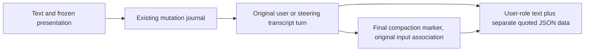

# Session input

Ordinary user text and its optional voice presentation evidence are one durable
input. The daemon's existing mutation journal owns acceptance, replay and
recovery. Text remains byte-identical; evidence is never concatenated into it.

## Voice presentation evidence

`appwire.InputItem.VoicePresentation` is supported only on one nonblank ordinary
text item submitted through `turn/start` or `turn/steer`. The trusted local-owner
daemon boundary accepts only human-authored evidence for its exact instance.
Manager-authored evidence and evidence on other input methods are rejected,
not silently discarded. Public hub ingress and the journal-backed voice producer
have separate trust checks owned by [voice conversations](voice.md).

The daemon advertises `voicePresentationContextV1` in both initialize features
and thread capabilities. A producer must require the original daemon capability
before sending evidence, since older decoders can ignore unknown fields.

[`VoicePresentationContext`](../../appwire/voice_presentation.go) records the
source, originating request and frontier, binding and generation identities,
generated wording, ordered audio items, cumulative generated/queued/played
samples, explicit output/device completion reports, and interruption. False
completion flags mean completion is not established. Rendering is not attention,
and sample positions cannot establish which words were heard.

Version 1 requires 24 kHz samples, valid UTF-8, at most 64 KiB serialized evidence,
a 16 KiB transcript, 32 ordered items, and 512 bytes per identity. Item identities
are unique and counters satisfy `0 <= played <= queued <= generated`. Producers
may truncate the transcript with `transcriptTruncated=true`, but never silently
remove items. Shared validation rejects invalid evidence atomically with its text.

Normalization clones evidence before hashing the full mutation. Reusing a
mutation ID with changed evidence conflicts. Accepted-start restoration, steering
restoration and failed-start recovery retain the same payload. Start and steer
records do not enter the exposed input queue, so existing queue promotion and
drain operations keep their ordinary behavior.

`schema.Turn` retains the typed payload and daemon-stamped
`voice_presentation_input_id` (`client:<clientMutationId>`). Provider projection
appends a separate JSON-escaped data content part on a message copy. It changes
neither stored text, role, actor nor authorship. Generated wording has no
instructional authority and supplies neither approval nor an action receipt.
Ambiguous or interrupted references require named clarification before acting.

Compaction carries only the latest consumed presentation association onto its
existing final marker when the owning input has folded away. If the association
survives in the retained tail, no marker copy is added. Publication selects from
the committed history including concurrent appends, and writes the association
in the same fold transaction. Repeated folds and restart retain the original
causal input ID. The marker's evidence is historical, not replayed input or a
correction of later user text. Earlier evidence remains in the full transcript.

## Verification boundary

`TestVoicePresentation*` exercises normalization bounds, actual start and steer
model requests, admission and capability reads, replay and restart, failed-start
reconstruction, actual repeated folds and restored model projection, and a typed
or voice correction appended during summarization. Scripted providers verify
custody and request shape, not model decisions about spoken references. Those
require the opt-in live voice journeys.
