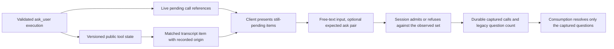

# Session questions

The session owns unanswered `ask_user` calls. Text and voice clients present the
same questions and send ordinary free-text input. They do not own a second
questionnaire or a conditional-answer API.

## Canonical content and origin

Successful execution stores `schema.AskUserState`, version 1, in the existing
result's `ToolState`. Its ordered questions retain the public header, question,
options, descriptions, recommendation details, fallback and multi-select flag.
The matched transcript item's `raw` contains that versioned state. Original
arguments are evidence of what the model supplied, not what ran: argument repair
or a pretool hook may replace them. Invalid or denied calls have no successful
canonical question state.

The item's `conversationProvenance` comes from the recorded originating assistant
turn, including its request and frontier. Matching the result preserves this
origin and assigns the final item ID as `sourceItemId`. Legacy records without
that evidence do not acquire a synthesized origin or canonical content.

## Live ownership

`Thread.evener.pendingAsk` is an optional `PendingAskState` with `version: 1`,
`instanceId`, `bootGeneration`, `revision`, and ordered `calls` containing
`turnId` and `callId`. Identity is the pair of call and execution turn, since
call IDs can repeat in different turns. The state contains references, not full
question text. `calllessCount` counts legacy questions without both identities;
an empty calls array alone does not prove that no question waits.

The session samples the bounded `pendingQuestion` and full pending-call state
together under one lock. The server commits them together, fences older samples
and replaced sources, and clamps only the wire row to ten composites.
`compositeTotal` counts the full composite set; `callsTruncated` identifies the
clamped list. A missing state means unknown. A new daemon boot changes
`bootGeneration` even when restoring the same revision and pending calls.

Roster frames also retain the received list length as a lower bound on the
composite total. When an older daemon omits the total, clamping still sets
`truncatedList` and `listReason:"unavailable"` for the omitted calls.

Roster, discovery and spawn share one workspace-reference builder. An explicit
`WorkspaceRef` remains authoritative; without it, the reference uses the projected
thread ID. The pending set carries its own `instanceId` independently of that
workspace reference.

The excerpt carries its displayed question's `turnId` and `callId` when known.
Live append also supplies explicit `complete` and `truncated` flags; restore
leaves these flags absent rather than claiming to have measured the original
question. A Manager may answer from an excerpt only when it is explicitly
complete, untruncated, and the only question in the observed set. Otherwise it
reads every named ask's canonical content before answering.

## Fenced answers and complete pending-call reads

`AskFence` advertises both conditional answer admission and pending-call pages.
Start, queue and steer accept optional `expectedAskRevision` and
`expectedAskBootGeneration` together. Revision zero is meaningful. The session
compares the supplied pair during admission, before writing an accepted input.
A mismatch returns a durable typed refusal receipt and leaves every question
pending. Retry with the same mutation ID replays that refusal; the caller must
read and evaluate the new set before composing a new answer.

Manager `delegate_send` and pending-page `job_status` opt into
`RegisteredTool.UnmarshalArgs` for their fence revision and page bounds.
Preparation and dispatch use the same decoder, preserving the full uint64
revision range, including zero and MaxUint64, through JSON repair and pre-tool
hook updates. Hook input and numeric replacements use that per-call decoder;
the callback is not part of the hook protocol. Overflow and non-integer revisions
retain the typed refusal. Other arguments and tools keep their existing float64
decoding. An unrelated decode failure retains the existing whole-hook fallback:
no partial update applies, and the original call remains the execution input.

The same two registrations compose the existing `PreValidate` hook, preserving
any prior validator first. Selected numeric tokens must pass the wire's uint64
revision or native-int page decoder before generic schema validation. This check
does not change other fields or numeric-string repair.

An admitted input captures the exact composites and the legacy-question count
present at admission. Consumption and restore resolve only that capture, so a
question appended later survives both. `schema.Turn.AskResolution` retains this
evidence separately from execution-level `AnswerToTurnIDs`; steering omits its
active execution from answer links without discarding the resolution evidence.
Unfenced input and legacy records retain whole-set behavior. An accepted
interrupt and session close also retain their explicit whole-set clear behavior.

A ref-addressed `thread/read` carrying the expected pair, `offset` and `limit`
returns `pendingAskPage:{composites,total,nextOffset,calllessCount}`. Any page
key selects this grammar, which requires the pair and refuses subscriptions,
held snapshots and answer-continuation queries. Pages sample the full live set;
they never recover from saved history. A changed pair refuses the page typed.
Follow `nextOffset` until absent. Question count and composite count are
different units; mixed sets also require locating the reported number of
call-less questions in history. The hub checks the live daemon's `AskFence`
before forwarding a page or fenced answer to it.

The normalized maximum is 3,244 composites per page. The
[`pending_ask_page_measurement_test.go`](../../server/pending_ask_page_measurement_test.go)
fixture measures the whole Manager response with 4,000 backing composites, the
ten-call row, maximum escaped excerpt content, actor and follow-up metadata.
At that maximum it encodes 262,089 bytes with fresh 24-character turn IDs and
216,519 with mutation turn IDs, below the 262,144-byte cap. One more composite
exceeds the cap for fresh IDs. Larger ordinary metadata can still cause a typed
whole-read refusal; the page never silently truncates JSON.

Voice resolves beyond-prefix membership through these same pair-fenced pages
in its network-work stage, before selecting speech. A clamped row cannot turn a
still-pending canonical question into empty spoken text. Canonical successful
result state and recorded origin remain required for voice eligibility.

The shared TypeScript client retains these fields through its existing JSON
transport. Generated AppWire types describe them; persisted transcript-model
validators do not decode question or attention payloads. Transport tests cover
their response, notification and outgoing-page forms without adding a separate
runtime validation layer.

## Compaction and recovery

Explicit `Compact` still refuses while a question is pending. Automatic
compaction may fold older history while keeping the unresolved execution tail.
The context manager keeps history from the earliest pending execution onward.
The existing fold transaction replays that exact persisted tail after its
summary/checkpoint marker, with original ordinals and turn identities. This
preserves canonical content and recorded origin through restart without a
second pending-question store. Non-resolving human notes leave the question
pending. An ordinary answer clears it and permits later explicit compaction.

The durable tail is read only for an actual fold with pending questions. If a
required pending execution cannot be found or the transcript cannot be read,
publication refuses that fold and emits a warning rather than fabricating a
source. This may prevent compaction until the underlying source problem is
resolved. Legacy inputs with no recorded execution identity retain their
preexisting restoration behavior.

## Owners and checks

- `agent/session_tools_ask.go`: execution state, pending references and restore.
- `agent/session_client_mutation_ask.go`: admission capture and durable evidence.
- `agent/session_compaction_ask.go`: existing transcript tail replay.
- `agent/internal/contextmgr`: pending-tail retention during folding.
- `server/thread_envelope.go`: atomic, generation-fenced ask projection.
- `server/appwire_thread_projection.go`: bounded row references.
- `cmd/evener-hub/session_input.go`: all-mode capability prepare gate.
- `cmd/evener-hub/voice_speech.go`: paged speech membership recovery.
- `appwire-client/typescript/client.test.ts`: additive-field transport retention.
- `internal/apptranscript` and `internal/transcriptindex`: matched item origin.
- `TestVoicePendingAsk_*`: real tool execution, hook replacement, restore,
  durable answer retry, rejection, compaction and projection checks.
- `TestE2E_ManagerPagesPendingCallsAndQueuesOneAnswer`: real Manager tool route,
  bounded paging and fenced queue consumption.
- `TestE2E_VoicePendingQuestionBeyondRowPrefixIsSpoken`: canonical question
  selection beyond the bounded row.

These checks do not qualify physical device audio.
