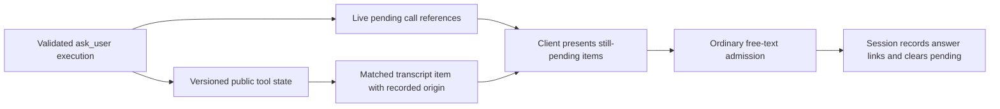

# Session questions

The session owns unanswered `ask_user` calls. Text and voice clients present the
same questions and send ordinary free-text input. They do not own a second
questionnaire or a conditional-answer API.

## Canonical content and origin

Successful execution stores `schema.AskUserState`, version 1, in the existing
result's `ToolState`. Its ordered questions retain the public header, question,
options, descriptions, recommendation details, fallback and multi-select flag.
The matched transcript item's `raw` contains that versioned state. Original
arguments are evidence of what the model supplied, not what ran: argument repair
or a pretool hook may replace them. Invalid or denied calls have no successful
canonical question state.

The item's `conversationProvenance` comes from the recorded originating assistant
turn, including its request and frontier. Matching the result preserves this
origin and assigns the final item ID as `sourceItemId`. Legacy records without
that evidence do not acquire a synthesized origin or canonical content.

## Live ownership

`Thread.evener.pendingAsk` is an optional `PendingAskState` with `version: 1`,
`instanceId`, `revision`, and ordered `calls` containing `turnId` and `callId`.
It contains references, not full question text. The bounded `pendingQuestion`
preview remains unchanged. A missing state means unknown. A present state with
an empty calls array means no eligible pending calls.

The session samples references under its lock. The server commits only newer
revisions within the same instance and fences samples from a replaced source.
A replacement instance or source may restart the revision. An older in-flight
sample cannot reinstate a question after a newer empty sample.

These references are advisory presentation ownership. Ordinary durable input
admission still resolves the runtime's current pending set and records
`AnswerToTurnIDs`. Retrying an already-admitted input does not clear a later set
or run the answer twice. Restoration prefers canonical successful result state
and retains its exact execution turn and call IDs. Older transcripts retain
ordinary legacy question restoration but gain no canonical voice eligibility.

## Compaction and recovery

Explicit `Compact` still refuses while a question is pending. Automatic
compaction may fold older history while keeping the unresolved execution tail.
The context manager keeps history from the earliest pending execution onward.
The existing fold transaction replays that exact persisted tail after its
summary/checkpoint marker, with original ordinals and turn identities. This
preserves canonical content and recorded origin through restart without a
second pending-question store. Non-resolving human notes leave the question
pending. An ordinary answer clears it and permits later explicit compaction.

The durable tail is read only for an actual fold with pending questions. If a
required pending execution cannot be found or the transcript cannot be read,
publication refuses that fold and emits a warning rather than fabricating a
source. This may prevent compaction until the underlying source problem is
resolved. Legacy inputs with no recorded execution identity retain their
preexisting restoration behavior.

## Owners and checks

- `agent/session_tools_ask.go`: execution state, pending references and restore.
- `agent/session_compaction_ask.go`: existing transcript tail replay.
- `agent/internal/contextmgr`: pending-tail retention during folding.
- `server/thread_envelope.go`: generation-fenced live reference projection.
- `internal/apptranscript` and `internal/transcriptindex`: matched item origin.
- `TestVoicePendingAsk_*`: real tool execution, hook replacement, restore,
  durable answer retry, rejection, compaction and projection checks.

These checks cover the shared session boundary, not device audio or the hub's
end-to-end voice journey.
