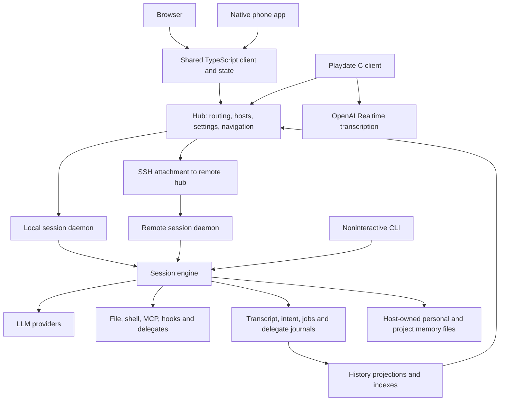

# Product subsystem map

Use this map to follow a user's action to the component that owns the work, its
durable state, and its recovery. It describes the implementation, including gaps;
the [principles](principles.md) describe product intent and the
[punchlist](friction.md) records open gaps and their product decisions.

Ownership here means code responsibility, not a team or person. A client can show
a failure while another component owns its cause. Follow both sides before adding
a retry, refusal, banner, or repair action.

Version skew between hub, daemons, clients and remote hubs follows the
direction rules in the [compatibility policy](README.md#compatibility).

## How the product fits together

Arrows show responsibility and data flow, not shared memory. Local and remote
daemons have their own state roots. AppWire carries client control, daemon control,
and ordered events; the hub also exposes HTTP surfaces. The installed `evener`
executable provides the commands that launch these processes. See
[architecture](../architecture.md) for module boundaries.

## Find the owner from the user's task

| User's task | Start here | Then follow |
| --- | --- | --- |
| Start work with a chosen model and directory | S01 launch; S16 model catalog | S06 hub routing, S08 daemon, S15 provider configuration |
| Read, find, or scroll through a conversation | S02 client; S10 history | S05 protocol and S06 remote/local routing |
| Send, queue, steer, stop, or recover submitted input | S11 durable intent | S05 transport, S08 daemon, S09 session owner |
| Return after a disconnect or phone backgrounding | S02 browser or S03 native; S05 transport | S06 connection binding, S10 history, S11 pending work |
| Use another machine | S07 hosts | S06 routing, S08 daemon, S20 installation |
| Delegate work, follow a job, or maintain a goal | S12 background work; S09 session | S13 worktrees/scratch, S10 history, S11 attention delivery |
| Recall, correct or forget durable lessons | S24 memory | S09 session context, S14 scoped execution, S10 historical evidence |
| Use a plugin, skill, hook, or external tool | S17–S19 extensions | S14 execution boundaries, S15 credentials |
| Approve access beyond a selected sandbox | S14 execution boundaries | S05 approval requests and decisions; S02–S03 client controls |
| Diagnose a stuck session or repair setup | S21 diagnostics; S15 settings | The affected subsystem's authority and recovery owner below |

## Clients and interaction

The [Playdate client](playdate-client.md) is a small additional client surface.
Its [separate C repository](https://github.com/prime-radiant-inc/evener-client-playdate) owns paged navigation,
chat projection, scrolling, immediate microphone capture, recoverable audio,
review drafts and persisted mutation identity. Its native Tailscale transport
owns DERP, WireGuard, TCP, native enrollment, authenticated control maps and
device identity recovery. The Hub owns generic short-lived device invitations and browser approvals;
[device pairing](../device-pairing.md) defines the shared QR/acoustic wire format
and encrypted credential delivery. The Hub also owns automatic destination
discovery from the browser origin, listener and network interfaces;
the browser presents that default and lets the operator edit it before creating
an invitation. Ordinary LAN/tailnet setup requires no configuration-file edit.
Mobile settings distinguish the direct phone QR from sound invitations. Sound
setup keeps playback and approval in one flow, with all eight comparison groups
shown as four lines of two. Phone setup offers manual address entry and a QR
invitation through the same approval flow when discovery fails or the phone
needs a different destination.
The parent settings view owns setup dismissal,
keeping the loaded phone pairing link accessible while sound setup loads or fails.
The browser sends invitations and confirms matching codes. Clients own durable
settings and saved work scoped by destination
and authenticated Tailscale peer. S05 AppWire
and S06 Hub routing own its session protocol;
S10 history and S11 durable intent remain authoritative for recorded messages
and accepted input. The device reconnects and hydrates that authority, preserving
its drafts. OpenAI owns transcription; the device connects directly using SDK
TLS, without a Hub or Mac transcription proxy.

| ID and responsibility | Entry points and implementation | State authority and recovery ownership | Owning references |
| --- | --- | --- | --- |
| **S02 Browser workspace** — browse sessions, read, compose, inspect activity and change settings | [Frontend](../../cmd/evener-hub/frontend/src), [thread store](../../cmd/evener-hub/frontend/src/stores/threads.ts), [transcript flow](../../cmd/evener-hub/frontend/src/panes/session/transcript/flow), [older-history reader](../../cmd/evener-hub/frontend/src/panes/session/transcript/useTranscript.ts), [session activity binding](../../cmd/evener-hub/frontend/src/stores/sessionActivity.ts) | Stores bind visible state to the selected session and connection. Failed-turn Retry submits the shared `continue` message through the thread store's existing send admission and durable outbox. It is offered only when the failed turn is the canonical latest turn, and it is inactive while this client has an unresolved send or queue in the durable outbox. Activation rechecks both owners, so a stale press submits nothing; the pending projection fails closed until its durable read answers, so a reload with an unknown or unresolved outbox keeps Retry inactive. Its local `preserveComposer` intent keeps refusal recovery explicit, leaving composer text, selections and staged images intact. [Settings](../web-ui/README.md#settings) owns task-group navigation, control-keyword search and retired-route fallback to Appearance while retaining explicit host scope. Its existing preference stores retain browser-local and hub-synchronized ownership. Plugins combines Installed, Browse and Sources under one host picker; directory reads, drafts and saves remain usable through inventory failures and retries. Hub, Storage and About own the former General summary fields. The workspace store owns exact living pane records, current slots and focus across desktop/phone host changes. Its `sourcePaneSessionRef` projection supplies conversation-source ownership to document opening and route reconciliation, including a job transcript's parent session. Desktop reconstruction restores dockview geometry without replacing those records or replaying their selection; document Back owners, captured file references and reopen generations remain runtime-only. After a session route settles, filename Open/reopen retains document selection beside its exact live source promoted to main, including secondary sessions and transcripts; reconnect and settled location refresh preserve this binding, and an embedded cascade column's filename open binds the hosting inspection pane as its source without promoting it, its focused document reading as the route's companion, the binding following the inspector's retyped record through drills, pops and resumes. Route reconciliation waits for the opening stack to publish the exact source owner when hydration publishes a reference first. New or pending URL intent, generic documents and stale or mismatched bindings still follow route reconciliation. Cold restore creates fresh records, honors route intent and never resurrects runtime owners from saved layouts. The rail projects own session failure and live child work from compact navigation summaries, preserving questions, approvals and failed-child context. The command palette groups matching subagent sessions under their top-level session's row — greyed when that session itself did not match — through the shared search grouping, keeping one row per session: a matched live parent nests its subagent hits under its Live row. One shell-level needs-you owner serves Mod+J, the palette's needs-you row and the palette's next-needs-you command: a controller and provider owned by the AppShell above the desktop and phone hosts, exactly one observing at a time, reading the shared `needs_you` navigation section rather than a palette-local row copy. A deliberate Next requests at most one required page, retries a failed boundary page on the next activation and never opens a missing, stale or unloaded row. A needs-you list row whose page is refreshing or failed renders refused and states why; a refused row cannot navigate. A settled needs-you page owns completion: its reported remaining rows end Next demand and Load more, while the manifest total only justifies demand before any page has settled and a failed boundary or populated retry keeps its own demand. The shared navigation selectors own that rule for the needs-you owner's settled and failed boundaries, the palette's first page and the Live chord; the needs-you populated retry stays in the needs-you owner. The floating control hides only while an IME composition is in progress, while a question or approval is pending in the focused conversation, or while the palette or another blocking modal owns interaction; editor focus and a saved draft never hide it, so a session that autofocuses its composer still offers Next. That owner cancels pending intent on reader/source changes, accepted route events, another palette activation, navigation-generation changes, modal activity and disposal, and a deferred palette selection is cancelled by a workspace write, including a host change ([global chords](../web-ui/keybindings.md)). Its modal watch follows the workspace's focused reader, so a dialog in a popout the reader has left does not block attention navigation in the window they returned to. The Live next/previous chord applies the same rule when its demanded page lands: a dialog in the opener or the focused reader's window defers the navigation, one in a popout the reader has left does not. The launcher and session composer share the atomic skill/command editor; target-scoped catalogs authorize offered rows, and the pane-owned composer source retains text, ordered skill/command selections and UTF-16 mention locations beside attachments across remount, inspection and Return; structured drafts persist that editing metadata. Launch drafts own the [selection restoration signal](../web-ui/parity/contracts-composer-queue-pending.md#atomic-skill-and-command-selections) used by the mounted editor when submitted image cleanup finishes after a remount. Explicit commands expand with empty arguments, while typed leading commands and built-in controls keep their existing behavior. The Dock integration preserves mounted transcript scroll positions when focusing an already selected pane in another group. The existing transcript registration retains visible-entry intent and approximate usable-depth progress across viewport width and height changes, including later composer-height settlement, while VirtualList owns measurement and committed geometry. The [conversation body](../../cmd/evener-hub/frontend/src/panes/session/ConversationBody.tsx) admits a retained source capture through the existing registry before scroll initialization on remount or hydration, keeping away-reading intent out of fresh end-follow initialization. Restoration waits for useful committed content and scroll read-back; the pane-lifetime [transcript read view](../../cmd/evener-hub/frontend/src/panes/session/transcript/transcriptReadView.ts) lets newer viewport movement or explicit positioning supersede older work without moving focus. Passive bottom-follow admission also uses committed VirtualList geometry, preserving an away reader through temporary reflow clamping. Existing end-follow intent survives passive same-viewport measurement corrections; newly measurable viewports still require true-end admission. End following, keyed prepend and history recovery retain their existing owners. DockHost excludes the empty floating overlay mirror from layout during native resize; Dockview owns resize observation and populated floating placement, overhang and input. Each visible desktop session pane owns a footer bound to its explicit ref; opening activity from that footer focuses its pane before the shared sidebar reads focus. An embedded cascade column's Overview holds that column's scope explicitly until the workspace scope moves, Overview closes, or another open request names a different scope, keeping the cascade focused even when an ordinary pane for that conversation exists; a focus-based open request releases the held scope and leaves the sidebar and its preference saves with the focused conversation. Mobile session panes omit the working-directory/repository row and reserve only keyboard-aware safe-area clearance below the composer. The composer keeps exited-session model, session-action and Send controls visible at rest, with only the empty editor shrinking to one line. At every web width, the ordinary composer shows Stop instead of Send for an empty draft when session controls permit Stop; any sendable draft restores Send. Stop remains in the session menu, while Steer retains its inline-wide/menu-narrow placement. The composer owns the 500 ms inline Send-to-Stop activation delay and distinct button identities, preserving editor focus and existing pending-question, capability, interrupt and durable-input ownership ([composer contract](../web-ui/parity/contracts-composer-queue-pending.md#stop-and-send-placement)). It tracks focus while live and across stopping, controls and portaled overlays; focus, drafts and attachments keep the editor expanded. Its inline chrome remains the activity discovery owner across editor engagement. Model selection follows the advertised capability and the hub-owned cold-session resume path. Session action menus expose Overview with session-scoped Agents, Jobs, Watches, Tasks and shared-model About. Tasks and Details remain registered workspace panels. Workspace restore omits saved Activity placements through unknown-pane recovery, preserves useful survivors and valid primary routes, and leaves independent Overview preferences intact. DockHost retains saved tab labels while session names are unavailable, then accepts bounded-navigation or live thread-name updates; a type or ref change retires the old title hint. Hydrated pane headings can own their tab labels, while the cascade tab retains its registered selected-leaf title. Standalone Details, the recursive Activity Sheet and inline discovery retain their existing owners; retirement performs no deletion or lifecycle mutation. Session menus offer Delete only for local top-level sessions whose lifecycle is stopped, including confirmed crashes; live sessions and ordinary non-crashed errors keep Delete hidden. A session fenced behind an incompatible daemon protocol presents a degraded notice in its pane instead of action buttons: it states the session is still working and everything already saved is kept, that the session runs a different Evener version and cannot receive new messages, and the stop-and-start loop that restores interaction (Force shutdown in the session menu stops it, interrupting in-progress work, and the next message starts it again). The pane follows the fenced daemon's exit by itself through the hub's `evener/thread/resync` re-read, with no manual refresh control, and then offers the ordinary resume-fold or Send-driven recovery. A session fenced by its own recovery (stopped under uncertainty) makes Send the single action in both the web workspace and the phone app, for every ref shape, remote included: pressing it resumes the session, reconciling any delivery-uncertain messages and waiting out a Stop this page started, and then dispatches the pressed send once. Neither client offers a standalone Resume control; a resume failure reports its reason on the send path with the pressed text preserved as durable pending work. Only the shapes Send cannot complete keep a notice: a restartRequired daemon, whose older process must be stopped first, and a retained child with work its owner must reconcile. An identity-changing resume moves the pane to the resumed identity carrying the newer stored draft (text, selections, command names, mentions), and replaces a cascade column's path entry in place, keeping its position and drilled descendants; staged image attachments are per-mount composer state and do not follow the identity or survive a reload ([C14](friction.md#c14-staged-image-attachments-across-identity-changes)). Scroll supplies older-page demand; `useTranscript` binds its shared retry owner to the committed session and retains demand across navigation. Jump to live cancels demand from the returned pane and its removed predecessors while independently open panes keep their demand. The thread store owns hydration, page merging and replay. Activity views share session-scoped summary and collection demand; transcript entity reads share that binding, and the visible recursive panel owns subtree demand. Sidebar activity rows put relative timestamps beside their titles from existing activity data, with one visible-sidebar clock shared by rows and expanded Watch details; successful settled Agents and Jobs use one line, while live and non-success outcomes keep their context. The sidebar's compact Tasks presentation leaves the standalone Tasks Sheet and pane unchanged. Sidebar agent rows and dense activity tree rows show a running delegate's stated tool intent through the shared work-text helper, and lead with the shared subagent status dot — alive while fresh, quiet ink past the shared threshold, amber attention, red diamond failure, no mark settled — computed by one client rule so the surfaces cannot drift; the status word stays reachable through the row's labeled dot and title, and the tree row's description. The recursive Activity Sheet folds every settled job and delegate, including failures, into its existing per-session Inactive groups with truthful settled rows (no mark done, red diamond failed); active descendants and their ancestor paths stay visible, while live questions, approvals and current errors retain attention. Folding leaves authoritative output actions and recovery information intact, independently of Overview and native histories. The panel view store retains mobile sheet, disclosure and per-collection loaded-boundary intent across child/Back navigation while its workspace pane remains retained; restoration uses the existing page boundary and ends on close or resolved-session replacement. AppShell ends route deferral when the resolved location confirms an already placed session, preserving subsequent child conversation focus and the parent URL; a nested conversation's job log keeps that focus through the conversation context walk. Desktop Agents activation opens or reuses a secondary [automatic cascade](session-activity.md#automatic-agent-cascade): a first drill's lone column fills the pane, deeper levels keep two readable scopes and live ancestor spines with shared session-list indicators and selected-leaf chrome, and a live origin pane's conversation never renders in the cascade. Spine runtime metadata and navigation-summary arbitration retain their separate owners. The ordinary center source stays mounted with its composer and semantic scroll position; secondary origins retain work under normal inactive-tab mounting rules. Return closes only the inspector and focuses the exact surviving source lifetime. The [workspace owner](../../cmd/evener-hub/frontend/src/shell/workspace.ts) owns logical panel records and successful restore; the [pane lifetime](../../cmd/evener-hub/frontend/src/shell/paneLifetime.ts) owns retained composers and transcript readers. The [cascade origin owner](../../cmd/evener-hub/frontend/src/panes/zoom/inspectionOrigin.ts) binds validated saved locators during successful workspace restore before publication, and retirement removes stale locators without adopting a reused pane ID. Saved inspection focus survives boot and late route recovery only when the actual ordinary route is already satisfied; fresh pathname navigation keeps priority. Saved intent retains edges and origin while unrelated panes keep their placement; image bytes remain lifetime-owned. Existing saved cascades without inspection intent retain their recorded Return behavior. AppShell recognizes a matching legacy cascade source during initial route reconciliation regardless of whether location or DockHost restoration finishes first; different routes keep precedence and later navigation retains its placement rules. Mounted composers apply image gestures to their own text and selection; background marker cleanup and detached continuations cannot claim another pane's newer shared draft. Close/reset retires the source lifetime even when the panel ID and ref are reused; late recovery completion cannot change the replacement's work, while the existing dispatcher still owns durable input. Cascade and sidebar breadcrumbs share reconciled requested bindings. Cascade columns consume the existing thread deletion fence and scope availability state for terminal explanations while healthy parents and ordinary hydration recovery remain usable. The [real-stack guard](../../cmd/evener-hub/frontend/scripts/cascadeguard/README.md) exercises the producer, hub and production browser boundary. The desktop sidebar store retains bounded per-session/category open, disclosure and semantic scroll intent across reload; its viewport restores through the existing visible page boundary, with no persisted resource rows or second read/retry owner. Jobs folds every terminal background job under Completed while later-page current work remains discoverable. Terminal Jobs and Agents retain true outcomes — jobs with their quiet glyphs, agents with no mark done and the red diamond failed; live input and approvals keep attention, and job output opens through its authoritative owner in a secondary pane. That pane retains a single paced output reader under its existing lifetime, with 512 KiB older and 512 KiB live source-byte windows. VirtualList owns viewport rendering and end-follow; the adapter preserves byte/pixel anchors and loads adjacent unloaded intervals without skipping them. Hidden/disconnected panes preserve cached reading and demand for recovery; close or owner/job replacement fences late replies. Terminal observation requires a fresh latest drain, and Refresh preserves older reading. Transcript and activity lifetimes share additive subscriptions; delegate cards and status indicators resolve the same owned activity entity without requiring a diagnostics roster. Browser storage retains drafts, outbox state and an entry-backed session-history cache: the [transcript repository](../../cmd/evener-hub/frontend/src/stores/transcriptRepository.ts) is the browser's single owner of recorded-history ingestion and persistence, writing keyed item, turn and coverage rows to the existing `evener-session-cache` IndexedDB through [SessionEntryCache](../../cmd/evener-hub/frontend/src/stores/sessionEntryCache.ts). The server transcript stays the authority and the cache is derived: it is never the authority for an accepted turn or transcript record, and only committed writes advance cached coverage. First background-to-foreground promotion restores the latest 200 bodies with older identities locally pageable. Within a source revision, the repository retains the oldest foreground-loaded position across foreground release and restores that required range on local reopen without keeping ended background bodies resident. Accepted newer versions win over the opening cut. The thread store owns the local-opening hold and bounded source recovery when required bodies cannot be restored or the opening deadline expires; the accepted baseline restores display, older paging and live updates. A remount over a still-established view, whose last accepted local open holds with no invalidation since, waits out a slow local restore instead of racing the deadline, so the loaded range survives without a source read; only a genuinely stalled storage read settles the opening early. A settled stall keeps the range only while its required bodies stay resident; a view whose release reclaimed them hands the open to source recovery, so the display recovers even though storage never answered. The late result of a settled stall acts only while its opening still owns the route, a live pane and the newest opening: it republishes the range when usable and falls back to source recovery when it cannot restore the required range, merging into whatever the repository published in the meantime — local older pages and accepted updates — instead of replacing it with the opening's captured snapshot, and the local continuation derives from bodies still missing after the merge, so paging that already exhausted stays exhausted. Usable retained bodies can avoid an activation read under the existing authority rules even without a cache certificate, but restoration manufactures neither currentness nor a server cursor. Reconnect and source changes still retire obsolete cursors, and Clear, deletion, final release and superseded openings fence late publication. The pane read view and scroll owner retain placement across responsive remounts; a genuine close and new pane still starts at latest. Active unfinished output is memory-only and may exceed the background budget, and charged ended-body overage is an accepted exception. Clear from Settings suppresses persistence for the existing cache lifetime. The affected surfaces are the session transcript pane and its older-history reader. Assistant prose may link a `file://` path; the transcript binds it to a document read only when it resolves inside the advertised working directory or the session's retained artifacts directory, so a link the hub would refuse stays an ordinary destination instead of a dead affordance. | [Web guide](../web-ui/README.md), [design system](../web-ui/design-system.md), [session activity](session-activity.md) |
| **S03 Native app** — phone navigation, conversation, composition, connection and foreground recovery | [iOS configuration](../../mobile-native/app.config.js), [Native screens](../../mobile-native/src/screens.tsx), [connection lifecycle](../../mobile-native/src/hubConnection.ts), [connection binding](../../mobile-native/src/ConnectionProvider.tsx), [pairing/profiles](../../mobile-native/src/connection.ts), [mutation runtime](../../mobile-native/src/nativeMutationRuntime.ts), [outbox](../../mobile-native/src/outbox), [conversation services and store](../../mobile-native/src/conversation), [older-history reader](../../mobile-native/src/session/useOlderHistory.ts), [session history memory](../../mobile-native/src/session/historyMemory.ts), [activity binding](../../mobile-native/src/subagents/subagentTree.ts), [share extension](../../mobile-native/targets/share/ShareViewController.swift), [share intake](../../mobile-native/src/share/sharePayload.ts) | Failed-turn Retry submits the shared `continue` message through the existing send/queue router and non-consuming draft document operation. One shared session binding per (hub, ref) serves every mounted view: Retry is offered only while that canonical store's latest turn is the clicked own failure and the durable outbox has no unresolved own send or queue. Unknown canonical or pending readiness keeps the action inactive, activation rechecks both owners so a stale press submits nothing, and an unresolved own submission keeps Retry disabled until the outbox settles. Draft text and staged images survive acceptance and refusal; the latest-own-failure gate and Resume/Sign in precedence remain with the native error-action owner; mutation recovery retains refused or uncertain input. Expo owns the iOS scene lifecycle and window startup; the generated AppDelegate provides the React factory. UIKit notifications drive React Native AppState and the existing foreground recovery owner. A shared item is written to the App Group by the extension and placed, by the app, into the destination session's saved composer draft before its share file is dropped; the app group file is the recovery record, so a failed open or a crash loses nothing. Native persisted drafts/outbox retain local intent; connection and route bindings govern re-entry and stale-response rejection. Shared client services obtain authoritative reads. BoardController/NavigationPages deliver compact navigation summaries; Board status projects own failure and live child work while preserving questions, approvals and running-delegate chips. Board search groups matching subagents under their top-level session's row — greyed when only its subagents matched — through the same shared grouping the web palette renders. The alert feed follows Board bands, delaying new nonblocking Warnings until child work settles and omitting those that clear first; blocking Warnings remain eligible, and combined banners, counts and Next share Board attention membership. The native activity binding projects subtree resources through the shared recovering owner and transfers its same-ref/scope loaded snapshot when replacing a client, so the shared fresh walk restores later-page membership without a native retry loop. Activity separates independent Done delegate and Completed background-job histories, includes all terminal outcomes under Done, preserves truthful quiet rows — quiet moves from the word to the leading dot — and active-descendant controls, and keeps summary counts independent of loaded search results. A running delegate's why line shows its stated tool intent, else its running command, else the subagents it waits on, and otherwise stays empty beside the row's leading status dot — alive fresh, quiet ink past the shared threshold, amber attention, red failure, none settled — which replaces the failed xmark and done checkmark the band headers already carry; the accessible label keeps the state word and the dot's state word beside it. The native view retains observed end demand across same-height folded pages, gated by shared per-resource loading/errors, focus and current layout; changed rows/geometry or scrolling away require a new edge observation. The existing shared store owns admission, cursors, backoff and recovery. Shell output uses the portable raw-page codec for its latest-only view, preserving successful output through failures and the focused two-second reread cadence. Native Board, project/location and pin rows show running-delegate chips only; the session header keeps neutral authoritative totals and unknown-count access without settled-failure suffixes. A session's own errors, current questions and approvals retain their attention and priority, with existing offline and stale-input rules. Transcript and activity holders use additive thread leases. Screen controllers supply browse and Find demand; `useOlderHistory` retains pending browse and Find intent across inactivity and native route disposal using per-hub/session memory. Only committed readers attach a store and service; disposed readers run no timers. Confirmed new bindings, explicit abandonment and hub removal retire the corresponding demand; settled unobserved sessions are reclaimed. A resumed Find rebuilds its saved match boundary before stepping older. Find distinguishes incomplete search from confirmed history end. Automatic memory-refresh rows start folded at every detail level, retain formatted and literal-source access, and keep explicit disclosure choices per hub, session and item. Review backgrounding, connection recovery and draft recovery together. Native queued-message Edit/Remove carry a local capture token through failed draft confirmation; exact queued-row and current-target proof permits preclear of only the matching uncertainty copy before the existing guarded action, while retained edits also require current thread/instance identity. The token is not admission proof; missing or different tokens stay manual without blocking unrelated valid actions, and failed matching persistence blocks the action. The screen coordinates separate-store resend receipts and interrupted-edit recovery without automatic Send. Successful non-message built-ins use explicit draft completion markers before source cleanup; /steer and /queue remain receipt-settled messages. Its effect-owned, versioned hub/ref record in existing device Storage retains only last-observed authoritative thread/instance identity for offline local controls, never transport or Send capability. Current matching-ref identity supersedes the cache; failed cache work and recovery acknowledgments expose Retry. See [message recovery](message-recovery.md) for source ownership and the older-native image-reference limit. The phone conversation store keeps no activity projection of its own: Activity screens read the shared session activity store, and the conversation store asks for its one authoritative reread when a turn settles or the jobs tree changes. | [Native README](../../mobile-native/README.md), [message recovery](message-recovery.md), [native instructions](../../mobile-native/AGENTS.md), [session activity](session-activity.md) |
| **S05 Protocol and shared client** — identities, requests, subscriptions, results, ordered events and capabilities | [AppWire catalog](../../appwire/protocol.go), [Go client](../../appwire/client.go), [server transport](../../internal/appserver), [content selection](history-content.md), [TypeScript client](../../appwire-client/typescript), [shared state](../../appwire-client/typescript/state) | Shared client destinations are HTTP(S) origins independent of server listener and advertised public origin; credentials remain separate. Generated contracts describe requests and results; fixed result discriminators come from the Go catalog so clients can narrow its method-specific unions directly. The TypeScript transport owns handshake/reconnect and caches each negotiated result before ready dispatch; its shared connection binding publishes ready with matching server information and features, including automatic reconnect and already-ready attachment, without dialing an idle client. Browser boot and manual retry use that binding; native preferences retain their per-ready model rebuilding policy. AppWire owns the catalog of methods eligible for forwarding. The SDK constrains host-scoped requests and remote-capable launch/extension store ports to that generated catalog, owns request wrapping and host spelling rules for browser and native clients, and retains the broad transport for valid local operations; the hub owns forwarding authorization and retry classification. Mutation identity and acceptance state determine replay semantics; connection owners handle reattachment and resubscription. The Go client sends every method through its generic `Request`; tests that drive a hub or daemon through it use the typed calls in `appwire/appwiretest`. The server transport owns heartbeat deferral during receive-loop backpressure on browser-to-hub and hub-to-daemon sockets. Incoming frames do not cancel an active control-frame write; bounded attempts finish, heartbeat checks resume with the reader, and genuine disconnects still cancel connection-owned work. The shared session activity store owns collection demand and recovery, driven by scoped activity invalidations rather than legacy lifecycle/tree notifications; Jobs pages and counts consume the domain reader's durable background eligibility without a client-side filter. Its retained-snapshot constructor input preserves matching ref/scope membership across client replacement while resetting read state, runtime and cursors, and the existing resolved-session fence retires former-session evidence. The shared recursive row builder groups settled entries without rewriting outcomes or counts; its entity index includes all loaded entries independently of folds and preserves truthful fold origin and authoritative action identities. Authoritative delegate counts retain all outcomes; native quiet-chip presentation neither rewrites these counts nor changes shared navigation selectors used by the web rail. Connection/ref leases share transcript and activity subscription membership. The portable job-output codec validates lossless raw pages and typed pruning bounds for browser and phone, without owning their read lifetimes. Protocol v7 coordinates the six-field output contract across clients and owners; incompatible live daemons retain their work and require an explicit restart for current reads. Wire compatibility, a stale cache, a lost response and an authoritative refusal are distinct states: a connection at high-water inbound-queue depth refuses retry-safe mutations in band as `connectionBackpressure` without queueing them, and a mutation still riding the queue at teardown was never admitted, so its client outbox row remains the recovery record. One shared attention precedence (`attentionState`) classifies a session for the phone Board, Board search, the browser Cadence family and notification levels; the hub states its approval half in `hubapi.AttentionState`, and a pending approval never masks a failure, restart need or ended session. See [session activity](session-activity.md). | [AppWire protocol](../appwire-protocol.md), [TypeScript package](../../appwire-client/typescript/README.md), [session activity](session-activity.md), [session pulse meter](pulse-meter.md) |

S02's workspace store owns current logical pane slots; DockHost mirrors only
actual slot transitions into Dockview placement. Params, document bindings and
pane add/remove publications preserve every unchanged-slot pane's chosen group.
Source promotion isolates the current main without collecting unaffected
secondary splits. Cold and live desktop restore retain saved geometry; live
phone-side slot changes reconcile against restored placements while pane records,
source bindings and focus remain workspace-owned. See
[desktop recovery](../../cmd/evener-hub/frontend/src/shell/DockHost.tsx) and the
[design system](../web-ui/design-system.md#design-model-an-editorial-instrument).

S02's Rail owns the sidebar boundary and session-row geometry for navigation
context cards. HoverCard's shared floating layer owns the body portal,
measurement and reveal/dismiss lifetime. It observes the visible card and its
side-anchored row so placement follows sidebar resizing. Session cards float beside the rail
with viewport-aware fallback; other floating descriptions keep their placement.
Three listener lifetimes stay distinct, and none grows with the number of
mounted cards. One shared document-scoped tracker, one owner per Document,
records whether a pointer is pressed or was lifted within the compatibility
window a touch browser leaves before its mouse and focus events. A long-press
gesture owns its window scroll and resize cancellation pair only from the
pointer that starts it until that same pointer ends or cancels it, so an idle
trigger owns none and a second pointer neither ends nor takes over the first
pointer's gesture. Separately, the floating-label hook dismisses a pending or
visible reveal on scroll or resize, and a visible card installs its own
document pointerdown outside-dismissal. Scroll and viewport resize cancel both
visible and pending reveals without changing navigation state. See the
[sidebar placement contract](../web-ui/design-system.md).

For shared-notes transcript updates, S05's shared projector owns the
Conversation/System events visibility rule and prevents terminal fallback from
restoring hidden snapshots. S01 records `NOTES_CONTEXT` transcript snapshots for
both human and agent updates while omitting agent-only self-echoes from model
requests until compaction re-projects the current state. S02's browser renderer
and S03's native labelled
notice preserve complete literal text behind an initially folded disclosure,
with explicit expansion scoped to session and item. S03 keeps list-row text
bounded and resolves expanded snapshots from retained canonical turns, falling
back to available row text when that lookup misses.
Native's Conversation-only
presentation also suppresses snapshots because its display adapter projects at
Intent before applying that mode. Saved human-note messages and the Notes panel
remain independent. See the [shared-notes guide](../web-ui/shared-notes.md).

Task rows use the shared `appwire.Task` representation for persistence and protocol reads;
`agent/task` retains aliases for the store API. A task-list result of `null` means data is
unavailable, while `[]` is an authoritative empty list. SDK generation preserves this
distinction, and client adapters own validation and display-field normalization.

S02's browser Tasks tab shows aggregate counts in its tab label, with task groups
directly in the body. Standalone task surfaces retain their aggregate headers.
Activity resource rows share one padding inset at each row or disclosure summary
boundary. See [session activity](session-activity.md#client-lifetimes) for the
presentation and retained-row recovery contracts.

## Hub, hosts and sessions

| ID and responsibility | Entry points and implementation | State authority and recovery ownership | Owning references |
| --- | --- | --- | --- |
| **S06 Hub routing and discovery** — connect clients to local and remote sessions and keep navigation current | [Hub startup](../../cmd/evener-hub/main.go), [startup phases](../../cmd/evener-hub/hub_startup.go), [RPC routing](../../cmd/evener-hub/app_rpc.go), [hubcore](../../cmd/evener-hub/internal/hubcore), [appsource](../../cmd/evener-hub/internal/appsource), [rendezvous](../../rendezvous) | Hub registries and source connections describe reachable work; daemon reads establish live session identity. Mutation forwarding classifies response loss from transport provenance before mapping errors; the representation of error data does not authorize replay. Reconciliation and connection owners refresh routing and subscriptions. The hub retains future event membership across subscribed saved-history reads and orders resumed events after hydration; reads alone never launch a daemon. The admitted source read owns unresolved route discovery until authoritative publication wakes parked deliveries, while its command owner retains daemon-departure recovery through downstream subscription handoff. Queued reads cannot hold an earlier read's acknowledgement barrier. Navigation representation 3 carries compact session summaries; the separate archived list retains bounded fork-original conversations. Search's past results name each matching subagent's top-level session (an additive optional wire field resolved by the tree's own top-level rule), so clients group descendant hits instead of filing them as primary results. Session activity routes resolve logical owners independently of navigation children. Hub lifecycle separates installing a binary from restarting into it: `evener/hub/restart` verifies the recorded launch path and execs it in place, and clients confirm by process incarnation rather than build version. Startup runs as named phases over one shared runtime, each returning the cleanup it owns, and shutdown runs them in reverse so the lock is released last. Startup failures can affect the whole hub; [H01](friction.md#h01-credential-store-failure-scope) and [H03](friction.md#h03-host-journal-failure-scope) describe specific failure-scope decisions. | [Session activity](session-activity.md), [Remote sessions](remote-sessions.md), [Hub guide](../evener-hub.md), [web routing](../evener-hub-web-routing.md) |
| **S07 Remote host lifecycle** — provision, connect, deploy, detach and remove machines | [sshconn](../../cmd/evener-hub/internal/sshconn), [host registry](../../cmd/evener-hub/internal/hostreg), [host operations](../../cmd/evener-hub/internal/hostops), [hub host manager](../../cmd/evener-hub/app_host_manage.go) (config, store, hub.toml writer, boot reconcile, compensation and attach state in the sibling `app_host_*.go` files) | Host registry records identify hosts; the operations journal and teardown remnants record in-flight effects. SSH workers own attachment/reconnect: a compatible live initialize handshake preserves the executable and process, independent of controller build or available deployment sources. The channel's optional build metadata supplies remote identity to web/native host details; absent metadata stays unknown, never borrowed from package, controller or disk versions. Lifecycle handlers own provisioning and teardown reconciliation. Explicit deployment and pending restart recovery retain requested-build and predecessor-process checks; compatibility alone cannot settle their recorded effects. The SSH manager retains the hub-owned entry validator with pending effects across reconnect. A fresh admitted Restart may renew that entry authorization while preserving the original build and target; automatic retries and dedup replay cannot. | [Remote operations](../evener-hub-remote-operations.md) |
| **S08 Daemon lifecycle** — start, restore, retire and resume session processes | [serve](../../cmd/evener/serve.go), [live session and exit ownership](../../cmd/evener/serve_live_session.go), [status mapping](../../cmd/evener/serve_status.go), [server](../../server), [hub session lifecycle](../../cmd/evener-hub/app_threadlifecycle.go) | Persisted session state survives the process; rendezvous and instance identity describe the live owner. Admission coordinates retirement and input. `RetrySafeTurnFunctions` owns daemon turn dispatch and its capability wiring; callbacks resolve the current session on every call, including after thread/clear replacement. The retirement controller records why each automatic retirement attempt did not retire the process (the status read's `lastAttempt`, logged once per distinct reason). Root delegate attention parked behind a Stop does not block retirement: it waits for the user's next message, and the transcript fold and durable queue hold restore it on resume. The hub owns process discovery/start; the session owns durable restoration. Roster watching owns daemon-exit discovery (rendezvous fsnotify plus a paced tick) and fans the `evener/thread/resync` re-read out to subscribers; a daemon on an incompatible protocol stays fenced read-only until its process exits, and moving it to the current build keeps Force shutdown as the stop path ([H13](friction.md#h13-wind-down-for-an-incompatible-session-daemon)). The recovery fence's explicit `thread/resume` requirement is unchanged: the web client sequences the resume behind its single Send action, because the delivery-uncertain rows live in the client's outbox. | [Idle retirement](../daemon-idle-retirement.md), [runtime contracts](../subagent-runtime-contracts.md) |
| **S09 Session execution and goals** — own turns, model/tool rounds, questions, compaction and ongoing goals | [Session](../../agent/session.go), [execution](../../agent/session_execution.go), [model calls](../../agent/session_model_call.go), [goals](../../agent/session_goal.go), [context manager](../../agent/internal/contextmgr) | The session loop owns conversation mutation. Metadata and journals retain progress; context management builds the next request. Summary failures carry bounded route/category diagnostics through existing CLI, browser, native and Notification warning surfaces. Session publication owns their private process-log record; context management preserves history/checkpoints and permits the next eligible compaction to recover, with no new retry policy. See [summary failure diagnostics](history-content.md#summary-failure-diagnostics). Compaction keeps the human partner's own messages, including steering they sent during a turn, in front of the model: every model-written compaction turn (a summary) carries them verbatim beside the model's text, and points to the session transcript for recovery. No compaction drops a human partner's message: over budget the checkpoint and the carry shed the agent's own text and tool output first, and if the partner's messages alone still exceed it, they keep every one, trimming only the middle of very long ones (pasted logs) with a pointer to the full text in the transcript; short instructions are never touched. Past a ceiling of a quarter of the model's context window, a summary turn carries the newest of those messages verbatim (the newest trimmed in the middle if it alone overflows) and gives the oldest to the summarizer to summarize, quoting their permissions and holds, with a system reminder to read them verbatim from the transcript, so a long session never outgrows the model's window. Compaction writes a summary only when every route a summary may take (a configured cheap model and the session model it falls back to) has a window of at least 50,000 tokens and an input cap no tighter than such a window allows; on a smaller model it keeps the deterministic checkpoint, which keeps the partner's messages. The summary prompt asks the model to quote the human partner's permissions, approvals, holds and stops rather than add or drop one; steering the partner sends during a turn counts as their message in the checkpoint and the summarizer's input; a parent agent's steer into its delegate is kept alongside them, with its attribution, though it never answers the partner's questions; and the deterministic checkpoint carries an earlier summary forward whole, first and within its cap, so a repeated compaction still sees it. Model retries, goal continuations and turn-finalization retries have different owners and termination conditions. The drain-loop settle owns the resting state: awaiting only for a pending question or an accepted turn-ending communicate whose `end_reason` is `needs_response`, idle otherwise. A `needs_response` rest arms awaiting after a quiet period, announced by `STATUS_SETTLED`, unless a turn, a close or new work arrives first; restore derives the same from the transcript, where that call's result carries the reason in its tool state. The session binds memory identity, persists sticky opt-out, and refreshes bounded lower-trust indexes at model boundaries, independently of history storage. See [memory](memory.md). | [Architecture](../architecture.md), [runtime contracts](../subagent-runtime-contracts.md) |
| **S10 History and transcript** — preserve work and provide readable, paged history | [Transcript](../../agent/transcript), [session persistence failure](../../agent/session_fail_closed.go), [server history](../../server/history_read.go), [history queue](../../server/thread_history.go), [transcript index](../../internal/transcriptindex), [selected history pages](../../internal/apphistory), [transcript projection](../../internal/apptranscript), [live overlay](../../internal/appoverlay), [older-page demand](../../appwire-client/typescript/historyPaging.ts) | Transcript records are authoritative; indexes, client projections and the browser's entry-backed session-history cache (the `evener-session-cache` item, turn and coverage rows) are derived storage. Writers handle record/durability errors; server readers can rebuild projections; client stores own cursors and page merging. A daemonless read never runs or waits behind a full transcript-index rebuild: a read that needs one answers the typed retryable `transcriptIndexRebuilding` error while one owned background repair runs per transcript, and a live writer sharing the sidecar serializes behind that repair as behind any rebuild. `HistoryPaging` coalesces older-page demand, paces unresolved reads without an attempt limit, and resumes retained demand when a reader becomes active. The browser reader classifies retained demand by its live read handle, so pane promotion cannot transfer or cancel another reader's intent. Ordinary navigation can adopt a disposed predecessor's demand. Explicit abandonment cancels only the requesting consumer; proven permanent errors retain their explanation. Distinguish a failed projection from an authoritative write failure. Memory-context turns remain historical user-source evidence. Projection preserves their original text and supplies typed display data; the browser renders a standalone, initially folded memory-refresh notification with formatted and literal-source inspection. Native context presentation remains generic. Decode failure keeps the original observation inspectable without affecting surrounding history. History deletion and compaction never own deletion of active memory files, and logical forgetting does not erase recorded context or retained tool artifacts. | [Transcript tools](../tools/transcripts.md), [AppWire](../appwire-protocol.md), [entry-backed transcript cache](../superpowers/specs/2026-10-08-entry-backed-background-transcripts-design.md) |
| **S11 Input, queues and attention** — retain sends, steers, interrupts, queued messages and pending delivery | [Client mutations](../../agent/session_client_mutation.go), [mutation schema](../../appwire/input.go), [shared outbox](../../appwire-client/typescript/state/mutation/outbox.ts), [browser pending turns](../../cmd/evener-hub/frontend/src/panes/session/composer/queue/pendingTurnsStore.ts), [native outbox](../../mobile-native/src/outbox) | Client storage owns unsent intent; daemon mutation/queue state owns accepted work, including text-owned UTF-16 atom locations beside canonical activation identities. Queue reads and pushes preserve those locations for editing from a fresh client without its original outbox. Automatic transcript-refusal recovery clones the original `pending.Input` through `returnClaimedQueuedMutation`; direct promotion also keeps the original input items. The separate `pushQueueHead` helper has no production callers but retains locations on explicit push-back. Public drains shift locations into joined text, counting only retained text and its separators. Durable recovery and mutation replay retain this editing metadata without authorizing activation. Mutation IDs allow reconciliation without guessing from text. A live frame that names a mutation the daemon has moved past — a recorded item's `clientMutationId` in `history/updated`, or a queue id in `thread/queueChanged` — settles that client's durable record through the shared `notificationMutationIdentities` rule, so a composer's pending row clears from the live feed rather than waiting for a read. A bounded read can stop naming an incorporated start, so a complete mutation-authoritative read also retires accepted start and queue records it cannot name and that predate the read; an accepted record is already applied, so absence proves delivery rather than an unsent intent. The client flush owner, transport and session drain loop must each arrange re-entry after a temporary failure. The hub's backpressure refusal — `connectionBackpressure`, answered in band at high-water inbound-queue depth without queueing the mutation — is one such temporary failure: the shared dispatcher keeps the record queued and rolls back its attempted marker, the browser surfaces busy on the row and paces the retry (500ms doubling to 15s), and the direct-send fallback surfaces the hub's message with no automatic retry. A send pressed on a recovery-fenced session is durably retained and parks without a request until the resume's reconciliation clears the fence, then dispatches exactly once; presses while fenced keep offering Send and re-drive the resume, with every parked row draining in order. A reconcile that fails only because storage will not answer or refuses records the ref as storage-blocked instead of failed - at the reconcile's rejection, or earlier when the send fallback's own storage failure observes it while that reconcile is still pending - and discovery owns its recovery: every pass retries the reconcile, and a successful one clears the state. A web composer send whose durable write storage fails - a wedge or a write the browser refuses, such as a full origin - goes out as a plain RPC instead; a failure that judges the record stays a send failure ([C13](friction.md#c13-storage-unavailable-send-fallback-ordering-and-stop-fence)). A phone send whose SQLite outbox write fails because the storage failed goes out the same way, with the same rule for which failures count. The send fallback is the one consumer that may admit a storage-blocked ref - its own in-memory ordering guards carry the ordering responsibility - while the durable dispatcher, a queued record's Retry press and the recovery banner stay fenced; a genuine reconciliation failure recorded beside a storage-blocked record keeps its stricter fence and still refuses the fallback. A delegate's updates and reports reach its owner as typed attention in the owner's transcript, never as steering. A parent's `delegate_send` into a running delegate is steering with source `parent`, which both clients label "From parent". Both composers decide Send, Queue, and Resume through one shared send/queue gate over the send/queue table; client recovery and offline facts remain inputs. | [Message recovery](message-recovery.md), [Stop/outbox ownership](../design/stop-cancellation-outbox.md), [AppWire](../appwire-protocol.md) |
| **S12 Jobs, delegates and watches** — run background work, inspect descendants and deliver relevant attention | [Jobs](../../agent/jobs.go), [watch configuration](../../agent/watch_config.go), [watch fire paths](../../agent/watch_fire.go), [watch send rail](../../agent/watch_send_rail.go), [child drive](../../agent/session_watch_drain.go), [delegate runtime](../../agent/delegate_runtime.go) (split by lifecycle stage: [activity reporting](../../agent/delegate_activity_report.go), [quiet watch](../../agent/delegate_quiet_watch.go), [attention drive](../../agent/delegate_attention_drive.go), [owed bootstrap](../../agent/delegate_owed_bootstrap.go), [attention escalation](../../agent/delegate_attention_escalation.go), [send](../../agent/delegate_send.go), [create](../../agent/delegate_create.go), [idle restore](../../agent/delegate_restore_idle.go), [resource bootstrap](../../agent/delegate_bootstrap.go)), [activity reads](../../agent/session_activity.go), [activity invalidations](../../agent/session_activity_events.go), [shared prose bound](../../agent/activitybound/activitybound.go) | Shell/watch journals, delegate records and transcript attention have separate authorities. Shell start events own durable background eligibility through completion, forwarding and restart; retained foreground output and detached commands remain separate. Immutable delegate descriptors supply compact display names; owner refs and delegate IDs remain the addressing authority. The model-facing `job_list` renderer bounds name/description previews within the registered page budget, preserving selected membership when fixed fields fit; structured state and durable briefs remain complete, with configured-limit truncation/recovery owned by the tool registry. Session activity reads project these authorities through disposable indexes. One domain-owned durable background predicate controls both Jobs page admission and summary job counts; unclassified and foreground records stay available through complete diagnostics, saved output and job transcript reads. Job output reads select and encode one coherent raw byte snapshot with lifetime offsets and the actual retention floor; live and remote owners remain authoritative, with saved fallback only for the existing dead-local condition. The domain validates supplied backward ends against that snapshot, preserves explicit zero and returns typed pruning below the floor. EOF describes a snapshot, not permanent completion. Summary reads recover previously established job/watch sources within shared budgets and signal paced warm recovery without scanning cold sources. Watches are selected by logical receiver; their physical source ref qualifies target-job labels from already loaded entities without adding reads, and retained delegates remain visible without live child runtimes. Owner loops drain notifications; parents drive their children. Each owning session runs one shared quiet-watch ticker for its live delegate leases; it exists while any lease is attached and stops with the last. Stable attention starts revalidate transcript work after claiming a retained child; a root turn or delegate generation consumes the attention its settled requests already presented, whether armed before or during it, so only attention that arrives after its last request earns another turn or generation; compaction keeps the turn behind every pending attention item and behind an accepted generation's trigger until a settled request presents it (a restarted owed generation restores that turn into its resumed history), so a fold cannot hide an item from the turn that would consume it; a delegate whose turn has ended while it waits on its own delegates runs a turn for an update from one of them, while their reports get no turn of their own and wait for its generation's end unless an update's turn presents them first; accepted starts retain their exact generation through journal-commit retries. Pending watch sends can survive a restart even when an active registration ends as `runtime_lost`. A delegate's updates (`communicate(end_turn=false)`) ride its ordered delivery queue ahead of its generation's report and reach the owner as `kind="update"` attention under the report's wake, hold and restart rules; Activity's `reportPreview` reads only the report. A successfully reported generation preserves accepted human `communicate.message` separately from its structured output in the immutable terminal packet; settlement, owner notification, synchronous results and journal recovery reuse that packet under the same generation and delivery identity. Existing receipts, storage limits and preview bounds remain authoritative; this does not change notification timing or reconstruct missing historical report text. | [Session activity](session-activity.md), [Job control](../job-control.md), [runtime contracts](../subagent-runtime-contracts.md) |
| **S13 Worktrees and scratch** — preserve working files across isolation and resume, and give each session a scratch directory for its lifetime | [Worktree tools](../../agent/session_tools_worktree.go) with [create](../../agent/session_tools_worktree_create.go), [switch/adopt/exit](../../agent/session_tools_worktree_switch.go), [remove](../../agent/session_tools_worktree_remove.go), [list](../../agent/session_tools_worktree_list.go), [prune](../../agent/session_tools_worktree_prune.go) and [shared git/state plumbing](../../agent/session_worktree_state.go), [worktree resume](../../agent/session_worktree_resume.go), [session scratch](../../agent/sandbox/session_scratch.go) | Git owns working trees/commits. A session's scratch lives in its root's tree (`<tmp>/evener-scratch-<root>/<session>`), is kept across the session's ends with its caches pruned, and is reopened on resume; the hub deletes the tree when the root is archived (explicitly, by age, or with its project) or deleted, once no daemon is running it. The sweep at startup reclaims disposable scratch a crash left. Environment swaps move scratch ownership between live environments. | [Worktrees](../developing-evener/worktrees.md), [sandboxing](../sandboxing.md) |

S06 requires local `hub_state_root` storage with best-effort OS classification,
not an exhaustive filesystem allowlist. Endpoint observation is non-owning,
Linux owners retain flock plus an OFD marker, and hub/inspector upgrades must be
coordinated. S07's settled journal and completed custody remain durable authority
during selective offline root relocation. The [state runbook](../evener-hub-state.md)
owns that bounded procedure, independent-path preservation and proof limits.

S06's local live thread-read merge uses saved tasks and diagnostics only when
the daemon omitted those fields. Present live values, including empty ones,
avoid their saved projections and the delegate attention-transcript reads that
diagnostic reconstruction requires. Missing metadata and requested missing turns
retain their saved fallbacks. Remote threads never borrow local saved state.
This applies to all AppWire clients; see
[session snapshot reads](../evener-hub-web-routing.md#session-snapshot-and-live-delivery).

S06's document server resolves each read from the owning live daemon descriptor
or freshly loaded archived metadata, independently of cached navigation roots.
Missing archived metadata is a not-found result; other metadata read or decode
failures are session-unavailable results. S05's shared document read demand
preserves and paces visible, connected readers' retry intent through those faults.
The next read after metadata recovery uses its fresh directory without an index
rebuild. Browser DocPane, native Reader, raw HTTP, image HTTP and the native
share download retain the same owning-session boundary; the download format
serves the whole file where a pane read stops at its cap. See
[session document reads](../evener-hub-web-routing.md#session-document-reads).

## Capabilities and configuration

| ID and responsibility | Entry points and implementation | State authority and recovery ownership | Owning references |
| --- | --- | --- | --- |
| **S14 Tool execution and boundaries** — let the agent inspect, edit and run commands under the selected execution policy | [Tool dispatch](../../agent/session_tools.go), [tool definitions](../../agent/session_tool_definitions.go), [argument decoding](../../agent/session_tool_args.go), [image description side channel](../../agent/session_tools_vision.go), [registry/breaker](../../agent/internal/tool), [shell](../../agent/session_tools_shell.go), [execution environment](../../agent/execenv), [sandbox](../../agent/sandbox), [escalation](../../agent/session_escalation.go), [web approval](../../cmd/evener-hub/frontend/src/panes/session/transcript/tools/sandboxEscalation.tsx), [native approval](../../mobile-native/src/approvalControls.ts) | Session configuration and resolved environment determine access; sandboxing defaults off. Unconfined file tools and command working directories impose no workspace boundary; explicit policies and derived read-only roles retain their boundaries. Attachment reads have their own root scope. Dispatch owns argument repair, hook results, loop intervention and execution. Eligible file denials in an interactive root session can request approval through an attached client. Approval currently grants one invocation without changing session policy; [T05](friction.md#t05-approval-scope-and-lifetime) records the deferred approval design. A human's Allow or Deny is recorded in the transcript as approval history (an `approval_decision` notice whose `raw.approvalDecision` the web and native rows read), shown at every detail level and never folded into a run of system events; a stopped turn or closed session records no decision. A parked tool call has its own recovery limitations. Native memory wrappers use independently confined roots and ordinary file/search output retention, without widening workspace, shell or network grants. A root session's read-only role can write authorized memory; a delegate only reads and searches it, whatever its role, and parent tool/scope ceilings still apply. | [Sandboxing](../sandboxing.md), [architecture](../architecture.md) |
| **S15 Providers and credentials** — configure an account/endpoint and keep requests usable | [Provider configuration](../../cmd/evener-hub/app_instances.go), [file recovery](../../cmd/evener-hub/app_provider_reload.go), [child configuration](../../cmd/evener-hub/child_provider_config.go), [credential store](../../internal/credentials/store.go), [LLM registry](../../llm/registry), [providers](../../llm/providers), [auth](../../auth), [launch wiring](../../cmdutil) | Configuration files and credential stores supply registry snapshots; providers own request/authentication behavior. Web Save and check persists the resolved credential, then makes a model-list check without submitting the launch task or generating. A transient read failure retries automatically with bounded backoff and without rewriting the saved credential; a later list failure does not erase a successful save. A hub-observed credential write that replaces the checked instance's credential while its probe is in flight makes that probe result superseded: the hub refuses it as a conflict, and guided setup repeats the fresh read and check without rewriting the saved credential. The same per-instance fence covers an in-app access edit that replaces what a probe reads — a keyless instance's endpoint, or a credential-header selector whose public revision and header name stay equal — and the replacement's stale rejection is retired, while a keyless probe still never creates a credential-rejection record. The connector retains that stored-access fact across dismissal and retry while discarding unsaved secret drafts between dialog lifetimes. Automatic completion closes the guided setup exactly once and returns to the originating draft. The same connector runs the real device or redirect OAuth continuation and then its model-list check; cancelling retires the pending flow so no late exchange completes it, and an endpoint change refuses the pending completion. A completion the hub cannot check against the endpoint the flow started on, because it cannot key fingerprints or the flow began with no destination to capture, is never saved: the hub discards the flow and answers that the client must start a fresh one, which the web and phone clients do without a click against the endpoint the name resolves to now. If the hub still cannot key the endpoint, that start is refused until it can. The connector edits only its controller host; remote launch recovery never opens the controller credential editor. The hub notice watcher adopts valid external provider edits, retries load failures and invalidates clients. In-app writes acknowledge their persisted bytes to avoid repeated invalidations. Observed invalid edits retain the previous hub registry. When a user file was successfully loaded, new launches, model lists and credential checks use a private copy of those exact bytes without replacing edited source. The owning child or probe keeps that copy until exit. The [provider guide](../llm-providers.md#providerstoml) names observation, startup and filesystem limits. OAuth refresh and session model retry have separate owners. The Chat Completions adapter owns [bounded JPEG normalization recovery](../llm-providers.md#image-recovery) for every client: private color-managed sRGB PNG copies, safe disclosed ICC-only fallback, and at most two same-model resends preserve original attachments and history. The session publishes successful unmanaged recovery through the existing provider-source warning diagnostic, without new client state. Repair-only expanded-PNG 413s return the original image rejection when no distinct smaller fallback exists, preserving configured fallback rather than forcing compaction. | [Connecting a provider](../connecting-a-provider.md), [provider launch configuration](../llm-provider-config-and-launch.md), [providers](../llm-providers.md) |
| **S16 Model catalog and capabilities** — make the chosen models/options available without repeated discovery work | [Hub models](../../cmd/evener-hub/app_models.go), [registry](../../llm/registry), [launch-check marker producer](../../cmd/evener/internal/launchcheck/launchcheck.go), [web launch](../../cmd/evener-hub/frontend/src/panes/spawn/Spawn.tsx), [OAuth browser guard](../../cmd/evener-hub/onboarding_oauth_browser_test.go), [native launch](../../mobile-native/src/newSession.ts) | A usable live listing owns base-catalog ID visibility; curated overlay and user-config IDs remain additive. A provider check proves only that listing request's result, not generation access, quota, billing or capability. Launch-check marks an instance's configured default only on that instance's own usable live listing. An untouched New session draft may adopt exactly one such marked row for the connected instance; every explicit or saved choice, another provider's default, an absent marker and a failed fresh read are preserved without forcing a picker or writing a global default. Failed and successfully empty scoped reads retain recovery through the current generation-fenced loader, with retry carrying `model/list.refresh` through the selected host to bypass both client and hub launch-list caches and await a live result (concurrent live requests may share work); ordinary reads retain stale-while-refresh caching and registry-generation fencing. No credential resave is needed after provider recovery; local callers can also reopen connection settings, while remote callers cannot. Snapshot/cache rows recover selection when live discovery is unsupported, fails or has no usable rows, while the fetch failure remains diagnostic. Fact precedence is base, overlay, live, then user config. The registry's row facts own capability-keyed behavior defaults — input modalities plus the adapter delivery facts decide whether a session describes a tool-result image out of band or relies on the bytes its model sees inline (an explicit vision-model setting always overrides). The launch-model cache is keyed by working directory; startup warms only the unscoped entry, while scoped requests populate their own entries. [C07](friction.md#c07-model-discovery-and-default-launch) connects that scope to picker and launch behavior. | [Providers](../llm-providers.md), [launch configuration](../llm-provider-config-and-launch.md) |
| **S17 Extension installation and selection** — install/update plugins and choose their contributions | [Plugin store](../../internal/plugins), [plugin loading](../../agent/plugin), [CLI plugin commands](../../cmd/evener/plugincmd.go) | Marketplace records, installed revisions, enablement and source paths own selected content. Managed publication audits private staging and keeps Git metadata outside granted content roots. Updated hub and CLI writers migrate legacy metadata without moving plugin content; incomplete migration retries on the next mutation. Policy resolution samples the completed audit to skip managed-root walks, while user-owned roots keep their existing behavior. The store recovers interrupted marketplace renames and isolates individual auto-upgrade failures; session loading skips broken plugin instances rather than aborting the batch. An upgrade publishes a new immutable revision and changes the registry's fresh-launch selection without deleting the old directory. Automatic marketplace-name migration and same-source alias merges rekey logical ownership without moving published caches or changing valid install paths. Existing-marker recovery preserves surviving old trees and reconciles a missing recorded path only to a physically owned, already-moved exact destination. `Manager.Gc` at hub startup and through the CLI retains all published revisions for live, stopped and cold delegate selections, even without session metadata; older revisions consume disk until a future explicit ownership-aware policy. Its separate sweep still removes leftover marketplace clones while protecting registered directory sources. Explicit marketplace rename rekeys logical ownership while leaving all published cache directories and install paths fixed. Rename-back and cache-only name reuse preserve retained packages; live names, clone residue and orphan registry entries still block overwrite or ghost selection. Later installation publishes fresh immutable paths, including same-revision collisions. Clone movement retains source protection and transaction rollback. Uninstall/removal and edits to external directory sources keep their own semantics. Doctor reports unregistered published revisions as retained and offers no GC deletion remediation. Install and upgrade refuse a revision with a malformed command or agent file and doctor flags it, so the previously working revision stays selected; a session that already has such a revision skips the file and runs the rest, and launch resolution reports the file as a diagnostic. | [Skills and commands](../skills.md), [hooks](../hooks.md) |
| **S18 Skills, commands and hooks** — use reusable instructions and lifecycle automation | [Skills](../../agent/skill), [skill source recovery](../../agent/session_skill_source.go), [skill reload](../../agent/session_skill_reload.go), [plugin commands](../../agent/plugin/commands.go), [hook runner](../../agent/internal/hooks) | Catalog identity and activation state determine which instruction source is in use. The owning Session's loaded command map supplies path-free `thread.evener.diagnostics.commands` through DetailedStatus and `thread/read`; live completion never borrows the controller palette's global inventory. Explicit command input resolves exact canonical identity at claim and expands once per input with empty arguments using its source-dependent expansion; original prose and selected names survive failed consumption. Public skill roots discover readable immediate-child directory links, including outside-root targets, while retaining lexical source/base paths and existing permissions. Broken links are diagnosed without hiding healthy siblings; restored targets recover on the next discovery, and retained descriptors can load again under existing identity/current-byte validation. Live sessions and cold catalogs share discovery; completion and inspection remain path-free. The shared skill parser recovers single-line unquoted descriptions containing colon-space only when the whole repaired metadata mapping validates, preserving strict invocation controls, original source bytes and complete activation bodies. The Session stamps skill-specific warning guidance for every client; healthy skills remain usable, and corrected sources recover at the next discovery or startup. A malformed or unreadable plugin command or agent file is skipped with a warning naming its plugin and file, and the plugin's other commands, agents and skills stay usable. The private builtin cache keeps its separate validation policy. Fresh invocations retain their existing missing-source lookup; durable continuations retain their source identity. Preserved published revisions let an existing session load its selected skill, command and hook bytes and their companion files after an upgrade, explicit rename, automatic marketplace migration and restart; new sessions select the current registry revision. A directory the user explicitly removed remains unavailable. Hooks distinguish an explicit denial from an execution error; unsupported behavior is diagnosed. Bundled `gardening-memory` is an ordinary explicit activation, never background maintenance; it is advertised in a session's skill catalog, and loadable, only while the session can save memory, so a delegate, a disabled session or a profile that denies a save tool does not list it in its skill catalog and cannot load it; a pending delivery restored into such a session is denied with the same typed refusal instead of being finalized from retained content. | [Skills](../skills.md), [hooks](../hooks.md) |
| **S19 MCP tools** — expose external services to an active session | [MCP manager](../../agent/internal/mcp/manager.go), [session MCP initialization](../../agent/session_init.go), [MCP config](../../agent/mcpconfig) | The manager owns connections and discovered registrations; the tool registry owns dispatch. Existing tools attempt lazy reconnect after a dropped transport. A restored connection emits an informational notice before the tool retry returns; clients retain it quietly at Full without hiding the retry outcome. Initial discovery failure contributes no registrations, so it does not share that recovery path. MCP configuration and companion files inside a selected published plugin revision remain at their original paths after an upgrade, explicit rename, automatic marketplace migration and plugin GC; connection discovery and retries still belong to the manager. | [Hub configuration](../evener-hub.md), [sandboxing](../sandboxing.md) |
| **S20 Installation and upgrades** — install the application and keep local/remote processes compatible | [Installer](../../install.sh), [self-update](../../internal/selfupdate), [remote install](../../internal/remoteinstall), [binary resolution](../../internal/binresolve), [build metadata](../../buildinfo) | Published archive/checksum and install prefix determine the executable. Upgrades replace the installed binary; hub/remote lifecycle code owns running-process transitions. A running process, installed file and connected protocol version are separate facts. | [Getting started](../getting-started.md), [building](../developing-evener/building.md), [remote operations](../evener-hub-remote-operations.md) |
| **S24 Memory** — keep useful personal and project lessons in ordinary host-owned files | [Memory context and roots](../../agent/session_memory.go), [native wrappers](../../agent/session_tools_memory.go), [page assembly](../../agent/memorypages/write_page.go), [page parsing](../../agent/memorypages/memory_page.go), [index rendering](../../agent/memorypages/memory_index_render.go), [index migration](../../agent/memorypages/memory_migrate.go), [host state root](../../envvars/userdirs/userdirs.go), [gardening skill](../../internal/bundled/skills/gardening-memory/SKILL.md) | Files under `memory/` (personal) and `projects/<Project.ID>/memory/` (project) in the host state root are authoritative, outside history even where they sit beside it. Trusted launch binding owns scope identity, and restore binds a root session saved without one from its own home (never the resume cwd) and persists it; a delegate always takes its live parent's binding, on spawn and every restore; the session owns bounded lower-trust index refresh, the per-scope baseline (the full rendering, whatever the 8 KiB projection budget showed) that limits full index projections to start, resume, compaction and recovery, delivers every scope's index news, other sessions' index changes and notices of other sessions' changes to pages the session read as one memory-context system notification per turn boundary, and keeps its own writes from echoing back, and per-session sticky opt-out. Storage faults affect the failing scope, later access/boundaries requalify its fixed directory beneath captured host authority without symlink traversal, and healthy work continues. The session retires replaced environments after admitted memory operations drain. `memory_write` takes a page's `when` and body as fields and writes the frontmatter itself, refusing a blank `when`. The session owns the generated `MEMORY.md` (the stateless `agent/memorypages` package, which never imports `agent`, renders it from page frontmatter and runs the one-time migration of a hand-written index; the session adds write refusal and page stamps); the model owns page edits and link repair, not an atomic wiki transaction. Only root sessions save: a delegate gets read and search alone and no save guidance, and reports what it learned to its parent, which decides what to keep. The projector splits that message into one item per section; web and native transcripts own compact memory-refresh disclosures at every detail level, using the shared AppWire payload validator and retaining scope/state, truncation and literal source. Their existing disclosure stores own explicit reader choices; native keys include hub, session and item. Web and native memory tools have dedicated step renderers; these projections never become a second memory store. History/worktree cleanup does not delete memory; project memory shares `projects/<Project.ID>/` with session history, so history cleanup there removes per-session entries only, never the directory; logical removal does not erase old transcripts, artifacts or backups. | [Memory](memory.md), [memory tools](../tools/memory.md), [sandboxing](../sandboxing.md) |

## Diagnostics and shared foundations

| ID and responsibility | Entry points and implementation | State authority and recovery ownership | Owning references |
| --- | --- | --- | --- |
| **S21 Diagnosis and recovery guidance** — explain where work is stuck and what can restore it | [Doctor](../../agent/doctor), [doctor command](../../cmd/evener-doctor), [diagnostics](../../agent/diagnostic), [bundled doctor guidance](../../internal/bundled/skills/doctoring-evener) | Doctor reads persisted evidence without constructing a live session. Diagnostic text and repair authority in bundled instructions affect what the agent can do next. Diagnosis alone does not own a runtime repair; trace the finding to the subsystem that does. Summary failure records exclude provider bodies and conversation text, work with API logging off, and name the actual session even for delegates. The daemon launcher owns the private stderr file and launch-time retention; logging failure does not change compaction recovery. See [safe fields and log location](history-content.md#summary-failure-diagnostics). | [Doctor README](../../cmd/evener-doctor/README.md), [repair guidance](../../internal/bundled/skills/doctoring-evener/references/repair-guardrails.md) |
| **S22 Shared foundations** — consistent identities, environment/config values and process mechanics | [Environment](../../envvars), [identifiers](../../identifier), [execution support](../../execsupport), [invariants](../../invariant), [wire types](../../appwire) | These modules provide primitives; their callers own user intent and retry decisions. Normal-build invariant calls are no-ops. Process-group and pipe handling affect cancellation and shutdown across providers, tools and host operations. | [Execution support](../../execsupport/README.md), [environment](../developing-evener/environment.md), [architecture](../architecture.md) |
| **S23 Development and qualification** — keep changes verifiable and docs consistent | [Makefile](../../Makefile), [dev tooling](../../cmd/evener-dev), [scripts](../../scripts), [scenarios](../../test/scenarios), [fuzz tooling](../../fuzz), [.github workflows](../../.github/workflows) | Source, generated contracts, deterministic test fixtures and explicit live-test evidence establish different claims. Gate membership comes from workspace/module lists. Failure-oriented tests also need recovery and user-work preservation coverage when behavior changes. | [Developing](../developing-evener/README.md), [testing](../developing-evener/testing.md), [fuzzing](../developing-evener/fuzzing.md) |

## Maintaining the map

Native S03 built-in commands retire edited recovery through a draft-owned
completion marker and S11's exact-source cleanup coordinator. `/steer` and
`/queue` remain message submissions whose source ownership settles only from an
exact resend receipt; command completion is not send evidence. See the
[message recovery contract](message-recovery.md#native-controls-and-recovery).

When a change moves an owner, adds a persistent store, changes a recovery trigger,
introduces a surface, or changes a user-visible boundary, update the affected row
and its owning guide in that change. Keep the user-task table and diagram aligned
with the rows. Link to stable source paths and named responsibilities; avoid line
numbers and duplicated protocol field lists in this map.

The `S`-IDs are stable keys, not a dense sequence: a retired subsystem leaves a
gap (S04 is a retired client surface) and the surviving IDs are never renumbered,
because every other doc and row references them by number. Add a new subsystem at
the next unused ID rather than renumbering.

For a failure path, be able to name the retained intent, the authoritative state,
the smallest affected scope, the component that detects recovery, and the event
that resumes work. If the implementation has no such owner or event, record the
gap in the punchlist rather than describing an intended repair as implemented.
