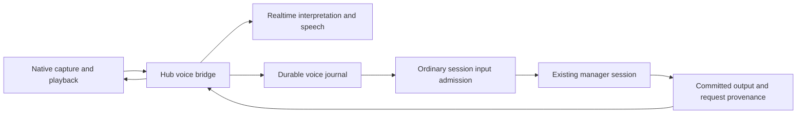
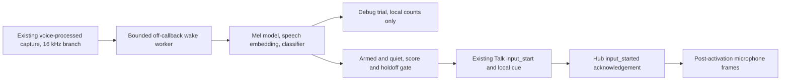

# Voice conversations

The native iOS app can bind voice to an existing live manager session. Voice is
an additional input and presentation channel for that session. The manager keeps
its normal tools, context, typed input and durable transcript.

## Owners

The phone owns microphone processing, local speech and wake detection, immediate output
stopping and played-sample acknowledgements. The hub owns the scoped listening
grant, provider connection, intent journal and speech selection. Ordinary session
admission and the existing manager own execution. The speech provider cannot
choose a target session or execute manager tools.

- [`VoiceService`](../../mobile-native/modules/evener-voice/ios/VoiceService.swift)
  owns native capture and transport outside React component lifetimes.
- [`voiceService`](../../cmd/evener-hub/voice_http.go) binds a device, manager
  instance and listening epoch. Arm requires foreground hub authentication.
  The original daemon must advertise `voicePresentationContextV1` so it can
  preserve speech context alongside the user's next input.
  Arm also requires supported, authoritative conversation provenance for that
  same instance, before issuing a grant or replacing an existing binding. A
  restored legacy manager without that evidence remains usable through typed
  input, with its transcript intact, but cannot arm voice.
  `POST /api/voice/status` answers the same admission checks without binding,
  so the iPhone offers the voice bar only on a session that can arm now. The bar
  answers from that preflight and stays hidden otherwise; an armed binding still
  shows on every session so Talk and Stop keep working. A hub that predates the
  preflight keeps the earlier behavior and still offers the bar.
  The scoped socket grant cannot dispatch general AppWire requests.
- [`voiceBridge`](../../cmd/evener-hub/voice_bridge.go) accepts ordered utterance
  frames, waits for completed interpretation and uses ordinary `turn/start` or
  `turn/steer` admission. It records the immutable interpreted text, mutation
  identity and receipt in the
  [`VoiceJournal`](../../cmd/evener-hub/internal/hubcore/voice_journal.go).
- [`VoiceRealtime`](../../cmd/evener-hub/voice_realtime.go) owns acknowledged
  provider setup, input completion, interpretation, cancellation and truncation.
  Setup cancellation is separate from an established connection's lifetime.

## Speech and interruption

Speech comes from newly committed public `communicate` items or successful,
still-pending `ask_user` items. The hub compares each item's recorded originating
request and consumed-input frontier with the
live session's authoritative provenance. It never assigns current provenance to
an old reply. Arm starts after existing history, without reading backlog aloud.
The transcript remains the authority even when speech is suppressed or stopped.
After that baseline, the bridge follows matching-snapshot history pages back to
its speech cursor, including output committed during playback or reconnect fencing.

Compaction during a model request preserves that request's exact input coverage
when its response is committed. Inputs admitted or incorporated after dispatch
cannot become part of that response's provenance.

Question speech uses the successful executor's canonical public state, including
the full ordered questions and options. The current pending owner must name the
same execution and call. Original tool arguments, navigation previews and legacy
records without canonical state cannot substitute for that source. See
[session questions](session-questions.md) for persistence and compaction ownership.
An unfinished eligible question holds the speech cursor until its canonical
result arrives, so a later message from the same tool batch cannot skip it.
Voice answers remain ordinary, unchanged free-text input. The runtime resolves
its current pending batch through normal admission and idempotent retries.

A `SpeechDelivery` records its canonical source, generation, generated transcript
and per-item generated, queued and played sample counts. Provider completion and
each item's device playback-complete acknowledgement are separate durable facts.
Equal sample counts alone establish neither completion nor human attention.
Retiring a fully rendered delivery preserves its completion evidence; cutting
off unfinished playback records interruption. Provider truncation uses the played
watermark in the provider's 24 kHz sample timeline.

Native playback limits outstanding audio. A physical buffer-drain acknowledgement
releases queue capacity even while the provider is still generating that item.
Cumulative played evidence and provider-gated completion remain intact.
The device accepts the hub's nonempty, even-length PCM16LE packets through 64 KiB
of decoded audio, independently of the outstanding playback limit.

At utterance start, the journal pins the binding's latest presentation identity,
including an explicit absence when nothing has been presented. Preparing the
text intent freezes that delivery's observed wording and playback facts into
the same immutable mutation payload. Late acknowledgements and newer speech
cannot change a retry's evidence or attach another presentation to its words.

Only the hub's journal-backed voice transport may attach those facts. Public
hub input rejects client-supplied presentation evidence. The original daemon
also validates the human actor, input method, instance and payload bounds.
The [session input owner](session-input.md) persists the association and projects
it as separate quoted data in the user message, without changing the user's
text or granting authority to generated speech. A bounded transcript can be
explicitly truncated; sample counts never identify which words the user heard.

Native barge-in retires presentation immediately and preserves the following
utterance while provider cancellation completes. If setup or speech creation is
still awaiting acknowledgement, the bridge closes that provider connection and
opens a fresh one for the queued utterance. The manager's active work continues.
A newer typed admission also retires stale speech before a fresh reply exists.
Delayed old audio and output from a request that did not consume the correction
cannot become the new reply.

If a reply arrives while native audio is recovering, the phone retires that
incoming speech generation with no played samples and stays in recovery. The hub
cancels that presentation, so fresh spoken updates can proceed after recovery
without another user input. The cancelled reply remains in the canonical
transcript and is not replayed when capture resumes.

An explicit session Stop or definitive input-preparation failure stops requiring
an admitted input only when it never reached canonical history. Inputs
recorded before interruption or failure remain required across compaction and
restore. Accepted or unsettled inputs continue to fence stale replies.

Separately, an accepted session Stop from any authenticated client retires
unfinished speech owned by the interrupted execution and suppresses its pending
canonical sources. The bridge matches the source item's execution `TurnID`, not
the provenance run or audio generation. Matching history notifications retire
speech even while provider setup awaits acknowledgement; authoritative reads
also apply interruption before selecting more speech. Relay resync and changed
history identities demand an authoritative refresh that does not wait for
provider setup or block ordinary speech work. These hints alone never silence
speech; the refreshed bound-instance history must prove the interruption.
Terminal evidence remains
in force across stale reads. Fully rendered deliveries retain completion evidence,
and canonical replies and recorded input remain unchanged. This is not global
silence: Stop does not target another execution's speech or change idle-Stop
admission. Ordinary completed executions remain eligible for speech, including
pending output on older history pages. Failure alone is not an interruption.

Disconnect aborts incomplete audio input. Journaled text intents and receipts
remain durable. Disarm and takeover retire the listening binding without
cancelling accepted manager work. A session-instance change requires a new
explicit binding rather than sending to a replacement manager automatically.

The authenticated native connection renews its scoped grant while its binding
and original manager instance remain valid. Renewal preserves the device,
session, epoch and grant identity and replaces the live expiry timer. A retired
or expired grant cannot renew itself. Each connection waits for the previous
bridge to finish, then advertises a generation at least as high as every durable
speech delivery, including interrupted deliveries. The phone acknowledges every
`ready` with its retained playback fence through `interrupt`, including fresh Arm.
The hub reconciles that fence without lowering the durable floor and replies with
`stop` before starting cloud input or selecting fresh speech. Output committed
while the acknowledgement is in flight remains eligible; old speech is not
replayed and the manager's conversation is unchanged.

Reconnect also scans the binding's durable text intents. A prepared intent can
dispatch under its still-valid grant. An attempted intent first requires an
authoritative read of its original manager instance, then replays its exact
stored method, payload and mutation identity through ordinary admission. The
daemon returns the original receipt if it already accepted the request. Recovery
records that receipt without interpreting the audio again or duplicating the
user input. Accepted intents are not dispatched again. Retired bindings and
replacement instances keep unresolved text in the journal for explicit recovery.
Only a definitive refusal stamped by the daemon's mutation journal settles an
intent as `rejected`. Its text and original target remain durable, and reconnect
reports the refusal without replaying it or blocking other intents. Resubmitting
that text requires explicit new input with a new identity. Transport failures and
unstamped refusals remain uncertain, and public rejected-intent retry rules do
not change.

Deleting a local session, directly or with its project, removes its voice
bindings, turns, text intents and speech deliveries. The shared session-deletion
owner opens an existing journal even when this hub process has not used voice.
Cleanup failures remain retryable through ordinary deletion, and a refused
deletion preserves the journal records.

A missing history row does not prove deletion. Live or uncertain ownership,
unreadable metadata and held API-log reservations preserve voice records and
other session decisions. A prior deletion's tombstone permits cleanup to retry
in the original history bucket. Confirmed absence permits orphan-decision
cleanup. Ordinary deletion works again when the blocking condition clears.

## Client and qualification boundaries

Voice controls are native iOS controls; browser and ordinary text input retain
their existing owners. The native module exposes Talk, Stop speaking and a local
openWakeWord detector. The shipped default is the custom **Hey Evener.**
classifier at threshold **0.99**, not pretrained Alexa. The model is integrated,
not physically qualified. Attached presentation evidence supports
references such as "the second one"; model
reference-resolution quality requires a separate live qualification.

The replaceable [`WakeWordDetecting`](../../mobile-native/modules/evener-voice/core/WakeWordDetector.swift)
boundary consumes mono 16 kHz samples. The ONNX implementation uses 80 ms
embedding strides, configured batch hops, threshold, release threshold and
holdoff. The custom default uses 1280-sample hops, 16 embedding frames and a
2500 ms holdoff. A release threshold of 0.5 requires a clear score drop before
rearming, avoiding repeated detections from fluctuations near 0.99. It does not
lower the detection threshold. Inference runs on a separate bounded queue, never on the audio tap or
AEC graph. Startup and dropped audio require fresh context. Quiet audio stays
on the device; there are no hub wake predictions or pre-activation cloud frames.
A detection in armed quiet state enters the same controller and socket path as
Talk, updates the local heard-wake score and gives the same cue. Speak the
request after the cue. Existing VAD follow-up and interruption rules are unchanged.

Open **Voice → Test wake word**, turn voice on, then start a test. Wait for
**Listening**, play or speak the trial audio, and mark **Intended**, **Background**
or **False alarm**. Intended means an intended wake, including a miss.
Trials suppress conversation activation and Talk, count every debounced detection,
show scores and scored-audio duration, and retain per-attempt model/settings on
the phone. Native UserDefaults owns persistence through JS suspension; no PCM is
stored. Detections and labels save immediately; ongoing duration checkpoints
every five seconds. A process restart marks an unfinished attempt interrupted,
never counts downtime, and excludes it from qualification totals.

Counters keep different model/settings cohorts separate. The targets remain
**at least 60 intended trials, at least 95% detection, and 30 hours of negative
audio**. Warmup, unavailable capture and dropped frames do not count as scored
time. These counters are a harness, not proof that those gates were met. Actual
Swift/ONNX tests use committed spoken positive and negative WAVs; neither they
nor JS replay tests establish physical-phone acoustic accuracy or battery life.

The trainer's [offline held-out report](../../mobile-native/modules/evener-voice/tools/wake-word/results/evaluation.json)
records **598/600 positives (99.67%)** and **zero false accepts over 2.09 h of
negatives** at 0.99. Positive speech is synthetic Piper output with
speaker-disjoint training/calibration/test splits, not human wake recordings.
Negatives combine Piper confusers, real LibriSpeech speech and procedural noise.
The exact negative duration is 2.089803 h, not the required 30 h. On m5max,
Swift/ONNX 1.20.0 detected the committed custom WAV once (peak 0.9999996) and
the negative WAV zero times (peak 0.0004506111), without changing 0.99.
The ≥60 physical trials, ≥95% detection, 30 h negatives, microphone/AEC,
locked-duration and battery gates remain open.

Model paths and checksums come from a packaged manifest, not a hardcoded training
artifact location. The [native module's model-swap procedure](../../mobile-native/modules/evener-voice/README.md#swapping-the-wake-model)
copies a selected local classifier into the resource bundle without moving or
rewriting the training lane's artifact. From `mobile-native`, run
`node modules/evener-voice/ensure-model.mjs --wake-manifest /absolute/custom-wake.json`,
then rebuild through the normal pod/prebuild flow. With no option, postinstall
selects `wake-models.custom.json` and its paired feature models. CocoaPods bundles
only the selected models and notices, not unused pretrained ONNX copies.
`wake-models.pretrained.json` remains an optional CC BY-NC-SA 4.0 Alexa preview.

The real-stack tests in
[`e2e_voice_arm_provenance_test.go`](../../cmd/evener-hub/e2e_voice_arm_provenance_test.go),
[`voice_http_test.go`](../../cmd/evener-hub/voice_http_test.go),
[`e2e_voice_stop_test.go`](../../cmd/evener-hub/e2e_voice_stop_test.go),
[`e2e_voice_test.go`](../../cmd/evener-hub/e2e_voice_test.go),
[`e2e_voice_correction_test.go`](../../cmd/evener-hub/e2e_voice_correction_test.go),
[`e2e_voice_barge_test.go`](../../cmd/evener-hub/e2e_voice_barge_test.go),
[`e2e_voice_questions_test.go`](../../cmd/evener-hub/e2e_voice_questions_test.go),
[`e2e_voice_question_order_test.go`](../../cmd/evener-hub/e2e_voice_question_order_test.go),
[`e2e_voice_history_test.go`](../../cmd/evener-hub/e2e_voice_history_test.go),
[`e2e_voice_presentation_test.go`](../../cmd/evener-hub/e2e_voice_presentation_test.go),
[`e2e_voice_audio_recovery_test.go`](../../cmd/evener-hub/e2e_voice_audio_recovery_test.go),
[`e2e_voice_recovery_test.go`](../../cmd/evener-hub/e2e_voice_recovery_test.go)
and [`e2e_voice_intent_recovery_test.go`](../../cmd/evener-hub/e2e_voice_intent_recovery_test.go)
exercise real hub, daemon, journal and transcript paths with scripted external
provider/device boundaries. They do not qualify microphone initialization,
echo cancellation, audible stopping, locked-phone lifetime or battery use.
Those require physical iPhone testing, not a Swift compile or protocol fixture.
