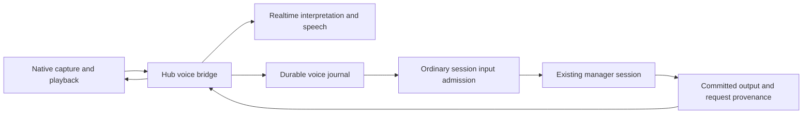

# Voice conversations

The native iOS app can bind voice to an existing live manager session. Voice is
an additional input and presentation channel for that session. The manager keeps
its normal tools, context, typed input and durable transcript.

## Owners

The phone owns microphone processing, local speech detection, immediate output
stopping and played-sample acknowledgements. The hub owns the scoped listening
grant, provider connection, intent journal and speech selection. Ordinary session
admission and the existing manager own execution. The speech provider cannot
choose a target session or execute manager tools.

- [`VoiceService`](../../mobile-native/modules/evener-voice/ios/VoiceService.swift)
  owns native capture and transport outside React component lifetimes.
- [`voiceService`](../../cmd/evener-hub/voice_http.go) binds a device, manager
  instance and listening epoch. Arm requires foreground hub authentication.
  The scoped socket grant cannot dispatch general AppWire requests.
- [`voiceBridge`](../../cmd/evener-hub/voice_bridge.go) accepts ordered utterance
  frames, waits for completed interpretation and uses ordinary `turn/start` or
  `turn/steer` admission. It records the immutable interpreted text, mutation
  identity and receipt in the
  [`VoiceJournal`](../../cmd/evener-hub/internal/hubcore/voice_journal.go).
- [`VoiceRealtime`](../../cmd/evener-hub/voice_realtime.go) owns acknowledged
  provider setup, input completion, interpretation, cancellation and truncation.
  Setup cancellation is separate from an established connection's lifetime.

## Speech and interruption

Speech comes from newly committed public `communicate` items. The hub compares
that item's recorded originating request and consumed-input frontier with the
live session's authoritative provenance. It never assigns current provenance to
an old reply. Arm starts after existing history, without reading backlog aloud.
The transcript remains the authority even when speech is suppressed or stopped.

A `SpeechDelivery` records its canonical source, generation, generated transcript
and per-item generated, queued and played sample counts. Generated audio is not
proof that the phone played it. Provider truncation uses the played watermark in
the provider's 24 kHz sample timeline.

Native barge-in retires presentation immediately and preserves the following
utterance while provider cancellation completes. If setup or speech creation is
still awaiting acknowledgement, the bridge closes that provider connection and
opens a fresh one for the queued utterance. The manager's active work continues.
A newer typed admission also retires stale speech before a fresh reply exists.
Delayed old audio and output from a request that did not consume the correction
cannot become the new reply.

Disconnect aborts incomplete audio input. Journaled text intents and receipts
remain durable. Disarm and takeover retire the listening binding without
cancelling accepted manager work. A session-instance change requires a new
explicit binding rather than sending to a replacement manager automatically.

The authenticated native connection renews its scoped grant while its binding
and original manager instance remain valid. Renewal preserves the device,
session, epoch and grant identity and replaces the live expiry timer. A retired
or expired grant cannot renew itself. Reconnect synchronizes the bridge to the
phone's retained playback fence before fresh output, without replaying old speech
or replacing the manager's conversation.

## Client and qualification boundaries

Voice controls are native iOS controls; browser and ordinary text input retain
their existing owners. The native module exposes Talk and Stop speaking. Wake
recognition is unavailable until a shipping detector is qualified. Spoken
`ask_user` questions require canonical successful question state and exact pending
call identity; arbitrary tool arguments are never a speech source.

The real-stack tests in
[`e2e_voice_test.go`](../../cmd/evener-hub/e2e_voice_test.go),
[`e2e_voice_correction_test.go`](../../cmd/evener-hub/e2e_voice_correction_test.go),
[`e2e_voice_barge_test.go`](../../cmd/evener-hub/e2e_voice_barge_test.go)
and [`e2e_voice_recovery_test.go`](../../cmd/evener-hub/e2e_voice_recovery_test.go)
exercise real hub, daemon, journal and transcript paths with scripted external
provider/device boundaries. They do not qualify microphone initialization,
echo cancellation, audible stopping, locked-phone lifetime or battery use.
Those require physical iPhone testing, not a Swift compile or protocol fixture.
