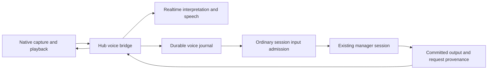

# Voice conversations

The native iOS app can bind voice to an existing live manager session. Voice is
an additional input and presentation channel for that session. The manager keeps
its normal tools, context, typed input and durable transcript.

## Owners

The phone owns microphone processing, local speech detection, immediate output
stopping and played-sample acknowledgements. The hub owns the scoped listening
grant, provider connection, intent journal and speech selection. Ordinary session
admission and the existing manager own execution. The speech provider cannot
choose a target session or execute manager tools.

- [`VoiceService`](../../mobile-native/modules/evener-voice/ios/VoiceService.swift)
  owns native capture and transport outside React component lifetimes.
- [`voiceService`](../../cmd/evener-hub/voice_http.go) binds a device, manager
  instance and listening epoch. Arm requires foreground hub authentication.
  The original daemon must advertise `voicePresentationContextV1` so it can
  preserve speech context alongside the user's next input.
  The scoped socket grant cannot dispatch general AppWire requests.
- [`voiceBridge`](../../cmd/evener-hub/voice_bridge.go) accepts ordered utterance
  frames, waits for completed interpretation and uses ordinary `turn/start` or
  `turn/steer` admission. It records the immutable interpreted text, mutation
  identity and receipt in the
  [`VoiceJournal`](../../cmd/evener-hub/internal/hubcore/voice_journal.go).
- [`VoiceRealtime`](../../cmd/evener-hub/voice_realtime.go) owns acknowledged
  provider setup, input completion, interpretation, cancellation and truncation.
  Setup cancellation is separate from an established connection's lifetime.

## Speech and interruption

Speech comes from newly committed public `communicate` items or successful,
still-pending `ask_user` items. The hub compares each item's recorded originating
request and consumed-input frontier with the
live session's authoritative provenance. It never assigns current provenance to
an old reply. Arm starts after existing history, without reading backlog aloud.
The transcript remains the authority even when speech is suppressed or stopped.

Question speech uses the successful executor's canonical public state, including
the full ordered questions and options. The current pending owner must name the
same execution and call. Original tool arguments, navigation previews and legacy
records without canonical state cannot substitute for that source. See
[session questions](session-questions.md) for persistence and compaction ownership.
Voice answers remain ordinary, unchanged free-text input. The runtime resolves
its current pending batch through normal admission and idempotent retries.

A `SpeechDelivery` records its canonical source, generation, generated transcript
and per-item generated, queued and played sample counts. Provider completion and
each item's device playback-complete acknowledgement are separate durable facts.
Equal sample counts alone establish neither completion nor human attention.
Retiring a fully rendered delivery preserves its completion evidence; cutting
off unfinished playback records interruption. Provider truncation uses the played
watermark in the provider's 24 kHz sample timeline.

At utterance start, the journal pins the binding's latest presentation identity,
including an explicit absence when nothing has been presented. Preparing the
text intent freezes that delivery's observed wording and playback facts into
the same immutable mutation payload. Late acknowledgements and newer speech
cannot change a retry's evidence or attach another presentation to its words.

Only the hub's journal-backed voice transport may attach those facts. Public
hub input rejects client-supplied presentation evidence. The original daemon
also validates the human actor, input method, instance and payload bounds.
The [session input owner](session-input.md) persists the association and projects
it as separate quoted data in the user message, without changing the user's
text or granting authority to generated speech. A bounded transcript can be
explicitly truncated; sample counts never identify which words the user heard.

Native barge-in retires presentation immediately and preserves the following
utterance while provider cancellation completes. If setup or speech creation is
still awaiting acknowledgement, the bridge closes that provider connection and
opens a fresh one for the queued utterance. The manager's active work continues.
A newer typed admission also retires stale speech before a fresh reply exists.
Delayed old audio and output from a request that did not consume the correction
cannot become the new reply.

Disconnect aborts incomplete audio input. Journaled text intents and receipts
remain durable. Disarm and takeover retire the listening binding without
cancelling accepted manager work. A session-instance change requires a new
explicit binding rather than sending to a replacement manager automatically.

The authenticated native connection renews its scoped grant while its binding
and original manager instance remain valid. Renewal preserves the device,
session, epoch and grant identity and replaces the live expiry timer. A retired
or expired grant cannot renew itself. Each connection waits for the previous
bridge to finish, then advertises a generation at least as high as every durable
speech delivery, including interrupted deliveries. The phone acknowledges every
`ready` with its retained playback fence through `interrupt`, including fresh Arm.
The hub reconciles that fence without lowering the durable floor and replies with
`stop` before starting cloud input or selecting fresh speech. Output committed
while the acknowledgement is in flight remains eligible; old speech is not
replayed and the manager's conversation is unchanged.

Reconnect also scans the binding's durable text intents. A prepared intent can
dispatch under its still-valid grant. An attempted intent first requires an
authoritative read of its original manager instance, then replays its exact
stored method, payload and mutation identity through ordinary admission. The
daemon returns the original receipt if it already accepted the request. Recovery
records that receipt without interpreting the audio again or duplicating the
user input. Accepted intents are not dispatched again. Retired bindings and
replacement instances keep unresolved text in the journal for explicit recovery.

Deleting a local session, directly or with its project, removes its voice
bindings, turns, text intents and speech deliveries. The shared session-deletion
owner opens an existing journal even when this hub process has not used voice.
Cleanup failures remain retryable through ordinary deletion, and a refused
deletion preserves the journal records.

A missing history row does not prove deletion. Live or uncertain ownership,
unreadable metadata and held API-log reservations preserve voice records and
other session decisions. A prior deletion's tombstone permits cleanup to retry
in the original history bucket. Confirmed absence permits orphan-decision
cleanup. Ordinary deletion works again when the blocking condition clears.

## Client and qualification boundaries

Voice controls are native iOS controls; browser and ordinary text input retain
their existing owners. The native module exposes Talk and Stop speaking. Wake
recognition is unavailable until a shipping detector is qualified. Attached
presentation evidence supports references such as "the second one"; model
reference-resolution quality requires a separate live qualification.

The real-stack tests in
[`e2e_voice_test.go`](../../cmd/evener-hub/e2e_voice_test.go),
[`e2e_voice_correction_test.go`](../../cmd/evener-hub/e2e_voice_correction_test.go),
[`e2e_voice_barge_test.go`](../../cmd/evener-hub/e2e_voice_barge_test.go),
[`e2e_voice_questions_test.go`](../../cmd/evener-hub/e2e_voice_questions_test.go),
[`e2e_voice_presentation_test.go`](../../cmd/evener-hub/e2e_voice_presentation_test.go),
[`e2e_voice_recovery_test.go`](../../cmd/evener-hub/e2e_voice_recovery_test.go)
and [`e2e_voice_intent_recovery_test.go`](../../cmd/evener-hub/e2e_voice_intent_recovery_test.go)
exercise real hub, daemon, journal and transcript paths with scripted external
provider/device boundaries. They do not qualify microphone initialization,
echo cancellation, audible stopping, locked-phone lifetime or battery use.
Those require physical iPhone testing, not a Swift compile or protocol fixture.
