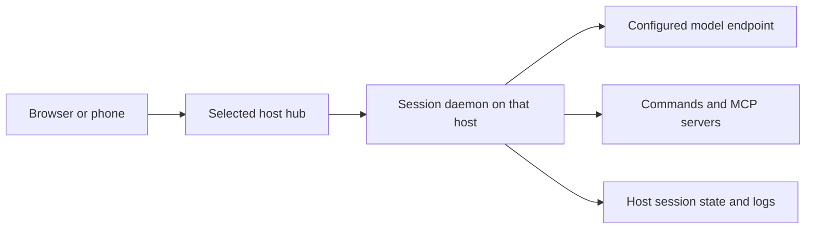

# Security, privacy, and storage

Evener can run commands with your account's access. Sandboxing is off by default. Before giving a session sensitive work, choose its host, provider, sandbox, and extensions deliberately. A prompt asking the agent to be careful is not an access boundary.

## Know where data goes

The selected host runs the session and stores its state. Model requests can include prompts, conversation history, tool results, source files, and images. Tools and MCP servers have their own destinations and access. Using a local model does not make network-enabled tools local-only.

Evener's sandbox controls the tool plane; it does not prevent the daemon from contacting the model provider. `EVENER_OFFLINE=1` disables catalog refresh, not model requests or all networking. Provider-side retention, training, and account policies are the provider's responsibility. Review those policies for the endpoint you actually use, including gateways and proxies.

## Protect access

- Keep API keys in the provider connection form, credential store, or a securely supplied process environment. Never put them in prompts, screenshots, shell arguments, shared launch TOML, or ordinary headers.
- Treat `credentials.toml`, OAuth records, hub authorization URLs, cookies, and rendezvous files as secrets. Credential and new token files are written with mode `0600`; do not assume an existing hub token file's permissions are repaired automatically.
- The hub capability grants full hub access. It is not a per-user authorization system. Keep the listener on loopback or behind an encrypted, access-controlled connection. Follow [remote access](evener-hub-remote-operations.md).
- Review credential command expressions before saving them. They execute shell code as the Evener process. Their stdout becomes a credential, but failure diagnostics can contain their stderr; a helper must not print secrets there.
- Review repository launch settings, plugins, hooks, and MCP servers before enabling them. Repository launch trust is not a blanket security audit of extension code.

If a credential leaks, revoke or rotate it with its issuer first, then replace it in Evener. Deleting a local copy does not revoke access. Do not delete the whole state directory to repair authentication.

## Choose a sandbox

Use `read-only` for review, `workspace-write` for code changes, or `restricted` to narrow reads as well. Pair a non-off mode with network off when tools do not need network access. Check the startup report for the backend and actual policy. See [Sandboxing](sandboxing.md) for platform limits, secret-path masking, cache behavior, and the degraded read-only delegate exception.

**`read-only` and `workspace-write` do not hide all Evener credentials.** The
standard denylist masks Evener's config root, not its default state root,
`${XDG_STATE_HOME:-$HOME/.local/state}/evener`. OAuth records under `auth/`, the
hub's `auth-token`, and secrets in `run/` may therefore be readable by a session
running as the same user. Mode `0600` does not prevent that user's own processes
from reading a file. `--sandbox-net off` does not stop file-tool reads or keep
read content out of model context. `restricted` excludes the state root only
when it lies outside the session's granted read roots; inspect the effective
paths and grants before relying on that boundary.

Sandboxing does not protect against other processes running as your user. It also cannot retract data already sent to a provider, erase earlier conversation, or make an allowed command harmless. An unsandboxed shell retains its normal filesystem access even if a particular tool is unavailable.

## Storage and backups

The default config root is `${XDG_CONFIG_HOME:-$HOME/.config}/evener`; the default state root is `${XDG_STATE_HOME:-$HOME/.local/state}/evener`. Overrides can move individual stores. Inventory the effective paths before copying anything.

| Data | Default location | Backup implication |
| --- | --- | --- |
| Provider, launch, hub, extension configuration | Config root | Preserve authored settings and referenced files |
| API keys | `credentials.toml` in config root | Encrypt backups and restrict readers |
| OAuth records | State root `auth/` | Sensitive refresh credentials, may need fresh sign-in on restore |
| Hub capability | State root `auth-token` | A copied token grants access, treat backup as a credential |
| Saved sessions and project state | State root `projects/` | Preserve full project buckets, not just rendered transcripts |
| Personal/project memory | Under the owning host's state root | Include it if you expect restored sessions to retain memory |
| Search index | State root `index.db` | An index is not the transcript source |
| Runtime discovery and daemon logs | State root `run/` | Can contain bearer tokens, not a portable running-session checkpoint |
| Repository changes and worktrees | Repository and managed worktree paths | Back up separately from configuration |

There is no verified one-command, transactional backup/restore procedure documented here. Copying a live state directory is **not** guaranteed consistent: daemons can still append transcripts and mutate state while the hub is stopped. A filesystem copy cannot preserve running processes, open connections, or detached external jobs.

For a conservative maintenance backup:

1. Record the build version, selected hosts, effective config/state paths, and repository/worktree locations. Do not record secret values in the inventory.
2. Finish or stop active sessions and their owned jobs. Check remote hosts too. Stop the hub through its supervisor and prevent automatic restart while copying.
3. Make a private, encrypted backup of configuration, durable state, referenced extension content, and repositories. Preserve permissions. Follow the backup tool's consistency procedure for SQLite files; do not copy only the main database while ignoring live sidecars.
4. Verify the backup by restoring to an isolated location with no production listeners or provider credentials active. Check files and saved-session readability before considering a production restore.

Restoring old state over newer state can lose work or reintroduce credentials and authorization tokens. Preserve both copies, stop writers, and investigate the specific damaged store rather than overlaying a backup blindly. Do not infer that every older binary can read state written by a newer one.

## Share diagnostics safely

API logging is off by default. Enabling `api_log` or `--api-log on` records full provider request and response bodies in session `.api.jsonl` files. This can include private source, prompts, tool results, and provider handles. Turning logging off stops future recording; it does not remove existing logs.

Start with metadata, timestamps, build identifiers, and the smallest failing command. Inspect diagnostic output locally before sharing it. Redacted credential fields do not imply that every error, URL, custom header, transcript, or third-party stderr is safe. Hub startup logs include an authorization URL and must remain private.

See [Troubleshooting](troubleshooting.md) for read-only checks and [hub upgrades](evener-hub.md#upgrading-and-migrating-safely) for maintenance steps.
