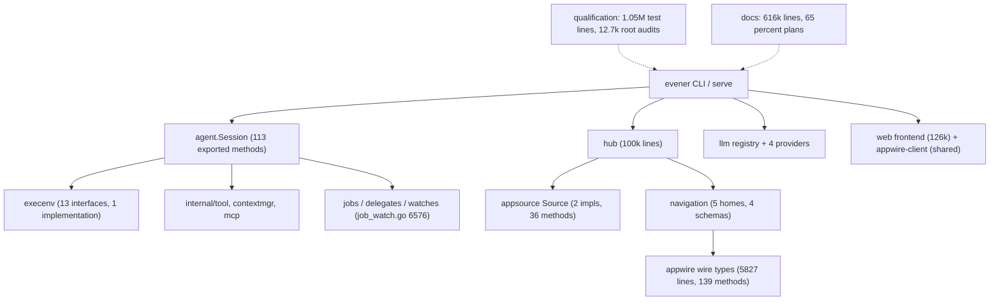

# Codebase simplification audit — 2026-11-08

Read-only audit of the whole tree at `bda81868e5`, done by one session plus nine
read-only sub-audits (agent core, agent background work, execenv/sandbox,
llm+small modules, hub, CLI/internal, web frontend, shared clients, meta layer).
Eight delivered reports; the ninth (meta layer) ran long and its numbers below
were re-verified directly instead.
Nothing was edited except this file. Every path below was opened; counts come
from `git ls-files`/`wc`, `golangci-lint` (`gocyclo`, `dupl`),
`golang.org/x/tools/cmd/deadcode`, and brace-aware function-length measurement.

Every `file:line` reference below is a line number at `bda81868e5`. The Tier 1
and Tier 2 fixes have since landed, so those numbers have drifted: read each one
as "the symbol named in this sentence, somewhere near this line." Symbol names,
not line numbers, are the stable part of the citations.

## The answer in one paragraph

The codebase is **verbose rather than bloated**. Unreachable code is under 1% of
the production tree; the real cost is duplication (229 copy-paste pairs at a
60-line threshold), a handful of very large functions and files, one concern
implemented four times (navigation schema), and a qualification layer that is
larger and more self-referential than the product it guards. You can remove a
few thousand lines with no behavior change, and you can remove far more by
consolidating duplication rather than deleting features. The three places where
duplication is a **correctness** risk, not just a tidiness one: sandbox path
containment, denial redaction, and the two token/effort derivation walks in the
provider registry.

## Measured weight

| Area | Non-test lines | Test lines | Tests as share |
| --- | --- | --- | --- |
| Go, all modules | 384,171 | 1,052,479 | 73% |
| `agent` module | 173,140 | 531,360 | 75% |
| `cmd/evener-hub` | 100,314 | 270,566 | 73% |
| web frontend (`src`) | 125,803 | 272,763 | 68% |
| `llm` | 29,577 | 64,276 | 68% |
| Markdown, all | 615,622 | — | — |
| `docs/superpowers` | 522,157 | — | 85% of all Markdown |
| `docs/superpowers/plans` | 401,038 | — | 65% of all Markdown |

- 4,384 tracked Go files in 157 packages across 9 workspace modules; 109
  packages hold two files or fewer, 300 non-test Go files are under 60 lines.
- `gocyclo` finds 155 functions above complexity 30, 49 of them in
  `cmd/evener-hub`.
- 1,459 Markdown files. 1,080 under `docs/`; `docs-site/publication.json` lists
  31 entries.
- 22,653 Go test functions, 565 fuzz targets, 4,168 committed fuzz seed files
  (2,327 of them for one target).

## Findings, highest value first

Each finding names the change, the evidence, the risk, and the delta. Deltas are
line counts from the files named, not estimates of unrelated cleanup.

### Tier 1 — duplication that can rot into a correctness bug

**F1. Path containment is implemented three times, and denial redaction twice.**
`agent/sandbox/gitdir.go:627` (`pathUnder`) and `agent/execenv/securepath.go:497`
are the same algorithm; `agent/execenv/local.go:3489` (`pathWithinRoot`) is a
third variant that adds symlink resolution. Redaction lives twice:
`agent/execenv/audit.go:41` (`redactAuditPath`) and `agent/sandbox/denial.go:151`
(`(*DeniedError).Redacted`) make the same masked/protected decision, one from a
`Sensitive` flag and one from a reason string. These gate every file tool.
**Change:** export one containment predicate from `sandbox` (the lower layer,
already imported by `execenv`) and build the `DeniedError` first so the audit
record uses `Redacted()`. **Risk:** medium — keep
`execenv/securepath_test.go`, `dead_sandbox_root_test.go`, `sandbox/gitdir_test.go`
green and add one case proving the audit record and `Redacted()` agree.
**Delta:** −25 lines, two security rules instead of four.

**F2. The provider registry walks the same layer ordering twice.**
`llm/registry/resolve.go:872` (`resolveLayersModeLive`, complexity 63) and
`:1376` (`modelDisabled`, 85 lines) each rebuild the tag order, the
missing-tags-before-this-layer prologue, and the trailing catch-up loop; the
second's own comment says it mirrors the first. `AuthFingerprint`
(`llm/registry/instances.go:526`, complexity 43) hand-copies
`credentialWithAuth`'s precedence for the same reason.
**Change:** one `replayOrdered` iterator used by all three. **Risk:**
medium-high — ordering decides which model a session launches with; land it
alone behind the registry tests. **Delta:** −90 to −120 lines and two
complexity-40+ functions become projections.

**F3. The navigation graph schema exists four times.**
`hubapi/navigation_delta.go:120` (`NavigationSnapshot.Validate`, 110 lines) and
`appwire-client/typescript/state/navigation/codec.ts:690` walk the same graph
with the same four limits, defined as constants in both:
`maxNavigationSessionEntities = 2_000` / `MAX_NAVIGATION_SESSION_ENTITIES = 2000`.
`cmd/evener-hub/navigation_schema.go` re-checks entity identity, slots and parent
counts after calling it. **Change:** keep the hub's projection as the single
authority, keep the client's decode checks, and drop the second graph walk plus
the duplicated bounds. **Risk:** medium — a malformed hub would render a bad
tree instead of producing a clean client error; prove every emission path calls
the hub validator first (6 call sites). **Delta:** −250 to −400 Go, −200 to −350
TypeScript.

### Tier 2 — large functions and files that hide their seams

**F4. `newHubRelayFunctions` is 1,806 lines in one function.**
`cmd/evener-hub/app_relay.go:462`. It is 27 nested closures plus a nine-field
return struct; `hubRelayFunctions` (`:356`) exists only to hand those closures
to `registerThreadHandlers`. **Change (no behavior change):** turn it into a
`hubRelay` struct with methods and one constructor per concern group (relay
start/stop, thread read, turn start, publication). Keep
`observeHubRelayFunctions` (`:368`) as the test seam. **Risk:** low — same
package, no API movement; `app_relay*_test.go` pins behavior. **Delta:** 0 lines,
one 1,806-line function becomes ~12 methods.

**F5. `runServeWithDeps` is 1,585 lines in one function.**
`cmd/evener/serve.go:396`, verified concern by concern: flags (397–449), plugin
resolve (463–530), work/state dirs (531–577), resume and model ref (578–621),
client/profile (622–653), `SessionConfig` literal (654–717), sandbox (718–740),
session create/restore (741–790), server bind (791–836), identity (838–905),
retirement controller and two RPCs (906–1178), drain teardown (1180–1314),
`bridgeSession` (1315–1470), server callbacks and thread/clear (1471–1721),
input loop (1761–1888), shutdown (1890–1984). **Change:** extract
`setupRetirement`, `bindServerCallbacks`, and a named `bridgeSession` method.
Target under 400 lines. **Risk:** medium — the closures capture about a dozen
locals and `serve_retirement_test.go` (1,677 lines) pins ordering. **Delta:** 0
lines, large readability win.

**F6. `job_watch.go` is 6,576 lines holding 18 concerns; nine of them touch
neither configure nor observe.**
Projections 2,361–3,278; output feed 3,572–3,835; expiry and timers 3,836–4,166;
send recording 4,167–4,563; delivery receipts 4,564–5,132; pending persistence
5,133–5,702; drain/drive-down 5,703–6,249; frame rendering 6,250–6,576.
**Change:** split by those boundaries into `_projection`, `_delivery`,
`_persist`, `_drain`, `_frame`. Value types already cross the boundary.
**Risk:** low (mechanical move). **Delta:** 0 lines, 1 file → 5.

**F7. `session_lifecycle.go` is 3,370 lines and 40% comments, with three
self-contained concerns.**
Env-work admission/fence (`:204–407`), transcript-refusal classifier
(`:1730–1900`), and the job-notification drain/classify/mark pipeline
(`:2890–3370`, whose pure cores `classifyDurableNotifications` and
`filterDeliverableJobNotifications` already stand alone). `processOneInput` is
663 lines, `processInputKindWithProvenance` 582, `releaseRuntimeOnce` 361.
**Change:** move the three blocks to their own files; the file becomes the turn
loop. **Risk:** low. **Delta:** 0 lines, 1 file → 4.

**F8. `session.go`'s `Session` type is 1,014 lines and 273 fields, 113 of them
exported methods; 24 exported methods have no caller outside the package.**
Examples: `CommunicateOutput`, `ContextPressure`, `DrainJobTreeKeepingReport`,
`RegisterTool`, `RestingWireState`, `SteerFromUser`, `SubagentTally`.
**Change:** unexport the 24, or mark them as test affordances. **Risk:** low —
`go build` across `cmd/` proves it; six `agent_test` files may need updates.
**Delta:** −0 lines, 113 → 89 exported methods.

**F9. `agent/execenv` declares 13 interfaces over one production
implementation.** `*LocalExecutionEnvironment` is the only real implementer;
every other implementer is a test double. The three budget capabilities
(`GlobExcluder`, `GlobBudgeter`, `DirListBudgeter`) are each type-asserted at
exactly one place: `agent/session_tools_shell.go:228,282,286`. **Change:**
collapse the three budget interfaces into one, or into `ExecutionEnvironment`.
Leave the other nine: each marks a real optional capability across a package
boundary. **Risk:** low — the `default:` fallbacks already handle doubles.
**Delta:** −30 lines, −2 interfaces.

### Tier 3 — dead and test-only code

**F10. 500 lines of test harness live in a production package.**
`agent/sandbox/contract.go` has no build tag, exports `ContractCases`,
`AssertResolve`, `MaterializeWorkspace`, `ReRootCases`, `AssertReRoot` and five
more, and has **no non-test consumer anywhere** (`TestingT` is referenced only
inside the file). `agent/sandbox` is a dependency of `cmd/evener`, so it is
compiled into the product. Go's linker discards the unreachable functions, so
this costs build and vet time rather than bytes in the shipped executable.
**Change:** move it to `agent/sandbox/sandboxcontract`
alongside the existing `sandboxtest`, or to `contract_test.go` plus a small
support package for the four cross-package callers. **Risk:** medium (import-path
updates only). **Delta:** −500 lines of test-only source out of the
`agent/sandbox` package, −9 exported symbols.

**F11. `execenv`'s file-tool audit path is never wired.** `agent/execenv/audit.go`
defines `auditSink`, which only tests ever assign; its comment still claims the
wiring arrives "when --sandbox goes live". The feature exists and is dead.
**Change:** either wire it at session start (then assert one record per denial)
or delete `audit.go` and the `auditDenial` call. Deletion is behavior-neutral: a
nil sink is already a no-op in production. **Risk:** low (delete) / medium
(wire). **Delta:** −52 lines.

**F12. Test-only clusters with `//nolint:unused` markers naming their fuzz
owners.** 18 such markers exist. The largest cluster: `agent/jobs.go` carries 278
lines of shell/output construction that production never calls (`createShell`,
`readOutputHead`, `grepOutput`, `outputDropped`, `abandonRunningJob`,
`noteJobActivity`, `liveWorkHandles`, `finalizeWithRunNoNotification`), while
`job_shell.go:512` (`newDelayedShell`) rebuilds the same 16-field record literal.
Also dead: `jobstore`'s whole path-based output-snapshot API
(`ReadOutputSnapshot`, `ReadOutputWindowSnapshot`, `ReadOutputPageSnapshot` and
13 private helpers, 261 lines — production uses only the `*FromFile` variants),
and the legacy in-process `spawnAgent`/`sendInput`/`cancelAgent` API in
`agent/subagents.go` (≈174 lines; the delegate tool routes to
`prepareStableDelegateRun`). **Change:** delete or move each into its tagged test
file. **Risk:** medium — many tests drive their scenarios through these, so it is
a test migration. **Delta:** −700 to −800 lines.

**F13. Whole-tree deadcode: 286 unreachable symbols, 17 with no reference at
all.** Representative: `agent.CloseStopJoinBudget`, `llm.BuildAPILogCredentialMaterial`,
`llm/providers/anthropic.clampEffort`, `hubapi.Client` (a REST client with no
production caller), `internal/devtool/gatesurface` (a 26-line Go mirror of a
shell constant with zero importers, guarded by its own drift test),
`agent/internal/jobstore.NewJobID`, `atif.Convert`, `foldcache.Cache.Stats`.
**Change:** delete the 17 outright; for the rest decide per symbol whether a test
should keep importing it or the production path should be used instead.
**Risk:** low individually. **Delta:** −250 lines plus the 700–800 above.

**F14. Two agent files exist only for tests or one predicate.**
`agent/delegate_start_failure.go` is 13 lines holding a two-line predicate;
`agent/jobs_panel.go:17` is a five-line `isOutputNotExistErr` with no production
caller. **Change:** move the predicate to `delegate_runtime.go`. **Delta:** −1
file, −5 lines.

### Tier 4 — the qualification and documentation layer

**F15. The timing ratchet's headline check is currently switched off.**
`testing-budget.json` has no `metric` key, and
`scripts/gate/test-timing-budget.sh:484` reads `had_metric` — without it every
per-package ratio warns instead of failing, in CI too. What still enforces is the
28 tests named in `perTestCeilingClasses`. Separately the file has 15 rows for
packages that no longer exist and 62 workspace packages with no row.
**Change:** one deliberate `make test-rebaseline` to stamp the metric (turning
the ratchet on), then drop the stale rows. **Risk:** medium — the first rebaseline
may surface genuine regressions; do it on an idle host. **Delta:** −15 rows,
ratchet live.

**F16. The class machinery is 28 tests and 2,513 characters of changelog for
0.12% of the suite.** 22,653 Go test functions exist; seven named classes cover
28 of them, and `timingbudget_test.go` is 1,024 lines with 41 tests including
eight near-duplicate "…AndInEveryMode" pairs. **Change:** replace
`perTestCeilingClasses` with one flat map of `test name → ceiling` (all still
strict), dropping class names, the "one class only" rule, and the prose log.
**Risk:** low — same tests, same ceilings, one representation. **Delta:** −250
test lines, −2,000 characters of JSON prose.

**F17. Root-level audit tests are 12,661 lines across 40 files, and the root Go
package contains zero non-test files.** Largest: `makefiletargets_audit_test.go`
1,219 (a hand-rolled Makefile parser that duplicates
`internal/maketargetsdoc/parse.go`), `timingbudget_test.go` 1,024,
`scenariosourcecite_audit_test.go` 967 (re-implements a TypeScript declaration
scan with regex where `tsc`/Biome exist), `gatemodulerunner_test.go` 782,
`disposablehub_audit_test.go` 606, `scriptmktemp_audit_test.go` 570. Three
separate audits hand-roll Markdown block scanners.
**Change:** (a) delete `TestEveryTargetHasASummaryAnnotation` —
`internal/maketargetsdoc` already fails on an unannotated rule, proven by
stripping an annotation and watching the generator exit 1; (b) route the Makefile
parser through the generator's package; (c) one Markdown scanner in a shared
helper; (d) fold the `…AndInEveryMode` pairs into table subtests. **Risk:** low —
each removal leaves the failing mode caught elsewhere, named per item. **Delta:**
−800 to −1,200 lines.

**F18. Redundant gate spellings.**
`make test-install` re-runs `TestInstallHomeGeneratedHome`, which
`ROOT_FULL=1 make test` already runs inside `merge-approval-gate`; `make
test-short` is an alias for `make test`; `make mutation-floor` and `make
fuzz-mutation-score` are the same script with one flag; `make lint-biome` runs
the same `npm run lint` that `make test-web` already runs, so Biome runs twice in
one merge gate; `make vet` re-runs govet that `lint-golangci` already runs (the
only uncovered analyzer is `inline`, which `.golangci.yml:48` disables — enable it
there and drop the host pass); `make fuzz-corpus-scan` is annotated "Required CI"
and invoked by nothing. **Change:** delete `test-install`, `test-short`,
`mutation-floor`, and the host `make vet` pass; keep the underlying assertions.
**Risk:** low; each has a named backstop. **Delta:** −4 targets, −2 retry loops
(the two `tools-*` targets carry byte-identical retry loops and two near-identical
test files).

**F19. `make help` is 98 lines of Go where five lines of `awk` produce
byte-identical output.** `internal/maketargetsdoc/help.go` plus its 122-line test;
the generator's other mode (`generate`, 830 lines, rewriting six doc tables) is
genuinely load-bearing. **Change:** keep `generate`, replace `help` with an
`awk` recipe. **Risk:** low — the delegate compared output byte-for-byte.
**Delta:** −220 lines, −1s on cold `make help`.

**F20. The bridge has libs wearing binary names.** Six `cmd/evener-*` directories
are library packages (`tomlcheck`, `internalcheck`, `fuzzcov`, `fuzzregistry`,
`transcriptv2upgrade`, `migrate`), already dispatched by `evener-dev`/`evener`.
`go run ./cmd/evener-tomlcheck` prints "is not a main package", yet three files'
own docs tell the reader to run exactly that. **Change:** rename to
`internal/devtool/…` or document the convention; fix the three stale usage lines.
**Risk:** low. **Delta:** 0 lines, three lies fixed.

**F21. `internal/plugins` spends 20% of itself reconciling stores.**
`marketplace_migration.go` (1,282) + `metadata_migration.go` (343) +
`store_format.go` (94) = 1,719 of 8,699 lines, guarded by 5,324 test lines; four
persisted state files drive it. Eight overlapping path-containment helpers exist
in the package alone. **Change:** collapse the four containment predicates into
one; gate the three migrations behind one version number. **Risk:** medium for
the second half. **Delta:** −40 to −80 lines immediately.

**F22. `internal/maketargetsdoc`'s `-mode generate` rewrites doc tables whose
annotations are 74% of `make/*.mk`.** 947 comment lines of 1,283 are `##` blocks
with `proves:`/`trigger:`/`requires:`/`fails-when:` prose; some of it is already
wrong (`fuzz-corpus-scan` claims CI). **Change:** keep summary plus one failure
line per target; move the narrative into the doc it generates. **Risk:** low.
**Delta:** −300 to −400 comment lines, fewer false claims.

**F23. `docs/superpowers/plans` is 472 files and 401,038 lines — 65% of all
Markdown — and only five plan paths are cited by Go code.**
`docs-site/scripts/check.mjs` already excludes `docs/superpowers/` from link
checking. Jesse's ruling: plans may go, specs stay.
**Change:** delete `docs/superpowers/plans/`, fix the five citations
(`agent/doctor/apilog.go`, `agent/internal/atif/atif.go`,
`agent/session_notes_committed_test.go`, `agent/session_turn_boundary_test.go`,
`appwire/daemon_test.go`, `llm/providers/anthropic/protocol_test.go`), and the
`scripts/measure-transcript-read-model.sh` header reference; drop the `plans/`
row from `docs/superpowers/README.md`. **Risk:** low — no gate reads them.
**Delta:** −401,038 lines.

**F24. The doc archive beyond specs is also mostly uncited.** 899 superpowers
files, 522,157 lines; only 68 are cited anywhere outside the tree. `handoffs` (6),
`reviews` (2), `notes` (3), `proofs` (36), `research` (14), `mockups` (2) are
history by the directory's own README. **Change:** keep `specs/` (35 code
citations) and the index; consider moving the rest out of the repo or leaving them
and deleting only `plans/`. **Risk:** low. **Delta:** up to −120,000 lines if you
also drop handoffs/notes/reviews/proofs.

### Tier 5 — client-side duplication

**F25. The web transcript state has two owners for one model.**
`transcriptRepository.ts` is documented as the single owner of recorded history,
and every accepted update is also copied into `threadsStore.threads` through
`publishEntryTranscriptModel` (`threads.ts:885`, re-registered at `:908` and
`:1371`), with a skip set (`:5938`) that exists only to stop the double fold.
`threads.ts` is 8,577 lines, 34% comments, 236 top-level declarations.
**Change:** make entry-backed models a read-through of
`repository.getSnapshot()`; delete the publish path and the skip set. **Risk:**
medium — hot path; `threads.entryRecordedFrameTimes.test.ts` already asserts one
fold. **Delta:** −250 to −400 lines.

**F26. `watchedThreads` is a second copy of `threads`.** Two maps at
`threads.ts:206` and `:284`, twin hydration (`:3544`, `:3731`), two `applyToMap`
calls (`:5947`, `:5953`), and every lookup written as
`threads.get(ref) ?? watchedThreads.get(ref)`. **Change:** one map plus a
per-ref watcher set and one `includeTurns` bit. **Risk:** medium-high (lifetime
and release semantics). **Delta:** −300 to −450 lines and one state map.

**F27. One status vocabulary is spelled three times.**
`STATE_LABELS` in `widgets/cadence/index.tsx:23`, `STATUS_LABEL` in
`widgets/statusdot/index.tsx:34` (whose comment admits "carries its own copy"),
and `KIND_STATE_LABEL` in `ActivityTree.tsx:110`; the wire→cadence mapper also
exists twice (`shell/sessionStatus.ts:4`, `panes/session/liveness.ts:30`).
**Change:** export the two tables from `cadence` and import them; make the mapper
accept both wire spellings. **Risk:** low — pure tables. **Delta:** −45 lines.

**F28. Fifteen exports in the web `src` tree have exactly one reference: their
own definition.** Includes `snapshotFromTree`, `useArchivedList` (the live name is
`useArchivedLists`), `subagentChildrenOf`, `clearDisclosureScope`, and six
legacy-preference aliases. **Change:** delete. **Risk:** low. **Delta:** −90 lines.

**F29. The AppWire client package publishes 1,562 names; 572 have no importer
and 24 are referenced nowhere after their declaration.** Also: six config files
hand-maintain the same eight-entry subpath map
(`frontend/tsconfig.json`, `frontend/vite.config.ts`, `mobile-native/tsconfig.json`,
`tsconfig.check.json`, `vitest.config.mts`, `metro.config.js`), and
`state/credentials`, `state/extensions`, `docContent` use `export *` barrels that
break named imports under `tsx` (reproduced). **Change:** delete the 24
declarations; derive the path maps from `package.json` `exports`; make the three
star barrels explicit. **Risk:** low for the first and third, medium for the map
derivation. **Delta:** −150 lines now, one source of truth for the rest.

**F30. A 3.5 MB generated module is rebuilt on every native test run.**
`mobile-native/src/generated/mermaidPage.ts` is a two-line file whose second line
is a 3.5 MB string; `mermaidPage.test.ts:26` re-bundles mermaid+DOMPurify and
compares, every `npm test`. **Change:** move the freshness assertion behind a
Make target; the committed bundle stays (it is what makes the WebView offline).
**Risk:** low. **Delta:** one esbuild run per test run. The bundle stays in the
module graph either way, because `MermaidDiagram.tsx` and
`mermaidPageContent.ts` import it directly.

**F31. Frontend guard harness: 43,482 lines of scripts against 125,803 lines of
app.** `layoutguard` alone is 9,593 lines across 42 case directories, each with a
`harness.html`; `dev/` holds another 17,004 lines. All of it is out of the shipped
bundle (`import.meta.env.DEV`, and `src/dev/**` is coverage-excluded).
**Change:** not a blanket cut; audit per guard whether it still protects a live
invariant. Start with `shellguard` (3,030) and `cascadeguard` (2,093) for
overlap with the real-stack cascade guard. **Risk:** low per guard, but each guard
is a regression net. **Delta:** unknown until audited; likely −3,000 to −8,000.

### Tier 6 — module boundaries

**F32. `llm/go.mod` requires the root module it never imports.** Verified with
`GOWORK=off go mod why -m primeradiant.com/evener` → "main module does not need
module". **Change:** drop the require and its `go.work` replace. **Risk:** low;
`go.work.sum` already has an uncommitted change so expect a small diff.

**F33. Five leaf modules earn their `go.mod` unevenly.** `invariant` (50 lines,
two build-tagged files, 30 production call sites) earns it: folding it would move
the `evenerfuzz` tag's import path for nothing. `auth` (2,140, one coherent OAuth
package), `execsupport` (1,087, five distinct helpers across 14 importers), and
`identifier` (699, seven id domains) are coherent. `envvars` (468, a declaration
table plus `FirstNonEmpty`, zero dependencies) is the only borderline one, and
merging it would touch `go.work`, `GO_MODULES`, `docs/architecture.md` and two
`go.mod`s for ~1,100 lines that are already dependency-free. **Verdict:** keep
all five; do not spend the churn.

**F34. `frontmatter` exists twice because Go's `internal` rule forbids the
import.** Root `frontmatter/` (61 lines) duplicates
`agent/internal/frontmatter/frontmatter.go` (86); the root copy is imported by
exactly one file, `internal/bundled/bundled_test.go`. Proved the constraint by
compiling a probe: `use of internal package … not allowed`. **Change:** move the
parser to `agent/frontmatter` (public, above the `internal` wall) and delete the
root copy. **Risk:** low. **Delta:** −61 lines, one parser.

## Where the pieces connect

The load-bearing structure is sound: the turn loop, the mailbox invariant, the
wire catalog and its router cross-check, the client's shared paging and outbox.
The weight is in **peripheral duplication** — four navigation validators, two
registry ordering walks, three containment predicates, two transcript owners in
the browser store, and a qualification layer whose own metadata (Makefile prose,
timing classes, plan archive) has become a second product.

## Checked and clean — do not cut these

- The breaker ledger (`agent/internal/tool/breaker.go`): two triggers keyed
  differently, both justified, both fuzzed.
- The three-mailbox design and the forbidden re-entry rule: the watch outbox is a
  pointer into the durable pending-send record plus a wake reason, and delivery
  ordering is reliability-critical.
- `appwire` catalog ↔ router cross-check: 147 Go method constants against 139 TS
  request names, zero drift, enforced by tests.
- Four provider adapters: ~80% protocol-specific. Do not unify `toChatMessages`,
  `toResponsesInput`, `toAnthropicMessages`, `toGeminiContents`; only the
  text/tool-result plumbing and the decoder literal are shared work.
- `agent/doctor`: a genuine thin read layer that reuses `jobstore`, `transcript`,
  `apilog` and `schema`; it does not re-derive formats.
- `llm/internal/imagerepair`: 20/16/13 early-return guards are validation of
  malformed ICC/JPEG, not over-engineering.
- `agent/internal/frontmatter` (9 importers), `lineend` (5), `runetrim` (14),
  `toolname` (6), `clock` (39), `cheapmodel` (45): each earns its package.
- `appsource.Source` with two real implementations and nine optional capability
  interfaces is not single-implementation abstraction; the missing piece is
  compile-time assertions on `LocalDaemonSource`, not removal.
- Client transcript paging, outbox dispatch and connection store are already
  shared; the web/native duplication is composer draft persistence and native's
  hook-level reconnect loop only.
- Build-tag splits: every `_unix`/`_other`/`_darwin`/`_linux`/`_windows` variant
  checked does real platform work. Merge only same-tag files, never across tags.

## Sequenced plan

Phase 0 costs nothing and buys correctness: F1 (containment/redaction), F32
(stale module require), F20 (rename the faux binaries and fix three usage lines).

Phase 1 is deletion with zero behavior change: F10, F11, F12, F13, F14, F28,
plus the 24 never-referenced client exports and F23 (delete plans). Do this before
any refactor so the diff is unambiguous.

Phase 2 turns the guards back on and makes them cheaper: F15 (rebaseline to
stamp the metric), F16 (flat ceiling map), F17, F18, F19, F22. Each removal names
the check that still catches its failure mode.

Phase 3 is the structural work, one item per PR with its own test evidence: F4
(relay function → methods), F5 (serve function), F6, F7 (file splits), F9
(interfaces), F8 (unexport).

Phase 4 is the duplication consolidations that can change behavior if wrong:
F2 (registry ordering), F3 (navigation schema), F21 (plugin containment), F25 and
F26 (web transcript ownership), F29 and F30 (shared client).

Phase 5 is the judgement calls, after the cheap wins: F31 (guard harness audit),
F24 (archive beyond plans), F33 (module boundaries — verdict: leave them).

## What has landed

Every Tier 1 and Tier 2 finding has a merged pull request, or was already
fixed upstream before the batch started. Each landed as its own small PR through
adversarial review, `simplify-code`, and the merge queue.

| Finding | PR | Merge commit |
| --- | --- | --- |
| F1 denial redaction | #5916 | `13b3eb0341` |
| F2 registry replay order | #5918 | `b63101730e` |
| F3 navigation schema | #5919 | `3b4d9a44dc` |
| F5 serve extraction | #5911 | `db3f5bf01f` |
| F7 lifecycle split | #5910 | `1c23784297` |
| F8 unexport `Session` methods | #5914 | `2fa53e000d` (128 → 112 exported) |
| F9 budget interfaces | #5921 | `9354eead78` |
| F4 relay function | — | already a `hubRelay` struct on main |
| F6 `job_watch.go` | — | already split to `job_watch_hub.go` on main |

Two findings changed shape when tested against real code:

- **F9 over-reached in this audit.** A single three-method `BudgetedLister`
  would break a double that implements only `GlobWithBudget`, which a probe
  confirmed by replacing `BUDGETED_GLOB` with `PLAIN_GLOB`. The merged change
  keeps `GlobBudgeter` and `DirListBudgeter` separate and deletes only the
  unreachable `GlobExcluder`.
- **F8's candidate list had a false positive.** `SubagentTally` looks uncalled
  by a `.Method(` grep but is passed as a bare method value at
  `cmd/evener/serve_bridge.go:222`, so it correctly stayed exported.
  `GoalStatus` is on the exported `EnvelopeSampling` interface and also stayed.

`F10` is Tier 3, outside the tier 1 and tier 2 batch, so it has no PR.
Its partial work sits uncommitted at
`/Users/jesse/git/prime-radiant/evener-f10`: the harness moved to
`agent/sandbox/sandboxcontract` with a `TestingT`-shaped interface,
`agent/execenv`, `agent/internal/mcp` and `agent/internal/hooks` tests green
against it, but `agent/sandbox`'s own tests do not compile yet (`undefined:
gitHarness`, `MaterializeWorkspace`, `contractGitRunnerFor`), so the lane is a
head start rather than a finished slice.

The `cmd/evener-dev` timing row that invalidated merge groups throughout this
batch has its own PR, #5926, which removes `TestCrossCompileWindows` and passes
`-buildvcs=false` to the MCP example fixture. The 110s budget and every
threshold are unchanged.

## Not verified

- No test suite, build, lint, or typecheck was run as part of the audit; the
  only commands executed were read-only enumeration, `go list`, `deadcode`,
  `golangci-lint --enable-only gocyclo/dupl`, `make help`, `GOWORK=off go mod why`,
  and one throwaway import probe (deleted).
- The gates/qualification numbers in F15–F22 and F31 come from the meta-layer
  audit plus the direct checks listed above (budget coverage 110 rows / 157
  packages / 15 stale / 62 unbudgeted; `metric` key absent; `gatesurface` zero
  importers; `test-short` alias; `mutation-floor` same script; `lint-biome` same
  command as `test-web`; `fuzz-corpus-scan` invoked nowhere; `test-install`
  runs a test the merge gate already runs).
- `docs/superpowers` line counts include 472 plan files; the "65% of Markdown"
  figure is plans over all tracked `*.md`.
- The web frontend and client findings (F25–F31) were read, not executed; no
  `vitest`, `tsc` or Metro run.
