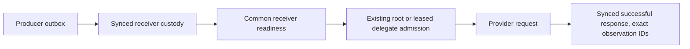
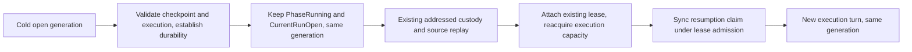
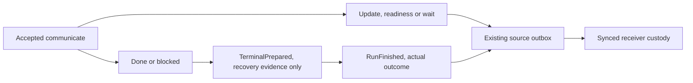

# Subagent runtime contracts

Use this page to understand what survives a delegate run, how reports reach the
parent, and which runtime policies apply to child sessions. For tool parameters,
start with [Job control](job-control.md); for remote clients, use
[Integrations](integrations.md). These contracts track main.

## Read a delegate result correctly

A delegate is a durable conversation identified by `dlg_...`, not a shell job.
It can run, report, become idle and run again when its owner sends new input.
Its internal generation is not another public handle. Keep the stable delegate
ID for control and the session transcript reference for evidence.

Completion of one generation does not prove that the requested work is correct.
Read the terminal message, structured output and cited artifacts, then perform
the task's acceptance check. A detailed terminal message can differ from its
structured summary; do not discard either. Failed, cancelled or exhausted runs
are not successful reports. The report-preservation section below defines the
accepted capture and recovery behavior.

An idle delegate is still available for follow-up. A stop request instead
cancels its subtree. Do not infer cancellation from a disconnected client or
confuse a metadata-only status read with consumption of a result packet.

This reference covers shipped runtime policy for delegates, plugins, hooks,
helpers, and lineage. See [job control](job-control.md) for tool parameters,
results, allowance, and availability; [architecture](architecture.md) for runtime
mechanics; and the [stable delegate model](subagent-management/11-delegate-resource-model.md)
for the lifecycle contract. Earlier [design specs](subagent-management/) are
historical proposals, not current behavior. Source citations use paths and
symbols so readers can locate the implementation after line numbers change.

Stable attention drives revalidate transcript-owned pending IDs after claiming
the retained child for a start (`Session.driveStableDelegateAttention`). A delayed
drive cannot reserve an ID an intervening generation already observed and
finished. An admitted start retains its exact reservation and generation across
a failed delegate-journal commit. A launch claim is not observation and writes
no consumed marker. The exact child schedules its own leased execution without
a parent-model turn, and fresh owner work remains admissible after it settles.

Ordinary bare-text or empty-response reporting exhaustion still stops and joins
owned managed shells before terminal packet evidence is sampled. Successful
cleanup does not set the fatal automatic-drive gate, so attention arriving after
the generation's last request remains eligible once that generation is released.
Cleanup failure retains the joined run error and sets that gate. Genuine fatal
errors and attention/finalization/settlement infrastructure error gates retain
their existing refusal and explicit `delegate_send` recovery behavior.

Roots and delegates share receiver-scoped notification readiness
(`agent/session_notifications.go`). Durable append publishes readiness after
writer locks are released. Root callbacks use the existing server wake channel
and serve loop. Delegate callbacks use the existing restore and leased start
admission, not a parallel executor. Cold writers, restore and execution retain
their existing exclusion and lifecycle fences.

Wake callbacks hand off a message and return. They must not call their own
`Session.Close` inline, because shutdown joins the operation delivering the
wake. An external owner closes the session after the handoff.

Releasing a finalization fence permits waiting admissions to retry immediately.
The operation that released it carries its notification recheck past enclosing
locks, reconstruction publication and all enclosing retirement and restore/start
admissions, then runs the recheck synchronously before it completes. Capacity
reclamation returns the effect through create or restoration to that operation's
outer consumer. Recursive empty-to-pending wake passes return the effect to the
original wake caller rather than consuming it inside an outer wake admission.
The admission-release channel is not a tail-completion channel. An already-closing
controller or root ends that old runtime's traversal, leaving persisted custody
for restoration. Only the exact
early controller-close refusal is classified as shutdown. Storage, target and
retirement failures remain diagnostic errors.

With nonempty `StateDir`, the transcript is canonical and its attention cursor
is only a derived cache. Configured persistence with a missing, closed or failed
writer cannot fall back to memory. With intentionally empty `StateDir`, after
transcript initialization, the same fold is canonical for that Session's
lifetime: acceptance, successful-response observation and resolution use the
same admission path without claiming a disk record. Pending notifications
survive in-process compaction, not restart. Custody still differs from model
observation, and a failed provider response leaves the notification pending.

Cold shell replay also recognizes the exact historical plain-user completion
message with nil provenance for the same receiver, job and terminal generation.
It preserves the original receipt unchanged, revalidates its presence and full
message after writer open, and requires receiver durability and successful Close
before acknowledging that source. A record damaged into precisely this old
representation is indistinguishable from a historical receipt. All other
message/provenance mismatches still refuse recovery. Fresh writes retain
Machinery and source provenance, and recovery never invents observation.

The durable path is:

Custody settles source transport, not model observation. Question, approval and
explicit Stop holds remain execution gates. Registration, hold/capacity release
and executor release recheck durable work, including a lost wake edge. A failed
transport retains source-owned debt and paced retry, so repaired storage resumes
delivery without another input. Healthy receivers remain usable while another
receiver's transport fails. Permanent provider failures defer that receiver,
not healthy siblings. Exhausted fast `ActiveTurnID` release retries retain the
exact release obligation in common
paced recovery, so repaired storage can resume admission without user input or
a daemon restart. These callbacks do not reopen a Stop or bypass an executor.

### Terminal drain and Stop custody

The one-shot host and each retained delegate install one lifetime notification
callback before execution. `DrainJobTree` and `DrainJobTreeKeepingReport` receive
that owner's coalesced wake channel, never replace the callback, and recheck the
edge before declaring quiescence. The channel is only a hint. Canonical receiver
custody and common execution admission still decide whether a model turn is owed.
Resource-only completion wakes rescan ownership without inventing model input.
Pending source deliveries count toward the recorded receiver's drain and its
eligible ancestors, including cold descendants, not unrelated receivers' drains.
The transport retry inventory remains global, and subtree lifecycle gates still apply.

On completed one-shot quiescence, the job manager fences new watch callbacks,
joins entered callbacks through source persistence, then retires registrations.
Already-produced messages remain durable and run when eligible. The callback
gate reopens on every exit so later input can create useful watches. Daemon
drains retain their watches. Yielded waits bypass terminal cleanup and retain
their producers. Detached processes remain outside managed cleanup.
Notification delivery has no drain polling ticker or idle backoff. Resource
deadlines, stall bounds and scoped recovery retain their own timers.

New subtree Stop requests persist `preserve_notifications=true`. Cancellation
still ends covered work, but reconciliation, Stop completion and shell repair
retain resumable receivers' source obligations and accepted notifications.
Only successful-response coverage records observation. The recorded request's
policy survives restart, and completion clears the pending policy after applying
it. Historical requests with a missing or false field retain their historical
discard fold. No inbox append releases a user Stop, question, approval or subtree
fence, and permanently closed destinations retain canonical closure handling.

Child reports and updates wake a parent delegate waiting on work. The parent's
next model request presents the pending notification without waiting for another
child's update or completion. A delegate cannot claim `done` while a child is
live, including a reserved child start. That sender check shares the child-start
admission lock. It is not a task-list, shell-job, watch or attention inventory
gate, and does not restrict root completion. A valid `waiting_on_work` call
publishes its message, joins the tool batch, syncs a checkpoint, then releases
model execution capacity without settling its generation. Children, shell jobs,
watches, callbacks and the original lease remain owned by that generation.
Unfinished task-list rows alone do not force another turn.
Report, update, watch and system labels do not earn an extra acknowledgement
round. After the successful response covers the pending messages, a session
with no actual work may become idle, even with unfinished task-list rows.

### Rollout and downgrade boundary

Current readers retain historical notification and Stop semantics. That does
not make older binaries safe readers of newly written state. Copied-state
checks against `9852924f0e1a06771ed1b985145a07eafefd1e4d` show that its transcript
reader rejects successful-response receipts and its delegate store rejects
preserving Stop requests. Its watch fold ignores `RestartSeq`, collapsing
distinct callback and restart obligations, and its restore reconciliation
settles a safely yielded generation as `runtime_lost`.

Do not downgrade a state directory after these records have been written.
Before rollback, stop new admissions and retain a reader that understands all
written records. Reverting code or deleting records is not a safe rollback.
Keep a pre-upgrade copy for isolated verification, never restore it over newer
work. Integration review, CI and approved deployment field checks remain gates.

### Durable wait yield and recovery

`agent/session_wait.go` defines private `WAIT_CHECKPOINT` yield/resumption
records. They never enter model history or public/UI content. Raw forensic
readers retain them without adding numbered public turns or execution spans.
The latest nonduplicate checkpoint is evidence, not execution authority.

Before generic `runtime_lost`, cold recovery checks the session, descriptor,
delegate and journal generation, the same accepted configured result-tool call
(`communicate` by default), all tool results, a checkpoint sealing the completed
batch and absence of later contradicting execution, question or approval state.
Stop and existing writer, restore,
reservation and finalization fences still own admission. The existing owned
writer's `EstablishDurability` barrier must succeed, readable bytes alone do not
prove a safe yield. Read/durability errors leave retryable uncertainty without
truncating the evidence or fabricating an outcome. Missing or inconsistent safe
boundary evidence retains ordinary interrupted-runtime reconciliation.

Recovery first leaves the generation cold, unbound and on the existing
reconciliation order. It writes no terminal outcome and starts no replacement
generation. The addressed dispatcher attaches that same lease through existing
writer/restore fences, then uses the existing single executor. A cold waiting
ancestor may be attached to restore a descendant without running its own model.
Existing shell/watch repair and delegate FIFO outboxes retain their
transport obligations until synced receiver custody. Independently proven cold
waits can accept notifications through the existing cold writer admission, but
acceptance neither consumes them nor resumes execution. A missing/nonrestorable
named producer yields one addressed `wait-interrupted:<session>:<execution>:<call>`
notification, not a false completion. Source-read failure does not mean absence.
Root checkpoints may omit delegate, generation and named target.

Any incoming notification or admitted user input may resume a wait, not just
the named producer. The target validates admission, never filters messages.
An already settled named target is an ordinary refusal carrying its actual
terminal state, with no publication, checkpoint or synthetic wake. Completion
after validation remains owed through ordinary durable delivery.

A root wait that subsequently has a durable failed completion is not resumable.
After proving its complete wait boundary and establishing writer durability,
new input may start a distinct execution through ordinary input admission.
The old checkpoint remains unchanged, with no resumption or observation claim.
Missing, unreadable or incomplete boundary evidence still refuses admission.

The resumption claim is synced before new model/tool activity while holding
the original lease admission lock. Stop either wins before that claim or cancels
the admitted execution of that exact generation. Retained-unsynced records use
the existing durability barrier, never a blind reappend. A checkpoint can repair
a missing activation-completion marker as completed; a crash after a resumption
claim instead uses ordinary interrupted-execution recovery.

Direct user Stop also restores a cold yielded runtime on its original lease,
without borrowing execution capacity or entering the model. Attachment installs
the existing yielded cancellation tail before publishing resident ownership.
The restore callback gate and drive guard exclude execution until cancellation
admission, then release on success or failure. This ends only that run, not its
descendants or owed messages. Retained pending input can legitimately start a
successor after cancellation, exactly as for a resident run. No input means no
Stop-created successor. Unreadable live-wait proof is an error that can be retried,
while a genuinely idle cold delegate still answers `notRunning`.

There is no wait-target polling loop, ticker or fabricated continuation prompt.
Ordinary non-checkpoint idle dispatch retains successor-generation semantics.
A pre-checkpoint
reader cannot safely restore a yielded generation, downgrade requires retaining
the checkpoint-aware reader, not a legacy compatibility route.

Only notifications not already presented by a successful request whose response
synced owe a drain turn. The private `observed_notification_ids` field on that
assistant response records the exact successful attempt's coverage, including
retries and full-history fallback. Pending notifications force full history when
a Responses delta cannot prove coverage. Compaction preserves unobserved bodies.
If the derived consumed-marker write fails, the drain or a reopened session
repairs the marker without another provider request. A second marker failure
leaves index repair for the generation's end without failing the parent or
stopping healthy siblings (`Session.ackNotifications`, `Session.drainJobTreeWith`,
`Session.repairNotificationReceipts`, `agent/session_jobtree_drain.go`).

Reports take synced receiver custody during model calls and tool execution,
without waiting in a second receiver queue. Writer serialization and request
construction keep tool calls paired with their results. An inline waiter is a
subscriber to that canonical delivery ID: the selected request presents its
persisted tool result when it carries the ID, otherwise the ordinary notification.
Timeout, cancellation and failed tool-result storage leave ordinary delivery
usable. Source acknowledgment follows receiver custody, not waiter resolution;
only a synced successful response records model observation
(`deliverDelegatePacket`, `expandHistory`).

## Delegate report preservation

Accepted updates, readiness and valid waits publish immediately through the
existing update outbox, even while the parent executes tools. The publication
captures the same call's message, disposition, blocker, wait target and structured
output. Retrying its call ID in the same generation reuses its delivery identity,
including after source acknowledgment. Unknown inventory remains unknown, but
does not erase a valid message.

Every notification is a message into its addressed session. Update, readiness
and report are payload labels, not wake policies. Acceptance establishes receiver
custody; successful-response observation and generation settlement are separate
facts. Status, list, activity and doctor reads project metadata without consuming
delivery. The real producer corpus in `TestNotificationReportProjection` checks
update, readiness, wait, done, blocked and interruption through the receiver and
AppWire projection, including reads that leave pending notifications unchanged.

Done and blocked capture durable `TerminalPrepared` evidence without publishing
completion. Only `RunFinished` queues the generation's one terminal delivery.
Finalization waits for both admitted quiet-attention persistence and the admitted
tool batch, including synced tool-result storage. A settlement claim rejects new
batches but still lets its same open, exact-generation batch publish updates.
Closing that batch removes the permission, and restart cannot recover it.

A reported generation's terminal packet `message` is the accepted
terminal `communicate.message`, with communicate's existing trimming and
`output.message` fallback. Its structured result remains separate, including a
different summary, data, artifacts, or a custom-schema value. Both come from the
same accepted capture under the session lock
(`delegateTerminalRunInputs.captureCommunicateReport`, `agent/subagents.go`).
Competing terminal calls cannot replace that capture. A later failure, cancellation
or exhaustion changes the actual outcome and diagnostics, not the accepted
message or structured value. Unreported runs retain diagnostic result semantics.
Root-session return values and `CommunicateOutput` keep their structured-output
semantics.

Settlement persists an immutable terminal packet. Owner notifications and
synchronous results consume that packet, and journal recovery reuses it across
both prepared-before-settlement and settled-but-undelivered windows. Recovery
does not ask the child to report again or allocate a new generation or delivery
identity (`delegateTreeController.Reconcile`, `agent/delegate_tree_restore.go`,
and `deliverDelegatePacket`, `agent/delegate_delivery.go`). Existing receipts,
storage limits, and preview bounds still apply. Recovery does not reconstruct
detailed reports absent from historical packets.

The terminal packet holds one immutable, generation-scoped typed report summary.
Notification rendering and inline or earlier `delegate_send` results render that
same capture, including completed, current and incomplete tasks and unknown
inventory. Current and incomplete may name the same task. Readiness uses one
typed internal update projection while preserving unrelated packet metadata and
structured-result provenance. Public `report_summary` and wire `report_notice`
remain presentation fields, not new delivery identities.

Activity reads never assign an earlier generation's outcome, reason, error or
end time to a newer open generation. The earlier immutable packet remains in
its own history. Cumulative usage and worktree metadata are not run outcomes.
Both clients parse the recorded producers through the shared adapter; captured
structured output stays distinct from message prose, including on terminal
errors with explicit valid provenance. Plain JSON-looking updates stay prose.

## Effective capability policy

A child agent can **narrow** but never **expand** the capability set available to its
parent/session. This is enforced structurally by a single per-session tool registry,
not by parallel policy checks:

- **One registry, narrowed at child init.** `initSessionState` (`agent/session_init.go`)
  builds the full registry, then applies the spawn restrictions: `RestrictKeepingResultTool`
  (`agent/internal/tool/registry.go`) drops every tool not in the child's allowed set
  except the result tool, and `Remove` drops each denied tool. A `tools: all` agent gets
  exactly the tools effective in *this* child session — not every tool registered in the
  process.
- **Visibility == execution.** The advertised tool set (`rebuildToolDefsCache`,
  `agent/session_tools.go`) and the execution gate (`Registry.ExecuteCall`,
  `agent/internal/tool/registry.go`) read the **same** `s.reg`. A tool removed from the
  registry is therefore both invisible to the model and unexecutable — a forged or stale
  model-returned call to a filtered tool hits the unknown-tool path and is denied before
  execution. The two surfaces cannot disagree because there is only one source.
- **`grant_tools` intersects, never expands.** A parent can only `grant_tools` a tool the
  session can already call; the spawn path rejects a grant of a root-only or
  not-currently-callable tool (`agent/subagents.go`, e.g. `"cannot grant tool %q via
  grant_tools…"`, `"cannot grant tool %q: it is not currently callable…"`).
- **Delegation is allowance-gated.** A child with `delegation_allowance: 0`
  cannot call `delegate`; it retains `job_watch`, subject to tool policy and
  watch-source permissions. A positive allowance permits delegation, subject to
  tool policy, regardless of depth. See [delegation allowance](job-control.md#delegation-allowance-recursive-delegation).
- **Close/cancel denies new child work.** The stable delegate-tree controller
  admits starts and sends against one fenced lifecycle aggregate. Once a session
  or subtree is closing/stopping, new child/model/shell admission cannot commit
  below that fence (`delegateTreeController`,
  `agent/delegate_tree_controller.go`;
  `delegateRuntime`, `agent/delegate_runtime.go`).

Not yet centralized (these hold today via code ordering / per-feature resolution, not a
single enforced gate — see `subagent-management/10-runtime-contracts.md` Contract 1 for
the target): policy immutability after a tool execution starts is a property of the
sequential `PreToolUse → execute → PostToolUse` path, not a frozen-policy token; an
agent definition naming an **unknown MCP tool** yields a silently-absent tool (a forged
call later gets unknown-tool) rather than a deterministic spawn-time error; and an agent
definition naming an **unsupported provider feature** is resolved/overridden rather than
rejected with a policy error. MCP *server* unavailability is now **non-fatal and
parallel** (previously fail-fast): each server's transport build, connect, and
tools/list run concurrently in its own goroutine; a failure there, or later during tool
registration, is isolated to that server rather than aborting the batch, reported as a
`ServerOutcome` (`agent/internal/mcp` `NewManager`/`RegisterTools`). Each outcome
becomes a `pendingMCPWarnings` entry classified `SourceMCP`
(`agent/diagnostic`), flushed after `SESSION_START` (`agent/session_init.go`
`initMCP` → `emitSessionStartEnvelope`) — the session constructs with whichever servers
came up healthy, and zero healthy servers is still a healthy session. A connection
dropped mid-session gets exactly one call-driven lazy reconnect attempt, gated on
`errors.Is(err, mcpsdk.ErrConnectionClosed)` (`conn.reconnect`). CLI
`--mcp-config`/`--mcp` config-parse errors (`agent/mcpconfig` `Discover`) are the one
thing that still stays fatal, since they're explicit user input for this invocation.

## Plugin and agent loading

What validation actually runs when evener loads a plugin (`agent/plugin/plugin.go`,
`agent/plugin/agents.go`):

- **Plugin name** is required and must be kebab-case (`validatePluginName` / `kebabCaseRe`).
- **Claude manifest first.** `Load` reads `.claude-plugin/plugin.json` and falls
  back to `.codex-plugin/plugin.json` only when the first is absent, not malformed.
  See the [plugin package format](plugins.md#package-format-reference).
- **Duplicate plugin names use the first valid manifest.** Session loading uses
  `LoadAllFailSoft`: later manifests with the same name are skipped with a warning,
  even if an unrelated component of the first plugin fails to load. The separate
  `LoadAll` API rejects duplicates; it is not the session-loading policy.
- **Agent `name`/`description`** are required non-empty strings (`getString`).
  **`tools`** accepts string lists, comma-separated strings, single tool names,
  or scalar `all`; see [role metadata and validation](plugins.md#add-a-delegate-role)
  for accepted and rejected forms. Claude tool names are mapped to evener canonical
  names at load (`toolname.ClaudeToEvener`). `model`/`color` default to `inherit`/`blue`.
- **Agent `model` is a provider-local preference.** Evener selects the first usable
  source in this order: an available plugin model, the delegate call's explicit
  `model`, then the parent model. Plugin metadata never switches providers.
  `sonnet`, `opus`, and `haiku` are catalog aliases that resolve to concrete models
  before Evener checks the current provider instance's advertised model list. An exact
  custom model ID works when that instance advertises it. An unadvertised model, or
  one whose availability cannot be verified, falls through with a diagnostic warning.
- **Namespacing.** Plugin agents are exposed as `plugin:agent`, except a
  `coordinator-workflow` plugin exposes its bundled agents by bare name
  (`exposedAgentCatalogKey`, `agent/coordinator_workflow_plugin.go`). Plugin MCP servers
  are namespaced `plugin_<plugin>_<server>` (`discoverPluginMCPConfigs`); `.mcp.json` is
  the file source, merged with inline manifest `mcpServers`.
- Missing component directories are tolerated — a plugin with no agents/hooks/MCP is valid.

Not yet (these are proposed in `subagent-management/06-plugin-agent-validation.md`, not
built): agent-name kebab validation, duplicate **agent**-name rejection within a plugin
(a later agent silently overwrites an earlier same-name one), manifest field-type
validation, `agents`-override path-traversal/absolute-path rejection, `model`-value
validation, empty-body warnings, unsupported-Claude-field rejection, and any
`Validate*` Go API / `evener plugin validate` CLI. An inline `mcpServers` parse failure is
no longer a silent gap: it now degrades to a **plugin-level MCP warning**
(`Instance.MCPConfigWarnings`, `agent/plugin/plugin.go` `discoverPluginMCPConfigs`) — the
plugin's MCP layer is skipped but its skills/agents/hooks still load; a malformed
`.mcp.json` file and malformed inline JSON are warned the same way. One silent gap
remains: **`skills`/`tasks` entries are not value-validated** (empty strings/fields pass).

## Lifecycle hooks (Claude-compatible subset)

Evener fires a tested subset of the Claude hook contract; the rest is recognized but
reserved. (`agent/plugin/hooks.go`, `agent/internal/hooks/`.)

- **Nine events fire:** `SessionStart`, `UserPromptSubmit`, `PreToolUse`, `PostToolUse`,
  `Notification`, `SubagentStop`, `Stop`, `PreCompact`, `SessionEnd` (`validHookEvents`).
  The full ~30-name Claude vocabulary is recognized as `reserved-placeholder` — parsed,
  diagnosed, never fired (`recognizedClaudeEvents`); unknown names are bucketed
  separately and warned loudly at load.
- **Discovery:** inline manifest object, manifest string path, else default
  `<dir>/hooks/hooks.json`; both wrapper (`{description?, hooks:{}}`) and direct
  (events-at-top) JSON shapes parse.
- **Matchers** (`agent/internal/hooks/matcher.go`): empty/`*` = all; `[A-Za-z0-9_|]` =
  exact or pipe-list; otherwise Go RE2. `Bash` does not match `BashOutput`. Matchers run
  against the **Claude** tool name (`shell` → `Bash`). An invalid regex is skipped and
  diagnosed once at load, not per dispatch.
- **Handlers:** only `command` and `prompt` execute; `http`/`mcp_tool`/`agent` are
  reserved and skipped-with-diagnostic. `command` supports shell-form (`bash -c`) and
  exec-form (`args`); `${CLAUDE_PLUGIN_ROOT}`/`${PLUGIN_ROOT}` expand in command/prompt/
  args; the runner sets `CLAUDE_PLUGIN_ROOT`, `PLUGIN_ROOT`, `CLAUDE_PROJECT_DIR`, and
  `CLAUDE_EFFORT` (only when configured). It does not set `CLAUDE_CODE_REMOTE`
  or `CLAUDE_PLUGIN_DATA`. `prompt`
  is evener-native sugar that runs an LLM call with
  `$TOOL_INPUT/$TOOL_RESULT/$USER_PROMPT/$MESSAGE/$TOOL_NAME` substitution.
- **`PreToolUse` runs before registry schema validation**, can rewrite the tool input
  (`applyUpdatedToolInput`, applied before execution), and can deny (short-circuits the
  call). `allow`/`deny` with `permissionDecisionReason` are honored, including the
  deprecated `approve→allow`/`block→deny` mapping (preferred keys win); `ask`/`defer` are
  recognized but **not** honored (the tool proceeds with a diagnostic).
- **Exit-code 2 blocks only for `PreToolUse`, `Stop`, `SubagentStop`**
  (`agent/internal/hooks/exitcode.go` `exitBehavior`); every other event is non-blocking.
  JSON output is parsed only on exit 0; on exit 2 stdout is treated as stderr and JSON is
  ignored.
- **Output routing:** `additionalContext` goes to the model (wrapped as a system
  reminder); `systemMessage` goes to the user only — distinct channels (`routeOutput`).
- **Verification:** inspect startup warnings for load errors and use the
  [startup-hook example's explicit warning](hooks.md#add-and-verify-a-startup-hook)
  to confirm execution. Browser `/status` opens Overview's About tab, not a hook
  tier/count display.

Known gaps (stated so you don't over-trust the compat surface): **`UserPromptSubmit` and
`PreCompact` do not enforce the exit-2 block** even though Claude's contract blocks; and
`continue`/`suppressOutput`/`terminalSequence` are **parsed but have no consumer** (a
hook returning `continue:false` still runs to completion). `if`/`async`/`statusMessage`
and the `http`/`mcp_tool`/`agent` handlers are parsed-but-inert. See
`subagent-management/07-lifecycle-hooks-claude-compat.md` for the full reserved set.

## Events and diagnostics

- **Typed lifecycle payloads** (`agent/events/payloads.go`): `JOB_STARTED` and
  `JOB_FINISHED` carry only shell `job_id` / `job_type="shell"` state.
  `DELEGATE_UPDATED` carries the immutable stable delegate snapshot keyed by
  `delegate_id`, with its monotonic projection revision. The emitting session's
  ID rides on the envelope (`SessionEvent.SessionID`). Model-facing shell and
  delegate notifications remain separately typed; see
  [`job-control.md`](job-control.md).
- **Warnings are first-class and surfaced, never silent.** `WarningData`
  (`agent/events/payloads.go`), carried on the `EventWarning` event, flows on the session
  event stream that clients consume; emitting paths include plugin hook-config
  warnings (built in `agent/session_init.go`, emitted via `emitDiagnosticWarning`) and
  delegate task-seed failures (`agent/subagents.go`). A warning with no display surface
  is treated as a bug.
- **Policy denials name the action and the boundary**, not just "not allowed" — e.g. the
  `grant_tools` rejections above and the delegation-allowance and ownership
  errors in the stable delegate controller. A role's tool policy and the child's
  allowance govern which delegation tools it can receive.
- **Compatibility gaps are reported, not half-accepted.** Recognized-but-unsupported and
  unknown hook events are recorded (`Instance.UnsupportedHooks`/`UnknownHooks`) and turned
  into load-time warnings; reserved handler fields are captured for diagnostics rather
  than treated as working.

**Do not assume warnings are secret-safe.** Hook lifecycle event payloads contain
metadata, not hook commands, environment values, or stdout/stderr. Free-form
warnings have a different contract: a failed `SessionStart` warning includes the
first non-empty line of stderr, or stdout when stderr is empty, truncated to 160
characters plus an ellipsis if longer (`agent/internal/hooks/hooks.go`,
`sessionStartFailureWarning`).
Hooks can also supply `systemMessage` warnings or model context. These messages
have no dedicated secret-redaction layer. Keep secrets out of hook output and
inspect warnings and transcripts before sharing them. See
[hook output routing](hooks.md#what-your-hook-returns).

A shared redaction helper and grouped validation issues remain proposals in
`subagent-management/10-runtime-contracts.md` Contract 3.

## Lightweight helper isolation

Several operations make a one-shot LLM call that is **not** a delegate. These
helper calls route through `llm.Client.Complete`/`llm.GenerateObject` directly
and never register a stable delegate, create a child transcript, mutate the task
store, run tools, or appear as a delegate item in `job_list`. Verified call
sites:

- `web_fetch` cheap-model summarization (`agent/tool_web_fetch.go` `webFetch`),
- session auto-naming (`agent/session_namer.go` `nameSession`, advisory — failure does
  not fail the session),
- image description (`describeImage`, `agent/session_tools.go` — side-channel call, no
  `Tools` set),
- prompt hooks (`agent/internal/hooks/hooks.go` `clientAdapter`/`executePromptHook`),
- context-manager strategies (fork-summarize, recursive distill, checkpoint prediction,
  memory crystals — `agent/internal/contextmgr/*`).

The isolation is structural: a delegate enters the stable controller only
through the registered create path (`agent/delegate_runtime.go` and
`agent/delegate_tree_controller.go`), which none of the helper sites reach.
Because helpers all route through `llm.Client.Complete`
(`llm/client.go`) — directly, or via `llm.GenerateObject`/`Generate` for the schema'd
ones like session naming — they still inherit request validation, provider resolution,
middleware/logging, and error stamping. The proposed shared helper API
(`GenerateHelperText`, `LoadLLMClient`, …) in
`subagent-management/08-standalone-llm-calls.md` is **not built** — these sites achieve
tool-freeness simply by never populating `Tools`.

## History and lineage

Fork and subagent are **distinct relations** sharing lineage fields, kept explicit:

- **Fork copies history; delegates start fresh by default.** `ForkSession`
  (`agent/fork.go`) replays the parent's first `divergenceTurn-1` entries into the
  child transcript. A delegate starts with a fresh conversation unless the caller
  sets `fork_context: true`, which copies the parent's recorded conversation,
  excluding the unfinished tool round. The delegate keeps its own role and
  permissions. See [forked context](job-control.md#delegate).
- **A fork may defer the diverging input.** `ForkSessionAtUserTurn` (`agent/fork.go`)
  writes only the prefix (no replacement user turn) and returns the original message
  text, so the web UI's fork-from-message flow can stage it in the composer for
  editing before explicit submission — the forked session never auto-runs it. The
  divergence turn must still be a `USER_INPUT` entry; both variants record the same
  `ParentSessionID`/`DivergenceTurn` lineage.
  `AsideSession` (`agent/aside.go`) is the degenerate fork at the tip: it copies the
  parent's full transcript with no divergent edit, records `DivergenceTurn` one past
  the tip, and inherits the parent's config — the machinery behind the `/aside`
  side-thread command. Both are built on the shared `writeForkChild` helper; the nil
  replacement-turn variant covers both the deferred-input fork and the aside.
- **Lineage lives in metadata and headers, discoverable without reading transcript
  bodies.** `SessionMeta` (`agent/schema/snapshot.go`) carries `ParentSessionID`,
  `DivergenceTurn`, `ForkLabel`, and `IsSubagent`; the transcript `Header`
  (`agent/transcript/transcript.go`) carries `ParentSessionID` (and `ParentToolCallID`).
  `ForkSession` (`agent/fork.go`) writes the child header and meta inline from the same
  values; subagent spawn sets `ParentSessionID` at init (`agent/session_init.go`).
  `IsSubagent` is true when spawned with a parent and false for a fork.
- **Parent lineage is immutable and preserved** across meta rewrite and resume
  (`ParentSessionID`/`DivergenceTurn` are write-once; round-tripped by the meta save
  path; covered by `agent/fork_test.go`
  `TestForkSession_ChildLineagePreservedAcrossMetaRewrite` /
  `TestForkSession_ParentForkLabelPreservedAcrossMetaRewrite`).
- **The `ForkLabel` lives on the parent**, not the child (the child's is empty), so the
  label marks which branch diverged.
- **`children_of` is a metadata-derived view, not a stored index.**
  `find_session_transcripts(children_of=…)` (`agent/session_tools_find.go`) scans
  `*.meta.json` at query time, returns both forks and subagents, and tags each with a
  `kind` discriminator; results are scoped to the parent's project and gated on a
  readable transcript. A missing parent reference is a diagnostic, not a crash.
- **Parents reference children, not inline their bodies** — delegate results carry a
  `transcript_ref` (`encodeRef`), and child transcripts are read explicitly and bounded
  via the transcript tools.

Not built (proposed/assessed, not committed): the session-**tree** API (`ListSessionTree`
etc.) is deferred in `subagent-management/09-session-tree-history-assessment.md` in favor
of the metadata + `children_of` baseline above. Two known characterization gaps: the
transcript header alone cannot distinguish fork from subagent parentage (use the
metadata `kind`), and a single parent forked more than once has only one `ForkLabel`
slot (later forks overwrite it).

## Where the design specs live

The proposals, target contracts, acceptance criteria, and test matrices behind these
shipped behaviors are in [`subagent-management/`](subagent-management/):
`06-plugin-agent-validation`, `07-lifecycle-hooks-claude-compat`,
`08-standalone-llm-calls`, `09-session-tree-history-assessment`, and
`10-runtime-contracts`. Those are point-in-time design records. The shipped
stable-delegate model is `11-delegate-resource-model`; this doc remains the
current-reality reference for the cross-cutting runtime around it. When a
behavior described here changes, update both applicable evergreen authorities.
