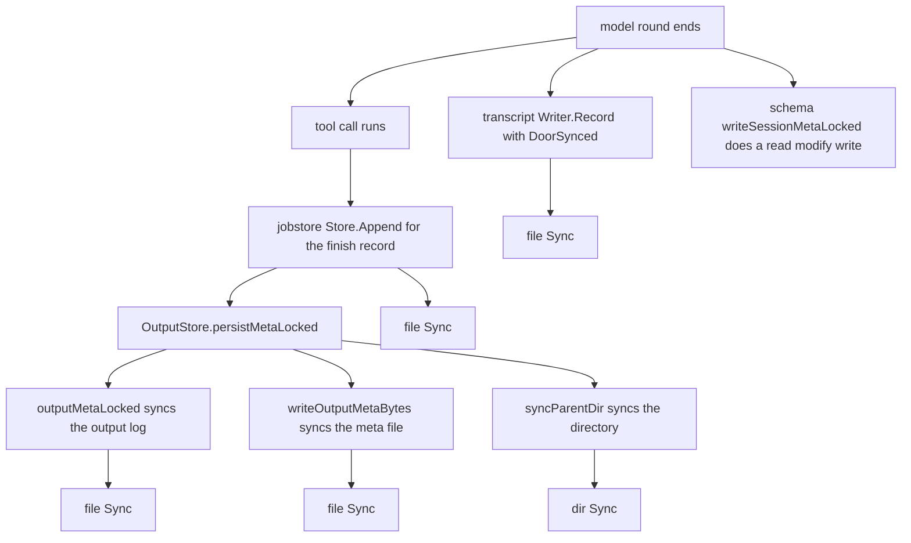

# CPU efficiency audit: synthesis

Audited tree: worktree `cpu-efficiency-audit`, branched from `origin/main` at
`377ac0867f580bc65981dee425bf83b3f89af72e` (2026-11-14). Go 1.27.4.

Nine lanes ran: round loop, LLM stream, tools/execenv, transcript/history,
hub/AppWire, frontend, idle/background, storage/sqlite, GC/allocation. Each
lane report is a sibling file in this directory and carries its own
`path:line` citations, evidence labels, and fix designs. This file ranks
across lanes and sequences the work.

## Verdict

**Half of a session's CPU is syscall time, and a third of it is a single
syscall: `fsync`.** In a 200-round scripted-provider run, 52.8% of sampled CPU
sat in the syscall path and 34.2% in `syscall.Fsync` specifically. That is
about 3.9 ms of fsync inside a 9.6-13.6 ms round. The second cost is garbage
collection at 18.2%, driven by `encoding/json` at 16.9%. Everything the nine
lanes found in application code costs far less than the durability barriers
this workload pays to store 35 KB of new data per round: quadratic history
copies, per-subscriber re-encodes, redundant transcript scans.

The lever is fewer and larger durability barriers, plus fewer allocations on
the JSON paths that feed them. That is a different program from "rewrite the
hot loops", and it is the one with the measured payoff.

## Ground truth (executed, by the coordinator)

Three independent runs, all on the repo's own harness, so anyone can repeat
them:

```bash
# per-round CPU, 200 rounds, scripted provider, Linux, in golang:1.27
go build -o /tmp/evener ./cmd/evener
go run ./test/e2e/turncpu --evener /tmp/evener --rounds 200 --out /out/run --cpu-profile
#  wall 2.53s · process cpu: 2.25s · 201 rounds · mean 9.6-13.6 ms CPU/round

# syscall census around the same harness, 20 rounds
strace -f -c -e trace=fsync,fdatasync,openat,write,rename /tmp/turncpu --evener /tmp/evener --rounds 20 --out /out/run
```

**CPU attribution of the 200-round profile** (2310 ms of samples, read with a
hand-rolled pprof protobuf reader because `go tool pprof` would not finish its
cold tool build on this host):

| share | cost | what |
|---|---|---|
| 52.8% | 1220 ms | all syscalls (`runtime/syscall/linux.Syscall6`) |
| **34.2%** | **790 ms** | **`syscall.Fsync`** |
| 18.2% | 420 ms | GC background mark (`runtime.gcBgMarkWorker`) |
| 16.9% | 390 ms | `encoding/json` marshal + unmarshal |

**Where the fsyncs come from** (790 ms attributed to the nearest evener frame):

| ms | owner |
|---|---|
| 270 | `agent/transcript.(*Writer).appendBatchLocked` |
| 160 | `agent/internal/jobstore.(*Store).Append` |
| 110 | `agent/internal/jobstore.writeOutputMetaBytes` |
| 80 | `agent/internal/jobstore.syncParentDir` |
| 60 | `agent/internal/jobstore.(*OutputStore).outputMetaLocked` |
| 50 | `agent/transcript.(*Writer).EstablishDurability` |
| 30 | `execsupport/fsatomic.SyncDir` |
| 20 | `execsupport/fsatomic.write` |
| 10 | `agent/transcript.writeTranscriptHeader` |

**Syscall census, 20 rounds, prebuilt binaries** (so the compiler is not under
strace): **150 `fsync` calls, 459 µs each, 71% of all syscall time**, against
769 `openat` and 1391 `write`. That is **7.1 fsyncs per round**. Cross-checked
against the profile: 150 × 459 µs / 21 rounds = 3.3 ms/round, against the
profile's 3.9 ms/round. Two methods, same answer. An earlier run that used
`go run` reported fsync as 17% of syscall time because the compiler was
writing into the same trace; 71% is the number to quote.

**Which files get synced**: `strace -y -e trace=fsync,fdatasync`, 6 rounds,
44 calls:

| calls | file |
|---|---|
| 15 | `state/sessions/<id>.transcript.jsonl` |
| 6 | `state/sessions/<id>/jobs.jsonl` |
| 4 | the `jobs/` directory |
| 2 + 2 | one job's `.log` and `.log.meta.json.tmp` |
| 2 + 2 | a second job's `.log` and `.log.meta.json.tmp` |
| 7 | first-run config and identity files (plugins, installation id, mutations) |

As rates: **2.5 transcript fsyncs per round, 1 jobstore fsync per round, and
6 fsyncs per completed shell job** (its log, its meta tmp, and the parent
directory, twice each). The profile's owners map onto it exactly:
`appendBatchLocked` 270 ms, `Store.Append` 160 ms, and the `outputMetaLocked`
+ `writeOutputMetaBytes` + `syncParentDir` triple at 250 ms.

**How much data that buys**: `du` on the same 201-round run: 4.84 MB of
transcript, 94.5 KB of `jobs.jsonl`, and 201 job logs at 20.5 KB each, about
**35 KB of new durable data per round**. Each round stores 35 KB and pays 7
fsyncs to do it: 3.9 ms of a 9.6-13.6 ms round.

**JSON attribution** (390 ms): `chatcompletions.decodeStream.func2` 140 ms,
`protocolhttp.Prepare` 80 ms, `llm.estimateInputTokens` 70 ms,
`transcript.decodeStrictJSON` 70 ms, `schema.loadSessionMetaFS` 20 ms,
`registry.FromModelsDev` 10 ms.

**Idle** (my measurements, before the lanes): a hub with no sessions used 1.07
CPU-seconds per 120 s (0.9% of one core), RSS 176 MB. An idle `evener serve`
used 0.07 CPU-s per 60 s.

## Ranked findings across lanes

Scale is per unit of real work. "Executed" means a command was run and its
output quoted; "read" means a code trace, no run.

| # | Severity | Finding | Evidence | Scale | Owning report |
|---|---|---|---|---|---|
| 1 | **Critical** | A round pays ~7 fsyncs across four independent durable stores; 34% of CPU | executed (pprof + strace) | 3.9 ms/round | this file |
| 2 | **High** | One output-meta persist costs 3 fsyncs (data, meta, parent dir) plus a marshal, tmp write, and rename | executed + read | 3 fsyncs per job output update | this file |
| 3 | **High** | `jobstore.Store.Append` fsyncs per event; `AppendBatch` exists and is not used on the per-round path | executed + read | 1-3 fsyncs/round | this file |
| 4 | **High** | Two doors force a transcript fsync every round: turn completion (`DoorSynced`) and the assistant turn (`DoorDurable`). Changing either alone saves nothing | executed + read | 1 fsync/round | this file |
| 5 | **High** | GC is 18% of CPU; the top five allocation sites are all JSON | executed (pprof) | ~1.8 ms/round | this file, `gc-alloc.md` |
| 5b | **High** | GC is untuned: 157 cycles for a 4 MB live heap at default `GOGC=100` | executed (`gctrace`) | 388 ms pauses / 4.3 s run | this file |
| 6 | **High** | Every streamed delta reprojects and sorts the full transcript | read | O(I log I) per delta | `frontend.md` |
| 7 | **High** | `grep` launches 3 ripgrep processes and up to 3 tree walks per call | read | 3 processes/tool call | `tools-execenv.md` |
| 8 | **High** | `read_file` reads and normalizes the whole file before applying offset/limit | read | O(file bytes), 128 MiB cap | `tools-execenv.md` |
| 9 | **High** | Turn-addressed past-thread reads scan all index records | read | O(turns + items)/request | `transcript-history.md` |
| 10 | **High** | Derived usage totals reread every turn summary per past-thread read | read | O(turns)/request | `transcript-history.md` |
| 11 | **High** | Resume reparses and retains the full transcript before trimming to checkpoint | read | O(file bytes)/resume | `transcript-history.md` |
| 12 | **High** | Hub idle projections rebuild full snapshots every 5 s | executed (read+coordinator) | 3 wakes/5 s/hub | `idle-background.md` |
| 13 | **High** | Each relay polls every 250 ms to discover subscribers are gone | read | 4 wakes/s/relay | `idle-background.md` |
| 14 | **High** | Filtered event fanout decodes and re-encodes per subscriber under the delivery gate | read | 2 decodes + 2 encodes × subscribers | `hub-appwire.md` |
| 15 | **High** | Local relay status events run 6+ JSON unmarshals and marshals per route | read | ≥6 each/status event | `hub-appwire.md` |
| 15b | **High** | Hub SQLite runs WAL with `synchronous=FULL`, so every commit fsyncs the WAL | read + executed probe | 1 barrier per hub store write | `storage-sqlite.md` |
| 15c | **High** | Every hub store call opens and closes a whole `*sql.DB`: 5 opens / 27 statements per navigation build | executed (counting driver) | 27 statements, 6 wanted | `storage-sqlite.md` |
| 16 | **High** | Live `communicate` preview reparses growing tool-arg JSON per delta | read | O(D·N)/message | `llm-stream.md` |
| 17 | Medium | `StreamGenerate` copies the growing response per text delta (O(D·N)) | executed 789 µs/1000 deltas | latent: no production caller | `llm-stream.md` |
| 18 | Medium | Context-pressure fallback rebuilds every message per request | executed by coordinator | 8.1 µs@50 turns, 45.4 µs@800 | `transcript-history.md` |
| 19 | Medium | Chat Completions decodes the same SSE event twice for tool-arg chunks | read | 2 decodes/arg chunk | `llm-stream.md` |
| 20 | Medium | API log fsyncs twice per request (attempt + settlement) | read | 2 fsyncs/request | `llm-stream.md` |
| 21 | Medium | SSE reader allocates a string per line and copies event data at flush | read | 1 alloc/line, 1 copy/event | `llm-stream.md` |
| 22 | Medium | Cold transcript-index rebuild allocates 1.55 GB for 200 MB of index | executed | one-time on invalidation | `transcript-history.md` |
| 23 | Medium | Breaker hashes every result body once per judged tool call | read | O(result bytes)/call | `tools-execenv.md` |
| 24 | Medium | Brace-expanded globs repeat overlapping walks; `.gitignore` recompiled per call | read | O(alternatives × tree) | `tools-execenv.md` |
| 25 | Medium | Live markdown reparses as deltas arrive; clocks tick in hidden tabs | read | per delta, 3 s/1 s tickers | `frontend.md` |
| 26 | Medium | Past index and message-search refresh sweep all sessions every 60 s | read | O(sessions)/min/hub | `idle-background.md` |
| 27 | Low | Per round: 3-6 whole-history message-slice copies | executed by coordinator | 542 µs / 1.98 MB @800 turns | `round-loop.md` |
| 28 | Low | `apply_patch` rebuilds a complete file per update op | read | O(file)/op | `tools-execenv.md` |
| 29 | Low | Each subprocess rebuilds launch env and PATH overlays | read | O(env+PATH)/spawn | `tools-execenv.md` |
| 30 | Low | Round timing misattributes request assembly to `LoopOverhead`; `ToolDefs` never set | read | 1 per round | `round-loop.md` |

## Tier 1: the durability fan-out (fix this first)

Per round the session durably stores about 35 KB of new data and pays 7
fsyncs to do it. Four independent stores each sync on their own schedule, and
nothing coordinates them.



Four stores, no shared barrier. Each sync is a separate trip to the
filesystem, and on a real disk each one waits for the device.

### 1.1 Collapse the output-meta triple sync

`agent/internal/jobstore/output.go:838-853` (`persistMetaLocked`) calls
`outputMetaLocked`, which syncs the output log
(`output.go:855-860`), then `writeOutputMetaFileFsSyncMarshal`
(`output.go:898-926`), which writes a tmp file, syncs it
(`writeOutputMetaBytes`, `output.go:928-942`), renames, and syncs the parent
directory (`syncParentDir`, `output.go:944-958`).

The parent-directory sync exists to make the *rename* durable. After the first
meta write, the directory entry for `metaPath` already exists, so a rename
over an existing name cannot be lost by a power cut in the way a new entry
can. It is paying a directory barrier on every update to protect a directory
entry that has not changed.

**Fix design.** Keep the data sync and the meta-file sync. Skip the directory
sync when the target file already existed before the rename, tracked with one
`bool` on the `OutputStore` set on open and after each successful create.
Expected: 3 fsyncs to 2, and a measurable drop in the `writeOutputMetaBytes` +
`syncParentDir` + `outputMetaLocked` 250 ms. **Risk:** a filesystem whose
rename durability does not follow the entry-exists rule. Verify with the
existing `persistMetaLocked` fuzz cases
(`jobstore/jobstore_program_fuzz_test.go:557-585`) plus a test asserting the
dir sync runs on first write and not on the second.

### 1.2 Batch the jobstore events for one tool call

`agent/internal/jobstore/store.go:201-224`, `Append` takes the lock, validates,
marshals, seeks, writes, and calls `syncLocked()` (`store.go:803-808`) for
**every event**. `AppendBatch` (`store.go:245`) does the same work for N events
with one sync, and its doc comment already spells out the crash-atomicity
contract. `jobManager.finalizeKeptSync` (`agent/jobs.go:1554-1584`) and
`writeFinishJob` emit the terminal job record and its registry effects as
separate appends.

**Fix design.** Route the finish path through `AppendBatch` with the terminal
record and its companion events in one slice, one sync. Expected: 160 ms of
`Store.Append` collapses toward one sync per tool call instead of one per
event. **Risk:** `AppendBatch`'s documented non-crash-atomic prefix behavior,
and callers that rely on `Append` returning a `Seq` immediately. Check the
re-run-idempotence note in the `AppendBatch` comment before widening its use.

### 1.3 Give turn completion and the assistant turn a durability window instead of a barrier

Three appends reach the transcript writer every round, and two of them force a sync.

`agent/session_execution.go:104-110` records the `TurnCompletion` turn with
`transcript.DoorSynced`. The comment is explicit: "A turn's terminal status
must never be lost."

`agent/session.go:3236` also writes the assistant turn through
`writeTranscriptDurableLocked` (`:3048`), which is `DoorDurable`. Every door but
`DoorBuffered` forces the sync (`agent/transcript/transcript.go:693`), and
`forceSync` short-circuits the `SyncInterval` gate at `:781`. So the 1 s
`SyncInterval` does not suppress either append.

Consequence for the fix: switching only turn completion to a buffered door
leaves the assistant turn paying the barrier, and the round still syncs once.
Both call sites have to move, or the change buys nothing. Tool results are
already buffered: `appendToolResults` (`agent/session_tools.go:788-794`) takes
the buffered door unless the round carries delivery commits, a terminal job
result, or a skill-state carrier.

`DoorBuffered` already syncs at most once per `SyncInterval`, set to 1 s in
`agent/session_init.go:690,1471`, so the machinery for a coalesced barrier
already exists and these two appends opt out of it.

**Fix design.** Two options, and this needs Jesse's ruling:

- (a) `DoorDurable` instead of `DoorSynced` for `TurnCompletion`. Still syncs,
  still rolls back on failure; loses the "recorded AND durable" guarantee only
  in the window where a later sync has not run yet. On its own this saves
  nothing, because the assistant-turn append still forces a sync in the same
  round.
- (b) Bound both appends: if a sync happened within the last `SyncInterval`,
  record through the buffered door and let the next sync cover it. Bounds the
  crash-loss window to 1 s instead of zero, for one fsync saved per round. This
  has to cover `agent/session.go:3236` as well as `session_execution.go:104`,
  which means a new door or a policy check in `recordTranscriptLocked` rather
  than two independent door choices.

Expected: 270 ms of the 790 ms fsync budget, minus whatever the coalesced
barrier still costs. The same move also drops the assistant turn's share, which
the profile folds into the same `appendBatchLocked` 270 ms, since both appends
reach it. **Risk:** this is a stated durability promise in a code comment, so it
is a product decision, not a performance one. The delegate steering path
(`agent/delegate_tree_steer.go:409`) and `writeTranscriptSyncedLocked`
(`agent/session.go:3068`) make the same promise for other record types, so the
ruling should name which of those may move.

### 1.4 Stop rewriting session meta on every autosave

`agent/schema/snapshot.go:668-700`, `writeSessionMetaLocked` reads the
previous meta in full (`loadSessionMetaFS`), unions `ObservedBy`, bumps the
revision, marshals, writes a tmp file, renames. There are ~18 `maybeAutoSave`
call sites (`session.go:57,94,2258,2337,2345,2481,2735`,
`session_close.go:291`, `session_compaction.go:84`,
`session_lifecycle.go:1173,1176`, `session_model_call.go:1834`,
`session_goal.go:346,468`, `session_namer.go:467,646`,
`session_tools.go:812`, `session_self_compact.go:327`,
`history_repair.go:196`).

It does not fsync (hence only 30 ms in the profile), so this is not Tier 1 CPU.
It is a full read-modify-write of a file for a counter bump, and `loadSessionMetaFS`
shows up in the JSON attribution at 20 ms. Rank it with Tier 2: hold the meta
in memory per session and write it when it actually changed, with the same
rename durability.

### 1.5 Every 32 KiB of captured job output re-persists metadata (found by the census)

`agent/internal/jobstore/output.go:252-273`, `OutputStore.Append` writes the
bytes, then calls `pruneLocked`, `refreshVisibleLocked`, and
`persistMetaLocked`. That last call is the triple sync from 1.1. It runs on
**every append**, not once per job.

The append arrives from `io.Copy`'s 32 KiB buffer:
`runShell` hands `shellOutputWriter` to `StreamCommand`
(`agent/job_shell.go:185`), `shellOutputWriter.Write` calls `appendJobOutput`
(`agent/job_shell.go:171`), which calls `OutputStore.Append`
(`agent/jobs.go:1282`). The copy loops are `agent/execenv/command_runtime.go:206,255`.

So a command that prints 1 MB pays **32 rounds of 3 fsyncs, 96 barriers**, to
record where its output file currently ends. The repo already knows this:
`agent/internal/jobstore/output_test.go:1258-1260` explains that one append of
100 newlines costs "a single fsync round instead of ~300 (each Append fsyncs
the log, re-hashes it, and fsyncs the meta file + parent dir)."

**Fix design.** Metadata for a live job is a recovery hint, not a fact the
user needs per chunk. Persist it on job finish, on a pruning/compaction event,
and on a slow ticker (1 s, matching `transcript.SyncInterval`), while keeping
the in-memory `total` exact for readers. The log bytes themselves still go
through `write`; only the barrier moves. **Risk:** a crash mid-job leaves meta
stale, so recovery must trust the log's length over the meta's
`TotalBytes`. Check `OpenOutput`'s meta/dir reconciliation
(`output.go:167-215`) and the fuzz cases at
`jobstore_program_fuzz_test.go:557-585`. **Verify:** the counting test below;
expect barriers per 32 KiB chunk to drop from 3 to 0, and the
`writeOutputMetaBytes`/`syncParentDir`/`outputMetaLocked` 250 ms in the profile
to collapse to the per-job rate.

**Measured:** the per-file census shows 6 fsyncs per completed shell job for
two jobs in 6 rounds, so in this harness the jobs are short enough that the
per-chunk cost is small. It scales with *output bytes*, which the harness does
not produce: each job log is 20.5 KB there. A `go build` or a test run
printing megabytes is where this bites, and the repo's own test comment
measures that shape.

## Tier 2: allocation and JSON (18% GC)

### 2.0 What one round's per-history passes actually cost (executed)

I benchmarked each pass a round makes over the accumulated history, at three
history sizes, with a realistic 2 KiB tool result per turn
(`agent/zz_audit_round_test.go`, temporary, deleted):

```bash
go test ./agent -run '^$' -bench 'BenchmarkAuditRoundAssemblyPerHistory' -benchmem -benchtime 3x
```

| pass | 50 turns | 200 turns | 800 turns |
|---|---|---|---|
| history snapshot shallow copy | 6.2 µs / 131 KB | 52 µs / 500 KB | 542 µs / 1.98 MB |
| `expandHistory` | 97 µs / 151 allocs | 130 µs / 601 allocs | 408 µs / 2401 allocs |
| expand + token estimate | 60 µs | 135 µs | 435 µs |
| **`json.Marshal(llm.Request)`** | **392 µs / 323 KB** | **1222 µs / 2.2 MB** | **2200 µs / 5.5 MB** |

Two things fall out of this. **Request marshaling alone is 2.2 ms at 800
turns, about a fifth of an 11 ms round**, and it allocates 5.5 MB per request.
That single line accounts for the `protocolhttp.Prepare` 80 ms in the profile
and is the largest addressable allocation in the round. The history copies are
an order of magnitude cheaper than the marshal, which is why the round-loop
lane ranked them "Medium" and why the earlier "quadratic history copy" framing
was too generous to them.

The benchmark also settles a question the lanes could only estimate: at 800
turns the shallow snapshot copy is 542 µs, not the ~173 KB of descriptors the
round-loop lane projected, because the copy allocates a new 1.98 MB slice. If
you fix one thing on this list, fix the marshal.

### 2.1 The five JSON sites

GC is 420 ms of the 2310 ms profile, and the five largest owned allocators are
all `encoding/json`. Two of them are on the provider stream path and matter per
request, not per round:

- **`llm/token_count.go:81-84` marshals the whole tool-schema list to JSON,
  divides the byte count by 4, and throws the bytes away.** `estimateInputTokens`
  does this on every request, which is the 70 ms line in the JSON table. With
  20-40 registered tools the lane puts it at 0.2-0.5 MB per round. The fix is
  exact, not an approximation: cache the schema's byte length beside
  `Session.cachedToolDefs` (`agent/session.go:1351`, rebuilt only at
  `session_tool_definitions.go:362`) and pass it on the request, so the token
  estimate is byte-identical and no threshold or admission decision moves.
  I confirmed the marshal-and-discard myself.
- `chatcompletions.decodeStream.func2` (140 ms) decodes each SSE event, and
  `captureChunkArgsRaw` (`llm/providers/chatcompletions/stream.go:266-324`)
  decodes the same payload a second time for argument-bearing chunks.
  Fix: keep `json.RawMessage` for `function.arguments` in the first decode.
- `protocolhttp.Prepare` (80 ms) marshals the body once per attempt
  (`llm/providers/internal/protocolhttp/call.go:66-122`). That is intentional
  and correct; do not cache across attempts, since preparation mutates the
  body in place.
- `llm.estimateInputTokens` (70 ms) runs per request.
- `transcript.decodeStrictJSON` (70 ms) is the resume path: `scanForResume` (`transcript.go:1165-1197`) decodes every line before
  trimming to the checkpoint.
- `schema.loadSessionMetaFS` (20 ms) is the autosave read-modify-write above.

Fixing decode-twice and the autosave read plus narrowing `estimateInputTokens`
addresses about 230 ms of the 390 ms JSON figure.

### 2.2 GC runs 157 times for a 4 MB live heap (executed, and untuned)

`GODEBUG=gctrace=1` on the same 200-round harness:

```bash
GODEBUG=gctrace=1 /tmp/turncpu --evener /tmp/evener --rounds 200 --out /out/run
```

| | |
|---|---|
| GC cycles | **157** in a 4.3 s run |
| total pause | **387.6 ms**, mean 2.47 ms per cycle |
| share of run CPU | 14.6% (against the profile's 18.2% for background mark) |
| live heap after a cycle | **3-6 MB** |
| heap goal | **8-13 MB** |

Two independent instruments agree on the GC share (14.6% from `gctrace`
counting pause, 18.2% from CPU-profile sampling), so that number is solid.

The interesting part is the shape: the heap goal is 8-13 MB against a 3-6 MB
live set, so the collector is running roughly **every 27 ms** to reclaim a few
megabytes. And there is no tuning anywhere in the tree: `rg
production code. The process runs at Go's default `GOGC=100`.

**Fix design.** Two independent, cheap changes:

1. Set a `debug.SetGCPercent` higher than 100 (200, or `GOMEMLIMIT` plus
   `GOGC=off` with a bound) for the agent and hub processes. At a 4 MB live
   heap, doubling the goal halves the cycles. This trades a few MB of RSS for
   CPU, which is the right trade on every host Evener runs on.
2. Cut the allocation that feeds it: 5.5 MB of `json.Marshal` per request at
   800 turns (2.0 above) is more garbage than the entire live heap.

**Risk:** a higher `GOGC` raises peak RSS, which matters for the hub's
many-session process. Measure RSS before and after on a loaded hub. **Verify:**
the `gctrace` command above; cycles should fall roughly with the goal, and
`gc N @Xs P%` should report a lower percentage.

Note this is *not* a substitute for fixing the allocation sites. It is the
cheapest single lever in the whole audit after the output-meta fsync, and it is
a two-line change.

### 2.3 Live-path quadratic work that is not latent

- `emitCommunicatePreview` (`agent/session_stream.go:401-420`) rebuilds the
  whole accumulated tool-argument string and rescans its `message` field from
  the beginning on every argument delta. Real path, `result`/`communicate`
  tool calls only. Fix: per-call parser state beside `toolArgs`.
- `StreamGenerate`'s per-delta `PartialResponse` (`llm/stream_generate.go:222-228`)
  measured 789 µs and 9.2 MB per 1000 deltas against 24 µs and 63 KB
  append-only. **It has no non-test caller**, so it is latent. Fix it when
  something starts calling it, or fix it cheaply now.

### 2.4 The `providerStampStream` nil dereference

`llm/client.go:861-869` (`providerStampStream.pump`) panics on a nil inner
stream. The round-loop lane hit it running `BenchmarkRoundOverhead -cpuprofile`
and got no profile for 77 s of work. That blocks profile-driven work on the
agent loop, which is reason enough to fix it. It is a test-visible crash, so
write the test first.

### 2.5 Per-event allocation, measured (the GC lane's executed table)

The GC lane got honest per-operation numbers by compiling the test binary once
and running it directly, which sidesteps this Mac's exec cost:

| operation | ns/op | B/op | allocs/op |
|---|---|---|---|
| `emit` a text delta, no provenance | 2542 | **1** | **0** |
| `emit` with causal provenance | 1619 | **577** | **6** |
| `events.New` | 66.9 | 0 | 0 |
| hub overlay stream delta | 1276 | 240 | 5 |
| hub overlay 4 KiB tool output | 12206 | **44,585** | 3 |

Two things this settles. `events.New` allocates nothing and `emit` allocates
nothing on the plain path, so the "reflection per emit" hypothesis stays dead
and the per-delta emit path is not the problem on an ordinary turn. But a
**watch-driven turn**, which is what a delegate or a notification wake
produces, pays 6 allocations and 577 B per event, so 500 deltas cost about
288 KiB and 3,000 allocations per turn. And a 4 KiB tool-output delta
allocates 44.6 KB, 11x its own size, appending into `slot.output`.

Struct sizes measured, for pointer-density work: `agent.Session` 7,416 B,
`ToolCallEndData` 152 B, `SessionEvent` 80 B, `llm.Message` 72 B,
`llm.ContentPart` 112 B, `provenance.Entry` 96 B, `provenance.Causal` 56 B.

The lane also measured whole-history copies at 3-4 per round and confirmed the
fold path is not compaction-only: `selectStrategy` returns
`NewCompactStrategy` for the default empty config
(`agent/session_init.go:266`).

## Tier 2.5: hub durable storage (SQLite)

The storage lane's first result is a scoping correction, and it matters:
**SQLite is off the agent's per-round path.** `modernc.org/sqlite` appears in
five files, all under `cmd/evener-hub/internal/hubcore/`, plus the one-shot
`cmd/evener-doctor/reconstruct.go`. The `evener` binary the round harness runs
cannot import `hubcore`, so none of the 7.1 fsyncs per round are SQLite.

Everything here is hub-process CPU, paid on navigation and status actions. Two
findings are worth acting on.

### 2.6 WAL is on but `synchronous` stays FULL (one-line fix)

`cmd/evener-hub/internal/hubcore/sqlite_dsn.go:25` sets `busy_timeout` and
`journal_mode(WAL)` and nothing else. modernc compiles
`SQLITE_DEFAULT_SYNCHRONOUS = 2`, and WAL does not change it. The lane's probe
confirms: after setting WAL, `journal=wal, synchronous=2`.

`synchronous=FULL` under WAL fsyncs the write-ahead log on **every commit**. So
every hub store write is a barrier, in the same shape as Tier 1. The fix is one
DSN parameter, `&_pragma=synchronous(NORMAL)`, no code and no test change.

The file's own comment states the assumption this rests on: "Five stores
(archive, favorite, pin sections, seen markers, past-index FTS) plus the
periodic FTS rebuild all write to the same file from **short-lived
connections**" (`sqlite_dsn.go:12-16`). Short-lived connections plus
`synchronous=FULL` is exactly the shape that pays a barrier per call. Adding
the pragma is a one-string change to `sqliteDSN`; `sqliteDSNImmediate` inherits
it.

**Risk:** `NORMAL` under WAL can lose the last commit on an OS crash or power
cut, and cannot corrupt the database. For hub navigation, favorites, pins, and
seen-state, that is the right trade; check whether the operation store or
session records need `FULL`, and set it per connection if so. **Verify:** the
`PRAGMA synchronous` probe in the lane report, plus a commit-counting test.

### 2.7 Every hub store call opens and closes a whole `*sql.DB`

`archive.go:124`, `favorite.go:51`, `pin_section.go:147`, `session_seen.go:107`,
and `past.go:982,1091,1224` each do `sql.Open`, DDL, `ensureIndexSchema`, one
query, and `Close`. Executed count with a wrapping driver: **one navigation
build read set = 5 opens, 14 execs, 13 queries = 27 statements, of which 6 were
the queries actually wanted.** The lane's code-read prediction was 27 before
the measurement, and the measurement returned 27.

The lane also measured the handle cost on C SQLite as a floor: 139 µs for
open+DDL+PRAGMA+SELECT+close against 18 µs for a reused handle, 7.9x. modernc
is slower than C SQLite, so the real gap is larger.

**Fix design.** One process-level `*sql.DB` per store file, opened once and
kept, with the DDL applied once at open. `MessageSearch.apply`
(`message_search.go:539-592`) already does the right shape (one transaction,
prepared statements) and is the model to copy. **Risk:** connection lifetime
and DDL-at-open ordering, plus the existing `openDB` seam that tests use.
**Verify:** the counting driver test the lane built; expect one open per store
per process instead of one per call.

The storage lane's other findings (FTS state rewrites on a no-change status
refresh, whole-file `operations.json` rewrites, a full index scan plus a `stat`
per session every 60 s) are in `storage-sqlite.md` and overlap the idle tier
below.

## Tier 3: per-request and per-event scans

These are linear or worse in history or audience, and none is a barrier, so
they are cheaper than Tier 1 per unit but some run far more often.

- **Turn-addressed past-thread reads** (`indexedTurnOrder`,
  `selectTurnRange`, `candidatesForTurnSlots`) iterate from slot zero on every
  turn-window request. O(all turns + all items) for a constant-sized window.
  Fix: an ordinal-to-slot index so a window seek is a lookup.
- **Derived usage totals** (`internal/transcriptindex/window.go:122-163`)
  reread every turn record and sum the span, per request. Fix: keep a running
  total per turn, or a prefix sum, in the sidecar.
- **Resume** decodes the whole transcript then throws most of it away. Fix:
  walk backwards from the tail to the last checkpoint, decode only from there.
  This needs the framing to be seekable, which the index already provides.
- **Frontend delta path**: every `overlay/delta` calls `projectThread`, which
  collects all items, sorts them (`transcriptProjector.ts:496-501`), and
  rebuilds the row list, while `reducer.ts:88-99` maps the whole turns array.
  Fix: keep `sourceIndexRanks` in the projection and update it incrementally;
  append the single changed turn in the reducer.
- **Hub filtered fanout**: `deliverNotifications`
  (`internal/appserver/server.go:336-345`) decodes and re-encodes per filtered
  subscriber while holding `deliveryMu`. Fix: encode once per distinct
  payload, filter on the encoded form or on a cheaper predicate, and move the
  encode out of the gate.
- **Relay status stamping** (`cmd/evener-hub/app_relay_fanout.go:110-140`) runs
  three capability stampers at ≥6 JSON passes per route per status event. Fix:
  resolve capabilities once per delivery and pass the resolved value down.

## Tier 4: idle CPU

Small individually, but constant while the machine is quiet. The measured hub
floor is 1.07 CPU-s/120 s with zero sessions; the timers below are what it
spends it on.

- Three independent 5-second wakes per hub (`watchHubRoster`,
  `watchHubAttention`, `watchHubNotices`, `hub_startup.go:849-878`) that each
  rebuild a full snapshot. Fix: one scheduler, change-driven refresh, and skip
  a rebuild when the underlying state revision did not move.
- A 250 ms per-relay ticker (`app_relay_fanout.go:12-18,435-460`,
  `app_relay_types.go:120-125`) whose only job is noticing that subscribers
  went away. Fix: retire on the subscription's own close signal, with the
  ticker as a slow safety net (1-5 s).
- 15 s WebSocket and agent keepalives per connection
  (`internal/appserver/websocket.go:20-28,192`; `appwire/client.go:105-121`).
  Four pings per connection per minute; fine per connection, worth a look at
  100 idle connections.
- 60 s past-index and message-search full sweeps
  (`hub_startup.go:851-866`). Fix: drive from fsnotify with the 60 s sweep as
  reconciliation only.
- 20 ms process-exit polling (`daemonprocess/process.go:250-275`). Fix: wait
  on the process handle.

## Sequenced plan

Ordered by measured payoff over risk. Nothing here is implemented yet.

1. **Profile-visible, no behavior change:** fix `providerStampStream` nil
   dereference and add per-phase timing to `prepareModelRequestWithError` so
   the next rounds are measured rather than estimated. Small, unblocks
   everything else.
2. **Per-chunk output-meta fsync** (1.5, the item the per-file census found).
   `OutputStore.Append` re-persists metadata on every 32 KiB chunk of captured
   output. Coalesce the meta persist to the job's finish and to a slow ticker.
   This is the single highest-count fsync source for a verbose tool call.
3. **Raise the GC goal** (2.2). Two lines: `debug.SetGCPercent(200)` in the
   agent and hub entry points, after measuring RSS. Halves the cycle count at
   a 4 MB live heap. Cheapest CPU-per-line change in the audit.
4. **Output-meta directory sync** (1.1). 3 fsyncs to 2. No durability change
   for an existing directory entry. ~250 ms of the fsync budget.
4b. **Hub SQLite `synchronous=NORMAL`** (2.6). One DSN parameter, removes a
   barrier from every hub store write. Independent of the agent path, so it
   can land in parallel with anything above.
4c. **Reuse the hub `*sql.DB` per store** (2.7). 5 opens and 27 statements
   per navigation build down to one open per process. Copy
   `MessageSearch.apply`'s shape.
5. **Jobstore `AppendBatch` for the finish path** (1.2). One sync per tool
   call instead of one per event. ~160 ms.
6. **JSON allocation fixes** (2.1): decode-twice on tool-arg chunks, autosave
   meta read-modify-write, `estimateInputTokens`. ~230 ms of the 390 ms JSON
   figure, plus a share of the 420 ms GC.
7. **Request marshal reuse** (2.0). 2.2 ms and 5.5 MB per request at 800
   turns. Cache the encoded body when the attempt only changes headers, or
   encode into a reusable buffer. Ranked here because the fix is more delicate
   than the fsync work: preparation mutates the body per attempt.
8. **Transcript durability window** (1.3). The largest single fsync item at
   270 ms, and the only one that changes a promise, so it needs a ruling before
   it ships. It covers two call sites, not one: the assistant turn as well as
   turn completion. Changing one alone saves nothing.
9. **Tier 3 scans**, frontend delta path first, since every delta pays it.
10. **Idle timers**, hub scheduler first.

A conservative reading: steps 2 through 6 together remove on the order of
600 ms of CPU per 201 rounds from the measured 2.25 s, most of it syscall and
GC time, without changing a single promise. Step 8 adds another ~270 ms if
Jesse accepts a bounded durability window, and step 7 is worth up to ~400 ms
of the remaining round at long history if the marshal can be reused safely.

## Open questions needing a ruling

1. **Turn-completion durability.** Is "a turn's terminal status must never be
   lost" absolute, or is a 1 s bounded loss window acceptable? This is the
   single largest item and it changes a documented guarantee. The same question
   must be answered for the assistant turn (`agent/session.go:3236`), which
   takes `DoorDurable` and forces its own sync in the same round. Answering for
   turn completion alone buys nothing.
2. **Output-meta directory sync.** Is a rename over an existing directory
   entry enough without a directory barrier, on every filesystem evener
   supports (darwin APFS, linux ext4/xfs/btrfs, and whatever runs in
   containers)? Answering this by rule rather than by test would be a guess.
3. **API-log fsync.** Two syncs per request (attempt + settlement). Same
   question as (1), for forensic records rather than turn state.
4. **`StreamGenerate` partial snapshots.** Is the per-delta snapshot in the
   public API contract, or can it be a bounded cadence? It has no in-tree
   caller today, so the answer may be "leave it, document it".
5. **`NOW_TICK_MS` is 3 s in source**
   (`cmd/evener-hub/frontend/src/panes/session/liveness.ts:11`), shared by the
   rail clock and the About tab, while project memory records the decision as
   at least 5 s. Which is authoritative, did the cadence change on purpose?
6. **Hidden-tab timers.** Should live clocks and activity ticks pause when the
   document is hidden? The frontend lane found no visibility check on either.
7. **`grep`'s oversized-file note.** It launches two extra ripgrep listings per
   successful search purely to report oversize files. Is that note worth two
   tree walks?
8. **Breaker body hashing.** SHA-256 over every result body per judged call.
   A non-cryptographic hash would be cheaper; is collision resistance part of
   the ledger's contract?
9. **GC tuning and the RSS trade.** The process runs at default `GOGC=100`
   with a 4 MB live heap and 157 collections per 4 s. Is a higher `GOGC` (more
   RSS, less CPU) acceptable for the hub, which holds many sessions, or should
   the hub and the agent get different settings?

## Claims I re-checked myself

The lanes wrote their own reports. These are the ones I opened the code for
and confirmed, because the synthesis leans on them.

| claim | verdict | how |
|---|---|---|
| `grep` runs two extra `rg --files` listings per successful search | **confirmed** | `grepRgOversizeCount` calls `grepRgListFiles` twice, `agent/execenv/local_search.go:500,504`, unconditionally on the success path |
| `read_file` reads the whole file for a line window | **confirmed** | `readFileCappedCtx` runs on the whole path before line numbering, `agent/execenv/local_files.go:90-115`; the doc comment says "the bytes are the complete file even when offset and limit select only some of its lines" |
| relay fanout wakes every 250 ms | **confirmed** | `hubRelayIdleInterval = 250 * time.Millisecond`, `cmd/evener-hub/app_relay_types.go:120`; ticker at `app_relay_fanout.go:17` is selected even with no deliveries at `:435-460` |
| `Broadcast` holds `deliveryMu` across per-subscriber work | **confirmed** | `internal/appserver/server.go:297-300` locks, calls `deliverNotifications`, unlocks after the loop |
| filtered subscribers decode and re-encode per subscriber | **confirmed** | `Filter.Notification` unmarshals at `internal/apphistory/notifications.go:67,75`; `replaceFields:121-136` unmarshals the params map again and marshals it |
| `OutputStore.Append` re-persists metadata per chunk | **confirmed** | `output.go:252-273`; the repo's own `output_test.go:1258-1260` says each append "fsyncs the log, re-hashes it, and fsyncs the meta file + parent dir" |
| a round durably stores ~35 KB | **confirmed** | `stat` sum over the 201-round run: 6,989,972 bytes = 34.8 KB/round |
| `NOW_TICK_MS` is 3 s | **confirmed** | `cmd/evener-hub/frontend/src/panes/session/liveness.ts:11` |
| request JSON marshal is 2.2 ms / 5.5 MB at 800 turns | **confirmed, my own benchmark** | `BenchmarkAuditRoundAssemblyPerHistory/request-json/turns=800` |
| fsync is ~34% of round CPU | **confirmed two ways** | pprof 790/2310 ms; strace 150 calls over 21 rounds at 459 µs each |
| two doors, not one, force the per-round transcript sync | **confirmed** | `agent/session.go:3236` uses `DoorDurable`, `agent/session_execution.go:104` uses `DoorSynced`, and `agent/transcript/transcript.go:693` forces for both. Caught by the memory page `design/transcript-durability-doors.md` after the first draft named only turn completion |
| SQLite is off the agent per-round path | **confirmed** | `rg -l 'modernc.org/sqlite'` finds only `cmd/evener-hub/internal/hubcore/` and the doctor CLI; the agent binary cannot import `hubcore` |
| hub SQLite leaves `synchronous` at FULL under WAL | **confirmed** | `sqlite_dsn.go:25` sets only `busy_timeout` and `journal_mode(WAL)`; the lane's probe reports `journal=wal, synchronous=2` |

## What I could not measure

- **`go tool pprof` never finished** on this host (cold tool build, >5 min,
  across four attempts with isolated `GOCACHE` and `GOPROXY` variants). All
  profile numbers come from the three stdlib-only readers in `tools/`, which
  are checked in with a README so the numbers can be re-derived; see
  `tools/README.md` for the harness command, the reader usage, and the two
  protobuf quirks. Re-run with real `pprof` on a quiet machine before
  publishing the percentages.
- **`BenchmarkRoundOverhead -cpuprofile` produces no profile** because of the
  `providerStampStream` nil dereference. So the per-phase split inside a round
  is read from code, not measured.
- **The two frontend checks** ran read-only: no `node_modules` in the worktree,
  so no browser measurement. Every frontend finding is "read".
- **The hub side was not straced.** The fsync census is the agent path only.
  The hub's own fsync rate under load is unmeasured, so 2.6's effect on hub
  write latency is a design argument, not a measurement.
- **Live-provider behavior** was never exercised: all turncpu runs use the
  scripted provider, so network and tokenization costs are out of scope, and
  the JSON figures exclude real response sizes.
