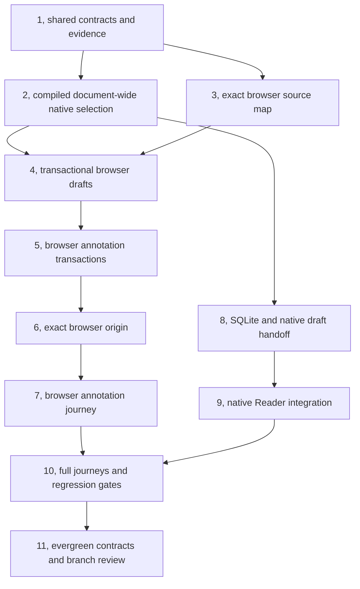

# Markdown Document Annotations Implementation Plan

> **For agentic workers:** REQUIRED SUB-SKILL: Use superpowers:subagent-driven-development
> (recommended) or superpowers:executing-plans to implement this plan task-by-task. Steps use
> checkbox (`- [ ]`) syntax for tracking.

**Goal:** Let Jesse annotate an exact Markdown passage in desktop browser, phone browser, and native
iPhone Reader, retain its highlight locally, and append its reference once to the opening session's
unsent draft.

**Architecture:** Keep the existing viewers and draft owners. Share snapshot comparison,
source-range validation, formatting, and operation contracts through `@evener/appwire-client`; keep
rendering, gestures, storage, and editor ownership in their platform adapters. Commit each
annotation handoff receipt with the actual draft edit, and fence an expired document version before
deleting its payloads.

**Tech Stack:** TypeScript, React, Marked 18.0.6, DOMPurify 3.4.13, IndexedDB, React Native 0.86.3,
Expo SDK 57, SQLite, patched react-native-enriched-markdown 1.0.2, Objective-C++, C++, Vitest,
Chrome/CDP, and installed iOS Simulator tests.

**Spec:** `docs/superpowers/specs/2026-10-04-markdown-document-annotations-design.md`. Read the
entire spec before this plan. The original approved behavior baseline is
`025289b1316cb5534984b0ea1338db1dc5c71d57`; the approved and independently re-reviewed native
code-text amendment is `19afe6b9e69b3caffcf9e6d4d7efebf6b0f74727`. The original approved plan is
`dd919c9a597a57c00f14d9fc61287edcfeffddb6`; source baseline is
`abd240265411bb1a35f10d1761a56cf0685339ea`. This bounded plan amendment changes only native
boundary implementation, its Reader consumer and their qualification instructions. Its written-plan
approval is pending. Product edits remain paused until Jesse approves it.

## Global Constraints

- Scope: "desktop browser document pane, the phone-browser document viewer, and the native iPhone
  Reader". Android remains deferred. No new iPad qualification scope.
- Saved annotations are session/file/client-local. No cross-device, cross-profile, browser/native,
  or hub synchronization.
- "The document is read-only." Annotation Send has zero source-write, send, queue, steer, or session
  start/resume effects.
- "Positions refer to the original Markdown source". Store zero-based UTF-16 `[start,end)`; display
  one-based line/column with an inclusive final position. Preserve CRLF, tabs, and surrogate
  boundaries.
- "A detected source change expires and deletes its saved annotations." Delete
  note/quote/range/context/map payloads and cancel unapplied handoffs. No reanchor, archive, or
  resurrection when old content returns. Applied composer bytes remain unchanged.
- "Missing revision metadata or changed coverage alone is not evidence of an edit." A prefix
  fingerprint never claims whole-file coverage. Read failures preserve notes and comment work.
- "Use the real draft owner, including its detached-write and revision protections." Focus and a
  read-only child view never choose the recipient. Do not use `quoteInsert` or native `pendingQuote`
  for annotations.
- "Preserve attachments, selected skills/commands, mention locations, and existing recovery
  ownership." Native drafts do not have browser chip metadata; preserve their existing
  representation instead of adding fictional fields.
- "Keep Markdown sanitation." Notes and quotations are literal text. Generated source-map metadata
  must never allow authored HTML to impersonate a mapped leaf.
- "Keep the native Reader and its reading behavior." Extend the patched native boundary. No WebView
  replacement; preserve reading position, outline, changes, text scaling, links, code/table
  scrolling, selection/copy, and explicit Review.
- Replace only Markdown code blocks' text leaf with the new content-only native leaf in the existing
  enriched-markdown patch. Keep Reader's inset View and horizontal ScrollView, `useCodeText`, exact
  `block.code?.text ?? block.text`, baselines, size, direction, accessibility and Copy. Add no header,
  inset or internal scroller. Plain-code-file lines remain unchanged. No React Native package patch.
- "No background cleanup infers deletion from inactivity." Annotation retention does not inherit
  DocumentMemory's 100-document cap. Review and history-cache clearing do not own annotations.
- Shared consumers use package-name imports and documented root exports. No relative imports into
  `appwire-client/typescript`, new hub protocol, or server annotation store.
- Default tests are deterministic. Script only the external LLM provider for real-stack journeys;
  use real hub, daemon, AppWire, document reads, storage, renderer, and draft editing below that
  boundary.
- Commands and proposed APIs below are implementation instructions, not passed checks. Task 1 is
  complete at `447d6bc616cd55d2ae1846ab61743c5f9cf28fc9` and must not be redispatched. Task 2 remains
  incomplete. Retained-run native RED, compilation/layout evidence and unproved GREEN remain
  separate, as recorded in Task 2.

### Additional approvals recorded on 2026-10-04

Jesse approved **transactional browser drafts**: move browser composer persistence from localStorage
into the existing IndexedDB infrastructure, preserve existing supported drafts and owner behavior,
and route ordinary edits, clearing, and recovery through the transactional seam. This authorizes the
supported-draft transfer needed by this change, not historical-schema guessing.

Jesse approved **source-aware Marked**: maintain a pinned source-aware extension of Marked 18.0.6,
including lexer/tokenizer instrumentation, while preserving document rendering/sanitization and
leaving transcript rendering unchanged. A different parser dependency is not approved.

Jesse provided the passwordless SSH Mac `jesses-macbook-pro-2-1`. Read-only inspection found Xcode
26.6 (17F113), iOS 26.5 Simulator runtime, iPhone 17 Pro device type, Node 26.0.0, Ruby 3.3.6,
Bundler 2.7.2, XcodeGen 2.44.1, and Maestro 2.0.9. This establishes a build route, not native
behavior evidence.

Jesse approved the content-only native Markdown code leaf direction and then the written amendment
at `19afe6b9e69b3caffcf9e6d4d7efebf6b0f74727`. Both independent spec re-reviews approved it with no
significant findings. Those gates are closed. Preserve the already-approved subagent-driven method
and original sole Task 2 implementer `dlg_034a9F17VZIlYAZuj7JLqC`; the controller edits docs and
review artifacts only. Self-review and dual independent review of this plan amendment precede
Jesse's written-plan approval. No product resume, push, merge or deployment before that approval.
Controller push, merge and deployment remain prohibited after approval too.

## Review Focus

1. **An older open browser bundle writes after draft authority transfers.** Preserve its recoverable
   draft bytes; never let its localStorage value overwrite a newer IndexedDB draft or an applied
   receipt. Tasks 4 and 10 pin this.
2. **Decoder transformations change source coordinates.** Preserve a UTF-8 BOM in the source
   coordinate space and omit an incomplete scalar at a truncated byte boundary instead of anchoring
   a synthetic replacement character. Tasks 1 and 3 pin this.
3. **A child/read-only view opens the same file as a writable root.** Capture its displayed session,
   keep root ownership separate, and retain a pending/copyable note rather than writing into the
   root. Tasks 6 and 10 pin this.
4. **The comment box, fonts, scrollers, or breakpoint move a saved range.** Keep its frozen source
   anchor, recompute geometry, preserve selection adjustment/copy, and reveal every overlapping
   note. Tasks 2, 7, 9, and 10 pin this.
5. **A short equal prefix or fingerprint collision resembles an accepted version.** Retain the
   longest compatible raw evidence and verify the actual source/map; do not expire from coverage
   alone or accept a hash-only match. Tasks 1, 5, and 8 pin this.

## Order, ownership, and gates



The first native gate deliberately precedes the broad browser draft transition. Separate React rows,
the GFM renderer's segmented text, raster tables, and the current code text are not one native
selection surface today. Task 2 adds the approved code leaf and proves it in production-shaped
qualification rows; Task 9 alone integrates it into production `ReaderBlock`. Prove document-wide
gestures and exact source coordinates on the installed renderer before the remaining integration.
If preservation requires changing Reader's containers, plain-code-file renderer, selection scope
or adding a React Native patch, stop and obtain a new approved and independently reviewed amendment.

Tasks 2 and 3 can be implemented independently after Task 1, but one implementer must own each patch
or renderer path. Task 4 changes shared settlement interfaces, so land it before other browser
writers. Native storage can follow the proven native boundary independently of browser UI. Use
isolated delegate worktrees for concurrent writers and do not share a native `node_modules`
installation under patch development.

Each task has a red/green cycle, its owning regression checks, and a scoped commit. Inspect scripts
before execution. An expected red run must fail for the named missing behavior, not dependency,
syntax, toolchain, or launch failure. Preserve all expected-error assertions and console guards.

## File and responsibility map

All **Create** paths below are proposed new files, not existing APIs.

| Owner | Files and responsibility |
| --- | --- |
| Shared contracts | Create `appwire-client/typescript/documentAnnotations.ts`, `annotationFingerprint.ts`, and `documentAnnotations.test.ts`; modify `index.ts`, `README.md`, and `docContent.ts`/`docContent.test.ts`. Source evidence, positions, context, formatting, lease and operation types. |
| Native selection boundary | Modify `mobile-native/patches/react-native-enriched-markdown+1.0.2.patch`; create `mobile-native/src/reader/ReaderSelectionSurface.tsx` and `nativeSelection.ts`/`nativeSelection.test.ts`, plus `mobile-native/scripts/rebuild-enriched-markdown.mjs`. Patch owns MD4C provenance, attributed ranges, document-wide coordination, range painting, the content-only code leaf, actual public package outputs and Fabric registration. Extend the existing native probe and Mac/XCTest driver. |
| Browser source map | Create `cmd/evener-hub/frontend/src/widgets/markdown/{sourceMap.ts,mappedLexer.ts,mappedTokenizer.ts,mappedHelpers.ts,MappedDocumentMarkdown.tsx,renderPolicy.ts,sourceMap.test.ts}`. Modify `index.tsx` and `segments.ts` only to share existing render/sanitize policy. Keep original Marked source attribution/license beside the extension. |
| Browser draft authority | Create `cmd/evener-hub/frontend/src/stores/localCompositionIndexedDB.ts`/`.test.ts`. Modify `mutationOutboxIndexedDB.ts`, composer `draft.ts`, `sourceState.ts`, `Composer.tsx`, pending-turn settlement and all enumerated producers. One schema/transaction domain, persistent revisions, supported-draft transfer and recoverable conflicts. |
| Browser annotation repository | Create `cmd/evener-hub/frontend/src/stores/documentAnnotations.ts`/`.test.ts`. Document heads, evidence, annotation payloads, receipts, expiry and bounded recovery. |
| Browser origin and UI | Create `cmd/evener-hub/frontend/src/panes/doc/{documentOrigin.tsx,openDocument.ts,documentSelection.ts,DocumentHighlights.tsx,DocumentAnnotationBox.tsx,documentannotations.module.css,documentOrigin.test.tsx,documentSelection.test.ts}`. Modify `DocPane.tsx`, `openDoc.ts`, direct opening producers and conversation provider boundaries. |
| Native storage and editor | Create `mobile-native/src/documentAnnotations.ts`/`.test.ts`. Modify `draftRepository.ts`, `draftDocument.ts`, `draftLibrary.ts`, `nativeDrafts.ts` and hub cleanup wiring. Reuse `evener-drafts.db`, savepoints and retained documents. |
| Native Reader UI | Create `mobile-native/src/reader/AnnotationBox.tsx`, `useDocumentAnnotations.ts`, and their headless/controller tests. Modify `ReaderScreen.tsx`, `ReaderBlock.tsx`, `documentBlocks.ts`, `documentSource.ts`, navigation types and `screens.tsx` only where the owner/controller requires it. Task 9 consumes Task 2's public code leaf inside unchanged containers. Keep existing Comment/Review records and plain-code-file rendering untouched. |
| Real-stack evidence | Create `scripts/e2e/e2e-document-annotations.sh`, `e2e-native-document-annotations.sh`, frontend `scripts/documentannotationsguard/run.mjs`, `test/e2e/fakellm/docannotations/cmd/main.go`, and native `e2e/document-annotations.yaml`. Reuse `scripts/lib/e2e-lib.sh`; register the browser launcher in `cmd/evener-dev/webbrowser.go`. |
| Evergreen docs | Create `docs/product/document-annotations.md`; modify `docs/product/{README.md,subsystems.md}`, `docs/web-ui/{README.md,contracts-composer-queue-pending.md}`, `mobile-native/README.md`, and parser/patch maintenance documentation. |

Existing browser source paths in later tasks are relative to `cmd/evener-hub/frontend/` when
prefixed `src/`. Native source paths are written in full. Preserve existing tests at these
boundaries, including `sourceState.test.ts`, `draft.test.ts`, `paneLifetime.test.ts`,
`markdown.test.tsx`, `segments.test.ts`, `draftDocument.test.ts`, `draftRepository.test.ts`, and
shared `state/mutation/pendingTurns.test.ts`.

## Shared proposed interfaces

Task 1 defines these exports in `documentAnnotations.ts`. Later tasks consume these exact names.
Platform repository/controller classes are new; existing methods are explicitly identified in task
descriptions.

```ts
export type AnnotationNamespace =
  | { kind: "browser"; origin: string }
  | { kind: "native"; hubId: string };
export interface DocumentKey {
  namespace: AnnotationNamespace;
  sessionRef: string;
  path: string;
}
export interface SourceRange { start: number; end: number }
export interface SourcePosition { line: number; column: number }
export interface DisplayFingerprint {
  algorithm: "cyrb53";
  value: string;
  coverage: SourceRange;
  scope: "displayed-full" | "displayed-prefix";
}
export interface CapturedEvidence {
  wholeRevision?: string;
  fingerprint: DisplayFingerprint;
}
export interface AcceptedSourceLease {
  key: DocumentKey;
  namespaceIncarnation: string;
  epoch: string;
  headRevision: number;
  displayedSnapshotId: string;
}
export interface CapturedPassage {
  evidence: CapturedEvidence;
  sourceRange: SourceRange;
  start: SourcePosition;
  endInclusive: SourcePosition;
  selectedRenderedText: string;
  contextBefore: string;
  contextAfter: string;
  mappingId: string;
  displayedSnapshotId: string;
}
export type DestinationProvenance =
  | { kind: "browser-origin"; paneId: string; compositionOwnerId: string }
  | { kind: "browser-readonly-session"; sourcePaneId: string }
  | { kind: "browser-restored-session" }
  | { kind: "native-session" };
export interface PreparedAnnotation {
  operationId: string;
  lease: AcceptedSourceLease;
  capture: CapturedPassage;
  note: string;
  destination: DestinationProvenance;
}
export interface SaveReceipt {
  operationId: string;
  epoch: string;
  sessionSequence: number;
}
export type HandoffResult =
  | { state: "applied"; draftRevision: number }
  | { state: "already-applied"; draftRevision: number }
  | { state: "pending"; reason: "owner-unavailable" | "dirty-draft" | "revision-conflict" }
  | { state: "cancelled" };
export interface ExpiryReceipt {
  key: DocumentKey;
  namespaceIncarnation: string;
  expiredEpoch: string;
  replacementEpoch: string;
  phase: "fenced" | "deleted";
}
export interface ReadTicket {
  key: DocumentKey;
  namespaceIncarnation: string;
  headRevision: number;
  requestId: string;
}
export type AcceptedReadResult =
  | { state: "accepted"; lease: AcceptedSourceLease }
  | { state: "stale-ticket" }
  | { state: "expiry-pending"; receipt?: ExpiryReceipt };
export type AnnotationRetryReason =
  | "reader-open" | "composer-open" | "foreground" | "storage-recovered";
export interface AnnotationView {
  operation: PreparedAnnotation;
  receipt: SaveReceipt;
  handoff: HandoffResult;
}
```

A runtime pane `serial` remains a late-write guard. It is not the durable `compositionOwnerId`.
Persist the new identity with newly saved conversation-pane metadata, outside the session params
used for pane deduplication; keep it associated with the actual restored pane record and session.
The approved old-document-pane path remains session-bound pending, with no fabricated owner
identity.

The shared module also exports these pure functions:

```ts
export function displayedFingerprint(source: string, truncated: boolean): DisplayFingerprint;
export function sourcePositions(source: string, range: SourceRange): {
  start: SourcePosition; endInclusive: SourcePosition;
};
export function validateSourceRange(source: string, range: SourceRange): void;
export function compareDisplayedSources(
  captured: { source: string; evidence: CapturedEvidence },
  current: { source: string; evidence: CapturedEvidence },
): { changed: boolean; detection: "whole-revision" | "comparable-source" | "insufficient-coverage" };
export function contextForRange(source: string, range: SourceRange): {
  before: string; after: string;
};
export function formatAnnotationReference(capture: CapturedPassage, path: string, note: string): string;
```

Task 1 also defines these pure comment-work functions so browser/native controllers do not duplicate
selection freezing and source-expiry rules:

```ts
export interface AnnotationCommentWork {
  note: string;
  capture?: CapturedPassage;
  captureFrozen: boolean;
}
export function selectCommentPassage(work: AnnotationCommentWork, capture: CapturedPassage): AnnotationCommentWork;
export function editCommentText(work: AnnotationCommentWork, note: string): AnnotationCommentWork;
export function invalidateCommentCapture(work: AnnotationCommentWork): AnnotationCommentWork;
```

Selecting a passage retains an already-frozen capture. The first note edit freezes an existing
capture, including whitespace-only edits. Source expiry removes the old capture and clears its
freeze flag while keeping the note bytes; the first fresh selection attaches the retained note and
freezes that new capture. Cancel returns empty unfrozen work. Repository controllers retain
immutable attempted operations separately from editable unsent work: retries reuse the same ID and
exact attempted payload, and a late receipt must not overwrite a newer unsent edit.

## Independent fixtures

Keep these literals in test fixtures. Expected offsets and complete draft strings are handwritten
assertions, never generated by the formatter or source-map implementation under test.

```ts
const SOURCE = "First occurrence: same\n\nOther context for a second occurrence is nearby: same\n";
const FIRST = { start: 18, end: 22 };
const SECOND = { start: 73, end: 77 };
// SOURCE.length === 78. FIRST is 1:19-1:22, SECOND is 3:50-3:53.
const REFERENCE =
  'A note on `NOTES.md:1:19-1:22` (captured source positions), selecting “same”: "Keep this scope."\n' +
  'Captured whole-file revision: "rev-A".\n' +
  'Context before: "First occurrence: "; after: "\\n\\nOther context for a second occurrence is nearby: same\\n".\n' +
  'Verify the quotation and context against current content before relying on these captured coordinates.';
const APPENDED = "Existing draft\n\n" + REFERENCE;
```

The formatter uses backslash escaping inside the code-delimited path, JSON string escaping for
note/revision/context, and a single blank line when appending to nonempty draft text. Preserve
leading/trailing draft whitespace and the entered note bytes; use `note.trim()` only to test whether
it is blank. Preserve the curly quotation wrapper by escaping embedded curly quotes in the selected
text or use a JSON-quoted selection when that text contains its delimiters. Tests pin both forms.

The CRLF/native/browser fixture is:

````ts
const RICH_SOURCE = '# Note\r\n\r\nfirst **same** [link](https://example.test) &amp; 😀\r\n\r\n' +
  'second same\r\n\r\n- item **same**\r\n\r\n' +
  '| Cell | Other |\r\n| --- | --- |\r\n| same | tail |\r\n\r\n```ts\r\nsame()\r\n```\r\n';
// UTF-16 length 172.
// same ranges: [18,22), [73,77), [90,94), [135,139), [159,163).
// Display positions: 3:9-3:12, 5:8-5:11, 7:10-7:13, 11:3-11:6, 14:1-14:4.
// link label: [26,30). Entity spelling: [54,59). Emoji: [60,62).
// Cross-block first-to-second same: [18,77).
````

Arithmetic was checked with standalone Python/Node against literal source, not with product code.
Add independent literal cases for nested/loose lists, indentation tabs, escaped pipes, reference
definitions across Mermaid segments, inline-code whitespace, authored HTML,
backwards/element-boundary selections, BOM, and truncated UTF-8 tails.

---

### Task 1: Shared range, evidence, and literal reference contracts

**Files:** Create shared contract/fingerprint/test files above. Modify
`appwire-client/typescript/index.ts`, `README.md`, `docContent.ts`, `docContent.test.ts`, and
`mobile-native/src/reader/documentBlocks.ts`.

**Interfaces:** Produces the shared types/functions above and `hashAnnotationText(text: string):
string`. Move the existing cyrb53 implementation from `documentBlocks.ts` unchanged; retain its
`hashText` export as a reexport so native block hashes do not change. This preserves an existing
export, not a new historical data adapter.

- [ ] **Write the failing tests** for exact endpoints, whole revision preference, compatible prefix
      coverage, collision-independent raw comparison, formatting and decoder source space.

```ts
it("uses the second literal occurrence and inclusive UTF16 positions", () => {
  expect(sourcePositions(SOURCE, SECOND)).toEqual({
    start: { line: 3, column: 50 }, endInclusive: { line: 3, column: 53 },
  });
  expect(() => validateSourceRange("a😀b", { start: 1, end: 2 })).toThrow();
});
it("does not treat a shorter equal prefix as an edit", () => {
  expect(compareDisplayedSources(
    { source: "abcdef", evidence: { fingerprint: displayedFingerprint("abcdef", true) } },
    { source: "abc", evidence: { fingerprint: displayedFingerprint("abc", true) } },
  )).toEqual({ changed: false, detection: "insufficient-coverage" });
});
it("expires on whole revision change despite equal visible source", () => {
  const fingerprint = displayedFingerprint("abc", true);
  expect(compareDisplayedSources(
    { source: "abc", evidence: { wholeRevision: "A", fingerprint } },
    { source: "abc", evidence: { wholeRevision: "B", fingerprint } },
  ).changed).toBe(true);
});
it("compares actual source despite an identical supplied fingerprint", () => {
  const fingerprint: DisplayFingerprint = {
    algorithm: "cyrb53", value: "deliberate-collision",
    coverage: { start: 0, end: 6 }, scope: "displayed-full",
  };
  expect(compareDisplayedSources(
    { source: "abcdef", evidence: { fingerprint } },
    { source: "abcxef", evidence: { fingerprint } },
  )).toEqual({ changed: true, detection: "comparable-source" });
});
it("prints the captured snapshot in ordinary draft text", () => {
  const capture: CapturedPassage = {
    evidence: { wholeRevision: "rev-A", fingerprint: displayedFingerprint(SOURCE, false) },
    sourceRange: FIRST, start: { line: 1, column: 19 }, endInclusive: { line: 1, column: 22 },
    selectedRenderedText: "same", contextBefore: "First occurrence: ",
    contextAfter: "\n\nOther context for a second occurrence is nearby: same\n",
    mappingId: "fixture-map", displayedSnapshotId: "snapshot-A",
  };
  expect(formatAnnotationReference(capture, "NOTES.md", "Keep this scope.")).toBe(REFERENCE);
});
```

Do not monkeypatch the hash function. Add comment-work assertions using the actual shared functions:
edit `FIRST` to `"Keep this scope.\n"`, select `SECOND` and retain `FIRST`, invalidate it and retain
the note with no capture, then attach/freeze `SECOND`. Add exact escaped-note/path cases and
prefix-only wording. Context starts at surrounding paragraph boundaries and expands to distinguish
occurrences in the displayed snapshot; when the displayed prefix cannot establish whole-file
uniqueness, retain coordinates/context and say so rather than inventing suffix evidence.

For document decoding, preserve BOM with `new TextDecoder("utf-8", { ignoreBOM: true })`. At a
truncated boundary, inspect at most the final four bytes and trim only an incomplete UTF-8 scalar
before decoding. Keep `sizeBytes` as bytes received and whole-file revision unchanged. Assert real
`readDocFile` output for `[0xef,0xbb,0xbf,0x61]` is `"\ufeffa"`, for truncated `[0x61,0xf0,0x9f]` is
`"a"`, and for a complete emoji it is `"a😀"`. Keep complete-file invalid-byte behavior and binary
classification covered; do not trim arbitrary invalid data.

- [ ] **Run red:** `cd cmd/evener-hub/frontend && npm test --
      ../../../appwire-client/typescript/documentAnnotations.test.ts
      ../../../appwire-client/typescript/docContent.test.ts`. Expected missing shared behavior
      assertions, not a broken runner.
- [ ] **Implement pure functions**, retain the source immutable, and publish root exports.
      Comparison uses unequal strong revisions first, otherwise actual comparable raw text; hashing
      is a reference identifier, never proof of source equality. A CRLF is one line break but two
      source units. Reject empty/out-of-bounds/surrogate-splitting ranges.

```ts
export function displayedFingerprint(source: string, truncated: boolean): DisplayFingerprint {
  return {
    algorithm: "cyrb53", value: hashAnnotationText(source),
    coverage: { start: 0, end: source.length },
    scope: truncated ? "displayed-prefix" : "displayed-full",
  };
}
```

- [ ] **Run green and regression:** repeat the red command, then native
      `src/reader/documentBlocks.test.ts` unchanged. Exercise a runtime without `crypto.subtle`; do
      not add a secure-context requirement.
- [ ] **Commit only the named shared files and `documentBlocks.ts`** after reviewing staged diff,
      with message `feat(annotation): define snapshot-scoped passage contracts`.

### Task 2: Prove exact document-wide native selection on the compiled renderer

**Files:** Modify `mobile-native/patches/react-native-enriched-markdown+1.0.2.patch`; create
`mobile-native/src/reader/ReaderSelectionSurface.tsx`, `nativeSelection.ts`/`.test.ts` in that
directory, and `mobile-native/scripts/rebuild-enriched-markdown.mjs`. Extend the already-created
probe `mobile-native/e2e/document-annotations-probe.tsx`, Mac helper
`mobile-native/e2e/document-annotations-mac.sh`, Swift UI driver
`mobile-native/e2e/document-annotations-ui/DocumentAnnotationsUITests.swift` and
`scripts/e2e/e2e-native-document-annotations.sh`. Include patch maintenance notes. Task 2 owns no
production `ReaderBlock.tsx`, `ReaderScreen.tsx`, `ui.tsx`, annotation UI or plain-code-file edits.

**Resume and evidence:** Continue the original task with the original sole implementer. Task review
BASE remains `447d6bc616cd55d2ae1846ab61743c5f9cf28fc9`, including every probe/harness commit;
spec/plan commits do not reset it. Preserve these distinct native baseline pins verbatim:

- RED **source**: `312684b7ec7826980c7b04d14b2299ac0da0da8a`.
- RED **test harness**: `7f5a46ae2a55d288c7025308f244d51f5b8d9d6a`.

**Retained-run RED:** real long press, Copy-menu assertion and real handle drag ran against those
separate pins; source/completion/cross-row assertions failed, exit 65. Controller verified retained
run `job:job_034a9F17VZOOMlziEKkvVP_HIa0M1WXZ9gi`, not a controller rerun. Log
`.superpowers/sdd/2026-10-04-markdown-document-annotations/task-2-evidence/baseline-red-qualify.log`
has SHA256 `f6c050a448f4aba4a6a68a49525394732b2e70809dd1f18e1cc80e4438ef60b4`; retained gesture
attachments and `task-2-report.md` document it. This RED used the library's code rendering, not
Reader's RN Text leaf. It does not qualify the new Reader-shaped code comparison.

**Compilation/layout:** successful app/test compilation and `testLayoutReceipt` are distinct
infrastructure/layout evidence. The earlier `KeyError: TestConfigurations` was a harness-format
failure before gestures, not behavioral RED. **Unproved GREEN:** no installed native behavior pass
has been retained. Spec reviews and this plan cannot supply one. Keep the existing driver and
assertions; add real installed RED for new code cases rather than relabeling the old run. Stop after
two rejected attempts at one finding or three unsuccessful fixes, and report the evidence.

**Interfaces:** Produces the proposed native boundary below. All props/events are new and must be
added to the public wrapper, Fabric codegen spec, and actual GFM component. Reader uses
`flavor="github"`, which mounts `EnrichedMarkdownNativeComponent`, not the single-text-view
CommonMark component.

```ts
export interface NativeDocumentSelection {
  displayedSnapshotId: string;
  mappingId: string;
  sourceRange: SourceRange;
  selectedRenderedText: string;
  phase: "changing" | "completed" | "cleared";
}
export interface NativeSavedRange {
  operationId: string;
  sourceRange: SourceRange;
}
// ReaderSelectionSurface owns one document-wide selection model across rows.
export interface ReaderSelectionSurfaceProps {
  source: string;
  displayedSnapshotId: string;
  ranges: readonly NativeSavedRange[];
  onSelection(event: NativeDocumentSelection): void;
  onRangePress(operationIds: readonly string[]): void;
  children: React.ReactNode;
}
export function ReaderSelectionSurface(props: ReaderSelectionSurfaceProps): React.ReactElement;
export function captureNativePassage(
  event: NativeDocumentSelection, source: string, lease: AcceptedSourceLease,
  evidence: CapturedEvidence,
): CapturedPassage;
```

The following is a **new** public package interface, produced by Task 2 and consumed by Task 9.
Export it from `react-native-enriched-markdown`, not from a private Reader adapter:

```ts
import type { ReactElement } from "react";
import type { StyleProp, TextStyle, ViewProps } from "react-native";

export interface MarkdownCodeSourceRange { start: number; end: number }
export interface EnrichedMarkdownCodeTextProps extends Omit<ViewProps, "style"> {
  text: string;
  documentSnapshotId: string;
  blockSourceRange: MarkdownCodeSourceRange;
  selectable: boolean;
  allowFontScaling: boolean;
  style?: StyleProp<TextStyle>;
}
export function EnrichedMarkdownCodeText(props: EnrichedMarkdownCodeTextProps): ReactElement;
```

Support the existing `useCodeText` fields and effective text alignment/writing direction. Flatten
text style in the public wrapper without adding a View. Forward accessibility/testID/native View
props unchanged. `documentSnapshotId` resolves the ancestor surface's original-document model;
`blockSourceRange` chooses a verified node projection, never a guessed offset. Native registration
obtains `mappingId` from that model and identifies mounted row/native tag and layout generation.
Selection/range-press events still go through `ReaderSelectionSurface`, not a second JS coordinator.

- [ ] **Create a real installed baseline probe** using `RICH_SOURCE`. It reports actual native
      selection events/ranges in an accessibility value only in the qualification build; it must not
      fabricate source offsets or simulate completed callbacks. Drive long press and
      selection-handle movement. Expected captures are `[18,22)` and cross-row `[18,77)`; table/code
      captures are `[135,139)` and `[159,163)`. Keep the probe out of normal production navigation,
      and do not leave a hardcoded production fixture.

```yaml
# NEW qualification flow. Native events populate these labels.
appId: com.primeradiant.evener.native
---
- launchApp
- longPressOn:
    id: native-probe-first-passage
- assertVisible: "Captured source 18:22"
- assertVisible: "Selection completed"
# Record handle coordinates from this exact simulator's accessibility/layout
# receipt, then drag the real handle across the second paragraph in the flow.
- assertVisible: "Captured source 18:77"
```

The app identifier above is verified in `mobile-native/app.json`; assert it against the installed
artifact. Choose gesture coordinates from actual rendered glyph rectangles in the qualification
fixture, independently of the new original-source map. The YAML shows baseline assertions; implement
its actual cross-block handle gesture in the qualification driver before counting it as a test.
Maestro's `swipe` alone is not established evidence of dragging an iOS selection handle. Use a
task-owned XCTest UI target with XcodeGen and actual press/drag gestures if Maestro cannot drive it.
A diagnostic label or JavaScript callback alone never proves the native gesture.

The probe must compile on the unextended renderer: it can observe the existing selection-menu
events, but it must not claim finished-selection or original-source events before they exist. Its
red result is the installed UI assertion after a real gesture, not an unknown-prop/typecheck
failure. After the patch, the same driver observes actual native completed-selection events and
source endpoints. Save the red-test source checkpoint and green implementation checkpoint before
transferring their exact Git bundles.

- [ ] **Run the baseline probe on the current source** with the Mac route below. The relevant red
      assertion is absence of automatic completed-selection/source-range reporting or inability to
      cross native rows. A failed build is not that red assertion.
- [ ] **Extend native provenance at the source**, through these exact installed-package paths
      represented in the patch:

```text
cpp/md4c/md4c.h and md4c.c
cpp/parser/MarkdownASTNode.hpp and MD4CParser.cpp
ios/parser/MarkdownASTNode.h, MarkdownASTNode.m, MarkdownParserBridge.mm
ios/renderer/TextRenderer.m, CodeRenderer.m, CodeBlockRenderer.m
  and the renderers that emit decoded entities or generated separators
src/types/MarkdownTextProps.ts
src/EnrichedMarkdownNativeComponent.ts
src/native/EnrichedMarkdownText.tsx
ios/EnrichedMarkdown.mm
ios/views/EnrichedMarkdownInternalText.h and EnrichedMarkdownInternalText.m
ios/views/ENRMTableIOSGridView.m and TableContainerView.m
```

Check each path against the installed package before editing; preserve existing patch hunks. Add
source spans to parser-emitted text, carry them through Objective-C AST and attributed text, and
attach explicit unmapped markers to generated chrome. MD4C normally emits input slices, but it emits
synthetic spaces/newlines for code and breaks. Extend the vendored callback boundary to carry
explicit byte spans for those emissions; never subtract a synthetic pointer from `inputText`.

```cpp
// NEW internal provenance record carried beside each emitted text fragment.
struct SourceFragment {
  std::string text;
  size_t sourceByteStart;
  size_t sourceByteEnd;
  bool generated;
};
// Convert the original input's UTF-8 byte boundaries to NSString UTF-16 once.
// Synthetic CRLF/code-space emissions retain their actual original spans.
```

Extend the existing GFM layout with a document-wide selection coordinator hosted by
`ReaderSelectionSurface`; register rendered text leaves from each row/segment with that coordinator.
Keep FlatList/reader memory, block identities, outline/change markers and existing row actions. A
row-local UITextView selection event is insufficient. The coordinator owns endpoint movement across
registered rows, keeps the full document position model when rows recycle, autoscrolls the existing
vertical list, and computes range rectangles from the actual text layout. Table cells must provide
text layout hit-testing/ranges despite their current raster-grid drawing. Markdown code uses the
new content-only `EnrichedMarkdownCodeText` leaf in this same patch. Its mounted drawing layout
supplies hit-testing, carets and every range rectangle to the same coordinator. No second RN patch
or recreated selection layout is authorized. Generated labels, images and diagram shapes remain
unmapped.

The surface owns a native parsed model of the immutable ORIGINAL document, keyed by
`displayedSnapshotId` and `mappingId`. Extend the patched row renderer with `documentSnapshotId:
string` and `blockSourceRange: SourceRange` props to project that model's verified nodes into
existing rows. Never parse normalized/reconstructed row Markdown and add a guessed base offset. Task
9 instruments the existing block scanner before normalization to retain original row ranges; the
qualification fixture supplies independent literal row ranges while Task 2 proves the native model.
Code/table rows register geometry against the same original-document model. Parse once per snapshot
rather than duplicating a full-document parse in each recycled row.

Completion is a gesture-state transition after the native selection/handle gesture ends, not a
debounce that steals ongoing selection. Retain ordinary system copying, selection adjustment, link
actions, horizontal code/table scroll, and keyboard focus. Saved ranges are drawn from mapped glyph
geometry and hit-tested to return every overlapping operation ID. Rebuild geometry after font scale,
row remount, width or scrolling changes.

- [ ] **Add installed code-leaf RED and preservation cases to the existing probe/Swift driver.**
      Mount the current RN Text leaf and the new leaf in identical Reader-shaped inset Views and
      horizontal ScrollViews in the same qualification build. Keep the current RN leaf's code
      props/style untouched. Before implementation the probe remains buildable: the comparison
      slot uses the old leaf, and the real source/completion/cross-boundary assertions fail after
      gestures. Do not count import/codegen/build failure as RED. Preserve the earlier RED record.

```ts
// Literal preservation inputs, independent of the new parser/layout implementation.
const CODE_TEXT_CASES = [
  "", "same()", "same()\n", "same()\n\n", "\nsame()\n\nnext()\n",
  "\tfirst\tsecond\n", "😀 e\u0301 שלום same()\n",
  "0123456789012345678901234567890123456789012345678901234567890123456789\n",
] as const;
// Both comparison slots retain these outer props and literal text.
// The new slot consumes documentSnapshotId/blockSourceRange from its verified fixture model.
<View style={{ backgroundColor: palette.inset, borderRadius: 12 }}>
  <ScrollView horizontal contentContainerStyle={{ paddingVertical: 12, paddingHorizontal: 14 }}>
    <Text allowFontScaling={allowFontScaling} selectable={selecting} style={code} {...accessibility}>
      {literalText}
    </Text>
  </ScrollView>
</View>;
```

Set up independently authored original-document fixtures for these code strings; do not derive
their expected source endpoints from the new model. Keep the unchanged `RICH_SOURCE` endpoint
assertions `[18,22)`, `[18,77)`, `[135,139)`, `[159,163)`. Capture exact displayed/VoiceOver and
clipboard text. Zero/one/multiple trailing LF and blank-line counts are exact, with no tolerance.
Existing whole-block Copy uses `block.text`; existing RN paragraph Copy uses the whole paragraph.
Preserve those actions separately from proving NEW selected-range Copy and real selection handles.

Add these methods to the existing Swift test class, retaining `point`, `copyMenu`, `receipt` and
`testCompletedOriginalSourceSelectionAcrossRows`. TABLE and CODE coordinates come from that
simulator's native layout/screenshot receipt, not the source map:

```swift
func testTableOriginalSourceSelection() throws {
    try point("TABLE").press(forDuration: 1.2)
    XCTAssertTrue(copyMenu.waitForExistence(timeout: 5))
    receipt("table-selected")
    XCTAssertTrue(app.staticTexts["Captured source 135:139"].waitForExistence(timeout: 5))
    XCTAssertTrue(app.staticTexts["Selection completed"].exists)
}
func testMarkdownCodeOriginalSourceSelection() throws {
    try point("CODE").press(forDuration: 1.2)
    XCTAssertTrue(copyMenu.waitForExistence(timeout: 5))
    receipt("reader-code-selected")
    XCTAssertTrue(app.staticTexts["Captured source 159:163"].waitForExistence(timeout: 5))
    XCTAssertTrue(app.staticTexts["Selection completed"].exists)
}
```

Extend the Mac helper's finite-coordinate allowlist with TABLE/CODE and the independently measured
handle/target names used by the boundary cases. Keep FIRST/HANDLE/SECOND and FormatVersion 1
per-run xctestrun copying/digest checks. Its current qualify phase selects only
`testCompletedOriginalSourceSelectionAcrossRows`; change that phase's `-only-testing` arguments
to include that unchanged test, both methods above and each new preservation/boundary test. Retain
layout/long-press phases. Verify the xcresult lists each intended method and no failures before
claiming GREEN; merely adding methods that the helper never selects does not run them.

Before the comparison, record the installed screen scale `s`; the maximum rounding tolerance is
`1 / s` points for each baseline, rectangle edge and intrinsic size dimension. Compare corresponding
RN/new-leaf measurements at identical constraints, palette, font and scale, with an independent
layout/screenshot receipt. No larger tolerance may hide a missing line, changed wrapping or text.
Exercise Reader scaling and system Dynamic Type. On iOS `useTextScale` already multiplies sizes
and `allowFontScaling` is false; forward `13 * scale` and `18 * scale` without double scaling.

- [ ] **Implement the public wrapper, Fabric contracts and native content-only leaf in the patch.**
      Create these installed-package paths, captured in the existing patch:

```text
src/types/MarkdownCodeTextProps.ts
src/native/EnrichedMarkdownCodeText.tsx
src/EnrichedMarkdownCodeTextNativeComponent.ts
ios/EnrichedMarkdownCodeText.h and EnrichedMarkdownCodeText.mm
ios/internals/EnrichedMarkdownCodeTextShadowNode.h and EnrichedMarkdownCodeTextShadowNode.mm
ios/internals/EnrichedMarkdownCodeTextComponentDescriptor.h
ios/internals/EnrichedMarkdownCodeTextState.h
```

Add public exports to `src/index.tsx` and matching runtime/declaration outputs under
`lib/module/` and `lib/typescript/src/`. Register `EnrichedMarkdownCodeText` with class name
`EnrichedMarkdownCodeText` in `package.json`'s existing `codegenConfig.ios.components`. The new
native spec extends `ViewProps`, uses `CodegenTypes.Float` for fontSize/lineHeight,
`ColorValue` for textColor, string fields for text/fontFamily/textAlign/writingDirection and
documentSnapshotId, explicit start/end fields for blockSourceRange, and boolean selectable and
allowFontScaling. The wrapper converts the public style to those fields; register the exact
generated component descriptor/name and implement Fabric props/state/layout/recycling updates.
The existing `ReactNativeEnrichedMarkdown.podspec` source globs cover new iOS files; do not invent
a separate pod or switch the dependency version.

```ts
// NEW src/EnrichedMarkdownCodeTextNativeComponent.ts, self-contained for codegen.
import { codegenNativeComponent, type CodegenTypes, type ColorValue, type ViewProps } from "react-native";
interface NativeProps extends ViewProps {
  text: string;
  documentSnapshotId: string;
  blockSourceRange: Readonly<{ start: CodegenTypes.Int32; end: CodegenTypes.Int32 }>;
  fontFamily: string;
  fontSize: CodegenTypes.Float;
  lineHeight: CodegenTypes.Float;
  textColor: ColorValue;
  textAlign: string;
  writingDirection: string;
  selectable: boolean;
  allowFontScaling: boolean;
}
export default codegenNativeComponent<NativeProps>("EnrichedMarkdownCodeText");
```

The mounted leaf owns its text storage/layout manager/container for drawing and all selection
geometry. Verify its displayed text through the original model's parser transformations. Preserve
tabs, CRLF spelling and trailing lines; library helpers that trim LF, force LTR or impose code
padding are not preservation shortcuts. Associate registrations with snapshot, mapping, mounted row
and generation. Convert through current inset/scroll transforms, clip painting and hits, and
invalidate on source/style/font/width/scroll/remount changes before accepting new events.

Yoga sizing remains view-free. `measureContent` can run off-main while RN holds commit locks:
never wait synchronously for main, access live UIKit, or share mutable mounted TextKit state with
that measurement. Use a separate thread-confined sizing layout with identical text/font/paragraph
rules, existing `ENRMFontScaleForMeasurement` and `ENRMClampMeasuredSize` where suitable. Sizing
is not a selection geometry oracle. Compare its output to the actual mounted RN leaf; the mounted
leaf remains the only drawing/hit/caret/range layout.

- [ ] **Regenerate actual package outputs reproducibly before patch capture.** Create
      `mobile-native/scripts/rebuild-enriched-markdown.mjs` with `--help` and checked nonzero errors.
      Refuse a symlinked install and verify package version 1.0.2/RN 0.86.3. Use installed
      TypeScript and Babel tools, not the absent monorepo `bob`/`prepare` scripts. Its explicit source
      allowlist comprises the new leaf's three TS files, `src/index.tsx` and the existing public
      wrapper/prop/spec files changed by this task. Emit only their matching runtime/declaration
      outputs and maps; leave unrelated package files intact. Babel uses the installed TypeScript
      preset and JSX transform, ESM output and `.js` relative module specifiers. TypeScript uses a
      checked program with declaration-only emit; diagnostics fail generation, and its write
      callback admits only allowlisted `lib/typescript/src/` outputs. No handwritten divergence
      between source exports and shipped exports. Keep generated mirrors in this same patch.

```sh
set -euo pipefail
# IMPLEMENTATION commands, not checks already run. From mobile-native:
node scripts/rebuild-enriched-markdown.mjs
PKG="$(pwd)/node_modules/react-native-enriched-markdown"
node node_modules/react-native/scripts/generate-codegen-artifacts.js \
  --path "$PKG" --targetPlatform ios --source library
npx patch-package react-native-enriched-markdown --exclude '^$'
```

The installed codegen executor includes its own root library even with
`includesGeneratedCode:true`; `--source library` avoids app-only provider generation. Its package
outputDir places artifacts under `ios/generated/ReactCodegen/EnrichedMarkdownTextSpec/`. Normal
app/pod codegen skips dependencies shipping generated code, so pod install alone cannot refresh
these contracts. Inspect generated Props, EventEmitters, States, ComponentDescriptors and
RCTComponentViewHelpers for the new leaf and changed GFM contracts before patch capture. Prove
package-name import/type resolution against `lib/typescript/src/index.d.ts`, shipped module export
presence and Metro source resolution; preserve all existing public exports. Repeat generation and
assert the allowlisted outputs are byte-identical before recording the patch digest.

Installed patch-package excludes `package.json` by default. The explicit `--exclude '^$'` above
retains the new codegen component/class registration. Inspect that exact hunk, preserve existing
patch hunks and reject unrelated package changes. Verify patch reapplication in the task-owned Mac
install retains the registration and generated contracts; do not change lockfiles to hide failure.

- [ ] **Inspect the complete regenerated patch and rebuild with the lock-preserving Mac route**
      so public outputs, Fabric registration and C++/Objective-C++ changes actually compile.
- [ ] **Run green on the installed probe**, capture exact offsets, real cross-block handle movement,
      selectable table/code text, saved-range rectangles, tap events, and preservation checks. If
      the chosen coordinator cannot meet them while preserving Reader, stop here; do not substitute
      menu-only activation or a WebView.
- [ ] **Run code/prose/table boundary and invalidation checks in the same installed artifact.**
      Drive handles both directions across each boundary, vertical autoscroll and recycled rows.
      On a wide code line, distinguish ordinary horizontal scrolling from active handle dragging;
      repeat endpoint movement after horizontal/vertical scrolling. Exercise width/font changes,
      remount, clipped saved-range painting/hits and a tap returning all overlapping operation IDs.
      Reject stale generation events without moving saved source anchors; reading must recover
      after layout refresh. Keep legacy menu/Copy/accessibility actions and all old proof gates.
      No JS-generated completion or separately reconstructed layout counts as handle evidence.
- [ ] **Commit the patch, native adapter/tests, probe/harness and maintenance notes**, message
      `feat(native): expose verified document-wide passage selections`.

#### Exact Mac build route, used by Tasks 2, 9 and 10

The existing harness has `--host HOST`, `--source-ref REF`, `--harness-ref REF`, `--keep-artifacts`,
`--phase layout|restore|long-press|qualify|cleanup` and `--geometry FILE`. Default host is
`jesses-macbook-pro-2-1`; source and harness default separately to committed `HEAD`. Read it and its
Mac helper before execution. Its reserved `/Users/jesse/tmp/evener-markdown-document-annotations`
already contains retained task evidence: read the manifest/retention notes before touching it.
Transfer exact committed Git bundles, preserve source/harness/app/driver digests and per-run
copies of the original xctestrun format. Do not overwrite retained RED artifacts or substitute an
unrelated app. Extend this driver, not a replacement harness.

```sh
# Unchanged historical source and harness identities, not instructions to rebuild old RED.
RED_SOURCE=312684b7ec7826980c7b04d14b2299ac0da0da8a
RED_HARNESS=7f5a46ae2a55d288c7025308f244d51f5b8d9d6a
# After committing the amended implementation and driver, pin both current identities separately.
SOURCE_SHA=$(git rev-parse HEAD)
HARNESS_SHA=$(git rev-parse HEAD)
bash scripts/e2e/e2e-native-document-annotations.sh --host jesses-macbook-pro-2-1 \
  --source-ref "$SOURCE_SHA" --harness-ref "$HARNESS_SHA" --phase layout --keep-artifacts
```

Inspect that run's native layout/screenshots to record FIRST/HANDLE/SECOND in the existing geometry
JSON; then use the same source/harness pins with `--phase long-press` and `--phase qualify` and
`--geometry` pointing to that exact simulator's receipt. Add code comparison/gesture cases to the
existing Swift target and qualify phase. A layout phase by itself is never GREEN. If stopping before
qualify, invoke the harness's cleanup phase for the same pins and only its owned simulator.

```sh
# Read-only preflight, repeat before making the task-owned workspace.
ssh -o BatchMode=yes -o ConnectTimeout=15 -o StrictHostKeyChecking=yes \
  jesses-macbook-pro-2-1 'xcodebuild -version; xcrun simctl list runtimes available'

# Inside the new task-owned Mac checkout, never a shared node_modules symlink:
export PATH="/Users/jesse/.rbenv/versions/3.3.6/bin:/opt/homebrew/bin:$PATH"
npm ci --prefix mobile-native
npm ci --prefix appwire-client/typescript
cd mobile-native
npx expo prebuild --platform ios --no-install
cp Podfile.lock ios/Podfile.lock
bundle _2.7.2_ install
bundle _2.7.2_ exec pod install --deployment --project-directory=ios
SIM_ID=$(xcrun simctl create Evener-Document-Annotations \
  com.apple.CoreSimulator.SimDeviceType.iPhone-17-Pro \
  com.apple.CoreSimulator.SimRuntime.iOS-26-5)
xcrun simctl boot "$SIM_ID"
xcrun simctl bootstatus "$SIM_ID" -b
xcodebuild -workspace ios/Evener.xcworkspace -scheme Evener \
  -configuration Release -sdk iphonesimulator \
  -destination "id=$SIM_ID" -derivedDataPath ../annotation-derived-data build
xcrun simctl install "$SIM_ID" ../annotation-derived-data/Build/Products/Release-iphonesimulator/Evener.app
```

Use normal simulator signing. Never set `CODE_SIGNING_ALLOWED=NO`, change the committed pod
resolution to make a failing install disappear, erase all simulators, kill other Metro/hub lanes, or
use an unrelated prebuilt app. Record source SHA, patch digest, Xcode/runtime, app bundle
identity/digest and simulator ID. Build and launch failures fail qualification. Teardown
stops/deletes only the created simulator and owned processes, preserving the original failure status
and evidence the report names.

### Task 3: Provenance-aware browser Markdown and real DOM ranges

**Files:** Create browser source-map/renderer files in the map. Modify `index.tsx` and `segments.ts`
to extract the existing policy only. Add pinned-source attribution and maintenance instructions.

**Interfaces:** Consumes shared `SourceRange`. Produces:

```ts
export interface MappedTextLeaf {
  id: string;
  text: string;
  // Every rendered UTF16 unit carries its original source span.
  sourceSpans: readonly SourceRange[];
}
export interface MappedMarkdown {
  originalSource: string;
  mappingId: string;
  leaves: readonly MappedTextLeaf[];
  html: string;
}
export interface BoundDocumentMap {
  source: string;
  mappingId: string;
  root: HTMLElement;
  sourceRange(range: Range): SourceRange;
  renderedRange(range: SourceRange): Range;
  dispose(): void;
}
export function mapDocumentMarkdown(source: string): MappedMarkdown;
export function bindDocumentMap(root: HTMLElement, mapped: MappedMarkdown): BoundDocumentMap;
```

`MappedDocumentMarkdown` receives `source`, `displayedSnapshotId`, and `onMap(map: BoundDocumentMap
| null)`. It is annotation-only and settled; ordinary/transcript streaming Markdown retains its
current path.

- [ ] **Write red mapping tests** with handwritten range assertions and differential render
      comparisons to pinned unmodified Marked using the shared current renderer policy.

```ts
it("maps distinct rendered duplicates through original CRLF source", () => {
  const mapped = mapDocumentMarkdown(RICH_SOURCE);
  const root = document.createElement("div");
  root.innerHTML = mapped.html;
  const bound = bindDocumentMap(root, mapped);
  const strong = root.querySelector("p strong");
  if (!strong?.firstChild) throw new Error("fixture strong text missing");
  const range = document.createRange();
  range.setStart(strong.firstChild, 0);
  range.setEnd(strong.firstChild, 4);
  expect(bound.sourceRange(range)).toEqual({ start: 18, end: 22 });
  bound.dispose();
});
```

jsdom assertions prove map logic, not geometry. Add BOM, tabs, escaped table pipes, nested/loose
lists, HTML-as-visible-text, inline code, entities, full-stream reference definitions around a
Mermaid segment, element-container endpoints, backwards ranges, cross-block source endpoints,
surrogate refusal, and post-sanitization text mismatch refusal. Compare normal generated DOM
semantics/text against the existing renderer after removing only generated map metadata.

- [ ] **Run red:** `cd cmd/evener-hub/frontend && npm test --
      src/widgets/markdown/sourceMap.test.ts`.
- [ ] **Implement the approved pinned lexer/tokenizer extension.** Start with immutable source plus
      per-character spans. Every normalization/slice/replacement transports provenance, including
      Marked's CRLF conversion, escaped labels, list tab expansion/deindent/task-marker removal,
      blockquote removal, table splitting/trimming/escaped-pipe decoding, code trimming and
      entities. Attach maps when child input is produced, before inline parsing loses the
      information. Do not derive child positions from `indexOf`, `walkTokens`, stripped text or
      cumulative raw-token lengths.

```ts
// NEW transformation primitive used by the instrumented lexer/tokenizer.
export interface ProvenanceText {
  text: string;
  spans: readonly SourceRange[];
}
export function sliceProvenance(value: ProvenanceText, start: number, end: number): ProvenanceText {
  return { text: value.text.slice(start, end), spans: value.spans.slice(start, end) };
}
```

Keep renderer `code`, `codespan`, `link` and escaped `html` behavior byte/DOM-equivalent. Keep URI
filtering, target/rel attributes, Mermaid segmentation and whole-source link resolution. Add only
generated `data-annotation-leaf` metadata to the annotation renderer's sanitizer allowlist; raw
authored HTML continues to be escaped. Bind surviving generated markers to actual sanitized Text
nodes and verify decoded text exactly. A mismatch disables capture for that map, retains comment
work, and triggers rebuild; it never guesses another occurrence.

- [ ] **Run green/regressions:** repeat red; run `npm test -- src/widgets/markdown/markdown.test.tsx
      src/widgets/markdown/segments.test.ts`; run existing Mermaid browser guard when the real
      browser is available.
- [ ] **Commit exact renderer/map/license/doc files**, message `feat(web): map rendered Markdown to
      original source spans`.

### Task 4: Move actual browser draft authority into transactional storage

**Files:** Create `src/stores/localCompositionIndexedDB.ts`/`.test.ts`. Modify
`src/stores/mutationOutboxIndexedDB.ts`, `src/panes/session/composer/queue/pendingTurnsStore.ts`,
composer `draft.ts`, `sourceState.ts`, `Composer.tsx`, and
`src/panes/session/transcript/messages/UserMessageItem.tsx`. Actual development producers are
`src/dev/surface-sections/composer.tsx` and `src/dev/retirementharness-entry.tsx`. Update their
direct draft consumers/tests, including `src/stores/threads.retirement.test.tsx`,
`src/panes/zoom/ActivityPeek.test.tsx`, composer/queue tests and `UserMessageItem.test.tsx`. Modify
shared `state/mutation/pendingTurns.ts`, `submission.ts`, `index.ts` exports and their tests. Re-run
the writer/import search before landing to catch additional consumers. Include the affected composer
contract docs.

**Interfaces:** Preserve browser `ComposerDraft extends SkillEditorValue`. Keep its synchronous
local edit revision separately from persisted revision. Produce the new transactional port:

```ts
export interface StoredComposerDraft {
  ref: string;
  revision: number;
  value: ComposerDraft;
  recoveryId?: string;
}
export interface DraftCommitGuard {
  expectedRevision: number;
  stillOwnsEdit(): boolean;
}
export type DraftWriteResult =
  | { state: "committed"; record: StoredComposerDraft }
  | { state: "conflict"; current: StoredComposerDraft };
export interface BrowserDraftRepository {
  load(ref: string): Promise<StoredComposerDraft>;
  write(ref: string, value: ComposerDraft, guard: DraftCommitGuard): Promise<DraftWriteResult>;
  clearIfUnchanged(ref: string, submitted: SubmittedDraft): Promise<{
    cleared: boolean; draftUnchanged: boolean;
  }>;
}
```

Add required `persistentRevisionAtStart: number | null` and `stillOwnsEdit(): boolean` fields to
existing `SubmittedDraft`. Capture the last proven persistent revision with the submitted value
after attempting the owner's flush, preserving `draftRevisionAtStart` as its separate local edit
guard. Null means persistent ownership could not be established and forbids clearing a persisted
draft; it never substitutes revision zero. The callback binds the submitting source's actual
lifetime, local edit revision and recovery epoch, not a newly looked-up owner. Change the shared
port to `settleDraft(ref, submitted): Promise<{cleared:boolean;draftUnchanged:boolean}>`;
`PendingTurnsStore.settleSubmittedDraft` returns that Promise. Use
`Awaited<ReturnType<PendingTurnsStore["settleSubmittedDraft"]>>` for `MutationSubmissionCommitted`.
Await settlement, then recheck the captured projection epoch before calling `onCommitted` in
`state/mutation/submission.ts`. Do not preserve an unawaited compatibility implementation. The
browser port compares the persistent revision and checks the real source callback inside its actual
clear transaction. Update every producer/test of `SubmittedDraft`; callers must supply the real
guard or explicitly declare unavailable persisted ownership.

Keep ordinary Send useful if draft persistence fails: its existing input/outbox submission boundary
decides whether input can proceed, not the new draft flush. A local cleanup fault after `perform()`
has accepted input returns an honest uncleared result and retained/retryable local cleanup state. It
cannot invoke `onFailure`, reject accepted input as unsent, or cause a second submission. Capture
and assert its storage diagnostics. Annotation handoff remains pending until its draft-plus-receipt
transaction commits. Add actual-owner tests for storage unavailable before submission, accepted
input followed by settlement failure, and lifetime/epoch retirement while the awaited settlement is
pending; verify `onCommitted` receives a resolved report only for the still-current generation. No
native production consumer imports this shared submission port at the source baseline, as verified
by search; do not invent a native compatibility adapter.

- [ ] **Write red real-IDB tests** using the existing `fake-indexeddb` 6.2.5 seam and two
      independent repositories against one database. Cover supported draft import, immutable
      blank-record revisions, conflict preservation, failed write without empty hydration, edits
      while settlement waits, outbox data surviving upgrade, and an older bundle's localStorage
      write after transfer.

```ts
it("rejects a stale draft candidate without losing newer text", async () => {
  const first = await left.load("session-A");
  expect(await right.write("session-A", { text: "NEW /probe", skillNames: ["probe"] }, {
    expectedRevision: first.revision, stillOwnsEdit: () => true,
  })).toMatchObject({ state: "committed" });
  expect(await left.write("session-A", { text: "OLD", skillNames: [] }, {
    expectedRevision: first.revision, stillOwnsEdit: () => true,
  })).toMatchObject({ state: "conflict", current: { value: { text: "NEW /probe" } } });
});
```

The test setup constructs actual `IDBFactory` repositories with unique database names and
closes/reopens them. Do not use a Map implementation of storage. Inject failures only at documented
transaction boundaries and assert the intended error output.

- [ ] **Run red:** `cd cmd/evener-hub/frontend && npm test --
      src/stores/localCompositionIndexedDB.test.ts src/panes/session/composer/draft.test.ts
      src/panes/session/composer/sourceState.test.ts
      ../../../appwire-client/typescript/state/mutation/pendingTurns.test.ts`.
- [ ] **Implement one additive schema at `evener-mutation-outbox` version 4.** Reuse `IDBConnection`
      timeouts/diagnostics/versionchange retirement. Keep existing `outbox`, `optimistic`,
      `recovery`, `sequences` and their contents. Add `composerDrafts`, `draftTransfers`,
      `draftConflicts`, `annotationHeads`, `annotationEvidence`, `annotationPayloads`,
      `annotationOperations`, `annotationSequences`, `annotationExpiry`, and `annotationNamespaces`.
      Share schema/transaction helpers with outbox without rewriting its mutation semantics.

`composerDrafts` retains a tombstone-like empty value/revision after ordinary clear; clearing text
never resets revision or deletes applied receipts. Import the draft value accepted by the currently
supported `readComposerDraft` decoder, including its already-approved v1 literal-text fallback.
Allocate persistent revision and transfer receipt together. Remove the transferred legacy value only
after commit and only if it still matches the captured input. No new old-schema guessing.

A database version bump fences old outbox connections, but cannot stop old JavaScript writing
localStorage. Keep the last imported supported value digest in the transfer record. Observe later
changed legacy values and retain each distinct incoming value as a recovery/conflict draft, not a
replacement of the authoritative draft. Check again on foreground/reopen to recover writes missed
during shutdown. Offer those bytes through existing recovery composition, automatically restoring
only when the authoritative draft is demonstrably untouched/empty and ownership allows it;
conflicting current work remains current and recoverable old work is visible. Do not silently delete
an old tab's work or claim simultaneous old-bundle editing has transactional guarantees. No
dual-write authoritative store.

Extend `ComposerSourceState` with `flushDraft(): Promise<void>`. Its current editor/recovery queue
owns persistence. Hydrate before publishing persisted content; a late load never overwrites typing.
Keep failed edits in memory with retryable storage state, and retain newer stored data as a
recoverable conflict when merging cannot be proven safe. Distinguish local edit revision, owned
persistent revision, recovery replacement epoch and lifetime validity. Route ALL normal
writers/clearers/restores and harness producers through this seam, not only annotations.

- [ ] **Run green/regressions**, including source-state ownership/disposal/recovery and shared
      submission tests. Search again for direct legacy draft-key writes and unawaited settlement;
      only approved import/recovery observation may touch those keys.
- [ ] **Commit the enumerated authority/port/writer/test/doc files**, message `feat(composer):
      commit browser drafts through IndexedDB`.

### Task 5: Browser durable annotation creation, handoff, and expiry

**Files:** Create `src/stores/documentAnnotations.ts`/`.test.ts`; modify the transactional store,
`sourceState.ts`, `mutationOutboxIndexedDB.ts`, and `pendingTurnsStore.ts` only at their actual
write/owner boundaries.

**Interfaces:** Produces `BrowserDocumentAnnotations` with:

```ts
export interface DocumentAnnotationRepository {
  beginRead(key: DocumentKey): Promise<ReadTicket>;
  acceptRead(ticket: ReadTicket, content: DocFileContent): Promise<AcceptedReadResult>;
  saveAnnotation(operation: PreparedAnnotation): Promise<SaveReceipt>;
  listAnnotations(key: DocumentKey): Promise<AnnotationView[]>;
  finishExpiry(receipt: ExpiryReceipt): Promise<void>;
  retryPending(reason: AnnotationRetryReason): Promise<void>;
}
```

Browser and native annotation adapters implement this shared port. Add its type export to the shared
contract module in Task 1. Platform transaction callbacks remain synchronous even though this public
port is awaited.

Extend actual `ComposerSourceState` with `applyAnnotation(operationId: string):
Promise<HandoffResult>`. No transport capability belongs to the annotation repository. Save/apply
reject on storage failure; `pending` describes a durable handoff state, not a successful write that
failed.

- [ ] **Write red fault/restart tests** using two real IDB repository instances. Fixture setup
      inserts an accepted `SOURCE`/`rev-A`, the actual current draft and a fully specified
      `PreparedAnnotation` with ID `op-1`. `saveAnnotation` twice returns the same receipt/sequence.
      Assert stored rows by ID/key independently of UI projections.

```ts
it("recovers a committed append after acknowledgement is interrupted", async () => {
  await annotations.saveAnnotation(operation);
  // Inject only after the real draft+receipt transaction has committed.
  await expect(owner.applyAnnotation("op-1")).rejects.toThrow("ack interrupted");
  closeAllConnections();
  const reopened = await reopenSameDatabase();
  expect(await reopened.owner.applyAnnotation("op-1")).toMatchObject({ state: "already-applied" });
  expect((await reopened.drafts.load("session-A")).value.text).toBe(APPENDED);
  expect(await reopened.appliedOperationIds()).toEqual(["op-1"]);
});
```

`closeAllConnections`, `reopenSameDatabase` and `appliedOperationIds` are test-local fixture helpers
over actual connections/object-store reads; define them in this test file, never as an in-memory
substitute. Add abort after draft-row request but before receipt commit: neither row survives, and
retry appends once. Add user removal/submission/clear followed by restart: the applied receipt
remains terminal.

- [ ] **Run red:** `cd cmd/evener-hub/frontend && npm test --
      src/stores/documentAnnotations.test.ts`.
- [ ] **Implement transactions in this order**, with all state reads and writes inside the relevant
      transaction scope:

```text
CREATE: verify namespace incarnation + accepted epoch + frozen source/map
        allocate per-session sequence, save payload + pending operation
        duplicate ID returns its existing terminal/pending receipt
APPLY: enter actual owner queue, flush current edits/recovery
       read operation terminal state FIRST
       verify namespace + epoch + expected draft revision + late owner guard
       append literal reference to CURRENT draft/recovery record
       advance draft revision + write applied receipt IN THE SAME transaction
EXPIRE: compare read ticket's head revision + accepted raw evidence
        fence fresh epoch, cancel old unapplied IDs, write expiry receipt
        delete old-epoch payload/evidence, mark receipt deleted
```

Ordinary handoff transactions lock `composerDrafts` and the relevant annotation stores. Recovery
handoff extends the existing recovery-row write transaction to include the applied receipt; calling
`updateRecoveryPendingTurn` and then writing a receipt separately is forbidden. Keep recovery
text/input/attachments/mentions together and do not mark attempted/send/enqueue to edit a recovery
copy.

Drain ascending durable sequence per destination. An unavailable earlier owner blocks that session's
annotation drain, not healthy reading/typing or another session. Late local typing invalidates a
candidate before commit; a committed snapshot cannot overwrite newer in-memory edits. Use a
synchronous final owner guard inside the transaction and publish a committed snapshot only if its
local edit revision still matches.

Also test the commit-to-acknowledgment gap with typing, not only process death. Track real editor
edit transactions while an apply is in flight and abort its active transaction when a new edit
invalidates the candidate. If it already committed, read its applied receipt and replay the
intervening editor operations on the committed base through the actual owner; never overwrite with a
stale whole-value snapshot or apply the annotation a second time. A deliberate later deletion
remains a deletion. The independent expected draft is `NEW /probe [image 1]\n\n` plus the
handwritten reference, with skill `probe`, its mention at offset 4, and attachment `image-1` intact.

Before `patchSelectionText`, freeze the existing selected atoms with
`skillAtomMentions(parseSkillDocument(current))` when mentions are absent. Notes that contain
`/probe` remain literal prose, never new selections. Appending at EOF leaves existing mention
offsets unchanged; preserve attachments and selected commands as well as skills.

Keep accepted raw evidence separate from annotation payloads, retaining the longest mutually
compatible prefix. On changed source, replace the accepted head and remove old evidence/payloads.
Retain only opaque operation/version/cancellation receipts. A stale read ticket cannot expire a
newer head. Finishing deletion for A cannot replace B's head, delete B/C, or resurrect A. Failure
before a durable fence gives only local suppression; after a durable fence, hide old highlights,
suppress pending appends, and retry deletion without weakening the fence.

Fence explicit namespace removal before deleting that namespace's rows; retain minimal
incarnation/disabled markers so delayed callbacks cannot recreate it. Browser history-cache clearing
is not authored-data reset.

- [ ] **Run green and full owned race matrix:** changed overlap, missing revision, shorter/longer
      equal prefixes, equal visible prefix with unequal whole revisions, deliberate hash collision,
      source A returning, old tabs, failed deletion after fence, B created before A cleanup, reset
      delayed callback, failed save retaining the same ID/comment, and bounded retries per trigger.
- [ ] **Commit annotation/owner/recovery transaction tests and code**, message `feat(annotation):
      persist browser notes and atomic draft handoffs`.

### Task 6: Capture the actual browser opening owner

**Files:** Create `src/panes/doc/documentOrigin.tsx`, `openDocument.ts`, `documentOrigin.test.tsx`.
Modify `openDoc.ts`, `shell/paneActions.ts`, `shell/paneLifetime.ts`, `shell/workspace.ts` and its
serialization boundary, `panes/session/Session.tsx`, Transcript/Zoom provider boundaries,
`fileOpenBeside.tsx` and `messages/AgentMarkdown.tsx`.

**Interfaces:** Produces the runtime contract below and serializable `DestinationProvenance`.
`openDocument(params: DocParams, origin: DocumentOrigin): void` is side-effect-free at import time.
`DocParams` gains validated optional provenance, while session/path/kind remain the document-read
identity.

```ts
export interface DocumentOrigin {
  documentSessionRef: string;
  sourceLifetime: PaneLifetime | null;
  writableOwner: ComposerSourceState | null;
  destination: DestinationProvenance;
}
```

- [ ] **Write red owner tests** through real workspace/opening functions: producer button, agent
      file link, focus switch, phone host unmount, pane replacement, restart restore, deduplication,
      read-only child session, and saved doc without origin metadata.

```ts
it("does not give a child document the root session's composer", () => {
  // Use the real workspace/pane-lifetime fixture to mount root session A,
  // expose child B in its Zoom view, then activate B's actual document opener.
  const opened = openChildDocumentThroughProducer("session-B", "NOTES.md");
  expect(opened.params.session).toBe("session-B");
  expect(opened.origin.writableOwner).toBeNull();
  expect(opened.destination).toEqual({ kind: "browser-readonly-session", sourcePaneId: rootPane.id });
  expect(rootSource.getSnapshot()).toEqual(rootDraftBefore);
});
```

Define the fixture helper by exercising the existing provider/opening components, not by returning a
manufactured `DocParams`. Both direct producers must be covered because `openDocBeside` alone is not
their common boundary today.

- [ ] **Run red:** `cd cmd/evener-hub/frontend && npm test -- src/panes/doc/documentOrigin.test.tsx
      src/shell/paneLifetime.test.ts src/shell/paneActions.test.ts`.
- [ ] **Implement exact origin plumbing.** Capture before opening changes focus. Generate/persist a
      composition-owner identity for newly saved conversation records outside dedup params, and bind
      it to actual pane record/session. Restore that exact identity when the same serialized record
      returns; runtime serial protects late callbacks. Never infer it from current focus, path,
      matching title or pane ID alone. Disposed/mismatched/unavailable origins remain pending.

Keep read-only child provenance distinct from legacy origin absence: store its displayed session and
no writable owner, with no root fallback. Preserve the `fileOpenBeside.tsx` import boundary that
avoids eagerly registering doc panes. Update NotesPanel through its existing FileOpenBesideButton
usage rather than duplicating an opener. Keep existing doc dedup/read identity and do not silently
replace the first captured owner when another pane opens the same document.

- [ ] **Run green/regressions:** repeat red plus workspace/paneRestore/Session/Zoom tests at the
      touched boundary. Verify old saved doc params remain readable and pending only for their
      recorded session.
- [ ] **Commit origin/producers/serialization/test files**, message `feat(web): retain document
      annotation composer provenance`.

### Task 7: Browser selection box, highlights, and uninterrupted reading

**Files:** Create selection/highlight/comment components and CSS/tests in the map. Modify
`DocPane.tsx`. Add controller tests for comment work and foreground/reconnect reads.

**Interfaces:** `captureDocumentSelection(selection: Selection, map: BoundDocumentMap, lease:
AcceptedSourceLease, evidence: CapturedEvidence): CapturedPassage | null`; `DocumentHighlights`
consumes the bound map and saved views; `DocumentAnnotationBox` consumes frozen capture/comment work
and calls save/retry/cancel only. A per-document controller retained outside React mount owns unsent
text, selected capture and one allocated operation ID. It uses shared `AnnotationCommentWork`,
`selectCommentPassage`, `editCommentText` and `invalidateCommentCapture` rather than a second
implementation of those rules.

- [ ] **Write red real-DOM capture and comment-state tests** for
      completed/backwards/element-endpoint/multiblock selection, frozen selection while typing,
      multiline Return, same-ID retry, cancellation, malicious literal text, source expiry
      preserving unsent text but clearing its old capture, and remote-read failure preserving both.

```ts
it("keeps an authored comment attached to its first frozen selection", () => {
  controller.select(firstCapture);
  controller.editNote("Keep this scope.\n/probe is prose");
  controller.select(secondCapture);
  expect(controller.snapshot().capture?.sourceRange).toEqual(FIRST);
  expect(controller.snapshot().note).toBe("Keep this scope.\n/probe is prose");
});
```

Controller fixtures use real shared/domain methods with real-IDB integration separately; UI unit
tests do not assert mocked storage behavior.

- [ ] **Run red:** `cd cmd/evener-hub/frontend && npm test --
      src/panes/doc/documentSelection.test.ts src/panes/doc/documentOrigin.test.tsx` and the new
      real-browser guard as its cases are introduced.
- [ ] **Implement completed selection and literal UI.** Listen to actual selection updates,
      pointer/touch gesture completion and keyboard selection; ignore selections outside mapped
      text/chrome. Open automatically after completion without collapsing the selected passage or
      stealing ongoing handle adjustment. Retain ordinary copy. The comment box freezes its passage
      once text entry starts. No composer shortcut propagates out of the note field.

```tsx
<textarea
  value={work.note}
  onChange={(event) => controller.editNote(event.currentTarget.value)}
  onKeyDown={(event) => event.stopPropagation()}
  aria-label="Document annotation"
/>
```

Save allocates one operation ID per authored activation and keeps it for duplicate Send/fault
retries. Show unsaved/pending/applied status from actual receipts. Keep reader scroll and box work
across remount, breakpoints and navigation. Dispose DOM map bindings, not document work or durable
operations. Cancel clears only this unsent comment.

Restore highlights as exact DOM ranges, never quote lookup. Start with measured
`Range.getClientRects()` bands so CSS Custom Highlight support is not a release requirement. Clip to
relevant text/code/table scrollers and document viewport; recompute on scroll/resize/font/image
layout. Desktop hover/focus and touch tap disclose every overlapping note as literal text, with
copyable formatted references for unavailable recipients.

Add successful-read reconciliation on reader open, foreground, connection recovery and relevant
source refresh. Obtain a new `ReadTicket` before each actual `readDocFile`; reconcile head/expiry
before painting. Failed reads keep loaded content/notes/work usable. Changed source removes ranges
and old capture data, keeps unsent note text, and requires a fresh selection. Expose prefix
detection and pre-fence process-death limits in concise UI text.

- [ ] **Run green unit and actual-browser cases** for range geometry, selection adjustment,
      focus/hover/tap, overlaps, keyboard, scrolled code/table, resize/font scale, phone-sized
      unmounted composer, and origin close/replacement.
- [ ] **Commit browser UI/controller/test/CSS files**, message `feat(web): annotate Markdown
      passages without leaving the reader`.

### Task 8: Native SQLite annotations and actual draft-document handoff

**Files:** Create `mobile-native/src/documentAnnotations.ts`/`.test.ts`; modify
`draftRepository.ts`, `draftDocument.ts`, `draftLibrary.ts`, `nativeDrafts.ts`, hub cleanup wiring
and their tests. No second annotation database and no review-cache schema migration.

**Interfaces:** `NativeDocumentAnnotations` exposes the same controller methods as the browser
adapter, wrapping synchronous SQLite operations before returning their resolved Promise. Actual
savepoint callbacks remain synchronous. Extend `DraftRepository` with this port, using its existing
`DraftRecord`, `DraftDestination` and `DraftImageData` types:

```ts
export interface NativeStoredDraft { record: DraftRecord; revision: number }
export type NativeDraftWriteResult =
  | { state: "committed"; current: NativeStoredDraft }
  | { state: "conflict"; current: NativeStoredDraft };
export interface NativeDraftRevisionPort {
  readWithRevision(destination: DraftDestination): NativeStoredDraft;
  write(destination: DraftDestination, record: DraftRecord, additions: DraftImageData[], expectedRevision: number): NativeDraftWriteResult;
  applyAnnotation(destination: DraftDestination, operationId: string, expectedRevision: number, shouldCommit: () => boolean): HandoffResult;
}
```

Read the value/revision in one savepoint, not separate potentially inconsistent queries. Update
`DraftDocument`/`DraftLibrary` repository ports and every writer/test to handle the result instead
of adding an unguarded compatibility overload. Extend retained `DraftDocument` with
`applyAnnotation(operationId: string): HandoffResult`.

- [ ] **Write red tests against actual node:sqlite** using
      `mobile-native/src/sqliteSync.testkit.ts`/`openSqliteSyncDouble`. Close/reopen the SAME
      database after fault injection. Cover append/receipt rollback, acknowledgement interruption,
      current failed edit flush, unconfirmed text/images, duplicate callbacks, normal send/clear,
      image references, hub removal isolation and every expiry race from Task 5.

```ts
it("preserves unconfirmed data while applying once to the current draft", async () => {
  expect(repository.write(destination, {
    draft: "Existing draft", unconfirmed: "Already sending",
    images: [image], unconfirmedImages: [unconfirmedImage],
  }, imageAdditions, repository.readWithRevision(destination).revision)).toMatchObject({ state: "committed" });
  const document = drafts.open(destination);
  await annotations.saveAnnotation(operation);
  expect(document.applyAnnotation("op-1")).toMatchObject({ state: "applied" });
  expect(repository.read(destination)).toMatchObject({
    draft: APPENDED, unconfirmed: "Already sending",
    images: [image], unconfirmedImages: [unconfirmedImage],
  });
  expect(document.applyAnnotation("op-1")).toMatchObject({ state: "already-applied" });
});
```

`image`, `unconfirmedImage` and additions use real fixture bytes and repository image inputs. Open
the retained document only after seeding the record so its initial snapshot is not stale. The async
save wrapper completes a synchronous savepoint; never return a Promise from a SQLite savepoint
callback.

- [ ] **Run red:** `cd mobile-native && npm test -- src/documentAnnotations.test.ts
      src/draftRepository.test.ts src/draftDocument.test.ts`.
- [ ] **Implement additive tables in `evener-drafts.db`** for draft revisions, annotation
      heads/evidence/payloads/operations/sequences/expiry and hub incarnation markers. Use the same
      retained SQLite connection and WAL. Wrap existing `DraftRepository.write` savepoint inside the
      annotation apply savepoint; check operation state/head/revision first and `shouldCommit()`
      immediately before the final writes. Rollback includes images, text, revision and receipt.

Use `drafts.open({hubId,sessionRef})`, which returns the actual retained `DraftDocument`. Flush
pending in-memory edits via its existing retry/persistence machinery before deriving the current
append, then check `getSnapshot().loaded` and `getSnapshot().error`; current `retry()` catches
storage exceptions, so returning from it is not proof of a successful flush. On failure keep newest
work and the unexpired handoff pending. Do not call `replaceDraft`, `submit`, pendingQuote or
transport to append. Keep `unconfirmed` and `unconfirmedImages` intact. CAS ordinary writes against
their loaded revision; a stale document preserves its edit for reconciliation instead of overwriting
newer persisted data. A forgotten hub/document rejects delayed commits.

Apply the same head/evidence/expiry rules as browser. Annotation receipts survive ordinary draft
text removal and review clearing. Remove hub A through the existing cleanup boundary, fencing its
incarnation and attempting all cleanups even if one fails; leave hub B and its
documents/images/annotations usable. The 100-document review-memory eviction never touches these
tables.

- [ ] **Run green/regressions**, including existing draft/image/question/removal tests. Open >100
      annotated files and assert all IDs/pending handoffs remain. Fault exceptions must be captured
      and asserted, not logged as unverified warnings.
- [ ] **Commit native repository/document/library/cleanup/test files**, message `feat(native):
      commit annotations with retained draft documents`.

### Task 9: Wire native Reader selection, note box, and persistent tap highlights

**Files:** Create `AnnotationBox.tsx`, `useDocumentAnnotations.ts` and controller tests; modify
native `ReaderScreen.tsx`, `ReaderBlock.tsx`, `documentBlocks.ts`, `documentSource.ts`, navigation
types and `screens.tsx` only at actual ownership/UI seams. Keep `CommentSheet.tsx` and
`ReviewSheet.tsx` behavior, adding regression evidence rather than repurposing their records.

**Interfaces:** Consumes `ReaderSelectionSurface` events, accepted source leases, actual
`DraftLibrary.open`, `NativeDocumentAnnotations` and Task 2's public
`EnrichedMarkdownCodeText`/`EnrichedMarkdownCodeTextProps` from `react-native-enriched-markdown`.
`LoadedDocument` preserves the original
source, optional whole revision and displayed coverage in addition to existing
blocks/title/truncation. The controller uses shared comment-work functions from Task 1. New native
annotation box callbacks are save/retry/cancel, never Review/submit.

- [ ] **Write red controller tests** for opening hub/session identity, selection freeze,
      remount/background, changed source requiring fresh capture, same-ID retry, unchanged read
      restoration, failed-read preservation and isolated Review membership.

```ts
it("expires saved ranges without rewriting an already edited draft", async () => {
  await controller.acceptSource(sourceA);
  await controller.save(firstCapture, "Keep this scope.");
  document.edit("User revised this draft");
  await controller.acceptSource(sourceB);
  expect(controller.snapshot().annotations).toEqual([]);
  expect(document.getSnapshot().record.draft).toBe("User revised this draft");
  expect(sqlite.getAllSync<{ operation_id: string }>(
    "SELECT operation_id FROM annotation_operations WHERE hub_id = ? AND session_ref = ? AND state = 'applied' ORDER BY session_sequence",
    destination.hubId, destination.sessionRef,
  ).map((row) => row.operation_id)).toEqual(["op-1"]);
});
```

The controller fixture uses real repository/document/annotation objects. `annotation_operations` is
the new native operation table from Task 8; its columns include `operation_id`, `hub_id`,
`session_ref`, `session_sequence` and terminal `state`. `acceptSource`, `save`, and `snapshot` are
new native controller methods defined in `useDocumentAnnotations.ts`'s framework-free controller;
`sourceA/B` have explicit revision/raw content.

- [ ] **Run red:** `cd mobile-native && npm test -- src/reader/nativeSelection.test.ts
      src/documentAnnotations.test.ts` plus the installed automatic-selection flow.
- [ ] **Implement Reader integration.** Retain current read recovery triggers, outline, change
      navigation, scroll memory, typography, existing review actions and selected block behavior.
      Carry original source/evidence into the shared capture; do not map reconstructed block
      Markdown or normalized `documentBlocks` text to original positions. Extend block records with
      verified original ranges without changing legacy hash values. Native parser maps rendered text
      to the original source; the block parser remains the reader's layout/change identity.

- [ ] **Replace only the Markdown code text leaf in `ReaderBlock.tsx`.** Import Task 2's public
      component by package name. Thread `documentSnapshotId` and verified `blockSourceRange` from
      the same snapshot/block records used by the prose renderer. Inside the unchanged inset View
      and horizontal ScrollView replace only `<Text>` with:

```tsx
<EnrichedMarkdownCodeText
  text={block.code?.text ?? block.text}
  documentSnapshotId={documentSnapshotId}
  blockSourceRange={blockSourceRange}
  allowFontScaling={allowFontScaling}
  selectable={selecting}
  style={code}
  {...accessibility}
/>
```

`code` remains the existing `useCodeText()` return value. Keep padding, palette, border radius,
block menu actions, change/comment markers and selected-block behavior untouched. Do not add a
second Reader code wrapper or edit `useCodeText`/`ui.tsx` to compensate for a leaf mismatch. Plain
code files and `ReaderScreen`'s code-file lines retain RN Text. Assert the leaf receives the exact
existing code string, scaled style and accessibility actions; the native patch owns geometry and
source verification, not this UI integration.

Render automatic annotation entry as a keyboard-safe reader sheet/overlay that leaves position
intact. Multiline Return stays in the note. Another selection never silently retargets a typed note.
Tap a stored range to reveal all notes at that passage. On unchanged source, native remount
reconstructs ranges from the verified current map. Source expiry deletes saved
range/quote/note/context and pending appends, preserves existing draft bytes and unsent note text,
and clears the unsent capture before accepting a fresh selection.

Use namespace hub/session identities captured at open, including when Conversation is not mounted.
The retained draft document owns insertion. Return to Conversation through ordinary navigation,
where the actual accumulated unsent draft appears; annotation Send remains in Reader. Native Add
comment/Review membership and explicit send/queue remain separate.

- [ ] **Compile/install current source again**, run real gesture-to-box-to-highlight-to-draft flow,
      test background/foreground/restart, overlaps/tap, multiline keyboard, repeated text and
      cross-row/code/table selections. Preserve links, copy, font scaling, horizontal scroll, read
      position and change markers in the same installed artifact.
      Repeat Task 2's RN/new-leaf comparison and bidirectional boundary, scroll/handle, clipping and
      generation/recycling cases against the actual integrated Reader, not only the probe. Separate
      retained-run RED, compilation/layout and installed behavioral GREEN in the report.
- [ ] **Commit native Reader/controller/navigation/test files**, message `feat(native): annotate
      passages and retain unsent session drafts`.

### Task 10: Real-stack browser and iPhone qualification with independent oracles

**Files:** Create the browser real-stack launcher, provider fixture and CDP guard; extend the native
real-stack harness/flows created in Task 2. Register browser journey launching in
`cmd/evener-dev/webbrowser.go`. No AppWire transport mock or native-only duplicate provider stack.

**Interfaces:** Reuse `scripts/lib/e2e-lib.sh` and existing browser guard process/CDP utilities.
Provider fixture uses `fakellm.NewOn("127.0.0.1:0")`, `Server.Next(done)`, `Call.RespondToolCall`,
and `Call.RespondText`; no invented endpoints or credentials. Both clients use a real fixture
session/workspace and actual document-open producers.

- [ ] **Write the failing journey before each corresponding production feature**, with both desktop
      and phone-sized browser cases mandatory by default. The native flow uses the compiled
      task-owned simulator and real hub. Seed byte-exact `RICH_SOURCE` as in-workspace `NOTES.md`.
      Script a real `read_file` tool round and an assistant `[NOTES.md](NOTES.md)` link so both
      opening producers are exercised. The provider fixture logs/asserts actual requests without
      printing secrets.

```go
server, err := fakellm.NewOn("127.0.0.1:0")
if err != nil { return err }
defer server.Close()
call, err := server.Next(ctx.Done())
if err != nil { return err }
call.RespondToolCall("read_file", map[string]any{
  "file_path": "NOTES.md", "intent": "Reading the annotation fixture.",
})
call, err = server.Next(ctx.Done())
if err != nil { return err }
call.RespondText("Read [NOTES.md](NOTES.md).")
```

This is provider-boundary scripting, not a fake renderer/client/hub. The harness isolates
HOME/state/workspace, starts fresh binaries/production embedded SPA, uses assigned ports, and never
touches a live provider. Reuse the real turn-controls launcher pattern and
`e2e_build_binary`/`e2e_health_check`/owned-process cleanup rather than inventing a second test
infrastructure.

- [ ] **Drive actual browser Selection/Range plus trusted mouse/keyboard gestures**, not a mocked
      Selection/rectangle object. Use actual DOM text to select the first bold occurrence; assert
      captured `[18,22)` independently. Add cross-block `[18,77)`, table/code, entity, backwards and
      surrogate cases.

```js
const selected = await evaluate(send, `(() => {
  const root = document.querySelector('[data-testid="doc-markdown"]');
  const text = root?.querySelector('p strong')?.firstChild;
  if (!text) throw new Error('production fixture missing');
  const range = document.createRange();
  range.setStart(text, 0); range.setEnd(text, 4);
  const selection = window.getSelection();
  if (!selection) throw new Error('Selection unavailable');
  selection.removeAllRanges(); selection.addRange(range);
  return { text: selection.toString(), rects: [...range.getClientRects()].map(r => ({
    left: r.left, top: r.top, width: r.width, height: r.height,
  })) };
})()`);
assert.equal(selected.text, 'same');
assert.ok(selected.rects.some(r => r.width > 0 && r.height > 0));
// Read the actual comment reference once its automatic box is visible.
assert.deepEqual(capturedSourceRange, [18, 22]);
```

`capturedSourceRange` is read from the production annotation reference's generated test metadata
after waiting for the actual automatic box, not an injected callback or helper-generated
expectation. Measure painted bands against independently captured Range rects, including nested
scroller clipping, overlaps, resize/fonts and malicious notes. A hand-authored CSS harness alone is
not annotation-renderer proof.

- [ ] **Observe real mutation absence.** Enable CDP Network before navigation, prove bootstrap
      frames were observed, baseline methods immediately before annotation Send, then assert no
      `turn/start`, `turn/queue` or `turn/steer` frames and no corresponding daemon/provider work.
      Observe the real `{id,method,params}` envelope, not a spy-stubbed AppWire client. For native,
      inspect the real daemon transcript/events/provider calls with a known setup baseline. An
      unattached observer/empty trace fails the test.

```js
assert.deepEqual(methodsAfterAnnotation.filter(method =>
  ['turn/start', 'turn/queue', 'turn/steer'].includes(method)
), []);
assert.equal(providerCallsAfterAnnotation, providerCallsBeforeAnnotation);
```

- [ ] **Pin restart/current-work/expiry behavior:** multiple ordered notes while phone composer is
      unmounted; focus/child/origin close/replace; text/images/skill/command/mentions preserved;
      remove inserted text then reopen without duplicate; same-profile restart; changed file with a
      moved quote and identical old-coordinate quote; source A returning; failure before save,
      interruption after apply, durable expiry before failed deletion; two real tabs racing accepted
      reads/creation/drafts; later older-bundle legacy draft recovery; >100 files; native Review and
      browser history-cache clear isolation. Compare actual stored/draft bytes to handwritten
      goldens and verify old payload fields are physically absent after final expiry.
- [ ] **Repeat integrated native code preservation and geometry.** In the current installed iPhone
      build compare Task 2's literal code cases with the retained RN Text comparison leaf using
      unchanged Reader containers. Assert exact text/Copy/blank lines, the predeclared one-physical-
      pixel geometry tolerance, scale/direction/accessibility/menu behavior and ordinary horizontal
      scrolling. Drive real handles both directions across code/prose/table rows, scrolling,
      autoscroll/reflow/recycling, clipped painting and all-overlap taps through production Reader.
      Keep the original source/completion/table/highlight gates. A standalone library code block,
      layout pass or fabricated event does not qualify this integrated journey.
- [ ] **Run the actual proposed commands**, first red at the missing feature then unchanged green
      after integration:

```sh
bash scripts/e2e/e2e-document-annotations.sh
bash scripts/e2e/e2e-native-document-annotations.sh --host jesses-macbook-pro-2-1 --source-ref HEAD
```

Launch any remotely accessed task server on all interfaces with a task-owned port. The new scripts
document their interface, fail on missing browser/Mac/build/assertion, preserve failing artifacts
and exit status, and stop only owned processes. `e2e_stop_run` exits zero, so do not let teardown
mask an assertion failure. Store auth tokens only in protected configuration/private test state; do
not print them, put them in screenshot URLs, or commit them.

Native onboarding uses the real Add hub UI and SecureStore with normal simulator entitlements. If
using a Linux-hosted task hub, verify the Mac simulator can reach the selected `magic-kingdom`
endpoint before running the flow; failure is an infrastructure blocker, not a passed native journey.
Do not substitute a prebuilt app or Expo Go.

- [ ] **Qualify touch honestly.** Phone-sized Chrome proves responsive geometry/remount and its
      actual browser events. It does not prove Safari selection handles or the real on-screen
      keyboard. Use iPhone Simulator Safari with the real served SPA for handle/keyboard/tap checks,
      and record its exact runtime and browser. If automation cannot drive those handles, record an
      observed manual gesture pass with screenshots/range receipts. Unperformed touch cases remain
      release blockers for this feature, not an implied pass from viewport size.
- [ ] **Run formatting and owning gates** from their correct directories after targeted green runs:

```sh
# Use exact changed-file paths, including new files once staged.
# Run this from repository root after reviewing the explicit staging list.
set -euo pipefail
REPO=$(pwd)
BASE=abd240265411bb1a35f10d1761a56cf0685339ea
while IFS= read -r -d '' path; do
  case "$path" in
    cmd/evener-hub/frontend/src/*|appwire-client/typescript/*)
      (cd cmd/evener-hub/frontend && npx biome check --write "$REPO/$path") ;;
    mobile-native/src/*)
      (cd mobile-native && npx biome check --write "$REPO/$path") ;;
  esac
done < <(git diff --name-only --diff-filter=ACM -z "$BASE" -- \
  cmd/evener-hub/frontend/src appwire-client/typescript mobile-native/src)
# From repository root:
make test-web
make test-web-browser
make test-native
make test-api-package
```

Read the generated exact path list before formatting; these bounded roots exclude the deliberately
hand-authored guard HTML. Execute the loop with Bash error checking so one formatter failure fails
the step. Never run root `npx biome`. Inspect each gate runner and honor its real worker budget;
native vmThread tests require at least two workers. `make test-native` includes a real Metro bundle,
but that does not replace Xcode/installed selection evidence. Do not block a push on a long local
all-module suite; CI owns full lint/vet/test lanes under the repository policy.

- [ ] **Commit harness/provider/launcher/gate evidence source files**, message `test(annotation):
      verify real browser and iPhone draft journeys`. Reports contain red/green commands, exact
      artifacts/SHAs, observed cases and limits, never only a printed test count.

### Task 11: Evergreen contracts, whole-branch review, and delivery

**Files:** Create `docs/product/document-annotations.md`; update the guides/subsystem rows named in
the spec and shared/native parser/patch maintenance docs. Only task-related source fixes from
independent review may be added here.

**Interfaces:** No new product behavior. Document the implemented source of truth, ownership, useful
recovery and exact verified client surfaces.

- [ ] **Write/verify the evergreen guide** against implemented behavior: local namespaces,
      original-coordinate reference examples, transaction domain, current draft/recovery owner,
      once-only receipts, current-read expiry, truncated-source limit, pre-fence process-death
      limit, fault recovery triggers, unsent comment preservation, unavailable-origin copy,
      namespace removal and review/history-cache isolation. Explain the supported-draft transfer and
      older-tab recoverable-conflict behavior without promising cross-version simultaneous editing.
- [ ] **Link S02/S03/S05 and client/package guides.** Keep dated progress and test runs out of
      evergreen docs. Leave unrelated native review retention issue #3711 unchanged; annotations
      have independent non-evicting storage.
- [ ] **Self-review spec coverage and types**, run `git diff --check`, inspect exact staged paths,
      and commit docs with `docs(annotation): document ownership and recovery contracts`.
- [ ] **Run simplify-code and independent whole-branch review** using the applicable skills.
      Reviewers read the approved spec and this plan, inspect actual transaction/renderer code and
      evidence, and do not treat unrun native/touch qualification as completed. Fix genuine findings
      red-first at their source and keep every existing check at least as strict.
- [ ] **Shepherd the PR under repository policy**: one complete edit round, one push, CI plus
      exact-head RoboRev findings, one settle wait. Read combined and per-commit review surfaces.
      Merge the base before approval, then merge only when authorized criteria are met. No hub
      restart/deployment was requested.
- [ ] **Clean only task-owned scratch/processes/simulator lanes.** Keep requested deliverables and
      evidence named by the final report. Name spec, plan, guide, PR/commit, exact browser/native
      artifacts, checks and any missing qualification in the report to Jesse.

## Planned requirement coverage and self-review

| Spec requirement | Owning task/evidence |
| --- | --- |
| Automatic completed-selection box, copy/adjust handles | Native 2/9, browser 7, real gestures 10 |
| Original UTF-16 coordinates, repeated/inline/block/table/code passages | Shared 1, native 2, browser 3, independent real selections 10 |
| Literal snapshot reference, revision/context and later user edits | Shared 1, atomic apply 5/8, moved-quote journey 10 |
| Ordered once-only current-owner draft append with no transport | Authority 4, transactions 5/8, origin 6, real wire/provider evidence 10 |
| Text/attachments/chips/commands/mention/recovery preservation | Browser 4/5, native 8, owner/edit/recovery journeys 10 |
| Restart/remount/background and unsent work | Stores 5/8, controllers 7/9, real same-store/profile restart 10 |
| Honest save failure and useful bounded retry | 4/5/7/8/9, injected transaction boundaries plus recovery journeys 10 |
| Delete-on-change, no old payload/archive/resurrection | Shared comparison 1, fence/deletion 5/8, UI 7/9, stored-field assertions 10 |
| Strong revision, comparable prefixes, missing metadata and collision | 1/5/8, regression/read journeys 10 |
| Old tabs/delayed callbacks/namespace removal/newer epochs | 4/5/8, two-tab/current-owner journeys 10 |
| Native Reader/review/cache retention and >100 docs | Native 2/8/9, real/regression assertions 10 |
| Sanitation/literal malicious notes and rendering parity | Browser 3/7, native 2/9, security cases 10 |
| Evergreen ownership/recovery responsibilities and client links | 11 |
| Built native artifact and installed iPhone qualification | Blocking gate 2, integrated 9, final exact-source 10 |

Self-review checked the approved specification and storage/parser approvals against the coverage
table, proposed contracts, source entry points and literal source fixtures. It corrected native app
identity, read-only origin classification, draft revision capture, acknowledgment-time typing,
shared comment freezing and real native snapshot/write APIs. Code blocks are contract/algorithm/test
instructions, not an implementation claim. Every task must retain its red/green evidence and
reviewer gate. Native document-wide selection and actual phone touch/keyboard qualification remain
the largest unverified risks; they are explicit blocking checks rather than assumed capabilities.

## Execution choice, still required

Implementation is not authorized by the storage/parser approvals alone. Jesse must review this plan
and choose **subagent-driven** or **native** execution before code.

Recommend subagent-driven execution: the plan crosses parser provenance, native codegen/layout, two
transaction stores and draft-lifetime settlement, where an independent task review can catch a
source/ownership mistake before downstream integration. The cheaper native option keeps
implementation in this session with a fresh whole-branch reviewer at the end. Neither option skips
the compiled native/touch gates or red-green tests.
