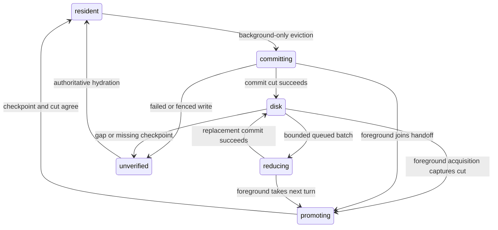

# Background Live Transcripts Implementation Plan

> **For agentic workers:** REQUIRED SUB-SKILL: Use superpowers:subagent-driven-development (recommended) or superpowers:executing-plans to implement this plan task-by-task. Steps use checkbox (`- [ ]`) syntax for tracking.

**Goal:** Keep every web Live session current before opening, with bounded background memory and lossless, same-connection reopening from the existing local disk cache.

**Architecture:** A web-lifetime owner discovers the complete Live roster without increasing visible navigation demand. The canonical thread store shares foreground/background subscription ownership and one reducer path; a per-ref residency coordinator serializes disk checkpoints, notifications and promotion. Current checkpoints extend the existing IndexedDB database and confer freshness only through the living coordinator's connection, clear epoch and receive cut.

**Tech Stack:** TypeScript, the existing AppWire client/reducer, Zustand, React, IndexedDB, Vitest/fake-indexeddb, Go browserguard fixtures and Chrome/CDP. No new dependency or server API.

**Spec:** `docs/superpowers/specs/2026-10-05-background-live-transcripts-design.md`, approved by Jesse, commit `4f99f44c1975329410edb5ff2b52bd57acf87c2b`.

## Global Constraints

The following values and rules come from the approved spec:

- Web UI, including its narrow-screen layout.
- All session refs represented in the complete Live navigation resource, across projects and attached remote hosts, including idle sessions.
- Delegates and archived sessions are outside discovery scope, even if running.
- Native and CLI clients do not acquire background transcript demand.
- No wildcard subscription, new server paging cursor, new outbox behavior, service worker, cross-tab leader election or separate cache database is proposed.
- Resident background transcript payload: **16 MiB aggregate**.
- Pending background notification payload: **4 MiB aggregate**.
- Background load/reduce/commit workers: **1**.
- Concurrent background network hydrations: **2**.
- Cache records on disk, both classes combined: **Existing 32 MiB aggregate**.
- Cache TTL: **Existing 14 days**.
- Payload accounting uses the encoded state/update size, including live overlay and structured item data, not just message counts.
- The same budgets cover background frame buffers, hydration buffers, retained write payloads and models awaiting disk handoff.
- Only a still-live in-memory coordinator can certify a checkpoint as current.
- Background discovery and hydration never enqueue, resume or dispatch mutations.
- Keep entire recorded histories and their cursors together when unloading.
- No open reader loses loaded pages, its scroll anchor or Find demand.
- Reconnect invalidates held history and replaces it with an authoritative latest window; page back through its returned cursor.
- Clear suppresses persistence until the pre-clear foreground/history holders and mutation pins release and a new explicit foreground acquisition hydrates authoritatively. Background churn does not reset suppression.
- Default tests use a scripted provider at the LLM boundary and real Evener plumbing. End-to-end tests must not substitute mocked Evener internals.

Implementation constraints:

- Work only in the existing isolated `wip/background-live-transcripts` lane. No product edits until Jesse reviews this plan.
- Execution is already chosen: fresh Luna implementation subagents, followed by independent reviews. Verify the exact available model before dispatch; the planning session verified `oai-jrv/gpt-6-luna`. Do not ask Jesse to choose an execution method again.
- Preserve the existing `cmd/evener-hub/frontend/node_modules` symlink and `core.hooksPath=scripts/hooks`. Never run `npm ci` through that symlink. A new delegate worktree must run the documented preflight or obtain a same-lockfile dependency install before checking anything.
- Read `AGENTS.md`, `docs/developing-evener/testing.md`, `docs/product/README.md`, `docs/product/subsystems.md` and the approved spec. Use package-name imports, not relative imports into `appwire-client/typescript`.
- Use existing deadlines: cache lookup **250 ms**, storage operation **10,000 ms**, resident cache writes **1,000 ms trailing / 5,000 ms maximum**. Use the existing hydration retry scheduler for paced reads. Test timers are injected; no sleeps or fixed microtask-flush counts.
- The new browser entry is test-only. Normal builds expose no debug RPC, query parameter or global control surface.

## Review Focus

1. **Hidden page fails during archive:** a foreground mutation must still converge on its own loaded resources. Pin this in Task 3, including a page acquired by both owners.
2. **Alias resolves to a new session during a disk operation:** keep the requested subscription key, reject the old checkpoint and hydrate the new identity. Pin this in Task 6.
3. **Two background reads finish while the disk worker is blocked:** response bodies, hydration deltas and retained write payloads must share the bounds, rather than forming a second staging queue. Pin this in Task 5.
4. **Clear outlives pane closure while Live membership persists:** suppression must survive background churn but end after a genuinely new foreground lifetime hydrates. Pin this in Task 6.
5. **A sibling clears after checkpoint lookup but before publication, with its broadcast lost:** allow the specified brief stale display, reject the old-epoch write, detect the durable epoch within 250 ms after promotion and reconcile. Pin this in Tasks 2 and 6.

---

## File boundaries and execution order

This is one coupled feature, not independent subsystem projects. Codec and storage are useful without enabling automatic background demand. Task 7 enables discovery only after the ownership, budget and recovery contracts pass.

| Unit | Files and responsibility |
| --- | --- |
| Reducer checkpoint codec | Extend `appwire-client/typescript/reducer.ts` beside the existing cache codec; export through `index.ts`. Preserve reducer-owned fields, item markers and overlay state; rebuild display turns. |
| Durable cache | Extend `cmd/evener-hub/frontend/src/stores/sessionCacheIndexedDB.ts`. One database, schema v2, shared epoch, TTL and aggregate accounting for both record classes. |
| Navigation demand | Extend `appwire-client/typescript/state/navigation/{store,revalidator,selectors,index}.ts`. Separate visible ownership from complete-roster demand while retaining shared requests. |
| Canonical thread ownership | Narrow changes in `cmd/evener-hub/frontend/src/stores/threads.ts`. Keep the existing pane API, hydration handoff, reducer and outbox owners; add independent background claims and no-dispatch hydration intent. |
| Residency coordination | New `cmd/evener-hub/frontend/src/stores/transcriptResidency.ts` and `transcriptPayloadBudget.ts`. Per-ref state, ordered work, promotion, bounds and recovery. Do not move unrelated mutation code out of `threads.ts`. |
| Web roster owner | New `cmd/evener-hub/frontend/src/stores/backgroundTranscripts.ts`, started from `shell/AppShell.tsx`. Walk complete Live pages and reconcile claims; own no renderer or mutation state. |
| Behavior tests | New focused tests beside each unit; existing cache/history/subscription/navigation tests remain regression gates. Real browser test uses an isolated test entry and the existing daemon/hub browserguard machinery. |
| Evergreen docs | New `docs/web-ui/session-cache.md`; update web guide, session-activity guide, subsystem map and affected protocol subscription prose. The approved dated spec stays the implementation input. |

Tasks 1 → 2 and Task 3 can be implemented in separate worktrees if parallelism helps. Task 4 follows Task 1; Task 5 follows Tasks 2 and 4; Task 6 follows Task 5; Task 7 follows Tasks 3 and 6; Task 8 follows Task 7. Never run two writers against the same checkout. Land and review each dependency before its consumer starts.

### Commands and evidence convention

All commands below run from the repository root unless they explicitly `cd`. Targeted TypeScript tests use the frontend's pinned Vitest:

```bash
cd cmd/evener-hub/frontend
./node_modules/.bin/vitest run --maxWorkers=2 src/stores/threads.sessionCache.test.ts src/stores/threads.history.test.ts ../../../appwire-client/typescript/threadSubscription.test.ts
```

Those three existing files passed 88 tests during spec preparation. That is a baseline, not evidence for this feature. Each implementation task must report its new test failing for the intended missing behavior, the passing rerun, and the affected existing tests. Fix a test's import/setup failure before counting its behavioral red run. Commands naming new files below are planned checks, not claims that those files or passing results already exist.

After a green task, format only its touched TypeScript paths from the frontend directory, inspect `git diff --check`, stage only the listed files, read `git diff --cached`, then commit with normal hooks. Do not run root-level `npx biome`.

## Task 1: Round-trip current reducer state without disk authority

**Files:**
- Modify: `appwire-client/typescript/reducer.ts`, cache-codec block around `CachedSessionRecord`, `threadModelFromCache` and `cachedSessionRecord`.
- Modify: `appwire-client/typescript/index.ts`, reducer exports.
- Create: `appwire-client/typescript/currentTranscript.test.ts`.
- Create: `appwire-client/typescript/testing/currentTranscript.ts`.

**Interfaces:**
- Consumes existing `ThreadModel`, `HistoryState`, `OverlayItem`, `CachedSessionHistory`, `hydrateThread`, `applyNotification`, `withDisplay`, and item text-presence helpers in `reducer.ts`.
- Produces the following exports. `fields` is an explicit allowlist, never a rest-spread of the runtime model.

```ts
export type CurrentTranscriptAdmission = Pick<ThreadModel,
  "capabilities" | "capabilitySource" | "instanceId" |
  "resumeRequired" | "resumeOnlyFoldable">;

export type CurrentTranscriptFields = Pick<ThreadModel,
  "ref" | "parentRef" | "threadId" | "imageSessionId" | "name" |
  "status" | "modelProvider" | "model" | "reasoningEffort" | "visionModel" |
  "askPending" | "pendingEscalations" | "activeTurnId" | "runningTurnId" |
  "queue" | "tasks" | "diagnostics" | "delegates" | "skills" | "turnSlots" |
  "jobsUpdatedAt" | "jobsTreeRevision" | "olderCursor" | "lastFrameAt" |
  "modelRetry" | "goal" | "humanNote" | "agentNote" | "sessionUrls" |
  "contextUsed" | "contextWindow" | "contextPressure" | "usage" | "cost" |
  "failedToolCalls" | "access" | "workMillis" | "activeTurnStartedAt" |
  "lastTurnEndedAt" | "reasoningEffortLevels" | "supportsReasoning" |
  "cwd" | "gitBranch" | "projectPath" | "createdAt" | "updatedAt">;

export interface CurrentTranscriptState {
  version: 1;
  fields: CurrentTranscriptFields;
  history: Omit<HistoryState, "turns"> & Pick<CachedSessionHistory, "turns">;
  overlay: Record<string, OverlayItem>;
}
export function currentTranscriptState(model: ThreadModel): CurrentTranscriptState | undefined;
export function decodeCurrentTranscriptState(value: unknown): CurrentTranscriptState | undefined;
export function threadModelFromCurrentState(
  state: CurrentTranscriptState,
  admission?: CurrentTranscriptAdmission,
): ThreadModel;
```

`queue` is the server's displayed input queue, not the local durable outbox. Do not persist `pendingMutations`, capabilities, resume admission, mutation runtime state or derived `turns`. The coordinator retains `CurrentTranscriptAdmission` in RAM while continuity holds. Only that coordinator supplies admission during restoration; a disk record alone cannot supply it. A stale seed must also clear running/active display indicators before publication and pass through `invalidateHistory` before an authoritative replacement.

- [ ] **Step 1: Add the wire fixture and failing round-trip test.** The new testing helper exports `currentRead(ref: string): ThreadReadResponse` and `textDelta(ref: string, delta: string): AnyNotification`:

```ts
import type { AnyNotification, ThreadReadResponse } from "../types.gen";
import { wireThread } from "./notifications";

export function currentRead(ref: string): ThreadReadResponse {
  return {
    thread: wireThread(ref),
    bootGeneration: "1", epoch: 1,
    snapshot: { incarnation: "inc-1", length: 40 },
    requestGeneration: 1, olderCursor: "older-40",
    overlay: [{
      key: "stream:s1:agentMessage", kind: "stream",
      streamId: "s1", roundId: "r1", turnId: "turn_1",
      item: { id: "a1", turnId: "turn_1", type: "agentMessage", text: "alpha" },
    }],
  };
}
export function textDelta(ref: string, delta: string): AnyNotification {
  return { method: "overlay/delta", params: {
    ref, threadId: `thr_${ref}`, key: "stream:s1:agentMessage", field: "text", delta,
  } };
}
```

Use the real reducer in the test:

```ts
const original = hydrateThread(currentRead("local:one"), "local:one", 10);
const encoded = currentTranscriptState(original);
expect(encoded).toBeDefined();
const decoded = decodeCurrentTranscriptState(JSON.parse(JSON.stringify(encoded)));
if (!decoded) throw new Error("valid current state did not decode");
const restored = threadModelFromCurrentState(decoded, {
  capabilities: original.capabilities,
  capabilitySource: original.capabilitySource,
  instanceId: original.instanceId,
  resumeRequired: original.resumeRequired,
  resumeOnlyFoldable: original.resumeOnlyFoldable,
});
const next = textDelta("local:one", "-beta");
expect(applyNotification(restored, next, 11).turns)
  .toEqual(applyNotification(original, next, 11).turns);
expect(restored.olderCursor).toBe("older-40");
expect(threadModelFromCurrentState(decoded).capabilities.send).toBe(false);
expect(encoded).not.toHaveProperty("turns");
expect(encoded?.fields).not.toHaveProperty("pendingMutations");
```

- [ ] **Step 2: Run red.**

```bash
(cd cmd/evener-hub/frontend && ./node_modules/.bin/vitest run --maxWorkers=2 ../../../appwire-client/typescript/currentTranscript.test.ts)
```

Expected initially: missing codec exports. After defining the API, the first behavioral red must show overlay loss or inability to continue the fold, not a malformed fixture.

- [ ] **Step 3: Implement the codec at the reducer boundary.** Share the existing history item encode/decode helpers with `cachedSessionRecord` and `threadModelFromCache`; preserve their existing output. Encode omitted-text markers explicitly, including any identity-only marker needed by a continuing fold. Materialize chunk views into plain arrays/strings without changing their text. Restore through `withDisplay`, never from a stored display projection:

```ts
// In threadModelFromCurrentState, after validating/decoding history items:
const model: ThreadModel = {
  ...state.fields,
  turns: [],
  capabilities: { ...EMPTY_CAPABILITIES },
  ...admission,
};
return withDisplay(model, history, state.overlay);
```

Here `history` is the decoded `HistoryState` constructed in this function using the shared item decoder. Enumerate every allowed `fields` property when encoding. The decoder rejects unsupported versions, malformed required fields, unusable positions, malformed history/overlay items and mismatched overlay keys; do not cast arbitrary JSON to a model. Unknown extra fields must never leak into the restored model. `currentTranscriptState` returns `undefined` for a model without versioned history, so callers take ordinary authoritative recovery rather than pretending a legacy snapshot is a complete checkpoint.

- [ ] **Step 4: Add continuation cases and run green.** Table-drive fixtures through JSON and then through the same subsequent notifications: omitted versus empty text, tool arguments/output/error and structured `raw`, images with resolved session routes, reasoning chunks, overlay retirement into history, delegates with projection revisions, loaded older turns/cursor, invalidated/failed history and deferred pages. Use `testing/{toolWireFixtures,notificationWireFixtures,subagentWireFixtures}.ts` for the real producer items. Assert literal text, item multiplicity, running status and paging identity against the fixture, as well as restored/uninterrupted equivalence. Add invalid/unknown-version decode cases and prove no admission or local mutation state is recovered without the RAM argument.

```bash
(cd cmd/evener-hub/frontend && ./node_modules/.bin/vitest run --maxWorkers=2 ../../../appwire-client/typescript/currentTranscript.test.ts ../../../appwire-client/typescript/reducer.test.ts src/stores/threads.sessionCache.test.ts)
```

- [ ] **Step 5: Commit the codec.**

```bash
git add appwire-client/typescript/reducer.ts appwire-client/typescript/index.ts appwire-client/typescript/currentTranscript.test.ts appwire-client/typescript/testing/currentTranscript.ts
git diff --cached
git commit -m "feat: encode current transcript checkpoints without mutation authority"
```

## Task 2: Store owner-scoped checkpoints in the existing cache

**Files:**
- Modify: `cmd/evener-hub/frontend/src/stores/sessionCacheIndexedDB.ts`.
- Create: `cmd/evener-hub/frontend/src/stores/sessionCacheCurrent.test.ts`.
- Modify: `cmd/evener-hub/frontend/src/stores/testing/stalledIndexedDB.ts` and `testing/stalledIndexedDB.test.ts`, transaction/lookup seams and their tests.
- Modify: `cmd/evener-hub/frontend/src/stores/sessionCacheIndexedDB.test.ts` and `threads.sessionCache.test.ts`, schema and exact-store transaction assertions only.

**Interfaces:**
- Consumes Task 1's codec and existing `IDBConnection`, `requestResult`, `transactionCompletion`, clear epoch and storage deadlines.
- Produces these types/methods on the existing `SessionCacheIndexedDB` class:

```ts
export type CurrentSessionKey = readonly [ownerToken: string, ref: string];
export interface CurrentSessionRecord {
  ownerToken: string;
  ref: string;
  connectionGeneration: number;
  ownershipGeneration: number;
  clearEpoch: number;
  appliedSequence: number;
  savedAt: number;
  state: CurrentTranscriptState;
}
export interface CurrentSessionLookup {
  record: CurrentSessionRecord | undefined;
  epoch: number;
}
// New class methods:
getCurrent(key: CurrentSessionKey, now: number): Promise<CurrentSessionLookup | undefined>;
putCurrent(record: CurrentSessionRecord, now: number): Promise<SessionCacheWriteOutcome>;
readEpoch(): Promise<number | undefined>;
// Existing written outcome gains optional eviction receipts:
// { outcome: "written"; evictedCurrent?: readonly CurrentSessionKey[] }
```

`undefined` lookup means storage failure/deadline, while `{record: undefined, epoch}` means a successful miss. `putCurrent` compares `record.clearEpoch` with the durable epoch in its transaction. It reports evicted current keys so the local coordinator can revoke their continuity claim immediately; another tab discovers its eviction through a subsequent lookup miss. `readEpoch()` is bounded by the existing 250 ms lookup deadline.

- [ ] **Step 1: Add the failing ownership/clear test.** Import the real codec and `currentRead` fixture, and use a fresh `IDBFactory` per test:

```ts
const cache = new SessionCacheIndexedDB({ indexedDB: new IDBFactory() });
const state = currentTranscriptState(hydrateThread(currentRead("local:one"), "local:one", 1));
if (!state) throw new Error("versioned fixture lacks current state");
const record: CurrentSessionRecord = {
  ownerToken: "tab-a", ref: "local:one", connectionGeneration: 1,
  ownershipGeneration: 1, clearEpoch: 0, appliedSequence: 7, savedAt: 1, state,
};
expect((await cache.putCurrent(record, 1)).outcome).toBe("written");
expect((await cache.getCurrent(["tab-a", "local:one"], 2))?.record?.appliedSequence).toBe(7);
expect((await cache.getCurrent(["tab-b", "local:one"], 2))?.record).toBeUndefined();
const cleared = await cache.clear();
expect(cleared.committed).toBe(true);
expect(await cache.putCurrent(record, 3)).toEqual({ outcome: "aborted", observedEpoch: cleared.epoch });
expect((await cache.getCurrent(["tab-a", "local:one"], 3))?.record).toBeUndefined();
```

- [ ] **Step 2: Run red.**

```bash
(cd cmd/evener-hub/frontend && ./node_modules/.bin/vitest run --maxWorkers=2 src/stores/sessionCacheCurrent.test.ts)
```

- [ ] **Step 3: Extend schema and transactions.** Set `DATABASE_VERSION = 2`. In the existing upgrade callback, create missing stores without recreating or clearing `records` or `meta`:

```ts
if (!database.objectStoreNames.contains("current")) {
  const current = database.createObjectStore("current", { keyPath: ["ownerToken", "ref"] });
  current.createIndex("ref", "ref", { unique: false });
}
if (!database.objectStoreNames.contains("currentMeta")) {
  const meta = database.createObjectStore("currentMeta", { keyPath: ["ownerToken", "ref"] });
  meta.createIndex("ref", "ref", { unique: false });
}
```

Current metadata holds only the key, encoded byte count and `savedAt`. Enumerate metadata, not bodies, for aggregate budget/expiry decisions. Reuse the UTF-8 byte counter and write-transaction wrapper; extend `beforeCommit` with `"putCurrent"` so a test can abort that real transaction. All put, clear, delete and sweep transactions that affect the aggregate include the four stores. Keep a single epoch row in `meta`.

Evict expired records first, then older recorded-history rows before valid current checkpoints, then oldest current checkpoints if the current class itself cannot fit. A normal history write must not evict a current checkpoint just to retain unrelated stale history; return `oversize` if its eligible room is insufficient. A current write may evict another current checkpoint only as the spec's exceptional disk-pressure path, returning its key. Delete an oversized replacement's old row so it cannot masquerade as the new state. Count unique session refs across both classes for Settings, without counting owner-token duplicates.

Clear both classes atomically with the epoch bump. `deleteRecords(refs)` removes both history rows and every owner's current row via the ref index. Malformed records are deleted as misses. All failures preserve the cache's best-effort outcomes, not uncaught exceptions. Old schema clients keep the existing VersionError/versionchange behavior; add no compatibility adapter.

Update `bumpCacheEpochRow` in the test seam to open the existing database without pinning version 1. Keep explicit v1 opens only in migration/version-fence tests. Adapt cache-specific `holdNextWriteTransaction` callers to the actual four-store transaction; retain the helper's exact-store matching so unrelated outbox transactions cannot satisfy a cache test. Do not change outbox transaction scopes.

- [ ] **Step 4: Prove migration, atomicity and combined bounds.** Seed a v1 database using the existing test setup, upgrade it with the v2 adapter, and verify the history row survives unchanged. Exercise all put orderings across the shared cap, TTL at its boundary, count deduplication, corrupt codec versions, deletion across two owners, quota abort rollback, open-blocked/versionchange deadlines, old-version fencing and concurrent clear/write transactions. Read the durable epoch after a held lookup transaction and a sibling clear; assert the old lookup's epoch differs and an old-epoch put aborts. Use real fake-indexeddb transactions and the existing stalled-IDB seam, not a fake cache class.

```bash
(cd cmd/evener-hub/frontend && ./node_modules/.bin/vitest run --maxWorkers=2 src/stores/sessionCacheCurrent.test.ts src/stores/sessionCacheIndexedDB.test.ts src/stores/threads.sessionCache.test.ts)
```

- [ ] **Step 5: Commit durable checkpoint storage.**

```bash
git add cmd/evener-hub/frontend/src/stores/sessionCacheIndexedDB.ts cmd/evener-hub/frontend/src/stores/sessionCacheCurrent.test.ts cmd/evener-hub/frontend/src/stores/testing/stalledIndexedDB.ts cmd/evener-hub/frontend/src/stores/testing/stalledIndexedDB.test.ts cmd/evener-hub/frontend/src/stores/sessionCacheIndexedDB.test.ts cmd/evener-hub/frontend/src/stores/threads.sessionCache.test.ts
git diff --cached
git commit -m "feat: share cache fences and budgets with current transcript records"
```

## Task 3: Scope navigation pages and convergence by demand owner

**Files:**
- Modify: `appwire-client/typescript/state/navigation/store.ts`, `revalidator.ts`, `selectors.ts`, `index.ts`.
- Create: `appwire-client/typescript/state/navigation/backgroundDemand.test.ts`.
- Modify: `cmd/evener-hub/frontend/src/shell/rail/Rail.tsx`, `loadedSection` resource selection.
- Create: `cmd/evener-hub/frontend/src/shell/rail/Rail.backgroundDemand.test.tsx`.
- Modify: `cmd/evener-hub/frontend/src/shell/rail/actions.test.ts`, archive convergence regression.
- Test: existing navigation store/revalidator/selectors tests and web Rail status/refresh tests.

**Interfaces:**
- Existing `loadSection(section, offset?, limit?)` remains foreground-owned.
- Add `visibleResourceKeys: ReadonlySet<string>` to `NavigationStoreState`. All existing `load*`/`track*` methods register foreground keys; background demand never adds one. Reset clears the set; generation refresh retains the user's loaded boundary.
- Add the following lease to `NavigationStore`, exported from the navigation package subpath:

```ts
export interface BackgroundLivePages {
  load(offset: number, limit?: number): Promise<ResourceState<NavigationSectionResource>>;
  release(): void;
}
// NavigationStore method:
acquireBackgroundLivePages(): BackgroundLivePages;
// NavigationRevalidator additions:
waitForTargets(
  targets: NavigationInvalidationTarget[],
  generationID?: string,
  keys?: ReadonlySet<string>,
): Promise<void>;
release(key: ResourceKey): void;
```

The optional revalidator wait set is a snapshot of canonical key IDs, not a mutable selector. Store-level `awaitNavigationTargets`, `applyNavigationMutation` and `awaitConvergence` always supply the foreground set. Background sweeps await their own page results. A shared page uses the same resource key/request and counts as foreground when explicitly loaded there. `release` removes a request only after the store's last demand owner releases it; visible demand retains its existing store-lifetime semantics.

- [ ] **Step 1: Pin hidden-page isolation.** Extend the existing scripted NavigationClient test fixture in the navigation store tests, using valid v3 responses. Test with page size 2 and six rows, keeping the first two pages visible and the third background-only:

```ts
const hidden = store.acquireBackgroundLivePages();
await store.getState().loadSection("live", 0, 2);
await store.getState().loadSection("live", 2, 2);
const before = selectLiveRows(store.getState()).map((row) => row.ref);
await hidden.load(4, 2);
expect(selectLiveRows(store.getState()).map((row) => row.ref)).toEqual(before);
expect(selectNextSectionOffset("live", store.getState())).toBe(4);
expect(selectSectionRemaining("live", store.getState())).toBe(2);
hidden.release();
```

The `store` is the real `createNavigationStore` instance connected to the existing scripted external client. Also assert a foreground load of offset 4 adopts the already read page without issuing another request and changes the visible boundary only at that point.

- [ ] **Step 2: Pin Review Focus 1 at the revalidator and action boundary.** With real `NavigationRevalidator`, register a visible page and hidden page. After revision 2 invalidates Live, make the visible request settle and the hidden request fail. A `waitForTargets` limited to the visible key resolves; a wait that names the hidden key rejects. In the web action test, archive a visible row through the real `shell/rail/actions.ts` path with the same hidden-page failure and assert action success and visible convergence. Acquiring the hidden page as foreground must put it into the next foreground wait. Do not suppress its error globally.

```ts
await expect(revalidator.waitForTargets(
  [{ kind: "section", section: "live", revision: 2 }], "g1", visibleKeys,
)).resolves.toBeUndefined();
```

- [ ] **Step 3: Run red, then implement ownership at registration.**

```bash
(cd cmd/evener-hub/frontend && ./node_modules/.bin/vitest run --maxWorkers=2 ../../../appwire-client/typescript/state/navigation/backgroundDemand.test.ts)
rg 'resources\.values\(|selectLiveRows|selectSectionRemaining|selectNextSectionOffset' cmd/evener-hub/frontend/src/shell/rail appwire-client/typescript/state/navigation
```

Use one per-key demand record in the store, with a foreground bit and a set of background lease tokens. Register ownership before `revalidator.load`, so a synchronously published result already has the right visibility. Filter section flattening, next-offset and remaining selectors by `visibleResourceKeys`, including loaded/visible lookups through `selectSessionSummary` and `selectGlobalRows`. In `Rail.tsx`, filter `loadedSection` before passing resources to `selectRailModel`; do not modify that pure per-resource adapter. Do not filter the shared `resources` map itself, because the background owner needs it.

- [ ] **Step 4: Run the existing navigation and rail tests.** Add reset, same-key deduplication, two background leases, release while in flight, generation reset, sequence gap and later-visible-page refresh cases. A disposed lease cannot publish into a replacement client. Foreground wait sets must include previously required location/project resources, not only Live pages.

```bash
(cd cmd/evener-hub/frontend && ./node_modules/.bin/vitest run --maxWorkers=2 ../../../appwire-client/typescript/state/navigation src/stores/navigation src/shell/rail)
```

- [ ] **Step 5: Commit demand scoping.** Stage only these package and web paths, then inspect the staged diff.

```bash
git add appwire-client/typescript/state/navigation/store.ts appwire-client/typescript/state/navigation/revalidator.ts appwire-client/typescript/state/navigation/selectors.ts appwire-client/typescript/state/navigation/index.ts appwire-client/typescript/state/navigation/backgroundDemand.test.ts cmd/evener-hub/frontend/src/shell/rail/Rail.tsx cmd/evener-hub/frontend/src/shell/rail/Rail.backgroundDemand.test.tsx cmd/evener-hub/frontend/src/shell/rail/actions.test.ts
git diff --cached
git commit -m "feat: separate background navigation demand from visible convergence"
```

## Task 4: Add background claims to the canonical thread lifetime

**Files:**
- Modify: `cmd/evener-hub/frontend/src/stores/threads.ts`, ownership/subscription helpers, pending hydration, `publishAndReconcileThreadHydration`, `handleNotification`, `handleReady`, `ensureThread`, `releaseThread`, `loadOlderTurns`, reset/teardown.
- Create: `cmd/evener-hub/frontend/src/stores/threads.background.test.ts`.
- Test: `appwire-client/typescript/threadSubscription.test.ts`, existing `threads.test.ts`, `threads.history.test.ts`, `threads.sessionCache.test.ts`.

**Interfaces:**
- Keep `ThreadsStoreState.ensureThread(ref): Promise<void>`, `releaseThread(ref): void` and `loadOlderTurns(ref): Promise<void>` unchanged for consumers.
- Export from `threads.ts`:

```ts
export interface BackgroundThreadLease {
  readonly ready: Promise<void>;
  release(): Promise<void>;
}
export function acquireBackgroundThread(ref: string): BackgroundThreadLease;
```

`ready` settles after the first bounded acquisition attempt or retirement, including a failed attempt that leaves the ref unverified and retrying. It is not a currentness certificate and never waits for every future retry. It does not grant mutation dispatch permission. `release()` is idempotent and settles after final available state has been drained/saved or explicitly classified stale after failure. A new claim cancels a pending release by generation.

Add an internal hydration intent discriminant, `"foreground" | "background" | "final"`. Background/final reads share the existing `beginThreadHydration` → `hydrateAndSubscribe` → buffered replay path. Only a foreground or existing mutation-pin recovery caller runs outbox reconciliation/dispatch hooks. Preserve existing receipt handling on live notifications; do not disable the outbox's independent recovery owner.

- [ ] **Step 1: Test resident adoption and independent release.** Use the real thread store, `FakeClient`, `currentRead`, and a real `SessionCacheIndexedDB` backed by `IDBFactory`. Follow the existing cache test's reset/teardown discipline. Register `thread/read` and `thread/unsubscribe` handlers before connecting:

```ts
const fake = new FakeClient("ready");
fake.on("thread/read", (params) => currentRead(params.ref));
fake.on("thread/unsubscribe", () => ({}));
connectionStore.getState().connect(fake);
const background = acquireBackgroundThread("local:one");
await background.ready;
const held = threadsStore.getState().threads.get("local:one");
const reads = fake.calls.filter((call) => call.method === "thread/read").length;
await threadsStore.getState().ensureThread("local:one");
expect(threadsStore.getState().threads.get("local:one")).toBe(held);
expect(fake.calls.filter((call) => call.method === "thread/read")).toHaveLength(reads);
threadsStore.getState().releaseThread("local:one");
fake.emitNotification(textDelta("local:one", "-after-close"));
expect(threadsStore.getState().threads.get("local:one")?.turns
  .flatMap((turn) => turn.items).map((item) => item.text).join(""))
  .toContain("alpha-after-close");
await background.release();
```

The generated unsubscribe result is `EmptyResponse`, so `{}` is the complete acknowledgment. Add both release orders, two panes, two background leases and an activity subscription holder using the actual `acquireThreadSubscription` API. Count subscription membership at the transport boundary, not just local claims.

- [ ] **Step 2: Run red.**

```bash
(cd cmd/evener-hub/frontend && ./node_modules/.bin/vitest run --maxWorkers=2 src/stores/threads.background.test.ts)
```

- [ ] **Step 3: Implement independent claims without a new transcript store.** Add background claims to `hydrationOwnerActive`, `syncThreadSubscription` and canonical routing. Keep `watchedThreads` unchanged; it is not this feature's backing store. Separate the canonical model's ownership generation from pane cache lifetimes so releasing the last pane cannot retire a background hydration. Track in-flight `loadOlderTurns` as a foreground/history hold until its `finally` completes. Mutation pins remain non-evictable.

Extract the existing store-specific notification fold into one local helper used by resident and later disk reductions:

```ts
function foldCanonicalNotification(
  model: ThreadModel, notification: AnyNotification, now: number,
): { model: ThreadModel; endedResumeOnly: boolean } {
  const endedRefs: string[] = [];
  const updated = settleResumeOnlyOffShutdown(
    model, applyNotification(model, notification, now), endedRefs,
  );
  return { model: updated, endedResumeOnly: endedRefs.includes(model.ref) };
}
```

Keep goal/notes fallback invalidation, receipt handling and liveness bookkeeping at their current acceptance/publication boundary. A disk fold will reuse this helper; it must not replay global receipt side effects a second time. Split hydration publication/admission capture from outbox reconciliation, then gate the latter by the caller's intent, not by Live membership. Existing user-requested recovery remains permitted even when the same ref has a background owner.

- [ ] **Step 4: Pin no-dispatch and late-completion behavior.** Seed real durable outbox rows using the existing mutation-test helpers, then acquire only background demand. Assert the rows are unchanged and no `turn/start`, `turn/steer`, `turn/queue` or resume request is sent by that acquisition. In a separate test, explicitly send through the existing foreground API and prove ordinary dispatch still works. Cover release during hydration, deletion, client replacement, stable aliases, and mutation pins. The current resident-only API is not wired into AppShell yet; do not enable unbounded automatic acquisition as an intermediate result.

```bash
(cd cmd/evener-hub/frontend && ./node_modules/.bin/vitest run --maxWorkers=2 src/stores/threads.background.test.ts src/stores/threads.test.ts src/stores/threads.history.test.ts src/stores/threads.sessionCache.test.ts ../../../appwire-client/typescript/threadSubscription.test.ts)
```

- [ ] **Step 5: Commit canonical ownership.**

```bash
git add cmd/evener-hub/frontend/src/stores/threads.ts cmd/evener-hub/frontend/src/stores/threads.background.test.ts
git diff --cached
git commit -m "feat: share canonical transcript ownership with background readers"
```

## Task 5: Bound residency and promote current disk state without a read

**Files:**
- Create: `cmd/evener-hub/frontend/src/stores/transcriptResidency.ts`.
- Create: `cmd/evener-hub/frontend/src/stores/transcriptPayloadBudget.ts`.
- Create: `cmd/evener-hub/frontend/src/stores/backgroundTranscriptOptions.ts`.
- Create: `cmd/evener-hub/frontend/src/stores/transcriptResidency.test.ts` and `transcriptPayloadBudget.test.ts`.
- Modify: `cmd/evener-hub/frontend/src/stores/threads.ts` and `threads.background.test.ts`.
- Modify: `cmd/evener-hub/frontend/src/stores/sessionCacheIndexedDB.ts`, import the extracted UTF-8 size helper.

**Interfaces:**

The options module contains only types, defaults and the test installer, with no store/app imports:

```ts
export interface BackgroundTranscriptOptions {
  residentBytes: number;
  pendingBytes: number;
  diskWorkers: 1;
  networkHydrations: number;
}
export const DEFAULT_BACKGROUND_TRANSCRIPT_OPTIONS: BackgroundTranscriptOptions = {
  residentBytes: 16 * 1024 * 1024,
  pendingBytes: 4 * 1024 * 1024,
  diskWorkers: 1,
  networkHydrations: 2,
};
export function backgroundTranscriptOptions(): Readonly<BackgroundTranscriptOptions>;
export function installBackgroundTranscriptOptionsForTests(
  options: Partial<BackgroundTranscriptOptions>,
): () => void;
```

`installBackgroundTranscriptOptionsForTests` must run before store/coordinator initialization, return restoration cleanup, and reject invalid/nonpositive limits except `residentBytes: 0`, which deliberately forces disk residency in tests. Production uses the constants unchanged. Tests reset the store before restoring options.

`transcriptResidency.ts` consumes Tasks 1–2's codec/storage and Task 4's canonical fold. Keep model bodies in the existing `threads` map, or in the single active disk worker; a ref entry holds metadata and bounded pending frames, not a hidden second retained model.

```ts
export interface TranscriptOwners {
  foreground: number;
  history: number;
  mutationPinned: boolean;
  background: number;
}
export interface ReceivedTranscriptUpdate {
  sequence: number;
  now: number;
  notification: AnyNotification;
  bytes: number;
}
export interface TranscriptResidencyPort {
  cache: SessionCacheIndexedDB;
  resident(ref: string): ThreadModel | undefined;
  publish(ref: string, model: ThreadModel): void;
  unload(ref: string): void;
  admission(ref: string): CurrentTranscriptAdmission | undefined;
  fold(ref: string, model: ThreadModel, update: ReceivedTranscriptUpdate): ThreadModel;
  hydrate(ref: string, intent: "background" | "foreground" | "final", signal: AbortSignal): Promise<void>;
}
export interface TranscriptResidency {
  owners(ref: string, owners: TranscriptOwners): void;
  connection(generation: number, ready: boolean): void;
  // Returns true when this coordinator queued or rejected the update,
  // so the ordinary resident fold must skip it.
  accept(ref: string, update: ReceivedTranscriptUpdate): boolean;
  // Called once after a resident fold or authoritative publish, never to fold again.
  published(ref: string, model: ThreadModel, appliedSequence: number): void;
  // Existing pending-hydration storage uses these reservations too.
  reservePending(ref: string, bytes: number): boolean;
  releasePending(ref: string, bytes: number): void;
  promote(ref: string): Promise<ThreadModel | undefined>;
  drain(ref: string): Promise<void>;
  revoke(ref: string, reason: "gap" | "storage" | "alias" | "deleted"): void;
  clear(epoch: number): void;
  dispose(): void;
  settled(): Promise<void>;
  snapshot(): TranscriptResidencySnapshot;
}
export interface TranscriptResidencySnapshot {
  residentBytes: number;
  pendingBytes: number;
  workerBytes: number;
  diskWorkers: number;
  networkHydrations: number;
  committedWrites: number;
  refs: ReadonlyMap<string, {
    resident: boolean;
    current: boolean;
    appliedSequence: number;
    persistence: "enabled" | "repairing" | "clear-suppressed";
  }>;
}
export function createTranscriptResidency(
  port: TranscriptResidencyPort,
  options: Readonly<BackgroundTranscriptOptions>,
): TranscriptResidency;
```

Expose thin test-only readers from `threads.ts`: `settleBackgroundTranscriptsForTests(): Promise<void>` and `backgroundTranscriptSnapshotForTests(): TranscriptResidencySnapshot`. They call `settled`/`snapshot`; they cannot mutate residency or force a successful result. `settled` joins currently scheduled work, not all future retry timers. The constructor generates one browser-instance owner token through the existing secure source; never persist and reuse it on reload.

`TranscriptResidencyPort.hydrate` delegates to the existing canonical hydration path. It neither creates another hydration buffer nor invents a replay cut. Add receive sequence/timestamps to that path's buffered updates, reserve their payload before appending, and feed the accepted cut to `published` after existing snapshot/replay reconciliation. Failed reservation invalidates the pending hydration; its eventual response cannot publish as current.

- [ ] **Step 1: Add the disk-resident activation test.** Install a zero resident budget before resetting/connecting the store. Use the real fake-indexeddb adapter, Task 1 fixtures and external `FakeClient`. Each test owns option and database cleanup.

```ts
const restoreOptions = installBackgroundTranscriptOptionsForTests({ residentBytes: 0, pendingBytes: 4096 });
resetThreadsStoreForTests();
const fake = new FakeClient("ready");
fake.on("thread/read", (params) => currentRead(params.ref));
connectionStore.getState().connect(fake);
const lease = acquireBackgroundThread("local:one");
await lease.ready;
await settleBackgroundTranscriptsForTests();
expect(threadsStore.getState().threads.has("local:one")).toBe(false);
fake.emitNotification(textDelta("local:one", "-disk"));
const reads = fake.calls.filter((call) => call.method === "thread/read").length;
await threadsStore.getState().ensureThread("local:one");
expect(fake.calls.filter((call) => call.method === "thread/read")).toHaveLength(reads);
expect(threadsStore.getState().threads.get("local:one")?.turns
  .flatMap((turn) => turn.items).map((item) => item.text).join(""))
  .toContain("alpha-disk");
```

Keep `restoreOptions`, pane release, lease release and database close in the test's cleanup, including failure paths. Test a notification arriving during the held `getCurrent` transaction; it must appear once whether it falls before or after the promotion cut.

- [ ] **Step 2: Run red.**

```bash
(cd cmd/evener-hub/frontend && ./node_modules/.bin/vitest run --maxWorkers=2 src/stores/transcriptResidency.test.ts src/stores/threads.background.test.ts)
```

- [ ] **Step 3: Implement serialized handoff, never a second fold.** Assign a monotonic sequence in `handleNotification` for the actual client/ready epoch, before handing a notification to any canonical target. Resolve nonresident targets with a small requested-ref/resolved-thread-id index; do not scan or load every checkpoint. Preserve the requested alias key independently of resolved identity.

Use these transitions; an asynchronous completion must match owner token, connection generation, per-ref ownership generation and clear epoch before publication:



Mark the ref as transferring synchronously before starting a commit. Every subsequent accepted notification goes to its bounded queue, so the committed cut and queue meet without a gap. Retain the model's accounted payload until commit succeeds; after success and matching ownership, remove it from `threads` without retiring its subscription, routing metadata or cache suppression. Split `removeThreadModel`'s current model removal from final lifetime retirement rather than calling the existing all-in-one finalizer for eviction.

Promotion captures the cut, joins any existing work, loads the current owner's checkpoint, verifies continuity, folds updates through that cut with `foldCanonicalNotification`, publishes once and transfers later updates back to ordinary resident reduction. It restores admission only from the live RAM record. A healthy resident promotion returns the same model object. A successful disk promotion calls no hydration completion dispatch hook and sends no `thread/read`.

One FIFO of ready refs plus an urgent foreground queue is sufficient. Keep one coalesced work entry per ref. Remove a ref from the ready queue before doing a bounded batch, then place it at the back only if more work exists. Keep at most one cache-sized temporary model in the disk worker. Background network reads have a separate two-slot scheduler, with foreground requests taking priority over queued work. Never wait for a failed remote's retry before starting another ready ref.

- [ ] **Step 4: Account retained payload before accepting it.** Move the existing `countUtf8Bytes(text: string): number` implementation from `sessionCacheIndexedDB.ts` into `transcriptPayloadBudget.ts` and export it. The cache imports it there; the budget module imports no cache or store. Also export `encodedPayloadBytes(value: unknown): number` and `TranscriptPayloadBudget` with `constructor(limit: number)`, `reserve(bytes: number): boolean`, `release(bytes: number): void`, `readonly used: number` and `readonly limit: number`. `encodedPayloadBytes` counts `JSON.stringify(value)` and returns `Infinity` for non-serializable input so admission refuses it. Charge all background pending buffers, completed read staging, write payloads retained across awaits and models awaiting eviction to the designated resident/pending budget. One active worker is accounted separately and capped by the disk record limit. Do not retain two large completed reads outside those buckets.

At hydration, history replacement and checkpoint boundaries, measure the actual encoded state. For individual text/output deltas, reserve their encoded update bytes before folding and increment a conservative payload upper bound without serializing the whole transcript. At the next checkpoint, replace that upper bound with the exact state size. Release reservations once the retained object leaves its owning queue. A resident candidate's LRU timestamp changes only on explicit foreground use, not background traffic. Do not round-robin unchanged disk-resident refs into RAM.

```ts
const size = encodedPayloadBytes(update.notification);
if (!residency.reservePending(ref, size)) {
  residency.revoke(ref, "gap");
  return;
}
// Append to the existing pending-hydration buffer only after reservation.
pending.notifications.push(update);
```

Adapt `pending.notifications` and its replay helper together to consume `ReceivedTranscriptUpdate`; foreground-only buffers keep existing semantics and are explicitly outside background bounds. Count the same accepted notification only once when a ref has both pane and background demand. Any queue rejection removes incremental continuity, rather than silently dropping a chunk and reporting currentness.

- [ ] **Step 5: Test Review Focus 3 and preservation under real cache transactions.** Hold the disk transaction while two background reads complete and many deltas arrive. Assert retained resident and pending bytes stay within injected limits at every acceptance/publication callback; report worker bytes separately. Independently compute UTF-8 JSON byte counts in the test and include emoji and structured tool output. Verify one disk worker, at most two background hydrations, foreground priority, fair draining and no full-state serialization per text delta. Test multiple older pages, a cursor and a visible later-page item across close → disk → reopen → further paging. While any pane, history request, Find reader or mutation pin holds the model, apply pressure and assert model/cursor preservation. Complete the streaming turn and assert one rendered copy after overlay retirement.

Use `holdNextWriteTransaction(["records", "meta", "current", "currentMeta"])` from the existing test seam. Keep that commit completion held while resolving two deferred `thread/read` responses. In the residency unit test's real port callbacks and after each queued update, assert:

```ts
const measured = residency.snapshot();
expect(measured.residentBytes).toBeLessThanOrEqual(options.residentBytes);
expect(measured.pendingBytes).toBeLessThanOrEqual(options.pendingBytes);
expect(measured.diskWorkers).toBeLessThanOrEqual(1);
expect(measured.networkHydrations).toBeLessThanOrEqual(2);
expect(measured.workerBytes).toBeLessThanOrEqual(32 * 1024 * 1024);
expect(encodedPayloadBytes({ text: "🙂", raw: { output: ["工具", 7] } }))
  .toBe(new TextEncoder().encode(JSON.stringify({ text: "🙂", raw: { output: ["工具", 7] } })).byteLength);
```

The deferred responses each exceed the remaining resident room but individually fit the disk cap. Require either accounted handoff or explicit unverified recovery; neither response may remain retained in an unmeasured list. Release the held transaction in `finally`, then require progress for both refs. A counter-only unit test is insufficient: the store test must exercise completed real hydration responses while commit completion remains held.

```bash
(cd cmd/evener-hub/frontend && ./node_modules/.bin/vitest run --maxWorkers=2 src/stores/transcriptPayloadBudget.test.ts src/stores/transcriptResidency.test.ts src/stores/threads.background.test.ts src/stores/threads.history.test.ts src/stores/threads.sessionCache.test.ts)
```

- [ ] **Step 6: Commit local promotion and bounds.**

```bash
git add cmd/evener-hub/frontend/src/stores/transcriptResidency.ts cmd/evener-hub/frontend/src/stores/transcriptPayloadBudget.ts cmd/evener-hub/frontend/src/stores/backgroundTranscriptOptions.ts cmd/evener-hub/frontend/src/stores/transcriptResidency.test.ts cmd/evener-hub/frontend/src/stores/transcriptPayloadBudget.test.ts cmd/evener-hub/frontend/src/stores/threads.ts cmd/evener-hub/frontend/src/stores/threads.background.test.ts cmd/evener-hub/frontend/src/stores/sessionCacheIndexedDB.ts
git diff --cached
git commit -m "feat: keep evicted background transcripts current on local disk"
```

## Task 6: Recover from gaps, storage failure, Clear and stale completions

**Files:**
- Modify: `cmd/evener-hub/frontend/src/stores/transcriptResidency.ts`, `threads.ts`, `transcriptResidency.test.ts`, `threads.background.test.ts`.
- Create: `cmd/evener-hub/frontend/src/stores/threads.backgroundRecovery.test.ts`.
- Modify: `cmd/evener-hub/frontend/src/stores/testing/stalledIndexedDB.ts` only for deterministic boundaries not already exposed.

**Interfaces:**
- Implements the failure/recovery branches of Task 5's `connection`, `revoke`, `clear`, `dispose` and promotion methods. No new public user API.
- Extends `CacheLifetime` internally with a foreground-lifetime generation/holder record distinct from background membership. The existing durable cache epoch and `clearInFlight` remain the shared authority for both record classes.
- Add this test-only completion seam to `testing/stalledIndexedDB.ts`. It holds the result of a real lookup after its transaction settles, allowing a sibling transaction to commit before publication:

```ts
export function holdNextCurrentLookup(cache: SessionCacheIndexedDB) {
  const read = cache.getCurrent.bind(cache);
  let reached!: () => void;
  let release!: () => void;
  const arrived = new Promise<void>((resolve) => { reached = resolve; });
  const gate = new Promise<void>((resolve) => { release = resolve; });
  const spy = vi.spyOn(cache, "getCurrent").mockImplementationOnce(async (...args) => {
    const result = await read(...args);
    reached();
    await gate;
    return result;
  });
  return { reached: arrived, release: () => { release(); spy.mockRestore(); } };
}
```

Import `SessionCacheIndexedDB` as a type in that test module. Register `release` in cleanup before starting the asynchronous operation. This delays a real storage result; it does not substitute a fabricated successful cache or reducer.

- [ ] **Step 1: Pin the continuous-Live clear/reopen case.** With an injected zero resident budget, acquire background demand and open the pane, then clear while both holders exist:

```ts
const cleared = await clearCachedSessions();
expect(cleared.committed).toBe(true);
expect(backgroundTranscriptSnapshotForTests().refs.get(ref)?.persistence)
  .toBe("clear-suppressed");
threadsStore.getState().releaseThread(ref);
await settleBackgroundTranscriptsForTests();
expect(threadsStore.getState().threads.has(ref)).toBe(false);
const readsBefore = fake.calls.filter((call) => call.method === "thread/read").length;
await threadsStore.getState().ensureThread(ref);
expect(fake.calls.filter((call) => call.method === "thread/read").length)
  .toBeGreaterThan(readsBefore);
expect(backgroundTranscriptSnapshotForTests().refs.get(ref)?.persistence).toBe("enabled");
threadsStore.getState().releaseThread(ref);
await settleBackgroundTranscriptsForTests();
const afterRecovery = fake.calls.filter((call) => call.method === "thread/read").length;
await threadsStore.getState().ensureThread(ref);
expect(fake.calls.filter((call) => call.method === "thread/read")).toHaveLength(afterRecovery);
```

Use Task 5's full real-store setup with `ref = "local:one"`, scripted reads and real IndexedDB adapter. Add a pin and a second pre-clear pane in separate cases: until both release, a new pane cannot reset suppression. With no pre-clear foreground holder, the next explicit pane can establish the new lifetime. Background release/reacquire and reconnect alone must never enable caching.

- [ ] **Step 2: Pin failure → useful operation, then run red.** Block or abort a real `putCurrent` transaction; stream until pending admission refuses another update. Assert the ref is unverified, its old checkpoint cannot satisfy promotion, bytes remain bounded, and an explicit open issues authoritative hydration. Remove the storage fault, advance the injected retry scheduler, then require a successful checkpoint, actual RAM eviction and a later no-read local open. A successful probe without a checkpoint is not recovery evidence.

```bash
(cd cmd/evener-hub/frontend && ./node_modules/.bin/vitest run --maxWorkers=2 src/stores/threads.backgroundRecovery.test.ts)
```

- [ ] **Step 3: Implement explicit recovery states.** Storage failures and overload enter `repairing`; successful checkpoint commit returns to `enabled`. Retry automatically using one coalesced bounded-backoff timer per affected ref and the shared paced hydration queue. A storage deadline releases the worker. An expired callback or old transaction cannot consume the replacement worker's token. `clear-suppressed` never arms a storage-repair timer or probe. If suppression prevents writing and the background RAM budget is exhausted, release excess payload and retain an unverified metadata entry; opening recovers through the existing cache-seeded authoritative path.

Synchronous connection loss revokes all current proofs, including nonresident refs, before another promotion can succeed. Invalidate held histories with the existing reconnect helper; restored stale state must also be invalidated so the authoritative read replaces, not merges. Pace reconnect hydration for every desired ref, whether in RAM or on disk. Keep rendered stale state usable without reviving old running indicators, capabilities or resume admission. Source failure affects only its refs.

For an oversized checkpoint containing older history, request a latest window only when background-only, with no held snapshot, and adopt the server's new cursor. If the fresh live state still cannot fit, remain unverified with bounded payload and ordinary foreground recovery. Do not retry the same oversized unchanged state continuously, and never trim items while preserving an incompatible old cursor.

- [ ] **Step 4: Implement the clear/publication and deletion fences.** Same-tab clear synchronously retires in-flight promotion/hydration claims; commit suppresses held lifetimes and abort preserves the existing cache-clear semantics. Do not reset a lease's suppression when evicting its model. Only a qualifying explicit foreground acquisition may capture a new epoch after the old foreground/history/pin holders finish, and it must hydrate authoritatively before writes resume.

After every successful disk promotion, schedule the bounded durable-epoch recheck independently of broadcasts:

```ts
const observed = await port.cache.readEpoch();
if (observed === undefined || observed !== promotionEpoch) {
  // Re-enter the same fenced recovery path as an observed clear/gap.
  // Publication already visible is retained only as stale display state.
  if (observed !== undefined) residency.clear(observed);
  else residency.revoke(ref, "storage");
}
```

Here `promotionEpoch` is the lookup transaction's captured epoch. This is part of the promotion operation's tracked asynchronous work, not a global lock. Guard its completion by the same client/owner/claim generation so it cannot invalidate a newer lifetime. Clear/delete transactions reject or remove old writes; the coordinator also rejects late read/page results. Deletion retires ref work, routing and subscription demand, and keeps the existing durable deletion marker. Client replacement retires the owner token and cancels all queued work before wiring the replacement.

- [ ] **Step 5: Exercise the ordering matrix.** Parameterize the existing transaction hold seams and client events; require literal produced text/item multiplicity plus wire request counts, not only coordinator flags:

| Boundary/condition | Required result |
| --- | --- |
| Notification during eviction commit | Exactly one copy, on either resident handback or disk promotion. |
| Foreground acquisition/release during disk read/write | No dual owner, no lost accepted cut, no unnecessary read on healthy promotion. |
| Resync/reconnect during promotion | Old checkpoint cannot certify currentness; latest-window read replaces history; paging returns the old later-page sentinel once. |
| Alias rebind during read/commit | Requested key remains subscribed, old resolved history/overlay rejected, new identity hydrated. |
| Delete during promotion/hydration/older-page read | No late publication, disk resurrection, retry or subscription reacquisition. |
| Sibling clear after lookup, delayed/lost broadcast | Spec-permitted brief display, rejected old-epoch put, epoch recheck within 250 ms, suppressed authoritative recovery. |
| Same-tab clear while resident write/nonresident update is pending | Atomic empty cache, stale completions fenced, bounded RAM, no repair-loop writes. |
| Blocked/open-failed IDB, quota abort, disk eviction, giant item | Bounded unverified fallback; removing the fault restores a real disk-backed no-read open automatically. |
| One unavailable remote alongside healthy local/remote refs | Healthy refs hydrate and drain before the failed ref's later retry. |
| Cache owner A and owner B, same requested ref | Neither borrows the other's continuity or overwrites its checkpoint. |

After reconnect load more than one older page and locate a previously visible later-page item. Do not assert retention of the pre-reconnect cursor. Check existing outbox acceptance/replay and cache-clear abort tests unchanged.

- [ ] **Step 5a: Pin Review Focus 2 at the held-lookup boundary.** In the residency test, create a disk checkpoint for a requested alias and retain its original resolved thread ID. Start promotion, then revoke its alias continuity before releasing the lookup:

```ts
const heldLookup = holdNextCurrentLookup(cache);
const opening = residency.promote(ref);
await heldLookup.reached;
residency.revoke(ref, "alias");
heldLookup.release();
await opening;
await residency.settled();
expect(port.resident(ref)?.threadId).not.toBe(originalThreadID);
```

The port uses the real reducer and scripts the authoritative replacement as `currentRead(ref)` with `thread.id`/`thread.sessionId` set to the replacement identity and literal replacement text. Assert that replacement identity/text, not just inequality. Add a store-level case through its existing resync/authoritative alias-resolution path: the requested subscription ref survives, while old resolved IDs, overlays and late pages cannot re-enter the model. This distinguishes requested routing identity from resolved session identity.

- [ ] **Step 5b: Pin Review Focus 5 without a broadcast.** Use two cache adapters backed by the same `IDBFactory`. Start from a healthy disk checkpoint and hold the first adapter's lookup result. Clear with the sibling directly, without emitting a channel notification:

```ts
const heldLookup = holdNextCurrentLookup(cache);
const opening = threadsStore.getState().ensureThread(ref);
await heldLookup.reached;
const cleared = await sibling.clear();
expect(cleared.committed).toBe(true);
heldLookup.release();
await opening;
await settleBackgroundTranscriptsForTests();
expect(backgroundTranscriptSnapshotForTests().refs.get(ref)?.persistence)
  .toBe("clear-suppressed");
expect((await cache.putCurrent(preClearRecord, 3)).outcome).toBe("aborted");
```

`preClearRecord` is the real fixture checkpoint saved before starting this promotion. Assert the post-promotion durable epoch check starts immediately and resolves or times out within 250 ms using fake time; require an authoritative read after detection. The brief pre-clear display is allowed, durable resurrection is not. Repeat with epoch lookup failure and with a replacement client before the delayed result arrives.

```bash
(cd cmd/evener-hub/frontend && ./node_modules/.bin/vitest run --maxWorkers=2 src/stores/threads.backgroundRecovery.test.ts src/stores/transcriptResidency.test.ts src/stores/threads.background.test.ts src/stores/threads.sessionCache.test.ts src/stores/threads.history.test.ts src/stores/threads.test.ts src/stores/sessionCacheCurrent.test.ts)
```

- [ ] **Step 6: Commit recovery and preservation.**

```bash
git add cmd/evener-hub/frontend/src/stores/transcriptResidency.ts cmd/evener-hub/frontend/src/stores/threads.ts cmd/evener-hub/frontend/src/stores/transcriptResidency.test.ts cmd/evener-hub/frontend/src/stores/threads.background.test.ts cmd/evener-hub/frontend/src/stores/threads.backgroundRecovery.test.ts cmd/evener-hub/frontend/src/stores/testing/stalledIndexedDB.ts
git diff --cached
git commit -m "feat: recover disk-backed transcripts without undoing cache clear"
```

## Task 7: Keep the complete Live roster owned by the web lifetime

**Files:**
- Create: `cmd/evener-hub/frontend/src/stores/backgroundTranscripts.ts` and `backgroundTranscripts.test.ts`.
- Modify: `cmd/evener-hub/frontend/src/shell/AppShell.tsx` and `AppShell.test.tsx`.
- Modify: `cmd/evener-hub/frontend/src/stores/threads.ts` and `threads.backgroundRecovery.test.ts`, final-release branch only.
- Create: `docs/web-ui/session-cache.md`.
- Modify: `docs/web-ui/README.md`, `docs/product/session-activity.md`, `docs/product/subsystems.md`, `docs/appwire-protocol.md`.

**Interfaces:**
- Consumes Task 3's `NavigationStore.acquireBackgroundLivePages`, existing `subscribe`/`getState`, `ResourceState<NavigationSectionResource>`, and Task 4's thread leases.
- Produces these exports from `backgroundTranscripts.ts`:

```ts
export function eligibleLiveRefs(rows: readonly NavigationSessionSummary[]): Set<string>;
export interface BackgroundTranscriptsOwner {
  dispose(): Promise<void>;
  settled(): Promise<void>;
}
export function startBackgroundTranscripts(navigation: NavigationStore): BackgroundTranscriptsOwner;
```

`settled` joins the current sweep and acquisition/release work, not future retry timers. `dispose` synchronously stops accepting navigation changes, then releases its claims; it does not close the shared client. Each owner holds one background page lease and one thread lease per requested ref. AppShell owns one instance per actual client lifetime, including StrictMode cleanup and client replacement.

- [ ] **Step 1: Pin recursive eligibility and opaque identity.** Add this typed fixture in `backgroundTranscripts.test.ts`:

```ts
function liveRow(ref: string, fields: Partial<NavigationSessionSummary> = {}): NavigationSessionSummary {
  return {
    ref, host_id: "local", session_id: ref, title: ref, project: "p",
    state: "idle", kind: "session", live: true, children: [], ...fields,
  };
}
expect([...eligibleLiveRefs([
  liveRow("local:idle", { children: [liveRow("remote-a:nested", { host_id: "remote-a" })] }),
  liveRow("remote-b:same-id", { host_id: "remote-b" }),
  liveRow("local:idle"),
  liveRow("local:delegate", { kind: "subagent" }),
  liveRow("local:ended", { live: false }),
])]).toEqual(["local:idle", "remote-a:nested", "remote-b:same-id"]);
```

Walk children recursively, retaining rows with `kind === "session" && live`. Do not filter on active/running state, strip host prefixes, infer sessions from other sections or request activity collections.

- [ ] **Step 2: Pin discovery and removal with the real stores.** Connect a `FakeClient` to the real navigation and thread stores. Script v3 `navigation/read` using `wireSnapshot` from `@evener/appwire-client/testing/navigation`, and `thread/read` with Task 1's `currentRead`. Use three Live pages at `NAVIGATION_SECTION_LIMIT`. Put an idle remote ref on the last page and a nested eligible session in the first. Foreground-load two pages before starting the owner:

```ts
const visible = selectLiveRows(navigationStore.getState()).map((row) => row.ref);
const nextOffset = selectNextSectionOffset("live", navigationStore.getState());
const owner = startBackgroundTranscripts(navigationStore);
await owner.settled();
const reads = new Set(fake.calls.filter((call) => call.method === "thread/read")
  .map((call) => call.params.ref));
expect(reads.has("remote-a:last-page-idle")).toBe(true);
expect(reads.has("remote-a:nested")).toBe(true);
expect(selectLiveRows(navigationStore.getState()).map((row) => row.ref)).toEqual(visible);
expect(selectNextSectionOffset("live", navigationStore.getState())).toBe(nextOffset);
```

The fixture supplies the named literal refs. After acquisition, reorder pages and remove one held row while another page fails or returns a different revision. Assert no unsubscribe for the missing row. Complete a coherent replacement sweep and assert that only the removed row releases. Add invalidation during the terminal-page request, a non-advancing truncated page, generation replacement, duplicate refs, disappearance/reappearance during release, and unsupported navigation capability. Await actual promises/notifications; use fake time only for retry scheduling.

- [ ] **Step 3: Run red.**

```bash
(cd cmd/evener-hub/frontend && ./node_modules/.bin/vitest run --maxWorkers=2 src/stores/backgroundTranscripts.test.ts src/shell/AppShell.test.tsx)
```

- [ ] **Step 4: Implement coherent sweeps and lifecycle wiring.** Record a sweep token, navigation `clientGenerationID` and the first settled page's logical revision. Read contiguous offsets through the page lease; advance by top-level row count with `nextNavigationOffset`, never by recursively counted refs. Require each page's `generationID`, `loadedRevision`, data generation/revision, freshness and terminal condition to agree before releasing absent refs. No advancing rows with `truncated: true` means incomplete. Fresh-page additions may acquire immediately; failed/mixed sweeps retain previous owners.

```ts
export function eligibleLiveRefs(rows: readonly NavigationSessionSummary[]): Set<string> {
  const refs = new Set<string>();
  const visit = (row: NavigationSessionSummary) => {
    if (row.kind === "session" && row.live) refs.add(row.ref);
    row.children.forEach(visit);
  };
  rows.forEach(visit);
  return refs;
}
```

Coalesce invalidations into one superseding sweep. The sweep's own resource publications must not schedule an endless new sweep. Retain page demand needed by the current/last coherent sweep; retire trailing hidden pages after coherent shrinkage. Reconnect/new generations schedule fresh sweeps without dropping existing thread demand first. Do not await one ref's `ready` before acquiring the next: residency, not discovery order, owns hydration concurrency.

In AppShell's client connection effect, start after `connectionStore.getState().connect(client)` and stop in that effect's existing cleanup before client teardown:

```ts
const backgroundTranscripts = startBackgroundTranscripts(navigationStore);
// In the existing effect cleanup, alongside its other disposals:
void backgroundTranscripts.dispose();
```

Observe navigation initialization already performed by the app. Do not add another initialize request or tie lifetime to the selected pane, rail expansion, width or visibility. Fence asynchronous disposal against a replacement owner so StrictMode cannot unsubscribe its successor.

- [ ] **Step 5: Finish final-tail release.** In `BackgroundThreadLease.release`, mark release-in-progress, drain accepted updates, then attempt a final canonical authoritative snapshot with intent `"final"` while reachable. Keep subscription demand until that snapshot's replay boundary and final persistence settle. A reappearing ref advances ownership generation and cancels retirement. Final read failure retains available state as stale, releases bounded payload and does not block other releases; reuse hydration/storage deadlines. Foreground/activity/pin ownership survives background release.

Add a deterministic test that removes Live membership before delivering the last text chunk, holds the final read, then returns the completed transcript. Assert the retained cache contains the literal final chunk once. Add failed final read and reappearance cases. Final-release payload uses the ordinary pending/worker budgets; final reads consume background hydration slots.

- [ ] **Step 6: Update evergreen contracts and run green.** Document the record classes, 16/4/32 MiB limits, continuity-qualified reopening, final-tail release, automatic recovery, Clear lifetimes and reconnect paging. Link `session-cache.md` from the web guide. In the session-activity guide/subsystem map, distinguish web roster ownership from shared subscription ownership and state that native/CLI demand is unchanged. Correct affected protocol prose to additive subscription leases, without changing messages. Preserve the approved spec.

```bash
(cd cmd/evener-hub/frontend && ./node_modules/.bin/vitest run --maxWorkers=2 src/stores/backgroundTranscripts.test.ts src/stores/threads.backgroundRecovery.test.ts src/shell/AppShell.test.tsx src/shell/rail ../../../appwire-client/typescript/state/navigation ../../../appwire-client/typescript/threadSubscription.test.ts)
```

AppShell tests must prove one owner across rerenders, cleanup/remount, replacement client and desktop/narrow layouts. Rail tests must retain a previously loaded later-page row and Load more control after background discovery and reconnect.

- [ ] **Step 7: Commit complete Live ownership and documentation.**

```bash
git add cmd/evener-hub/frontend/src/stores/backgroundTranscripts.ts cmd/evener-hub/frontend/src/stores/backgroundTranscripts.test.ts cmd/evener-hub/frontend/src/shell/AppShell.tsx cmd/evener-hub/frontend/src/shell/AppShell.test.tsx cmd/evener-hub/frontend/src/stores/threads.ts cmd/evener-hub/frontend/src/stores/threads.backgroundRecovery.test.ts docs/web-ui/session-cache.md docs/web-ui/README.md docs/product/session-activity.md docs/product/subsystems.md docs/appwire-protocol.md
git diff --cached
git commit -m "feat: maintain every Live web transcript before pane activation"
```

## Task 8: Prove the real background-to-disk-to-pane journey

**Files:**
- Create: `cmd/evener-hub/background_transcripts_browser_test.go`, build tag `browserguard`.
- Modify: `cmd/evener/skill_browser_helper_test.go`, deterministic provider/fixture controls only.
- Create: `cmd/evener-hub/frontend/scripts/backgroundtranscriptguard/index.html`, `run.mjs`, `README.md`.
- Create: `cmd/evener-hub/frontend/src/dev/backgroundTranscriptGuard.tsx`.
- Modify: `cmd/evener-dev/webbrowser.go` and `webbrowser_test.go`, named guard and launch-contract tests.

**Interfaces and real harness:**
- Export Go test `TestBackgroundTranscriptsBrowser`. Reuse `skillGuardSetup`, `skillGuardStartHelper` and cleanup from `cmd/evener-hub/skill_composer_browser_test.go`; both compile under `browserguard`. Use the same real roster, past index, `newWebServer`, two helper daemons and `appserver.NewWebSocketTrace`. Fixture state/trace files belong in the test's private temporary directory.
- Extend the helper's scripted LLM boundary with channel-backed `llm.Stream` events, using `llm.NewChanStream` as in `agent/session_test.go`'s `streamingAdapter.Stream` and `llm/example_test.go`. `server/transcript_parity_test.go` is not a streaming precedent: its provider returns `llm.ErrStreamUnsupported`.
- `run.mjs` receives fixture hub/auth URLs, refs, control paths and artifact directory from the Go test. Validate arguments before Chrome. Reuse the skillguard driver's control-file format and CDP utilities, not a product endpoint. Fixture phase commands must be acknowledged, cancelable and confined to the fixture directory.
- The test entry installs Task 5's tiny budgets before importing the real app. Normal production HTML/build inputs stay unchanged.

- [ ] **Step 1: Test guard registration, then add the isolated entry.** In `webbrowser_test.go`, add a failing test that `backgroundtranscriptguard` is registered, uses the exact Go command below, is never signalled mid-cleanup, and has an isolated Vite cache. Then add it to `browserGuards`, `needsBuild` and `unsignalled`, with this launch contract:

```go
case backgroundTranscriptGuard:
    return guardSpec{
        name: guard,
        argv: []string{"go", "test", "-tags", "browserguard", "./cmd/evener-hub", "-run", "^TestBackgroundTranscriptsBrowser$", "-count=1"},
        dir: ".",
        env: []string{vite},
    }
```

Define `backgroundTranscriptGuard = "backgroundtranscriptguard"` beside existing constants. Run `go test ./cmd/evener-dev -run 'Test.*Browser' -count=1` red before registration, then green. Keep existing registration/cancellation tests unchanged.

The new nested HTML has a root element and a module script for `/src/dev/backgroundTranscriptGuard.tsx`. The entry is:

```ts
import { installBackgroundTranscriptOptionsForTests } from "../stores/backgroundTranscriptOptions";

installBackgroundTranscriptOptionsForTests({ residentBytes: 64 * 1024, pendingBytes: 32 * 1024 });
await import("../main");
const threads = await import("../stores/threads");
Object.defineProperty(window, "backgroundTranscriptEvidence", {
  value: Object.freeze({
    snapshot: threads.backgroundTranscriptSnapshotForTests,
    settled: threads.settleBackgroundTranscriptsForTests,
  }),
});
```

Keep all global installation in the dev entry. The installer module has no transitive app/store import. Assert installer-before-initialization in the browser test; limits changed after startup do not test the budget contract.

- [ ] **Step 2: Connect that entry to a real fixture hub.** Use `startBrowserGuard` from `scripts/browserGuardProcess.mjs` with `viteConfigFile: "scripts/browserguard.vite.config.mjs"`. Before starting it, set `process.env.EVENER_HUB_ADDR` to the fixture hub URL. The Vite child inherits that environment; existing configuration proxies `/rpc` WebSockets and hub HTTP routes. Use the same hostname for hub and Vite, authenticate through the hub-issued auth URL, then navigate to the Vite origin's `/scripts/backgroundtranscriptguard/index.html`.

Use `try/finally` for browser cleanup and `t.Cleanup` for Go fixtures. Failed auth, proxy connection, Chrome launch or provider phase fails the test. Assert a real hub connection before the workload. This exercises real application modules in Vite development mode, not a byte-identical production bundle; existing production-bundle browser guards remain required.

- [ ] **Step 3: Write the whole-journey assertions and run red.** Script literal sentinels through the provider boundary and a real `exec_command` invocation. The Go fixture retains expected sentinels/refs independently of the coordinator. The scripted stream uses:

```go
stream := llm.NewChanStream(cancel)
go func() {
    defer stream.CloseSend()
    stream.Send(llm.StreamEvent{Type: llm.StreamEventStreamStart})
    stream.Send(llm.StreamEvent{Type: llm.StreamEventTextDelta, Delta: "BACKGROUND_BEFORE_EVICTION"})
    if !a.waitBackgroundPhase(ctx, "after-eviction") { return }
    stream.Send(llm.StreamEvent{Type: llm.StreamEventTextDelta, Delta: "BACKGROUND_AFTER_EVICTION"})
    if !a.waitBackgroundPhase(ctx, "finish") { return }
    stream.Send(llm.StreamEvent{Type: llm.StreamEventFinish})
}()
```

Add `Phase string` to `skillBrowserControlCommand` and a fixture-only `"background-phase"` branch in `skillBrowserControls` that releases a named one-shot channel on the adapter and logs its acknowledgment. Define `(*skillBrowserAdapter).waitBackgroundPhase(ctx context.Context, phase string) bool` to wait on that channel or context cancellation, returning true only for the phase. Reuse the existing fsnotify-backed JSONL reader, never a second polling reader. `cancel` is the stream context cancel function. Gate scripted streaming behind an explicit fixture mode so the existing skill guard retains its Complete behavior. Use real structured tool-call events/results for the tool phase.

Driver assertions, in order:

1. Leave the target unopened. Wait for its actual background read/subscription and produced text. Another session plus deterministic structured output exceeds the injected resident budget. Observe the target absent from the resident map via read-only evidence and its checkpoint committed in real IndexedDB.
2. Only then release the next provider phase. Emit `BACKGROUND_AFTER_EVICTION` and real tool output. Wait for accepted work to settle; record the hub trace position and `thread/read` count.
3. Open through the rail. Assert literal before/after text, tool output and running state in the renderer, with zero activation reads between the trace position and pane readiness. Finish the turn and assert each produced item/chunk appears once after overlay retirement.
4. Produce enough turns for at least two older pages. Keep a visible later-page sentinel and its cursor. Close, force disk handoff, reopen without a read, and verify the sentinel, cursor and further paging. Exercise an open Find/history holder under pressure without removing its model.
5. Break the actual WebSocket through Chrome network controls, produce a completed turn during the gap, then reconnect. Require authoritative latest-window replacement. Page back through the returned cursor to the prior later-page sentinel, without duplicates or skipped produced turns. Do not require the old cursor after reconnect.
6. Repeat activation/preservation checks at a narrow viewport. Run a bounded sustained workload across both sessions, recording payload/worker peaks, committed writes and activation reads. Prove batching with acknowledged held-work phases, not timing-dependent write/chunk ratios.

Inspect real hub AppWire requests and rendered items, not only coordinator flags. Print observed counts and produced/observed sentinel comparisons; tiny-budget fixtures are not a production latency benchmark.

```bash
make build-web
go test -tags browserguard ./cmd/evener-hub -run '^TestBackgroundTranscriptsBrowser$' -count=1
```

The meaningful red run must fail a journey assertion; missing dependencies or setup/type errors do not count. Prove the oracle by omitting the post-eviction fixture phase and observing its content assertion fail, then restore the phase before green. Do not commit a weakened assertion or disabled behavior.

- [ ] **Step 4: Run the journey green and check build isolation.** Run the commands above to exit zero with all phases asserted. Add a check over normal built assets that the nested HTML and dev evidence global are absent. Keep the entry outside production build inputs/public assets. Document auth/proxy prerequisites, phase protocol, evidence and cleanup in the guard README.

- [ ] **Step 5: Run affected gates, then commit.** Read gate implementations before reporting them. Format every touched TypeScript file with the pinned formatter from the frontend directory, then:

```bash
go test ./cmd/evener-dev -run 'Test.*Browser' -count=1
make test-web
make test-api-package
make test-native
make test-web-browser
git diff --check
```

Shared navigation/reducer changes require the native gate despite unchanged native demand. Fix in-scope failures red-first; report external blockers accurately. Full repository lint/vet/test, race and fuzz evidence comes from CI; these targeted commands do not replace it.

```bash
git add cmd/evener-hub/background_transcripts_browser_test.go cmd/evener/skill_browser_helper_test.go cmd/evener-hub/frontend/scripts/backgroundtranscriptguard/index.html cmd/evener-hub/frontend/scripts/backgroundtranscriptguard/run.mjs cmd/evener-hub/frontend/scripts/backgroundtranscriptguard/README.md cmd/evener-hub/frontend/src/dev/backgroundTranscriptGuard.tsx cmd/evener-dev/webbrowser.go cmd/evener-dev/webbrowser_test.go
git diff --cached
git commit -m "test: prove background transcript disk handoff through real web routing"
```

## Delivery after all eight tasks

- [ ] Review the immutable base/head diff, approved spec and actual behavior evidence with the required independent implementation reviewers, including new files. Fix evidenced findings red-first; obtain Jesse's approval for spec changes.
- [ ] Use `simplify-code:simplify-code`, preserving behavior, and rerun affected checks.
- [ ] Use `shepherd-pr:shepherd-pr`. Batch each round into one push, inspect exact-head CI/RoboRev findings, and follow repository merge-approval policy.
- [ ] Verify GitHub reports the intended merged content, then clean only owned disposable scratch/worktrees. Preserve shared dependencies and the plan/spec. Report PR/merge SHA, evidence, measured counts and remaining limits. Do not deploy or restart the hub without separate authorization.

## Plan self-review record

Coverage map: codec/admission (Task 1), disk fences/budget (Task 2), hidden navigation/mutation waits (Task 3), shared ownership/no dispatch (Task 4), bounded handoff/promotion (Task 5), recovery/Clear/reconnect/alias/deletion (Task 6), complete roster/final tail/docs (Task 7), real journey/resource measurements/client gates (Task 8). The five Review Focus cases belong to Tasks 3, 5 and 6 as named above.

These commands/examples describe implementation work, not existing features or passing tests. Implementation remains gated on Jesse's review of this plan; the selected execution method remains Luna subagents.
