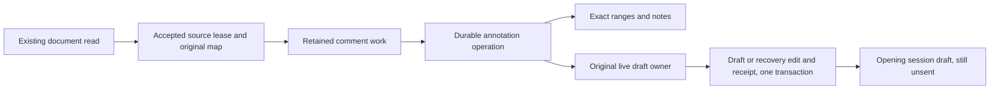

# Browser Markdown Document Annotations Implementation Plan

> **For agentic workers:** REQUIRED SUB-SKILL: Use superpowers:subagent-driven-development (recommended) or superpowers:executing-plans to implement this plan task-by-task. Steps use checkbox (`- [ ]`) syntax for tracking.

**Goal:** Deliver desktop and phone-browser document annotations that save exact passage notes and append each reference once to the opening session's unsent draft, then qualify and merge the browser feature.

**Architecture:** Extend settled document rendering with original-source provenance while retaining Marked and its sanitation boundary. Add non-evicting authored stores to the existing browser IndexedDB database so annotation receipts, ordinary drafts and recovery-backed edits share transactional authority. Keep document work and composer ownership outside React mounts; the annotation path never calls mutation transport.

**Tech Stack:** TypeScript, React, pinned Marked 18.0.6, DOMPurify, IndexedDB, Vitest/jsdom with fake-indexeddb, production Evener hub/AppWire, scripted provider at the LLM boundary, Chrome CDP and a genuine phone browser/OS keyboard.

**Spec:** `docs/superpowers/specs/2026-10-05-markdown-document-annotations-browser-design.md`, approved by Jesse at `a394da26be598950c9c6959523930d68be20c4e9`. Its linked browser/shared requirements from approved specification `19afe6b9e69b3caffcf9e6d4d7efebf6b0f74727` remain binding. The owned exact copy is `.superpowers/sdd/2026-10-05-markdown-document-annotations-browser/inputs/original-approved-spec-19afe6b9e6.md`.

## Global Constraints

The following lines quote the approved browser specification. Every task includes them.

- “Send creates a local annotation operation. Creating, restoring, or retrying it must cause zero send, queue, steer, or session-start/resume mutations. Only the ordinary composer controls submit the accumulated draft.”
- “Require a nonempty selection and nonblank note. Preserve note text and line breaks. Editing freezes the captured passage. Return in the comment field cannot trigger the composer's Send shortcut.”
- “Map actual rendered selections to original Markdown source. Use zero-based UTF-16 `[start,end)` ranges and one-based, inclusive displayed positions.”
- “Capture the opening session and originating pane lifetime.”
- “Use the real transactional draft authority. Transfer currently supported localStorage drafts into existing IndexedDB infrastructure with their owner protections intact. Commit an applied receipt with its actual draft edit.”
- “Ordinary draft submission, clearing or later user edits never reactivate it.”
- “Do not promise process-death durability before persistence.”
- “Preserve Markdown sanitation, inert literal note/quote text, readable escaping, document permissions and read routing.”
- “The approved parser remains a source-aware extension of Marked **18.0.6** for document rendering. No parser replacement is authorized.”
- “The only approved compatibility work remains supported-draft transfer and restored browser document panes that lack origin-pane identity.”
- “Reuse completed shared Task1 rather than implementing or reviewing it as a new task.”
- “Do not modify native Reader selection/rendering, native annotation storage, CommentSheet/ReviewSheet behavior or native annotation qualification harnesses.”
- “Distinguish emulated touch/viewport evidence from a real phone's OS keyboard; emulation alone cannot prove real on-screen phone keyboard interaction.”
- “Deployment is excluded.”

Additional execution boundaries:

- Start from accepted shared base `447d6bc616cd55d2ae1846ab61743c5f9cf28fc9`. Its pure annotation functions, contracts and behavior-preserving native hash import/re-export are complete. Consume them unchanged unless a reproduced browser integration defect requires a bounded shared fix and review.
- Preserve unmerged native lane `wip/markdown-document-annotations` at `7f2bacf33fad854c849a9db6aafd34dbb680ed4c`, its evidence and original RED pins. Native Task2 is blocked, incomplete and deferred after three reverted unsuccessful fixes. No fourth fix, resume, native experiment, native merge, deletion or deployment is authorized.
- Work only in `wip/markdown-document-annotations-browser` and owned review/evidence paths. Do not inspect or copy another lane's source or plan workspace. Owned immutable planning inputs are listed in the two manifests under `.superpowers/sdd/2026-10-05-markdown-document-annotations-browser/inputs/` and `plan-inputs/`.
- Product code, installs, builds and runtime tests wait for Jesse's approval of this written plan after self-review and independent dual written-plan review. The already chosen subagent-driven method remains in force.
- Read `docs/product/README.md`, owning subsystem rows S02/S05, `docs/developing-evener/testing.md` and `AGENTS.md` before implementation. Keep established transcript, composer, permissions and cache controls working.
- Tests remain deterministic. Use a scripted provider only at the LLM boundary; exercise real application, storage and transport below it. No mocked annotation, draft or transport implementation in E2E. No live provider request in default gates.
- No LRU, TTL, inactivity or 100-file limit applies to authored notes. A failed read is not source-change evidence. An unseen truncated suffix remains outside the guarantee when a whole-file revision is unavailable.

## Review Focus

Each condition below has a concrete owning test in the named task.

1. Same spelling after BOM, CRLF, nested Markdown transforms or Mermaid must map to the selected occurrence, including element-container endpoints and backwards selection. Task 1 tests `second duplicate`, `normalization matrix` and `element endpoints`.
2. A same-text atom/mention edit or typing between commit and UI acknowledgment must survive an annotation append and ordinary submission. Task 2 tests `late metadata edit` and `commit acknowledgment race`; Task 3 tests `append to recovery backing`.
3. A restored pane, reused pane ID, stale tab or changed source that later reverts must not redirect or resurrect work. Tasks 3/4 test `A B A expiry`, `namespace reset` and `same-id replacement`.
4. Late save acknowledgment must not overwrite a newer comment, collapse browser selection handles or move the reader when a phone host remounts. Task 5 tests `late receipt` and `retained reader`; Task 6 qualifies genuine input and phone keyboard behavior.
5. A failed upgrade/transfer/expiry commit must remain honestly pending and recover without another Send; history clear must preserve more than 100 files. Tasks 2/3 test `interrupted transfer`, `expiry fault recovery` and `101 files`; Task 6 repeats recovery through real APIs.

---

## Source facts and execution map

The controller read both complete scouts, then checked critical interfaces. Full reports are retained at `local:034ajhJ5ZgMEICA556wvN4` turn 144 and `local:034ajiLH6ZnJK72kXuWlmB` turn 130. Their checked findings and limits are recorded in `.superpowers/sdd/2026-10-05-markdown-document-annotations-browser/browser-plan-source-inspection.md`.

Current facts, rather than proposed APIs:

- `appwire-client/typescript/docContent.ts` exports `readDocFile(session, path, port): Promise<DocFileContent>`. Source text preserves BOM and CRLF; the display cap is `512 * 1024` bytes. The hub provides a whole-file SHA-256 revision when available. Keep the endpoint and routing unchanged.
- `src/widgets/markdown/index.tsx` uses Marked, escapes authored HTML/code and sanitizes before mounting. `segments.ts` interleaves sanitized prose with Mermaid. `markdownLexer` is a `Marked` instance, not a source mapper. Marked normalizes CRLF; normalized token lengths are not original offsets.
- `src/panes/doc/DocPane.tsx` reads on mount and currently has no annotation plumbing. Both `fileOpenBeside.tsx` and `messages/AgentMarkdown.tsx` open documents directly. Fixing only `openDocBeside` misses both producers.
- `src/panes/session/composer/draft.ts` owns current `evener.composer.draft.v1.<ref>` literal text and `.v2.<ref>` structured values. Revisions exist only in process memory. All supported writers must transfer to the new authority.
- `src/stores/mutationOutboxIndexedDB.ts` owns `evener-mutation-outbox` version 3, with `outbox`, `optimistic`, `recovery` and `sequences`. Its actual recovery edits must share a transaction with applied receipts. `src/storage` does not exist.
- `src/shell/paneLifetime.ts` owns record-object lifetimes with runtime `serial`; serial is not durable `compositionOwnerId`. Editor unmount preserves the pane owner; removing/replacing the committed pane disposes it.
- `appwire-client/typescript/state/mutation/submission.ts` currently settles drafts synchronously. An asynchronous clear cannot be fire-and-forget or turn accepted input into a send failure.
- No production general authored-local-data reset was found. `clearCachedSessions()` is only history-cache clear. Add a narrow annotation-namespace reset capability, not an invented global reset UI.

Here and in task commands, `F` means `cmd/evener-hub/frontend` and `S` means `cmd/evener-hub/frontend/src`. File ownership lists use full repository-relative paths.



The source lease prevents stale captures from saving against a newer document. The applied receipt belongs to the actual draft/recovery edit, so retries cannot append again. The ordinary composer remains the sole input-submission path.

### Focused file responsibilities

| Unit | Paths | Responsibility |
| --- | --- | --- |
| Document mapping/rendering | `S/widgets/markdown/documentSourceMap.ts`, `DocumentMarkdown.tsx`, `rendering.ts` | Original UTF-16 provenance, sanitized DOM binding and settled document rendering; reuse existing render/sanitize policy |
| Durable schema/drafts | `S/stores/localCompositionSchema.ts`, `browserDraftRepository.ts`, `S/panes/session/composer/draft.ts` | Additive shared schema, supported transfer, durable revision/CAS and truthful UI projection |
| Pane owner metadata | `S/shell/workspace.ts`, `paneLifetime.ts` | Durable owner ID outside deduplication params and runtime disposal fencing |
| Annotation repository | `S/stores/documentAnnotationIndexedDB.ts`, `documentAnnotationRuntime.ts` | Source heads/epochs, operations, payload deletion, ordered atomic handoff, bounded recovery/reset |
| Opening provenance | `S/panes/doc/docOpeningContext.tsx`, `openDoc.ts`, both transcript producers | Capture exact opening session and owner; preserve read-only/restored cases |
| Reader work/UI | `S/panes/doc/documentReadState.ts`, `documentSelection.ts`, `documentHighlights.ts`, `DocumentCommentBox.tsx`, `DocumentHighlights.tsx` | Retained capture/note/position, finished selections, exact live range geometry and accessible notes |
| Production qualification | `cmd/evener-hub/document_annotations_browser_test.go`, `F/scripts/documentannotationguard/` | Actual hub/API/SPA journey, independent geometry and mutation trace, physical-phone evidence |
| Product contract | `docs/product/document-annotations.md` and linked owning guides | Current browser behavior, source-of-truth, recovery and explicit native deferral |

Avoid a broad file reorganization. Extract only renderer/sanitizer internals shared by the existing renderer and the new document renderer. Preserve `Markdown({source,live,ref})`, `markdownLexer` consumers and transcript selection behavior.

## Independent literals

Create `S/panes/doc/testing/annotationFixtures.ts` in Task 1. Keep it test-only. Expected offsets and full expected reference strings are independent of the mapper and formatter under test.

```ts
export const SOURCE = "First occurrence: same\n\nOther context for a second occurrence is nearby: same\n";
export const FIRST = { start: 18, end: 22 };
export const SECOND = { start: 73, end: 77 };
export const REFERENCE =
  'A note on `NOTES.md:1:19-1:22` (captured source positions), selecting “same”: "Keep this scope."\n' +
  'Captured whole-file revision: "rev-A".\n' +
  'Context before: "First occurrence: "; after: "\\n\\nOther context for a second occurrence is nearby: same\\n".\n' +
  'Verify the quotation and context against current content before relying on these captured coordinates.';
export const APPENDED = "Existing draft\n\n" + REFERENCE;
export const JOURNEY_REFERENCE =
  'A note on `NOTES.md:1:19-1:22` (captured source positions), selecting “same”: "Keep this scope."\n' +
  'Captured whole-file revision: "4808d04cf747af87429a6d65d3c229bba77e2ce07a9145e520400d9fdebff0a6".\n' +
  'Context before: "First occurrence: "; after: "".\n' +
  'Verify the quotation and context against current content before relying on these captured coordinates.';
export const JOURNEY_APPENDED = "Existing draft\n\n" + JOURNEY_REFERENCE;
export const RICH_SOURCE =
  '# Note\r\n\r\nfirst **same** [link](https://example.test) &amp; 😀\r\n\r\n' +
  'second same\r\n\r\n- item **same**\r\n\r\n' +
  '| Cell | Other |\r\n| --- | --- |\r\n| same | tail |\r\n\r\n```ts\r\nsame()\r\n```\r\n';
export const RICH_RANGES = [
  { start: 18, end: 22 }, { start: 73, end: 77 },
  { start: 90, end: 94 }, { start: 135, end: 139 },
  { start: 159, end: 163 },
];
```

`SOURCE.length` is 78; FIRST is `1:19-1:22`, SECOND `3:50-3:53`. `RICH_SOURCE.length` is 172; its five `same` positions are `3:9-3:12`, `5:8-5:11`, `7:10-7:13`, `11:3-11:6`, `14:1-14:4`. The rich link is `[26,30)`, entity spelling `[54,59)`, emoji `[60,62)` and cross-block range `[18,77)`.

`REFERENCE`/`APPENDED` are intentionally synthetic repository inputs with manually captured `rev-A` and context. Keep them for those tests. `JOURNEY_REFERENCE`/`JOURNEY_APPENDED` are the separate full production golden: the real hub hashes the literal SOURCE bytes to the stated lowercase SHA256, and accepted `contextForRange` bounds FIRST to its paragraph with empty after-context. Tasks5/6 use this production golden for the actual file-card/read/drag path. Copy the literal into the guard's `fixtures.mjs`; never compute expected draft text with the formatter/context helper under test or change the accepted shared helpers to satisfy the synthetic fixture.

Additional literal mapping oracles:

| Original source | Selected rendered text | Source `[start,end)` |
| --- | --- | --- |
| `same same.` | second `same` | `[5,9)` |
| `same\n\nsame\n` | second `same` | `[6,10)` |
| `A **same** and same.` | emphasis interior | `[4,8)` |
| `A **same** and same.` | `same and same` | `[4,19)` |
| `[go &amp; now](x) \\*ok\\*` | `& now` | `[4,13)` |
| `[go &amp; now](x) \\*ok\\*` | `*ok*` | `[18,24)` |
| `\ufeff# H\r\n\r\n\t😀e\u0301\r\n` | indented-code text `\t😀é` | `[8,13)` |
| fenced `js` source ` ```js\r\n\t😀x\r\nz\r\n``` `, without surrounding spaces | `\t😀x\nz` | `[7,14)` |
| `| H | H |\n| --- | --- |\n| a\\|b | 😀 |\n` | `a|b` | `[26,30)` |
| inline code source `` ` a\r\nb ` `` | `a b` | `[2,6)` |
| `- one\n\n> two\n` | actual browser list-to-quote selection | `[2,12)` |

For multi-block selection, preserve the actual `Selection.toString()` result; do not normalize browser block separators to manufacture the quotation. Entity/escape units map to their complete original spelling. Reject boundaries that split a surrogate pair. Genuine browser geometry/input proof belongs to Tasks 5/6, not these string arithmetic fixtures.

## Execution and evidence rules

Each implementation task gets a fresh implementer and independent spec/quality review gate before its dependent task starts. The controller owns task ordering, scope checks and evidence. A reviewer receives this plan, approved spec, immutable task base/head including untracked-new-file inventory and the full RED/GREEN report. Two returned attempts at one finding require stopping and reporting.

Use one writer at a time in the browser lane for these dependent tasks. Read-only reviewers can share it. Any additional overlapping writer needs its own managed worktree; branch work must be committed, checked and landed explicitly. Never include native feature/harness work in a task diff.

After written-plan approval, inspect each script before executing it. Current frontend/API `node_modules` are absent. Use root `make web-preflight` and the API gate's `scripts/sdk/api-package-preflight.sh`; never run `npm ci` through a symlink. Pin the existing manifest's Marked caret to exact `18.0.6` in Task 1 without upgrading the resolved parser. Run `make hooks` if this clone has not installed the hook. Never bypass a hook.

For targeted tests, execute from the frontend using `npm test -- <exact files>` or its pinned `node_modules/.bin/vitest run <exact files>`. `npm test` also invokes the package boundary check and Node script tests; report what actually ran. Run root `make test-api-package`, `make test-web` and `make test-web-browser` for final qualification. Biome must run from the frontend on explicit touched `src/` and AppWire paths, never `npx biome` from the root.

Record each task's source base/head, actual commands, exit status, assertions and limits under `.superpowers/sdd/2026-10-05-markdown-document-annotations-browser/`. Store only owned artifacts needed by the report. A passing unit test does not prove real input, geometry, device keyboard or E2E. An unavailable launch or timed-out run is not a pass.

### Task 1: Original-source mapped document rendering

**Files:**
- Create: `cmd/evener-hub/frontend/src/widgets/markdown/documentSourceMap.ts`
- Create: `cmd/evener-hub/frontend/src/widgets/markdown/DocumentMarkdown.tsx`
- Create: `cmd/evener-hub/frontend/src/widgets/markdown/rendering.ts`
- Create/Test: `cmd/evener-hub/frontend/src/widgets/markdown/documentSourceMap.test.ts`
- Create/Test: `cmd/evener-hub/frontend/src/widgets/markdown/DocumentMarkdown.test.tsx`
- Create: `cmd/evener-hub/frontend/src/panes/doc/testing/annotationFixtures.ts`
- Modify/Test: `cmd/evener-hub/frontend/src/widgets/markdown/index.tsx`, `markdown.test.tsx`, `segments.ts`, `segments.test.ts`
- Modify/Test: `cmd/evener-hub/frontend/src/panes/doc/DocPane.tsx`, `DocPane.test.tsx`
- Modify: `cmd/evener-hub/frontend/package.json`, `package-lock.json` only for the exact existing parser pin

**Interfaces:** Consumes accepted `SourceRange`, `validateSourceRange` and original `DocFileContent.text`. Produces the following new browser-only contracts in `documentSourceMap.ts` and the component in `DocumentMarkdown.tsx`:

```ts
export interface DocumentRenderIdentity {
  displayedSnapshotId: string;
  mappingId: string;
}
export interface DocumentTextRun {
  id: string;
  renderedText: string;
  sourceSpans: readonly SourceRange[]; // one original span per rendered UTF-16 unit
}
export interface DocumentRenderMap extends DocumentRenderIdentity {
  source: string;
  textRuns: readonly DocumentTextRun[];
}
export type MappedSelection =
  | { state: "mapped"; sourceRange: SourceRange; selectedRenderedText: string }
  | { state: "unmapped"; reason: "outside" | "stale" | "chrome" | "unverified" };
export interface BoundDocumentMap {
  identity: DocumentRenderIdentity;
  capture(selection: Selection): MappedSelection;
  rangesFor(sourceRange: SourceRange): readonly Range[];
  dispose(): void;
}
export function bindDocumentMap(root: HTMLElement, map: DocumentRenderMap): BoundDocumentMap;
export function DocumentMarkdown(props: {
  source: string;
  identity: DocumentRenderIdentity;
  onMap(map: BoundDocumentMap | null): void;
}): React.ReactElement;
```

- [ ] **Step 1: Prepare the pinned parser and independent mapping tests.** After dependency preflight, read the installed root Marked 18.0.6 lexer/tokenizer implementation before writing instrumentation. Record package version and actual normalization/nested-token entry points in the task report. Read `index.tsx`, `segments.ts` and sanitizer policy. Implement no parallel Markdown grammar. Create the literal fixture module above and tests that bind actual sanitized rendered DOM, rather than a fabricated token tree.

```tsx
it("maps the second duplicate, including element endpoints", async () => {
  let map: BoundDocumentMap | null = null;
  const { container } = render(<DocumentMarkdown source="same same."
    identity={{ displayedSnapshotId: "s1", mappingId: "m1" }}
    onMap={(value) => { map = value; }} />);
  const paragraph = container.querySelector("p");
  if (!paragraph || !map) throw new Error("mapped document was not bound");
  const text = paragraph.firstChild;
  if (!text) throw new Error("paragraph has no text");
  const range = document.createRange();
  range.setStart(text, 5); range.setEnd(text, 9);
  const selection = window.getSelection();
  if (!selection) throw new Error("selection is unavailable");
  selection.removeAllRanges(); selection.addRange(range);
  expect(map.capture(selection)).toEqual({ state: "mapped",
    sourceRange: { start: 5, end: 9 }, selectedRenderedText: "same" });
  range.selectNodeContents(paragraph);
  selection.removeAllRanges(); selection.addRange(range);
  expect(map.capture(selection)).toMatchObject({ state: "mapped",
    sourceRange: { start: 0, end: 10 } });
});
```

This programmed Range proves DOM binding only. Test backwards Selection direction separately without changing endpoint semantics.

- [ ] **Step 2: Run the RED.** From `F`, run `npm test -- src/widgets/markdown/documentSourceMap.test.ts src/widgets/markdown/DocumentMarkdown.test.tsx`. Expect the absent new mapper/component to fail first. After exports exist, keep the literal coordinate assertions red until real provenance passes. Capture the actual failure; a wrong import alone is not the behavioral RED.
- [ ] **Step 3: Carry provenance through the actual pinned Marked transformations.** Represent each input UTF-16 unit with an original source span. Carry those spans through BOM display omission, CRLF/CR normalization, nested list/quote prefixes, tab/code normalization, table-cell extraction, inline escape/entity decoding, reference resolution and codespan whitespace normalization. For CRLF, the rendered newline's span covers both source units. Omitted syntax contributes no displayed run; the contiguous capture range still spans syntax between selected endpoint runs. Do not sum normalized `token.raw.length`, use `indexOf` to place repeated tokens, replace Marked, or silently downgrade Markdown to plain text.

```ts
// Boundary arithmetic in documentSourceMap.ts, after verified token provenance:
const firstSpan = run.sourceSpans[renderedStart];
const lastSpan = run.sourceSpans[renderedEnd - 1];
if (!firstSpan || !lastSpan) return { state: "unmapped", reason: "unverified" };
const sourceRange = { start: firstSpan.start, end: lastSpan.end };
validateSourceRange(map.source, sourceRange);
```

For multi-run selections, resolve both DOM endpoints in document order and verify every included text run. Preserve the actual selected rendered string. Bind marked sanitized runs only after checking node text against expected run text; do not trust surviving `data-*` attributes alone. Reject generated chrome/diagram text, stale bindings, removed text and surrogate splits. `rangesFor` reconstructs only verified visible fragments of the stored exact range, never a quote search.

- [ ] **Step 4: Preserve rendering and pin difficult transforms.** Test every literal in the table, nested/loose lists and quotes, escapes next to entities, partial words, links/reference definitions across Mermaid, multiple paragraphs, table alignment, code trailing newline and inline-code space normalization. Test original HTML as inert visible text and removed image content as unmapped. Exclude code language labels and generated Mermaid labels. Keep literal text in a Mermaid error fallback mappable as code while excluding its label/error chrome; preserve offsets of following prose. Unterminated Mermaid fences retain ordinary code behavior. Extract the existing renderer/sanitizer policy into `rendering.ts` for both callers, preserving allowlists and link safety.

```tsx
it("keeps authored HTML inert", () => {
  const { container } = render(<DocumentMarkdown source={'\n<script>window.pwned=2</script>'}
    identity={{ displayedSnapshotId: "s", mappingId: "m" }} onMap={() => {}} />);
  expect(container.querySelector("img,script,[onerror]")).toBeNull();
  expect(container.textContent).toContain("<script>");
});
```

Wire settled Markdown documents through `DocumentMarkdown` with original `content.text`; keep image/plain/binary/error handling untouched. Temporary display identities in this task are replaced by accepted source leases in Task 5 before annotation integration.
- [ ] **Step 5: Run GREEN and preservation tests.** Run the new tests plus `npm test -- src/widgets/markdown/markdown.test.tsx src/widgets/markdown/segments.test.ts src/panes/doc/DocPane.test.tsx`. Check no unexpected logs. Report source inspection limits and any unsupported actual parser transform as a blocker, not a false map.
- [ ] **Step 6: Commit only owned files.** Format touched TS with frontend Biome, inspect `git diff --check` and the staged diff, then commit `feat(doc): map rendered Markdown to original source`. Stage each exact path listed above; no root-wide add. The independent task review must accept provenance and renderer preservation before Task 5 consumes the map.

### Task 2: Transactional browser draft and pane-owner authority

**Files:**
- Create/Test: `cmd/evener-hub/frontend/src/stores/localCompositionSchema.ts`, `localCompositionSchema.test.ts`
- Create/Test: `cmd/evener-hub/frontend/src/stores/browserDraftRepository.ts`, `browserDraftRepository.test.ts`
- Modify/Test: `cmd/evener-hub/frontend/src/stores/mutationOutboxIndexedDB.ts`, its conformance/stall/openDiagnostic tests
- Modify/Test: `cmd/evener-hub/frontend/src/panes/session/composer/draft.ts`, `draft.test.ts`, `sourceState.ts`, `sourceState.test.ts`, `Composer.tsx`, `Composer.test.tsx`, `Composer.integration.test.tsx`
- Modify/Test: `cmd/evener-hub/frontend/src/panes/session/composer/queue/pendingTurnsStore.ts`, `pendingTurnsStore.test.ts`
- Modify/Test: `cmd/evener-hub/frontend/src/panes/session/composer/queue/QueueStrip.tsx`, `QueueStrip.test.tsx` only for local supported-draft conflict composition
- Modify/Test: `cmd/evener-hub/frontend/src/shell/workspace.ts`, `paneLifetime.ts`, `paneLifetime.test.ts`, `paneRestore.test.ts`
- Modify: `cmd/evener-hub/frontend/src/panes/session/testing/composerSource.ts` to construct genuine source owners for existing tests
- Modify: `cmd/evener-hub/frontend/src/panes/session/transcript/messages/UserMessageItem.tsx`, `src/dev/surface-sections/composer.tsx`, `src/dev/retirementharness-entry.tsx`
- Test/adjust direct consumers: `cmd/evener-hub/frontend/src/stores/threads.retirement.test.tsx`, `cmd/evener-hub/frontend/src/panes/zoom/ActivityPeek.test.tsx`, `cmd/evener-hub/frontend/src/panes/session/transcript/messages/UserMessageItem.test.tsx`
- Modify/Test: `appwire-client/typescript/state/mutation/submission.ts`, `submission.test.ts`, `pendingTurns.ts`, `pendingTurns.test.ts`
- Modify: `appwire-client/typescript/state/mutation/index.ts` to export the new shared settlement DTOs
- Preserve/regression: `src/panes/session/composer/skillDocument.ts`, `SkillEditor.tsx`, `recovery/recoveryDraft.ts`, `attachments/useAttachments.ts` and their actual tests

Abbreviated `src/...` paths in this file list are relative to `cmd/evener-hub/frontend`, not repository root.

**Interfaces:** Consume the existing `SkillEditorValue`, `TextEditor`, `PaneLifetime`, `ComposerSourceState`, IDBConnection helpers and mutation recovery records. Produce the following framework-free DTOs in shared `state/mutation/pendingTurns.ts` and export them from its `index.ts`. Browser imports use `@evener/appwire-client/state/mutation`; shared code imports no frontend types.

```ts
export interface DraftAuthorityToken {
  readonly namespaceIncarnation: string;
  readonly persistentRevision: number;
  readonly ownerRevision: number;
}
export type DraftBackingIdentity =
  | { readonly kind: "draft" }
  | { readonly kind: "recovery"; readonly recoveryId: string;
      readonly writeVersion: number; readonly replacementEpoch: number };
export interface DraftSettlementGuard {
  readonly token: DraftAuthorityToken;
  readonly compositionOwnerId: string;
  readonly backing: DraftBackingIdentity;
}
export interface DraftSettlement {
  cleared: boolean;
  draftUnchanged: boolean;
  persistence: "committed" | "pending";
}
```

Produce these browser contracts in `browserDraftRepository.ts`:

```ts
export interface BrowserDraftKey {
  namespace: { kind: "browser"; origin: string };
  sessionRef: string;
}
export interface BrowserDraftOwner {
  paneId: string;
  compositionOwnerId: string;
  lifetimeSerial: number;
}
export type DraftToken = DraftAuthorityToken;
export interface StoredDraftValue extends SkillEditorValue {
  key: BrowserDraftKey;
  token: DraftToken;
  backing: DraftBackingIdentity;
}
export interface OwnedComposerDraft extends StoredDraftValue {
  ownership: "owned";
  compositionOwnerId: string;
}
export type StoredComposerDraft = OwnedComposerDraft |
  (StoredDraftValue & { ownership: "unclaimed"; compositionOwnerId?: never });
export type DraftCommit =
  | { state: "committed"; draft: StoredComposerDraft }
  | { state: "conflict"; current: StoredComposerDraft }
  | { state: "unavailable" };
export interface SupportedDraftConflict {
  conflictId: string;
  key: BrowserDraftKey;
  legacyKey: string;
  inspectedBytes: string;
  value: SkillEditorValue;
}
export interface BrowserDraftRepository {
  load(key: BrowserDraftKey): Promise<StoredComposerDraft | null>;
  seedUnclaimed(key: BrowserDraftKey, value: SkillEditorValue): Promise<DraftCommit>;
  claim(key: BrowserDraftKey, owner: BrowserDraftOwner, expected: DraftToken | null,
    stillOwnsOwner: () => boolean): Promise<DraftCommit>;
  adopt(key: BrowserDraftKey, owner: BrowserDraftOwner, expected: DraftToken,
    expectedOwnerId: string, stillOwnsOwner: () => boolean): Promise<DraftCommit>;
  transferSupportedDrafts(namespace: BrowserDraftKey["namespace"]): Promise<{ state: "committed" | "pending" }>;
  listConflicts(key: BrowserDraftKey): Promise<readonly SupportedDraftConflict[]>;
  restoreConflict(key: BrowserDraftKey, owner: BrowserDraftOwner, expected: DraftToken,
    conflictId: string, stillOwnsEdit: () => boolean): Promise<DraftCommit>;
  commitEdit(key: BrowserDraftKey, owner: BrowserDraftOwner, expected: DraftToken,
    value: SkillEditorValue, stillOwnsEdit: () => boolean): Promise<DraftCommit>;
  clearSubmitted(key: BrowserDraftKey, submitted: SubmittedDraft): Promise<DraftSettlement>;
  subscribe(listener: (key: BrowserDraftKey) => void): () => void;
}
export function captureDraftSettlementGuard(draft: OwnedComposerDraft): DraftSettlementGuard;
export function createBrowserDraftTransferRuntime(input: {
  repository: BrowserDraftRepository;
  namespace: BrowserDraftKey["namespace"];
  storage: Storage;
  window: Window;
  document: Document;
}): {
  composerOpened(key: BrowserDraftKey): void;
  dispose(): void;
};
```

Transfer and pre-open seeding write `ownership: "unclaimed"` with no owner ID. `seedUnclaimed` creates only an absent record; an existing record yields conflict and stays unchanged. `claim` compares the complete token/current namespace in one transaction, claiming only an unclaimed/absent row or acknowledging the same owner. A competing different owner loses without changing the value. `adopt` is an explicit source-owner transition with the expected prior owner/token, never an effect of reading or annotation handoff. Claim/adopt advance durable `ownerRevision`; later callbacks from the previous owner cannot write. Preserve the full value and backing during adoption. A reused pane ID alone never authorizes it.

Extend browser source state with `compositionOwnerId`, `ready(): Promise<void>`, durable-token/dirty projection and an awaited `clearIfUnchanged`. Keep `getSnapshot()` synchronous for React. Persist owner ID on the committed pane record and saved panel metadata, **outside session params used for pane deduplication**; restored current records retain it. Generate a fresh ID for a newly created/replaced owner. Runtime `serial` and `alive` remain independent guards.

Change the actual browser factory to `createComposerSourceState(ref: string, owner: BrowserDraftOwner, repository?: BrowserDraftRepository): ComposerSourceState`. The optional repository injection is for a real isolated IDB adapter in tests, not a historical caller fallback. `paneLifetime.ts` supplies its committed owner metadata and runtime serial; standalone dev/harness sources create their own actual runtime owner. Update the existing `panes/session/testing/composerSource.ts` helper and every factory caller. Source hydration loads then claims/adopts through the real authority; reading alone does not claim another owner's draft.

Define `MutationSubmissionCommitted = DraftSettlement` at the shared submission boundary and update its stale synchronous-return commentary. `captureDraftSettlementGuard` copies and freezes the token and backing as well as the guard object; it must not retain aliases to mutable source state.

Extend `SubmittedDraft` with `settlementGuard?: DraftSettlementGuard`, `persistentRevisionAtStart?: number` and `stillOwnsEdit?: () => boolean`. The revision-only field may remain for reporting; browser clearing requires the full guard and live callback, never the scalar alone. Extend shared `MutationSubmissionOptions` with `settleDraft?: (ref: string, submitted: SubmittedDraft) => Promise<DraftSettlement>` and expose the settled result's `persistence` to browser listeners. These are capabilities for the current browser async authority, not a historical-schema adapter. Native's present synchronous path remains the default and is not rewritten.

**Two independently reviewed gates:** Task2A owns schema/repository/DTOs and Steps1–3. Its RED/GREEN commit and fresh review precede Task2B, which owns source/writer/settlement integration and Steps4–7 with a fresh implementer and review. Do not activate transfer in production or switch any writer until Task2B moves all supported writers together. Task2A adds an inactive tested repository, not a second authority or temporary compatibility bridge. Task3 still waits for the complete Task2B authority gate.

- [ ] **Step 1: RED supported-draft transfer using real IndexedDB.** Use `IDBFactory` from fake-indexeddb with an isolated database name and real production repository. Seed both exact supported localStorage keys for unopened refs, valid v2 with explicit empty mentions, invalid v2 fallback to literal v1, and JSON-looking/slash v1 text. Faults are injected at request/commit/cleanup boundaries, not by mocking repository methods.

```ts
it("does not reimport stale supported keys after committed transfer and clear", async () => {
  const factory = new IDBFactory();
  localStorage.setItem("evener.composer.draft.v1.root", '{"text":"literal /same"}');
  const key = { namespace: { kind: "browser" as const, origin: "https://hub.test" }, sessionRef: "root" };
  const repo = createBrowserDraftRepository({ indexedDB: factory, databaseName: "transfer-test",
    storage: localStorage, beforeLegacyCleanup: () => { throw new Error("cleanup interrupted"); } });
  expect(await repo.transferSupportedDrafts(key.namespace)).toEqual({ state: "committed" });
  const draft = await repo.load(key);
  expect(draft?.text).toBe('{"text":"literal /same"}');
  if (!draft) throw new Error("transferred draft missing");
  expect(draft.ownership).toBe("unclaimed");
  expect(draft).not.toHaveProperty("compositionOwnerId");
  const owner = { paneId: "pane-root", compositionOwnerId: "owner-root", lifetimeSerial: 1 };
  const claimed = await repo.claim(key, owner, draft.token, () => true);
  if (claimed.state !== "committed" || claimed.draft.ownership !== "owned") {
    throw new Error("transferred draft was not claimed");
  }
  await repo.clearSubmitted(key, { text: draft.text, skillNames: [], draftRevisionAtStart: 0,
    persistentRevisionAtStart: claimed.draft.token.persistentRevision,
    settlementGuard: captureDraftSettlementGuard(claimed.draft), stillOwnsEdit: () => true });
  const restarted = createBrowserDraftRepository({ indexedDB: factory, databaseName: "transfer-test", storage: localStorage });
  await restarted.transferSupportedDrafts(key.namespace);
  expect((await restarted.load(key))?.text ?? "").toBe("");
});
```

Define `createBrowserDraftRepository(options): BrowserDraftRepository` in this task. Options are `indexedDB?: IDBFactory`, `databaseName?: string`, `storage?: Storage`, `beforeCommit?: (operation: string) => void`, `beforeLegacyCleanup?: () => void` and an injected open diagnostic sink following the existing IDB pattern. Expected cleanup faults are caught and asserted; no unvalidated console errors.

Add a real-IDB claim race on an imported unopened value, using two distinct owner DTOs and the same expected token. Assert exactly one committed owner, the loser returns conflict and the complete structured value remains unchanged. Assert the winning guard is a copied immutable snapshot. Task2B repeats this through actual pane/source owners rather than treating literal owner DTOs as lifecycle proof.
- [ ] **Step 2: Run RED.** From `F`, run `npm test -- src/stores/browserDraftRepository.test.ts src/stores/localCompositionSchema.test.ts src/panes/session/composer/draft.test.ts`. Observe absent durable authority and interrupted-transfer behavior before implementation.
- [ ] **Step 3: Implement the additive schema and real authority.** Share database name/version/upgrade registration in `localCompositionSchema.ts`; bump the reviewed version from 3 to **4**. Preserve all four existing stores, key paths, indexes and rows. Create `composerDrafts`, `draftTransfers`, `draftConflicts`, `annotationNamespaces`, `annotationHeads`, `annotationEvidence`, `annotationPayloads`, `annotationOperations`, `annotationSequences` and `annotationExpiry`. Key authored rows with serialized namespace/session or document keys, not bare refs. Record the actual upgrade in tests from a populated version-3 DB. Leave cache DB unchanged.

Implement the load-time incarnation refresh and current-namespace write fence in Task2A, preserving complete draft/owner/backing rows. Task3 consumes this capability when it adds actual annotation reset. Early repository/settlement tests advance the real namespace row as an explicit IDB fixture transition and label that evidence as a namespace fence, not a production reset. Task2 must not call the not-yet-implemented Task3 reset API.

Transfer supported keys with the current decoder's semantics. Commit imported drafts and per-key transfer markers/tombstones first. Remove localStorage only if its inspected value still matches; a later change remains work to reconcile. IDB remains authority if cleanup fails. Read faults produce pending transfer, not empty success. Do not invent attachment bytes, historical pane identity or hub identity absent from old records.

Keep the inspected supported-key bytes in the transfer marker so an unchanged leftover cannot resurrect a cleared draft. A changed supported value written by a still-open old tab is new work, not an unchanged leftover: retain it in `draftConflicts` and reconcile without overwriting newer IDB work or manufacturing an owner. Add a test for that late write. Test populated version-3 mutation/recovery rows and versionchange retirement; the schema upgrade must not silently delete or duplicate pending mutations.

Implement `createBrowserDraftTransferRuntime` as the sole production lifecycle owner of supported-key rescans. It performs one initial repository-open attempt, one on composer open/reopen, one when `visibilitychange` returns to visible and one on a storage event for either supported draft-key prefix in the supplied storage. Register/unregister actual listeners; source hydration calls `composerOpened(key)`. Coalesce in-flight requests and at most one follow-up for triggers arriving during the attempt; a fault remains pending until the next declared trigger, never a timer/tight retry loop. Keep these transfer reasons separate from Task3's annotation retry reasons.

Deduplicate conflicts by the exact supported key and incoming bytes already recorded, including repeated foreground/storage notifications. Source subscriptions load `listConflicts(key)` and expose `draftConflicts: readonly SupportedDraftConflict[]` in the synchronous source snapshot. Composer passes them to QueueStrip as local conflict rows, separate from `MutationRecoveryRecord`; never fabricate a transport mutation. Provide a literal preview/copy action and an `onRestoreDraftConflict(conflictId: string): Promise<DraftCommit>` callback to the real source/repository `restoreConflict` path. It compares namespace/owner/token and empty unchanged structured work in a transaction, restores the full incoming value and consumes that conflict atomically. With dirty/nonempty newer work, retain the incoming row and copy action without replacing current work. Automatic restoration is allowed only for demonstrably untouched/empty authoritative work with valid ownership. These local rows must have no Send/resend/steer/queue action.

Do not claim transactional simultaneous editing by an old bundle. In tests bind the production runtime, complete initial transfer, change supported bytes as the old producer would, then drive each declared lifecycle/event entry point without directly calling transfer. Assert one recoverable incoming value and unchanged authoritative work, including a fault followed by the next trigger. Task2B renders the actual Composer/QueueStrip and restores through the real source/IDB path, checking structured values and no mutation enqueue. Actual two-tab qualification follows in Task6.

```ts
// In the real readwrite transaction, not a localStorage read/modify/write:
const current = await requestResult(drafts.get(serializedKey));
if (current && current.token.persistentRevision !== expected.persistentRevision) {
  return { state: "conflict", current };
}
if (!stillOwnsEdit()) return { state: "unavailable" };
await requestResult(drafts.put(nextDraft));
// The transaction runner waits for transactionCompletion before publishing.
```

`serializedKey`, `drafts`, `current`, `expected` and `nextDraft` are transaction-local values derived from the declared key/token/value inputs. Check namespace incarnation, durable owner revision and current backing alongside persistent revision. All external editor work precedes the transaction; only IDB requests and synchronous guards run within it. Duplicate edit acknowledgment must not advance revision again.

**Task2A GREEN/commit/review:** run `npm test -- src/stores/browserDraftRepository.test.ts src/stores/localCompositionSchema.test.ts`, the existing IDB conformance/stall/openDiagnostic tests and root `make test-api-package`/`make test-web`. Stage only the schema/repository and shared DTO/export paths plus the existing IDB schema registration changes and their tests. Commit `feat(composer): define transactional draft ownership and transfer`. The independent review checks unopened-value representation, real CAS, additive upgrade, full guard types and bounded runtime tests. Production source/writer wiring stays unchanged at this gate; Task2B cannot start until it is accepted.
- [ ] **Step 4: RED then migrate every supported writer and preserve current editor continuity.** Before integration, add failing actual source/pane tests for two owners racing an imported value, explicit owner transition and the real fork's seed-before-open path. Run `npm test -- src/panes/session/composer/sourceState.test.ts src/shell/paneLifetime.test.ts src/panes/session/transcript/messages/UserMessageItem.test.tsx`; retain the observed behavioral RED. The fork must await `seedUnclaimed` before opening, then the actual new pane claims its unchanged original input. Faulted seeding retains the input as pending/recoverable work rather than opening an apparently empty draft. Dev pre-open seeds use the same unclaimed path.

Replace localStorage draft writes/clears in `draft.ts`, sourceState, pendingTurnsStore, Composer, UserMessageItem fork seeding and the two named dev consumers. Activate the production transfer runtime only with this complete writer migration. Keep a synchronous projection plus explicit hydration/dirty state; hold a handoff while hydration or unsaved typing is unresolved. A late load never replaces newer typing. On conflict, reread/rebase identified current edits or retain a conflict record; never replay an old whole-value snapshot over committed text. Advance revisions for same-text skill/command/mention-only edits.

Retain attachment owner bag/generation and exact marker cleanup. Capture existing atom locations through the real editor/skill-document helpers before appending literal text; append does not activate matching `/same` prose. Preserve explicit empty mentions. Keep recovery ID/version/replacement epoch and actual IDB recovery backing; ordinary edits, activation, goal replacement and resend cannot leave a second localStorage authority.

Persist recovery `writeVersion` and `replacementEpoch` in the composer authority sidecar, initialized from its current record during hydration. They fence the backing; `MutationRecoveryRecord.version === 1` is a schema version and cannot be used as an edit counter. All browser recovery updates/discard/activation/replacement paths update the sidecar and real backing in the same transaction. Advance durable owner revision on any owner/backing identity transition, even if text is unchanged. Preserve the current runtime recovery counters as additional local guards and preserve actual attachment bytes/metadata already owned by the backing. Do not add attachment durability unsupported by existing ordinary drafts.

```ts
const capturedEditRevision = source.continuity.draftEditRevisionRef.current;
const stillOwnsEdit = () => source.alive &&
  source.continuity.draftEditRevisionRef.current === capturedEditRevision &&
  source.compositionOwnerId === owner.compositionOwnerId;
// Recheck this guard during commit and before applying the committed projection.
```

If typing happens after commit but before acknowledgment, retain those later local edits and reconcile them against the committed snapshot; do not skip them or replace their text. A closed/replaced pane cannot publish late effects.
- [ ] **Step 5: RED then await ordinary-submission settlement without resending accepted input.** Capture `settlementGuard` from the claimed current durable snapshot before `perform()`, alongside local revision, text, selections, mention and exact attachment identities. Freeze it once; never reread a newer token into the submitted guard. Add accepted-input tests that pause cleanup outside IDB transactions, change owner, replace recovery backing or advance/re-token the real namespace fixture with identical text, then release cleanup. Task3 repeats the namespace case through its actual reset API. Run actual source/pendingTurnsStore and shared `submission.test.ts` before implementing the async site; record each stale-clear RED. Assert current structured work and backing survive each transition. The unchanged original clears once, retains the empty row/revision tombstone and never resends accepted input.

Inside browser `clearSubmitted`, load the current namespace, authority and actual recovery row in the same readwrite transaction. Compare all three token fields, exact claimed owner, backing kind and recovery ID/writeVersion/replacementEpoch, submitted structured content and live local guard. A missing guard/callback or mismatch is a no-clear result, not permission to use revision-only cleanup. Recheck against the namespace row even when the stored draft has not yet been re-tokened after reset.

```ts
// Transaction-local namespace/current/backing were read from the real stores.
const guard = submitted.settlementGuard;
if (!guard || !submitted.stillOwnsEdit || !namespace || !current || current.ownership !== "owned" ||
    namespace.incarnation !== guard.token.namespaceIncarnation ||
    current.token.namespaceIncarnation !== guard.token.namespaceIncarnation ||
    current.token.persistentRevision !== guard.token.persistentRevision ||
    current.token.ownerRevision !== guard.token.ownerRevision ||
    current.compositionOwnerId !== guard.compositionOwnerId ||
    current.backing.kind !== guard.backing.kind) {
  return { cleared: false, draftUnchanged: false, persistence: "committed" };
}
if (guard.backing.kind === "recovery") {
  if (current.backing.kind !== "recovery" || !recovery ||
      recovery.clientMutationId !== guard.backing.recoveryId ||
      current.backing.recoveryId !== guard.backing.recoveryId ||
      current.backing.writeVersion !== guard.backing.writeVersion ||
      current.backing.replacementEpoch !== guard.backing.replacementEpoch) {
    return { cleared: false, draftUnchanged: false, persistence: "committed" };
  }
}
if (!submitted.stillOwnsEdit()) {
  return { cleared: false, draftUnchanged: false, persistence: "committed" };
}
// Existing structured-value/attachment checks precede the guarded clear put.
```

`namespace`, `current` and `recovery` are current transaction-local rows for the captured key, not projections supplied by the caller. A missing namespace/backing cannot clear; catch an actual storage fault as pending. Keep the complete captured guard on cleanup retries. Update the actual shared runner at the existing settlement site. Keep `perform()` failures in the existing failure path. After input has committed, draft-cleanup storage faults report `persistence: "pending"` and retry cleanup only. Recheck the projection epoch after the await before publishing or releasing a newer submission guard.

```ts
if (epoch === fence.epoch()) {
  const committed = opts.settleDraft
    ? await opts.settleDraft(opts.ref, opts)
    : { ...store.settleSubmittedDraft(opts.ref, opts), persistence: "committed" as const };
  if (epoch === fence.epoch()) onCommitted?.(committed);
}
```

Browser passes `clearSubmitted`; its adapter captures cleanup failures rather than throwing them as input failures. Shared/native callers without this browser capability preserve current behavior. Await the browser source clear at Send, built-in Send and queue-drain call sites. Retain local/durable submitted revisions and exact attachment identities; an annotation appended during ordinary Send prevents clearing later work.
- [ ] **Step 6: GREEN races and regression.** Add actual production-source/IDB tests for two same-ref owners, same-ID replacement, detached editor, reload, late hydration, two tabs, missing BroadcastChannel, metadata-only edits, commit-before-ack typing, old encode callbacks, recovery activation/update/discard/goal replacement and accepted input with cleanup failure. Use two adapters sharing one real IDB database; inject pauses outside transactions or at request boundaries, not promise waits that make IDB auto-close. Assert full structured values and mentions, not text alone.

```ts
expect(saved.mentions).toEqual([
  { kind: "command", name: "same", offset: 3 },
  { kind: "skill", name: "same", offset: 9 },
]);
expect(saved.text).toBe("🙂 /same /same /same\n\n" + REFERENCE);
```

Run the new storage tests, `sourceState.test.ts`, `paneLifetime.test.ts`, `paneRestore.test.ts`, both Composer suites, skillDocument/SkillEditor/attachments/recovery tests, QueueStrip/pendingTurnsStore tests and shared `state/mutation/pendingTurns.test.ts` and `submission.test.ts`. Also run from `F`: `npm test -- src/stores/threads.retirement.test.tsx src/panes/zoom/ActivityPeek.test.tsx src/panes/session/transcript/messages/UserMessageItem.test.tsx src/panes/session/composer/queue/QueueStrip.test.tsx`. Then run `make test-api-package` and `make test-web` from root. Report the actual tests and all storage-fault output assertions.
- [ ] **Step 7: Commit and independently review.** Inspect the exact staged diff and commit `feat(composer): make browser draft edits transactional`. The review must reject fire-and-forget clears, stale whole-value overwrite, unsupported legacy adapters or any native behavior change. Task 3 starts only after this authority gate passes.

### Task 3: Durable annotations, expiry and once-only origin handoff

**Files:**
- Create/Test: `cmd/evener-hub/frontend/src/stores/documentAnnotationIndexedDB.ts`, `documentAnnotationIndexedDB.test.ts`
- Create/Test: `cmd/evener-hub/frontend/src/stores/documentAnnotationRuntime.ts`, `documentAnnotationRuntime.test.ts`
- Create: `cmd/evener-hub/frontend/src/panes/doc/testing/annotationRepositoryFixtures.ts`
- Modify/Test: `cmd/evener-hub/frontend/src/stores/browserDraftRepository.ts`, `browserDraftRepository.test.ts`, `localCompositionSchema.ts`, `localCompositionSchema.test.ts`
- Modify/Test: `cmd/evener-hub/frontend/src/panes/session/composer/sourceState.ts`, `sourceState.test.ts`
- Test preservation: `cmd/evener-hub/frontend/src/stores/threads.sessionCache.test.ts`, `cmd/evener-hub/frontend/src/panes/settings/sections/sessionCacheRow.test.tsx`

**Interfaces:** Consume unchanged shared `DocumentAnnotationRepository`, `DocumentKey`, source evidence comparison, leases/tickets, `PreparedAnnotation`, `HandoffResult`, `ExpiryReceipt`, `formatAnnotationReference` and Task 2 authority. Produce:

```ts
export interface DocumentAnnotationOptions {
  indexedDB?: IDBFactory;
  databaseName?: string;
  beforeCommit?: (operation: "acceptRead" | "save" | "handoff" | "expiry" | "reset") => void;
  afterCommit?: (operation: string) => void; // acknowledgment-fault observation seam
  ownerFor(destination: DestinationProvenance, key: DocumentKey): ComposerAnnotationOwner | null;
}
export interface ComposerAnnotationOwner {
  owner: BrowserDraftOwner;
  key: BrowserDraftKey;
  alive(): boolean;
  snapshot(): { draft: StoredComposerDraft; dirty: boolean; localRevision: number };
  acknowledge(draft: StoredComposerDraft, localRevision: number): void;
}
export interface BrowserDocumentAnnotationRepository extends DocumentAnnotationRepository {
  handoff(operationId: string): Promise<HandoffResult>;
  resetOwnedNamespace(namespace: Extract<AnnotationNamespace, { kind: "browser" }>,
    expectedIncarnation: string): Promise<{ committed: boolean; incarnation: string }>;
  subscribe(key: DocumentKey, listener: () => void): () => void;
  close(): void;
}
export function createDocumentAnnotationRepository(options: DocumentAnnotationOptions): BrowserDocumentAnnotationRepository;
export function browserAnnotationNamespace(): Extract<AnnotationNamespace, { kind: "browser" }>;
```

`browserAnnotationNamespace()` captures the actual browser connection origin, not `browserDocPort.origin === ""`. Namespace incarnation is durable. `ownerFor` can return only the captured owner in the captured namespace/session; focus is never consulted. Read-only and unresolved restored provenance return no writable owner.

- [ ] **Step 1: RED atomic save/handoff against the real authority.** Use the production adapter and fake-indexeddb. Add `S/panes/doc/testing/annotationRepositoryFixtures.ts` here to construct genuine accepted leases through `beginRead/acceptRead`; do not fabricate a lease accepted by a fake repository. Export a test-only `acceptedOperation(repo,key,operationId,note,destination): Promise<PreparedAnnotation>` using literal SOURCE/FIRST/positions/context and the actual returned lease. Export `docContent(text,revision,truncated=false): DocFileContent` with UTF-8 byte length calculated by `TextEncoder`.

```ts
const ticket = await repo.beginRead(key);
const read = await repo.acceptRead(ticket, docContent(SOURCE, "rev-A"));
if (read.state !== "accepted") throw new Error("source was not accepted");
const operation: PreparedAnnotation = {
  operationId: "note-1", lease: read.lease, note: "Keep this scope.", destination,
  capture: { evidence: { wholeRevision: "rev-A", fingerprint: displayedFingerprint(SOURCE, false) },
    sourceRange: FIRST, start: { line: 1, column: 19 }, endInclusive: { line: 1, column: 22 },
    selectedRenderedText: "same", contextBefore: "First occurrence: ",
    contextAfter: "\n\nOther context for a second occurrence is nearby: same\n",
    mappingId: "map-A", displayedSnapshotId: read.lease.displayedSnapshotId },
};
await repo.saveAnnotation(operation);
await repo.handoff("note-1");
const retry = await repo.handoff("note-1");
expect((await drafts.load(draftKey))?.text).toBe(APPENDED);
expect(retry.state).toBe("already-applied");
```

Create the real draft/source owner via Task 2 APIs. Test duplicate save returns the same sequence, cross-file/session order, append while editor unmounted and no annotation rows enumerated as mutations.
- [ ] **Step 2: Run RED.** Run `npm test -- src/stores/documentAnnotationIndexedDB.test.ts src/stores/documentAnnotationRuntime.test.ts` from `F`. Preserve the atomicity/order failures before implementation.
- [ ] **Step 3: Implement authored state and transactional handoff.** Use the version-4 stores already registered by Task 2. `annotationHeads` holds key/incarnation/epoch/head revision/read generation/displayed snapshot. `annotationEvidence` retains original comparable source and coverage separately from cheap fingerprints. `annotationPayloads` contains quote/note/range/context; `annotationOperations` holds ID, epoch, session sequence, destination and terminal applied/cancelled state. `annotationSequences` allocates session-wide creation order. `annotationExpiry` holds durable fence/deletion progress. No mutable draft prose is the once-only ledger.

```ts
// All reads and writes below belong to ONE readwrite transaction scope:
// heads, operations, payloads, sequences, namespaces, drafts, recovery.
const operation = await requestResult(operations.get(operationId));
if (operation.state === "applied") return { state: "already-applied", draftRevision: operation.draftRevision };
if (operation.state === "cancelled") return { state: "cancelled" };
// Validate incarnation/epoch, original owner, backing, revisions and earlier pending sequence.
// Build the next structured draft from the CURRENT stored value and explicit atom positions.
await requestResult(authoritativeBacking.put(nextBacking));
await requestResult(operations.put({ ...operation, state: "applied", draftRevision: nextRevision }));
```

The transaction-local values come from the declared operation, current draft/recovery record and validated owner snapshot. Never await editor/transport/timers inside this transaction. For recovery backing, update the existing recovery row's input/attachments/composerText/composerMentions atomically with the receipt. Reuse existing recovery/skill helpers rather than duplicating their marker/atom logic. If current backing is dirty, unavailable, stale or cannot safely apply, return pending. Keep later operations behind earlier unexpired pending operations for the same session. Applied or cancelled operations do not block the queue.

After commit, acknowledge only the same live owner and local revision. A failed/lost acknowledgment rereads the receipt before retry; an applied receipt prevents reinsertion even after ordinary draft clear or user deletion. Publish broadcasts only as wakeups after commit. No calls to quoteInsert, mutation enqueue, send, steer, queue or recovery resend.
- [ ] **Step 4: RED/GREEN source expiry and stale callbacks.** Use accepted source reads A, B and A again. Whole-revision change expires even with identical displayed prefix. Absent revision metadata or reduced/expanded coverage alone does not prove change. Compare original source within comparable coverage to avoid fingerprint-collision assumptions. A failed fetch never calls `acceptRead` as successful empty content. Only current tickets can advance heads.

```ts
const changed = await repo.acceptRead(await repo.beginRead(key), docContent(SOURCE, "rev-B"));
if (changed.state === "expiry-pending" && changed.receipt) await repo.finishExpiry(changed.receipt);
expect(await repo.listAnnotations(key)).toEqual([]);
expect((await drafts.load(draftKey))?.text).toBe(APPENDED);
await repo.acceptRead(await repo.beginRead(key), docContent(SOURCE, "rev-A"));
expect(await repo.listAnnotations(key)).toEqual([]);
```

Commit a durable expiry fence with cancellation of unapplied operations before deleting payload/source evidence. Complete deletion in bounded transactions keyed by expired incarnation/epoch. Delete expired quote, note and anchor data; retain only the minimal terminal receipt needed to prevent duplicate/revived handoff. A delayed A expiry cannot delete B payloads. Hide highlights and suppress old appends as soon as change is established in memory, even while the durable fence is pending. Expose honest pending expiry; do not claim durable erasure before commit. If the process dies before any expiry receipt and source reverts, preserve the spec's explicit limit rather than claiming impossible protection.
- [ ] **Step 5: Fault, lifecycle, reset and retention tests.** Fault before save commit; retain the same immutable operation ID in memory. Abort after draft put/before receipt commit and verify neither lands. Commit both/drop acknowledgment and verify one append after recreation. Fault fence and deletion separately; recover on reader-open, composer-open, foreground or observed successful storage operation without another Send. Each trigger performs one bounded coalesced attempt; failures are not cached forever and no tight loop runs.

Use the accepted `AnnotationRetryReason` values exactly: `reader-open`, `composer-open`, `foreground`, `storage-recovered`. The last trigger comes from an observed successful real authority operation; do not claim a pre-existing storage-recovery event that the code does not provide. On expiry/reset, invalidate attempted old-epoch operations as well as persisted ones; retain editable unsent note text separately and require a fresh passage.

```ts
for (let n = 0; n < 101; n += 1) {
  const fileKey = { ...key, path: `notes-${n}.md` };
  await repo.saveAnnotation(await acceptedOperation(repo, fileKey, `op-${n}`, `note ${n}`, destination));
}
await clearCachedSessions();
expect(await repo.listAnnotations({ ...key, path: "notes-0.md" })).toHaveLength(1);
expect(await repo.listAnnotations({ ...key, path: "notes-100.md" })).toHaveLength(1);
```

Use the production history-clear API, not an annotation-specific mock. Add stale-read, delayed save, delayed handoff, delayed expiry, disposed owner, namespace reset and cross-namespace tests. Reset advances only the owned annotation namespace incarnation and deletes its payloads/pending operations; it does not reset ordinary composer text, outbox or history. Do not invent a global reset UI. Old callbacks cannot recreate reset rows. Verify every one of 101 files, not just endpoints.

Reset must return healthy writing to useful operation for live, closed, unopened and unclaimed drafts. Refresh live sources through the normal guarded authority load. `BrowserDraftRepository.load(key)` lazily re-tokens an old-incarnation ordinary/recovery/unclaimed row in a transaction with the current namespace row. Change only its incarnation, preserving persistent/owner revisions, claimed/unclaimed identity, full structured value, existing attachment ownership and actual recovery backing/version/epoch. Publish only after transaction completion. A read neither fabricates an owner nor restores annotation payloads/operations. Source hydration reconciles dirty local edits under Task2's guard; it cannot replace later typing with the re-tokened snapshot.

Every edit, claim/adopt, ordinary clear and handoff also checks the current namespace row. Thus a pre-reset callback fails even before its closed draft has been lazily re-tokened, and after re-tokening its old token still fails. Load does not erase ordinary work to make tokens match. Preserve native storage and outbox/history rows. A fault retains pending work until the next bounded recovery trigger; a permanent mismatch or reset banner is not recovery.

Before this reset implementation, add RED cases with closed ordinary, closed recovery-backed and unopened unclaimed rows, then reset annotations from a third live session. Save the old guards and compare the full rows after each production load against the original value/backing, with only incarnation changed. Open each through actual source/pane hydration; edit and Send ordinary/recovery drafts and claim/edit the unclaimed seed. Assert exact text, skills/commands/mention locations and the attachments actually supported by that backing survive. Live cursor/attachment owner continuity must survive reset; do not promise new durable cursor or ordinary attachment storage for closed panes. Release old edit/clear/annotation callbacks before and after load and prove they cannot clear work or recreate deleted annotations. Run GREEN with an ordinary edit and a fresh annotation in the live reset owner and after reload.

Repeat Task2's paused accepted-Send namespace test through production `resetOwnedNamespace`, preserving identical current text and backing. Re-token through actual load/source hydration, release the original cleanup and prove it leaves the current draft intact with no second input submission. This is the real reset/settlement integration proof; the earlier IDB fixture transition alone cannot satisfy it.
- [ ] **Step 6: GREEN and integration gate.** Run all new storage/runtime tests, real sourceState and pendingTurnsStore tests, shared annotation tests and existing IDB conformance/stall/open diagnostics/cache tests. Check recovery-backed appends and metadata/attachments in the real stored rows. Run root `make test-api-package` and `make test-web`. Commit `feat(annotation): persist ordered once-only document notes`; independent review must accept atomicity, expiry and fault limits before UI integration.

### Task 4: Capture opening provenance through every document producer

**Files:**
- Create/Test: `cmd/evener-hub/frontend/src/panes/doc/docOpeningContext.tsx`, `docOpeningContext.test.tsx`
- Modify/Test: `cmd/evener-hub/frontend/src/panes/doc/openDoc.ts`, `openDoc.test.ts`, `index.tsx`, `register.test.ts`
- Modify/Test: `cmd/evener-hub/frontend/src/panes/session/transcript/fileOpenBeside.tsx`, `fileOpenBeside.test.tsx`
- Modify/Test: `cmd/evener-hub/frontend/src/panes/session/transcript/messages/AgentMarkdown.tsx`, `agentMarkdownDiagramWalk.test.tsx`
- Modify: `cmd/evener-hub/frontend/src/panes/session/Session.tsx`, `cmd/evener-hub/frontend/src/panes/transcript/Transcript.tsx`
- Modify/Test: `cmd/evener-hub/frontend/src/panes/zoom/Zoom.tsx`, `Zoom.test.tsx`
- Modify/Test: `cmd/evener-hub/frontend/src/shell/paneRestore.test.ts`

**Interfaces:** Consume Task 2 durable owner metadata and actual pane lifetime. Extend `DocParams` only with `origin?: Extract<DestinationProvenance,{kind:"browser-origin"|"browser-readonly-session"}>`. Produce `DocOpeningProvider({origin,children})`, `useDocOpeningOrigin(): DocParams["origin"]` and `docOpeningOriginFor(lifetime: PaneLifetime, displayedSessionRef: string): NonNullable<DocParams["origin"]>` in `docOpeningContext.tsx`. Retain current `fileDocParams(filePath,sessionRef,cwd)` path checks and add captured origin at the opening action. Missing origin maps to `{kind:"browser-restored-session"}`, never current focus.

- [ ] **Step 1: RED both producers and old saved docs.** Render real file controls/AgentMarkdown under the opening provider. Spy only at the existing pane-opening boundary to inspect actual generated params; do not mock the provenance logic or mapper. Add same file/two owners, focus change, read-only, restored missing origin and reused-ID cases.

```tsx
const origin = { kind: "browser-origin" as const, paneId: "owner-pane", compositionOwnerId: "owner-A" };
render(<DocOpeningProvider origin={origin}>
  <FileOpenBesideButton absPath="/work/NOTES.md" sessionRef="root" cwd="/work" />
</DocOpeningProvider>);
fireEvent.click(screen.getByRole("button", { name: /open beside/i }));
expect(opened.params).toEqual({ session: "root", path: "NOTES.md", kind: "file", origin });
```

`opened` is the value captured from the real existing `paneActions.openBeside` call by the test's boundary observer. The real production-stack guard in Tasks 5/6 verifies actual pane creation.

Extend the real `Zoom.test.tsx` fixture/mount seam to include file cards and local Markdown links in both source and child scopes. Click both controls in each actual rendered column and inspect the document pane records. A session source-column opening carries the retained source owner; a child or transcript-source opening carries explicit `browser-readonly-session` for that displayed session. Return/retype/remount and repeat, including a pending source note that reconciles only with its retained original composer. Assert the child/focused/other source draft never changes. New Zoom openings must not fall into missing-origin restored compatibility.
- [ ] **Step 2: Run RED.** Run `npm test -- src/panes/doc/openDoc.test.ts src/panes/doc/docOpeningContext.test.tsx src/panes/session/transcript/fileOpenBeside.test.tsx src/panes/session/transcript/messages/agentMarkdownDiagramWalk.test.tsx src/panes/zoom/Zoom.test.tsx src/shell/paneRestore.test.ts`.
- [ ] **Step 3: Propagate exact owner provenance.** Provide context from the actual Session pane lifetime and read-only Transcript source pane. In Zoom, wrap each admitted `ScopeConversation`'s `ReadOnlyThreadContent` separately, using that column's `scope.requestedRef`; a pane-wide wrapper cannot distinguish children. Use the same helper below at all three producers. Update both card and prose-link open actions, including Open beside portals. Preserve current bare/local-link routing, cwd confinement, Mermaid exclusions and image kind. Keep owner lifetime object out of serialized params. Add doc `parseParams` that accepts current supported shape and the explicitly approved older shape without origin, rejecting invalid new provenance without inventing another compatibility format.

```ts
export function docOpeningOriginFor(lifetime: PaneLifetime,
  displayedSessionRef: string): NonNullable<DocParams["origin"]> {
  if (lifetime.alive && lifetime.sourceType === "session" &&
      lifetime.sourceRef === displayedSessionRef) {
    const composer = lifetime.composer;
    if (composer) return { kind: "browser-origin", paneId: lifetime.paneId,
      compositionOwnerId: composer.compositionOwnerId };
  }
  return { kind: "browser-readonly-session", sourcePaneId: lifetime.paneId };
}
```

A stored owner ID alone does not prove current availability; Task 3 resolves it against exact live owner/session/namespace. An old missing-origin document stays readable and session-bound pending. Do not assign an arbitrary same-ref/focused pane. If correct owner identity cannot be established, show saved note and copyable reference.
- [ ] **Step 4: GREEN preservation.** Run the new/open/restore tests, actual `Zoom.test.tsx` and existing paneLifetime tests. Verify dedupe does not collapse the same file opened from different owners, ordinary Session dedupe remains unchanged and changing focus never changes saved destination. Preserve existing transcript selection/quoting tests. Commit `feat(doc): retain the opening composition owner`; get independent review before Task 5.

### Task 5: Retained selection, comment box and exact highlight UI

**Files:**
- Create/Test: `cmd/evener-hub/frontend/src/panes/doc/documentReadState.ts`, `documentReadState.test.ts`
- Create/Test: `cmd/evener-hub/frontend/src/panes/doc/documentSelection.ts`, `documentSelection.test.ts`
- Create/Test: `cmd/evener-hub/frontend/src/panes/doc/documentHighlights.ts`, `documentHighlights.test.ts`
- Create/Test: `cmd/evener-hub/frontend/src/panes/doc/DocumentCommentBox.tsx`, `DocumentCommentBox.test.tsx`
- Create/Test: `cmd/evener-hub/frontend/src/panes/doc/DocumentHighlights.tsx`, `DocumentHighlights.test.tsx`
- Create: `cmd/evener-hub/frontend/src/panes/doc/documentAnnotations.module.css`
- Modify/Test: `cmd/evener-hub/frontend/src/panes/doc/DocPane.tsx`, `DocPane.test.tsx`, `docpane.module.css`
- Modify: `cmd/evener-hub/frontend/src/widgets/markdown/DocumentMarkdown.tsx` only for actual map lifetime/geometry wiring
- Create: initial `cmd/evener-hub/document_annotations_browser_test.go` and `cmd/evener-hub/frontend/scripts/documentannotationguard/run.mjs`, `README.md` for the early production walking journey

**Interfaces:** Consume map, accepted read/repository, opening provenance and unchanged shared comment functions. Produce retained read work and completion/geometry APIs:

```ts
export interface DocumentReaderWork {
  key: DocumentKey;
  comment: AnnotationCommentWork;
  scrollTop: number;
  attempted: PreparedAnnotation | null;
  lease: AcceptedSourceLease | null;
  phase: "reading" | "saving" | "unsaved" | "expiry-pending";
}
export function documentReaderWork(viewerId: string, key: DocumentKey): DocumentReaderWork;
export function disposeDocumentReaderWork(viewerId: string): void;
export interface FinishedDocumentSelection {
  displayedSnapshotId: string;
  mappingId: string;
  sourceRange: SourceRange;
  selectedRenderedText: string;
}
export function observeFinishedDocumentSelections(input: {
  root: HTMLElement; map: BoundDocumentMap;
  onFinish(capture: FinishedDocumentSelection): void;
}): () => void;
export interface HighlightTarget { operationId: string; sourceRange: SourceRange; }
export interface HighlightFragment { operationId: string; rect: DOMRectReadOnly; }
export function measureDocumentHighlights(map: BoundDocumentMap,
  targets: readonly HighlightTarget[], clip: DOMRectReadOnly): readonly HighlightFragment[];
```

`viewerId` comes from actual document pane identity; retained work survives mobile/desktop host remount but is disposed on committed viewer removal. Store attempted immutable operations separately from editable comment work. DocumentCommentBox props are `work`, `onNote(note)`, `onSend()`, `onCancel()`, `saving`, `status`; DocumentHighlights props are `map`, `annotations`, `scrollElement`, with note text rendered as literal text and every overlapping note accessible.

- [ ] **Step 1: RED retained work and comment controls.** Test first edit freezes capture, Return adds newline without bubbling to a composer shortcut, blank rejection uses trim only for validation, Cancel only clears unsaved work, source change removes capture but keeps exact note text, same-source remount restores comment/capture/scroll and a late receipt cannot replace a newer comment.

```tsx
const note = 'Keep this\n<script>window.pwned=1</script> /same';
render(<DocumentCommentBox work={{ note, capture, captureFrozen: true }}
  onNote={onNote} onSend={onSend} onCancel={onCancel} saving={false} status="unsaved" />);
expect(screen.getByRole("textbox")).toHaveValue(note);
expect(document.querySelector("script")).toBeNull();
fireEvent.keyDown(screen.getByRole("textbox"), { key: "Enter" });
expect(onSend).not.toHaveBeenCalled();
```

`capture` is the literal captured passage from `annotationRepositoryFixtures.ts`; `onNote`, `onSend` and `onCancel` are event observers only. Real save/draft behavior is covered through the production adapter, not mocked callbacks.
- [ ] **Step 2: Run RED component/state tests.** Run `npm test -- src/panes/doc/documentReadState.test.ts src/panes/doc/DocumentCommentBox.test.tsx src/panes/doc/DocPane.test.tsx`.
- [ ] **Step 3: Integrate read acceptance and comment operations.** Use `beginRead → existing readDocFile → acceptRead → mapped rendering`. Reject stale tickets; do not paint while expiry is pending. Revalidate on reader reopen/foreground with current tickets. Failed reads retain authored notes and unsent work. On accepted source change invalidate capture, retain text and require fresh selection.

```ts
const ticket = await repository.beginRead(key);
const content = await readDocFile(params.session, params.path, browserDocPort);
const accepted = await repository.acceptRead(ticket, content);
if (accepted.state === "accepted") {
  work.lease = accepted.lease;
  // Mount DocumentMarkdown with this displayedSnapshotId and a fresh mappingId.
} else {
  work.lease = null; // no stale highlights or old-lease saves
}
```

Capture positions/context/evidence from the original source and current map using shared helpers. Freeze selection at the first note edit. Allocate one secure operation ID on the first Send attempt; repeated callbacks and automatic retry use that immutable operation and payload. A later unsent edit gets separate work and cannot be erased by an earlier acknowledgment. Saved, unsaved/pending draft and expiry-pending statuses reflect actual receipts. Keep image/plain/binary/loading/error behavior unchanged.
- [ ] **Step 4: Finish selections without stealing adjustment/copy.** Observe the root's owning document/window. Emit only verified nonempty current captures. Track pointer/keyboard/touch interaction; pointer release or completed Shift-selection may open the box, while touch-handle adjustment must remain usable and cannot be treated as complete solely by a 150 ms debounce. Opening does not automatically focus the input or collapse selection handles. Tapping the comment field explicitly enters editing. Dispose listeners and invalidate maps on remount/source changes. Leave transcript SelectionQuote untouched.

```ts
const selection = root.ownerDocument.getSelection();
if (!selection) return;
const capture = map.capture(selection);
if (capture.state === "mapped" && capture.sourceRange.end > capture.sourceRange.start) {
  onFinish({ ...map.identity, sourceRange: capture.sourceRange,
    selectedRenderedText: capture.selectedRenderedText });
}
```

Pin completion state transitions in deterministic tests; genuine touch handling remains a separate physical-device gate.
- [ ] **Step 5: Paint live exact ranges and expose all notes.** Compute each band from actual `Range.getClientRects`, intersect with the real scroll clip and recompute on scroll, resize, font/viewport changes, map change and remount. Use non-text decoration so adding notes does not change browser-selected text or reparent prose. Partial words, code, tables and multi-block ranges keep their exact fragments. Hit testing returns every overlapping operation ID. Provide hover, focus and touch popup access without inserting duplicate note text into document selection.

```ts
const clipped = {
  left: Math.max(rect.left, clip.left), top: Math.max(rect.top, clip.top),
  right: Math.min(rect.right, clip.right), bottom: Math.min(rect.bottom, clip.bottom),
};
if (clipped.right > clipped.left && clipped.bottom > clipped.top) {
  // Paint the positive intersection for this operation, preserving fractional CSS pixels.
}
```

Use the existing PaneScaffold scroll owner, `--keyboard-inset`, safe-area padding and shell visual-viewport hook. Keep the comment field and Send/Cancel reachable above the keyboard. Do not introduce a competing keyboard detector. Preserve reading position after Send, further notes and host swaps. Style within existing typography/colors.
- [ ] **Step 6: Early actual-stack RED/GREEN journey.** Build a minimal guard using the exact real-stack seams specified in Task 6. Before the UI exists, genuine desktop drag must fail the assertion that the comment box opens. After integration, open the actual document from a real session file card, drag the independently named FIRST passage, type `Keep this scope.`, click annotation Send and inspect exact `JOURNEY_APPENDED` draft text, precise bands/note text and zero mutation calls. Assert the actual read's revision equals the literal fixture SHA256 and FIRST's stored after-context is empty. Do not use synthetic `APPENDED` here. This is the first end-to-end working path; do not defer all production-stack work until the final qualification task.
- [ ] **Step 7: GREEN and review.** Run every new UI/state test, map/render tests, production repository/source tests and existing DocPane/image/security/transcript/composer guards. Record separately the real drag journey and jsdom state evidence. Commit `feat(doc): annotate finished selections without leaving the reader`; independent task review must accept the whole small journey before expanding qualification.

### Task 6: Full production browser and genuine-phone qualification

**Files:**
- Modify/Test: `cmd/evener-hub/document_annotations_browser_test.go`
- Create: `cmd/evener-hub/frontend/scripts/documentannotationguard/selectionDriver.mjs`, `geometryAssertions.mjs`, `fixtures.mjs`, `assertions.test.mjs`
- Modify: `cmd/evener-hub/frontend/scripts/documentannotationguard/run.mjs`, `README.md`
- Modify/Test: `cmd/evener-dev/webbrowser.go`, its existing tests
- Modify: `docs/developing-evener/testing.md` for the actual new guard and physical-phone procedure
- Owned evidence: `.superpowers/sdd/2026-10-05-markdown-document-annotations-browser/browser-journey-report.md`, `phone-journey-report.md`, artifact manifests

**Interfaces:** Reuse actual `startHubStack(t,*fakellm.Server)`, `startHubStackOnProviderWithEvener(...)`, `stack.dialRPC(ctx,t)` and production built SPA. Reuse CDP `evaluate`, `navigateTo`, `connectPage`, viewport helpers and the existing real-stack Driver pattern. New exported test-driver functions are `dragText(send,endpoints)`, `shiftSelectText(send,endpoints)`, `independentRangeRects(send,endpoints)` and `assertBandGeometry(actual,expected,clip,tolerance=1)`. `endpoints` identifies exact DOM text-node paths and offsets from literal fixtures, not results from the production map.

- [ ] **Step 1: Extend the genuine-input RED journey.** Implement `TestDocumentAnnotationBrowserJourney` under `//go:build browserguard`, using the existing real-stack test conventions. The script drives production AppShell/DocPane/Composer, actual document reads, real IndexedDB and AppWire; fixture documents are actual owned files in the isolated test workspace. Only the provider is scripted. Begin network/RPC observation before navigation, require actual bootstrap/read traffic, then assert the complete prohibited-method set has zero calls during annotation operations. Also inspect actual mutation/outbox/provider/daemon evidence; an empty detached trace is not proof.

```go
// Actual production-stack setup inside TestDocumentAnnotationBrowserJourney:
provider, err := fakellm.New()
if err != nil { t.Fatal(err) }
t.Cleanup(provider.Close)
stack := startHubStack(t, provider)
client := stack.dialRPC(ctx, t)
started, err := client.ThreadStart(ctx, appwire.ThreadStartParams{
    Harness: "evener", CWD: stack.workDir, Model: stack.model,
    Input: []appwire.InputItem{{Type: "text", Text: "ANNOTATION_FIXTURE"}},
})
if err != nil { t.Fatal(err) }
rootRef := threadRef(started.Thread)
fixture, err := json.Marshal(map[string]any{
    "url": hubedge.AuthURLFor("http://"+stack.addr, stack.token),
    "artifactDir": artifacts, "rootRef": rootRef,
})
if err != nil { t.Fatal(err) }
driver := exec.CommandContext(ctx, "node", "frontend/scripts/documentannotationguard/run.mjs")
driver.Stdin = bytes.NewReader(fixture)
driver.Stdout, driver.Stderr = log, log
driver.WaitDelay = 15 * time.Second
if err := driver.Run(); err != nil { t.Fatalf("annotation browser journey: %v", err) }
body, err := os.ReadFile(filepath.Join(artifacts, "result.json"))
if err != nil { t.Fatal(err) }
var result struct {
    Assertions map[string]bool `json:"assertions"`
    ForbiddenMutationCalls int `json:"forbiddenMutationCalls"`
}
if err := json.Unmarshal(body, &result); err != nil { t.Fatal(err) }
for _, name := range []string{"finished-selection", "exact-draft", "exact-highlight", "literal-note", "unchanged-reopen"} {
    if !result.Assertions[name] { t.Errorf("missing passing assertion %s", name) }
}
if result.ForbiddenMutationCalls != 0 { t.Errorf("annotation issued %d input mutations", result.ForbiddenMutationCalls) }
```

The test creates `ctx` with `context.WithTimeout(t.Context(), 4*time.Minute)`, an owned retained `artifacts` directory and `driver.log`, then writes literal document fixtures into `stack.workDir`. Following `cascade_browser_test.go`, serve the scripted provider requests with `provider.Next(ctx.Done())` and `RespondToolCall`: the initial fixture turn performs the real `read_file` tool, producing the production file card, then completes through `communicate`. The initial real `ThreadStart` is setup traffic before the annotation-only assertion window. Subsequent annotation actions must generate neither provider input nor forbidden input RPCs. Retain source/artifact manifests, node assertion results and trace on failure; validate required assertions independently from a driver exit code. Keep the authenticated URL on stdin and the secret out of process arguments and report output. Copy no native harness and invent no RPC names.
- [ ] **Step 2: Run RED before adding each missing journey case.** From root, after builds/preflight: `go test -tags browserguard ./cmd/evener-hub -run '^TestDocumentAnnotationBrowserJourney$' -count=1 -v`. Record which genuine user assertion fails. A compile/setup failure is separate evidence and must be fixed before claiming behavioral RED.
- [ ] **Step 3: Independent geometry, selection and security assertions.** Read endpoint geometry with DOM Range independently of production mapper/highlight code. Compare band left/top/right/bottom to clipped independent fragments with a predeclared **1 CSS pixel** tolerance, covering fractional zoom and both directions. Use genuine CDP mouse drag and Shift-key input for completion, not `Selection.addRange` as the journey oracle. Cover partial words, all rich ranges, entity/escape text, code/table/multi-block fragments, nested/overlapping notes, reflow/font changes/scroll clips, readable popups, selection adjustment and normal Copy.

```js
export function assertBandGeometry(actual, expected, clip, tolerance = 1) {
  if (!Number.isFinite(tolerance) || tolerance < 0) throw new Error("invalid geometry tolerance");
  const edges = ["left", "top", "right", "bottom"];
  const measurements = [["clip", clip],
    ...actual.map((rect, i) => [`actual ${i}`, rect]),
    ...expected.map((rect, i) => [`expected ${i}`, rect])];
  for (const [name, rect] of measurements) {
    if (!rect || edges.some((edge) => !Number.isFinite(rect[edge]))) {
      throw new Error(`${name} has missing or nonfinite geometry`);
    }
  }
  if (actual.length !== expected.length) throw new Error("highlight fragment count differs");
  for (let i = 0; i < expected.length; i += 1) {
    for (const edge of edges) {
      if (Math.abs(actual[i][edge] - expected[i][edge]) > tolerance) {
        throw new Error(`highlight ${i} ${edge} exceeds ${tolerance} CSS pixel tolerance`);
      }
    }
  }
}
```

Construct expected intersections from independent Range fragments and clip before calling this assertion. Add Node tests showing a 2-pixel error fails and a within-1-pixel error passes; do not increase tolerance to hide a failure. Test malicious-looking quote/note/path text as literal data through actual renderer and reopened records. Verify no script execution or active unsafe attributes, and preserve safe links/copy controls.

```js
// assertions.test.mjs uses node:test and node:assert/strict, not production geometry.
test("rejects invalid measurements without weakening the pixel bound", () => {
  const expected = { left: 10, top: 20, right: 30, bottom: 40 };
  const clip = { left: 0, top: 0, right: 100, bottom: 100 };
  assert.doesNotThrow(() => assertBandGeometry([{ ...expected, left: 11 }], [expected], clip));
  assert.throws(() => assertBandGeometry([{ ...expected, left: 12 }], [expected], clip));
  for (const invalid of [NaN, Infinity, undefined]) {
    assert.throws(() => assertBandGeometry([{ ...expected, left: invalid }], [expected], clip));
    assert.throws(() => assertBandGeometry([expected], [{ ...expected, top: invalid }], clip));
    assert.throws(() => assertBandGeometry([expected], [expected], { ...clip, right: invalid }));
  }
  for (const tolerance of [-1, NaN, Infinity]) {
    assert.throws(() => assertBandGeometry([expected], [expected], clip, tolerance));
  }
  assert.throws(() => assertBandGeometry([], [expected], clip));
});
```

- [ ] **Step 4: Run persistence, owner and real fault journeys.** Through two actual browser tabs and the real SPA, save multiple notes with the origin composer unmounted, focus a child, close/replace origin, restart/reload and reopen. Verify captured destination, creation order, exact current draft/mentions/attachments and one append per ID. Edit/remove inserted text; send/clear ordinarily; reopen and verify no reinsertion. Test restored no-origin/read-only notes as readable/pending/copyable, never guessed to root/focus.

Fault actual IDB request/transaction/ack boundaries, not annotation/draft methods. Resume on reader/composer reopen, foreground and observed authority recovery with no second Send. Replace A with B, delay A callbacks, create B notes, revert to A and reload; inspect actual deleted payload rows and terminal receipts. Cover read failure, same-prefix whole revision changes, missing revision, comparable/mismatched truncated coverage and explicitly report unseen-suffix limits. Save notes in 101 actual files and use real history clear; verify all remain. Exercise namespace reset and stale tab callbacks independently from cache clear.
- [ ] **Step 5: Qualify responsive touch separately from a genuine phone.** Run Chrome phone-sized metrics and trusted touch input as supplemental geometry/responsive evidence. Label it emulated. It cannot satisfy the OS keyboard gate.

Jesse approved **starting browser implementation before phone access is arranged**, while retaining the phone gate. The physical phone is unavailable, and this repository has no general Safari/WebKit automation runner. Implement and test available browser paths now; genuine-phone qualification, task completion and merge remain blocked until real-phone testing passes. Obtain a real-phone access/qualification arrangement before claiming this task can finish. The proposed simplest route is an observed manual physical-phone journey against the same owned production hub, with the controller checking server/storage evidence and Jesse supplying device gestures/screen recording. If Jesse wants automated physical-phone control instead, agree and review that harness scope before implementing it; do not reuse or resume the blocked native annotation harness.

For a physical-phone session, bind the isolated owned hub on all interfaces at an assigned port reachable as `magic-kingdom`, never production port 9180 or the live hub. Inspect actual CLI parsing before launching; use the existing `--addr` flag rather than guessing another option. Start the owned server detached only when its address is needed, keep tokens out of arguments/reports, and stop it after evidence is captured. Do not disable authentication/security to make the phone reachable.

Physical checklist, recorded with device/OS/browser, source/artifact SHA, viewport, commands, screen recording and actual outcomes:

1. Open the real session document. Long-press/select the intended passage, adjust both handles, and confirm the comment opens without losing Copy/adjustment. Repeat across two paragraphs and on table-cell and fenced-code text; compare the saved source endpoints to the literal fixture ranges and retain the observed quotation without normalizing it.
2. Tap the field so the **actual OS keyboard** appears. Type a multiline note with Return; field and Send/Cancel remain reachable. Return must not submit an agent message.
3. Save several notes while the composer pane is unmounted. Scroll/read between notes; verify position remains stable and tap all overlapping notes.
4. Return to the opening session. Compare exact accumulated draft/reference order with the production stored rows; child/focused session remains unchanged and no agent input was submitted.
5. Reopen/reload unchanged source, then accept a source change and reopen. Unchanged notes restore once; expired notes remain deleted, existing draft text remains unchanged.

A manual phone observation is reported as manual, not agentic device automation. The desktop journey remains fully agentic through actual APIs. Missing physical access leaves this gate blocked; emulation or an iPhone simulator is not a substitute.
- [ ] **Step 6: Register the guard and run GREEN qualification.** Add `documentannotation` to the existing `cmd/evener-dev/webbrowser.go` guard table using the real-stack Go test invocation and build requirements, and add its table tests. Do not add a handwritten-markup/Vite harness. Run `node --test scripts/documentannotationguard/assertions.test.mjs` from `F`, then root `make test-api-package`, `make test-web`, `make test-web-browser` and `go test -tags browserguard ./cmd/evener-hub -run '^TestDocumentAnnotationBrowserJourney$' -count=1 -v`. Expected: every command exits zero with no failed assertions; the raw result inventory includes every required journey milestone and zero annotation input mutations. Inspect actual driver/Go/script output and every assertion inventory before reporting pass. Document separate real-input, geometry, fault, physical-phone and regression results and any limitations. A green desktop/CI command does not replace the separately recorded physical-phone result.
- [ ] **Step 7: Commit and independent qualification review.** Commit `test(annotation): qualify production browser annotation journeys`. A reviewer checks raw evidence/source/artifact identity, real API traffic, strict assertions and the physical keyboard distinction. A missing phone result blocks release rather than being hidden by a green browser gate.

### Task 7: Evergreen behavior docs, implementation PAR and simplification

**Files:**
- Create: `docs/product/document-annotations.md`
- Modify: `docs/product/README.md`, `docs/product/subsystems.md`, `docs/web-ui/README.md`, `appwire-client/typescript/README.md`
- Check/update deferral wording only if needed: `mobile-native/README.md`, subsystem S03; no native implementation/harness changes
- Owned reports: `.superpowers/sdd/2026-10-05-markdown-document-annotations-browser/implementation-review-a.md`, `implementation-review-b.md`, `implementation-review-reconciliation.md`, `simplification-report.md`, `progress.md`

**Interfaces:** Consume approved spec, completed independently reviewed tasks and complete actual behavior evidence. Produce current product contracts plus accepted immutable whole-branch review and behavior-preserving simplification.

- [ ] **Step 1: Publish current behavior and recovery ownership.** Document completed-selection comment behavior, draft-only Send, exact original source coordinates, captured provenance, overlaps, phone reading/keyboard behavior, per-profile/session/file persistence, delete-on-established-change, pending/unsaved states and disclosed fault/truncation limits. Name source-of-truth and recovery owners. Explain owner-unavailable/read-only/restored cases, transfer of currently supported drafts, ordinary composer independence and history-cache clear. Mark native annotations deferred and preserve native current comments/Review behavior. Link S02/S05 and guides; keep dated progress out of product docs.
- [ ] **Step 2: Check spec coverage and native exclusion.** Create a requirement/evidence table mapping each browser/shared requirement to actual test/journey assertion and source SHA. Check the browser diff against accepted shared base, including all new files, excludes every unqualified native feature/harness. Verify preserved native ref/worktree/evidence without editing it. Any missing required journey stays incomplete.
- [ ] **Step 3: Adapt installed PAR on implementation.** Load/read the installed `/par` instructions; direct command loading is unavailable in this harness, so disclose adapted execution. Freeze identical base/head/spec/amendments/evidence for two independent competing reviewers. Most legitimate significant findings earns 5 points; inventions/inflation disqualify. Read both full reports. Resolve legitimate findings at the source with a failing-then-passing test and post full evidence. Reconcile contradictory claims with actual code/checks, not votes.
- [ ] **Step 4: Simplify with the required skill.** Load `simplify-code:simplify-code`. Keep behavior and strict checks unchanged, consolidate only duplication actively touched, then rerun affected tests and whole journeys when their implementation changed. A changed head invalidates stale matching-head review evidence; repeat scoped review and qualify the final head.
- [ ] **Step 5: Commit reviewed docs/refinements.** Check links, evergreen truth, staged diff and `git diff --check`; commit only exact owned paths as `docs(annotation): describe browser annotation ownership and recovery`. Mark implementation/review tasks complete only after actual evidence and independent reports are accepted. Physical phone and deferred native status remain explicit.

### Task 8: Current-head CI, authorized browser merge and owned cleanup

**Files:** No further product edits unless a evidenced current-head finding requires a TDD fix. Owned artifacts: PR/evidence links and final record under `.superpowers/sdd/2026-10-05-markdown-document-annotations-browser/`.

**Interfaces:** Consume qualified final browser head, matching independent reviews and Jesse's authorization to deliver browser-only through merge. Produce GitHub MERGED state, verified intended content at squash SHA and preserved native evidence/cleanup inventory.

- [ ] **Step 1: Shepherd the PR.** Load `shepherd-pr:shepherd-pr`. Inspect repository remotes and open matching PR before creating one. Push only the browser branch with all intended commits. Use the returned PR URL, not `owner/repo#number`. Batch each review round's edits into one push, one CI run, one RoboRev review and one settle-detector background wait. Read combined RoboRev body and `roborev list --open` for own commits; green review execution alone does not mean clean findings.
- [ ] **Step 2: Reconcile the base before approval.** Note current branch and exact remote main commit, fetch only that ref with `--no-tags`, and use `git merge --no-ff --no-edit` only after rechecking neither ref moved and no merge-touched path has uncommitted work. Stop if either moved. Run affected targeted checks and rely on current-head CI for the full suite. Renew review/approval after any changed head; merge base before asking final approval under stale-review policy.
- [ ] **Step 3: Merge only qualified current browser head.** Require all current-head checks finished and green, matching review bodies, settled own findings and repository approval policy. The authorized command is:

```sh
gh pr merge "$PR_URL" --admin --squash --match-head-commit "$QUALIFIED_HEAD"
```

`PR_URL` and `QUALIFIED_HEAD` come from verified GitHub/current Git state, never hardcoded guesses. High/important findings or missing genuine-phone proof block this step. Deployment and native merge remain excluded.
- [ ] **Step 4: Verify the intended content before cleanup.** Query GitHub `MERGED` and merge SHA; fetch the exact merge ref with `--no-tags`. Inspect the merged tree/diff for intended browser feature, contracts/docs and native exclusion. Run a named targeted smoke check against the merged artifact when practical; report CI/head/artifact identities separately. Verify squash provenance rather than assuming ancestry.
- [ ] **Step 5: Clean only owned disposable work.** Read retention notes first. Stop owned nonterminal jobs and the temporary phone hub. Archive reports/artifacts explicitly referenced by final evidence. List controller/delegate scratch and remove only finished task-owned unneeded files. Preserve immutable inputs, required evidence, shared caches, unknown-owner files and the unmerged native branch/worktree/evidence. Remove only the verified merged browser worktree/branch after leaving its checkout. Never prune/dispose the native lane.
- [ ] **Step 6: Report what shipped and what remains.** Name PR URL, squash SHA, desktop agentic E2E, actual physical-phone result, canonical/CI evidence and cleanup/preserved paths. State native annotations remain incomplete/deferred and nothing was deployed. If any acceptance gate is blocked, report it and leave the browser work unmerged rather than dressing up a partial result.

## Coverage and approval gate

| Approved requirement | Owning tasks and independent evidence |
| --- | --- |
| Finished selection, frozen comment, multiline Return, Cancel | 1/5 binding and state tests; 5 early genuine drag; 6 genuine keyboard/touch/phone |
| Original UTF-16 positions, repeats/transforms, exact highlighted ranges | 1 literal coordinate matrix; 5 ranges; 6 independent live Range rectangles |
| Local persistence, many files, literal safe references | 3 real IDB/101-file/history tests; 6 restart/security journey |
| Same-source restore, established-change deletion, captured draft preservation | 3 epoch/fault/A B A tests; 5 read state; 6 real file/reload journey |
| Origin pane/session, missing owner, restored/read-only, order | 2 durable ownership; 3 atomic pending/order; 4 both openers; 6 child/unmounted/replace journeys |
| Draft/attachments/atoms/concurrent typing and ordinary Send | 2 actual source/editor/recovery/settlement races; 3 receipt atomicity; 6 actual tabs/API |
| Honest save/expiry faults, automatic bounded recovery, reset fences | 2 interrupted transfer; 3 all commit/ack/fence boundaries; 6 fault recovery and actual rows |
| Real APIs, agentic E2E and genuine phone keyboard | 5 actual-stack walking path; 6 complete driver plus separately recorded physical-device journey |
| Product docs, reviews, simplification, current-head merge/cleanup | 7/8 immutable evidence and verified GitHub/content/retention checks |
| Preserved shared baseline and deferred native obligations | Every scope review; 7/8 exact native ref/content/exclusion checks |

Before product execution: author → controller self-review → immutable plan freeze → independent dual written-plan review → Jesse written-plan approval. Jesse's approved timing amendment permits browser implementation and available browser tests before genuine-phone access is arranged. Resolve that arrangement and pass the required real-phone tests before qualification completion or merge; unavailable access never waives the proof. Plan approval does not make untested behavior pass. The chosen execution method is subagent-driven; do not ask Jesse to choose it again.
